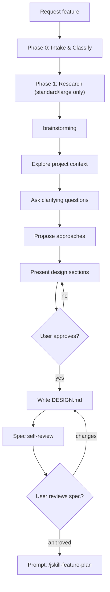

# JSkill Feature Design

Orchestrates the Superpowers brainstorming workflow for feature ideation and design refinement. Pure design phase — no plans, no code, no implementation.

## Parameters

| Parameter | Required | Description |
|-----------|----------|-------------|
| `description` | ✅ | User's feature requirement in natural language. What to build, why, and any constraints. |

**Language:** Design document (`DESIGN.md`) must be written in **Chinese** (中文) if the project convention mandates it (per AGENTS.md, `docs/superpowers/specs/` docs in Chinese).

**Modeling:** Flowcharts, architecture diagrams, and software models must use **Mermaid** or **PlantUML**. No ASCII art.

**Example:** `jskill-feature-design "Add user authentication with OAuth2 support for Google and GitHub"`

## Entry: Intake → Research → brainstorming → Exit: prompt user to run `/jskill-feature-plan <design-spec>`



## Workflow

### Phase 0: Intake & Classify

1. Read the project summary file (per AGENTS.md, e.g. `.agents/summary/summary_and_next.md`) to understand current project state and pending features.
2. Read `docs/superpowers/specs/` for any relevant existing design docs.
3. Restate the feature request in your own words. **Classify its size:**

| Tier | Criteria | Phases | Research |
|------|----------|--------|----------|
| trivial | single endpoint/component, known pattern | 0 → 2 → 3 | Skip Phase 1 |
| standard | multi-file, new module, new DB migration | 0 → 1 → 2 → 3 | 2-3 parallel explore agents |
| large | cross-cutting, new storage backend, new auth flow | 0 → 1 → 2 → 3 | 3+ explore + librarian |

### Phase 1: Research

For **standard** and **large** features:
1. Fire 2-3 parallel `explore` agents (run in background) to find existing patterns:
   - One for core/backend patterns (routes, services, models, DB queries)
   - One for frontend patterns if the feature touches a UI (components, hooks, API client)
   - One for config/middleware/storage patterns
2. If unfamiliar libraries/APIs are involved, fire a `librarian` agent for external docs.
3. Collect the results and use them to ground the brainstorming — do NOT start designing before research returns.

### Phase 2: Brainstorming (Socratic Design)

**REQUIRED SUB-SKILL:** Load `superpowers:brainstorming` and follow it exactly.

1. **Explore project context** — check files, docs, recent commits, existing patterns (plus Phase 1 research results)
2. **Ask clarifying questions** — one at a time. Each question MUST present 2-4 concrete options with a clear recommendation (标注"推荐") for the most suitable one. Never leave questions open-ended — guide the user with well-reasoned choices.
3. **Propose 2-3 approaches** — with trade-offs and your recommendation
4. **Present design sections** — scale each to complexity, get approval after each section
5. **Write design doc** — save to `docs/superpowers/specs/YYYY-MM-DD-<topic>-design.md`. Written in Chinese if the project convention requires it (per AGENTS.md).
6. **Spec self-review** — check placeholders, contradictions, scope, ambiguity
7. **User gate** — user reviews and approves the written spec file

The design doc describes WHAT and WHY (architecture, decisions, trade-offs). The plan (next stage) describes HOW — per-task TDD breakdown using the **Task Template Specification** defined in `jskill-feature-plan`.

### Phase 3: Handoff

After user approves the design spec, output this exact prompt:

```
✅ Design complete and saved to `docs/superpowers/specs/<date>-<topic>-design.md`.

Next: Run `/jskill-feature-plan docs/superpowers/specs/<date>-<topic>-design.md` to write the implementation plan with TDD task breakdown.
```

Do NOT invoke `jskill-feature-plan` automatically — let the user start it when ready.

## Design Document Structure

**Language: Chinese if the project convention mandates it (per AGENTS.md: `docs/superpowers/specs/` docs in Chinese).**

```markdown
# 设计文档：<特性名称>

## 概述
<1-2 段描述：这个特性做什么，为什么需要它>

## 目标与非目标
- **目标**：<要达成的具体目标>
- **非目标**：<明确排除的范围>

## 设计方案
<选定的技术方案描述，包括架构决策>

### 备选方案
| 方案 | 优点 | 缺点 | 为何未选用 |
|------|------|------|-----------|
| A    |      |      |           |
| B    |      |      |           |

## 架构
<组件图、数据流、接口定义 — 使用 Mermaid 或 PlantUML 编写>

## 关键设计决策
<每项决策的上下文、选项、选择理由>

## 错误处理
<异常路径、边界条件、失败模式>

## 测试策略
<测试层级、关键场景、验收标准>

## 依赖
<需要的前置条件、外部依赖、阻塞项>
```

## HARD GATE

Do NOT write any code, create implementation plans, scaffold projects, or invoke any implementation skill. This command handles design ONLY. When complete, prompt the user to run `/jskill-feature-plan docs/superpowers/specs/<date>-<topic>-design.md` — do NOT invoke it automatically.

## Anti-Patterns

| Excuse | Reality |
|--------|---------|
| "This is simple enough to skip design" | Simple projects hide the most assumptions. Design it. |
| "I'll design while I code" | Design-first prevents wasted implementation. |
| "One quick question then I'll start" | Follow the full brainstorming flow. |
| "I'll skip research for this standard feature" | Without parallel exploration the design misses existing patterns. |
| "I'll ask all my questions at once to save time" | Batch questions overwhelm the user. One per message. |

## Error Handling

| Condition | Action |
|-----------|--------|
| `description` parameter empty or missing | Ask user to provide the feature description |
| `docs/superpowers/specs/` directory doesn't exist | Create it before writing DESIGN.md |
| Ambiguous requirements | Ask clarifying questions one at a time — provide concrete options with a recommended choice, do NOT guess |
| Design scope too large | Flag to user and suggest decomposition into sub-features |
| Research agents return nothing useful | Report what was found (even if empty) and proceed — do not block design on empty exploration |

## Common Mistakes

| Mistake | Why It's Wrong |
|---------|---------------|
| Asking multiple questions at once | Overwhelms the user. One question per message. |
| Asking open-ended questions without options | Open-ended questions ("怎么处理X？") force the user to design. Provide 2-4 concrete options with a recommended choice. |
| Skipping project context exploration | Design without understanding existing code = rework. |
| Only proposing one approach | No alternatives = no trade-off analysis. Always 2-3. |
| Writing code snippets in DESIGN.md | Design doc is architecture, not implementation. |
| Using ASCII art for diagrams | Use Mermaid or PlantUML for all flowcharts and models. |
| Designing HOW instead of WHAT | Task-level TDD breakdown belongs to the plan stage, not the design. |

## Quick Reference

| Step | Action | Output |
|------|--------|--------|
| 0 | Intake + size classification | Tier: trivial/standard/large |
| 1 | Parallel research (standard/large) | Pattern knowledge |
| 2 | Load brainstorming skill | Design clarity |
| 3 | Explore + questions + approaches | Design clarity |
| 4 | Write DESIGN.md (中文) | `docs/superpowers/specs/<date>-<topic>-design.md` |
| 5 | Self-review + user gate | Approved design |
| 6 | Prompt: "Next: Run `/jskill-feature-plan docs/superpowers/specs/<date>-<topic>-design.md`" | User starts next stage |
