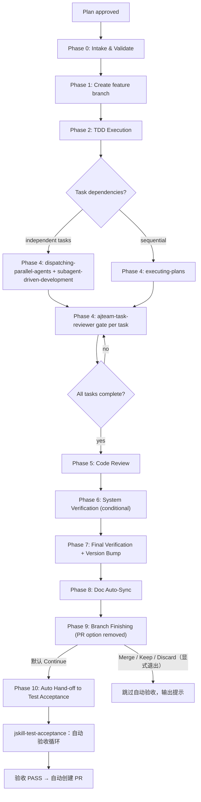

# JSkill Feature Development

Orchestrates the full Superpowers development cycle: **plan intake validation** → feature branch → TDD → subagent execution → code review → system verification → version bump + doc auto-sync → branch finishing → **automatic hand-off to test acceptance** (which creates the PR when acceptance passes).

## Parameters

| Parameter | Required | Description |
|-----------|----------|-------------|
| `plan-path` | ✅ | Path to the implementation plan (PLAN.md) from `jskill-feature-plan`. Must be a valid file path. |

**Example:** `jskill-feature-dev docs/superpowers/plans/2026-08-09-oauth2-auth-plan.md`

## Entry: Intake → Branch → TDD → Execute → Review → Verify → Sync → Finish → Auto Acceptance → PR



## Workflow

### Phase 0: Intake & Validate the Plan

Read the plan file at `plan-path`. If the file does not exist, abort and ask the user to run `/jskill-feature-plan docs/superpowers/specs/<spec-file>.md` first.

Read both project summary files (per AGENTS.md): `.agents/summary/summary_and_next_se.md` (backend) and `.agents/summary/summary_and_next_fe.md` (frontend) for current state and version — AGENTS.md requires reading them before developing.

**Validate the plan against the Task Template Specification (defined in `jskill-feature-plan`):**

- Every task has all required fields: `id`, `title`, `files`, `depends_on`, `breaking`, `ac`, `regression`, `test_code`, `impl_code`, `verify`.
- No task has >3 `files` entries. If it does, reject: "Task {id} has {N} files. Split into smaller tasks (max 3)."
- No task has `impl_code` appearing before `test_code` in the plan. Reject: "Task {id} lists implementation before test. TDD order must be: test first."
- All `depends_on` values reference existing task IDs. Reject circular or dangling dependencies.
- Any task touching `migrations/` or DB schema has `migration_verify` steps.
- Every `ac.then` is observable: it describes a specific output, state change, HTTP status, or exit code. Reject vague AC: "Task {id} AC 'then: {text}' is not observable. Rewrite as a concrete assertion."
- Every task has ≥1 `regression` entry naming an existing test. If no existing tests cover the area: `regression: ["<full project test command> (full suite — no existing tests for this module)"]`.

If any validation fails, present the findings to the user and pause — do NOT start implementation on a malformed plan.

**Restate the plan scope:** what will be built, files to touch, estimated effort.

**Classify the feature size:**

| Tier | Criteria | Execution |
|------|----------|-----------|
| trivial | 1 task, 1 file | Inline execution (no subagent) |
| standard | 2-5 tasks | Subagent per task (sequential) |
| large | 5+ tasks, cross-cutting | Subagent per task (parallel independent, sequential dependent) |

### Phase 1: Create Feature Branch

**Do NOT use git worktrees or isolated workspaces** unless the project convention says otherwise — create a feature branch directly in the current repository.

```bash
git checkout main 2>/dev/null || git checkout master
git pull
git checkout -b feature/<plan-name>      # from the plan file, kebab-case
```

Branch naming: `feature/<short-description>` — lowercase, hyphens for spaces.

**Verify clean baseline before starting:** the project's test + lint commands must pass. If they fail on baseline, abort and report — do NOT proceed.

### Phase 2: TDD Execution

**REQUIRED SUB-SKILL:** Load `superpowers:test-driven-development` and follow it exactly.

Every task in the plan follows the TDD cycle. **TDD is NON-NEGOTIABLE:**

1. **RED** — Write the failing test FIRST. Verify it fails (a passing test without implementation = false green, reject it).
2. **GREEN** — Write MINIMAL code to pass. No extras, no future-proofing, no unrelated refactoring.
3. **REFACTOR** — Clean up while tests stay green. Change NO behavior.

No code before tests. No exceptions.

### Phase 3: Code Standards

| Rule | Scope | Rationale |
|------|-------|-----------|
| Functions ≤ 50 lines (target) | **Backend** only (Rust, Go, Python, Java, etc.) | Keeps each function testable, reviewable, and single-responsibility |
| Line width ≤ 120 characters | **All code** (backend + frontend) | Readable on any screen, no horizontal scrolling in diff views |
| Frontend (JS/TS/TSX) no strict function limit | **Frontend** excl. from 50-line rule | React component structure varies; use judgment |

These constraints apply to ALL subagents. Include them in every delegation prompt.

### Phase 4: Strategy Selection & Execution

Read the plan's dependency graph and parallel execution groups. Choose:

**Independent tasks → `dispatching-parallel-agents` + `subagent-driven-development`:**
- **REQUIRED SUB-SKILLS:** Load both `superpowers:dispatching-parallel-agents` and `superpowers:subagent-driven-development`
- Each task dispatched to an independent subagent
- **Task-reviewer gate (per-task hard gate)** — after EACH task completes, dispatch the `ajteam-task-reviewer` agent to check the implementation against the task brief and the design doc:
  1. Implementer subagent finishes and self-verifies (lint + tests pass)
  2. Dispatch `ajteam-task-reviewer` with the task brief, design-doc path, and change scope (use the dispatch prompt template below)
  3. **PASS** → record outcome in `.superpowers/sdd/progress.md` → proceed to next task
  4. **FAIL** → send the deviation list back to the implementer (`task(task_id=ses_...)` — continue the same session) to fix → re-dispatch the reviewer
  5. If the reviewer's report lacks a VERDICT line (incomplete format) → treat as FAIL and re-dispatch (counts as 1 round)
  6. Bounce cap: **3 rounds** (counting from the 1st FAIL). If still FAIL after 3 rounds → escalate: Consult Oracle / report to user. NEVER silently proceed past a FAIL.

**Task-reviewer dispatch prompt template:**

```text
TASK: Review task {id} — {title}: does the implementation deviate from the task's AC/verify or the design doc?
EXPECTED OUTCOME: Structured review report (VERDICT: PASS/FAIL + deviation list + fix guidance).
REQUIRED TOOLS: read, grep, glob, git diff — READ-ONLY. Do NOT run tests or builds.
MUST DO:
  - Read the design doc {spec-path} and the task brief (ac/verify/files)
  - Check every AC against the implementation: is `then` observably satisfied?
  - Check the implementation against the design doc (architecture, key decisions, error handling, interface signatures)
  - Output VERDICT and a deviation list, each item with a code location
MUST NOT DO:
  - Edit any files, run tests, or run build commands
  - Review code style/naming/performance/security (Phase 5 scope)
  - Fix deviations yourself — report only
CONTEXT: Task brief = {ac/verify}; Design doc = {spec-path}; Change scope = {files/diff}.
```

**Sequential tasks → `executing-plans`:**
- **REQUIRED SUB-SKILL:** Load `superpowers:executing-plans`
- Execute tasks in order with human checkpoints between batches
- Apply the same `ajteam-task-reviewer` gate after EACH task (see the Independent-tasks section above) — FAIL bounces back, 3-round cap, escalate after 3. NEVER silently proceed.

**Key rules:**
- Sequential execution for interdependent tasks — do NOT fan out parallel implementers for dependent tasks.
- Fresh subagent per task — never reuse a subagent across tasks (context pollution).
- Task briefs must be self-contained — the subagent should need zero additional context.

**Generate each task brief from the template fields:**

```text
TASK: {id} — {title}
FILES: {files list}
DEPENDS_ON: {depends_on} (already completed: T0, T1)
BREAKING: {breaking} — if true, reviewer MUST flag this task for extra scrutiny

ACCEPTANCE CRITERIA:
  GIVEN {ac.given}
  WHEN {ac.when}
  THEN {ac.then}

REGRESSION GUARD: {regression commands — must keep passing}

MIGRATION VERIFY (if applicable): {migration_verify steps}

TDD ORDER:
  1. FIRST: Write test code → {test_code}
  2. Verify test FAILS → <test command> --exact (expect FAIL)
  3. SECOND: Write minimal implementation → {impl_code}
  4. Verify test PASSES → <test command> --exact (expect PASS)

FINAL VERIFY:
  {verify commands}
```

**TDD enforcement rules for the orchestrator (YOU):**
- Before dispatching any implementer subagent, confirm the task brief includes explicit test code.
- If the subagent returns implementation without test code → **REJECT**. Re-dispatch with: "Write the test first. Do NOT write implementation code until the test exists and fails."
- After the subagent returns, personally verify the test was written first by checking the commit/diff order.
- If a task in the plan does NOT specify test code, pause and ask the user to update the plan before continuing.

**Verification after every task:**
- Project lint command must be clean (zero warnings).
- Project test command must pass (except pre-existing ignored/skipped tests).
- If the task touches frontend, the frontend build must pass.
- If any step fails, fix the failing task before proceeding. Do NOT skip.

**Progress persistence:** Track progress in `.superpowers/sdd/progress.md` (task id, status, brief, review outcome). If the session is interrupted, read this file on resume and continue from the last completed task.

### Phase 5: Code Review

**REQUIRED SUB-SKILL:** Load `superpowers:requesting-code-review`

Run the pre-review checklist before submitting:
- All TDD cycles complete
- Tests pass
- No type errors, no `as any`, no suppressed diagnostics
- Changed files follow existing patterns
- No scope creep beyond the plan

**Review findings handling:**
- **CRITICAL** — fix immediately, re-verify, re-review.
- **HIGH** — fix before proceeding to the next phase.
- **MEDIUM** — document, fix if time permits.
- **LOW** — acknowledge, optional fix.

### Phase 6: System Verification (Conditional)

Run ONLY the verification layers the project actually has — nothing more. Determine what exists from `AGENTS.md` and the repo root:

- **If the project has integration tests requiring external services** (e.g. a database via a compose file or local setup): run the full integration suite with the documented connection configuration. If the environment cannot provide the services, note the skip and rely on the unit suite.
- **If the project has an end-to-end / browser test suite** (e.g. Playwright): run it for any feature that touches user-facing behavior. Failing specs are adjusted to the intended behavior — do NOT delete or paper over them. New user-facing options require new e2e coverage.
- **If the project has neither**: skip this phase with a note — the unit suite is the correctness gate.

**Cleanup:** after any system-level test run, remove test-created containers, temp storage, and report artifacts immediately. Nothing test-created may survive to the finish phase. Follow the cleanup commands documented in the project's AGENTS.md.

**Failure handling:** if any integration/e2e test fails, treat it as CRITICAL. Diagnose the root cause, fix it, re-run until green. Do NOT proceed while system tests fail (unless they are documented as pre-existing failures).

### Phase 7: Final Verification + Version Bump

**Run ALL project gates — if any fails, DO NOT proceed until fixed:**

```bash
<project lint command>    # zero warnings required
<project test command>    # all non-ignored must pass
<project build command>   # if the build is part of the project's gates
```

**Version bump (per AGENTS.md / project convention):**
- Feature → **minor** bump (e.g. `0.1.0` → `0.2.0`)
- Bugfix → **patch** bump (e.g. `0.1.0` → `0.1.1`)
- Bump the project's version manifest(s). If multiple manifests carry a version (e.g. workspace + subpackage), keep them in sync.

### Phase 8: Doc Auto-Sync (BEFORE finish options)

Run this **before** presenting any finish options. The doc sync commits must be included in the branch so a PR captures them.

1. Update `AGENTS.md` — sync version, migrations count, new API routes, architecture notes, config vars, crate/module boundaries — any structural change introduced in the phase.
2. Update `README.md` — sync version tagline, features checklist, project structure tree, API endpoint tables, migrations count, config var table — any user-facing change.
3. Update the project summary files (per AGENTS.md): `.agents/summary/summary_and_next_se.md` (backend) and `.agents/summary/summary_and_next_fe.md` (frontend). Update ONLY the file(s) for the side(s) this phase touched; a full-stack phase updates both, each with its own side's content — never cross-write. In each updated file: **REPLACE, don't append** — rewrite it to retain ONLY that side's currently-developing feature content: write a "## {phase}: {title} ✅ (本次完成)" section documenting what was built and verification results, list remaining issues and next steps. **Retention exception (MANDATORY):** the "## 待实施" (pending) table is NOT wiped on replace — carry over every entry not implemented in this phase unchanged with status 待实施 (including former 下一步 candidates), remove an entry only when this phase actually implemented it, and add new candidates as 待实施 rows. Remove any other content belonging to previously completed or non-current features. Do NOT accumulate old feature sections.
4. Update the target spec doc in `docs/superpowers/specs/` — refresh its TODO list to reflect this phase's completion (per AGENTS.md: "Update docs/superpowers/specs target spec doc TODO list after each phase").
5. Commit the synced files together: `docs: auto-sync AGENTS.md, README.md, summary (fe/se), spec TODO after {phase} completion`.
6. Do NOT skip this step — it is mandatory before proceeding to finish options.

### Phase 9: Branch Finishing

**REQUIRED SUB-SKILL:** Load `superpowers:finishing-a-development-branch`

**Verify working directory is clean** — all changes (including doc sync) must be committed.

**The "Create PR" option is REMOVED from the finish menu** — PR creation now happens automatically at the end of the test acceptance pipeline (so the PR includes acceptance bug-fix commits and the patch bump, per repo history e.g. PR #21). Present these 4 options:

1. **Continue (default)** — keep the branch open. Phase 10 auto-hands-off to `jskill-test-acceptance`; on acceptance PASS the PR is created automatically. **PR will include doc sync commits from Phase 8 plus all acceptance fix commits.**
2. **Merge** — merge into base branch, delete the feature branch. Explicit opt-out: **skips** the automatic acceptance & PR.
3. **Keep as-is** — leave branch for later. Explicit opt-out: **skips** the automatic acceptance & PR.
4. **Discard** — delete branch (requires explicit "discard" confirmation). Explicit opt-out: **skips** the automatic acceptance & PR.

**CRITICAL:** Do NOT hand off to acceptance (option 1) if the working directory is dirty or doc sync hasn't been committed yet. Go back and complete Phase 8 first.

### Phase 10: Auto Hand-off to Test Acceptance

**Default path (option 1 in Phase 9):** the feature pipeline is NOT terminal anymore — hand off automatically:

1. Output the development summary (branch, result).
2. **REQUIRED SUB-SKILL:** Load `jskill-test-acceptance` via the Skill tool — this automatically starts the acceptance loop (tester → bug-fixer → regression) on the current feature branch and creates the PR on PASS. No user prompt needed; the hand-off is automatic.
3. If the user chose **Merge / Keep as-is / Discard** in Phase 9 (explicit opt-out): do NOT hand off. Output the skip note and remind them `/jskill-test-acceptance` remains available manually.

```
✅ Feature development complete.
   Branch: feature/<name>
   Result: <auto-handoff to acceptance / merged / kept / discarded>

默认路径：自动启动测试验收（jskill-test-acceptance）→ 验收通过后自动创建 PR。
若在 Phase 9 显式选择 合并/保留/丢弃：已跳过自动验收，可随时手动运行 /jskill-test-acceptance。
```

`jskill-feature-dev` 是功能管线（design → plan → dev）的终点；测试验收（`jskill-test-acceptance`）在 Phase 10 **自动衔接**，验收通过后自动创建 PR。仅当用户在 Phase 9 显式选择 合并/保留/丢弃 时跳过自动验收。

## Failure Recovery

### If a task implementer subagent fails:
- Failed once: investigate the error, provide more context to the subagent, retry.
- Failed twice: re-read the relevant files, adjust the task brief with more specific instructions, retry.
- Failed 3 times: **Consult Oracle** with full failure context. Do NOT continue blindly.
- If Oracle cannot resolve: report to user with what's been tried.

### If tests break after a task:
- Do NOT proceed to the next task. The current task must pass verification.
- If the breakage is in code the task didn't touch, report as a pre-existing issue.

### If the session is interrupted:
- Read `.superpowers/sdd/progress.md` on resume.
- Continue from the last completed task. Task briefs are self-contained — no lost context.

## Anti-Patterns

| Excuse | Reality |
|--------|---------|
| "I'll create the branch later" | Work on wrong branch contaminates the repo. Branch first. |
| "This task is too simple for TDD" | Simple code breaks too. The test IS the proof it works. |
| "These two tasks are quick, I'll run them sequentially" | Parallel tasks speed up delivery 2-4x. Follow the plan's groups. |
| "I'll fix this unrelated issue while I'm here" | Scope creep introduces new bugs. Separate PR. |
| "Code review can wait until the PR" | Pre-review catches issues BEFORE they reach the reviewer. |
| "I'll skip the ajteam-task-reviewer gate for this one task" | Unreviewed deviations propagate downstream. The 3-round cap exists to fix, not to skip. |
| "The plan is slightly off-template, I'll just start" | Intake validation exists to catch this. Fix the plan first. |
| "Doc sync can wait, the user didn't ask" | AGENTS.md mandates it. Skip only if the user explicitly says so. |
| "收尾直接选 Create PR，跳过验收" | 验收修复必须在 PR 里。PR 选项已从收尾菜单移除，由验收流程在 PASS 后自动创建。 |
| "验收太麻烦，默认继续即可但手动确认" | 默认路径就是自动衔接，不需要用户确认；显式 合并/保留/丢弃 才退出管线。 |

## Error Handling

| Condition | Action |
|-----------|--------|
| `plan-path` parameter empty or missing | Ask user to provide the PLAN.md path |
| `plan-path` file does not exist | Report "File not found: `<path>`. Has `jskill-feature-plan` been run?" |
| Not inside a git repository | Report "This command requires a git repository. Initialize one first." |
| Uncommitted changes on base branch | Warn user and ask whether to stash, commit, or abort |
| Feature branch name already exists | Ask user for a different branch name |
| Task execution fails (test or compile error) | Fix the failing task before proceeding to next. Do NOT skip. |
| Plan fails intake validation | Present findings to user, pause. Do NOT start implementation. |

## Common Mistakes

| Mistake | Why It's Wrong |
|---------|---------------|
| Working on `main` without creating a branch | Contaminates the base branch. Always `feature/<name>`. |
| Writing implementation before tests | TDD requires RED first. Code before test = untested code. |
| Ignoring the dependency graph | Running dependent tasks out of order creates broken state. |
| Delegating with vague prompts | Subagents need explicit scope, MUST DO, MUST NOT DO. Use the brief template. |
| Treating parallel groups as suggestions | The plan's groups are deterministic — follow them exactly. |
| Merging without running the full test suite | A passing unit test doesn't mean no regressions. |
| Backend functions exceeding 50 lines | Split into smaller helpers. Each function = one responsibility. |
| Lines exceeding 120 characters | Break long expressions, chains, or string literals across multiple lines. |
| Forgetting the version bump | AGENTS.md mandates bump on every feature/bugfix. |
| Forgetting doc auto-sync | The branch must carry AGENTS.md/README.md/summary (fe/se) sync before finish. |

## Quick Reference

| Step | Skill / Action | Output |
|------|----------------|--------|
| 0 | Validate plan vs Task Template Specification | Approved intake |
| 1 | Create feature branch | `feature/<name>` branch |
| 2 | test-driven-development | TDD discipline |
| 3 | dispatching-parallel-agents OR executing-plans | Executed tasks |
| 4 | ajteam-task-reviewer per-task gate | Deviation check PASS/FAIL |
| 5 | requesting-code-review | Pre-review checklist pass |
| 6 | System verification (conditional) | Integration/e2e green or noted skip |
| 7 | Final verification + version bump | Clean gates, bumped version |
| 8 | Doc auto-sync | AGENTS.md/README.md/summary (fe/se) committed |
| 9 | finishing-a-development-branch | Continue / Merge / Keep / Discard (PR option removed — deferred) |
| 10 | Auto hand-off to `jskill-test-acceptance` | 自动验收循环 → 验收 PASS 后自动创建 PR |
