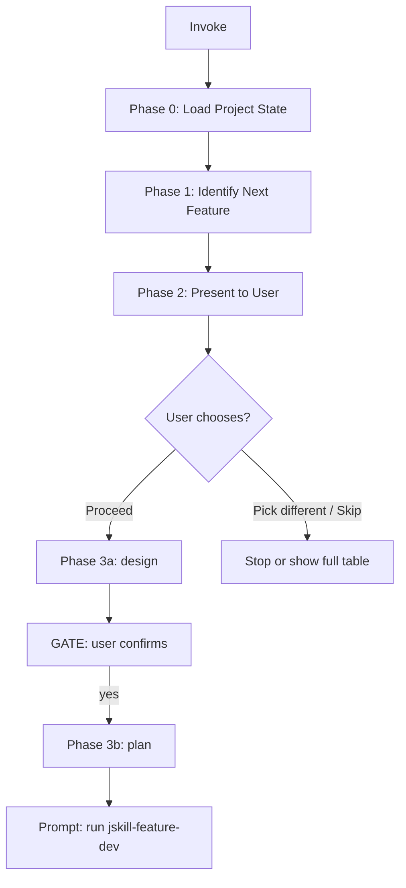

# JSkill Feature Next — Feature Entry Point

You are the **feature entry point**. Read the project's current state, identify the next feature to implement from the pending list, present it to the user, and on confirmation orchestrate the sequential pipeline: `jskill-feature-design` → `jskill-feature-plan` → (user runs `jskill-feature-dev` → 自动衔接 `jskill-test-acceptance` → 验收 PASS 后自动创建 PR)。

## Parameters

| Parameter | Required | Description |
|-----------|----------|-------------|
| — | — | No parameters. All context comes from the project summary files (`.agents/summary/summary_and_next_se.md` + `summary_and_next_fe.md`). |

## Entry: Load State → Identify Next → Present → Orchestrate



## Workflow

### Phase 0: Load Project State

Read these files in parallel:

1. Both project summary files (per AGENTS.md, frontend/backend isolated): `.agents/summary/summary_and_next_se.md` (backend) and `.agents/summary/summary_and_next_fe.md` (frontend) — from each extract:
   - The "## 待实施" (Pending) table: phase, title, dependencies for each row.
   - The "## 下一步" (Next Step) hint if present.
   - The most recent completed phase (marked ✅).
   Then merge the two pending tables for selection. Entries live in exactly one file (backend work → `_se.md`, frontend work → `_fe.md`); cross-cutting entries reference their counterpart file — do not duplicate.
2. `docs/superpowers/specs/` — find the **latest** design spec doc (by filename date, most recent first). If it exists, read it and extract the section matching the next feature's phase code.

### Phase 1: Identify Next Feature

Algorithm for selecting the next feature:

```
FOR each row in the merged "待实施" tables (se + fe), in order:
  IF all dependency phases are marked ✅ in completed sections:
    → This is the next feature. STOP.
```

**Tie-breaking:** the "## 下一步" hint in either summary file takes priority if it names a specific phase. Otherwise, use the merged table order (backend `_se.md` first, then frontend `_fe.md`).

### Phase 2: Present to User

Present the finding with context:

```
## Next Feature: {phase} — {title}

**From**: {latest-spec-doc-filename}
**Dependencies**: {dependency list with ✅ status}
**Summary**: {2-3 sentence summary from the spec doc}
**Estimated effort**: {from spec doc if available}

### Options:
1. **Proceed** — Run `/jskill-feature-design <feature description>` to produce a design spec, then `/jskill-feature-plan docs/superpowers/specs/<spec-file>.md` to produce an implementation plan. Sequential with gates between each.
2. **Pick a different feature** — Show the merged "待实施" tables (se + fe) and let the user choose.
3. **Skip** — Do nothing.
```

Present these 3 options and do NOT proceed until the user chooses.

### Phase 3: Orchestrate Design → Plan

If the user chooses option 1 (Proceed), run two sequential phases with a gate between them.

#### Phase 3a: Design

Extract the feature's description from the latest spec doc, then invoke the `jskill-feature-design` pipeline:

```
Feature: {phase} — {title}
Source: {spec-doc-path}, section {section-name}

Description: {full feature description from spec doc, including all sub-sections}

Context from summary files (fe/se):
- Dependencies: {list}
- Related completed features: {list}
```

This produces a design spec at `docs/superpowers/specs/YYYY-MM-DD-<topic>-design.md`.

**GATE:** After the spec is approved, do NOT proceed automatically. Ask the user: "Design spec is complete. Run `/jskill-feature-plan docs/superpowers/specs/<date>-<topic>-design.md` to produce an implementation plan, or skip?"

#### Phase 3b: Plan

If the user confirms, invoke the `jskill-feature-plan` pipeline with the newly created spec file as input.

This produces an implementation plan at `docs/superpowers/plans/YYYY-MM-DD-<feature-name>.md`, validated against the **Task Template Specification** by `jskill-feature-plan`'s momus validation gate.

**GATE:** After the plan is approved, tell the user: "Implementation plan is ready. Run `/jskill-feature-dev docs/superpowers/plans/<plan-file>.md` to execute."

### Global Subagent Timeout Policy（全量子 agent 10 min 看门狗）

**Scope:** 本 skill 内所有子 agent 派发（`jskill-feature-design` / `jskill-feature-plan` 编排调用及其内部 explore/momus 子派发）**统一 10 min 超时**。此为编排层看门狗，底层 skill 各自另有同规不叠加计数。

**Dispatch 必须带超时：** 每次 `task(...)` / Skill 调用派发显式设 `timeout: 600s`（10 min）。

**10 min 到点检查（先判完成，再判卡死）：**
1. **已完成** — 子调用已产出预期交付（design：`DESIGN.md` 落盘；plan：`PLAN.md` 落盘且校验 PASS）→ 直接采纳。
2. **卡死/无输出** — 10 min 内无任何输出（无 stdout/stderr 增量、无文件落盘、心跳缺失）→ 判定卡死 → **终止该子 agent 会话** → 用**相同输入** 重新派发全新子 agent（fresh session）。
3. **有输出但未完成** → 给予一次 `≤5 min` 宽限；仍无进展则按 (2) 终止重派。**绝不无界等待。**

**重派上限与升级：** 单一派发累计 **≤2 次重派**（含首发共 3 次尝试）。达到上限仍超时 → 标记 `blocked`，输出当前进展与缺失，交用户决策。

 ## Feature-Specific Context

When the spec doc mentions the feature in multiple sections (e.g. overview table + detail section + gantt chart), gather ALL relevant context:

- **Overview table**: phase code, title, priority, dependencies, estimated days
- **Detail section**: full functional requirements, UI mockups, API specs, DB changes
- **Risk table**: any security concerns, mitigation steps
- **Dependency/gantt graph**: where this fits in the overall timeline

Feed this complete context into the design phase so it doesn't miss constraints already documented.

## Edge Cases

| Condition | Action |
|-----------|--------|
| Both "待实施" tables are empty | "All features are implemented. No pending features found. Check both summary files — if a table should be non-empty, update it first." |
| Next feature has unmet dependencies | List what's blocking it. Suggest a feature with no dependencies that can proceed immediately. |
| Latest spec doc doesn't cover the next feature | Check for an older spec doc, or note the feature needs a new spec. |
| No spec docs exist at all | "No design specs found in docs/superpowers/specs/. Run `jskill-feature-design` with a feature description to create the first spec." |
| Either summary file missing or corrupt | "Cannot determine project state. Read AGENTS.md and docs/superpowers/specs/ manually to assess pending work." |

## Project-Specific Rules (from AGENTS.md)

- Design specs: in Chinese, use Mermaid or PlantUML diagrams.
- Plan tasks: TDD-first (test code before implementation), exact file paths, no placeholders, per the Task Template Specification.
- Verification gates: project test + lint commands must pass.
- Version bump: patch for fixes, minor for features.
- Doc auto-sync: after each completed phase, sync AGENTS.md / README.md / summary (fe+se, touched side(s)) and commit together.

## Quick Reference

| Step | Action | Output |
|------|--------|--------|
| 0 | Read summaries (se + fe) + latest spec | Project state |
| 1 | Identify next feature (deps ✅) | Candidate feature |
| 2 | Present 3 options | User choice |
| 3a | Run `/jskill-feature-design <feature description>` | Design spec |
| 3b | Gate → Run `/jskill-feature-plan docs/superpowers/specs/<date>-<topic>-design.md` | Validated plan |
| 4 | Prompt: "Next: Run `/jskill-feature-dev docs/superpowers/plans/<plan-file>.md`" | Next stage |
