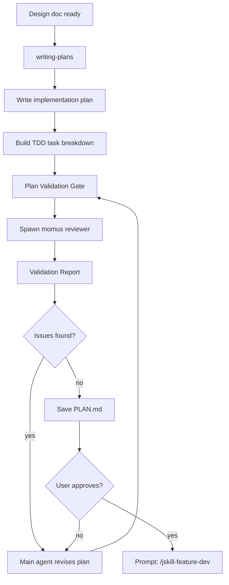
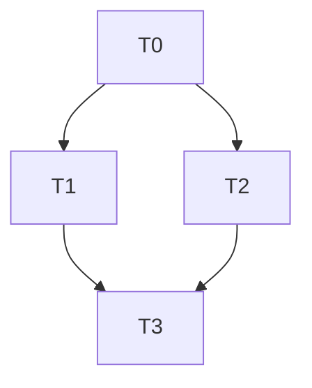

# JSkill Feature Plan

Orchestrates the Superpowers planning workflow with a **Plan Validation Gate** — a `momus` review step that audits the plan for design gaps, missing edge cases, and architectural concerns before implementation begins.

## Parameters

| Parameter | Required | Description |
|-----------|----------|-------------|
| `spec-path` | ✅ | Path to the design document (DESIGN.md) from `jskill-feature-design`. Must be a valid file path. |

**Language:** Task titles, ACs, and code in the implementation plan (`PLAN.md`) must be written in **English**. The plan header/context may be in Chinese if the source spec is Chinese.

**Modeling:** Dependency graphs, task flow diagrams, and architecture models must use **Mermaid** or **PlantUML**. No ASCII art.

**Example:** `jskill-feature-plan docs/superpowers/specs/2026-08-09-oauth2-auth-design.md`

## Entry: writing-plans → Plan Validation Gate → Exit: prompt user to run `/jskill-feature-dev <plan-file>`



## Task Template Specification

Every task in the implementation plan MUST use this schema. This is the **single source of truth** — `jskill-feature-design` references it, and `jskill-feature-dev` validates against it at intake.

```yaml
- id: T1                          # Sequential ID, ordered by dependency
  title: "<imperative phrase>"    # e.g. "Add clipboard paste handler"
  files:                          # ≤3 files per task (enforced)
    - path/to/file.rs             # Files to CREATE or MODIFY
    - path/to/file_test.rs        # Test file always listed
  depends_on: []                  # Task IDs this task requires (e.g. [T0])
  breaking: false                 # true if API/DB/storage/crate-boundary changes
  # --- Acceptance Criteria (GIVEN/WHEN/THEN) ---
  ac:
    - given: "<precondition>"
      when: "<action>"
      then: "<observable result>"   # Machine-verifiable: must be testable
  # --- Regression Guard ---
  regression:
    - "<existing test that must keep passing>"
  # --- Migration Guard (only if the task touches DB migrations) ---
  migration_verify:
    - "<step to verify the migration>"   # e.g. "Check new column exists: SELECT ..."
  # --- TDD ordering enforced — test_code ALWAYS before impl_code ---
  test_code: |
    # Test code — written FIRST, verified to fail, then implementation follows
  impl_code: |
    # Implementation — MINIMAL code to make the test pass
  # --- Verification ---
  verify:
    - "<concrete command that must pass>"
```

### Field Rules

| Field | Constraint | Reject if |
|-------|-----------|-----------|
| `id` | Sequential T0, T1, T2... | Gaps or duplicates |
| `title` | Imperative phrase | Vague or missing |
| `files` | **≤3** files, test file always included | >3 files (split the task) |
| `depends_on` | Explicit IDs, empty `[]` if independent | Missing dependency declaration |
| `breaking` | `true` for API/DB/storage/crate-boundary changes | Breaking change not marked |
| `ac` | ≥1 GIVEN/WHEN/THEN triple, each `then` observable | Missing AC, or `then` vague ("works correctly") |
| `regression` | ≥1 existing test that must keep passing | Empty regression list |
| `migration_verify` | Required if task touches `migrations/` | Migration without verify steps |
| `test_code` | Non-empty, MUST appear before `impl_code` | `impl_code` written before `test_code` |
| `verify` | ≥1 concrete command | Missing verification |

**No placeholders:** no TBD, no "similar to task N", no "implement later".
**Order:** tasks ordered by dependency (Level 0 → Level 1 → Level 2 → ...).

## Workflow

### Phase 1: Write the Plan

**REQUIRED SUB-SKILL:** Load `superpowers:writing-plans` and follow it exactly.

1. Read the approved design spec from `spec-path` (e.g. `docs/superpowers/specs/*-design.md`).
2. Read both project summary files (per AGENTS.md): `.agents/summary/summary_and_next_se.md` (backend) and `.agents/summary/summary_and_next_fe.md` (frontend) for current state and version.
3. Write a detailed implementation plan:
   - Every task conforms to the **Task Template Specification above** (all fields, no placeholders)
   - Ordered task breakdown with explicit `depends_on` chains
   - Parallelizable tasks identified
   - Mermaid dependency graph
4. Save the draft plan (before review — the reviewer must be able to read it).

**Plan header MUST include an "Agent Worker Instructions" section:**
- Required sub-skills for execution (`superpowers:subagent-driven-development` / `superpowers:executing-plans`)
- Recommended execution mode: `subagent-driven-development` (preferred) or `executing-plans`
- Required verification commands (project test + lint commands)
- Version bump reminder (feature → minor, bugfix → patch)

### Phase 2: Plan Validation Gate (MOMUS REVIEW)

This is the critical differentiator. Before any code is written, the plan must pass validation.

**Step 1: Spawn Reviewer — use `momus` (Plan Critic), NOT oracle**

Dispatch a `momus` subagent to audit the draft plan against the design spec:

```text
TASK: Audit the implementation plan draft against its source design spec.
EXPECTED OUTCOME: A validation report with PASS/FAIL/REVISE verdict per check item.
REQUIRED TOOLS: read
MUST DO:
  - Read the design spec at `[spec-path]` AND the draft plan at `docs/superpowers/plans/<date>-<topic>-plan.md`
  - Verify EVERY requirement in the design spec maps to at least one plan task
  - Validate every task against the Task Template Specification (all fields present, TDD order, ≤3 files, observable AC)
  - Identify missing edge cases and error states
  - Flag architectural concerns (coupling, single responsibility violations)
  - Check task granularity: each task completable in <3 files
  - Verify dependency graph has no cycles and no dangling `depends_on`
  - Check that parallelizable tasks are properly isolated
  - Flag any scope creep beyond the design spec
MUST NOT DO:
  - Edit any files
  - Suggest implementation approaches — only audit the plan structure
  - Comment on code style or naming — focus on plan completeness
CONTEXT: The design spec is at `[spec-path]`. The plan was generated from it and must be a faithful, complete translation of the design into executable TDD tasks. Audit by comparing the plan against ALL design requirements.
```

**Step 2: Validation Report Format**

| Check | Verdict | Detail |
|-------|---------|--------|
| Spec coverage | PASS/FAIL | Missing requirements listed |
| Template conformance | PASS/FAIL | Tasks violating the Task Template Specification |
| TDD compliance | PASS/FAIL | Tasks without test-first cycle |
| Edge cases | PASS/FAIL | Unhandled states |
| Architecture | PASS/FAIL | Coupling/design concerns |
| Task granularity | PASS/FAIL | Over/under-sized tasks |
| Dependency graph | PASS/FAIL | Cycles, dangling deps, isolation issues |
| Scope | PASS/FAIL | Items beyond design spec |

**Step 3: Revise Based on Report**

- If ALL items PASS → proceed to Phase 3
- If any item FAILS or REVISE → main agent fixes the plan, then re-runs validation
- Iterate until all items pass (max 3 rounds; if still failing after 3, present unresolved concerns to user)

### Phase 3: Finalize

1. Save final plan to `docs/superpowers/plans/YYYY-MM-DD-<feature-name>.md`
2. Present summary to user: task count, parallel vs sequential breakdown, TDD cycle count
3. Wait for explicit "approved" from user
4. After user approves, output this exact prompt:

```
✅ Plan validated and saved to `docs/superpowers/plans/<date>-<topic>-plan.md`.
   Tasks: <N> total, <P> parallelizable, <S> sequential
   Validation: all checks passed

Next: Run `/jskill-feature-dev docs/superpowers/plans/<date>-<topic>-plan.md` to start development.
```

Do NOT invoke `jskill-feature-dev` automatically — let the user start it when ready.

## Plan Document Structure

```markdown
# Plan: <Feature Name>

## Agent Worker Instructions
- Required sub-skills: superpowers:subagent-driven-development (or superpowers:executing-plans)
- Execution mode: subagent-driven-development (preferred) / executing-plans
- Required verification: <project test command>, <project lint command>
- Version bump: feature → minor, bugfix → patch

## Tasks

### T0: <title> [P0] [Sequential]
```yaml
<task block — Task Template Specification>
```

### T1: <title> [P1] [Parallel with T2]
...

## Dependency Graph


## Parallel Execution Groups
- Group A: T1, T2 (independent)
- Group B: T3, T4 (independent, after Group A)
```

## Anti-Patterns

| Excuse | Reality |
|--------|---------|
| "The plan is obvious, skip validation" | Untested plans hide assumptions. Momus catches them. |
| "Momus flagged minor issues, I'll fix them in code" | Plan issues become code bugs. Fix the plan first. |
| "3 validation rounds is too many" | Each round catches deeper issues. Stop at 3 and escalate to user. |
| "One big task is simpler than many small ones" | Large tasks are error-prone and block parallel execution. |
| "I'll figure out edge cases during coding" | Edge cases in the plan prevent edge-case bugs in code. |
| "The task template is too rigid" | Without a fixed schema, `feature-dev` cannot validate the plan or enforce TDD order at intake. |

## Error Handling

| Condition | Action |
|-----------|--------|
| `spec-path` parameter empty or missing | Ask user to provide the DESIGN.md path |
| `spec-path` file does not exist | Report "File not found: `<path>`. Has `jskill-feature-design` been run?" |
| `docs/superpowers/plans/` doesn't exist | Create it before saving PLAN.md |
| Momus validation fails 3 rounds | Stop iterating; present unresolved concerns to user for decision |

## Common Mistakes

| Mistake | Why It's Wrong |
|---------|---------------|
| Writing plan without reading the design spec | Plan won't match design requirements. Read `spec-path` first. |
| Tasks without explicit TDD cycles | Without test-first, task verification is impossible. |
| Not marking task dependencies | Broken execution order leads to merge conflicts and wasted work. |
| Grouping dependent tasks as parallel | Parallel tasks must be truly independent — no shared state, no ordering. |
| Forgetting to save the draft before review | Momus can't review what isn't written. Save draft plan first. |
| Using ASCII art for dependency graphs | Use Mermaid or PlantUML for all diagrams and models. |
| Skipping the Task Template Specification | Dev can't validate an unstructured plan. Every task must use the schema. |

## HARD GATE

Do NOT write any code, create feature branches, or invoke any implementation skill. This command produces a validated plan only. When complete, prompt the user to run `/jskill-feature-dev docs/superpowers/plans/<date>-<topic>-plan.md` — do NOT invoke it automatically.

## Quick Reference

| Step | Action | Output |
|------|--------|--------|
| 1 | Load writing-plans (English) | Plan draft |
| 2 | Spawn momus reviewer | Validation report |
| 3 | Revise plan | Addressed issues |
| 4 | Save PLAN.md | `docs/superpowers/plans/<date>-<topic>-plan.md` |
| 5 | User approves → prompt | "Next: Run `/jskill-feature-dev docs/superpowers/plans/<date>-<topic>-plan.md`" |
