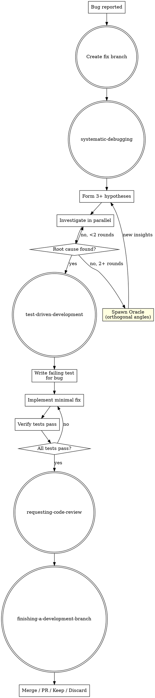

# JCMD Bug Fix

Orchestrates the Superpowers debugging and fix workflow: fix branch, hypothesis-driven root cause analysis, TDD-gated minimal fix, verification, code review, and branch finishing.

## Parameters

| Parameter | Required | Description |
|-----------|----------|-------------|
| `description` | ✅ | User's bug report in natural language. What's broken, observed behavior, expected behavior, steps to reproduce. |

**Example:** `jcmd-bug-fix "Login returns 500 after password reset — user can't sign in with new password"`

## Entry: Fix Branch → systematic-debugging → TDD Fix → Review → Finish



## Workflow

### Phase 0: Create Fix Branch

Create a fix branch from the latest base branch:

```bash
git checkout main 2>/dev/null || git checkout master
git pull
git checkout -b fix/<bug-description>
```

Branch naming: `fix/<short-description>` — lowercase, hyphens for spaces.

Confirm you are on the correct branch before proceeding. The `finishing-a-development-branch` step (Phase 5) handles merge/PR/cleanup.

### Phase 1: Hypothesis-Driven Debugging

**REQUIRED SUB-SKILL:** Load `superpowers:systematic-debugging` and follow it exactly.

1. **Form 3+ hypotheses** — never settle on a single theory
2. **Investigate in parallel** — test hypotheses concurrently
3. **After 2 failed rounds** — spawn Oracle agents from orthogonal angles:
   - Oracle analyzes the problem and provides new insights/perspectives
   - Use these insights to form fresh hypotheses → return to step 1
   - Oracle is read-only, high-IQ reasoning
4. **Confirm root cause** — lock it down with evidence before ANY fix

### Phase 2: TDD-Gated Fix

**REQUIRED SUB-SKILL:** Load `superpowers:test-driven-development` and follow it exactly.

1. **RED** — Write a failing test that reproduces the bug exactly
2. **GREEN** — Write the minimal fix to pass the test
3. **REFACTOR** — Only if the fix area needs cleanup; NEVER refactor unrelated code

**Code standards for the fix:**

| Rule | Scope |
|------|-------|
| Functions ≤ 50 lines (target) | Backend (Rust, Go, Python, Java, etc.) |
| Line width ≤ 120 characters | All code |
| Frontend (JS/TS/TSX) no strict function limit | Excl. from 50-line rule |

### Phase 3: Verification

- Run the failing test — must now pass
- Run the full test suite — no regressions
- Run diagnostics on changed files — clean
- If any step fails, return to Phase 2

### Phase 4: Code Review

**REQUIRED SUB-SKILL:** Load `superpowers:requesting-code-review`

Run pre-review checklist. The change should be minimal: one fix, one test. If the diff is large, the fix is too broad.

### Phase 5: Branch Finishing

**REQUIRED SUB-SKILL:** Load `superpowers:finishing-a-development-branch`

Present merge/PR/keep/discard options. Bug fixes should typically be merged or PR'd immediately.

### Phase 6: Pipeline Complete

After branch finishing is resolved, you MUST output:

```
✅ Bug fix complete.
   Branch: fix/<name>
   Root cause: <brief description>
   Fix: <summary of change>
   Result: <merged/PR created/kept/discarded>
```

`jcmd-bug-fix` is an independent entry point. No further pipeline handoff.

## Bug Fix Discipline (NON-NEGOTIABLE)

| Rule | Why |
|------|-----|
| **Fix minimally** | One bug, one fix. No "while I'm here" refactoring. |
| **Test first** | The bug IS the missing test. Write it before touching code. |
| **Never shotgun debug** | Random changes hoping to fix it. Each change must map to a hypothesis. |
| **Never delete failing tests** | If a test fails after your fix, the fix is wrong — not the test. |
| **Prove before fixing** | If you can't reproduce the bug in a test, you haven't found the root cause. |
| **Keep functions short** | Backend functions ≤ 50 lines. Long functions hide bugs. |
| **Limit line width** | Max 120 characters per line, all languages. |

## Anti-Patterns

| Excuse | Reality |
|--------|---------|
| "I know what the bug is, no need to debug" | Confirmation bias. Form 3+ hypotheses. |
| "While fixing, I'll clean up this file" | Scope creep introduces new bugs. Separate PR. |
| "The fix is obvious, I don't need a test" | The test IS the proof. Without it, the bug will return. |
| "I'll refactor to prevent similar bugs" | One bug, one fix. Refactoring is a separate feature. |

## Error Handling

| Condition | Action |
|-----------|--------|
| `description` parameter empty or missing | Ask user to provide bug details (symptoms, expected behavior, steps) |
| Not inside a git repository | Report "This command requires a git repository. Initialize one first." |
| Uncommitted changes on base branch | Warn user and ask whether to stash, commit, or abort |
| Fix branch name already exists | Ask user for a different branch name |
| Cannot reproduce the bug | Go back to Phase 1 — your hypotheses missed the trigger condition |
| Fix causes test regression elsewhere | Revert fix; the root cause analysis was incomplete |

## Common Mistakes

| Mistake | Why It's Wrong |
|---------|---------------|
| Forming only one hypothesis | Single hypothesis = confirmation bias. Always 3+ before investigating. |
| Applying a fix without a failing test | Without a test, you can't prove the bug existed or that it's fixed. |
| Using `as any` or `@ts-ignore` to silence errors | Type errors are clues. Suppressing them hides the real problem. |
| Going straight to Oracle on first failure | Oracle is the escalation path for stuck debugging, not a shortcut. |
| Deleting the failing test to "pass" | If your fix broke other tests, the fix is wrong — not the tests. |
| Fixing the symptom, not the cause | "Add null check" when the real issue is upstream data corruption. |
| Writing a 200-line fix function | Split into helpers. Even fixes should be ≤ 50 lines for backend. |
| Lines exceeding 120 characters | Break long expressions across multiple lines. |

## Quick Reference

| Step | Skill | Output |
|------|-------|--------|
| 0 | Create fix branch | `fix/<name>` branch |
| 1 | systematic-debugging | Confirmed root cause |
| 2 | Oracle escalation (if 2+ fails) | Unblocked investigation |
| 3 | test-driven-development | Failing test + minimal fix |
| 4 | Verify | Passing tests, clean diagnostics |
| 5 | requesting-code-review | Pre-review checklist |
| 6 | finishing-a-development-branch | Merge/PR/Keep/Discard |
| 7 | Pipeline complete | Terminal — no further stage |
