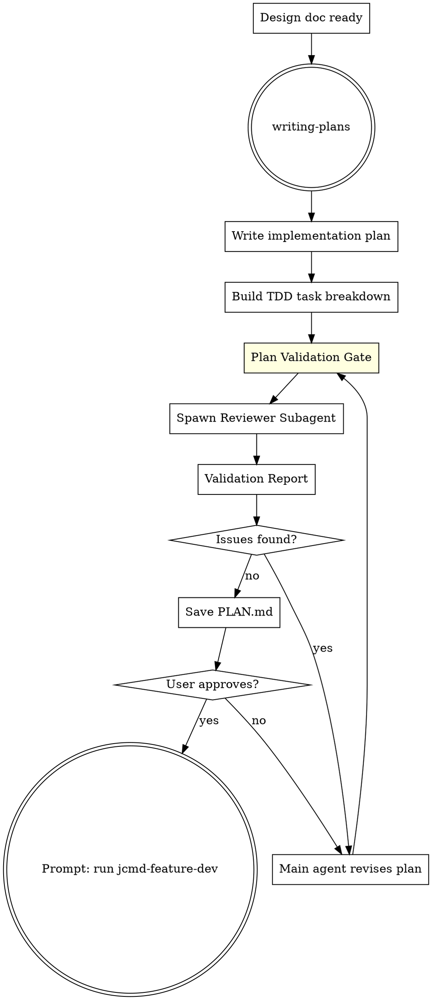
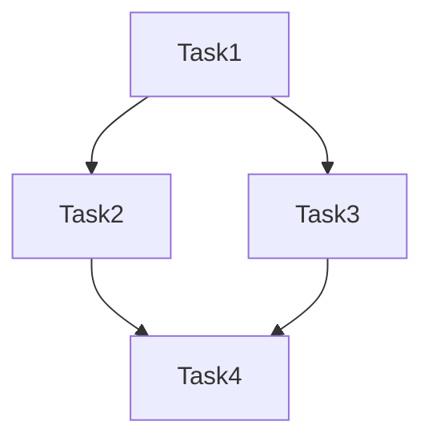

# JCMD Feature Plan

Orchestrates the Superpowers planning workflow with a **Plan Validation Gate** — a subagent review step that audits the plan for design gaps, missing edge cases, and architectural concerns before implementation begins.

## Parameters

| Parameter | Required | Description |
|-----------|----------|-------------|
| `spec-path` | ✅ | Path to the design document (DESIGN.md) from `jcmd-feature-design`. Must be a valid file path. |

**Language:** Implementation plan (`PLAN.md`) must be written in **English**.

**Modeling:** Dependency graphs, task flow diagrams, and architecture models must use **PlantUML** or **Mermaid**. No ASCII art.

**Example:** `jcmd-feature-plan docs/superpowers/specs/2026-08-09-oauth2-auth-design.md`

## Entry: writing-plans → Plan Validation Gate → Exit: prompt user to run `jcmd-feature-dev`



## Workflow

### Phase 1: Write the Plan

**REQUIRED SUB-SKILL:** Load `superpowers:writing-plans` and follow it exactly.

1. Read the approved design spec from `spec-path` (e.g. `docs/superpowers/specs/*-design.md`)
2. Write a detailed implementation plan with (**all content in English**):
   - Ordered task breakdown
   - Each task mapped to TDD cycle (test → implement → refactor)
   - Dependencies between tasks marked
   - Parallelizable tasks identified
   - Success criteria per task
3. Save draft plan

### Phase 2: Plan Validation Gate (SUBAGENT REVIEW)

This is the critical differentiator. Before any code is written, the plan must pass validation.

**Step 1: Spawn Reviewer Subagent**

Dispatch an `oracle` agent (read-only, high-IQ reasoning) to audit the draft plan against the design spec:

```text
TASK: Audit the implementation plan draft against its source design spec.
EXPECTED OUTCOME: A validation report with PASS/FAIL/REVISE verdict per check item.
REQUIRED TOOLS: read
MUST DO:
  - Read the design spec at `[spec-path]` AND the draft plan at `docs/superpowers/plans/<date>-<topic>-plan.md`
  - Verify EVERY requirement in the design spec maps to at least one plan task
  - Check every task has a corresponding TDD cycle (test → implement → refactor)
  - Identify missing edge cases and error states
  - Flag architectural concerns (coupling, single responsibility violations)
  - Check task granularity: each task completable in <3 files
  - Verify dependency graph has no cycles
  - Check that parallelizable tasks are properly isolated
  - Flag any scope creep beyond the design spec
MUST NOT DO:
  - Edit any files
  - Suggest implementation approaches — only audit the plan structure
  - Comment on code style or naming — focus on plan completeness
CONTEXT: The design spec is at `[spec-path]`. The plan was generated from it. The plan must be a faithful, complete translation of the design into executable TDD tasks. Audit by comparing the plan against ALL design requirements.
```

**Step 2: Validation Report Format**

The reviewer produces a structured report:

| Check | Verdict | Detail |
|-------|---------|--------|
| Spec coverage | PASS/FAIL | Missing requirements listed |
| TDD compliance | PASS/FAIL | Tasks without test-first cycle |
| Edge cases | PASS/FAIL | Unhandled states |
| Architecture | PASS/FAIL | Coupling/design concerns |
| Task granularity | PASS/FAIL | Over/under-sized tasks |
| Dependency graph | PASS/FAIL | Cycles or isolation issues |
| Scope | PASS/FAIL | Items beyond design spec |

**Step 3: Revise Based on Report**

- If ALL items PASS → proceed to Phase 3
- If any item FAILS or REVISE → main agent fixes the plan, then re-runs validation
- Iterate until all items pass (max 3 rounds; if still failing after 3, present unresolved concerns to user)

### Phase 3: Finalize

1. Save final plan to `docs/superpowers/plans/YYYY-MM-DD-<topic>-plan.md`
2. Present summary to user: task count, parallel vs sequential breakdown, TDD cycle count
3. Wait for explicit "approved" from user
4. After user approves, you MUST output this exact prompt:

```
✅ Plan validated and saved to `docs/superpowers/plans/<date>-<topic>-plan.md`.
   Tasks: <N> total, <P> parallelizable, <S> sequential
   Validation: all checks passed

Next: Run `jcmd-feature-dev` to start development on a feature branch.
```

Do NOT invoke `jcmd-feature-dev` automatically — let the user start it when ready.

## Plan Document Structure

**Language: English only. All task names, descriptions, and criteria must be in English.**

```markdown
# Plan: <Feature Name>

## Tasks

Priority levels: **P0** = blocking (must complete first), **P1** = important, **P2** = nice-to-have.
Execution mode: **Sequential** = must run in order, **Parallel** = can run concurrently with named task(s).

### Task 1: <Name> [P0] [Sequential]
- **Files**: path/to/file.ts
- **TDD Cycle**: test → implement → refactor
- **Depends on**: none
- **Success criteria**: <measurable outcome>

### Task 2: <Name> [P1] [Parallel with Task 3]
- ...

## Dependency Graph


## Parallel Execution Groups
- Group A: Task 2, Task 3 (independent)
- Group B: Task 4, Task 5 (independent, after Group A)
```

## Anti-Patterns

| Excuse | Reality |
|--------|---------|
| "The plan is obvious, skip validation" | Untested plans hide assumptions. Oracle catches them. |
| "Oracle flagged minor issues, I'll fix them in code" | Plan issues become code bugs. Fix the plan first. |
| "3 validation rounds is too many" | Each round catches deeper issues. Stop at 3 and escalate to user. |
| "One big task is simpler than many small ones" | Large tasks are error-prone and block parallel execution. |
| "I'll figure out edge cases during coding" | Edge cases in the plan prevent edge-case bugs in code. |

## Error Handling

| Condition | Action |
|-----------|--------|
| `spec-path` parameter empty or missing | Ask user to provide the DESIGN.md path |
| `spec-path` file does not exist | Report "File not found: `<path>`. Has `jcmd-feature-design` been run?" |
| `docs/superpowers/plans/` doesn't exist | Create it before saving PLAN.md |
| Oracle validation fails 3 rounds | Stop iterating; present unresolved concerns to user for decision |

## Common Mistakes

| Mistake | Why It's Wrong |
|---------|---------------|
| Writing plan without reading the design spec | Plan won't match design requirements. Read `spec-path` first. |
| Tasks without explicit TDD cycles | Without test-first, task verification is impossible. |
| Not marking task dependencies | Broken execution order leads to merge conflicts and wasted work. |
| Grouping dependent tasks as parallel | Parallel tasks must be truly independent — no shared state, no ordering. |
| Forgetting to save the draft before review | Oracle can't review what isn't written. Save draft plan first.
| Using ASCII art for dependency graphs | Use Mermaid or PlantUML for all diagrams and models. |

## HARD GATE

Do NOT write any code, create feature branches, or invoke any implementation skill. This command produces a validated plan only. When complete, prompt the user to run `jcmd-feature-dev` — do NOT invoke it automatically.

## Quick Reference

| Step | Action | Output |
|------|--------|--------|
| 1 | Load writing-plans (English) | Plan draft |
| 2 | Spawn oracle reviewer | Validation report |
| 3 | Revise plan | Addressed issues |
| 4 | Save PLAN.md | `docs/superpowers/plans/<date>-<topic>-plan.md` |
| 5 | User approves → prompt | "Next: Run `jcmd-feature-dev`" |
