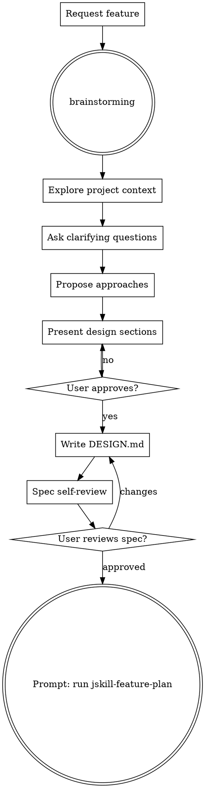

# JCMD Feature Design

Orchestrates the Superpowers brainstorming workflow for feature ideation and design refinement. Pure design phase — no plans, no code, no implementation.

## Parameters

| Parameter | Required | Description |
|-----------|----------|-------------|
| `description` | ✅ | User's feature requirement in natural language. What to build, why, and any constraints. |

**Language:** Design document (`DESIGN.md`) must be written in **Chinese** (中文).

**Modeling:** Flowcharts, architecture diagrams, and software models must use **PlantUML** or **Mermaid**. No ASCII art.

**Example:** `jskill-feature-design "Add user authentication with OAuth2 support for Google and GitHub"`

## Entry: brainstorming → Exit: prompt user to run `jskill-feature-plan`



## Workflow

### Phase 1: Brainstorming (Socratic Design)

**REQUIRED SUB-SKILL:** Load `superpowers:brainstorming` and follow it exactly.

1. **Explore project context** — check files, docs, recent commits, existing patterns
2. **Ask clarifying questions** — one at a time. Each question MUST present 2-4 concrete options with a clear recommendation (标注"推荐") for the most suitable one. Never leave questions open-ended — guide the user with well-reasoned choices.
3. **Propose 2-3 approaches** — with trade-offs and your recommendation
4. **Present design sections** — scale each to complexity, get approval after each section
5. **Write design doc** — save to `docs/superpowers/specs/YYYY-MM-DD-<topic>-design.md`. **Must be written in Chinese (中文).**
6. **Spec self-review** — check placeholders, contradictions, scope, ambiguity
7. **User gate** — user reviews and approves the written spec file

### Phase 2: Handoff

After user approves the design spec, you MUST output this exact prompt:

```
✅ Design complete and saved to `docs/superpowers/specs/<date>-<topic>-design.md`.

Next: Run `jskill-feature-plan` to write the implementation plan with TDD task breakdown.
```

Do NOT invoke `jskill-feature-plan` automatically — let the user start it when ready.

## Design Document Structure

**Language: Chinese only (中文). All sections, descriptions, and decisions must be written in Chinese.**

```markdown
# 设计文档：<特性名称>

## 概述
<1-2 段描述：这个特性做什么，为什么需要它>

## 目标与非目标
- **目标**：<要达成的具体目标>
- **非目标**：<明确排除的范围>

## 设计方案
<选定的技术方案描述，包括架构决策>

### 备选方案
| 方案 | 优点 | 缺点 | 为何未选用 |
|------|------|------|-----------|
| A    |      |      |           |
| B    |      |      |           |

## 架构
<组件图、数据流、接口定义 — 使用 PlantUML 或 Mermaid 编写>

## 关键设计决策
<每项决策的上下文、选项、选择理由>

## 错误处理
<异常路径、边界条件、失败模式>

## 测试策略
<测试层级、关键场景、验收标准>

## 依赖
<需要的前置条件、外部依赖、阻塞项>
```

## HARD GATE

Do NOT write any code, create implementation plans, scaffold projects, or invoke any implementation skill. This command handles design ONLY. When complete, prompt the user to run `jskill-feature-plan` — do NOT invoke it automatically.

## Anti-Patterns

| Excuse | Reality |
|--------|---------|
| "This is simple enough to skip design" | Simple projects hide the most assumptions. Design it. |
| "I'll design while I code" | Design-first prevents wasted implementation. |
| "One quick question then I'll start" | Follow the full brainstorming flow. |

## Error Handling

| Condition | Action |
|-----------|--------|
| `description` parameter empty or missing | Ask user to provide the feature description |
| `docs/superpowers/specs/` directory doesn't exist | Create it before writing DESIGN.md |
| Ambiguous requirements | Ask clarifying questions one at a time — provide concrete options with a recommended choice, do NOT guess |
| Design scope too large | Flag to user and suggest decomposition into sub-features |

## Common Mistakes

| Mistake | Why It's Wrong |
|---------|---------------|
| Asking multiple questions at once | Overwhelms the user. One question per message. |
| Asking open-ended questions without options | Open-ended questions ("怎么处理X？") force the user to design. Provide 2-4 concrete options with a recommended choice. |
| Skipping project context exploration | Design without understanding existing code = rework. |
| Only proposing one approach | No alternatives = no trade-off analysis. Always 2-3. |
| Writing code snippets in DESIGN.md | Design doc is architecture, not implementation. |
| Using ASCII art for diagrams | Use Mermaid or PlantUML for all flowcharts and models. |

## Quick Reference

| Step | Action | Output |
|------|--------|--------|
| 1 | Load brainstorming skill | Workflow context |
| 2 | Explore + questions + approaches | Design clarity |
| 3 | Write DESIGN.md (中文) | `docs/superpowers/specs/<date>-<topic>-design.md` |
| 4 | Self-review + user gate | Approved design |
| 5 | Prompt: "Next: Run `jskill-feature-plan`" | User starts next stage |
