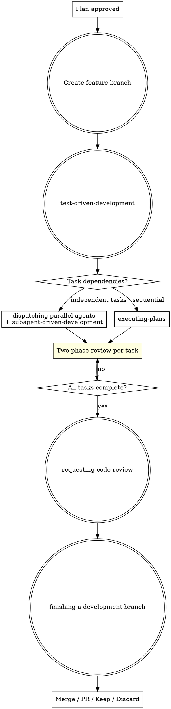

# JCMD Feature Development

Orchestrates the full Superpowers development cycle: feature branch, TDD, parallel/subagent execution with two-phase review, code review, and branch finishing.

## Parameters

| Parameter | Required | Description |
|-----------|----------|-------------|
| `plan-path` | ✅ | Path to the implementation plan (PLAN.md) from `jskill-feature-plan`. Must be a valid file path. |

**Example:** `jskill-feature-dev docs/superpowers/plans/2026-08-09-oauth2-auth-plan.md`

## Entry: Feature Branch → TDD → Execute → Review → Finish



## Workflow

### Phase 1: Create Feature Branch

Create a feature branch from the latest base branch (typically `main` or `master`):

```bash
git checkout main 2>/dev/null || git checkout master
git pull
git checkout -b feature/<feature-name>
```

Branch naming: `feature/<short-description>` — lowercase, hyphens for spaces.

Confirm you are on the correct branch before proceeding. All development work happens on this branch. The `finishing-a-development-branch` step (Phase 6) will handle merge/PR/cleanup.

### Phase 2: TDD Execution

**REQUIRED SUB-SKILL:** Load `superpowers:test-driven-development` and follow it exactly.

Read the plan from `plan-path` (e.g. `docs/superpowers/plans/*-plan.md`).

Every task in the plan follows the TDD cycle:
1. **RED** — Write a failing test
2. **GREEN** — Write minimal code to pass
3. **REFACTOR** — Clean up while tests stay green

No code before tests. No exceptions.

### Phase 3: Code Standards

All code written during development must follow these constraints:

| Rule | Scope | Rationale |
|------|-------|-----------|
| Functions ≤ 50 lines (target) | **Backend** only (Rust, Go, Python, Java, etc.) | Keeps each function testable, reviewable, and single-responsibility |
| Line width ≤ 120 characters | **All code** (backend + frontend) | Readable on any screen, no horizontal scrolling in diff views |
| Frontend (JS/TS/TSX) no strict function limit | **Frontend** excl. from 50-line rule | React component structure varies; use judgment |

These constraints apply to ALL subagents. Include them in every delegation prompt.

### Phase 4: Strategy Selection

Read the plan's dependency graph and parallel execution groups. Choose:

**Independent tasks → `dispatching-parallel-agents` + `subagent-driven-development`:**
- Each task dispatched to an independent subagent in parallel
- `subagent-driven-development` enforces two-phase review per task:
  - Phase 1: Spec compliance (does it match the plan?)
  - Phase 2: Code quality (does it follow patterns, handle errors, have tests?)
- **REQUIRED SUB-SKILLS:** Load both `superpowers:dispatching-parallel-agents` and `superpowers:subagent-driven-development`

**Sequential tasks → `executing-plans`:**
- Execute tasks in order with human checkpoints between batches
- **REQUIRED SUB-SKILL:** Load `superpowers:executing-plans`

### Phase 5: Code Review

**REQUIRED SUB-SKILL:** Load `superpowers:requesting-code-review`

Run the pre-review checklist before submitting:
- All TDD cycles complete
- Tests pass
- No type errors, no `as any`, no suppressed diagnostics
- Changed files follow existing patterns
- No scope creep beyond the plan

### Phase 6: Branch Finishing

**REQUIRED SUB-SKILL:** Load `superpowers:finishing-a-development-branch`

Present structured options:
1. **Merge** — directly merge into target branch
2. **PR** — create a pull request for review
3. **Keep** — keep the branch as-is for later
4. **Discard** — delete the branch and clean up

### Phase 7: Pipeline Complete

After branch finishing is resolved, you MUST output:

```
✅ Feature development complete.
   Branch: feature/<name>
   Result: <merged/PR created/kept/discarded>

The feature pipeline (design → plan → dev) is finished.
```

`jskill-feature-dev` is the terminal stage of the feature pipeline. No further handoff.

## Task Delegation Template

When dispatching tasks, use this template for each subagent prompt:

```text
TASK: [Single atomic task from plan]
EXPECTED OUTCOME: [Concrete deliverable with success criteria]
REQUIRED TOOLS: read, edit, write, bash
MUST DO:
  - Write failing test FIRST (TDD cycle)
  - Implement minimal code to pass
  - Refactor only after tests pass
  - Follow patterns in [reference files]
  - Backend: keep functions ≤ 50 lines; all code: max 120 chars per line
  - Run tests before marking complete
MUST NOT DO:
  - Touch files outside scope: [file list]
  - Modify unrelated code
  - Suppress type errors with as any or @ts-ignore
  - Skip the test phase
CONTEXT: Part of plan at `plan-path`. Depends on: [dependencies]. Files: [scope].
```

## Anti-Patterns

| Excuse | Reality |
|--------|---------|
| "I'll create the branch later" | Work on wrong branch contaminates the repo. Branch first. |
| "This task is too simple for TDD" | Simple code breaks too. The test IS the proof it works. |
| "These two tasks are quick, I'll run them sequentially" | Parallel tasks speed up delivery 2-4x. Follow the plan's groups. |
| "I'll fix this unrelated issue while I'm here" | Scope creep introduces new bugs. Separate PR. |
| "Code review can wait until the PR" | Pre-review catches issues BEFORE they reach the reviewer. |
| "I'll skip the two-phase review for this one subagent" | Unreviewed subagent output propagates errors downstream. |
| "It's just one long function, I'll refactor later" | Long functions hide bugs. Keep backend functions ≤ 50 lines. |

## Error Handling

| Condition | Action |
|-----------|--------|
| `plan-path` parameter empty or missing | Ask user to provide the PLAN.md path |
| `plan-path` file does not exist | Report "File not found: `<path>`. Has `jskill-feature-plan` been run?" |
| Not inside a git repository | Report "This command requires a git repository. Initialize one first." |
| Uncommitted changes on base branch | Warn user and ask whether to stash, commit, or abort |
| Feature branch name already exists | Ask user for a different branch name |
| Task execution fails (test or compile error) | Fix the failing task before proceeding to next. Do NOT skip. |

## Common Mistakes

| Mistake | Why It's Wrong |
|---------|---------------|
| Working on `main` without creating a branch | Contaminates the base branch. Always `feature/<name>`. |
| Writing implementation before tests | TDD requires RED first. Code before test = untested code. |
| Ignoring the dependency graph | Running dependent tasks out of order creates broken state. |
| Delegating with vague prompts | Subagents need explicit scope, MUST DO, MUST NOT DO. Use the template. |
| Treating parallel groups as suggestions | The plan's groups are deterministic — follow them exactly. |
| Merging without running the full test suite | A passing unit test doesn't mean no regressions. |
| Backend functions exceeding 50 lines | Split into smaller helpers. Each function = one responsibility. |
| Lines exceeding 120 characters | Break long expressions, chains, or string literals across multiple lines. |

## Quick Reference

| Step | Skill | Output |
|------|-------|--------|
| 1 | Create feature branch | `feature/<name>` branch |
| 2 | test-driven-development | TDD discipline |
| 3 | dispatching-parallel-agents OR executing-plans | Executed tasks |
| 4 | subagent-driven-development review | Two-phase verified code |
| 5 | requesting-code-review | Pre-review checklist pass |
| 6 | finishing-a-development-branch | Merge/PR/Keep/Discard |
| 7 | Pipeline complete | Terminal — no further stage |
