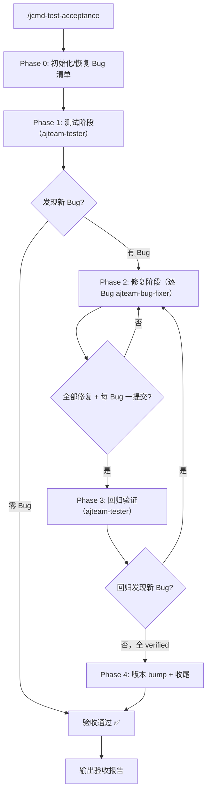

# JCMD Test Acceptance

在需求开发（`/jcmd-feature-dev`）结束后，编排测试验收循环：测试 agent（`ajteam-tester`）发现 Bug → Bug-fix agent（`ajteam-bug-fixer`）修复 Bug → 测试 agent 回归验证，直至发现的所有 Bug 修复完成。

## Parameters

| Parameter | Required | Description |
|-----------|----------|-------------|
| `scope` | ❌ | 可选。验收焦点（如「仅 CLI 模块」）。缺省时对整个当前特性范围验收 |

## Entry: 初始化 → 测试 → 修复 → 回归 → 判定 → 收尾



## 工作流

### Phase 0: 初始化 / 恢复 Bug 清单

- Bug 清单路径：`.superpowers/acceptance/bugs.md`
- 文件不存在 → 创建，写入表头与验收范围（当前特性）
- 文件已存在（上次会话中断）→ 读取，从第一个非 `verified` 的 Bug 继续
- 确认 git 工作区干净；不干净则提示用户先提交/暂存再验收

### Phase 1: 测试阶段

派发 `ajteam-tester`（模式 `test`），用下方「ajteam-tester 派发模板」构造 prompt。

- 报告「无可测软件」→ 中止验收，向用户输出门禁缺失项，不虚构 Bug
- 发现 Bug → 读回清单，进入 Phase 2
- 零 Bug → 进入 Phase 5 判定通过

### Phase 2: 修复阶段（逐 Bug）

对每个状态为 `open` 的 Bug，派发 `ajteam-bug-fixer`（一次一个 Bug）：

1. `task(subagent_type="ajteam-bug-fixer", load_skills=["systematic-debugging", "test-driven-development"], ...)` 派发，用下方「ajteam-bug-fixer 派发模板」构造 prompt
2. 修复完成后核验提交纪律（见「提交纪律」节）
3. 修复失败 → `task_id=ses_...` 续接同一会话重试；3 次失败 → 标记 `blocked`，上报用户/Oracle

### Phase 3: 回归验证

派发 `ajteam-tester`（模式 `regression`），逐条验证 `fixed` 的 Bug：

- 全部通过 → 全改 `verified`，进入 Phase 4
- 某 `fixed` Bug 验证失败 → 该 Bug 回退 `open`（同一 bug-id），回 Phase 2 重新修复
- 发现新 Bug → 写新条目 `open`，回 Phase 2
- 循环轮次 +1；若 ≥3 轮 → 停止，输出完整清单 + 每轮结果，交用户决策

### Phase 4: 版本 bump + 收尾

- 验收全部通过后，统一 bump **产品**版本 patch（如 `Cargo.toml`，遵循 AGENTS.md「bugfix → patch」）；无版本清单则跳过
- 遵循 AGENTS.md 执行文档自动同步（AGENTS.md / README.md / summary_and_next.md）

### Phase 5: 判定与报告

按固定格式输出验收报告：

```text
✅ 测试验收完成。
   Bug 总数：<N>（critical <x> / high <y> / medium <z> / low <w>）
   回归轮次：<rounds>
   门禁结果：<test / clippy / build 全绿>
   版本：<bump 至 x.y.z / 跳过>
   提交：<每 Bug 的 fix commit 列表>
```

## 派发模板

### ajteam-tester 派发模板

```text
TASK: 验收模式 <test|regression>——发现（或回归验证）当前特性的 Bug。
EXPECTED OUTCOME: 更新 .superpowers/acceptance/bugs.md（写 open / 回退 open / 改 verified），并输出本轮结论。
REQUIRED TOOLS: read, grep, glob, bash（运行门禁/软件）——不编辑、不提交。
MUST DO:
  - 运行门禁：<test / clippy / build 命令>
  - <test 模式>：探索式 QA 按特性 AC 与功能路径遍历，构造边界/异常用例
  - <regression 模式>：逐条验证 fixed Bug——通过改 verified，失败回退 open，新 Bug 写新条目
  - 每个 Bug 附可观察证据（失败输出/崩溃日志/行为偏差）
MUST NOT DO:
  - 修改代码、提交、修复 Bug
  - 虚构 Bug
  - 超出当前特性范围
CONTEXT: 特性范围 = <AC/功能路径>；门禁命令 = <...>；Bug 清单 = .superpowers/acceptance/bugs.md
```

### ajteam-bug-fixer 派发模板

```text
TASK: 修复单个 Bug <BUG-00N> <标题>。
EXPECTED OUTCOME: 该 Bug 的失败测试通过、门禁不回归、恰好一个提交（fix: <BUG-00N> <英文简述>）。
REQUIRED TOOLS: read, edit, bash（运行测试 + git commit）。
MUST DO:
  - 假设驱动调试（≥3 假设）确认根因
  - TDD：先写失败测试 → 最小修复 → 测试通过
  - 运行门禁确认无回归
  - 提交信息 fix: <BUG-00N> <英文简述>（英文），只提交本 Bug 相关文件
MUST NOT DO:
  - 一个提交包含多个 Bug 修复
  - 建分支 / 合并 / bump 版本号
  - as any / @ts-ignore / 删除测试凑通过
  - 无法复现时不伪造修复（标记 blocked 并报告）
CONTEXT: Bug 条目 = <id/标题/级别/重现步骤>；特性范围 = <...>；门禁命令 = <...>
```

## 提交纪律（硬性，NON-NEGOTIABLE）

| 规则 | 核验方式 |
|------|---------|
| 每 Bug 恰好一个提交 | 每 Bug 修复后 `git log -1` 检查提交信息为 `fix: <bug-id> ...` |
| 禁止一提交多 Bug | `git show --stat` 比对变更文件与当前 Bug 范围；超出则要求拆分提交 |
| 提交信息英文 | `fix: <bug-id> <英文简述>`（遵循 AGENTS.md） |

违规处理：驳回，要求 bug-fixer 拆分/重写提交，直至合规。

## 循环终止条件

- **PASS**：一次完整测试 round 零新 Bug，且所有 Bug 均 `verified`，门禁全绿
- **STOP（超限）**：循环 ≥3 轮仍未收敛 → 停止，输出完整清单交用户，**绝不静默通过**

## 错误处理

| 场景 | 处理 |
|------|------|
| 无可测软件 | 中止，输出门禁缺失项 |
| 门禁命令失败 | 记为 build 级 Bug，交 bug-fixer |
| bug-fixer 无法复现 | 标记 blocked，回交 tester 补步骤 |
| bug-fixer 3 次失败 | 停止该 Bug，上报用户/Oracle |
| 回归验证发现 fixed Bug 仍失败 | 该 Bug 回退 open（同一 bug-id），回 Phase 2 重新修复 |
| 会话中断 | 读 bugs.md 恢复，从第一个非 verified 继续 |
| 工作区不干净 | 提示用户先处理 |

## 反模式

| 借口 | 现实 |
|------|------|
| "Bug 太小，合并进一个提交" | 每 Bug 一提交是硬性要求 |
| "回归失败就再修一轮" | 3 轮上限，超限上报 |
| "没有 cargo 就虚构几个 Bug" | 不虚构，如实报告无可测软件 |
| "修复时顺手清理其他文件" | 范围外变更引入新 Bug，禁止 |

## 快速参考

| 阶段 | 动作 | 输出 |
|------|------|------|
| 0 | 初始化/恢复清单 | bugs.md 就绪 |
| 1 | 派发 tester（test） | Bug 清单（open） |
| 2 | 逐 Bug 派发 fixer | 每 Bug 一提交 |
| 3 | 派发 tester（regression） | 全 verified / 回退 open / 新 Bug |
| 4 | 版本 bump + 文档同步 | 产品 patch bump |
| 5 | 验收报告 | PASS / STOP |
