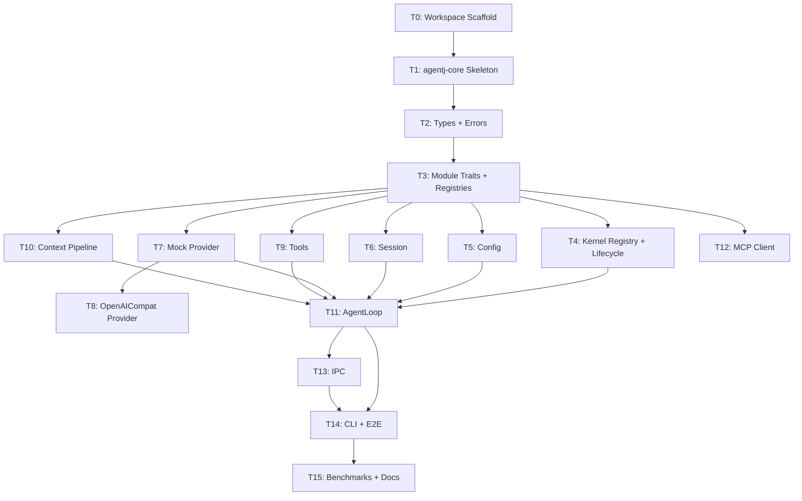

# AgentJ Core Architecture — Implementation Plan

> **For agentic workers:** REQUIRED SUB-SKILL: Use `superpowers:subagent-driven-development` (recommended) or `superpowers:executing-plans` to implement this plan task-by-task. TDD order is enforced — `test_code` MUST be written and verified failing before `impl_code`.

## Agent Worker Instructions

- Required sub-skills: `superpowers:subagent-driven-development` (preferred) or `superpowers:executing-plans`
- Execution mode: `subagent-driven-development`
- Required verification: `cargo test --workspace`, `cargo clippy --workspace -- -D warnings`
- Version bump: this cycle ships the initial release **v0.1.0** — no bump (per AGENTS.md, subsequent features bump minor `0.1.0 → 0.2.0`)
- **Cargo.toml rule:** dependency additions required by the code are listed inside `impl_code` and applied via `cargo add`; they do NOT count toward the 3-file limit (the task's primary files are the code files).
- **RED semantics for Rust:** when a test references symbols that do not exist yet, the RED state is a *compile error* — that is acceptable and proves the feature is absent. After `impl_code`, the tests must compile and PASS. Never skip the failing-first check.

## Global Constraints

- Rust version: 1.96+ (stable toolchain, `rust-version = "1.96"`)
- All dependencies: latest stable versions at time of execution (use `cargo add`)
- Rust functions: ≤ 50 lines, ≤ 120 chars per line
- No `unwrap()` / `expect()` in library code (use `Result` + `?`); tests may use them
- No type-error suppression (`as any`, `@ts-ignore`, or Rust equivalents)
- Commit messages in English
- Cargo workspace at repo root, all crates flattened in project root (`members = ["agentj-*"]`)

---

## Architecture Notes

- **Message Bus vs Direct Orchestration**: for v0.1, the kernel module registry + `KernelMessage` bus handles IPC ingress and module lifecycle. The agent loop orchestration (`run_turn_stream`) directly calls `SessionStore` / `ModelProvider` / `ToolRegistry` / `ContextPipeline` via trait objects — NOT through `KernelMessage` routing. This is intentional: the full `KernelMessage`-routed pipeline is needed for the v0.2 Sub-Agent Dispatcher.
- **AgentLoop in agentj-core with trait-only dependencies**: `AgentLoop` lives in `agentj-core/src/agent_loop.rs` and depends ONLY on traits defined in `agentj-core` (`SessionStore`, `ModelProvider`, `Tool`, `ContextPipeline`, `ConfigProvider`). **`ContextPipeline` is a trait in `agentj-core::module`**; `agentj-context` implements it. `AgentLoop` never imports from domain crates. Unit tests define inline mock implementations; the workspace integration test wires real implementations from domain crates via dev-dependencies.
- **Streaming API**: `AgentLoop` exposes `run_turn_stream()` returning a `tokio::sync::mpsc::Receiver<AgentEvent>` so IPC/CLI consumers receive incremental deltas — matching the design spec's "流式返回" requirement. `run_turn()` is a convenience collector for non-streaming callers.
- **Transport-agnostic core**: `ModelError::Network(String)` carries the message — `agentj-core` does NOT depend on `reqwest`.

---

## Tasks

### T0: Scaffold the Cargo workspace [P0] [Sequential]

```yaml
- id: T0
  title: "Scaffold the Cargo workspace"
  files:
    - Cargo.toml
    - rust-toolchain.toml
  depends_on: []
  breaking: false
  ac:
    - given: an empty repository at the project root
      when: running `cargo build --workspace`
      then: exits with code 0 and no errors
  regression:
    - "cargo build --workspace (empty workspace — no existing tests yet)"
  test_code: |
    # Scaffold task — no unit test exists yet. The gate is the build itself:
    # `cargo build --workspace` must exit 0 and produce no errors.
    # RED step: n/a (empty workspace always builds). GREEN: exit 0.
  impl_code: |
    # Cargo.toml (workspace root)
    [workspace]
    resolver = "2"
    members = ["agentj-*"]

    [workspace.package]
    version = "0.1.0"
    edition = "2024"
    rust-version = "1.96"

    # rust-toolchain.toml
    [toolchain]
    channel = "stable"
  verify:
    - "cargo build --workspace"
    - "cargo clippy --workspace -- -D warnings"
```

### T1: Create the agentj-core crate skeleton [P0] [Sequential]

```yaml
- id: T1
  title: "Create the agentj-core crate skeleton"
  files:
    - agentj-core/Cargo.toml
    - agentj-core/src/lib.rs
  depends_on: [T0]
  breaking: false
  ac:
    - given: the workspace scaffolded in T0
      when: running `cargo test -p agentj-core`
      then: "the smoke test passes (test result: ok, 1 passed)"
  regression:
    - "cargo build --workspace (T0 scaffold still builds)"
  test_code: |
    // In agentj-core/src/lib.rs
    #[cfg(test)]
    mod tests {
        use super::*;

        #[test]
        fn smoke() {
            assert_eq!(add(2, 2), 4);
        }
    }
  impl_code: |
    # agentj-core/Cargo.toml
    [package]
    name = "agentj-core"
    version.workspace = true
    edition.workspace = true
    rust-version.workspace = true

    [dependencies]
    serde = { version = "1", features = ["derive"] }
    serde_json = "1"
    thiserror = "2"

    // agentj-core/src/lib.rs
    //! AgentJ kernel — shared types, traits, and event loop.

    pub fn add(left: u64, right: u64) -> u64 {
        left + right
    }

    #[cfg(test)]
    mod tests {
        use super::*;

        #[test]
        fn smoke() {
            assert_eq!(add(2, 2), 4);
        }
    }
  verify:
    - "cargo test -p agentj-core"
    - "cargo clippy --workspace -- -D warnings"
```

### T2: Add shared types and error enums [P0] [Sequential]

```yaml
- id: T2
  title: "Add shared types and error enums"
  files:
    - agentj-core/src/types.rs
    - agentj-core/src/error.rs
    - agentj-core/src/lib.rs
  depends_on: [T1]
  breaking: false
  ac:
    - given: the agentj-core skeleton from T1
      when: running `cargo test -p agentj-core`
      then: all type and error tests pass (constructor roles, serialization roundtrip, error display, IpcError::from(io))
  regression:
    - "cargo test -p agentj-core -- smoke (T1 smoke test must keep passing)"
  test_code: |
    // In agentj-core/src/types.rs (tests module)
    #[cfg(test)]
    mod tests {
        use super::*;

        #[test]
        fn chatmessage_system_constructor() {
            let msg = ChatMessage::system("hello");
            assert_eq!(msg.role, Role::System);
            assert_eq!(msg.content, "hello");
            assert!(msg.tool_calls.is_empty());
        }

        #[test]
        fn chatmessage_assistant_and_tool_constructors() {
            let assistant = ChatMessage::assistant("hi");
            assert_eq!(assistant.role, Role::Assistant);
            let tool = ChatMessage::tool_result("call-1", "result");
            assert_eq!(tool.role, Role::Tool);
            assert_eq!(tool.tool_call_id.as_deref(), Some("call-1"));
        }

        #[test]
        fn chatmessage_serialization_roundtrip() {
            let json = serde_json::to_string(&ChatMessage::user("hi")).unwrap();
            let back: ChatMessage = serde_json::from_str(&json).unwrap();
            assert_eq!(back.role, Role::User);
        }

        #[test]
        fn model_options_default_is_streaming_deepseek() {
            let opts = ModelOptions::default();
            assert_eq!(opts.model, "deepseek-chat");
            assert!(opts.stream);
        }
    }

    // In agentj-core/src/error.rs (tests module)
    #[cfg(test)]
    mod tests {
        use super::*;

        #[test]
        fn kernel_error_display() {
            let err = KernelError::ModuleNotFound("test".into());
            assert!(err.to_string().contains("test"));
        }

        #[test]
        fn model_error_network_carries_message() {
            let err = ModelError::Network("conn refused".into());
            assert!(matches!(err, ModelError::Network(_)));
        }

        #[test]
        fn ipc_from_io_error() {
            let io: std::io::Error = std::io::ErrorKind::BrokenPipe.into();
            let err = IpcError::from(io);
            assert!(matches!(err, IpcError::Io(_)));
        }
    }
  impl_code: |
    # agentj-core/src/types.rs
    use serde::{Deserialize, Serialize};

    pub type ModuleId = String;
    pub type SessionId = String;

    #[derive(Debug, Clone, Copy, PartialEq, Eq, Serialize, Deserialize)]
    #[serde(rename_all = "lowercase")]
    pub enum Role { System, User, Assistant, Tool }

    #[derive(Debug, Clone, Serialize, Deserialize)]
    pub struct ToolCall {
        pub id: String,
        pub name: String,
        pub arguments: serde_json::Value,
    }

    #[derive(Debug, Clone, Serialize, Deserialize)]
    pub struct ChatMessage {
        pub role: Role,
        pub content: String,
        #[serde(skip_serializing_if = "Option::is_none")]
        pub tool_call_id: Option<String>,
        #[serde(skip_serializing_if = "Vec::is_empty", default)]
        pub tool_calls: Vec<ToolCall>,
    }

    impl ChatMessage {
        pub fn system(content: impl Into<String>) -> Self {
            Self { role: Role::System, content: content.into(), tool_call_id: None, tool_calls: vec![] }
        }
        pub fn user(content: impl Into<String>) -> Self {
            Self { role: Role::User, content: content.into(), tool_call_id: None, tool_calls: vec![] }
        }
        pub fn assistant(content: impl Into<String>) -> Self {
            Self { role: Role::Assistant, content: content.into(), tool_call_id: None, tool_calls: vec![] }
        }
        pub fn tool_result(tool_call_id: impl Into<String>, content: impl Into<String>) -> Self {
            Self { role: Role::Tool, content: content.into(), tool_call_id: Some(tool_call_id.into()), tool_calls: vec![] }
        }
    }

    #[derive(Debug, Clone, Serialize, Deserialize)]
    pub struct ToolDefinition {
        pub name: String,
        pub description: String,
        pub input_schema: serde_json::Value,
    }

    #[derive(Debug, Clone)]
    pub enum ModelEvent {
        Delta(String),
        ToolCall(ToolCall),
        Done,
    }

    #[derive(Debug, Clone)]
    pub struct ChatResponse {
        pub content: String,
        pub tool_calls: Vec<ToolCall>,
    }

    #[derive(Debug, Clone)]
    pub struct ModelOptions {
        pub model: String,
        pub temperature: Option<f32>,
        pub max_tokens: Option<u32>,
        pub stream: bool,
    }

    impl Default for ModelOptions {
        fn default() -> Self {
            Self { model: "deepseek-chat".into(), temperature: None, max_tokens: None, stream: true }
        }
    }

    #[derive(Debug, Clone, Serialize, Deserialize)]
    pub struct Attachment {
        pub path: Option<String>,
        pub content: Option<String>,
        pub mime: Option<String>,
    }

    // agentj-core/src/error.rs
    use std::time::Duration;

    #[derive(Debug, thiserror::Error)]
    pub enum ModuleError {
        #[error("module init failed: {0}")]
        Init(String),
        #[error("module shutdown failed: {0}")]
        Shutdown(String),
        #[error("handler error: {0}")]
        Handler(String),
    }

    #[derive(Debug, thiserror::Error)]
    pub enum KernelError {
        #[error("module '{0}' not found")]
        ModuleNotFound(String),
        #[error("module '{0}' initialization failed: {1}")]
        ModuleInitFailed(String, #[source] anyhow::Error),
        #[error("message routing failed for {msg:?}: {reason}")]
        MessageRouteFailed { msg: String, reason: String },
        #[error("shutdown timeout after {0:?}")]
        ShutdownTimeout(Duration),
        #[error("IPC error: {0}")]
        Ipc(#[from] IpcError),
    }

    #[derive(Debug, thiserror::Error)]
    pub enum IpcError {
        #[error("JSON parse error: {0}")]
        Json(#[from] serde_json::Error),
        #[error("IO error: {0}")]
        Io(#[from] std::io::Error),
        #[error("invalid request: {0}")]
        InvalidRequest(String),
    }

    #[derive(Debug, thiserror::Error)]
    pub enum ModelError {
        #[error("API error ({status}): {message}")]
        Api { status: u16, message: String },
        #[error("rate limited, retry after {retry_after:?}")]
        RateLimited { retry_after: Option<Duration> },
        #[error("context length exceeded: {used}/{max} tokens")]
        TokenLimitExceeded { used: usize, max: usize },
        #[error("network error: {0}")]
        Network(String),
        #[error("stream error: {0}")]
        Stream(String),
    }

    #[derive(Debug, thiserror::Error)]
    pub enum ToolError {
        #[error("tool '{name}' not found")]
        ToolNotFound { name: String },
        #[error("tool '{name}' execution failed: {reason}")]
        ExecutionFailed { name: String, reason: String },
        #[error("tool '{name}' permission denied: {reason}")]
        PermissionDenied { name: String, reason: String },
        #[error("tool timeout after {0:?}")]
        Timeout(Duration),
    }

    // agentj-core/src/lib.rs — add module declarations
    pub mod types;
    pub mod error;

    // Cargo.toml: add `anyhow = "1"` (KernelError::ModuleInitFailed uses #[source] anyhow::Error)
  verify:
    - "cargo test -p agentj-core"
    - "cargo clippy --workspace -- -D warnings"
```

### T3: Add module traits, registries, and KernelContext [P0] [Sequential]

```yaml
- id: T3
  title: "Add module traits, registries, and KernelContext"
  files:
    - agentj-core/src/module.rs
    - agentj-core/src/lib.rs
  depends_on: [T2]
  breaking: false
  ac:
    - given: types and errors from T2
      when: running `cargo test -p agentj-core`
      then: module_id and tool_registry tests pass (Arc-based registry register/get/definitions)
  regression:
    - "cargo test -p agentj-core (T2 types/error tests must keep passing)"
  test_code: |
    // In agentj-core/src/module.rs (tests module)
    #[cfg(test)]
    mod tests {
        use super::*;
        use crate::error::{ModuleError, ToolError};

        struct TestModule;
        impl Module for TestModule {
            fn id(&self) -> ModuleId { "test".into() }
            fn metadata(&self) -> ModuleMetadata {
                ModuleMetadata { id: "test".into(), name: "Test".into(), version: "0.1".into(), description: "".into(), author: "".into() }
            }
            fn init(&mut self, _ctx: &KernelContext, _register: &mut ModuleRegister) -> Result<(), ModuleError> { Ok(()) }
            fn shutdown(&mut self) -> Result<(), ModuleError> { Ok(()) }
        }

        struct DummyTool;
        impl Tool for DummyTool {
            fn name(&self) -> &str { "dummy" }
            fn description(&self) -> &str { "" }
            fn input_schema(&self) -> serde_json::Value { serde_json::json!({}) }
            fn execute(&self, _input: serde_json::Value) -> Result<serde_json::Value, ToolError> {
                Ok(serde_json::Value::String("ok".into()))
            }
        }

        #[test]
        fn module_id() {
            let m = TestModule;
            assert_eq!(m.id(), "test");
        }

        #[test]
        fn tool_registry_registers_and_gets() {
            let registry = ToolRegistry::new();
            assert!(registry.is_empty());
            registry.register(Arc::new(DummyTool));
            assert_eq!(registry.get("dummy").unwrap().name(), "dummy");
            assert_eq!(registry.definitions().len(), 1);
        }

        #[test]
        fn provider_registry_has_no_default_before_register() {
            let registry = ProviderRegistry::new();
            assert!(registry.get_default().is_none());
        }
    }
  impl_code: |
    # agentj-core/src/module.rs
    use std::collections::HashMap;
    use std::sync::Arc;
    use async_trait::async_trait;
    use futures::stream::BoxStream;
    use parking_lot::RwLock;
    use crate::error::{ModuleError, ModelError, ToolError};
    use crate::types::*;

    // ---- Traits ----

    pub trait Tool: Send + Sync {
        fn name(&self) -> &str;
        fn description(&self) -> &str;
        fn input_schema(&self) -> serde_json::Value;
        fn execute(&self, input: serde_json::Value) -> Result<serde_json::Value, ToolError>;
    }

    #[async_trait]
    pub trait ModelProvider: Send + Sync {
        async fn chat_stream(
            &self,
            messages: Vec<ChatMessage>,
            tools: Vec<ToolDefinition>,
            options: ModelOptions,
        ) -> Result<BoxStream<'static, Result<ModelEvent, ModelError>>, ModelError>;

        async fn chat(
            &self,
            messages: Vec<ChatMessage>,
            options: ModelOptions,
        ) -> Result<ChatResponse, ModelError>;
    }

    /// Assembles the request context and folds tool results back into history.
    /// Defined in core so `AgentLoop` stays trait-only; implemented by domain crates.
    pub trait ContextPipeline: Send + Sync {
        fn assemble(
            &self,
            system: &str,
            history: &[ChatMessage],
            tool_results: &[(ToolCall, String)],
        ) -> Vec<ChatMessage>;
        fn reflux(&self, history: &mut Vec<ChatMessage>, tool_call: &ToolCall, result: String);
    }

    #[derive(Debug, Clone, PartialEq, Eq, Hash)]
    pub enum EventType {
        PreRequest,
        PostResponse,
        Shutdown,
        ToolStart(String),
        ToolEnd(String),
    }

    pub trait EventHandler: Send + Sync {
        fn on_event(&self, event: &EventType, ctx: &KernelContext);
    }

    #[derive(Debug, Clone)]
    pub struct ModuleMetadata {
        pub id: ModuleId,
        pub name: String,
        pub version: String,
        pub description: String,
        pub author: String,
    }

    // ---- Module & KernelModule ----

    pub trait Module: Send + Sync {
        fn id(&self) -> ModuleId;
        fn metadata(&self) -> ModuleMetadata;
        fn init(&mut self, ctx: &KernelContext, register: &mut ModuleRegister) -> Result<(), ModuleError>;
        fn shutdown(&mut self) -> Result<(), ModuleError>;
    }

    pub trait KernelModule: Module {
        fn handle(&mut self, msg: &KernelMessage) -> Result<KernelResponse, ModuleError>;
    }

    // ---- Registries ----

    pub struct ModuleRegister {
        pub tools: Arc<ToolRegistry>,
        pub events: Vec<(EventType, Box<dyn EventHandler>)>,
        pub providers: Arc<ProviderRegistry>,
    }

    impl ModuleRegister {
        pub fn new(tools: Arc<ToolRegistry>, providers: Arc<ProviderRegistry>) -> Self {
            Self { tools, events: vec![], providers }
        }

        pub fn register_tool(&mut self, tool: Arc<dyn Tool>) -> Result<(), ModuleError> {
            self.tools.register(tool);
            Ok(())
        }

        pub fn on_event(&mut self, event: EventType, handler: Box<dyn EventHandler>) -> Result<(), ModuleError> {
            self.events.push((event, handler));
            Ok(())
        }

        pub fn register_provider(&mut self, provider: Arc<dyn ModelProvider>) -> Result<(), ModuleError> {
            self.providers.register("default".into(), provider);
            Ok(())
        }
    }

    pub struct ToolRegistry {
        tools: RwLock<HashMap<String, Arc<dyn Tool>>>,
    }

    impl ToolRegistry {
        pub fn new() -> Self {
            Self { tools: RwLock::new(HashMap::new()) }
        }

        pub fn register(&self, tool: Arc<dyn Tool>) {
            self.tools.write().insert(tool.name().to_string(), tool);
        }

        pub fn get(&self, name: &str) -> Option<Arc<dyn Tool>> {
            self.tools.read().get(name).cloned()
        }

        pub fn definitions(&self) -> Vec<ToolDefinition> {
            self.tools.read().iter().map(|(_, t)| ToolDefinition {
                name: t.name().into(),
                description: t.description().into(),
                input_schema: t.input_schema(),
            }).collect()
        }

        pub fn is_empty(&self) -> bool {
            self.tools.read().is_empty()
        }
    }

    impl Default for ToolRegistry {
        fn default() -> Self { Self::new() }
    }

    pub struct ProviderRegistry {
        providers: RwLock<HashMap<String, Arc<dyn ModelProvider>>>,
        default: RwLock<Option<String>>,
    }

    impl ProviderRegistry {
        pub fn new() -> Self {
            Self { providers: RwLock::new(HashMap::new()), default: RwLock::new(None) }
        }

        pub fn register(&self, name: String, provider: Arc<dyn ModelProvider>) {
            self.providers.write().insert(name.clone(), provider);
            if self.default.read().is_none() {
                *self.default.write() = Some(name);
            }
        }

        pub fn get_default(&self) -> Option<Arc<dyn ModelProvider>> {
            self.default.read().as_ref()
                .and_then(|name| self.providers.read().get(name).cloned())
        }

        pub fn list(&self) -> Vec<String> {
            self.providers.read().keys().cloned().collect()
        }
    }

    // ---- Session & Config ----

    pub trait SessionStore: Send + Sync {
        fn create(&self) -> Result<SessionId, ModuleError>;
        fn append(&self, session: &SessionId, message: ChatMessage) -> Result<(), ModuleError>;
        fn get(&self, session: &SessionId) -> Result<Vec<ChatMessage>, ModuleError>;
        fn estimate_tokens(&self, session: &SessionId) -> Result<usize, ModuleError>;
    }

    pub trait ConfigProvider: Send + Sync {
        fn get_str(&self, key: &str) -> Option<String>;
        fn get_int(&self, key: &str) -> Option<i64>;
        fn providers(&self) -> Vec<(String, String)>; // Vec<(name, base_url)>
    }

    #[derive(Clone)]
    pub struct KernelContext {
        pub session: Arc<dyn SessionStore>,
        pub tools: Arc<ToolRegistry>,
        pub providers: Arc<ProviderRegistry>,
        pub config: Arc<dyn ConfigProvider>,
    }

    // ---- Kernel Message ----

    #[derive(Debug, Clone)]
    pub enum KernelMessage {
        UserRequest { session_id: SessionId, content: String, attachments: Vec<Attachment> },
        Shutdown,
    }

    #[derive(Debug, Clone)]
    pub enum KernelResponse {
        Handled,
        Streaming(Vec<String>),
    }

    // agentj-core/src/lib.rs — add `pub mod module;`
    // Cargo.toml: add `async-trait = "0.1"`, `futures = "0.3"`, `parking_lot = "0.12"`,
    //             `tracing = "0.1"`, `tokio = { version = "1", features = ["sync", "rt", "macros", "time", "io-util", "fs", "process"] }`
  verify:
    - "cargo test -p agentj-core"
    - "cargo clippy --workspace -- -D warnings"
```

### T4: Add the Kernel module registry and event loop [P0] [Sequential]

```yaml
- id: T4
  title: "Add the Kernel module registry and event loop"
  files:
    - agentj-core/src/kernel.rs
    - agentj-core/src/lib.rs
  depends_on: [T3]
  breaking: false
  ac:
    - given: module traits from T3
      when: running `cargo test -p agentj-core`
      then: kernel routing test passes (spy module receives 1 message, Shutdown terminates the loop, JoinHandle resolves Ok)
  regression:
    - "cargo test -p agentj-core (T2 + T3 tests must keep passing)"
  test_code: |
    // In agentj-core/src/kernel.rs (tests module)
    #[cfg(test)]
    mod tests {
        use super::*;
        use crate::error::*;
        use crate::module::*;
        use crate::types::*;
        use std::sync::{Arc, Mutex as StdMutex};

        struct NoopSession;
        impl SessionStore for NoopSession {
            fn create(&self) -> Result<SessionId, ModuleError> { Ok("s1".into()) }
            fn append(&self, _s: &SessionId, _m: ChatMessage) -> Result<(), ModuleError> { Ok(()) }
            fn get(&self, _s: &SessionId) -> Result<Vec<ChatMessage>, ModuleError> { Ok(vec![]) }
            fn estimate_tokens(&self, _s: &SessionId) -> Result<usize, ModuleError> { Ok(0) }
        }

        struct NoopConfig;
        impl ConfigProvider for NoopConfig {
            fn get_str(&self, _k: &str) -> Option<String> { None }
            fn get_int(&self, _k: &str) -> Option<i64> { None }
            fn providers(&self) -> Vec<(String, String)> { vec![] }
        }

        fn dummy_kernel_context() -> KernelContext {
            KernelContext {
                session: Arc::new(NoopSession),
                tools: Arc::new(ToolRegistry::new()),
                providers: Arc::new(ProviderRegistry::new()),
                config: Arc::new(NoopConfig),
            }
        }

        struct SpyModule {
            handled: Arc<StdMutex<Vec<KernelMessage>>>,
        }

        impl Module for SpyModule {
            fn id(&self) -> ModuleId { "spy".into() }
            fn metadata(&self) -> ModuleMetadata {
                ModuleMetadata { id: "spy".into(), name: "Spy".into(), version: "0.1".into(), description: "".into(), author: "".into() }
            }
            fn init(&mut self, _ctx: &KernelContext, _r: &mut ModuleRegister) -> Result<(), ModuleError> { Ok(()) }
            fn shutdown(&mut self) -> Result<(), ModuleError> { Ok(()) }
        }

        impl KernelModule for SpyModule {
            fn handle(&mut self, msg: &KernelMessage) -> Result<KernelResponse, ModuleError> {
                self.handled.lock().unwrap().push(msg.clone());
                Ok(KernelResponse::Handled)
            }
        }

        #[tokio::test]
        async fn kernel_routes_message_and_shuts_down() {
            let handled = Arc::new(StdMutex::new(vec![]));
            let mut register = ModuleRegister::new(Arc::new(ToolRegistry::new()), Arc::new(ProviderRegistry::new()));
            let mut kernel = Kernel::new();
            kernel.register_module(
                Box::new(SpyModule { handled: handled.clone() }),
                &dummy_kernel_context(),
                &mut register,
            ).unwrap();

            let handle = kernel.start();
            kernel.sender().send(KernelMessage::UserRequest {
                session_id: "s1".into(), content: "hello".into(), attachments: vec![],
            }).unwrap();

            tokio::time::sleep(std::time::Duration::from_millis(50)).await;
            assert_eq!(handled.lock().unwrap().len(), 1);

            kernel.sender().send(KernelMessage::Shutdown).unwrap();
            handle.await.unwrap().unwrap();
        }
    }
  impl_code: |
    # agentj-core/src/kernel.rs
    use std::collections::HashMap;
    use std::sync::{Arc, Mutex};
    use tokio::task::JoinHandle;
    use crate::error::KernelError;
    use crate::module::{KernelContext, KernelMessage, KernelModule, KernelResponse, ModuleRegister};
    use crate::types::*;

    const CHANNEL_SIZE: usize = 128;

    #[derive(Clone)]
    pub struct KernelSender {
        tx: tokio::sync::mpsc::Sender<KernelMessage>,
    }

    impl KernelSender {
        pub fn send(&self, msg: KernelMessage) -> Result<(), KernelError> {
            self.tx.try_send(msg).map_err(|e| KernelError::MessageRouteFailed {
                msg: format!("{:?}", e.into_inner()),
                reason: "channel closed or full".into(),
            })
        }
    }

    pub struct Kernel {
        modules: Arc<Mutex<HashMap<String, Box<dyn KernelModule>>>>,
        sender: KernelSender,
        rx: Option<tokio::sync::mpsc::Receiver<KernelMessage>>,
    }

    impl Kernel {
        pub fn new() -> Self {
            let (tx, rx) = tokio::sync::mpsc::channel(CHANNEL_SIZE);
            Self { modules: Arc::new(Mutex::new(HashMap::new())), sender: KernelSender { tx }, rx: Some(rx) }
        }

        pub fn sender(&self) -> KernelSender {
            self.sender.clone()
        }

        pub fn register_module(
            &mut self,
            mut module: Box<dyn KernelModule>,
            ctx: &KernelContext,
            register: &mut ModuleRegister,
        ) -> Result<(), KernelError> {
            let id = module.id();
            match module.init(ctx, register) {
                Ok(()) => {
                    self.modules.lock().unwrap().insert(id, module);
                    Ok(())
                }
                Err(e) => {
                    tracing::warn!(module_id = %id, error = %e, "module init failed, continuing without it");
                    Ok(()) // design: one module's failure must not crash the kernel
                }
            }
        }

        pub fn start(&mut self) -> JoinHandle<Result<(), KernelError>> {
            let modules = Arc::clone(&self.modules);
            let rx = self.rx.take().unwrap_or_else(|| {
                let (_, rx) = tokio::sync::mpsc::channel(1);
                rx
            });
            tokio::spawn(async move {
                while let Some(msg) = rx.recv().await {
                    if matches!(msg, KernelMessage::Shutdown) { break; }
                    let mut guard = modules.lock().unwrap();
                    for (_, module) in guard.iter_mut() {
                        if let Err(e) = module.handle(&msg) {
                            tracing::error!(?e, "module handler error");
                        }
                    }
                }
                Ok(())
            })
        }
    }

    // agentj-core/src/lib.rs — add `pub mod kernel;`
  verify:
    - "cargo test -p agentj-core"
    - "cargo clippy --workspace -- -D warnings"
```

### T5: Add the agentj-config crate with layered config merge [P0] [Parallel with T6, T7, T9, T10, T12]

```yaml
- id: T5
  title: "Add the agentj-config crate with layered config merge"
  files:
    - agentj-config/Cargo.toml
    - agentj-config/src/lib.rs
    - agentj-config/src/merge.rs
  depends_on: [T3]
  breaking: false
  ac:
    - given: a temp config.toml with one provider
      when: running `cargo test -p agentj-config`
      then: loads_default_config, merge_precedence, and env_overrides_toml tests pass (defaults overlay, env wins)
  regression:
    - "cargo test -p agentj-core (T3 module tests — ConfigProvider trait unchanged)"
  test_code: |
    // In agentj-config/src/lib.rs (tests module)
    #[cfg(test)]
    mod tests {
        use super::*;
        use std::io::Write;

        #[test]
        fn loads_default_config() {
            let dir = tempfile::TempDir::new().unwrap();
            let config_path = dir.path().join("config.toml");
            std::fs::write(&config_path, r#"[model]
        provider = "deepseek"
        [[model.providers]]
        name = "deepseek-chat"
        base_url = "https://api.deepseek.com"
        "#).unwrap();

            let config = Config::load(Some(config_path)).unwrap();
            let providers = config.providers();
            assert_eq!(providers.len(), 1);
            assert_eq!(providers[0].0, "deepseek-chat");
        }

        #[test]
        fn env_overrides_toml() {
            let dir = tempfile::TempDir::new().unwrap();
            let config_path = dir.path().join("config.toml");
            std::fs::write(&config_path, "[model]\nprovider = \"deepseek\"\n").unwrap();

            std::env::set_var("AGENTJ_MODEL_PROVIDER", "opencode-go");
            let config = Config::load(Some(config_path)).unwrap();
            assert_eq!(config.inner().model.provider, "opencode-go");
            std::env::remove_var("AGENTJ_MODEL_PROVIDER");
        }
    }

    // In agentj-config/src/merge.rs (tests module)
    #[cfg(test)]
    mod tests {
        use super::*;
        use crate::{AgentJConfig, ModelSection};

        #[test]
        fn merge_precedence() {
            let base = AgentJConfig::default();
            let file = AgentJConfig {
                model: ModelSection {
                    provider: "deepseek".into(),
                    providers: vec![ModelProviderConfig {
                        name: "opencode-go".into(),
                        base_url: "http://localhost:8000".into(),
                        api_key_env: None,
                    }],
                },
            };
            let merged = merge_config(base, file);
            assert_eq!(merged.model.providers.len(), 1);
            assert_eq!(merged.model.providers[0].name, "opencode-go");
        }
    }
  impl_code: |
    # agentj-config/Cargo.toml
    [package]
    name = "agentj-config"
    version.workspace = true
    edition.workspace = true
    rust-version.workspace = true

    [dependencies]
    agentj-core = { path = "../agentj-core" }
    serde = { version = "1", features = ["derive"] }
    toml = "0.8"

    [dev-dependencies]
    tempfile = "3"

    # agentj-config/src/lib.rs
    pub mod merge;
    use std::path::PathBuf;
    use std::sync::Arc;
    use agentj_core::module::ConfigProvider;
    use serde::Deserialize;

    #[derive(Debug, Clone, Deserialize)]
    pub struct ModelProviderConfig {
        pub name: String,
        pub base_url: String,
        pub api_key_env: Option<String>,
    }

    #[derive(Debug, Clone, Deserialize)]
    pub struct ModelSection {
        pub provider: String,
        #[serde(default)]
        pub providers: Vec<ModelProviderConfig>,
    }

    impl Default for ModelSection {
        fn default() -> Self {
            Self { provider: "deepseek".into(), providers: vec![] }
        }
    }

    #[derive(Debug, Clone, Deserialize)]
    pub struct AgentJConfig {
        #[serde(default)]
        pub model: ModelSection,
    }

    impl Default for AgentJConfig {
        fn default() -> Self {
            Self { model: ModelSection {
                provider: "deepseek".into(),
                providers: vec![ModelProviderConfig {
                    name: "deepseek-chat".into(),
                    base_url: "https://api.deepseek.com".into(),
                    api_key_env: Some("DEEPSEEK_API_KEY".into()),
                }],
            }}
        }
    }

    pub struct Config {
        inner: AgentJConfig,
    }

    impl Config {
        pub fn load(path: Option<PathBuf>) -> Result<Self, Box<dyn std::error::Error>> {
            let mut config = AgentJConfig::default();
            if let Some(p) = path {
                if p.exists() {
                    let content = std::fs::read_to_string(&p)?;
                    let file_config: AgentJConfig = toml::from_str(&content)?;
                    config = merge::merge_config(config, file_config);
                }
            }
            config = merge::apply_env(config);
            Ok(Self { inner: config })
        }

        pub fn inner(&self) -> &AgentJConfig { &self.inner }
    }

    impl ConfigProvider for Config {
        fn get_str(&self, key: &str) -> Option<String> {
            match key {
                "model.provider" => Some(self.inner.model.provider.clone()),
                _ => None,
            }
        }
        fn get_int(&self, _key: &str) -> Option<i64> { None }
        fn providers(&self) -> Vec<(String, String)> {
            self.inner.model.providers.iter()
                .map(|p| (p.name.clone(), p.base_url.clone()))
                .collect()
        }
    }

    # agentj-config/src/merge.rs
    use crate::{AgentJConfig, ModelProviderConfig, ModelSection};

    /// Overlay `file` onto `base`: non-empty file fields win, otherwise base stays.
    pub fn merge_config(base: AgentJConfig, file: AgentJConfig) -> AgentJConfig {
        let mut config = base;
        if !file.model.providers.is_empty() {
            config.model.providers = file.model.providers;
        }
        if !file.model.provider.is_empty() && file.model.provider != "deepseek" {
            config.model.provider = file.model.provider;
        }
        config
    }

    /// Apply environment overrides (AGENTJ_* prefix) onto config — env always wins.
    pub fn apply_env(mut config: AgentJConfig) -> AgentJConfig {
        if let Ok(val) = std::env::var("AGENTJ_MODEL_PROVIDER") {
            config.model.provider = val;
        }
        config
    }
  verify:
    - "cargo test -p agentj-config"
    - "cargo clippy --workspace -- -D warnings"
```

### T6: Add the agentj-session crate with an in-memory session store [P0] [Parallel with T5, T7, T9, T10, T12]

```yaml
- id: T6
  title: "Add the agentj-session crate with an in-memory session store"
  files:
    - agentj-session/Cargo.toml
    - agentj-session/src/lib.rs
  depends_on: [T3]
  breaking: false
  ac:
    - given: a fresh InMemoryStore
      when: running `cargo test -p agentj-session`
      then: create/append/get, unknown-session-empty, and estimate-tokens tests pass
  regression:
    - "cargo test -p agentj-core (T3 module tests — SessionStore trait unchanged)"
  test_code: |
    // In agentj-session/src/lib.rs (tests module)
    #[cfg(test)]
    mod tests {
        use super::*;
        use agentj_core::error::ModuleError;
        use agentj_core::module::SessionStore;
        use agentj_core::types::{ChatMessage, Role, SessionId};

        #[test]
        fn create_and_append_session() -> Result<(), ModuleError> {
            let store = InMemoryStore::new();
            let sid = store.create()?;
            let msg = ChatMessage::user("hello");
            store.append(&sid, msg.clone())?;
            let history = store.get(&sid)?;
            assert_eq!(history.len(), 1);
            assert_eq!(history[0].role, Role::User);
            Ok(())
        }

        #[test]
        fn unknown_session_returns_empty() -> Result<(), ModuleError> {
            let store = InMemoryStore::new();
            let history = store.get(&"nonexistent".to_string())?;
            assert!(history.is_empty());
            Ok(())
        }

        #[test]
        fn estimate_tokens_counts_approximate() -> Result<(), ModuleError> {
            let store = InMemoryStore::new();
            let sid = store.create()?;
            store.append(&sid, ChatMessage::user("hello world, this is a test message with enough chars to count tokens roughly"))?;
            let tokens = store.estimate_tokens(&sid)?;
            assert!(tokens > 5, "should have more than 5 tokens");
            assert!(tokens < 50, "should have fewer than 50 tokens");
            Ok(())
        }
    }
  impl_code: |
    # agentj-session/Cargo.toml
    [package]
    name = "agentj-session"
    version.workspace = true
    edition.workspace = true
    rust-version.workspace = true

    [dependencies]
    agentj-core = { path = "../agentj-core" }
    uuid = { version = "1", features = ["v4"] }

    # agentj-session/src/lib.rs
    use std::collections::HashMap;
    use std::sync::Mutex;
    use agentj_core::error::ModuleError;
    use agentj_core::module::SessionStore;
    use agentj_core::types::{ChatMessage, SessionId};

    pub struct InMemoryStore {
        sessions: Mutex<HashMap<SessionId, Vec<ChatMessage>>>,
    }

    impl InMemoryStore {
        pub fn new() -> Self {
            Self { sessions: Mutex::new(HashMap::new()) }
        }
    }

    impl Default for InMemoryStore {
        fn default() -> Self { Self::new() }
    }

    impl SessionStore for InMemoryStore {
        fn create(&self) -> Result<SessionId, ModuleError> {
            let id = uuid::Uuid::new_v4().to_string();
            self.sessions.lock().unwrap().insert(id.clone(), vec![]);
            Ok(id)
        }

        fn append(&self, session: &SessionId, message: ChatMessage) -> Result<(), ModuleError> {
            let mut map = self.sessions.lock().unwrap();
            map.entry(session.clone()).or_default().push(message);
            Ok(())
        }

        fn get(&self, session: &SessionId) -> Result<Vec<ChatMessage>, ModuleError> {
            Ok(self.sessions.lock().unwrap().get(session).cloned().unwrap_or_default())
        }

        fn estimate_tokens(&self, session: &SessionId) -> Result<usize, ModuleError> {
            let messages = self.get(session)?;
            // v0.1: approximate token counting — ~4 chars per token for English text
            let total_chars: usize = messages.iter().map(|m| m.content.len()).sum();
            Ok(total_chars / 4)
        }
    }
  verify:
    - "cargo test -p agentj-session"
    - "cargo clippy --workspace -- -D warnings"
```

### T7: Add the agentj-model crate with MockModelProvider [P0] [Parallel with T5, T6, T9, T10, T12]

```yaml
- id: T7
  title: "Add the agentj-model crate with MockModelProvider"
  files:
    - agentj-model/Cargo.toml
    - agentj-model/src/lib.rs
    - agentj-model/src/mock.rs
  depends_on: [T3]
  breaking: false
  ac:
    - given: a MockModelProvider scripted with two deltas and Done
      when: running `cargo test -p agentj-model`
      then: the stream test passes and the collected chunks join to "Hello world"
  regression:
    - "cargo test -p agentj-core (T3 module tests — ModelProvider trait unchanged)"
  test_code: |
    // In agentj-model/src/mock.rs (tests module)
    #[cfg(test)]
    mod tests {
        use super::*;
        use agentj_core::error::ModelError;
        use agentj_core::module::ModelProvider;
        use agentj_core::types::*;
        use futures::StreamExt;

        #[tokio::test]
        async fn mock_provider_returns_scripted_events() {
            let events = vec![
                Ok(ModelEvent::Delta("Hello".into())),
                Ok(ModelEvent::Delta(" world".into())),
                Ok(ModelEvent::Done),
            ];
            let provider = MockModelProvider::new(events);
            let mut stream = provider.chat_stream(
                vec![ChatMessage::user("hi")], vec![], ModelOptions::default(),
            ).await.unwrap();

            let mut chunks: Vec<String> = vec![];
            while let Some(result) = stream.next().await {
                match result.unwrap() {
                    ModelEvent::Delta(text) => chunks.push(text),
                    ModelEvent::Done => break,
                    _ => {}
                }
            }
            assert_eq!(chunks.join(""), "Hello world");
        }
    }
  impl_code: |
    # agentj-model/Cargo.toml
    [package]
    name = "agentj-model"
    version.workspace = true
    edition.workspace = true
    rust-version.workspace = true

    [dependencies]
    agentj-core = { path = "../agentj-core" }
    async-trait = "0.1"
    futures = "0.3"
    tokio = { version = "1", features = ["sync", "rt", "macros"] }

    # agentj-model/src/lib.rs
    pub mod mock;

    # agentj-model/src/mock.rs
    use std::sync::Mutex;
    use agentj_core::error::ModelError;
    use agentj_core::module::ModelProvider;
    use agentj_core::types::*;
    use async_trait::async_trait;
    use futures::stream::{self, BoxStream};

    pub struct MockModelProvider {
        script: Mutex<Vec<Result<ModelEvent, ModelError>>>,
    }

    impl MockModelProvider {
        pub fn new(script: Vec<Result<ModelEvent, ModelError>>) -> Self {
            Self { script: Mutex::new(script) }
        }
    }

    #[async_trait]
    impl ModelProvider for MockModelProvider {
        async fn chat_stream(
            &self,
            _messages: Vec<ChatMessage>,
            _tools: Vec<ToolDefinition>,
            _options: ModelOptions,
        ) -> Result<BoxStream<'static, Result<ModelEvent, ModelError>>, ModelError> {
            let events = self.script.lock().unwrap().clone();
            Ok(Box::pin(stream::iter(events)))
        }

        async fn chat(
            &self,
            _messages: Vec<ChatMessage>,
            _options: ModelOptions,
        ) -> Result<ChatResponse, ModelError> {
            Ok(ChatResponse { content: "mock response".into(), tool_calls: vec![] })
        }
    }
  verify:
    - "cargo test -p agentj-model"
    - "cargo clippy --workspace -- -D warnings"
```

### T8: Add the OpenAICompatibleProvider with SSE streaming and retry [P0] [Sequential]

```yaml
- id: T8
  title: "Add the OpenAICompatibleProvider with SSE streaming and retry"
  files:
    - agentj-model/src/openai_compat.rs
    - agentj-model/src/lib.rs
    - agentj-model/Cargo.toml
  depends_on: [T7]
  breaking: false
  ac:
    - given: a wiremock server serving an SSE chat.completion.chunk response
      when: running `cargo test -p agentj-model`
      then: openai_compat_streams_sse passes and collected chunks join to "Hello world"
  regression:
    - "cargo test -p agentj-model (T7 mock tests must keep passing)"
  test_code: |
    // In agentj-model/src/openai_compat.rs (tests module)
    #[cfg(test)]
    mod tests {
        use super::*;
        use futures::StreamExt;
        use wiremock::matchers::{header, method, path};
        use wiremock::{Mock, MockServer, ResponseTemplate};

        #[tokio::test]
        async fn openai_compat_streams_sse() {
            let server = MockServer::start().await;
            let sse_body = concat!(
                "data: {\"id\":\"1\",\"object\":\"chat.completion.chunk\",\"choices\":[{\"delta\":{\"content\":\"Hello\"},\"index\":0}]}\n\n",
                "data: {\"id\":\"2\",\"object\":\"chat.completion.chunk\",\"choices\":[{\"delta\":{\"content\":\" world\"},\"index\":0}]}\n\n",
                "data: [DONE]\n\n"
            );

            Mock::given(method("POST"))
                .and(path("/v1/chat/completions"))
                .and(header("authorization", "Bearer sk-test"))
                .respond_with(
                    ResponseTemplate::new(200)
                        .set_body_string(sse_body)
                        .insert_header("content-type", "text/event-stream"),
                )
                .mount(&server).await;

            let provider = OpenAICompatibleProvider::new(
                server.uri(), "sk-test".into(), "test-model".into(),
            );
            let mut stream = provider.chat_stream(
                vec![ChatMessage::user("hi")],
                vec![],
                ModelOptions { model: "test-model".into(), ..Default::default() },
            ).await.unwrap();

            let mut chunks = vec![];
            while let Some(result) = stream.next().await {
                match result.unwrap() {
                    ModelEvent::Delta(text) => chunks.push(text),
                    ModelEvent::Done => break,
                    _ => {}
                }
            }
            assert_eq!(chunks.join(""), "Hello world");
        }

        #[tokio::test]
        async fn api_error_maps_to_model_error() {
            let server = MockServer::start().await;
            Mock::given(method("POST"))
                .and(path("/v1/chat/completions"))
                .respond_with(ResponseTemplate::new(401).set_body_string("unauthorized"))
                .mount(&server).await;

            let provider = OpenAICompatibleProvider::new(server.uri(), "bad".into(), "m".into());
            let result = provider.chat_stream(vec![], vec![], ModelOptions::default()).await;
            assert!(matches!(result, Err(ModelError::Api { status: 401, .. })));
        }
    }
  impl_code: |
    # agentj-model/src/lib.rs — add `pub mod openai_compat;`

    # agentj-model/src/openai_compat.rs
    use std::time::Duration;
    use agentj_core::error::ModelError;
    use agentj_core::module::ModelProvider;
    use agentj_core::types::*;
    use async_trait::async_trait;
    use futures::stream::BoxStream;
    use futures::{StreamExt, stream};
    use reqwest::Client;
    use serde_json::Value;
    use tokio::time::sleep;

    pub struct OpenAICompatibleProvider {
        base_url: String,
        api_key: String,
        model: String,
        client: Client,
    }

    impl OpenAICompatibleProvider {
        pub fn new(base_url: String, api_key: String, model: String) -> Self {
            Self {
                base_url: base_url.trim_end_matches('/').to_string(),
                api_key,
                model,
                client: Client::new(),
            }
        }

        fn request_body(&self, messages: &[ChatMessage], tools: &[ToolDefinition], options: &ModelOptions) -> Value {
            serde_json::json!({
                "model": options.model,
                "messages": messages,
                "tools": tools.iter().map(|t| serde_json::json!({
                    "type": "function",
                    "function": { "name": t.name, "description": t.description, "parameters": t.input_schema }
                })).collect::<Vec<_>>(),
                "stream": true,
                "temperature": options.temperature.unwrap_or(0.7),
            })
        }

        async fn open_stream(
            &self,
            messages: &[ChatMessage],
            tools: &[ToolDefinition],
            options: &ModelOptions,
        ) -> Result<BoxStream<'static, Result<ModelEvent, ModelError>>, ModelError> {
            let url = format!("{}/v1/chat/completions", self.base_url);
            let response = self.client.post(&url)
                .header("Authorization", format!("Bearer {}", &self.api_key))
                .header("Content-Type", "application/json")
                .json(&self.request_body(messages, tools, options))
                .send().await
                .map_err(|e| ModelError::Network(e.to_string()))?;

            let status = response.status().as_u16();
            if status == 429 {
                return Err(ModelError::RateLimited { retry_after: None });
            }
            if status != 200 {
                let msg = response.text().await.unwrap_or_default();
                return Err(ModelError::Api { status, message: msg });
            }

            let byte_stream = response.bytes_stream();
            let stream = byte_stream.map(move |result| {
                let bytes = result.map_err(|e| ModelError::Network(e.to_string()))?;
                parse_sse_chunk(&String::from_utf8_lossy(&bytes))
            });
            Ok(Box::pin(stream))
        }
    }

    /// Parse one SSE chunk (may contain multiple `data:` lines). Returns Done for [DONE].
    fn parse_sse_chunk(chunk: &str) -> Result<ModelEvent, ModelError> {
        for line in chunk.lines() {
            let line = line.trim();
            if !line.starts_with("data:") { continue; }
            let data = line[5..].trim();
            if data == "[DONE]" {
                return Ok(ModelEvent::Done);
            }
            if data.is_empty() { continue; }
            let json: Value = serde_json::from_str(data).map_err(|e| ModelError::Stream(e.to_string()))?;
            if let Some(choices) = json.get("choices").and_then(|c| c.as_array()) {
                for choice in choices {
                    if let Some(delta) = choice.get("delta") {
                        if let Some(content) = delta.get("content").and_then(|v| v.as_str()) {
                            if !content.is_empty() {
                                return Ok(ModelEvent::Delta(content.to_string()));
                            }
                        }
                        if delta.get("tool_calls").is_some() {
                            // v0.1: tool-call delta assembly deferred to v0.2
                            return Ok(ModelEvent::Done);
                        }
                    }
                    if let Some(finish) = choice.get("finish_reason").and_then(|v| v.as_str()) {
                        if finish == "stop" || finish == "tool_calls" {
                            return Ok(ModelEvent::Done);
                        }
                    }
                }
            }
        }
        Ok(ModelEvent::Done)
    }

    #[async_trait]
    impl ModelProvider for OpenAICompatibleProvider {
        async fn chat_stream(
            &self,
            messages: Vec<ChatMessage>,
            tools: Vec<ToolDefinition>,
            options: ModelOptions,
        ) -> Result<BoxStream<'static, Result<ModelEvent, ModelError>>, ModelError> {
            const MAX_RETRIES: u32 = 3;
            let mut last_err = None;
            for attempt in 0..MAX_RETRIES {
                match self.open_stream(&messages, &tools, &options).await {
                    Ok(stream) => return Ok(stream),
                    Err(e @ ModelError::RateLimited { .. }) => {
                        sleep(Duration::from_secs(2u64.pow(attempt))).await;
                        last_err = Some(e);
                    }
                    Err(e) => return Err(e),
                }
            }
            Err(last_err.unwrap_or_else(|| ModelError::Stream("max retries exceeded".into())))
        }

        async fn chat(
            &self,
            messages: Vec<ChatMessage>,
            options: ModelOptions,
        ) -> Result<ChatResponse, ModelError> {
            let url = format!("{}/v1/chat/completions", self.base_url);
            let response = self.client.post(&url)
                .header("Authorization", format!("Bearer {}", &self.api_key))
                .json(&serde_json::json!({ "model": options.model, "messages": messages, "stream": false }))
                .send().await
                .map_err(|e| ModelError::Network(e.to_string()))?;
            let status = response.status().as_u16();
            if status != 200 {
                let msg = response.text().await.unwrap_or_default();
                return Err(ModelError::Api { status, message: msg });
            }
            let json: Value = response.json().await.map_err(|e| ModelError::Network(e.to_string()))?;
            let content = json["choices"][0]["message"]["content"].as_str().unwrap_or("").to_string();
            Ok(ChatResponse { content, tool_calls: vec![] })
        }
    }

    # agentj-model/Cargo.toml: add `reqwest = { version = "0.12", features = ["json", "stream"] }`,
    #   `tokio = { version = "1", features = ["sync", "rt", "macros", "time"] }`, `tracing = "0.1"`;
    #   dev-dependencies: `wiremock = "0.6"`, `futures = "0.3"`
  verify:
    - "cargo test -p agentj-model"
    - "cargo clippy --workspace -- -D warnings"
```

### T9: Add the agentj-tools crate with built-in tools [P0] [Parallel with T5, T6, T7, T10, T12]

```yaml
- id: T9
  title: "Add the agentj-tools crate with built-in tools"
  files:
    - agentj-tools/Cargo.toml
    - agentj-tools/src/lib.rs
    - agentj-tools/src/builtins.rs
  depends_on: [T3]
  breaking: false
  ac:
    - given: a temp file containing "hello world"
      when: running `cargo test -p agentj-tools`
      then: read_tool_reads_file passes and bash_tool_timeout_detected returns ToolError::Timeout within ~100ms
  regression:
    - "cargo test -p agentj-core (T3 module tests — Tool trait unchanged)"
  test_code: |
    // In agentj-tools/src/builtins.rs (tests module)
    #[cfg(test)]
    mod tests {
        use super::*;
        use agentj_core::error::ToolError;
        use agentj_core::module::Tool;
        use std::sync::Arc;

        #[test]
        fn read_tool_reads_file() -> Result<(), ToolError> {
            let dir = tempfile::TempDir::new().unwrap();
            let file_path = dir.path().join("test.txt");
            std::fs::write(&file_path, "hello world")?;

            let tool = ReadTool;
            let result = tool.execute(serde_json::json!({"path": file_path.to_str().unwrap()}))?;
            assert_eq!(result.as_str().unwrap(), "hello world");
            Ok(())
        }

        #[test]
        fn bash_tool_timeout_detected() {
            let tool = Arc::new(BashTool);
            let started = std::time::Instant::now();
            let result = execute_with_timeout(
                &tool,
                serde_json::json!({"command": "sleep 5"}),
                std::time::Duration::from_millis(100),
            );
            assert!(matches!(result, Err(ToolError::Timeout(_))));
            assert!(started.elapsed() < std::time::Duration::from_secs(2));
        }
    }
  impl_code: |
    # agentj-tools/Cargo.toml
    [package]
    name = "agentj-tools"
    version.workspace = true
    edition.workspace = true
    rust-version.workspace = true

    [dependencies]
    agentj-core = { path = "../agentj-core" }
    serde_json = "1"

    [dev-dependencies]
    tempfile = "3"

    # agentj-tools/src/lib.rs
    pub mod builtins;
    pub use builtins::{BashTool, GlobTool, GrepTool, ReadTool, WriteTool, register_builtins, execute_with_timeout};

    # agentj-tools/src/builtins.rs
    use std::sync::Arc;
    use agentj_core::error::ToolError;
    use agentj_core::module::Tool;

    pub struct ReadTool;
    impl Tool for ReadTool {
        fn name(&self) -> &str { "read" }
        fn description(&self) -> &str { "Read file contents from the filesystem" }
        fn input_schema(&self) -> serde_json::Value {
            serde_json::json!({
                "type": "object",
                "properties": { "path": { "type": "string", "description": "File path to read" } },
                "required": ["path"]
            })
        }
        fn execute(&self, input: serde_json::Value) -> Result<serde_json::Value, ToolError> {
            let path = input["path"].as_str()
                .ok_or_else(|| ToolError::ExecutionFailed { name: "read".into(), reason: "missing 'path'".into() })?;
            let content = std::fs::read_to_string(path)
                .map_err(|e| ToolError::ExecutionFailed { name: "read".into(), reason: e.to_string() })?;
            Ok(serde_json::Value::String(content))
        }
    }

    pub struct WriteTool;
    impl Tool for WriteTool {
        fn name(&self) -> &str { "write" }
        fn description(&self) -> &str { "Write content to a file" }
        fn input_schema(&self) -> serde_json::Value {
            serde_json::json!({
                "type": "object",
                "properties": { "path": { "type": "string" }, "content": { "type": "string" } },
                "required": ["path", "content"]
            })
        }
        fn execute(&self, input: serde_json::Value) -> Result<serde_json::Value, ToolError> {
            let path = input["path"].as_str().ok_or_else(|| ToolError::ExecutionFailed { name: "write".into(), reason: "missing 'path'".into() })?;
            let content = input["content"].as_str().ok_or_else(|| ToolError::ExecutionFailed { name: "write".into(), reason: "missing 'content'".into() })?;
            if let Some(parent) = std::path::Path::new(path).parent() {
                std::fs::create_dir_all(parent).map_err(|e| ToolError::ExecutionFailed { name: "write".into(), reason: e.to_string() })?;
            }
            std::fs::write(path, content).map_err(|e| ToolError::ExecutionFailed { name: "write".into(), reason: e.to_string() })?;
            Ok(serde_json::Value::String("ok".into()))
        }
    }

    pub struct BashTool;
    impl Tool for BashTool {
        fn name(&self) -> &str { "bash" }
        fn description(&self) -> &str { "Execute a shell command" }
        fn input_schema(&self) -> serde_json::Value {
            serde_json::json!({
                "type": "object",
                "properties": { "command": { "type": "string", "description": "Command to execute" } },
                "required": ["command"]
            })
        }
        fn execute(&self, input: serde_json::Value) -> Result<serde_json::Value, ToolError> {
            let cmd = input["command"].as_str()
                .ok_or_else(|| ToolError::ExecutionFailed { name: "bash".into(), reason: "missing 'command'".into() })?;
            let output = std::process::Command::new("sh")
                .arg("-c").arg(cmd)
                .output()
                .map_err(|e| ToolError::ExecutionFailed { name: "bash".into(), reason: e.to_string() })?;
            let stdout = String::from_utf8_lossy(&output.stdout).to_string();
            Ok(serde_json::Value::String(stdout))
        }
    }

    pub struct GrepTool;
    impl Tool for GrepTool {
        fn name(&self) -> &str { "grep" }
        fn description(&self) -> &str { "Search file contents with regex" }
        fn input_schema(&self) -> serde_json::Value {
            serde_json::json!({
                "type": "object",
                "properties": {
                    "pattern": { "type": "string" },
                    "include": { "type": "string", "description": "File pattern (e.g. *.rs)" }
                },
                "required": ["pattern"]
            })
        }
        fn execute(&self, input: serde_json::Value) -> Result<serde_json::Value, ToolError> {
            let pattern = input["pattern"].as_str().unwrap_or(".*");
            let include = input["include"].as_str().unwrap_or("*");
            let output = std::process::Command::new("rg")
                .arg("--no-heading").arg("--with-filename")
                .arg(pattern).arg("--glob").arg(include)
                .output()
                .map_err(|e| ToolError::ExecutionFailed { name: "grep".into(), reason: e.to_string() })?;
            Ok(serde_json::Value::String(String::from_utf8_lossy(&output.stdout).to_string()))
        }
    }

    pub struct GlobTool;
    impl Tool for GlobTool {
        fn name(&self) -> &str { "glob" }
        fn description(&self) -> &str { "Find files matching a glob pattern" }
        fn input_schema(&self) -> serde_json::Value {
            serde_json::json!({
                "type": "object",
                "properties": { "pattern": { "type": "string" } },
                "required": ["pattern"]
            })
        }
        fn execute(&self, input: serde_json::Value) -> Result<serde_json::Value, ToolError> {
            let pat = input["pattern"].as_str().unwrap_or("*");
            let output = std::process::Command::new("find")
                .arg(".").arg("-name").arg(pat).arg("-type").arg("f")
                .output()
                .map_err(|e| ToolError::ExecutionFailed { name: "glob".into(), reason: e.to_string() })?;
            Ok(serde_json::Value::String(String::from_utf8_lossy(&output.stdout).to_string()))
        }
    }

    pub fn register_builtins(registry: &agentj_core::module::ToolRegistry) {
        registry.register(Arc::new(ReadTool));
        registry.register(Arc::new(WriteTool));
        registry.register(Arc::new(BashTool));
        registry.register(Arc::new(GrepTool));
        registry.register(Arc::new(GlobTool));
    }

    /// v0.1: timeout wrapper — spawns execution, returns Timeout if it exceeds `timeout_dur`.
    /// Uses recv_timeout so the caller is never blocked by a hung tool.
    pub fn execute_with_timeout(
        tool: &Arc<dyn agentj_core::module::Tool>,
        input: serde_json::Value,
        timeout_dur: std::time::Duration,
    ) -> Result<serde_json::Value, ToolError> {
        let tool = tool.clone();
        let (tx, rx) = std::sync::mpsc::channel();
        std::thread::spawn(move || {
            let result = tool.execute(input);
            let _ = tx.send(result);
        });
        match rx.recv_timeout(timeout_dur) {
            Ok(Ok(result)) => Ok(result),
            Ok(Err(e)) => Err(e),
            Err(_) => Err(ToolError::Timeout(timeout_dur)),
        }
    }
  verify:
    - "cargo test -p agentj-tools"
    - "cargo clippy --workspace -- -D warnings"
```

### T10: Add the agentj-context crate with ContextPipeline [P0] [Parallel with T5, T6, T7, T9, T12]

```yaml
- id: T10
  title: "Add the agentj-context crate with ContextPipeline"
  files:
    - agentj-context/Cargo.toml
    - agentj-context/src/lib.rs
  depends_on: [T3]
  breaking: false
  ac:
    - given: a ContextPipeline and a two-message history
      when: running `cargo test -p agentj-context`
      then: assemble prepends the system message (len 3, first role System) and reflux appends assistant+tool messages
  regression:
    - "cargo test -p agentj-core (T3 module tests — ContextPipeline trait unchanged)"
  test_code: |
    // In agentj-context/src/lib.rs (tests module)
    #[cfg(test)]
    mod tests {
        use super::*;
        use agentj_core::module::ContextPipeline as _;
        use agentj_core::types::*;

        #[test]
        fn assemble_builds_system_prompt_and_history() {
            let pipeline = ContextPipeline::new();
            let history = vec![
                ChatMessage::user("hello"),
                ChatMessage::assistant("hi there"),
            ];
            let result = pipeline.assemble("You are a helpful assistant.", &history, &[]);
            assert_eq!(result.len(), 3);
            assert_eq!(result[0].role, Role::System);
            assert_eq!(result[0].content, "You are a helpful assistant.");
        }

        #[test]
        fn reflux_appends_tool_result() {
            let pipeline = ContextPipeline::new();
            let mut history = vec![ChatMessage::user("hi")];
            let tc = ToolCall { id: "call-1".into(), name: "read".into(), arguments: serde_json::json!({}) };
            pipeline.reflux(&mut history, &tc, "file content".into());
            assert_eq!(history.len(), 3);
            assert_eq!(history[1].role, Role::Assistant);
            assert_eq!(history[1].tool_calls.len(), 1);
            assert_eq!(history[2].role, Role::Tool);
            assert_eq!(history[2].tool_call_id.as_deref(), Some("call-1"));
        }
    }
  impl_code: |
    # agentj-context/Cargo.toml
    [package]
    name = "agentj-context"
    version.workspace = true
    edition.workspace = true
    rust-version.workspace = true

    [dependencies]
    agentj-core = { path = "../agentj-core" }

    # agentj-context/src/lib.rs
    use agentj_core::module::ContextPipeline as ContextPipelineTrait;
    use agentj_core::types::{ChatMessage, Role, ToolCall};

    /// Pure message-builder pipeline. The system prompt is supplied by the caller
    /// (AgentLoop) at assemble time, so this struct carries no state.
    pub struct ContextPipeline;

    impl ContextPipeline {
        pub fn new() -> Self { Self }
    }

    impl Default for ContextPipeline {
        fn default() -> Self { Self::new() }
    }

    impl ContextPipelineTrait for ContextPipeline {
        fn assemble(
            &self,
            system: &str,
            history: &[ChatMessage],
            tool_results: &[(ToolCall, String)],
        ) -> Vec<ChatMessage> {
            let mut messages = vec![ChatMessage::system(system)];
            messages.extend_from_slice(history);
            for (tc, result) in tool_results {
                messages.push(ChatMessage {
                    role: Role::Assistant,
                    content: String::new(),
                    tool_call_id: None,
                    tool_calls: vec![tc.clone()],
                });
                messages.push(ChatMessage::tool_result(&tc.id, result));
            }
            messages
        }

        fn reflux(&self, history: &mut Vec<ChatMessage>, tool_call: &ToolCall, result: String) {
            history.push(ChatMessage {
                role: Role::Assistant,
                content: String::new(),
                tool_call_id: None,
                tool_calls: vec![tool_call.clone()],
            });
            history.push(ChatMessage::tool_result(&tool_call.id, result));
        }
    }
  verify:
    - "cargo test -p agentj-context"
    - "cargo clippy --workspace -- -D warnings"
```

### T11: Add AgentLoop with a streaming run_turn_stream API [P0] [Sequential]

```yaml
- id: T11
  title: "Add AgentLoop with a streaming run_turn_stream API"
  files:
    - agentj-core/src/agent_loop.rs
    - agentj-core/src/lib.rs
    - agentj-core/tests/integration_agent_loop.rs
  depends_on: [T3, T4, T5, T6, T7, T9, T10]
  breaking: false
  ac:
    - given: AgentLoop wired with inline trait mocks (unit) and real domain crates (integration)
      when: running `cargo test -p agentj-core`
      then: run_turn_stream_yields_deltas joins to "Hello world" and e2e_streaming_with_real_modules joins to "Response" with history of 2 messages
  regression:
    - "cargo test -p agentj-core (all core tests: T2 types, T3 module, T4 kernel)"
    - "cargo test -p agentj-session && cargo test -p agentj-model && cargo test -p agentj-tools && cargo test -p agentj-context"
  test_code: |
    // Unit test — in agentj-core/src/agent_loop.rs (tests module), inline mocks, NO domain imports:
    #[cfg(test)]
    mod tests {
        use super::*;
        use crate::error::*;
        use crate::module::*;
        use crate::types::*;
        use async_trait::async_trait;
        use futures::stream::{self, BoxStream};
        use std::sync::{Arc, Mutex};

        struct MockProvider { chunks: Vec<String> }
        #[async_trait]
        impl ModelProvider for MockProvider {
            async fn chat_stream(&self, _m: Vec<ChatMessage>, _t: Vec<ToolDefinition>, _o: ModelOptions)
                -> Result<BoxStream<'static, Result<ModelEvent, ModelError>>, ModelError> {
                let chunks: Vec<_> = self.chunks.iter().map(|s| Ok(ModelEvent::Delta(s.clone())))
                    .chain(std::iter::once(Ok(ModelEvent::Done))).collect();
                Ok(Box::pin(stream::iter(chunks)))
            }
            async fn chat(&self, _m: Vec<ChatMessage>, _o: ModelOptions) -> Result<ChatResponse, ModelError> {
                Ok(ChatResponse { content: "mock".into(), tool_calls: vec![] })
            }
        }

        struct MockSession { history: Mutex<Vec<ChatMessage>> }
        impl SessionStore for MockSession {
            fn create(&self) -> Result<SessionId, ModuleError> { Ok("test-session".into()) }
            fn append(&self, _sid: &SessionId, msg: ChatMessage) -> Result<(), ModuleError> {
                self.history.lock().unwrap().push(msg); Ok(())
            }
            fn get(&self, _sid: &SessionId) -> Result<Vec<ChatMessage>, ModuleError> {
                Ok(self.history.lock().unwrap().clone())
            }
            fn estimate_tokens(&self, _sid: &SessionId) -> Result<usize, ModuleError> { Ok(0) }
        }

        struct MockConfig;
        impl ConfigProvider for MockConfig {
            fn get_str(&self, _key: &str) -> Option<String> { None }
            fn get_int(&self, _key: &str) -> Option<i64> { None }
            fn providers(&self) -> Vec<(String, String)> { vec![] }
        }

        struct MockPipeline;
        impl ContextPipeline for MockPipeline {
            fn assemble(&self, system: &str, history: &[ChatMessage], _tool_results: &[(ToolCall, String)]) -> Vec<ChatMessage> {
                let mut msgs = vec![ChatMessage::system(system)];
                msgs.extend_from_slice(history);
                msgs
            }
            fn reflux(&self, history: &mut Vec<ChatMessage>, tool_call: &ToolCall, result: String) {
                history.push(ChatMessage { role: Role::Assistant, content: String::new(), tool_call_id: None, tool_calls: vec![tool_call.clone()] });
                history.push(ChatMessage::tool_result(&tool_call.id, result));
            }
        }

        #[tokio::test]
        async fn run_turn_stream_yields_deltas() {
            let tools = Arc::new(ToolRegistry::new());
            let providers = Arc::new(ProviderRegistry::new());
            let session = Arc::new(MockSession { history: Mutex::new(vec![]) });
            let config: Arc<dyn ConfigProvider> = Arc::new(MockConfig);
            let mock = Arc::new(MockProvider { chunks: vec!["Hello".into(), " world".into()] });
            providers.register("mock".into(), mock);

            let ctx = KernelContext { session, tools, providers, config };
            let agent_loop = AgentLoop::new(ctx, Arc::new(MockPipeline), "You are a helpful assistant.".into());
            let sid = agent_loop.create_session().unwrap();

            let mut rx = agent_loop.run_turn_stream(&sid, "hello");
            let mut collected = vec![];
            while let Some(event) = rx.recv().await {
                match event {
                    AgentEvent::Delta(text) => collected.push(text),
                    AgentEvent::Done { .. } => break,
                    AgentEvent::Error(e) => panic!("agent error: {e}"),
                    _ => {}
                }
            }
            assert_eq!(collected.join(""), "Hello world");
        }
    }

    // Integration test — agentj-core/tests/integration_agent_loop.rs (wires real domain crates via dev-deps):
    use agentj_core::agent_loop::{AgentEvent, AgentLoop};
    use agentj_core::module::*;
    use agentj_core::types::*;
    use agentj_context::ContextPipeline;
    use agentj_model::mock::MockModelProvider;
    use agentj_session::InMemoryStore;
    use agentj_tools::builtins::ReadTool;
    use std::sync::Arc;

    struct MockConfig;
    impl ConfigProvider for MockConfig {
        fn get_str(&self, _k: &str) -> Option<String> { None }
        fn get_int(&self, _k: &str) -> Option<i64> { None }
        fn providers(&self) -> Vec<(String, String)> { vec![] }
    }

    #[tokio::test]
    async fn e2e_streaming_with_real_modules() {
        let tools = Arc::new(ToolRegistry::new());
        tools.register(Arc::new(ReadTool));
        let providers = Arc::new(ProviderRegistry::new());
        let session = Arc::new(InMemoryStore::new());
        let config: Arc<dyn ConfigProvider> = Arc::new(MockConfig);
        let mock = Arc::new(MockModelProvider::new(vec![
            Ok(ModelEvent::Delta("Response".into())),
            Ok(ModelEvent::Done),
        ]));
        providers.register("test-model".into(), mock);

        let ctx = KernelContext { session: session.clone(), tools, providers, config };
        let agent_loop = AgentLoop::new(ctx, Arc::new(ContextPipeline::new()), "You are helpful.".into());
        let sid = agent_loop.create_session().unwrap();

        let mut rx = agent_loop.run_turn_stream(&sid, "hi");
        let mut text = String::new();
        while let Some(event) = rx.recv().await {
            match event {
                AgentEvent::Delta(d) => text.push_str(&d),
                AgentEvent::Done { .. } => break,
                AgentEvent::Error(e) => panic!("agent error: {e}"),
                _ => {}
            }
        }
        assert_eq!(text, "Response");
        assert_eq!(session.get(&sid).unwrap().len(), 2); // user + assistant
    }
  impl_code: |
    # agentj-core/src/agent_loop.rs
    use std::sync::Arc;
    use futures::StreamExt;
    use tokio::sync::mpsc;
    use crate::error::{KernelError, ModuleError};
    use crate::module::{ContextPipeline, KernelContext, ModelProvider};
    use crate::types::*;

    /// Incremental event emitted during agent loop execution.
    #[derive(Debug, Clone)]
    pub enum AgentEvent {
        Delta(String),
        ToolCall(ToolCall),
        ToolResult { call_id: String, result: String },
        Done { final_response: String, tool_calls: Vec<ToolCall> },
        Error(String),
    }

    pub struct AgentLoop {
        ctx: KernelContext,
        pipeline: Arc<dyn ContextPipeline>,
        system_prompt: String,
        max_tool_iterations: usize,
    }

    impl AgentLoop {
        pub fn new(ctx: KernelContext, pipeline: Arc<dyn ContextPipeline>, system_prompt: String) -> Self {
            Self { ctx, pipeline, system_prompt, max_tool_iterations: 10 }
        }

        pub fn create_session(&self) -> Result<SessionId, ModuleError> {
            self.ctx.session.create()
        }

        /// Runs one turn and returns a stream of events for incremental output.
        pub fn run_turn_stream(&self, session_id: &SessionId, user_input: &str) -> mpsc::Receiver<AgentEvent> {
            let (tx, rx) = mpsc::channel(256);
            let sid = session_id.clone();
            let input = user_input.to_string();
            let ctx = self.ctx.clone();
            let pipeline = Arc::clone(&self.pipeline);
            let system_prompt = self.system_prompt.clone();
            let max_iter = self.max_tool_iterations;
            tokio::spawn(async move {
                if let Err(e) = Self::run_inner(ctx, pipeline, sid, input, system_prompt, max_iter, tx.clone()).await {
                    let _ = tx.send(AgentEvent::Error(e.to_string())).await;
                }
            });
            rx
        }

        /// Convenience: run one turn and collect the final text (non-streaming callers).
        pub async fn run_turn(&self, session_id: &SessionId, user_input: &str) -> Result<String, KernelError> {
            let mut rx = self.run_turn_stream(session_id, user_input);
            let mut text = String::new();
            while let Some(event) = rx.recv().await {
                match event {
                    AgentEvent::Delta(d) => text.push_str(&d),
                    AgentEvent::Done { .. } => break,
                    AgentEvent::Error(e) => {
                        return Err(KernelError::MessageRouteFailed { msg: "agent".into(), reason: e });
                    }
                    _ => {}
                }
            }
            Ok(text)
        }

        async fn run_inner(
            ctx: KernelContext,
            pipeline: Arc<dyn ContextPipeline>,
            session_id: SessionId,
            user_input: String,
            system_prompt: String,
            max_iter: usize,
            tx: mpsc::Sender<AgentEvent>,
        ) -> Result<(), KernelError> {
            let route = |msg: &str, reason: String| KernelError::MessageRouteFailed { msg: msg.into(), reason };

            ctx.session.append(&session_id, ChatMessage::user(user_input))
                .map_err(|e| route("append", e.to_string()))?;
            let history = ctx.session.get(&session_id)
                .map_err(|e| route("get", e.to_string()))?;
            let provider = ctx.providers.get_default()
                .ok_or_else(|| route("no provider", "no default provider".into()))?;
            let tool_defs = ctx.tools.definitions();

            let mut messages = pipeline.assemble(&system_prompt, &history, &[]);
            let mut all_tool_calls: Vec<ToolCall> = vec![];

            for _iter in 0..max_iter {
                let mut stream = provider.chat_stream(messages.clone(), tool_defs.clone(), ModelOptions::default()).await
                    .map_err(|e| route("chat_stream", e.to_string()))?;

                let mut content = String::new();
                let mut tc_list: Vec<ToolCall> = vec![];
                while let Some(result) = stream.next().await {
                    match result.map_err(|e| route("stream", e.to_string()))? {
                        ModelEvent::Delta(text) => {
                            content.push_str(&text);
                            let _ = tx.send(AgentEvent::Delta(text)).await;
                        }
                        ModelEvent::ToolCall(tc) => tc_list.push(tc),
                        ModelEvent::Done => break,
                    }
                }

                if tc_list.is_empty() {
                    ctx.session.append(&session_id, ChatMessage::assistant(content.clone()))
                        .map_err(|e| route("append response", e.to_string()))?;
                    let _ = tx.send(AgentEvent::Done { final_response: content, tool_calls: all_tool_calls }).await;
                    return Ok(());
                }

                Self::execute_tool_calls(&ctx, pipeline.as_ref(), &mut messages, &tc_list, &mut all_tool_calls, &tx).await?;
            }
            let _ = tx.send(AgentEvent::Error("max tool iterations exceeded".into())).await;
            Ok(())
        }

        async fn execute_tool_calls(
            ctx: &KernelContext,
            pipeline: &dyn ContextPipeline,
            messages: &mut Vec<ChatMessage>,
            tc_list: &[ToolCall],
            all_tool_calls: &mut Vec<ToolCall>,
            tx: &mpsc::Sender<AgentEvent>,
        ) -> Result<(), KernelError> {
            for tc in tc_list {
                let _ = tx.send(AgentEvent::ToolCall(tc.clone())).await;
                all_tool_calls.push(tc.clone());
                if let Some(tool) = ctx.tools.get(&tc.name) {
                    let result = tokio::task::spawn_blocking({
                        let tool = tool.clone();
                        let args = tc.arguments.clone();
                        move || tool.execute(args)
                    }).await
                        .map_err(|e| KernelError::MessageRouteFailed { msg: "tool panic".into(), reason: e.to_string() })?;
                    let result_str = match result {
                        Ok(val) => val.as_str().map(String::from).unwrap_or_else(|| val.to_string()),
                        Err(e) => format!("Error: {e}"),
                    };
                    let _ = tx.send(AgentEvent::ToolResult { call_id: tc.id.clone(), result: result_str.clone() }).await;
                    pipeline.reflux(messages, tc, result_str);
                }
            }
            Ok(())
        }
    }

    # agentj-core/src/lib.rs — add `pub mod agent_loop;`
    # agentj-core/Cargo.toml dev-dependencies: `agentj-session = { path = "../agentj-session" }`,
    #   `agentj-model = { path = "../agentj-model" }`, `agentj-tools = { path = "../agentj-tools" }`,
    #   `agentj-context = { path = "../agentj-context" }`
  verify:
    - "cargo test -p agentj-core"
    - "cargo clippy --workspace -- -D warnings"
```

### T12: Add the agentj-mcp crate with an MCP client bridge [P0] [Parallel with T5, T6, T7, T9, T10]

```yaml
- id: T12
  title: "Add the agentj-mcp crate with an MCP client bridge"
  files:
    - agentj-mcp/Cargo.toml
    - agentj-mcp/src/lib.rs
    - agentj-mcp/tests/fixtures/mcp_echo.sh
  depends_on: [T3]
  breaking: false
  ac:
    - given: the mcp_echo.sh fixture server
      when: running `cargo test -p agentj-mcp`
      then: 'the echo tool is discovered via tools/list and its execute returns "echo: hello"'
  regression:
    - "cargo test -p agentj-core (T3 module tests — Tool trait unchanged)"
  test_code: |
    // In agentj-mcp/src/lib.rs (tests module)
    #[cfg(test)]
    mod tests {
        use super::*;
        use agentj_core::module::ToolRegistry;
        use std::sync::Arc;

        #[tokio::test]
        async fn mcp_client_discovers_and_executes_tool() {
            let tools = Arc::new(ToolRegistry::new());
            let script = concat!(env!("CARGO_MANIFEST_DIR"), "/tests/fixtures/mcp_echo.sh");
            McpClient::connect_and_register(script, &tools).await.unwrap();

            let echo_tool = tools.get("echo").expect("echo tool should be registered");
            let result = echo_tool.execute(serde_json::json!({"text": "hello"})).unwrap();
            assert_eq!(result.as_str().unwrap(), "echo: hello");
        }
    }
  impl_code: |
    # agentj-mcp/tests/fixtures/mcp_echo.sh — create and chmod +x:
    #!/bin/bash
    # Echo MCP server — responds to initialize, tools/list, and tools/call.
    read line
    echo '{"jsonrpc":"2.0","id":0,"result":{"protocolVersion":"2024-11-05","serverInfo":{"name":"test","version":"1.0"},"capabilities":{}}}'
    read line
    echo '{"jsonrpc":"2.0","id":1,"result":{"tools":[{"name":"echo","description":"Echo input","inputSchema":{"type":"object","properties":{"text":{"type":"string"}}}}]}}'
    read line
    echo '{"jsonrpc":"2.0","id":2,"result":{"content":[{"type":"text","text":"echo: hello"}]}}'

    # agentj-mcp/Cargo.toml
    [package]
    name = "agentj-mcp"
    version.workspace = true
    edition.workspace = true
    rust-version.workspace = true

    [dependencies]
    agentj-core = { path = "../agentj-core" }
    serde_json = "1"
    tokio = { version = "1", features = ["sync", "rt", "macros", "io-util", "process", "time"] }
    tracing = "0.1"

    # agentj-mcp/src/lib.rs
    use std::sync::Arc;
    use std::time::Duration;
    use tokio::io::{AsyncBufReadExt, AsyncWriteExt, BufReader};
    use tokio::process::{Child, ChildStdin, ChildStdout, Command};
    use agentj_core::error::ToolError;
    use agentj_core::module::{Tool, ToolRegistry};
    use serde_json::Value;

    pub struct McpClient;

    impl McpClient {
        /// Connect to an MCP server subprocess, discover its tools, and register them.
        pub async fn connect_and_register(
            srv_cmd: &str,
            registry: &ToolRegistry,
        ) -> Result<(), Box<dyn std::error::Error>> {
            let mut child = Command::new("sh").arg("-c").arg(srv_cmd)
                .stdin(std::process::Stdio::piped())
                .stdout(std::process::Stdio::piped())
                .stderr(std::process::Stdio::inherit())
                .spawn()?;
            let stdin = child.stdin.take().unwrap();
            let stdout = child.stdout.take().unwrap();
            let mut transport = McpTransport::new(stdin, stdout, child);

            transport.request("initialize", serde_json::json!({
                "protocolVersion": "2024-11-05",
                "capabilities": {},
                "clientInfo": { "name": "agentj", "version": "0.1" }
            })).await?;

            let tools_resp = transport.request("tools/list", serde_json::json!({})).await?;
            let tools = tools_resp["tools"].as_array()
                .ok_or("no tools array in response")?;
            for tool_def in tools {
                let tool = McpTool {
                    name: tool_def["name"].as_str().unwrap_or("unknown").to_string(),
                    description: tool_def["description"].as_str().unwrap_or("").to_string(),
                    input_schema: tool_def["inputSchema"].clone(),
                    command: srv_cmd.to_string(),
                };
                registry.register(Arc::new(tool));
            }
            Ok(())
        }
    }

    struct McpTransport {
        stdin: ChildStdin,
        stdout: BufReader<ChildStdout>,
        _child: Child,
        next_id: u64,
    }

    impl McpTransport {
        fn new(stdin: ChildStdin, stdout: ChildStdout, child: Child) -> Self {
            Self { stdin, stdout: BufReader::new(stdout), _child: child, next_id: 0 }
        }

        async fn request(&mut self, method: &str, params: Value) -> Result<Value, Box<dyn std::error::Error>> {
            let id = self.next_id;
            self.next_id += 1;
            let req = serde_json::json!({ "jsonrpc": "2.0", "id": id, "method": method, "params": params });
            let line = serde_json::to_string(&req)? + "\n";
            self.stdin.write_all(line.as_bytes()).await?;

            let mut response_line = String::new();
            tokio::time::timeout(Duration::from_secs(30), self.stdout.read_line(&mut response_line)).await??;
            let resp: Value = serde_json::from_str(&response_line)?;
            if let Some(err) = resp.get("error") {
                return Err(format!("MCP error: {err}").into());
            }
            Ok(resp["result"].clone())
        }
    }

    struct McpTool {
        name: String,
        description: String,
        input_schema: Value,
        command: String,
    }

    impl Tool for McpTool {
        fn name(&self) -> &str { &self.name }
        fn description(&self) -> &str { &self.description }
        fn input_schema(&self) -> Value { self.input_schema.clone() }
        fn execute(&self, input: Value) -> Result<Value, ToolError> {
            let rt = tokio::runtime::Handle::current();
            rt.block_on(async {
                let mut child = Command::new("sh").arg("-c").arg(&self.command)
                    .stdin(std::process::Stdio::piped())
                    .stdout(std::process::Stdio::piped())
                    .stderr(std::process::Stdio::inherit())
                    .spawn()
                    .map_err(|e| ToolError::ExecutionFailed { name: self.name.clone(), reason: e.to_string() })?;
                let stdin = child.stdin.take().unwrap();
                let stdout = child.stdout.take().unwrap();
                let mut transport = McpTransport::new(stdin, stdout, child);
                transport.request("initialize", serde_json::json!({ "protocolVersion": "2024-11-05", "capabilities": {}, "clientInfo": { "name": "agentj", "version": "0.1" } })).await
                    .map_err(|e| ToolError::ExecutionFailed { name: self.name.clone(), reason: e.to_string() })?;
                let resp = transport.request("tools/call", serde_json::json!({ "name": self.name, "arguments": input })).await
                    .map_err(|e| ToolError::ExecutionFailed { name: self.name.clone(), reason: e.to_string() })?;
                let text = resp["content"][0]["text"].as_str().unwrap_or("").to_string();
                Ok(Value::String(text))
            })
        }
    }
  verify:
    - "cargo test -p agentj-mcp"
    - "cargo clippy --workspace -- -D warnings"
```

### T13: Add the agentj-ipc crate with JSON-RPC 2.0 over stdio [P0] [Sequential]

```yaml
- id: T13
  title: "Add the agentj-ipc crate with JSON-RPC 2.0 over stdio"
  files:
    - agentj-ipc/Cargo.toml
    - agentj-ipc/src/lib.rs
  depends_on: [T11]
  breaking: false
  ac:
    - given: "an IpcServer backed by a real AgentLoop stub (dev-deps: session/model/context)"
      when: running `cargo test -p agentj-ipc`
      then: 'all contract tests pass — session/new returns a session_id, session/run streams "hello", unknown method → -32601, invalid JSON → -32700, shutdown → status ok'
  regression:
    - "cargo test -p agentj-core -- agent_loop (T11 AgentLoop tests must keep passing)"
  test_code: |
    // In agentj-ipc/src/lib.rs (tests module) — real stub built from dev-dependencies
    #[cfg(test)]
    mod tests {
        use super::*;
        use agentj_core::agent_loop::AgentLoop;
        use agentj_core::module::*;
        use agentj_core::types::*;
        use agentj_context::ContextPipeline;
        use agentj_model::mock::MockModelProvider;
        use agentj_session::InMemoryStore;
        use std::sync::Arc;

        struct MockConfig;
        impl ConfigProvider for MockConfig {
            fn get_str(&self, _k: &str) -> Option<String> { None }
            fn get_int(&self, _k: &str) -> Option<i64> { None }
            fn providers(&self) -> Vec<(String, String)> { vec![] }
        }

        fn stub_agent_loop() -> AgentLoop {
            let tools = Arc::new(ToolRegistry::new());
            let providers = Arc::new(ProviderRegistry::new());
            providers.register("mock".into(), Arc::new(MockModelProvider::new(vec![
                Ok(ModelEvent::Delta("hello".into())),
                Ok(ModelEvent::Done),
            ])));
            let ctx = KernelContext {
                session: Arc::new(InMemoryStore::new()),
                tools,
                providers,
                config: Arc::new(MockConfig),
            };
            AgentLoop::new(ctx, Arc::new(ContextPipeline::new()), "You are helpful.".into())
        }

        #[tokio::test]
        async fn session_new_returns_valid_id() {
            let server = IpcServer::new(stub_agent_loop());
            let resp = server.handle_request(r#"{"jsonrpc":"2.0","id":1,"method":"session/new"}"#).await.unwrap();
            let v: serde_json::Value = serde_json::from_str(&resp).unwrap();
            assert!(v["result"]["session_id"].is_string());
            assert!(!v["result"]["session_id"].as_str().unwrap().is_empty());
        }

        #[tokio::test]
        async fn session_run_streams_delta() {
            let server = IpcServer::new(stub_agent_loop());
            let resp = server.handle_request(r#"{"jsonrpc":"2.0","id":2,"method":"session/run","params":{"session_id":"s1","content":"hi"}}"#).await.unwrap();
            let v: serde_json::Value = serde_json::from_str(&resp).unwrap();
            assert_eq!(v["result"]["response"], "hello");
        }

        #[tokio::test]
        async fn unknown_method_returns_error() {
            let server = IpcServer::new(stub_agent_loop());
            let resp = server.handle_request(r#"{"jsonrpc":"2.0","id":3,"method":"bad/method"}"#).await.unwrap();
            let v: serde_json::Value = serde_json::from_str(&resp).unwrap();
            assert!(v["error"].is_object());
            assert_eq!(v["error"]["code"], -32601); // Method not found
        }

        #[tokio::test]
        async fn shutdown_returns_ok() {
            let server = IpcServer::new(stub_agent_loop());
            let resp = server.handle_request(r#"{"jsonrpc":"2.0","id":4,"method":"shutdown"}"#).await.unwrap();
            let v: serde_json::Value = serde_json::from_str(&resp).unwrap();
            assert_eq!(v["result"]["status"], "ok");
        }

        #[tokio::test]
        async fn invalid_json_returns_parse_error() {
            let server = IpcServer::new(stub_agent_loop());
            let resp = server.handle_request("not json").await.unwrap();
            let v: serde_json::Value = serde_json::from_str(&resp).unwrap();
            assert_eq!(v["error"]["code"], -32700); // Parse error
        }
    }
  impl_code: |
    # agentj-ipc/Cargo.toml
    [package]
    name = "agentj-ipc"
    version.workspace = true
    edition.workspace = true
    rust-version.workspace = true

    [dependencies]
    agentj-core = { path = "../agentj-core" }
    serde = { version = "1", features = ["derive"] }
    serde_json = "1"
    tokio = { version = "1", features = ["sync", "rt", "macros", "io-util"] }

    [dev-dependencies]
    agentj-session = { path = "../agentj-session" }
    agentj-model = { path = "../agentj-model" }
    agentj-context = { path = "../agentj-context" }

    # agentj-ipc/src/lib.rs
    use std::sync::Arc;
    use agentj_core::agent_loop::{AgentEvent, AgentLoop};
    use agentj_core::error::{IpcError, KernelError, ModuleError};
    use agentj_core::types::SessionId;
    use serde::{Deserialize, Serialize};
    use serde_json::Value;
    use tokio::io::{AsyncBufReadExt, AsyncWriteExt, BufReader};

    #[derive(Debug, Deserialize)]
    struct JsonRpcRequest {
        jsonrpc: String,
        id: Value,
        method: String,
        #[serde(default)]
        params: Option<Value>,
    }

    #[derive(Debug, Serialize)]
    struct JsonRpcResponse {
        jsonrpc: String,
        id: Value,
        #[serde(skip_serializing_if = "Option::is_none")]
        result: Option<Value>,
        #[serde(skip_serializing_if = "Option::is_none")]
        error: Option<JsonRpcError>,
    }

    #[derive(Debug, Serialize)]
    struct JsonRpcError {
        code: i32,
        message: String,
    }

    pub struct IpcServer {
        agent_loop: Arc<AgentLoop>,
    }

    impl IpcServer {
        pub fn new(agent_loop: AgentLoop) -> Self {
            Self { agent_loop: Arc::new(agent_loop) }
        }

        pub fn create_session(&self) -> Result<SessionId, ModuleError> {
            self.agent_loop.create_session()
        }

        pub async fn run_turn(&self, sid: &SessionId, input: &str) -> Result<String, KernelError> {
            self.agent_loop.run_turn(sid, input).await
        }

        /// Handle a single JSON-RPC request, returning a JSON-RPC response string.
        pub async fn handle_request(&self, raw: &str) -> Result<String, IpcError> {
            let req: JsonRpcRequest = match serde_json::from_str(raw) {
                Ok(r) => r,
                Err(e) => {
                    let err_resp = JsonRpcResponse {
                        jsonrpc: "2.0".into(), id: Value::Null, result: None,
                        error: Some(JsonRpcError { code: -32700, message: format!("Parse error: {e}") }),
                    };
                    return Ok(serde_json::to_string(&err_resp)?);
                }
            };

            let result = match req.method.as_str() {
                "session/new" => {
                    let sid = self.agent_loop.create_session()
                        .map_err(|e| IpcError::InvalidRequest(e.to_string()))?;
                    Ok(serde_json::json!({ "session_id": sid }))
                }
                "session/run" => {
                    let params = req.params.ok_or_else(|| IpcError::InvalidRequest("missing params".into()))?;
                    let sid = params["session_id"].as_str()
                        .ok_or_else(|| IpcError::InvalidRequest("missing session_id".into()))?;
                    let content = params["content"].as_str().unwrap_or("");
                    let mut rx = self.agent_loop.run_turn_stream(&sid.to_string(), content);
                    let mut text = String::new();
                    let mut tc_list = vec![];
                    while let Some(event) = rx.recv().await {
                        match event {
                            AgentEvent::Delta(d) => text.push_str(&d),
                            AgentEvent::Done { tool_calls, .. } => { tc_list = tool_calls; break; }
                            AgentEvent::Error(e) => return Err(IpcError::InvalidRequest(e)),
                            _ => {}
                        }
                    }
                    Ok(serde_json::json!({ "response": text, "tool_calls": tc_list }))
                }
                "shutdown" => Ok(serde_json::json!({ "status": "ok" })),
                _ => Err(IpcError::InvalidRequest(format!("unknown method: {}", req.method))),
            };

            match result {
                Ok(r) => {
                    let resp = JsonRpcResponse { jsonrpc: "2.0".into(), id: req.id, result: Some(r), error: None };
                    Ok(serde_json::to_string(&resp)?)
                }
                Err(e) => {
                    let resp = JsonRpcResponse {
                        jsonrpc: "2.0".into(), id: req.id, result: None,
                        error: Some(JsonRpcError { code: -32601, message: e.to_string() }),
                    };
                    Ok(serde_json::to_string(&resp)?)
                }
            }
        }

        /// Run the server in stdio mode: read JSON-RPC lines from stdin, write responses to stdout.
        pub async fn serve_stdio(&self) -> Result<(), IpcError> {
            let stdin = tokio::io::stdin();
            let mut reader = BufReader::new(stdin);
            let mut stdout = tokio::io::stdout();
            let mut line = String::new();
            loop {
                line.clear();
                let n = reader.read_line(&mut line).await?;
                if n == 0 { break; }
                let trimmed = line.trim();
                if trimmed.is_empty() { continue; }
                let response = self.handle_request(trimmed).await.unwrap_or_else(|e| {
                    format!(r#"{{"jsonrpc":"2.0","id":null,"error":{{"code":-32603,"message":"{e}"}}}}"#)
                });
                stdout.write_all(response.as_bytes()).await?;
                stdout.write_all(b"\n").await?;
                stdout.flush().await?;
            }
            Ok(())
        }
    }
  verify:
    - "cargo test -p agentj-ipc"
    - "cargo clippy --workspace -- -D warnings"
```

### T14: Add the agentj-cli binary with run/serve commands [P0] [Sequential]

```yaml
- id: T14
  title: "Add the agentj-cli binary with run/serve commands"
  files:
    - agentj-cli/Cargo.toml
    - agentj-cli/src/main.rs
    - agentj-cli/tests/e2e_cli.rs
  depends_on: [T11, T13]
  breaking: false
  ac:
    - given: the compiled agentj binary
      when: running `cargo test -p agentj-cli`
      then: the e2e serve test spawns the binary, sends session/new over stdin, and the stdout contains a "session_id"
  regression:
    - "cargo test -p agentj-ipc (T13 contract tests must keep passing)"
  test_code: |
    // In agentj-cli/tests/e2e_cli.rs
    use std::io::Write;
    use std::process::{Command, Stdio};

    #[test]
    fn e2e_serve_responds_to_jsonrpc_session_new() {
        // Temp config — avoids touching any real config.toml
        let dir = std::env::temp_dir().join(format!("agentj-e2e-{}", std::process::id()));
        std::fs::create_dir_all(&dir).unwrap();
        let cfg = dir.join("mock_config.toml");
        std::fs::write(&cfg, "[model]\nprovider = \"mock\"\n").unwrap();

        let mut child = Command::new(env!("CARGO_BIN_EXE_agentj"))
            .args(["--config", cfg.to_str().unwrap(), "serve"])
            .stdin(Stdio::piped())
            .stdout(Stdio::piped())
            .stderr(Stdio::null())
            .spawn()
            .unwrap();

        {
            let mut stdin = child.stdin.take().unwrap();
            writeln!(stdin, r#"{{"jsonrpc":"2.0","id":1,"method":"session/new"}}"#).unwrap();
        } // drop closes stdin → serve_stdio exits on EOF

        let output = child.wait_with_output().unwrap();
        assert!(output.status.success(), "stderr: {}", String::from_utf8_lossy(&output.stderr));
        let stdout = String::from_utf8_lossy(&output.stdout);
        assert!(stdout.contains(r#""session_id""#), "expected session_id in output, got: {stdout}");
    }
  impl_code: |
    # agentj-cli/Cargo.toml
    [package]
    name = "agentj-cli"
    version.workspace = true
    edition.workspace = true
    rust-version.workspace = true

    [[bin]]
    name = "agentj"
    path = "src/main.rs"

    [dependencies]
    agentj-core = { path = "../agentj-core" }
    agentj-config = { path = "../agentj-config" }
    agentj-context = { path = "../agentj-context" }
    agentj-ipc = { path = "../agentj-ipc" }
    agentj-model = { path = "../agentj-model" }
    agentj-session = { path = "../agentj-session" }
    agentj-tools = { path = "../agentj-tools" }
    anyhow = "1"
    clap = { version = "4", features = ["derive"] }
    tokio = { version = "1", features = ["rt-multi-thread", "macros"] }
    tracing-subscriber = "0.3"

    # agentj-cli/src/main.rs
    use std::sync::Arc;
    use clap::{Parser, Subcommand};
    use agentj_core::agent_loop::AgentLoop;
    use agentj_core::module::{KernelContext, ProviderRegistry, ToolRegistry};
    use agentj_context::ContextPipeline;
    use agentj_ipc::IpcServer;
    use agentj_model::openai_compat::OpenAICompatibleProvider;
    use agentj_session::InMemoryStore;
    use agentj_tools::builtins::register_builtins;

    #[derive(Parser)]
    #[command(name = "agentj", version, about = "AgentJ — AI coding agent")]
    struct Cli {
        #[command(subcommand)]
        command: Option<Commands>,

        #[arg(short, long, default_value = "config.toml")]
        config: String,
    }

    #[derive(Subcommand)]
    enum Commands {
        /// Run a single prompt and print the final response.
        Run { prompt: String },
        /// Serve the JSON-RPC API over stdio.
        Serve,
    }

    #[tokio::main]
    async fn main() -> anyhow::Result<()> {
        tracing_subscriber::fmt::init();
        let cli = Cli::parse();

        let config = agentj_config::Config::load(Some(cli.config.into()))?;
        let tools = Arc::new(ToolRegistry::new());
        register_builtins(&tools);
        let providers = Arc::new(ProviderRegistry::new());
        let session = Arc::new(InMemoryStore::new());

        for (name, base_url) in config.providers() {
            let api_key = std::env::var("DEEPSEEK_API_KEY").unwrap_or_default();
            let provider = Arc::new(OpenAICompatibleProvider::new(base_url, api_key, name.clone()));
            providers.register(name, provider);
        }

        let ctx = KernelContext { session, tools, providers, config: Arc::new(config) };
        let agent_loop = AgentLoop::new(ctx, Arc::new(ContextPipeline::new()), "You are AgentJ, an AI coding assistant.".into());
        let ipc_server = IpcServer::new(agent_loop);

        match cli.command {
            Some(Commands::Run { prompt }) => {
                let sid = ipc_server.create_session()?;
                let response = ipc_server.run_turn(&sid, &prompt).await?;
                println!("{response}");
            }
            Some(Commands::Serve) => {
                ipc_server.serve_stdio().await?;
            }
            None => {
                println!("Use `agentj run \"your prompt\"` or `agentj serve`");
            }
        }
        Ok(())
    }
  verify:
    - "cargo test -p agentj-cli"
    - "cargo build --workspace"
    - "cargo clippy --workspace -- -D warnings"
```

### T15: Add benchmarks and sync docs for v0.1 [P1] [Sequential]

```yaml
- id: T15
  title: "Add benchmarks and sync docs for v0.1"
  files:
    - agentj-model/benches/stream_bench.rs
    - AGENTS.md
    - README.md
  depends_on: [T14]
  breaking: false
  ac:
    - given: the full workspace from T0-T14
      when: running `cargo bench -p agentj-model` and `cargo test --workspace` and `cargo clippy --workspace -- -D warnings`
      then: the benchmark compiles and runs, and all workspace gates pass (README/AGENTS.md updated with crate list and v0.1.0)
  regression:
    - "cargo test --workspace (full suite — all prior tasks must keep passing)"
  test_code: |
    // agentj-model/benches/stream_bench.rs — criterion benchmark (compiles and runs)
    use criterion::{black_box, criterion_group, criterion_main, Criterion};
    use agentj_core::error::ModelError;
    use agentj_core::module::ModelProvider;
    use agentj_core::types::*;
    use agentj_model::mock::MockModelProvider;

    fn bench_mock_stream(c: &mut Criterion) {
        c.bench_function("mock_stream_10_events", |b| {
            b.to_async(tokio::runtime::Runtime::new().unwrap()).iter(|| async {
                let mut events: Vec<Result<ModelEvent, ModelError>> = (0..10)
                    .map(|i| Ok(ModelEvent::Delta(format!("event-{i}"))))
                    .collect();
                events.push(Ok(ModelEvent::Done));
                let provider = MockModelProvider::new(events);
                black_box(provider.chat_stream(vec![], vec![], ModelOptions::default()).await.unwrap());
            });
        });
    }

    criterion_group!(benches, bench_mock_stream);
    criterion_main!(benches);
  impl_code: |
    # agentj-model/benches/stream_bench.rs — same content as test_code (benchmarks ARE the artifact).

    # AGENTS.md — sync (per AGENTS.md doc-sync rule):
    #   - version: 0.1.0
    #   - crate list: agentj-core, agentj-config, agentj-session, agentj-model,
    #     agentj-tools, agentj-context, agentj-mcp, agentj-ipc, agentj-cli
    #   - architecture notes: kernel + trait registries, AgentLoop streaming API
    #   - verification gates: cargo test --workspace, cargo clippy --workspace -- -D warnings

    # README.md — sync:
    #   - version tagline: v0.1.0
    #   - Features checklist: core agent loop, streaming, built-in tools, MCP bridge,
    #     JSON-RPC stdio IPC, CLI run/serve
    #   - Project structure tree: list all crates
    #   - Usage: `agentj run "prompt"`, `agentj serve`
  verify:
    - "cargo bench -p agentj-model"
    - "cargo test --workspace"
    - "cargo clippy --workspace -- -D warnings"
```

---

## Phase B: v0.2+ — Deferred (Separate Plan Recommended)

The following depend on v0.1 kernel stability and external research (opencode/claude code plugin manifest format). A separate `jskill-feature-plan` cycle is recommended when v0.1 ships and manifest research completes. These are NOT template tasks in this plan.

### Task B1: Hook System (EventType routing, event bus)
**Files:** `agentj-core/src/hooks.rs`
**Depends on:** Task 3 (KernelContext, EventType, EventHandler)
**Success criteria:** Modules can subscribe to pre-request/post-response/shutdown events via `ModuleRegister::on_event()`.

### Task B2: Sub-Agent Dispatcher
**Files:** `agentj-core/src/dispatcher.rs`
**Depends on:** AgentLoop (Task 11)
**Success criteria:** `dispatcher::dispatch(task_spec) -> JoinHandle` spawns parallel sub-tasks using AgentLoop instances, collects results.

### Task B3: Skills Loader (.aj / .agents / .claude)
**Files:** `agentj-skills/src/loader.rs`
**Depends on:** Task 3 (ModuleRegister)
**Success criteria:** Loads skill files from `.aj/skills/` (priority 1), `.agents/skills/`, `.claude/skills/`. Same-name: higher priority wins. Different-name: all loaded. Registers tools/providers/event handlers.

### Task B4: Plugin Manager (dynamic loading)
**Files:** `agentj-plugin/src/loader.rs`, `agentj-plugin/src/sandbox.rs`
**Blocked on:** WASM vs libloading decision; capability whitelist design
**Success criteria:** Load plugin WASM/.so modules that implement `Module` trait. Sandbox enforces capability whitelist.

### Task B5: opencode/claude code plugin manifest compat
**Files:** `agentj-plugin/src/adapters/opencode.rs`, `agentj-plugin/src/adapters/claude.rs`
**Blocked on:** Manifest format research (design spec §6)
**Success criteria:** Parse opencode/claude code plugin manifests; bridge recognized capabilities (tools, MCP servers, skills) into AgentJ Module format.

### Task B6: Model expansion (OpenAI, Ollama)
**Files:** `agentj-model/src/providers.rs` (extend)
**Depends on:** Task 8 (OpenAICompatibleProvider already handles OpenAI API format)
**Success criteria:** Add Ollama provider (Ollama API wrapper). Verify OpenAI-compatible generic works with any OpenAI-compatible endpoint.

---

## Dependency Graph



## Parallel Execution Groups

- **Group A** (after T3): T4, T5, T6, T7, T9, T10, T12 — all independent, 7 parallel tasks
- **Group B** (after T7): T8 (depends on mock provider)
- **Group C** (after Group A + B): T11 (AgentLoop depends on core traits + session/model/tools/context)
- **Group D** (after T11): T13 (IPC)
- **Group E** (after T11 + T13): T14 (CLI + E2E)
- **Group F** (after T14): T15 (benchmarks + docs)
