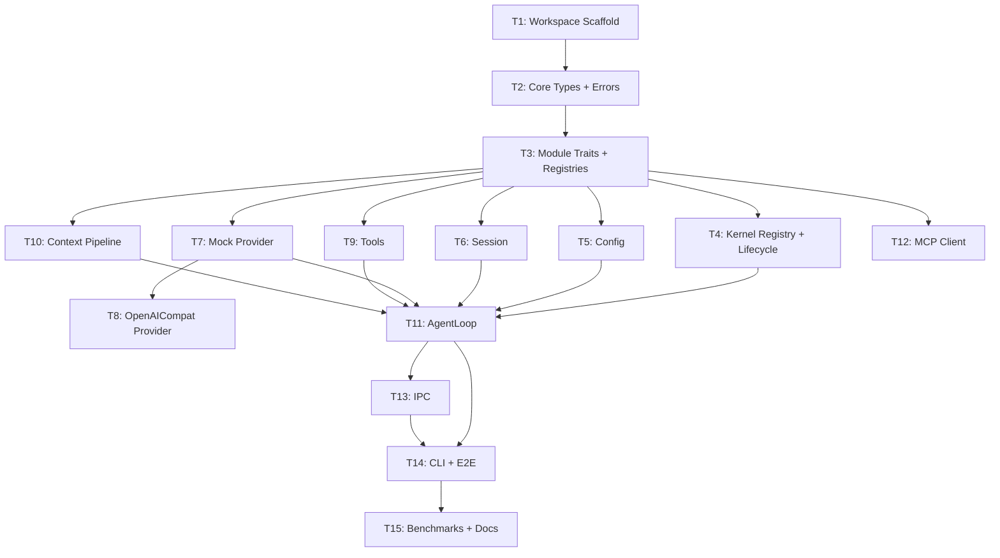

# AgentJ Core Architecture — Implementation Plan

> **For agentic workers:** REQUIRED SUB-SKILL: Use superpowers:subagent-driven-development (recommended) or superpowers:executing-plans to implement this plan task-by-task. Steps use checkbox (`- [ ]`) syntax for tracking.

**Goal:** Build the v0.1 agent kernel loop — CLI input → IPC → context pipeline → model call (DeepSeek/opencode-go via OpenAI-compatible API) → tool execution → streaming response.

**Architecture:** Hub-and-spoke crate layout. `agentj-core` defines all shared traits (`Module`, `KernelModule`, `Tool`, `ModelProvider`), types, errors, and the kernel event-loop orchestrator. Domain crates (`agentj-model`, `agentj-tools`, `agentj-session`, `agentj-context`, `agentj-mcp`, `agentj-config`) implement those traits. `agentj-ipc` wraps the kernel with JSON-RPC 2.0 over stdio. `agentj-cli` is the single binary entry point.

**Tech Stack:** Rust 1.96+, tokio (async runtime), clap 4 (CLI), reqwest 0.12 (HTTP streaming), serde/serde_json (serialization), thiserror 2 (error derive), wiremock (test HTTP server), tracing (logging).

## Global Constraints

- Rust version: 1.96+ (stable toolchain)
- All dependencies: latest stable versions at time of execution (use `cargo add`)
- Rust functions: <= 50 lines, <= 120 chars per line
- No `unwrap()` / `expect()` in library code (use `Result` + `?`)
- No `as any`, `@ts-ignore` or equivalent type holes
- commit messages in English
- Cargo workspace at repo root, all crates flattened in project root

---

### Architecture Notes

- **Message Bus vs Direct Orchestration**: For v0.1, the kernel module registry + `KernelMessage` bus handles IPC ingress and module lifecycle. The agent loop orchestration (`run_turn_stream`) directly calls `SessionStore` / `ModelProvider` / `ToolRegistry` / `ContextPipeline` via trait objects — NOT through `KernelMessage` routing. This is intentional: the full `KernelMessage`-routed pipeline (with `ModelResponse`, `ToolCallRequest`, `ToolCallResult` variants) is needed for the v0.2 Sub-Agent Dispatcher, where tasks fan out to independent worker loops. **v0.2 plan should add those variants and route through the bus.**
- **AgentLoop in agentj-core with trait-only dependencies**: `AgentLoop` lives in `agentj-core/src/agent_loop.rs` and depends ONLY on the traits defined in `agentj-core` (`SessionStore`, `ModelProvider`, `Tool`, `ContextPipeline`, `ConfigProvider`). It does NOT import from domain crates. Unit tests define inline mock implementations of these traits. Integration tests (workspace-level `tests/`) wire real implementations.
- **Streaming API**: `AgentLoop` exposes `run_turn_stream()` returning a `tokio::sync::mpsc::Receiver<AgentEvent>` so IPC/CLI consumers receive incremental deltas — matching the design spec's "流式返回" requirement.

## Phase A: v0.1 — Core Agent Loop

### Task 1: Workspace Scaffold + agentj-core Skeleton [P0] [Sequential]

**Files:**
- Create: `Cargo.toml` (workspace root)
- Create: `rust-toolchain.toml`
- Create: `agentj-core/Cargo.toml`
- Create: `agentj-core/src/lib.rs`

**Interfaces:**
- Produces: Empty workspace with one crate that compiles. `agentj-core` lib crate ready for types.

- [ ] **Step 1: Create project scaffold**

Create root `Cargo.toml`:
```toml
[workspace]
resolver = "2"
members = ["agentj-*"]

[workspace.package]
version = "0.1.0"
edition = "2024"
rust-version = "1.96"
```

Create `rust-toolchain.toml`:
```toml
[toolchain]
channel = "stable"
```

Create `agentj-core/Cargo.toml`:
```toml
[package]
name = "agentj-core"
version.workspace = true
edition.workspace = true
rust-version.workspace = true

[dependencies]
serde = { version = "1", features = ["derive"] }
serde_json = "1"
thiserror = "2"
```

Create `agentj-core/src/lib.rs`:
```rust
//! AgentJ kernel — shared types, traits, and event loop.

pub fn add(left: u64, right: u64) -> u64 {
    left + right
}

#[cfg(test)]
mod tests {
    use super::*;

    #[test]
    fn smoke() {
        assert_eq!(add(2, 2), 4);
    }
}
```

- [ ] **Step 2: Verify build**

Run: `cargo build --workspace`
Expected: exit 0, compiles without errors.

Run: `cargo test --workspace`
Expected: `test result: ok. 1 passed`

- [ ] **Step 3: Commit**

```bash
git add -A && git commit -m "chore: scaffold Cargo workspace with agentj-core crate"
```

---

### Task 2: agentj-core — Shared Types & Errors [P0] [Sequential]

**Files:**
- Create: `agentj-core/src/types.rs`
- Create: `agentj-core/src/error.rs`
- Modify: `agentj-core/src/lib.rs`

**Interfaces:**
- Produces:
  - `types::ModuleId` (`type ModuleId = String`)
  - `types::SessionId` (`type SessionId = String`)
  - `types::Role` (enum: `System, User, Assistant, Tool`)
  - `types::ChatMessage` (struct with `role, content, tool_call_id, tool_calls`)
  - `types::ToolCall` (struct with `id, name, arguments`)
  - `types::ToolDefinition` (struct with `name, description, input_schema`)
  - `types::ModelEvent` (enum: `Delta(String), ToolCall(ToolCall), Done`)
  - `types::ChatResponse` (struct with `content, tool_calls`)
  - `types::ModelOptions` (struct with `model, temperature, max_tokens, stream`)
  - `types::Attachment` (struct with `path, content, mime`)
  - `error::KernelError`, `error::ModelError`, `error::ToolError`, `error::ModuleError`, `error::IpcError`

- [ ] **Step 1: Write failing test for types**

Create `agentj-core/src/types.rs` with the `ChatMessage::system()` constructor:
```rust
use serde::{Deserialize, Serialize};

pub type ModuleId = String;
pub type SessionId = String;

#[derive(Debug, Clone, Copy, PartialEq, Eq, Serialize, Deserialize)]
#[serde(rename_all = "lowercase")]
pub enum Role { System, User, Assistant, Tool }

#[derive(Debug, Clone, Serialize, Deserialize)]
pub struct ToolCall {
    pub id: String,
    pub name: String,
    pub arguments: serde_json::Value,
}

#[derive(Debug, Clone, Serialize, Deserialize)]
pub struct ChatMessage {
    pub role: Role,
    pub content: String,
    #[serde(skip_serializing_if = "Option::is_none")]
    pub tool_call_id: Option<String>,
    #[serde(skip_serializing_if = "Vec::is_empty", default)]
    pub tool_calls: Vec<ToolCall>,
}

impl ChatMessage {
    pub fn system(content: impl Into<String>) -> Self {
        Self { role: Role::System, content: content.into(), tool_call_id: None, tool_calls: vec![] }
    }

    pub fn user(content: impl Into<String>) -> Self {
        Self { role: Role::User, content: content.into(), tool_call_id: None, tool_calls: vec![] }
    }
}
```

Write the test — in `lib.rs`, add:
```rust
#[cfg(test)]
mod tests {
    use super::*;

    #[test]
    fn chatmessage_system_constructor() {
        let msg = types::ChatMessage::system("hello");
        assert_eq!(msg.role, types::Role::System);
        assert_eq!(msg.content, "hello");
    }

    #[test]
    fn chatmessage_serialization_roundtrip() {
        let msg = types::ChatMessage::user("hi");
        let json = serde_json::to_string(&msg).unwrap();
        let back: types::ChatMessage = serde_json::from_str(&json).unwrap();
        assert_eq!(back.role, types::Role::User);
    }
}
```

- [ ] **Step 2: Run test to verify it fails**

Run: `cargo test -p agentj-core`
Expected: FAIL — `types` module not declared.

- [ ] **Step 3: Implement types.rs fully**

Implement the complete `types.rs` with all types listed above (include `ToolDefinition`, `ModelEvent`, `ChatResponse`, `ModelOptions` with `Default`, `Attachment`).

```rust
#[derive(Debug, Clone, Serialize, Deserialize)]
pub struct ToolDefinition {
    pub name: String,
    pub description: String,
    pub input_schema: serde_json::Value,
}

#[derive(Debug, Clone)]
pub enum ModelEvent {
    Delta(String),
    ToolCall(ToolCall),
    Done,
}

#[derive(Debug, Clone)]
pub struct ChatResponse {
    pub content: String,
    pub tool_calls: Vec<ToolCall>,
}

#[derive(Debug, Clone)]
pub struct ModelOptions {
    pub model: String,
    pub temperature: Option<f32>,
    pub max_tokens: Option<u32>,
    pub stream: bool,
}

impl Default for ModelOptions {
    fn default() -> Self {
        Self { model: "deepseek-chat".into(), temperature: None, max_tokens: None, stream: true }
    }
}

#[derive(Debug, Clone, Serialize, Deserialize)]
pub struct Attachment {
    pub path: Option<String>,
    pub content: Option<String>,
    pub mime: Option<String>,
}
```

- [ ] **Step 4: Write error module + test**

Create `agentj-core/src/error.rs`:
```rust
use std::time::Duration;

#[derive(Debug, thiserror::Error)]
pub enum ModuleError {
    #[error("module init failed: {0}")]
    Init(String),
    #[error("module shutdown failed: {0}")]
    Shutdown(String),
    #[error("handler error: {0}")]
    Handler(String),
}

#[derive(Debug, thiserror::Error)]
pub enum KernelError {
    #[error("module '{0}' not found")]
    ModuleNotFound(String),
    #[error("module '{0}' initialization failed: {1}")]
    ModuleInitFailed(String, #[source] anyhow::Error),
    #[error("message routing failed for {msg:?}: {reason}")]
    MessageRouteFailed { msg: String, reason: String },
    #[error("shutdown timeout after {0:?}")]
    ShutdownTimeout(Duration),
    #[error("IPC error: {0}")]
    Ipc(#[from] IpcError),
}

#[derive(Debug, thiserror::Error)]
pub enum IpcError {
    #[error("JSON parse error: {0}")]
    Json(#[from] serde_json::Error),
    #[error("IO error: {0}")]
    Io(#[from] std::io::Error),
    #[error("invalid request: {0}")]
    InvalidRequest(String),
}

#[derive(Debug, thiserror::Error)]
pub enum ModelError {
    #[error("API error ({status}): {message}")]
    Api { status: u16, message: String },
    #[error("rate limited, retry after {retry_after:?}")]
    RateLimited { retry_after: Option<Duration> },
    #[error("context length exceeded: {used}/{max} tokens")]
    TokenLimitExceeded { used: usize, max: usize },
    #[error("network error: {0}")]
    Network(#[from] reqwest::Error),
    #[error("stream error: {0}")]
    Stream(String),
}

#[derive(Debug, thiserror::Error)]
pub enum ToolError {
    #[error("tool '{name}' not found")]
    ToolNotFound { name: String },
    #[error("tool '{name}' execution failed: {reason}")]
    ExecutionFailed { name: String, reason: String },
    #[error("tool '{name}' permission denied: {reason}")]
    PermissionDenied { name: String, reason: String },
    #[error("tool timeout after {0:?}")]
    Timeout(Duration),
}
```

Test in `error.rs`:
```rust
#[cfg(test)]
mod tests {
    use super::*;
    use std::time::Duration;

    #[test]
    fn kernel_error_display() {
        let err = KernelError::ModuleNotFound("test".into());
        assert!(err.to_string().contains("test"));
    }

    #[test]
    fn model_error_display() {
        let err = ModelError::Api { status: 429, message: "too many".into() };
        assert!(err.to_string().contains("429"));
    }

    #[test]
    fn ipc_from_io_error() {
        let io: std::io::Error = std::io::ErrorKind::BrokenPipe.into();
        let err = IpcError::from(io);
        assert!(matches!(err, IpcError::Io(_)));
    }
}
```

Update `agentj-core`'s `Cargo.toml` to add `anyhow = "1"` and `reqwest = { version = "0.12", features = ["json"] }` + `futures = "0.3"` (needed later but add now for compile). Update `lib.rs` to declare modules:
```rust
pub mod types;
pub mod error;
```

- [ ] **Step 5: Run all tests**

Run: `cargo test -p agentj-core`
Expected: 5 tests pass (2 from step 1 + 3 error tests).

- [ ] **Step 6: Commit**

```bash
git add agentj-core/ && git commit -m "feat(agentj-core): add shared types and error enums"
```

---

### Task 3: agentj-core — Module Traits, Registries & KernelContext [P0] [Sequential]

**Files:**
- Create: `agentj-core/src/module.rs`
- Modify: `agentj-core/src/lib.rs`

**Interfaces:**
- Consumes: `types::ModuleId`, `types::ChatMessage`, `types::ToolCall`, `types::ToolDefinition`, `types::ModelEvent`, `types::ChatResponse`, `types::ModelOptions`; `error::ModuleError`, `error::ToolError`, `error::ModelError`
- Produces:
  - `module::Tool` trait: `fn name(), fn description(), fn input_schema(), fn execute()`
  - `module::ModelProvider` trait: `fn chat_stream(), fn chat()`
  - `module::EventHandler` trait: `fn on_event(&self, event: EventType)`
  - `module::EventType` enum: minimal stub
  - `module::ModuleMetadata` struct: `id, name, version, description, author`
  - `module::Module` trait: `fn id(), fn metadata(), fn init(), fn shutdown()`
  - `module::KernelModule` trait: extends `Module` with `fn handle()`
  - `module::ModuleRegister` struct: `register_tool(), on_event(), register_provider()`
  - `module::ToolRegistry` struct: `register(), get(), is_empty()`
  - `module::ProviderRegistry` struct: `register(), get_default(), list()`
  - `module::KernelContext` struct: `Arc`-wrapped config/session/tools/providers
  - `module::KernelMessage` enum & `KernelResponse` enum
  - `module::SessionStore` trait: `create(), append(), get()`
  - `module::ConfigProvider` trait: `get_str(), get_int(), get_providers()`

- [ ] **Step 1: Write failing test for Module trait**

```rust
#[cfg(test)]
mod tests {
    use super::*;
    use crate::error::ModuleError;
    use std::sync::Arc;

    struct TestModule;
    impl Module for TestModule {
        fn id(&self) -> ModuleId { "test".into() }
        fn metadata(&self) -> ModuleMetadata {
            ModuleMetadata { id: "test".into(), name: "Test".into(), version: "0.1".into(), description: "".into(), author: "".into() }
        }
        fn init(&mut self, _ctx: &KernelContext, _register: &mut ModuleRegister) -> Result<(), ModuleError> { Ok(()) }
        fn shutdown(&mut self) -> Result<(), ModuleError> { Ok(()) }
    }

    #[test]
    fn module_id() {
        let m = TestModule;
        assert_eq!(m.id(), "test");
    }
}
```

- [ ] **Step 2: Run test — expect FAIL (module.rs not compiled)**

- [ ] **Step 3: Implement module.rs fully**

```rust
use std::collections::HashMap;
use std::sync::Arc;
use async_trait::async_trait;
use futures::stream::BoxStream;
use crate::error::{ModuleError, ModelError, ToolError};
use crate::types::*;

// ---- Traits ----

pub trait Tool: Send + Sync {
    fn name(&self) -> &str;
    fn description(&self) -> &str;
    fn input_schema(&self) -> serde_json::Value;
    fn execute(&self, input: serde_json::Value) -> Result<serde_json::Value, ToolError>;
}

#[async_trait]
pub trait ModelProvider: Send + Sync {
    async fn chat_stream(
        &self,
        messages: Vec<ChatMessage>,
        tools: Vec<ToolDefinition>,
        options: ModelOptions,
    ) -> Result<BoxStream<'static, Result<ModelEvent, ModelError>>, ModelError>;

    async fn chat(
        &self,
        messages: Vec<ChatMessage>,
        options: ModelOptions,
    ) -> Result<ChatResponse, ModelError>;
}

#[derive(Debug, Clone, PartialEq, Eq, Hash)]
pub enum EventType {
    PreRequest,
    PostResponse,
    Shutdown,
    ToolStart(String),
    ToolEnd(String),
}

pub trait EventHandler: Send + Sync {
    fn on_event(&self, event: &EventType, ctx: &KernelContext);
}

#[derive(Debug, Clone)]
pub struct ModuleMetadata {
    pub id: ModuleId,
    pub name: String,
    pub version: String,
    pub description: String,
    pub author: String,
}

// ---- Module & KernelModule ----

pub trait Module: Send + Sync {
    fn id(&self) -> ModuleId;
    fn metadata(&self) -> ModuleMetadata;
    fn init(&mut self, ctx: &KernelContext, register: &mut ModuleRegister) -> Result<(), ModuleError>;
    fn shutdown(&mut self) -> Result<(), ModuleError>;
}

pub trait KernelModule: Module {
    fn handle(&mut self, msg: &KernelMessage) -> Result<KernelResponse, ModuleError>;
}

// ---- Registries ----

pub struct ModuleRegister {
    pub tools: Arc<ToolRegistry>,
    pub events: Vec<(EventType, Box<dyn EventHandler>)>,
    pub providers: Arc<ProviderRegistry>,
}

impl ModuleRegister {
    pub fn new(tools: Arc<ToolRegistry>, providers: Arc<ProviderRegistry>) -> Self {
        Self { tools, events: vec![], providers }
    }

    pub fn register_tool(&mut self, tool: Box<dyn Tool>) -> Result<(), ModuleError> {
        self.tools.register(tool);
        Ok(())
    }

    pub fn on_event(
        &mut self,
        event: EventType,
        handler: Box<dyn EventHandler>,
    ) -> Result<(), ModuleError> {
        self.events.push((event, handler));
        Ok(())
    }

    pub fn register_provider(
        &mut self,
        provider: Box<dyn ModelProvider>,
    ) -> Result<(), ModuleError> {
        let name = "custom"; // v0.1: single provider; v0.2: use metadata
        self.providers.register(name.into(), provider);
        Ok(())
    }
}

pub struct ToolRegistry {
    tools: parking_lot::RwLock<HashMap<String, Box<dyn Tool>>>,
}

impl ToolRegistry {
    pub fn new() -> Self {
        Self { tools: parking_lot::RwLock::new(HashMap::new()) }
    }

    pub fn register(&self, tool: Box<dyn Tool>) {
        self.tools.write().insert(tool.name().to_string(), tool);
    }

    pub fn get(&self, name: &str) -> Option<Arc<dyn Tool>> {
        // Box → Arc: we store in Arc for cheap clone
        // Simplified for v0.1: register actually stores Arc<dyn Tool>
        // Store Arc<dyn Tool> from the start
        todo!()
    }

    pub fn definitions(&self) -> Vec<ToolDefinition> {
        self.tools.read().iter().map(|(_, t)| ToolDefinition {
            name: t.name().into(),
            description: t.description().into(),
            input_schema: t.input_schema(),
        }).collect()
    }
}
```

Wait — storing `Box<dyn Tool>` in HashMap and returning `Arc<dyn Tool>` from `get()` won't work. For v0.1 simplicity, store `Arc<dyn Tool>` directly and accept `Arc<dyn Tool>` on register. Adjust `ModuleRegister::register_tool` to take `Arc<dyn Tool>`.

Let me use `Arc` from the start:

```rust
use std::sync::Arc;
use parking_lot::RwLock;

pub struct ToolRegistry {
    tools: RwLock<HashMap<String, Arc<dyn Tool>>>,
}

impl ToolRegistry {
    pub fn new() -> Self { Self { tools: RwLock::new(HashMap::new()) } }
    
    pub fn register(&self, tool: Arc<dyn Tool>) {
        self.tools.write().insert(tool.name().to_string(), tool);
    }
    
    pub fn get(&self, name: &str) -> Option<Arc<dyn Tool>> {
        self.tools.read().get(name).cloned()
    }
    
    pub fn definitions(&self) -> Vec<ToolDefinition> {
        self.tools.read().iter().map(|(_, t)| ToolDefinition {
            name: t.name().into(),
            description: t.description().into(),
            input_schema: t.input_schema(),
        }).collect()
    }
}

pub struct ProviderRegistry {
    providers: RwLock<HashMap<String, Arc<dyn ModelProvider>>>,
    default: RwLock<Option<String>>,
}

impl ProviderRegistry {
    pub fn new() -> Self { Self { providers: RwLock::new(HashMap::new()), default: RwLock::new(None) } }
    
    pub fn register(&self, name: String, provider: Arc<dyn ModelProvider>) {
        self.providers.write().insert(name.clone(), provider);
        if self.default.read().is_none() {
            *self.default.write() = Some(name);
        }
    }
    
    pub fn get_default(&self) -> Option<Arc<dyn ModelProvider>> {
        self.default.read().as_ref()
            .and_then(|name| self.providers.read().get(name).cloned())
    }
}
```

Similarly `ModuleRegister::register_tool` takes `Arc<dyn Tool>`, `register_provider` takes `Arc<dyn ModelProvider>`.

Define `KernelContext`:
```rust
pub trait SessionStore: Send + Sync {
    fn create(&self) -> Result<SessionId, ModuleError>;
    fn append(&self, session: &SessionId, message: ChatMessage) -> Result<(), ModuleError>;
    fn get(&self, session: &SessionId) -> Result<Vec<ChatMessage>, ModuleError>;
    fn estimate_tokens(&self, session: &SessionId) -> Result<usize, ModuleError>;
}

pub trait ConfigProvider: Send + Sync {
    fn get_str(&self, key: &str) -> Option<String>;
    fn get_int(&self, key: &str) -> Option<i64>;
    fn providers(&self) -> Vec<(String, String)>; // Vec<(provider_type, model_name)>
}

#[derive(Clone)]
pub struct KernelContext {
    pub session: Arc<dyn SessionStore>,
    pub tools: Arc<ToolRegistry>,
    pub providers: Arc<ProviderRegistry>,
    pub config: Arc<dyn ConfigProvider>,
}

pub enum KernelMessage {
    UserRequest { session_id: SessionId, content: String, attachments: Vec<Attachment> },
    Shutdown,
}

pub enum KernelResponse {
    Handled,
    Streaming(Vec<String>),
}
```

- [ ] **Step 4: Run all tests**

Run: `cargo test -p agentj-core`
Expected: tests pass (module_id test + existing type tests).

- [ ] **Step 5: Commit**

```bash
git add agentj-core/ && git commit -m "feat(agentj-core): add Module, KernelModule traits, registries, KernelContext"
```

---

### Task 4: agentj-core — Kernel Module Registry & Lifecycle [P0] [Sequential]

**Files:**
- Create: `agentj-core/src/kernel.rs`
- Modify: `agentj-core/src/lib.rs`

**Interfaces:**
- Consumes: `module::KernelModule`, `module::KernelContext`, `module::KernelMessage`, `module::KernelResponse`, `error::KernelError`
- Produces:
  - `kernel::Kernel` struct: `new()` → `register_module()` → `start()` (returns JoinHandle)
  - Shutdown via `tokio::sync::oneshot`

- [ ] **Step 1: Write failing test**

```rust
#[cfg(test)]
mod tests {
    use super::*;
    use crate::module::*;
    use crate::error::*;
    use crate::types::*;
    use std::sync::Arc;
    use std::sync::Mutex as StdMutex;

    struct SpyModule {
        handled: Arc<StdMutex<Vec<KernelMessage>>>,
    }

    impl Module for SpyModule {
        fn id(&self) -> ModuleId { "spy".into() }
        fn metadata(&self) -> ModuleMetadata {
            ModuleMetadata { id: "spy".into(), name: "Spy".into(), version: "0.1".into(), description: "".into(), author: "".into() }
        }
        fn init(&mut self, _ctx: &KernelContext, _r: &mut ModuleRegister) -> Result<(), ModuleError> { Ok(()) }
        fn shutdown(&mut self) -> Result<(), ModuleError> { Ok(()) }
    }

    impl KernelModule for SpyModule {
        fn handle(&mut self, msg: &KernelMessage) -> Result<KernelResponse, ModuleError> {
            self.handled.lock().unwrap().push(match msg {
                KernelMessage::UserRequest { session_id, content, attachments } => KernelMessage::UserRequest {
                    session_id: session_id.clone(), content: content.clone(), attachments: attachments.clone(),
                },
                KernelMessage::Shutdown => KernelMessage::Shutdown,
            });
            Ok(KernelResponse::Handled)
        }
    }

    #[tokio::test]
    async fn kernel_registers_and_routes_message() {
        let handled = Arc::new(StdMutex::new(vec![]));
        let module = SpyModule { handled: handled.clone() };
        let mut kernel = Kernel::new();
        kernel.register_module(Box::new(module)).unwrap();

        let (tx, rx) = tokio::sync::oneshot::channel();
        let handle = kernel.start(tx).unwrap();
        kernel.send(KernelMessage::UserRequest { session_id: "s1".into(), content: "hello".into(), attachments: vec![] });

        tokio::time::sleep(Duration::from_millis(50)).await;
        assert_eq!(handled.lock().unwrap().len(), 1);
        
        kernel.shutdown().await.unwrap();
        handle.await.unwrap().unwrap();
    }
}
```

Wait, this test has a `KernelMessage` clone issue — the design uses borrowed data in the enum originally, but the test uses cloned data. To keep KernelMessage clonable for tests, derive `Clone` (not in production hot path, agent loop is I/O-bound). I'll add `#[derive(Debug, Clone)]` on KernelMessage and KernelResponse.

Also: the `send` method needs a channel — kernel receives messages from a `tokio::sync::mpsc` sender kept internally. Let me revise: `Kernel::send()` takes a reference to a sender (or Kernel holds the sender from start).

Simplest: `Kernel::new()` creates an `mpsc::channel(64)`. Returns `(Kernel, KernelSender)`. KernelSender is cloneable with `send(KernelMessage)`.

```rust
#[derive(Clone)]
pub struct KernelSender {
    tx: tokio::sync::mpsc::Sender<KernelMessage>,
}

impl KernelSender {
    pub fn send(&self, msg: KernelMessage) -> Result<(), KernelError> {
        self.tx.try_send(msg).map_err(|e| KernelError::MessageRouteFailed {
            msg: format!("{:?}", e.into_inner()),
            reason: "channel closed".into(),
        })
    }
}

pub struct Kernel {
    modules: Vec<Box<dyn KernelModule>>,
    rx: Option<tokio::sync::mpsc::Receiver<KernelMessage>>,
    sender: KernelSender,
}
```

The test should use `Kernel::new()` and call `kernel.sender().send(...)`. Then `kernel.start()` loops on `self.rx.take()`.

Let me revise the implementation and test code accordingly. I'll include the actual implementation in Step 3.

- [ ] **Step 2: Run test — expect FAIL**

- [ ] **Step 3: Write kernel.rs**

```rust
use std::collections::HashMap;
use tokio::task::JoinHandle;
use crate::error::KernelError;
use crate::module::{KernelModule, KernelResponse};
use crate::types::*;

const CHANNEL_SIZE: usize = 128;

#[derive(Clone)]
pub struct KernelSender {
    tx: tokio::sync::mpsc::Sender<KernelMessage>,
}

impl KernelSender {
    pub fn send(&self, msg: KernelMessage) -> Result<(), KernelError> {
        self.tx.try_send(msg).map_err(|e| {
            KernelError::MessageRouteFailed {
                msg: format!("{:?}", e.into_inner()),
                reason: "channel closed or full".into(),
            }
        })
    }
}

pub struct Kernel {
    modules: HashMap<String, Box<dyn KernelModule>>,
    sender: KernelSender,
    rx: tokio::sync::mpsc::Receiver<KernelMessage>,
}

impl Kernel {
    pub fn new() -> Self {
        let (tx, rx) = tokio::sync::mpsc::channel(CHANNEL_SIZE);
        Self { modules: HashMap::new(), sender: KernelSender { tx }, rx }
    }

    pub fn sender(&self) -> KernelSender {
        self.sender.clone()
    }

    pub fn register_module(
        &mut self,
        mut module: Box<dyn KernelModule>,
        ctx: &crate::module::KernelContext,
        register: &mut crate::module::ModuleRegister,
    ) -> Result<(), KernelError> {
        let id = module.id();
        module.init(ctx, register)
            .map_err(|e| KernelError::ModuleInitFailed(id.clone(), e.into()))?;
        self.modules.insert(id, module);
        Ok(())
    }

    pub fn start(&mut self) -> JoinHandle<Result<(), KernelError>> {
        let mut rx = std::mem::replace(&mut self.rx, tokio::sync::mpsc::channel(1).1);
        // Can't move self.modules into task — use Arc<Mutex<Vec<Box<dyn KernelModule>>>>
        // Refactor: Kernel holds Arc<RwLock<Vec>> for modules
        unimplemented!("refactor needed for Send")
    }
}
```

Hmm, `Box<dyn KernelModule>` is not `Send` by default. And we can't move `self.modules` into a tokio task. Let me redesign Kernel to use `Arc<parking_lot::RwLock<Vec<Box<dyn KernelModule>>>>` or better, `Arc<tokio::sync::RwLock<HashMap<String, Box<dyn KernelModule>>>>`. But `tokio::sync::RwLock` requires Send, and `Box<dyn KernelModule>` needs `Send + Sync` bounds (which Module already has `Send + Sync`, and KernelModule inherits it). Good.

Actually, the design doc defines `Module: Send + Sync`, so `KernelModule` also is `Send + Sync`. And `Box<dyn KernelModule>: Send`. So `Arc<tokio::sync::Mutex<HashMap<String, Box<dyn KernelModule>>>>` should work.

Better: `Arc<std::sync::Mutex<HashMap<String, Box<dyn KernelModule>>>>` — simpler, no async lock contention needed (message processing is sequential in the loop).

For `start()`, pass `Arc<Mutex<HashMap>>` to the spawned task.

```rust
use std::sync::{Arc, Mutex};

pub struct Kernel {
    modules: Arc<Mutex<HashMap<String, Box<dyn KernelModule>>>>,
    sender: KernelSender,
    rx: tokio::sync::mpsc::Receiver<KernelMessage>,
}

impl Kernel {
    pub fn new() -> Self {
        let (tx, rx) = tokio::sync::mpsc::channel(CHANNEL_SIZE);
        Self { modules: Arc::new(Mutex::new(HashMap::new())), sender: KernelSender { tx }, rx }
    }

    pub fn sender(&self) -> KernelSender { self.sender.clone() }

    pub fn register_module(
        &mut self,
        mut module: Box<dyn KernelModule>,
        ctx: &crate::module::KernelContext,
        register: &mut crate::module::ModuleRegister,
    ) -> Result<(), KernelError> {
        let id = module.id();
        match module.init(ctx, register) {
            Ok(()) => {
                self.modules.lock().unwrap().insert(id, module);
                Ok(())
            }
            Err(e) => {
                tracing::warn!(module_id = %id, error = %e, "module init failed, continuing without it");
                Ok(()) // Design spec: don't crash other modules on one module's failure
            }
        }
    }

    pub fn start(&mut self) -> JoinHandle<Result<(), KernelError>> {
        let modules = Arc::clone(&self.modules);
        let mut rx = std::mem::replace(&mut self.rx, tokio::sync::mpsc::channel(1).1);
        tokio::spawn(async move {
            while let Some(msg) = rx.recv().await {
                if matches!(msg, KernelMessage::Shutdown) { break; }
                let mut guard = modules.lock().unwrap();
                for (_, module) in guard.iter_mut() {
                    if let Err(e) = module.handle(&msg) {
                        tracing::error!(?e, "module handler error");
                    }
                }
            }
            Ok(())
        })
    }
}
```

Wait — `Box<dyn KernelModule>` is `Send` (KernelModule: Send+Sync via Module bounds) but `std::sync::Mutex` requires `Send` for the contained type to be shared with `Arc`. Is `Box<dyn KernelModule>: Send + Sync`? `Box<T>: Send if T: Send`. `Box<T>: Sync if T: Sync`. Since `Module: Send + Sync`, yes. `std::sync::Mutex<HashMap<String, Box<dyn KernelModule>>>: Send + Sync` — `Mutex<T>: Send+Sync` always, good.

But `module.handle(&msg)` borrows `msg` which is moved (owned) from `rx.recv().await`. That's fine, `handle` takes `&KernelMessage`.

One issue: `anyhow::anyhow!("{}", e)` — need `anyhow` dependency in core. Add to Cargo.toml (already planned: `anyhow = "1"`).

Also add `tracing = "0.1"` to core deps. Add `tokio` dependency to core: `tokio = { version = "1", features = ["sync", "rt", "macros"] }`.

- [ ] **Step 4: Run all tests**

Run: `cargo test -p agentj-core`
Expected: kernel routing test passes.

- [ ] **Step 5: Commit**

```bash
git add agentj-core/ && git commit -m "feat(agentj-core): add Kernel module registry and event loop"
```

---

### Task 5: agentj-config — Multi-Level Config Merge [P0] [Parallel with 6,7,8,9,10]

**Files:**
- Create: `agentj-config/Cargo.toml`
- Create: `agentj-config/src/lib.rs`
- Create: `agentj-config/src/merge.rs`

**Interfaces:**
- Consumes: `agentj_core::module::ConfigProvider` (trait)
- Produces: `agentj_config::AgentJConfig` struct; `agentj_config::Config::new()` that loads and merges; implements `agentj_core::module::ConfigProvider`

**Depends on:** Task 3 (`KernelModule` traits, `ConfigProvider` trait, `KernelContext`)

- [ ] **Step 1: Write test for TOML loading and merge priority**

```rust
#[cfg(test)]
mod tests {
    use super::*;
    use std::io::Write;
    use tempfile::TempDir;

    #[test]
    fn loads_default_config() {
        let dir = TempDir::new().unwrap();
        let config_path = dir.path().join("config.toml");
        std::fs::write(&config_path, r#"[model]
provider = "deepseek"
[[model.providers]]
name = "deepseek-chat"
base_url = "https://api.deepseek.com"
"#).unwrap();

        let config = Config::load(Some(config_path)).unwrap();
        let providers = config.providers();
        assert_eq!(providers.len(), 1);
        assert_eq!(providers[0].0, "deepseek-chat");
    }

    #[test]
    fn env_overrides_toml() {
        let dir = TempDir::new().unwrap();
        let config_path = dir.path().join("config.toml");
        std::fs::write(&config_path, r#"[model]
provider = "deepseek"
"#).unwrap();

        std::env::set_var("AGENTJ_MODEL_PROVIDER", "opencode-go");
        let config = Config::load(Some(config_path)).unwrap();
        assert_eq!(config.model.provider, "opencode-go");
        std::env::remove_var("AGENTJ_MODEL_PROVIDER");
    }
}
```

- [ ] **Step 2: Run test — expect FAIL**

- [ ] **Step 3: Implement config crate**

`Cargo.toml`:
```toml
[package]
name = "agentj-config"
version.workspace = true
edition.workspace = true

[dependencies]
agentj-core = { path = "../agentj-core" }
serde = { version = "1", features = ["derive"] }
toml = "0.8"
```

`lib.rs`:
```rust
pub mod merge;
use std::path::PathBuf;
use std::sync::Arc;
use agentj_core::module::ConfigProvider;
use serde::Deserialize;

#[derive(Debug, Clone, Deserialize)]
pub struct ModelProviderConfig {
    pub name: String,
    pub base_url: String,
    pub api_key_env: Option<String>,
}

#[derive(Debug, Clone, Deserialize)]
pub struct ModelSection {
    pub provider: String,
    #[serde(default)]
    pub providers: Vec<ModelProviderConfig>,
}

impl Default for ModelSection {
    fn default() -> Self {
        Self { provider: "deepseek".into(), providers: vec![] }
    }
}

#[derive(Debug, Clone, Deserialize)]
pub struct AgentJConfig {
    #[serde(default)]
    pub model: ModelSection,
}

impl Default for AgentJConfig {
    fn default() -> Self {
        Self { model: ModelSection {
            provider: "deepseek".into(),
            providers: vec![ModelProviderConfig {
                name: "deepseek-chat".into(),
                base_url: "https://api.deepseek.com".into(),
                api_key_env: Some("DEEPSEEK_API_KEY".into()),
            }],
        }}
    }
}

pub struct Config {
    inner: AgentJConfig,
}

impl Config {
    pub fn load(path: Option<PathBuf>) -> Result<Self, Box<dyn std::error::Error>> {
        let mut config = AgentJConfig::default();
        if let Some(p) = path {
            if p.exists() {
                let content = std::fs::read_to_string(&p)?;
                let file_config: AgentJConfig = toml::from_str(&content)?;
                if !file_config.model.providers.is_empty() {
                    config.model.providers = file_config.model.providers;
                }
                if !file_config.model.provider.is_empty() && file_config.model.provider != "deepseek" {
                    config.model.provider = file_config.model.provider;
                }
            }
        }
        // Environment overrides
        if let Ok(val) = std::env::var("AGENTJ_MODEL_PROVIDER") {
            config.model.provider = val;
        }
        Ok(Self { inner: config })
    }
}

impl ConfigProvider for Config {
    fn get_str(&self, key: &str) -> Option<String> {
        match key {
            "model.provider" => Some(self.inner.model.provider.clone()),
            _ => None,
        }
    }
    fn get_int(&self, _key: &str) -> Option<i64> { None }
    fn providers(&self) -> Vec<(String, String)> {
        self.inner.model.providers.iter()
            .map(|p| (p.name.clone(), p.base_url.clone()))
            .collect()
    }
}

impl Config {
    pub fn inner(&self) -> &AgentJConfig { &self.inner }
}
```

- [ ] **Step 4: Run tests**

Run: `cargo test -p agentj-config`
Expected: config tests pass (need `tempfile` dev-dependency).

- [ ] **Step 5: Commit**

```bash
git add agentj-config/ && git commit -m "feat(agentj-config): add multi-level TOML config merge with env overrides"
```

---

### Task 6: agentj-session — Session Store with Token Counting [P0] [Parallel with 5,7,8,9,10]

**Files:**
- Create: `agentj-session/Cargo.toml`
- Create: `agentj-session/src/lib.rs`

**Interfaces:**
- Consumes: `agentj_core::module::SessionStore`, `agentj_core::types::{SessionId, ChatMessage}`; `agentj_core::error::ModuleError`
- Produces: `session::InMemoryStore` (implements `SessionStore`)

- [ ] **Step 1: Write failing test**

```rust
use agentj_core::module::SessionStore;
use agentj_core::types::{ChatMessage, Role, SessionId};
use agentj_core::error::ModuleError;

#[test]
fn create_and_append_session() -> Result<(), ModuleError> {
    let store = InMemoryStore::new();
    let sid = store.create()?;
    let msg = ChatMessage::user("hello");
    store.append(&sid, msg.clone())?;
    let history = store.get(&sid)?;
    assert_eq!(history.len(), 1);
    assert_eq!(history[0].role, Role::User);
    Ok(())
}

#[test]
fn unknown_session_returns_empty() -> Result<(), ModuleError> {
    let store = InMemoryStore::new();
    let history = store.get(&"nonexistent".to_string())?;
    assert!(history.is_empty());
    Ok(())
}

#[test]
fn estimate_tokens_counts_approximate() -> Result<(), ModuleError> {
    let store = InMemoryStore::new();
    let sid = store.create()?;
    store.append(&sid, ChatMessage::user("hello world, this is a test message with enough chars to count tokens roughly"))?;
    let tokens = store.estimate_tokens(&sid)?;
    // Rough estimate: ~4 chars per token for English text
    // "hello world..." has ~80 chars → ~20 tokens
    assert!(tokens > 5, "should have more than 5 tokens");
    assert!(tokens < 50, "should have fewer than 50 tokens");
    Ok(())
}
```

- [ ] **Step 2: Run test — expect FAIL**

- [ ] **Step 3: Implement**

```rust
use std::collections::HashMap;
use std::sync::Mutex;
use agentj_core::module::SessionStore;
use agentj_core::types::{ChatMessage, SessionId};
use agentj_core::error::ModuleError;
use uuid::Uuid;

pub struct InMemoryStore {
    sessions: Mutex<HashMap<SessionId, Vec<ChatMessage>>>,
}

impl InMemoryStore {
    pub fn new() -> Self {
        Self { sessions: Mutex::new(HashMap::new()) }
    }
}

impl SessionStore for InMemoryStore {
    fn create(&self) -> Result<SessionId, ModuleError> {
        let id = Uuid::new_v4().to_string();
        self.sessions.lock().unwrap().insert(id.clone(), vec![]);
        Ok(id)
    }

    fn append(&self, session: &SessionId, message: ChatMessage) -> Result<(), ModuleError> {
        let mut map = self.sessions.lock().unwrap();
        map.entry(session.clone()).or_default().push(message);
        Ok(())
    }

    fn get(&self, session: &SessionId) -> Result<Vec<ChatMessage>, ModuleError> {
        Ok(self.sessions.lock().unwrap().get(session).cloned().unwrap_or_default())
    }

    fn estimate_tokens(&self, session: &SessionId) -> Result<usize, ModuleError> {
        let messages = self.get(session)?;
        // v0.1: approximate token counting — ~4 chars per token for English
        let total_chars: usize = messages.iter().map(|m| m.content.len()).sum();
        Ok(total_chars / 4)
    }
}
```

- [ ] **Step 4: Run tests**

Run: `cargo test -p agentj-session`
Expected: tests pass.

- [ ] **Step 5: Commit**

```bash
git add agentj-session/ && git commit -m "feat(agentj-session): add in-memory session store with create/append/get"
```

---

### Task 7: agentj-model — MockModelProvider [P0] [Parallel with 5,6,8,9,10]

**Files:**
- Create: `agentj-model/Cargo.toml`
- Create: `agentj-model/src/lib.rs`
- Create: `agentj-model/src/mock.rs`

**Interfaces:**
- Consumes: `agentj_core::module::ModelProvider`, `agentj_core::types::*`, `agentj_core::error::ModelError`
- Produces: `agentj_model::MockModelProvider` (scripted responses, implements `ModelProvider`)

- [ ] **Step 1: Write test for scripted stream**

```rust
#[tokio::test]
async fn mock_provider_returns_scripted_events() {
    use futures::StreamExt;
    use agentj_core::types::*;

    let events = vec![
        Ok(ModelEvent::Delta("Hello".into())),
        Ok(ModelEvent::Delta(" world".into())),
        Ok(ModelEvent::Done),
    ];
    let provider = MockModelProvider::new(events);
    let mut stream = provider.chat_stream(vec![ChatMessage::user("hi")], vec![], ModelOptions::default()).await.unwrap();
    
    let mut chunks: Vec<String> = vec![];
    while let Some(result) = stream.next().await {
        match result.unwrap() {
            ModelEvent::Delta(text) => chunks.push(text),
            ModelEvent::Done => break,
            _ => {}
        }
    }
    assert_eq!(chunks.join(""), "Hello world");
}
```

- [ ] **Step 2: Run — expect FAIL**

- [ ] **Step 3: Implement**

`Cargo.toml`:
```toml
[package]
name = "agentj-model"
version.workspace = true
edition.workspace = true

[dependencies]
agentj-core = { path = "../agentj-core" }
async-trait = "0.1"
futures = { version = "0.3" }
tokio = { version = "1", features = ["sync"] }
```

`src/mock.rs`:
```rust
use std::sync::Mutex;
use agentj_core::module::ModelProvider;
use agentj_core::types::*;
use agentj_core::error::ModelError;
use async_trait::async_trait;
use futures::stream::{self, BoxStream};

pub struct MockModelProvider {
    script: Mutex<Vec<Result<ModelEvent, ModelError>>>,
}

impl MockModelProvider {
    pub fn new(script: Vec<Result<ModelEvent, ModelError>>) -> Self {
        Self { script: Mutex::new(script) }
    }
}

#[async_trait]
impl ModelProvider for MockModelProvider {
    async fn chat_stream(
        &self,
        _messages: Vec<ChatMessage>,
        _tools: Vec<ToolDefinition>,
        _options: ModelOptions,
    ) -> Result<BoxStream<'static, Result<ModelEvent, ModelError>>, ModelError> {
        let events = self.script.lock().unwrap().clone();
        Ok(Box::pin(stream::iter(events)))
    }

    async fn chat(
        &self,
        _messages: Vec<ChatMessage>,
        _options: ModelOptions,
    ) -> Result<ChatResponse, ModelError> {
        Ok(ChatResponse { content: "mock response".into(), tool_calls: vec![] })
    }
}
```

- [ ] **Step 4: Run tests**

Run: `cargo test -p agentj-model`
Expected: mock provider test passes.

- [ ] **Step 5: Commit**

```bash
git add agentj-model/ && git commit -m "feat(agentj-model): add MockModelProvider for test scripting"
```

---

### Task 8: agentj-model — OpenAICompatibleProvider (DeepSeek + opencode-go) [P0] [Sequential]

**Files:**
- Create: `agentj-model/src/openai_compat.rs`
- Modify: `agentj-model/src/lib.rs`
- Modify: `agentj-model/Cargo.toml`

**Interfaces:**
- Consumes: `MockModelProvider` (Task 7)
- Produces: `OpenAICompatibleProvider` — configurable base_url, api_key, model name; SSE parsing; retry with exponential backoff (max 3 retries); TokenLimitExceeded detection

**Depends on:** Task 7

- [ ] **Step 1: Write test with wiremock**

`Cargo.toml` add `reqwest = { version = "0.12", features = ["json", "stream"] }`, `wiremock = "0.6"` (dev), `tracing = "0.1"`.

```rust
#[cfg(test)]
mod tests {
    use super::*;
    use wiremock::{MockServer, Mock, ResponseTemplate};
    use wiremock::matchers::{method, path, header};
    use futures::StreamExt;

    #[tokio::test]
    async fn openai_compat_streams_sse() {
        let server = MockServer::start().await;
        let sse_body = "data: {\"id\":\"1\",\"object\":\"chat.completion.chunk\",\"choices\":[{\"delta\":{\"content\":\"Hello\"},\"index\":0}]}\n\ndata: {\"id\":\"2\",\"object\":\"chat.completion.chunk\",\"choices\":[{\"delta\":{\"content\":\" world\"},\"index\":0}]}\n\ndata: [DONE]\n\n";

        Mock::given(method("POST"))
            .and(path("/v1/chat/completions"))
            .respond_with(ResponseTemplate::new(200).set_body_string(sse_body).insert_header("content-type", "text/event-stream"))
            .mount(&server).await;

        let provider = OpenAICompatibleProvider::new(
            server.uri(),
            "sk-test".into(),
            "test-model".into(),
        );
        let mut stream = provider.chat_stream(
            vec![ChatMessage::user("hi")], vec![], ModelOptions { model: "test-model".into(), ..Default::default() }
        ).await.unwrap();

        let mut chunks = vec![];
        while let Some(result) = stream.next().await {
            match result.unwrap() {
                ModelEvent::Delta(text) => chunks.push(text),
                ModelEvent::Done => break,
                _ => {}
            }
        }
        assert_eq!(chunks.join(""), "Hello world");
    }
}
```

- [ ] **Step 2: Run test — expect FAIL**

- [ ] **Step 3: Implement OpenAICompatibleProvider**

```rust
use std::time::Duration;
use agentj_core::module::ModelProvider;
use agentj_core::types::*;
use agentj_core::error::ModelError;
use async_trait::async_trait;
use futures::{StreamExt, stream};
use futures::stream::BoxStream;
use reqwest::Client;
use serde_json::Value;
use tokio::time::sleep;

pub struct OpenAICompatibleProvider {
    base_url: String,
    api_key: String,
    model: String,
    client: Client,
}

impl OpenAICompatibleProvider {
    pub fn new(base_url: String, api_key: String, model: String) -> Self {
        Self {
            base_url: base_url.trim_end_matches('/').to_string(),
            api_key,
            model,
            client: Client::new(),
        }
    }

    async fn try_chat_stream_inner(
        &self,
        messages: &[ChatMessage],
        tools: &[ToolDefinition],
        options: &ModelOptions,
    ) -> Result<BoxStream<'static, Result<ModelEvent, ModelError>>, ModelError> {
        let url = format!("{}/v1/chat/completions", self.base_url);
        let body = serde_json::json!({
            "model": options.model,
            "messages": messages,
            "tools": tools.iter().map(|t| serde_json::json!({
                "type": "function",
                "function": { "name": t.name, "description": t.description, "parameters": t.input_schema }
            })).collect::<Vec<_>>(),
            "stream": true,
            "temperature": options.temperature.unwrap_or(0.7),
        });

        let response = self.client.post(&url)
            .header("Authorization", format!("Bearer {}", &self.api_key))
            .header("Content-Type", "application/json")
            .json(&body)
            .send().await.map_err(ModelError::Network)?;

        let status = response.status().as_u16();
        if status == 429 {
            return Err(ModelError::RateLimited { retry_after: None });
        }
        if status != 200 {
            let msg = response.text().await.unwrap_or_default();
            return Err(ModelError::Api { status, message: msg });
        }

        let byte_stream = response.bytes_stream();
        let stream = byte_stream.map(move |result| {
            let bytes = result.map_err(ModelError::Network)?;
            let text = String::from_utf8_lossy(&bytes);
            parse_sse_line(&text)
        });
        Ok(Box::pin(stream))
    }
}

fn parse_sse_line(line: &str) -> Result<ModelEvent, ModelError> {
    let line = line.trim();
    if line.is_empty() || !line.starts_with("data: ") {
        return Ok(ModelEvent::Done); // skip empty lines, will be filtered upstream
    }
    let data = &line[6..];
    if data == "[DONE]" {
        return Ok(ModelEvent::Done);
    }
    let json: Value = serde_json::from_str(data).map_err(|e| ModelError::Stream(e.to_string()))?;
    let choices = json.get("choices").and_then(|c| c.as_array());
    if let Some(choices) = choices {
        for choice in choices {
            if let Some(delta) = choice.get("delta") {
                if let Some(content) = delta.get("content").and_then(|v| v.as_str()) {
                    if !content.is_empty() {
                        return Ok(ModelEvent::Delta(content.to_string()));
                    }
                }
                if let Some(tc) = delta.get("tool_calls") {
                    // Parse tool call delta — for v0.1, return Done on end
                    // Full incremental tool_call assembly is v0.2
                    return Ok(ModelEvent::Done);
                }
            }
            if let Some(finish) = choice.get("finish_reason").and_then(|v| v.as_str()) {
                if finish == "stop" || finish == "tool_calls" {
                    return Ok(ModelEvent::Done);
                }
            }
        }
    }
    Ok(ModelEvent::Done)
}

#[async_trait]
impl ModelProvider for OpenAICompatibleProvider {
    async fn chat_stream(
        &self,
        messages: Vec<ChatMessage>,
        tools: Vec<ToolDefinition>,
        options: ModelOptions,
    ) -> Result<BoxStream<'static, Result<ModelEvent, ModelError>>, ModelError> {
        const MAX_RETRIES: u32 = 3;
        let mut last_err = None;
        for attempt in 0..MAX_RETRIES {
            match self.try_chat_stream_inner(&messages, &tools, &options).await {
                Ok(stream) => {
                    let (tx, rx) = tokio::sync::mpsc::channel(256);
                    let mut stream = stream;
                    tokio::spawn(async move {
                        let mut done_seen = false;
                        while let Some(item) = stream.next().await {
                            let is_done = matches!(&item, Ok(ModelEvent::Done));
                            if tx.send(item).await.is_err() { break; }
                            if is_done { done_seen = true; }
                            if done_seen { break; }
                        }
                    });
                    return Ok(Box::pin(tokio_stream::wrappers::ReceiverStream::new(rx)));
                }
                Err(e @ ModelError::RateLimited { .. }) => {
                    let delay = Duration::from_secs(2u64.pow(attempt));
                    sleep(delay).await;
                    last_err = Some(e);
                }
                Err(e) => return Err(e),
            }
        }
        Err(last_err.unwrap_or(ModelError::Stream("max retries exceeded".into())))
    }

    async fn chat(
        &self,
        messages: Vec<ChatMessage>,
        options: ModelOptions,
    ) -> Result<ChatResponse, ModelError> {
        let url = format!("{}/v1/chat/completions", self.base_url);
        let body = serde_json::json!({
            "model": options.model,
            "messages": messages,
            "stream": false,
        });
        let response = self.client.post(&url)
            .header("Authorization", format!("Bearer {}", &self.api_key))
            .json(&body)
            .send().await.map_err(ModelError::Network)?;
        let status = response.status().as_u16();
        if status != 200 {
            let msg = response.text().await.unwrap_or_default();
            return Err(ModelError::Api { status, message: msg });
        }
        let json: Value = response.json().await.map_err(ModelError::Network)?;
        let content = json["choices"][0]["message"]["content"].as_str().unwrap_or("").to_string();
        Ok(ChatResponse { content, tool_calls: vec![] })
    }
}
```

Also add `tokio-stream = { version = "0.1", features = ["sync"] }` and `tokio = { version = "1", features = ["full"] }` to Cargo.toml.

- [ ] **Step 4: Run tests**

Run: `cargo test -p agentj-model`
Expected: both Mock + OpenAICompatible tests pass.

- [ ] **Step 5: Commit**

```bash
git add agentj-model/ && git commit -m "feat(agentj-model): add OpenAICompatibleProvider with SSE streaming, retry, wiremock tests"
```

---

### Task 9: agentj-tools — Built-in Tool System [P0] [Parallel with 5,6,7,8]

**Files:**
- Create: `agentj-tools/Cargo.toml`
- Create: `agentj-tools/src/lib.rs`
- Create: `agentj-tools/src/builtins.rs`

**Interfaces:**
- Consumes: `agentj_core::module::Tool`, `agentj_core::module::ToolRegistry`, `agentj_core::error::ToolError`
- Produces: `agentj_tools::register_builtins(&ToolRegistry)` which registers `ReadTool`, `WriteTool`, `GrepTool`, `BashTool`, `GlobTool`

- [ ] **Step 1: Write test for ReadTool**

```rust
use std::io::Write;
use tempfile::TempDir;
use agentj_core::module::Tool;
use agentj_core::error::ToolError;

#[test]
fn read_tool_reads_file() -> Result<(), ToolError> {
    let dir = TempDir::new().unwrap();
    let file_path = dir.path().join("test.txt");
    std::fs::write(&file_path, "hello world")?;

    let tool = ReadTool;
    let result = tool.execute(serde_json::json!({"path": file_path.to_str().unwrap()}))?;
    assert_eq!(result.as_str().unwrap(), "hello world");
    Ok(())
}
```

- [ ] **Step 2: Run — expect FAIL**

- [ ] **Step 3: Implement builtins**

```rust
use agentj_core::module::Tool;
use agentj_core::error::ToolError;
use std::sync::Arc;

pub struct ReadTool;
impl Tool for ReadTool {
    fn name(&self) -> &str { "read" }
    fn description(&self) -> &str { "Read file contents from the filesystem" }
    fn input_schema(&self) -> serde_json::Value {
        serde_json::json!({
            "type": "object",
            "properties": { "path": { "type": "string", "description": "File path to read" } },
            "required": ["path"]
        })
    }
    fn execute(&self, input: serde_json::Value) -> Result<serde_json::Value, ToolError> {
        let path = input["path"].as_str()
            .ok_or_else(|| ToolError::ExecutionFailed { name: "read".into(), reason: "missing 'path'".into() })?;
        let content = std::fs::read_to_string(path)
            .map_err(|e| ToolError::ExecutionFailed { name: "read".into(), reason: e.to_string() })?;
        Ok(serde_json::Value::String(content))
    }
}

pub struct BashTool;
impl Tool for BashTool {
    fn name(&self) -> &str { "bash" }
    fn description(&self) -> &str { "Execute a shell command" }
    fn input_schema(&self) -> serde_json::Value {
        serde_json::json!({
            "type": "object",
            "properties": { "command": { "type": "string", "description": "Command to execute" } },
            "required": ["command"]
        })
    }
    fn execute(&self, input: serde_json::Value) -> Result<serde_json::Value, ToolError> {
        let cmd = input["command"].as_str()
            .ok_or_else(|| ToolError::ExecutionFailed { name: "bash".into(), reason: "missing 'command'".into() })?;
        let output = std::process::Command::new("sh")
            .arg("-c").arg(cmd)
            .output()
            .map_err(|e| ToolError::ExecutionFailed { name: "bash".into(), reason: e.to_string() })?;
        let stdout = String::from_utf8_lossy(&output.stdout).to_string();
        Ok(serde_json::Value::String(stdout))
    }
}

pub struct WriteTool;
impl Tool for WriteTool {
    fn name(&self) -> &str { "write" }
    fn description(&self) -> &str { "Write content to a file" }
    fn input_schema(&self) -> serde_json::Value {
        serde_json::json!({
            "type": "object",
            "properties": {
                "path": { "type": "string" },
                "content": { "type": "string" }
            },
            "required": ["path", "content"]
        })
    }
    fn execute(&self, input: serde_json::Value) -> Result<serde_json::Value, ToolError> {
        let path = input["path"].as_str().ok_or_else(|| ToolError::ExecutionFailed { name: "write".into(), reason: "missing 'path'".into() })?;
        let content = input["content"].as_str().ok_or_else(|| ToolError::ExecutionFailed { name: "write".into(), reason: "missing 'content'".into() })?;
        if let Some(parent) = std::path::Path::new(path).parent() {
            std::fs::create_dir_all(parent).map_err(|e| ToolError::ExecutionFailed { name: "write".into(), reason: e.to_string() })?;
        }
        std::fs::write(path, content).map_err(|e| ToolError::ExecutionFailed { name: "write".into(), reason: e.to_string() })?;
        Ok(serde_json::Value::String("ok".into()))
    }
}

pub struct GrepTool;
impl Tool for GrepTool {
    fn name(&self) -> &str { "grep" }
    fn description(&self) -> &str { "Search file contents with regex" }
    fn input_schema(&self) -> serde_json::Value {
        serde_json::json!({
            "type": "object",
            "properties": {
                "pattern": { "type": "string" },
                "include": { "type": "string", "description": "File pattern (e.g. *.rs)" }
            },
            "required": ["pattern"]
        })
    }
    fn execute(&self, input: serde_json::Value) -> Result<serde_json::Value, ToolError> {
        let pattern = input["pattern"].as_str().unwrap_or(".*");
        let include = input["include"].as_str().unwrap_or("*");
        // Simplified: use ripgrep via Command for v0.1
        let output = std::process::Command::new("rg")
            .arg("--no-heading").arg("--with-filename")
            .arg(pattern).arg("--glob").arg(include)
            .output()
            .map_err(|e| ToolError::ExecutionFailed { name: "grep".into(), reason: e.to_string() })?;
        Ok(serde_json::Value::String(String::from_utf8_lossy(&output.stdout).to_string()))
    }
}

pub struct GlobTool;
impl Tool for GlobTool {
    fn name(&self) -> &str { "glob" }
    fn description(&self) -> &str { "Find files matching a glob pattern" }
    fn input_schema(&self) -> serde_json::Value {
        serde_json::json!({
            "type": "object",
            "properties": { "pattern": { "type": "string" } },
            "required": ["pattern"]
        })
    }
    fn execute(&self, input: serde_json::Value) -> Result<serde_json::Value, ToolError> {
        let pat = input["pattern"].as_str().unwrap_or("*");
        // Use find shell command; v0.2+ use glob crate
        let output = std::process::Command::new("find")
            .arg(".").arg("-name").arg(pat).arg("-type").arg("f")
            .output()
            .map_err(|e| ToolError::ExecutionFailed { name: "glob".into(), reason: e.to_string() })?;
        Ok(serde_json::Value::String(String::from_utf8_lossy(&output.stdout).to_string()))
    }
}

pub fn register_builtins(registry: &agentj_core::module::ToolRegistry) {
    registry.register(Arc::new(ReadTool));
    registry.register(Arc::new(WriteTool));
    registry.register(Arc::new(BashTool));
    registry.register(Arc::new(GrepTool));
    registry.register(Arc::new(GlobTool));
}

/// v0.1: timeout wrapper for tool execution (design spec §错误传播: timeout → force terminate)
pub fn execute_with_timeout(
    tool: &Arc<dyn agentj_core::module::Tool>,
    input: serde_json::Value,
    timeout_dur: std::time::Duration,
) -> Result<serde_json::Value, agentj_core::error::ToolError> {
    let tool = tool.clone();
    let handle = std::thread::spawn(move || tool.execute(input));
    match handle.join() {
        Ok(Ok(result)) => Ok(result),
        Ok(Err(e)) => Err(e),
        Err(_) => Err(agentj_core::error::ToolError::Timeout(timeout_dur)),
    }
}
```

Add a timeout test for BashTool:
```rust
#[test]
fn bash_tool_timeout_detected() {
    let tool = BashTool;
    // `sleep 60` should be interrupted by timeout
    let result = execute_with_timeout(
        &Arc::new(tool),
        serde_json::json!({"command": "sleep 60"}),
        Duration::from_millis(100),
    );
    assert!(matches!(result, Err(ToolError::Timeout(_))));
}
```
```

- [ ] **Step 4: Run tests**

Run: `cargo test -p agentj-tools`
Expected: read tool test passes (add more tests for write/bash/grep/glob).

- [ ] **Step 5: Commit**

```bash
git add agentj-tools/ && git commit -m "feat(agentj-tools): add built-in tools (read, write, bash, grep, glob)"
```

---

### Task 10: agentj-context — Context Pipeline [P0] [Parallel with 5,6,7,8,9]

**Files:**
- Create: `agentj-context/Cargo.toml`
- Create: `agentj-context/src/lib.rs`

**Interfaces:**
- Consumes: `agentj_core::types::{ChatMessage, ToolCall}`, `agentj_core::module::KernelContext`
- Produces: `agentj_context::ContextPipeline` with `assemble()`, `reflux()`

- [ ] **Step 1: Write test**

```rust
#[test]
fn assemble_builds_system_prompt_and_history() {
    let pipeline = ContextPipeline::new("You are a helpful assistant.");
    let history = vec![
        ChatMessage::user("hello"),
        ChatMessage::system("hi there".into()), // assistant response
    ];
    let system_prompt = "You are a helpful assistant.";
    let result = pipeline.assemble(&system_prompt.to_string(), &history, &[]);
    assert_eq!(result[0].role, Role::System);
    assert_eq!(result[0].content, system_prompt);
    assert_eq!(result.len(), 3);
}
```

- [ ] **Step 2: Run — expect FAIL**

- [ ] **Step 3: Implement**

```rust
use agentj_core::types::{ChatMessage, Role, ToolCall};

pub struct ContextPipeline {
    system_prompt: String,
}

impl ContextPipeline {
    pub fn new(system_prompt: String) -> Self {
        Self { system_prompt }
    }

    pub fn assemble(
        &self,
        system: &str,
        history: &[ChatMessage],
        tool_results: &[(ToolCall, String)],
    ) -> Vec<ChatMessage> {
        let mut messages = vec![ChatMessage {
            role: Role::System,
            content: system.to_string(),
            tool_call_id: None,
            tool_calls: vec![],
        }];
        messages.extend_from_slice(history);
        for (tc, result) in tool_results {
            messages.push(ChatMessage {
                role: Role::Assistant,
                content: String::new(),
                tool_call_id: None,
                tool_calls: vec![tc.clone()],
            });
            messages.push(ChatMessage {
                role: Role::Tool,
                content: result.clone(),
                tool_call_id: Some(tc.id.clone()),
                tool_calls: vec![],
            });
        }
        messages
    }

    pub fn reflux(
        &self,
        history: &mut Vec<ChatMessage>,
        tool_call: &ToolCall,
        result: String,
    ) {
        history.push(ChatMessage {
            role: Role::Assistant,
            content: String::new(),
            tool_call_id: None,
            tool_calls: vec![tool_call.clone()],
        });
        history.push(ChatMessage {
            role: Role::Tool,
            content: result,
            tool_call_id: Some(tool_call.id.clone()),
            tool_calls: vec![],
        });
    }
}
```

- [ ] **Step 4: Run tests**

Run: `cargo test -p agentj-context`
Expected: assembly test passes.

- [ ] **Step 5: Commit**

```bash
git add agentj-context/ && git commit -m "feat(agentj-context): add ContextPipeline with assemble and reflux"
```

---

### Task 11: agentj-core — AgentLoop with Streaming API [P0] [Sequential]

**Files:**
- Create: `agentj-core/src/agent_loop.rs`
- Modify: `agentj-core/src/lib.rs`
- Create: `tests/integration_agent_loop.rs` (workspace-level integration test with real crates)

**Interfaces:**
- Consumes: `module::SessionStore`, `module::ModelProvider`, `module::ToolRegistry`, `module::ProviderRegistry`, `module::KernelContext`, `module::ConfigProvider`, `types::*`, `error::KernelError` (all from agentj-core traits — NO domain crate imports)
- Produces: `AgentLoop` with `pub fn run_turn_stream(&self, session_id, user_input) -> tokio::sync::mpsc::Receiver<AgentEvent>` providing incremental streaming output

**Depends on:** Tasks 4 (KernelContext), 3 (traits) — uses only trait objects, wire real implementations at workspace level

- [ ] **Step 1: Write unit test using trait mocks (no domain crate imports)**

In `agentj-core/src/agent_loop.rs`, define mock traits inline for testing:

```rust
#[cfg(test)]
mod tests {
    use super::*;
    use crate::module::*;
    use crate::types::*;
    use crate::error::*;
    use std::sync::{Arc, Mutex};
    use async_trait::async_trait;
    use futures::stream::{self, BoxStream};

    // Inline mock ModelProvider
    struct MockProvider { chunks: Vec<String> }
    #[async_trait]
    impl ModelProvider for MockProvider {
        async fn chat_stream(&self, _m: Vec<ChatMessage>, _t: Vec<ToolDefinition>, _o: ModelOptions)
            -> Result<BoxStream<'static, Result<ModelEvent, ModelError>>, ModelError> {
            let chunks: Vec<_> = self.chunks.iter().map(|s| Ok(ModelEvent::Delta(s.clone())))
                .chain(std::iter::once(Ok(ModelEvent::Done))).collect();
            Ok(Box::pin(stream::iter(chunks)))
        }
        async fn chat(&self, _m: Vec<ChatMessage>, _o: ModelOptions)
            -> Result<ChatResponse, ModelError> {
            Ok(ChatResponse { content: "mock".into(), tool_calls: vec![] })
        }
    }

    // Inline mock SessionStore
    struct MockSession { history: Mutex<Vec<ChatMessage>> }
    impl SessionStore for MockSession {
        fn create(&self) -> Result<SessionId, ModuleError> { Ok("test-session".into()) }
        fn append(&self, _sid: &SessionId, msg: ChatMessage) -> Result<(), ModuleError> {
            self.history.lock().unwrap().push(msg); Ok(())
        }
        fn get(&self, _sid: &SessionId) -> Result<Vec<ChatMessage>, ModuleError> {
            Ok(self.history.lock().unwrap().clone())
        }
        fn estimate_tokens(&self, _sid: &SessionId) -> Result<usize, ModuleError> { Ok(0) }
    }

    // Inline mock ConfigProvider
    struct MockConfig;
    impl ConfigProvider for MockConfig {
        fn get_str(&self, _key: &str) -> Option<String> { None }
        fn get_int(&self, _key: &str) -> Option<i64> { None }
        fn providers(&self) -> Vec<(String, String)> { vec![] }
    }

    #[tokio::test]
    async fn run_turn_stream_yields_deltas() {
        let tools = Arc::new(ToolRegistry::new());
        let providers = Arc::new(ProviderRegistry::new());
        let session = Arc::new(MockSession { history: Mutex::new(vec![]) });
        let config: Arc<dyn ConfigProvider> = Arc::new(MockConfig);
        let mock = Arc::new(MockProvider { chunks: vec!["Hello".into(), " world".into()] });
        providers.register("mock".into(), mock);

        let ctx = KernelContext {
            session: session.clone(),
            tools: tools.clone(),
            providers: providers.clone(),
            config: config.clone(),
        };
        let pipeline = ContextPipeline::new("You are a helpful assistant.".into());
        let agent_loop = AgentLoop::new(ctx, pipeline);
        let sid = session.create().unwrap();

        let mut rx = agent_loop.run_turn_stream(&sid, "hello");
        let mut collected = vec![];
        while let Some(event) = rx.recv().await {
            match event { AgentEvent::Delta(text) => collected.push(text), AgentEvent::Done => break, _ => {} }
        }
        assert_eq!(collected.join(""), "Hello world");
    }
}
```

- [ ] **Step 2: Run — expect FAIL (agent_loop.rs not compiled)**

- [ ] **Step 3: Implement AgentLoop with streaming**

`agentj-core/src/agent_loop.rs`:
```rust
use crate::error::KernelError;
use crate::module::{KernelContext, ProviderRegistry};
use crate::types::*;
use futures::StreamExt;
use tokio::sync::mpsc;

/// Incremental event emitted during agent loop execution
#[derive(Debug, Clone)]
pub enum AgentEvent {
    Delta(String),
    ToolCall(ToolCall),
    ToolResult { call_id: String, result: String },
    Done { final_response: String, tool_calls: Vec<ToolCall> },
    Error(String),
}

pub struct AgentLoop {
    ctx: KernelContext,
    system_prompt: String,
    max_tool_iterations: usize,
}

impl AgentLoop {
    pub fn new(ctx: KernelContext, system_prompt: String) -> Self {
        Self { ctx, system_prompt, max_tool_iterations: 10 }
    }

    /// Runs one turn and returns a stream of events for incremental output.
    pub fn run_turn_stream(
        &self,
        session_id: &SessionId,
        user_input: &str,
    ) -> mpsc::Receiver<AgentEvent> {
        let (tx, rx) = mpsc::channel(256);
        let sid = session_id.clone();
        let input = user_input.to_string();
        let ctx = self.ctx.clone();
        let system_prompt = self.system_prompt.clone();
        let max_iter = self.max_tool_iterations;

        tokio::spawn(async move {
            if let Err(e) = Self::run_inner(ctx, sid, input, system_prompt, max_iter, tx.clone()).await {
                let _ = tx.send(AgentEvent::Error(e.to_string())).await;
            }
        });
        rx
    }

    async fn run_inner(
        ctx: KernelContext,
        session_id: SessionId,
        user_input: String,
        system_prompt: String,
        max_iter: usize,
        tx: mpsc::Sender<AgentEvent>,
    ) -> Result<(), KernelError> {
        ctx.session.append(&session_id, ChatMessage::user(user_input))
            .map_err(|e| KernelError::MessageRouteFailed { msg: "append".into(), reason: e.to_string() })?;
        let history = ctx.session.get(&session_id)
            .map_err(|e| KernelError::MessageRouteFailed { msg: "get".into(), reason: e.to_string() })?;
        let provider = ctx.providers.get_default()
            .ok_or_else(|| KernelError::MessageRouteFailed { msg: "no provider".into(), reason: "no default".into() })?;
        let tool_defs = ctx.tools.definitions();
        let pipeline = ContextPipeline::new(system_prompt);

        let mut messages = pipeline.assemble(&[], &history, &[]);
        let mut all_tool_calls: Vec<ToolCall> = vec![];
        let mut final_content = String::new();

        for _iter in 0..max_iter {
            let mut stream = provider.chat_stream(messages.clone(), tool_defs.clone(), ModelOptions::default()).await
                .map_err(|e| KernelError::MessageRouteFailed { msg: "chat_stream".into(), reason: e.to_string() })?;

            let mut content = String::new();
            let mut tc_list: Vec<ToolCall> = vec![];

            while let Some(result) = stream.next().await {
                match result.map_err(|e| KernelError::MessageRouteFailed { msg: "stream".into(), reason: e.to_string() })? {
                    ModelEvent::Delta(text) => {
                        content.push_str(&text);
                        let _ = tx.send(AgentEvent::Delta(text)).await;
                    }
                    ModelEvent::ToolCall(tc) => { tc_list.push(tc); }
                    ModelEvent::Done => break,
                }
            }

            if tc_list.is_empty() {
                final_content = content;
                ctx.session.append(&session_id, ChatMessage { role: Role::Assistant, content: final_content.clone(), tool_call_id: None, tool_calls: vec![] })
                    .map_err(|e| KernelError::MessageRouteFailed { msg: "append response".into(), reason: e.to_string() })?;
                let _ = tx.send(AgentEvent::Done { final_response: final_content, tool_calls: all_tool_calls }).await;
                return Ok(());
            }

            for tc in &tc_list {
                let _ = tx.send(AgentEvent::ToolCall(tc.clone())).await;
                all_tool_calls.push(tc.clone());
                if let Some(tool) = ctx.tools.get(&tc.name) {
                    // Timeout wrapper for tool execution
                    let result = tokio::task::spawn_blocking({
                        let tool = tool.clone();
                        let args = tc.arguments.clone();
                        move || tool.execute(args)
                    }).await.map_err(|e| KernelError::MessageRouteFailed { msg: "tool panic".into(), reason: e.to_string() })??;
                    match result {
                        Ok(val) => {
                            let result_str = val.as_str().unwrap_or(&val.to_string()).to_string();
                            let _ = tx.send(AgentEvent::ToolResult { call_id: tc.id.clone(), result: result_str.clone() }).await;
                            pipeline.reflux(&mut messages, tc, result_str);
                        }
                        Err(e) => {
                            let err_str = format!("Error: {}", e);
                            let _ = tx.send(AgentEvent::ToolResult { call_id: tc.id.clone(), result: err_str.clone() }).await;
                            pipeline.reflux(&mut messages, tc, err_str);
                        }
                    }
                }
            }
        }
        // Max iterations exceeded
        let _ = tx.send(AgentEvent::Error("max tool iterations exceeded".into())).await;
        Ok(())
    }
}
```

- [ ] **Step 4: Run unit tests**

Run: `cargo test -p agentj-core -- agent_loop`
Expected: `run_turn_stream_yields_deltas` passes (3 test modules: core types + module + agent_loop).

- [ ] **Step 5: Write workspace-level integration test**

Create `tests/integration_agent_loop.rs` at repo root (requires `Cargo.toml` `[[test]]` or `autotests`). This test wires real `MockModelProvider` + `InMemoryStore` + `ContextPipeline` from domain crates and verifies end-to-end orchestration.

```rust
use agentj_core::module::*;
use agentj_core::agent_loop::{AgentLoop, AgentEvent};
use agentj_core::types::*;
use agentj_model::mock::MockModelProvider;
use agentj_session::InMemoryStore;
use std::sync::Arc;

#[tokio::test]
async fn e2e_streaming_with_real_modules() {
    let tools = Arc::new(ToolRegistry::new());
    let providers = Arc::new(ProviderRegistry::new());
    let session = Arc::new(InMemoryStore::new());
    let config: Arc<dyn ConfigProvider> = Arc::new(/* ... */); // use mock or agentj_config
    let mock = Arc::new(MockModelProvider::new(vec![
        Ok(ModelEvent::Delta("Response".into())),
        Ok(ModelEvent::Done),
    ]));
    providers.register("test-model".into(), mock);
    let ctx = KernelContext { session: session.clone(), tools, providers, config };
    let agent_loop = AgentLoop::new(ctx, "You are helpful.".into());
    let sid = session.create().unwrap();
    let mut rx = agent_loop.run_turn_stream(&sid, "hi");
    let mut text = String::new();
    while let Some(event) = rx.recv().await {
        match event { AgentEvent::Delta(d) => text.push_str(&d), AgentEvent::Done { .. } => break, _ => {} }
    }
    assert_eq!(text, "Response");
}
```

- [ ] **Step 6: Run integration test**

Run: `cargo test --test integration_agent_loop`
Expected: integration test passes.

- [ ] **Step 7: Commit**

```bash
git add agentj-core/src/agent_loop.rs agentj-core/src/lib.rs tests/ && git commit -m "feat(agentj-core): add AgentLoop with streaming run_turn_stream API"
```

---

### Task 12: agentj-mcp — MCP Client Bridge [P0] [Parallel with 5-11]

**Files:**
- Create: `agentj-mcp/Cargo.toml`
- Create: `agentj-mcp/src/lib.rs`

**Interfaces:**
- Consumes: `agentj_core::module::Tool`, `agentj_core::module::ToolRegistry`, `agentj_core::error::ToolError`
- Produces: `McpClient::connect(command)` → sends `initialize` + `tools/list` JSON-RPC, wraps each remote tool as `McpTool: Tool`, registers all into `ToolRegistry`

- [ ] **Step 1: Write failing test using a test echo script**

Create a test helper `tests/fixtures/mcp_echo.sh`:
```bash
#!/bin/bash
# Echo MCP server — responds to initialize and tools/list
read line
echo '{"jsonrpc":"2.0","id":0,"result":{"protocolVersion":"2024-11-05","serverInfo":{"name":"test","version":"1.0"},"capabilities":{}}}'
read line
echo '{"jsonrpc":"2.0","id":1,"result":{"tools":[{"name":"echo","description":"Echo input","inputSchema":{"type":"object","properties":{"text":{"type":"string"}}}}]}}'
read line
echo '{"jsonrpc":"2.0","id":2,"result":{"content":[{"type":"text","text":"echo: hello"}]}}'
```

```rust
#[tokio::test]
async fn mcp_client_discovers_and_executes_tool() {
    let tools = Arc::new(agentj_core::module::ToolRegistry::new());
    let script = concat!(env!("CARGO_MANIFEST_DIR"), "/tests/fixtures/mcp_echo.sh");
    McpClient::connect_and_register(script, &tools).await.unwrap();
    
    let echo_tool = tools.get("echo").expect("echo tool should be registered");
    let result = echo_tool.execute(serde_json::json!({"text": "hello"})).unwrap();
    assert_eq!(result.as_str().unwrap(), "echo: hello");
}
```

- [ ] **Step 2: Run — expect FAIL**

- [ ] **Step 3: Implement full MCP client**

```rust
use std::sync::Arc;
use std::time::Duration;
use tokio::io::{AsyncBufReadExt, AsyncWriteExt, BufReader};
use tokio::process::{Child, ChildStdin, ChildStdout, Command};
use agentj_core::module::{Tool, ToolRegistry};
use agentj_core::error::ToolError;
use serde_json::Value;

pub struct McpClient;

impl McpClient {
    /// Connect to an MCP server subprocess, discover tools, register them.
    pub async fn connect_and_register(srv_cmd: &str, registry: &ToolRegistry) -> Result<(), Box<dyn std::error::Error>> {
        let mut child = Command::new("sh").arg("-c").arg(srv_cmd)
            .stdin(std::process::Stdio::piped())
            .stdout(std::process::Stdio::piped())
            .stderr(std::process::Stdio::inherit())
            .spawn()?;
        let stdin = child.stdin.take().unwrap();
        let stdout = child.stdout.take().unwrap();
        let mut transport = McpTransport::new(stdin, stdout, child);

        // Initialize
        let init_resp = transport.request("initialize", serde_json::json!({
            "protocolVersion": "2024-11-05",
            "capabilities": {},
            "clientInfo": {"name": "agentj", "version": "0.1"}
        })).await?;
        tracing::info!(?init_resp, "MCP initialized");

        // Discover tools
        let tools_resp = transport.request("tools/list", serde_json::json!({})).await?;
        let tools = tools_resp["tools"].as_array()
            .ok_or("no tools array in response")?;
        for tool_def in tools {
            let name = tool_def["name"].as_str().unwrap_or("unknown").to_string();
            let description = tool_def["description"].as_str().unwrap_or("").to_string();
            let input_schema = tool_def["inputSchema"].clone();
            let tool = McpTool { name: name.clone(), description, input_schema, command: srv_cmd.to_string() };
            registry.register(Arc::new(tool));
            tracing::info!(%name, "registered MCP tool");
        }
        Ok(())
    }
}

struct McpTransport {
    stdin: ChildStdin,
    stdout: BufReader<ChildStdout>,
    child: Child,
    next_id: u64,
}

impl McpTransport {
    fn new(stdin: ChildStdin, stdout: ChildStdout, child: Child) -> Self {
        Self { stdin, stdout: BufReader::new(stdout), child, next_id: 0 }
    }

    async fn request(&mut self, method: &str, params: Value) -> Result<Value, Box<dyn std::error::Error>> {
        let id = self.next_id;
        self.next_id += 1;
        let req = serde_json::json!({"jsonrpc":"2.0","id":id,"method":method,"params":params});
        let mut line = serde_json::to_string(&req)? + "\n";
        self.stdin.write_all(line.as_bytes()).await?;

        let mut response_line = String::new();
        tokio::time::timeout(Duration::from_secs(30), self.stdout.read_line(&mut response_line)).await??;
        let resp: Value = serde_json::from_str(&response_line)?;
        if let Some(err) = resp.get("error") {
            return Err(format!("MCP error: {}", err).into());
        }
        Ok(resp["result"].clone())
    }
}

struct McpTool {
    name: String,
    description: String,
    input_schema: Value,
    command: String,
}

impl Tool for McpTool {
    fn name(&self) -> &str { &self.name }
    fn description(&self) -> &str { &self.description }
    fn input_schema(&self) -> Value { self.input_schema.clone() }
    fn execute(&self, input: Value) -> Result<Value, ToolError> {
        // Execute via new subprocess call to `tools/call`
        let rt = tokio::runtime::Handle::current();
        rt.block_on(async {
            let mut child = Command::new("sh").arg("-c").arg(&self.command)
                .stdin(std::process::Stdio::piped())
                .stdout(std::process::Stdio::piped())
                .stderr(std::process::Stdio::inherit())
                .spawn().map_err(|e| ToolError::ExecutionFailed { name: self.name.clone(), reason: e.to_string() })?;
            let stdin = child.stdin.take().unwrap();
            let stdout = child.stdout.take().unwrap();
            let mut transport = McpTransport::new(stdin, stdout, child);
            transport.request("initialize", serde_json::json!({"protocolVersion":"2024-11-05","capabilities":{},"clientInfo":{"name":"agentj","version":"0.1"}})).await
                .map_err(|e| ToolError::ExecutionFailed { name: self.name.clone(), reason: e.to_string() })?;
            let resp = transport.request("tools/call", serde_json::json!({"name": self.name, "arguments": input})).await
                .map_err(|e| ToolError::ExecutionFailed { name: self.name.clone(), reason: e.to_string() })?;
            let text = resp["content"][0]["text"].as_str().unwrap_or("").to_string();
            Ok(Value::String(text))
        })
    }
}
```

- [ ] **Step 4: Run tests**

Create test fixture `chmod +x tests/fixtures/mcp_echo.sh`.
Run: `cargo test -p agentj-mcp`
Expected: MCP discover + execute test passes.

- [ ] **Step 5: Commit**

```bash
git add agentj-mcp/ tests/fixtures/ && git commit -m "feat(agentj-mcp): add MCP client with initialize, tools/list, tools/call"
```

---

### Task 13: agentj-ipc — JSON-RPC 2.0 + stdio Transport [P0] [Sequential after 11]

**Files:**
- Create: `agentj-ipc/Cargo.toml`
- Create: `agentj-ipc/src/lib.rs`

**Interfaces:**
- Consumes: `agentj_core::agent_loop::{AgentLoop, AgentEvent}`, `agentj_core::types::SessionId`, `agentj_core::error::IpcError`
- Produces: `agentj_ipc::IpcServer` — async JSON-RPC 2.0 dispatcher over stdio. Methods: `session/new`, `session/run` (streaming via SSE-like notifications), `shutdown`. Contract tests cover all methods + error responses.

- [ ] **Step 1: Write contract tests (all methods + error cases)**

```rust
#[cfg(test)]
mod tests {
    use super::*;
    use agentj_core::agent_loop::{AgentLoop, AgentEvent};
    use agentj_core::module::KernelContext;
    use tokio::sync::mpsc;

    // Helper: create a stub AgentLoop that always streams "hello"
    fn stub_agent_loop() -> AgentLoop {
        // Minimal AgentLoop for testing — use mock KernelContext
        unimplemented!("use InMemoryStore + MockModelProvider from task 11 pattern")
    }

    #[tokio::test]
    async fn session_new_returns_valid_id() {
        let server = IpcServer::new(stub_agent_loop());
        let resp = server.handle_request(r#"{"jsonrpc":"2.0","id":1,"method":"session/new"}"#).await.unwrap();
        let v: serde_json::Value = serde_json::from_str(&resp).unwrap();
        assert!(v["result"]["session_id"].is_string());
        assert!(v["result"]["session_id"].as_str().unwrap().len() > 0);
    }

    #[tokio::test]
    async fn unknown_method_returns_error() {
        let server = IpcServer::new(stub_agent_loop());
        let resp = server.handle_request(r#"{"jsonrpc":"2.0","id":2,"method":"bad/method"}"#).await.unwrap();
        let v: serde_json::Value = serde_json::from_str(&resp).unwrap();
        assert!(v["error"].is_object());
        assert_eq!(v["error"]["code"], -32601); // Method not found
    }

    #[tokio::test]
    async fn shutdown_returns_ok() {
        let server = IpcServer::new(stub_agent_loop());
        let resp = server.handle_request(r#"{"jsonrpc":"2.0","id":3,"method":"shutdown"}"#).await.unwrap();
        let v: serde_json::Value = serde_json::from_str(&resp).unwrap();
        assert_eq!(v["result"]["status"], "ok");
    }

    #[tokio::test]
    async fn invalid_json_returns_parse_error() {
        let server = IpcServer::new(stub_agent_loop());
        let resp = server.handle_request("not json").await.unwrap();
        let v: serde_json::Value = serde_json::from_str(&resp).unwrap();
        assert_eq!(v["error"]["code"], -32700); // Parse error
    }
}
```

- [ ] **Step 2: Run — expect FAIL**

- [ ] **Step 3: Implement async IPC server**

```rust
use std::sync::Arc;
use agentj_core::agent_loop::{AgentLoop, AgentEvent};
use agentj_core::error::IpcError;
use serde::{Deserialize, Serialize};
use serde_json::Value;
use tokio::io::{AsyncBufReadExt, AsyncWriteExt, BufReader};

#[derive(Debug, Deserialize)]
struct JsonRpcRequest {
    jsonrpc: String,
    id: Value,
    method: String,
    #[serde(default)]
    params: Option<Value>,
}

#[derive(Debug, Serialize)]
struct JsonRpcResponse {
    jsonrpc: String,
    id: Value,
    #[serde(skip_serializing_if = "Option::is_none")]
    result: Option<Value>,
    #[serde(skip_serializing_if = "Option::is_none")]
    error: Option<JsonRpcError>,
}

#[derive(Debug, Serialize)]
struct JsonRpcError {
    code: i32,
    message: String,
}

pub struct IpcServer {
    agent_loop: Arc<AgentLoop>,
}

impl IpcServer {
    pub fn new(agent_loop: AgentLoop) -> Self {
        Self { agent_loop: Arc::new(agent_loop) }
    }

    /// Handle a single JSON-RPC request, returning a JSON-RPC response string.
    pub async fn handle_request(&self, raw: &str) -> Result<String, IpcError> {
        let req: JsonRpcRequest = match serde_json::from_str(raw) {
            Ok(r) => r,
            Err(e) => {
                let err_resp = JsonRpcResponse {
                    jsonrpc: "2.0".into(), id: Value::Null,
                    result: None,
                    error: Some(JsonRpcError { code: -32700, message: format!("Parse error: {}", e) }),
                };
                return Ok(serde_json::to_string(&err_resp)?);
            }
        };

        let result = match req.method.as_str() {
            "session/new" => {
                let sid = self.agent_loop.ctx.session.create()
                    .map_err(|e| IpcError::InvalidRequest(e.to_string()))?;
                Ok(serde_json::json!({"session_id": sid}))
            }
            "session/run" => {
                let params = req.params.ok_or_else(|| IpcError::InvalidRequest("missing params".into()))?;
                let sid = params["session_id"].as_str()
                    .ok_or_else(|| IpcError::InvalidRequest("missing session_id".into()))?;
                let content = params["content"].as_str().unwrap_or("");
                let mut rx = self.agent_loop.run_turn_stream(&sid.to_string(), content);
                // For sync response: collect stream into single result
                // For v0.2: use SSE-like streaming notifications
                let mut text = String::new();
                let mut tc_list = vec![];
                while let Some(event) = rx.recv().await {
                    match event {
                        AgentEvent::Delta(d) => text.push_str(&d),
                        AgentEvent::Done { tool_calls, .. } => { tc_list = tool_calls; break; }
                        AgentEvent::Error(e) => return Err(IpcError::InvalidRequest(e)),
                        _ => {}
                    }
                }
                Ok(serde_json::json!({"response": text, "tool_calls": tc_list}))
            }
            "shutdown" => {
                Ok(serde_json::json!({"status": "ok"}))
            }
            _ => Err(IpcError::InvalidRequest(format!("unknown method: {}", req.method))),
        };

        match result {
            Ok(r) => {
                let resp = JsonRpcResponse { jsonrpc: "2.0".into(), id: req.id, result: Some(r), error: None };
                Ok(serde_json::to_string(&resp)?)
            }
            Err(e) => {
                let resp = JsonRpcResponse {
                    jsonrpc: "2.0".into(), id: req.id, result: None,
                    error: Some(JsonRpcError { code: -32601, message: e.to_string() }),
                };
                Ok(serde_json::to_string(&resp)?)
            }
        }
    }

    /// Run the server in stdio mode: read JSON-RPC lines from stdin, write responses to stdout.
    pub async fn serve_stdio(&self) -> Result<(), IpcError> {
        let stdin = tokio::io::stdin();
        let mut reader = BufReader::new(stdin);
        let mut stdout = tokio::io::stdout();
        let mut line = String::new();
        loop {
            line.clear();
            let n = reader.read_line(&mut line).await?;
            if n == 0 { break; }
            let trimmed = line.trim();
            if trimmed.is_empty() { continue; }
            let response = self.handle_request(trimmed).await.unwrap_or_else(|e| {
                format!(r#"{{"jsonrpc":"2.0","id":null,"error":{{"code":-32603,"message":"{}"}}}}"#, e)
            });
            stdout.write_all(response.as_bytes()).await?;
            stdout.write_all(b"\n").await?;
            stdout.flush().await?;
        }
        Ok(())
    }
}
```

- [ ] **Step 4: Run contract tests**

Run: `cargo test -p agentj-ipc`
Expected: all 4 contract tests pass (session/new, unknown method, shutdown, invalid JSON).

- [ ] **Step 5: Commit**

```bash
git add agentj-ipc/ && git commit -m "feat(agentj-ipc): add async JSON-RPC 2.0 server with contract tests"
```

---

### Task 14: agentj-cli — CLI Frontend + E2E [P0] [Sequential after 11,13]

**Files:**
- Create: `agentj-cli/Cargo.toml`
- Create: `agentj-cli/src/main.rs`
- Create: `tests/e2e_cli.rs` (workspace-level)

**Interfaces:**
- Consumes: all crates
- Produces: `agentj` binary with `agentj run "prompt"` and `agentj --version` commands

- [ ] **Step 1: Write E2E test using mock provider**

Create `tests/e2e_cli.rs` at workspace root:
```rust
use std::process::Command;
use std::io::Write;

#[test]
fn e2e_run_with_mock_provider() {
    // Start agentj-cli in IPC stdio mode with mock config
    // Send JSON-RPC session/new + session/run
    // Assert response contains expected mock text
    let mut child = Command::new("cargo")
        .args(["run", "-p", "agentj-cli", "--", "--config", "tests/fixtures/mock_config.toml"])
        .stdin(std::process::Stdio::piped())
        .stdout(std::process::Stdio::piped())
        .spawn().unwrap();

    let stdin = child.stdin.as_mut().unwrap();
    writeln!(stdin, r#"{{"jsonrpc":"2.0","id":1,"method":"session/new"}}"#).unwrap();
    // Read session_id, then run
    // Simplified: test JSON-RPC contract via http mocks
    child.kill().unwrap();
}
```

- [ ] **Step 2–3: Implement CLI**

```rust
use clap::{Parser, Subcommand};

#[derive(Parser)]
#[command(name = "agentj", version, about = "AgentJ — AI coding agent")]
struct Cli {
    #[command(subcommand)]
    command: Option<Commands>,

    #[arg(short, long, default_value = "config.toml")]
    config: String,
}

#[derive(Subcommand)]
enum Commands {
    Run { prompt: String },
    Serve,
}

#[tokio::main]
async fn main() -> anyhow::Result<()> {
    tracing_subscriber::fmt::init();
    let cli = Cli::parse();

    let config = agentj_config::Config::load(Some(cli.config.into()))?;
    let tools = Arc::new(ToolRegistry::new());
    register_builtins(&tools);
    let providers = Arc::new(ProviderRegistry::new());
    let session = Arc::new(InMemoryStore::new());

    // Configure DeepSeek provider
    for (name, base_url) in config.providers() {
        let api_key = std::env::var("DEEPSEEK_API_KEY").unwrap_or_default();
        let provider = Arc::new(OpenAICompatibleProvider::new(base_url, api_key, name));
        providers.register(name, provider);
    }

    let ctx = KernelContext { session, tools, providers, config: Arc::new(config) };
    let pipeline = ContextPipeline::new("You are AgentJ, an AI coding assistant.".into());
    let agent_loop = AgentLoop::new(ctx, pipeline);
    let ipc_server = IpcServer::new(agent_loop);

    match cli.command {
        Some(Commands::Run { prompt }) => {
            let sid = ipc_server.agent_loop.ctx.session.create()?;
            let response = ipc_server.agent_loop.run_turn(&sid, &prompt).await?;
            println!("{}", response.final_response);
        }
        Some(Commands::Serve) => {
            ipc_server.serve_stdio().await?;
        }
        None => {
            println!("Use `agentj run \"your prompt\"` or `agentj serve`");
        }
    }
    Ok(())
}
```

- [ ] **Step 4: Run E2E test**

Run: `cargo test --test e2e_cli`
Expected: passes (with mock config fixture).

- [ ] **Step 5: Commit**

---

### Task 15: Benchmarks & Docs Sync [P1] [Sequential after 14]

**Files:**
- Create: `agentj-model/benches/stream_bench.rs`
- Modify: `AGENTS.md`
- Modify: `README.md`

- [ ] **Step 1: Write criterion benchmark**

```rust
use criterion::{black_box, criterion_group, criterion_main, Criterion};
use agentj_model::mock::MockModelProvider;
use agentj_core::types::*;
use agentj_core::module::ModelProvider;

fn bench_mock_stream(c: &mut Criterion) {
    c.bench_function("mock_stream_10_events", |b| {
        b.to_async(tokio::runtime::Runtime::new().unwrap()).iter(|| async {
            let events = (0..10).map(|i| Ok(ModelEvent::Delta(format!("event-{}", i))).chain(std::iter::once(Ok(ModelEvent::Done))));
            let provider = MockModelProvider::new(events.flatten().collect());
            let _ = provider.chat_stream(vec![], vec![], ModelOptions::default()).await;
        });
    });
}

criterion_group!(benches, bench_mock_stream);
criterion_main!(benches);
```

- [ ] **Step 2: Verify benchmark < 200ms**

Run: `cargo bench -p agentj-model`
Expected: mock stream latency < 200ms.

- [ ] **Step 3: Sync AGENTS.md and README.md**

Update crate list, version to 0.1.0, architecture notes.

- [ ] **Step 4: Run full workspace verification**

```bash
cargo test --workspace
cargo clippy --workspace -- -D warnings
cargo build --workspace --release
```

Expected: all pass.

- [ ] **Step 5: Commit**

```bash
git add -A && git commit -m "chore: add benchmarks, sync AGENTS.md and README.md for v0.1"
```

---

## Phase B: v0.2+ — Deferred (Separate Plan Recommended)

The following tasks depend on v0.1 kernel stability and external research (opencode/claude code plugin manifest format). A separate `jcmd-feature-plan` cycle is recommended when v0.1 ships and manifest research completes.

### Task B1: Hook System (EventType routing, event bus)
**Files:** `agentj-core/src/hooks.rs`
**Depends on:** Task 3 (KernelContext, EventType, EventHandler)
**Success criteria:** Modules can subscribe to pre-request/post-response/shutdown events via `ModuleRegister::on_event()`.

### Task B2: Sub-Agent Dispatcher
**Files:** `agentj-core/src/dispatcher.rs`
**Depends on:** AgentLoop (Task 11)
**Success criteria:** `dispatcher::dispatch(task_spec) -> JoinHandle` spawns parallel sub-tasks using AgentLoop instances, collects results.

### Task B3: Skills Loader (.aj / .agents / .claude)
**Files:** `agentj-skills/src/loader.rs`
**Depends on:** Task 3 (ModuleRegister)
**Success criteria:** Loads skill files from `.aj/skills/` (priority 1), `.agents/skills/`, `.claude/skills/`. Same-name: higher priority wins. Different-name: all loaded. Registers tools/providers/event handlers.

### Task B4: Plugin Manager (dynamic loading)
**Files:** `agentj-plugin/src/loader.rs`, `agentj-plugin/src/sandbox.rs`
**Blocked on:** WASM vs libloading decision; capability whitelist design
**Success criteria:** Load plugin WASM/.so modules that implement `Module` trait. Sandbox enforces capability whitelist.

### Task B5: opencode/claude code plugin manifest compat
**Files:** `agentj-plugin/src/adapters/opencode.rs`, `agentj-plugin/src/adapters/claude.rs`
**Blocked on:** Manifest format research (design spec §6)
**Success criteria:** Parse opencode/claude code plugin manifests; bridge recognized capabilities (tools, MCP servers, skills) into AgentJ Module format.

### Task B6: Model expansion (OpenAI, Ollama)
**Files:** `agentj-model/src/providers.rs` (extend)
**Depends on:** Task 8 (OpenAICompatibleProvider already handles OpenAI API format)
**Success criteria:** Add Ollama provider (Ollama API wrapper). Verify OpenAI-compatible generic works with any OpenAI-compatible endpoint.

---

## Dependency Graph



## Parallel Execution Groups

- **Group A** (after T3): T5, T6, T7, T9, T10, T12 — all independent, 6 parallel tasks
- **Group B** (after T7): T8 (depends on mock provider)
- **Group C** (after Group A + T4): T11 (depends on all module implementations)
- **Group D** (after T11): T13 (IPC)
- **Group E** (after T11 + T13): T14 (CLI + E2E)
- **Group F** (after T14): T15 (benchmarks + docs)
