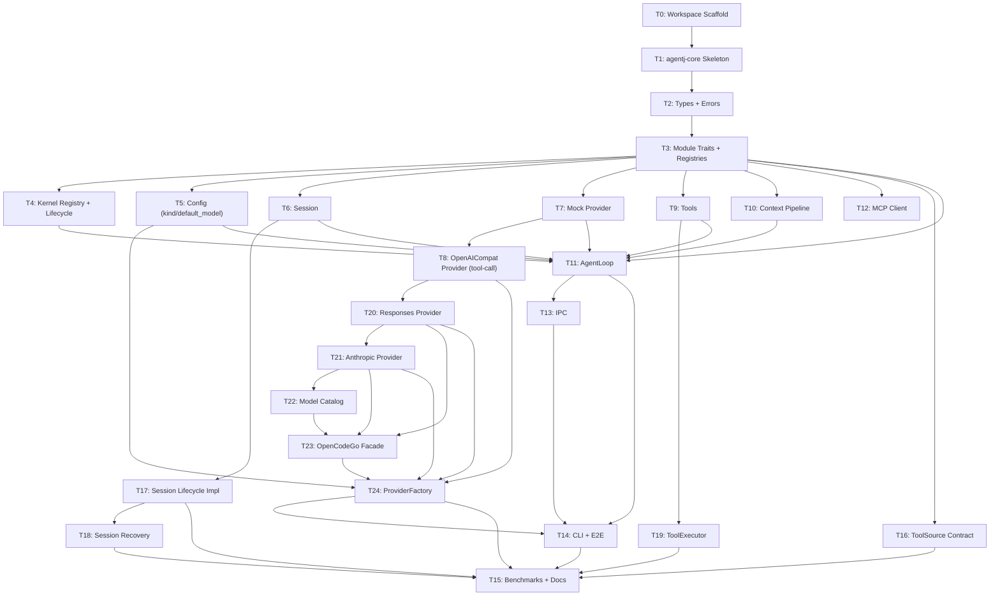

# AgentJ v0.1 Core Implementation Plan

> **For agentic workers:** REQUIRED SUB-SKILL: Use `superpowers:subagent-driven-development` (recommended) or `superpowers:executing-plans` to implement this plan task-by-task. TDD order is enforced — `test_code` MUST be written and verified failing before `impl_code`.

> **Plan split (1 of 3):** the AgentJ roadmap is split into three independent implementation plans by version priority — this is **Plan 1 (v0.1)**. Sibling plans: `2026-08-09-agentj-v0.2-plan.md` (ecosystem: Hook System / Sub-Agent Dispatcher / Skills Loader / Plugin Manager / Ollama / McpConnectionManager / session expire) and `2026-08-09-agentj-v0.3-plan.md` (commercial: Web Dashboard / usage stats / License). Execute v0.1 first; v0.2/v0.3 build on the crates shipped here.

## Agent Worker Instructions

- Required sub-skills: `superpowers:subagent-driven-development` (preferred) or `superpowers:executing-plans`
- Execution mode: `subagent-driven-development`
- Required verification: `cargo test --workspace`, `cargo clippy --workspace -- -D warnings`
- Version bump: this plan ships the initial release **v0.1.0** — no bump (per AGENTS.md, subsequent features bump minor `0.1.0 → 0.2.0`; the v0.2 plan bumps to `0.2.0`)
- **Cargo.toml rule:** dependency additions required by the code are listed inside `impl_code` and applied via `cargo add`; they do NOT count toward the 3-file limit (the task's primary files are the code files).
- **RED semantics for Rust:** when a test references symbols that do not exist yet, the RED state is a *compile error* — that is acceptable and proves the feature is absent. After `impl_code`, the tests must compile and PASS. Never skip the failing-first check.

## Global Constraints

- Rust version: 1.96+ (stable toolchain, `rust-version = "1.96"`)
- All dependencies: latest stable versions at time of execution (use `cargo add`)
- Rust functions: ≤ 50 lines, ≤ 120 chars per line
- No `unwrap()` / `expect()` in library code (use `Result` + `?`); tests may use them
- No type-error suppression (`as any`, `@ts-ignore`, or Rust equivalents)
- Commit messages in English
- Cargo workspace at repo root, all crates flattened in project root (`members = ["agentj-*"]`)

---

## Architecture Notes

- **Message Bus vs Direct Orchestration**: for v0.1, the kernel module registry + `KernelMessage` bus handles IPC ingress and **module lifecycle** (init/shutdown/state machine). The agent loop orchestration (`run_turn_stream`) directly calls `SessionStore` / `ModelProvider` / `ToolRegistry` / `ContextPipeline` via trait objects — NOT through `KernelMessage` routing. This is intentional: the full `KernelMessage`-routed pipeline is needed for the v0.2 Sub-Agent Dispatcher. **Production wiring (T13/T14)**: CLI creates a `Kernel`, registers `AgentLoopModule` (AgentLoop wrapped as a `Module`) so init/shutdown run in the real process; IPC `shutdown` sends `KernelMessage::Shutdown` and awaits the kernel's graceful shutdown chain (reverse-order, per-module timeout).
- **Lifecycle state machine**: `ModuleState` (Unloaded/Initializing/Ready/Stopping/Stopped/Failed) is tracked by the Kernel registry, NOT by the Module trait — state belongs to the orchestrator. `Kernel::module_state(id)` exposes queries; `Shutdown` is checked BEFORE message broadcast so a blocked module cannot starve the shutdown signal; graceful shutdown runs in reverse registration order with a per-module timeout (`KernelError::ShutdownTimeout`), wrapped in an overall budget (`DEFAULT_OVERALL_TIMEOUT` = 10s, design #13) so a hung module cannot block process exit forever.
- **ToolRegistry ownership contract (T16)**: every tool carries a `ToolSource` (Builtin/Mcp/Plugin); `register_tool_with_source` + `ReplacePolicy`, `unregister_tool`, `unregister_by_source` (ghost-tool cleanup primitive), `tools()` return entries with source. Contract-first v0.1 (design #10), consumed by v0.2 MCP long-lived connections and plugin unload.
- **Session lifecycle contract (T17)**: `SessionStore` gains `status`/`archive`/`delete` with default impls (contract-first, zero-break); `InMemoryStore` implements real semantics — archived/deleted sessions reject append/get with `SessionError::InactiveSession`, delete removes data. `SessionError` (incl. `PersistenceFailed`, reserved for v0.2) + `ModuleError::Session(#[from])` added in `agentj-core::error`.
- **Session recovery contract (T18)**: `SessionSnapshot` (session_id/status/messages/created_at/updated_at) + `snapshot`/`restore`/`load_all` with default impls (contract-first, zero-break, design #16); `InMemoryStore` implements roundtrip/overwrite (snapshot works for Active + Archived, `NotFound` for Deleted/missing; `load_all` stays empty = "no persistence"). Recovery is kernel-internal; IPC protocol untouched (design 4.4 philosophy).
- **ToolExecutor (T19)**: unified tool-execution lifecycle (design #15) — process-group isolation on Unix, timeout kills the whole group (`kill(-pgid, SIGKILL)`), drop reclaims orphans. BashTool and friends wire through it; Windows process-group kill is a known limitation (design 遗留问题).
- **CLI signal handling (T13/T14)**: SIGINT/SIGTERM → `KernelMessage::Shutdown` (same chain as stdin EOF); `serve_stdio`'s read loop is interrupted when the kernel finishes; overall graceful-shutdown timeout (design #13) is enforced in `Kernel::start`.
- **AgentLoop in agentj-core with trait-only dependencies**: `AgentLoop` lives in `agentj-core/src/agent_loop.rs` and depends ONLY on traits defined in `agentj-core` (`SessionStore`, `ModelProvider`, `Tool`, `ContextPipeline`, `ConfigProvider`). **`ContextPipeline` is a trait in `agentj-core::module`**; `agentj-context` implements it. `AgentLoop` never imports from domain crates. Unit tests define inline mock implementations; the workspace integration test wires real implementations from domain crates via dev-dependencies.
- **Streaming API**: `AgentLoop` exposes `run_turn_stream()` returning a `tokio::sync::mpsc::Receiver<AgentEvent>` so IPC/CLI consumers receive incremental deltas — matching the design spec's "流式返回" requirement. `run_turn()` is a convenience collector for non-streaming callers.
- **Transport-agnostic core**: `ModelError::Network(String)` carries the message — `agentj-core` does NOT depend on `reqwest`.
- **opencode-go provider support (design 4.1–4.4)**: `agentj-model` ships three wire-format providers — `OpenAICompatibleProvider` (T8, Chat Completions), `ResponsesProvider` (T20, OpenAI Responses API), `AnthropicProvider` (T21, Anthropic Messages API) — each implementing the same `ModelProvider` trait with tool-call delta assembly in v0.1 (design 4.2). `OpenCodeGoProvider` (T23) is a facade that routes `opencode-go/<model>` via the committed `models/opencode-go.json` catalog (T22) to the matching transport. `ProviderFactory` (T24) instantiates providers from config `kind` ("openai-compat" | "responses" | "anthropic" | "opencode-go", design 4.3). Config gains `kind` (default "openai-compat") and `default_model` (default "deepseek-chat") in T5 — both backward compatible; `AgentLoop` reads `model.default_model` from config in T11. IPC protocol is untouched (design 4.4).

---

## Tasks

### T0: Scaffold the Cargo workspace [P0] [Sequential]

```yaml
- id: T0
  title: "Scaffold the Cargo workspace"
  files:
    - Cargo.toml
    - rust-toolchain.toml
  depends_on: []
  breaking: false
  ac:
    - given: an empty repository at the project root
      when: running `cargo build --workspace`
      then: exits with code 0 and no errors
  regression:
    - "cargo build --workspace (empty workspace — no existing tests yet)"
  test_code: |
    # Scaffold task — no unit test exists yet. The gate is the build itself:
    # `cargo build --workspace` must exit 0 and produce no errors.
    # RED step: n/a (empty workspace always builds). GREEN: exit 0.
  impl_code: |
    # Cargo.toml (workspace root)
    [workspace]
    resolver = "2"
    members = ["agentj-*"]

    [workspace.package]
    version = "0.1.0"
    edition = "2024"
    rust-version = "1.96"

    # rust-toolchain.toml
    [toolchain]
    channel = "stable"
  verify:
    - "cargo build --workspace"
    - "cargo clippy --workspace -- -D warnings"
```

### T1: Create the agentj-core crate skeleton [P0] [Sequential]

```yaml
- id: T1
  title: "Create the agentj-core crate skeleton"
  files:
    - agentj-core/Cargo.toml
    - agentj-core/src/lib.rs
  depends_on: [T0]
  breaking: false
  ac:
    - given: the workspace scaffolded in T0
      when: running `cargo test -p agentj-core`
      then: "the smoke test passes (test result: ok, 1 passed)"
  regression:
    - "cargo build --workspace (T0 scaffold still builds)"
  test_code: |
    // In agentj-core/src/lib.rs
    #[cfg(test)]
    mod tests {
        use super::*;

        #[test]
        fn smoke() {
            assert_eq!(add(2, 2), 4);
        }
    }
  impl_code: |
    # agentj-core/Cargo.toml
    [package]
    name = "agentj-core"
    version.workspace = true
    edition.workspace = true
    rust-version.workspace = true

    [dependencies]
    serde = { version = "1", features = ["derive"] }
    serde_json = "1"
    thiserror = "2"

    // agentj-core/src/lib.rs
    //! AgentJ kernel — shared types, traits, and event loop.

    pub fn add(left: u64, right: u64) -> u64 {
        left + right
    }

    #[cfg(test)]
    mod tests {
        use super::*;

        #[test]
        fn smoke() {
            assert_eq!(add(2, 2), 4);
        }
    }
  verify:
    - "cargo test -p agentj-core"
    - "cargo clippy --workspace -- -D warnings"
```

### T2: Add shared types and error enums [P0] [Sequential]

```yaml
- id: T2
  title: "Add shared types and error enums"
  files:
    - agentj-core/src/types.rs
    - agentj-core/src/error.rs
    - agentj-core/src/lib.rs
  depends_on: [T1]
  breaking: false
  ac:
    - given: the agentj-core skeleton from T1
      when: running `cargo test -p agentj-core`
      then: all type and error tests pass (constructor roles, serialization roundtrip, error display, IpcError::from(io))
  regression:
    - "cargo test -p agentj-core -- smoke (T1 smoke test must keep passing)"
  test_code: |
    // In agentj-core/src/types.rs (tests module)
    #[cfg(test)]
    mod tests {
        use super::*;

        #[test]
        fn chatmessage_system_constructor() {
            let msg = ChatMessage::system("hello");
            assert_eq!(msg.role, Role::System);
            assert_eq!(msg.content, "hello");
            assert!(msg.tool_calls.is_empty());
        }

        #[test]
        fn chatmessage_assistant_and_tool_constructors() {
            let assistant = ChatMessage::assistant("hi");
            assert_eq!(assistant.role, Role::Assistant);
            let tool = ChatMessage::tool_result("call-1", "result");
            assert_eq!(tool.role, Role::Tool);
            assert_eq!(tool.tool_call_id.as_deref(), Some("call-1"));
        }

        #[test]
        fn chatmessage_serialization_roundtrip() {
            let json = serde_json::to_string(&ChatMessage::user("hi")).unwrap();
            let back: ChatMessage = serde_json::from_str(&json).unwrap();
            assert_eq!(back.role, Role::User);
        }

        #[test]
        fn model_options_default_is_streaming_deepseek() {
            let opts = ModelOptions::default();
            assert_eq!(opts.model, "deepseek-chat");
            assert!(opts.stream);
        }
    }

    // In agentj-core/src/error.rs (tests module)
    #[cfg(test)]
    mod tests {
        use super::*;

        #[test]
        fn kernel_error_display() {
            let err = KernelError::ModuleNotFound("test".into());
            assert!(err.to_string().contains("test"));
        }

        #[test]
        fn kernel_error_shutdown_failed_display() {
            let err = KernelError::ModuleShutdownFailed("m".into(), anyhow::anyhow!("boom"));
            assert!(err.to_string().contains("m"));
        }

        #[test]
        fn model_error_network_carries_message() {
            let err = ModelError::Network("conn refused".into());
            assert!(matches!(err, ModelError::Network(_)));
        }

        #[test]
        fn model_error_unknown_model_display() {
            let err = ModelError::UnknownModel { provider: "opencode-go".into(), model: "opencode-go/nope".into() };
            assert!(err.to_string().contains("opencode-go/nope"));
            assert!(matches!(err, ModelError::UnknownModel { provider, .. } if provider == "opencode-go"));
        }

        #[test]
        fn tool_error_server_unavailable_display() {
            let err = ToolError::ServerUnavailable { server_id: "srv1".into(), reason: "crashed".into() };
            assert!(err.to_string().contains("srv1"));
            assert!(matches!(err, ToolError::ServerUnavailable { server_id, .. } if server_id == "srv1"));
        }

        #[test]
        fn ipc_from_io_error() {
            let io: std::io::Error = std::io::ErrorKind::BrokenPipe.into();
            let err = IpcError::from(io);
            assert!(matches!(err, IpcError::Io(_)));
        }
    }
  impl_code: |
    # agentj-core/src/types.rs
    use serde::{Deserialize, Serialize};

    pub type ModuleId = String;
    pub type SessionId = String;

    #[derive(Debug, Clone, Copy, PartialEq, Eq, Serialize, Deserialize)]
    #[serde(rename_all = "lowercase")]
    pub enum Role { System, User, Assistant, Tool }

    #[derive(Debug, Clone, Serialize, Deserialize)]
    pub struct ToolCall {
        pub id: String,
        pub name: String,
        pub arguments: serde_json::Value,
    }

    #[derive(Debug, Clone, Serialize, Deserialize)]
    pub struct ChatMessage {
        pub role: Role,
        pub content: String,
        #[serde(skip_serializing_if = "Option::is_none")]
        pub tool_call_id: Option<String>,
        #[serde(skip_serializing_if = "Vec::is_empty", default)]
        pub tool_calls: Vec<ToolCall>,
    }

    impl ChatMessage {
        pub fn system(content: impl Into<String>) -> Self {
            Self { role: Role::System, content: content.into(), tool_call_id: None, tool_calls: vec![] }
        }
        pub fn user(content: impl Into<String>) -> Self {
            Self { role: Role::User, content: content.into(), tool_call_id: None, tool_calls: vec![] }
        }
        pub fn assistant(content: impl Into<String>) -> Self {
            Self { role: Role::Assistant, content: content.into(), tool_call_id: None, tool_calls: vec![] }
        }
        pub fn tool_result(tool_call_id: impl Into<String>, content: impl Into<String>) -> Self {
            Self { role: Role::Tool, content: content.into(), tool_call_id: Some(tool_call_id.into()), tool_calls: vec![] }
        }
    }

    #[derive(Debug, Clone, Serialize, Deserialize)]
    pub struct ToolDefinition {
        pub name: String,
        pub description: String,
        pub input_schema: serde_json::Value,
    }

    #[derive(Debug, Clone)]
    pub enum ModelEvent {
        Delta(String),
        ToolCall(ToolCall),
        Done,
    }

    #[derive(Debug, Clone)]
    pub struct ChatResponse {
        pub content: String,
        pub tool_calls: Vec<ToolCall>,
    }

    #[derive(Debug, Clone)]
    pub struct ModelOptions {
        pub model: String,
        pub temperature: Option<f32>,
        pub max_tokens: Option<u32>,
        pub stream: bool,
    }

    impl Default for ModelOptions {
        fn default() -> Self {
            Self { model: "deepseek-chat".into(), temperature: None, max_tokens: None, stream: true }
        }
    }

    #[derive(Debug, Clone, Serialize, Deserialize)]
    pub struct Attachment {
        pub path: Option<String>,
        pub content: Option<String>,
        pub mime: Option<String>,
    }

    // agentj-core/src/error.rs
    use std::time::Duration;

    #[derive(Debug, thiserror::Error)]
    pub enum ModuleError {
        #[error("module init failed: {0}")]
        Init(String),
        #[error("module shutdown failed: {0}")]
        Shutdown(String),
        #[error("handler error: {0}")]
        Handler(String),
    }

    #[derive(Debug, thiserror::Error)]
    pub enum KernelError {
        #[error("module '{0}' not found")]
        ModuleNotFound(String),
        #[error("module '{0}' initialization failed: {1}")]
        ModuleInitFailed(String, #[source] anyhow::Error),
        #[error("module '{0}' shutdown failed: {1}")]
        ModuleShutdownFailed(String, #[source] anyhow::Error),
        #[error("message routing failed for {msg:?}: {reason}")]
        MessageRouteFailed { msg: String, reason: String },
        #[error("shutdown timeout after {0:?}")]
        ShutdownTimeout(Duration),
        #[error("IPC error: {0}")]
        Ipc(#[from] IpcError),
    }

    #[derive(Debug, thiserror::Error)]
    pub enum IpcError {
        #[error("JSON parse error: {0}")]
        Json(#[from] serde_json::Error),
        #[error("IO error: {0}")]
        Io(#[from] std::io::Error),
        #[error("invalid request: {0}")]
        InvalidRequest(String),
    }

    #[derive(Debug, thiserror::Error)]
    pub enum ModelError {
        #[error("API error ({status}): {message}")]
        Api { status: u16, message: String },
        #[error("rate limited, retry after {retry_after:?}")]
        RateLimited { retry_after: Option<Duration> },
        #[error("context length exceeded: {used}/{max} tokens")]
        TokenLimitExceeded { used: usize, max: usize },
        #[error("unknown model '{model}' for provider '{provider}'")]
        UnknownModel { provider: String, model: String },
        #[error("network error: {0}")]
        Network(String),
        #[error("stream error: {0}")]
        Stream(String),
    }

    #[derive(Debug, thiserror::Error)]
    pub enum ToolError {
        #[error("tool '{name}' not found")]
        ToolNotFound { name: String },
        #[error("tool '{name}' execution failed: {reason}")]
        ExecutionFailed { name: String, reason: String },
        #[error("tool '{name}' permission denied: {reason}")]
        PermissionDenied { name: String, reason: String },
        #[error("tool timeout after {0:?}")]
        Timeout(Duration),
        // v0.1 contract-first (design error section): MCP server crash/disconnect mid-call.
        // Consumed by the v0.2 McpConnectionManager; defined now so the contract is stable.
        #[error("MCP server '{server_id}' unavailable: {reason}")]
        ServerUnavailable { server_id: String, reason: String },
    }

    // agentj-core/src/lib.rs — add module declarations
    pub mod types;
    pub mod error;

    // Cargo.toml: add `anyhow = "1"` (KernelError::ModuleInitFailed uses #[source] anyhow::Error)
  verify:
    - "cargo test -p agentj-core"
    - "cargo clippy --workspace -- -D warnings"
```

### T3: Add module traits, registries, and KernelContext [P0] [Sequential]

```yaml
- id: T3
  title: "Add module traits, registries, and KernelContext"
  files:
    - agentj-core/src/module.rs
    - agentj-core/src/lib.rs
  depends_on: [T2]
  breaking: false
  ac:
    - given: types and errors from T2
      when: running `cargo test -p agentj-core`
      then: module_id and tool_registry tests pass (Arc-based registry register/get/definitions)
  regression:
    - "cargo test -p agentj-core (T2 types/error tests must keep passing)"
  test_code: |
    // In agentj-core/src/module.rs (tests module)
    #[cfg(test)]
    mod tests {
        use super::*;
        use crate::error::{ModuleError, ToolError};

        struct TestModule;
        impl Module for TestModule {
            fn id(&self) -> ModuleId { "test".into() }
            fn metadata(&self) -> ModuleMetadata {
                ModuleMetadata { id: "test".into(), name: "Test".into(), version: "0.1".into(), description: "".into(), author: "".into() }
            }
            fn init(&mut self, _ctx: &KernelContext, _register: &mut ModuleRegister) -> Result<(), ModuleError> { Ok(()) }
            fn shutdown(&mut self) -> Result<(), ModuleError> { Ok(()) }
        }

        struct DummyTool;
        impl Tool for DummyTool {
            fn name(&self) -> &str { "dummy" }
            fn description(&self) -> &str { "" }
            fn input_schema(&self) -> serde_json::Value { serde_json::json!({}) }
            fn execute(&self, _input: serde_json::Value) -> Result<serde_json::Value, ToolError> {
                Ok(serde_json::Value::String("ok".into()))
            }
        }

        #[test]
        fn module_id() {
            let m = TestModule;
            assert_eq!(m.id(), "test");
        }

        #[test]
        fn tool_registry_registers_and_gets() {
            let registry = ToolRegistry::new();
            assert!(registry.is_empty());
            registry.register(Arc::new(DummyTool));
            assert_eq!(registry.get("dummy").unwrap().name(), "dummy");
            assert_eq!(registry.definitions().len(), 1);
        }

        #[test]
        fn provider_registry_has_no_default_before_register() {
            let registry = ProviderRegistry::new();
            assert!(registry.get_default().is_none());
        }

        #[test]
        fn event_type_lifecycle_variants_exist() {
            let loaded = EventType::ModuleLoaded("cfg".into());
            let failed = EventType::ModuleFailed("cfg".into());
            let stopped = EventType::ModuleStopped("cfg".into());
            assert_ne!(loaded, failed);
            assert_ne!(failed, stopped);
            assert_eq!(loaded, EventType::ModuleLoaded("cfg".into()));
        }

        #[test]
        fn event_type_session_variants_exist() {
            let archived = EventType::SessionArchived("s1".into());
            let deleted = EventType::SessionDeleted("s1".into());
            let expired = EventType::SessionExpired("s1".into());
            assert_ne!(archived, deleted);
            assert_ne!(deleted, expired);
            assert_eq!(archived, EventType::SessionArchived("s1".into()));
        }

        // Contract-only store: relies on SessionStore's default impls for
        // status/archive/delete — proves existing stores keep compiling.
        struct ContractOnlyStore;
        impl SessionStore for ContractOnlyStore {
            fn create(&self) -> Result<SessionId, ModuleError> { Ok("s".into()) }
            fn append(&self, _s: &SessionId, _m: ChatMessage) -> Result<(), ModuleError> { Ok(()) }
            fn get(&self, _s: &SessionId) -> Result<Vec<ChatMessage>, ModuleError> { Ok(vec![]) }
            fn estimate_tokens(&self, _s: &SessionId) -> Result<usize, ModuleError> { Ok(0) }
        }

        #[test]
        fn session_store_contract_defaults_apply() {
            let store = ContractOnlyStore;
            assert_eq!(store.status(&"s1".into()).unwrap(), SessionStatus::Active);
            assert!(store.archive(&"s1".into()).is_err());
            assert!(store.delete(&"s1".into()).is_err());
        }
    }
  impl_code: |
    # agentj-core/src/module.rs
    use std::collections::HashMap;
    use std::sync::Arc;
    use async_trait::async_trait;
    use futures::stream::BoxStream;
    use parking_lot::RwLock;
    use crate::error::{ModuleError, ModelError, ToolError};
    use crate::types::*;

    // ---- Traits ----

    pub trait Tool: Send + Sync {
        fn name(&self) -> &str;
        fn description(&self) -> &str;
        fn input_schema(&self) -> serde_json::Value;
        fn execute(&self, input: serde_json::Value) -> Result<serde_json::Value, ToolError>;
    }

    #[async_trait]
    pub trait ModelProvider: Send + Sync {
        async fn chat_stream(
            &self,
            messages: Vec<ChatMessage>,
            tools: Vec<ToolDefinition>,
            options: ModelOptions,
        ) -> Result<BoxStream<'static, Result<ModelEvent, ModelError>>, ModelError>;

        async fn chat(
            &self,
            messages: Vec<ChatMessage>,
            options: ModelOptions,
        ) -> Result<ChatResponse, ModelError>;
    }

    /// Assembles the request context and folds tool results back into history.
    /// Defined in core so `AgentLoop` stays trait-only; implemented by domain crates.
    pub trait ContextPipeline: Send + Sync {
        fn assemble(
            &self,
            system: &str,
            history: &[ChatMessage],
            tool_results: &[(ToolCall, String)],
        ) -> Vec<ChatMessage>;
        fn reflux(&self, history: &mut Vec<ChatMessage>, tool_call: &ToolCall, result: String);
    }

    #[derive(Debug, Clone, PartialEq, Eq, Hash)]
    pub enum EventType {
        PreRequest,
        PostResponse,
        Shutdown,
        ToolStart(String),
        ToolEnd(String),
        // 生命周期事件（v0.1 契约先行，v0.2 Hook System 消费）
        ModuleLoaded(ModuleId),
        ModuleFailed(ModuleId),
        ModuleStopped(ModuleId),
        // Session 生命周期事件（v0.1 契约先行，v0.2 消费；见设计 §Session 生命周期契约）
        SessionArchived(SessionId),
        SessionDeleted(SessionId),
        SessionExpired(SessionId),
    }

    pub trait EventHandler: Send + Sync {
        fn on_event(&self, event: &EventType, ctx: &KernelContext);
    }

    #[derive(Debug, Clone)]
    pub struct ModuleMetadata {
        pub id: ModuleId,
        pub name: String,
        pub version: String,
        pub description: String,
        pub author: String,
    }

    /// Lifecycle state of a registered module. Tracked by the Kernel registry (NOT by
    /// the module itself) — state belongs to the orchestrator (see design §模块生命周期状态机).
    #[derive(Debug, Clone, Copy, PartialEq, Eq)]
    pub enum ModuleState {
        Unloaded,
        Initializing,
        Ready,
        Stopping,
        Stopped,
        Failed,
    }

    // ---- Module & KernelModule ----

    pub trait Module: Send + Sync {
        fn id(&self) -> ModuleId;
        fn metadata(&self) -> ModuleMetadata;
        fn init(&mut self, ctx: &KernelContext, register: &mut ModuleRegister) -> Result<(), ModuleError>;
        fn shutdown(&mut self) -> Result<(), ModuleError>;
    }

    pub trait KernelModule: Module {
        fn handle(&mut self, msg: &KernelMessage) -> Result<KernelResponse, ModuleError>;
    }

    // ---- Registries ----

    pub struct ModuleRegister {
        pub tools: Arc<ToolRegistry>,
        pub events: Vec<(EventType, Box<dyn EventHandler>)>,
        pub providers: Arc<ProviderRegistry>,
    }

    impl ModuleRegister {
        pub fn new(tools: Arc<ToolRegistry>, providers: Arc<ProviderRegistry>) -> Self {
            Self { tools, events: vec![], providers }
        }

        pub fn register_tool(&mut self, tool: Arc<dyn Tool>) -> Result<(), ModuleError> {
            self.tools.register(tool);
            Ok(())
        }

        pub fn on_event(&mut self, event: EventType, handler: Box<dyn EventHandler>) -> Result<(), ModuleError> {
            self.events.push((event, handler));
            Ok(())
        }

        pub fn register_provider(&mut self, provider: Arc<dyn ModelProvider>) -> Result<(), ModuleError> {
            self.providers.register("default".into(), provider);
            Ok(())
        }
    }

    pub struct ToolRegistry {
        tools: RwLock<HashMap<String, Arc<dyn Tool>>>,
    }

    impl ToolRegistry {
        pub fn new() -> Self {
            Self { tools: RwLock::new(HashMap::new()) }
        }

        pub fn register(&self, tool: Arc<dyn Tool>) {
            self.tools.write().insert(tool.name().to_string(), tool);
        }

        pub fn get(&self, name: &str) -> Option<Arc<dyn Tool>> {
            self.tools.read().get(name).cloned()
        }

        pub fn definitions(&self) -> Vec<ToolDefinition> {
            self.tools.read().iter().map(|(_, t)| ToolDefinition {
                name: t.name().into(),
                description: t.description().into(),
                input_schema: t.input_schema(),
            }).collect()
        }

        pub fn is_empty(&self) -> bool {
            self.tools.read().is_empty()
        }
    }

    impl Default for ToolRegistry {
        fn default() -> Self { Self::new() }
    }

    pub struct ProviderRegistry {
        providers: RwLock<HashMap<String, Arc<dyn ModelProvider>>>,
        default: RwLock<Option<String>>,
    }

    impl ProviderRegistry {
        pub fn new() -> Self {
            Self { providers: RwLock::new(HashMap::new()), default: RwLock::new(None) }
        }

        pub fn register(&self, name: String, provider: Arc<dyn ModelProvider>) {
            self.providers.write().insert(name.clone(), provider);
            if self.default.read().is_none() {
                *self.default.write() = Some(name);
            }
        }

        pub fn get_default(&self) -> Option<Arc<dyn ModelProvider>> {
            self.default.read().as_ref()
                .and_then(|name| self.providers.read().get(name).cloned())
        }

        pub fn list(&self) -> Vec<String> {
            self.providers.read().keys().cloned().collect()
        }
    }

    // ---- Session & Config ----

    /// Session lifecycle status. Contract-first (v0.1 signature, v0.2 semantics) —
    /// see design §Session 生命周期契约 (decision #14).
    #[derive(Debug, Clone, Copy, PartialEq, Eq)]
    pub enum SessionStatus { Active, Archived, Deleted }

    pub trait SessionStore: Send + Sync {
        fn create(&self) -> Result<SessionId, ModuleError>;
        fn append(&self, session: &SessionId, message: ChatMessage) -> Result<(), ModuleError>;
        fn get(&self, session: &SessionId) -> Result<Vec<ChatMessage>, ModuleError>;
        fn estimate_tokens(&self, session: &SessionId) -> Result<usize, ModuleError>;

        // v0.1 contract-first: default impls keep existing stores compiling;
        // real archive/delete semantics land in T17 (agentj-session).
        fn status(&self, _session: &SessionId) -> Result<SessionStatus, ModuleError> {
            Ok(SessionStatus::Active)
        }
        fn archive(&self, _session: &SessionId) -> Result<(), ModuleError> {
            Err(ModuleError::Handler("archive not supported".into()))
        }
        fn delete(&self, _session: &SessionId) -> Result<(), ModuleError> {
            Err(ModuleError::Handler("delete not supported".into()))
        }
    }

    pub trait ConfigProvider: Send + Sync {
        fn get_str(&self, key: &str) -> Option<String>;
        fn get_int(&self, key: &str) -> Option<i64>;
        fn providers(&self) -> Vec<(String, String)>; // Vec<(name, base_url)>
    }

    #[derive(Clone)]
    pub struct KernelContext {
        pub session: Arc<dyn SessionStore>,
        pub tools: Arc<ToolRegistry>,
        pub providers: Arc<ProviderRegistry>,
        pub config: Arc<dyn ConfigProvider>,
    }

    // 预留访问器方法（v0.2+ Kernel 服务定位通道的契约，纯加性，零破坏）：
    // 未来方法内部可从"硬编码字段"换成 ModuleResolver::resolve()，模块代码零改动。
    impl KernelContext {
        pub fn session(&self) -> Arc<dyn SessionStore> { self.session.clone() }
        pub fn tools(&self) -> Arc<ToolRegistry> { self.tools.clone() }
        pub fn providers(&self) -> Arc<ProviderRegistry> { self.providers.clone() }
        pub fn config(&self) -> Arc<dyn ConfigProvider> { self.config.clone() }
    }

    // ---- Kernel Message ----

    #[derive(Debug, Clone)]
    pub enum KernelMessage {
        UserRequest { session_id: SessionId, content: String, attachments: Vec<Attachment> },
        Shutdown,
    }

    #[derive(Debug, Clone)]
    pub enum KernelResponse {
        Handled,
        Streaming(Vec<String>),
    }

    // agentj-core/src/lib.rs — add `pub mod module;`
    // Cargo.toml: add `async-trait = "0.1"`, `futures = "0.3"`, `parking_lot = "0.12"`,
    //             `tracing = "0.1"`, `tokio = { version = "1", features = ["sync", "rt", "macros", "time", "io-util", "fs", "process"] }`
  verify:
    - "cargo test -p agentj-core"
    - "cargo clippy --workspace -- -D warnings"
```

### T4: Add the Kernel module registry, event loop, and lifecycle state machine [P0] [Sequential]

```yaml
- id: T4
  title: "Add the Kernel module registry, event loop, and lifecycle state machine"
  files:
    - agentj-core/src/kernel.rs
    - agentj-core/src/lib.rs
  depends_on: [T3]
  breaking: false
  ac:
    - given: module traits from T3
      when: running `cargo test -p agentj-core`
      then: >-
        kernel routing test passes (spy module receives 1 message, Shutdown triggers
        reverse-order graceful shutdown, JoinHandle resolves Ok); shutdown timeout
        produces KernelError::ShutdownTimeout; overall graceful shutdown timeout
        produces KernelError::ShutdownTimeout(overall); init failure returns Err and marks
        the module Failed without crashing the kernel; module_state reflects
        Ready/Stopped/Failed transitions
  regression:
    - "cargo test -p agentj-core (T2 + T3 tests must keep passing)"
  test_code: |
    // In agentj-core/src/kernel.rs (tests module)
    #[cfg(test)]
    mod tests {
        use super::*;
        use crate::error::*;
        use crate::module::*;
        use crate::types::*;
        use std::sync::{Arc, Mutex as StdMutex};
        use std::time::Duration;

        struct NoopSession;
        impl SessionStore for NoopSession {
            fn create(&self) -> Result<SessionId, ModuleError> { Ok("s1".into()) }
            fn append(&self, _s: &SessionId, _m: ChatMessage) -> Result<(), ModuleError> { Ok(()) }
            fn get(&self, _s: &SessionId) -> Result<Vec<ChatMessage>, ModuleError> { Ok(vec![]) }
            fn estimate_tokens(&self, _s: &SessionId) -> Result<usize, ModuleError> { Ok(0) }
        }

        struct NoopConfig;
        impl ConfigProvider for NoopConfig {
            fn get_str(&self, _k: &str) -> Option<String> { None }
            fn get_int(&self, _k: &str) -> Option<i64> { None }
            fn providers(&self) -> Vec<(String, String)> { vec![] }
        }

        fn dummy_kernel_context() -> KernelContext {
            KernelContext {
                session: Arc::new(NoopSession),
                tools: Arc::new(ToolRegistry::new()),
                providers: Arc::new(ProviderRegistry::new()),
                config: Arc::new(NoopConfig),
            }
        }

        struct SpyModule {
            id: &'static str,
            handled: Arc<StdMutex<Vec<KernelMessage>>>,
            shutdowns: Arc<StdMutex<Vec<String>>>,
            shutdown_delay: Option<Duration>,
            init_fails: bool,
        }

        impl Module for SpyModule {
            fn id(&self) -> ModuleId { self.id.to_string() }
            fn metadata(&self) -> ModuleMetadata {
                ModuleMetadata { id: self.id.to_string(), name: self.id.to_string(), version: "0.1".into(), description: "".into(), author: "".into() }
            }
            fn init(&mut self, _ctx: &KernelContext, _r: &mut ModuleRegister) -> Result<(), ModuleError> {
                if self.init_fails { Err(ModuleError::Init("boom".into())) } else { Ok(()) }
            }
            fn shutdown(&mut self) -> Result<(), ModuleError> {
                self.shutdowns.lock().unwrap().push(self.id.to_string());
                if let Some(d) = self.shutdown_delay { std::thread::sleep(d); }
                Ok(())
            }
        }

        impl KernelModule for SpyModule {
            fn handle(&mut self, msg: &KernelMessage) -> Result<KernelResponse, ModuleError> {
                self.handled.lock().unwrap().push(msg.clone());
                Ok(KernelResponse::Handled)
            }
        }

        fn spy(
            id: &'static str,
            handled: Arc<StdMutex<Vec<KernelMessage>>>,
            shutdowns: Arc<StdMutex<Vec<String>>>,
            shutdown_delay: Option<Duration>,
            init_fails: bool,
        ) -> SpyModule {
            SpyModule { id, handled, shutdowns, shutdown_delay, init_fails }
        }

        #[tokio::test]
        async fn kernel_routes_message_and_shuts_down() {
            let handled = Arc::new(StdMutex::new(vec![]));
            let shutdowns = Arc::new(StdMutex::new(vec![]));
            let mut register = ModuleRegister::new(Arc::new(ToolRegistry::new()), Arc::new(ProviderRegistry::new()));
            let mut kernel = Kernel::new();
            kernel.register_module(
                Box::new(spy("spy", handled.clone(), shutdowns.clone(), None, false)),
                &dummy_kernel_context(),
                &mut register,
            ).unwrap();
            assert_eq!(kernel.module_state("spy"), Some(ModuleState::Ready));

            let handle = kernel.start();
            kernel.sender().send(KernelMessage::UserRequest {
                session_id: "s1".into(), content: "hello".into(), attachments: vec![],
            }).unwrap();

            tokio::time::sleep(Duration::from_millis(50)).await;
            assert_eq!(handled.lock().unwrap().len(), 1);

            kernel.sender().send(KernelMessage::Shutdown).unwrap();
            handle.await.unwrap().unwrap();
            assert_eq!(*shutdowns.lock().unwrap(), vec!["spy".to_string()]);
            assert_eq!(kernel.module_state("spy"), Some(ModuleState::Stopped));
        }

        #[tokio::test]
        async fn shutdown_runs_in_reverse_registration_order() {
            let shutdowns = Arc::new(StdMutex::new(vec![]));
            let mut register = ModuleRegister::new(Arc::new(ToolRegistry::new()), Arc::new(ProviderRegistry::new()));
            let mut kernel = Kernel::new();
            kernel.register_module(
                Box::new(spy("a", Arc::new(StdMutex::new(vec![])), shutdowns.clone(), None, false)),
                &dummy_kernel_context(), &mut register,
            ).unwrap();
            kernel.register_module(
                Box::new(spy("b", Arc::new(StdMutex::new(vec![])), shutdowns.clone(), None, false)),
                &dummy_kernel_context(), &mut register,
            ).unwrap();

            let handle = kernel.start();
            kernel.sender().send(KernelMessage::Shutdown).unwrap();
            handle.await.unwrap().unwrap();
            assert_eq!(*shutdowns.lock().unwrap(), vec!["b".to_string(), "a".to_string()]);
        }

        #[tokio::test]
        async fn init_failure_is_reported_and_isolated() {
            let mut register = ModuleRegister::new(Arc::new(ToolRegistry::new()), Arc::new(ProviderRegistry::new()));
            let mut kernel = Kernel::new();
            let err = kernel.register_module(
                Box::new(spy("bad", Arc::new(StdMutex::new(vec![])), Arc::new(StdMutex::new(vec![])), None, true)),
                &dummy_kernel_context(), &mut register,
            );
            assert!(matches!(err, Err(KernelError::ModuleInitFailed(ref id, _)) if id == "bad"));
            assert_eq!(kernel.module_state("bad"), Some(ModuleState::Failed));

            // kernel survives and still shuts down cleanly
            let handle = kernel.start();
            kernel.sender().send(KernelMessage::Shutdown).unwrap();
            handle.await.unwrap().unwrap();
        }

        #[tokio::test]
        async fn shutdown_timeout_yields_shutdown_timeout() {
            let mut register = ModuleRegister::new(Arc::new(ToolRegistry::new()), Arc::new(ProviderRegistry::new()));
            let mut kernel = Kernel::with_shutdown_timeout(Duration::from_millis(10));
            kernel.register_module(
                Box::new(spy("slow", Arc::new(StdMutex::new(vec![])), Arc::new(StdMutex::new(vec![])), Some(Duration::from_millis(200)), false)),
                &dummy_kernel_context(), &mut register,
            ).unwrap();

            let handle = kernel.start();
            kernel.sender().send(KernelMessage::Shutdown).unwrap();
            let result = handle.await.unwrap();
            assert!(matches!(result, Err(KernelError::ShutdownTimeout(_))));
            assert_eq!(kernel.module_state("slow"), Some(ModuleState::Failed));
        }

        #[tokio::test]
        async fn overall_shutdown_timeout_yields_timeout() {
            // Overall (design #13) timeout: 10ms total budget for the whole chain,
            // two modules each blocking 50ms — the overall budget fires first.
            let shutdowns = Arc::new(StdMutex::new(vec![]));
            let mut register = ModuleRegister::new(Arc::new(ToolRegistry::new()), Arc::new(ProviderRegistry::new()));
            let mut kernel = Kernel::with_timeouts(
                Duration::from_secs(2),          // per-module timeout
                Duration::from_millis(10),       // overall graceful shutdown timeout
            );
            kernel.register_module(
                Box::new(spy("a", Arc::new(StdMutex::new(vec![])), shutdowns.clone(), Some(Duration::from_millis(50)), false)),
                &dummy_kernel_context(), &mut register,
            ).unwrap();
            kernel.register_module(
                Box::new(spy("b", Arc::new(StdMutex::new(vec![])), shutdowns.clone(), Some(Duration::from_millis(50)), false)),
                &dummy_kernel_context(), &mut register,
            ).unwrap();

            let handle = kernel.start();
            kernel.sender().send(KernelMessage::Shutdown).unwrap();
            let result = handle.await.unwrap();
            assert!(matches!(result, Err(KernelError::ShutdownTimeout(_))));
        }
    }
  impl_code: |
    # agentj-core/src/kernel.rs
    use std::collections::HashMap;
    use std::sync::{Arc, Mutex};
    use std::time::Duration;
    use tokio::task::JoinHandle;
    use crate::error::KernelError;
    use crate::module::{KernelContext, KernelMessage, KernelModule, ModuleRegister, ModuleState};
    use crate::types::*;

    const CHANNEL_SIZE: usize = 128;
    const DEFAULT_SHUTDOWN_TIMEOUT: Duration = Duration::from_secs(2);
    const DEFAULT_OVERALL_TIMEOUT: Duration = Duration::from_secs(10); // design #13 CLI 信号兜底

    #[derive(Clone)]
    pub struct KernelSender {
        tx: tokio::sync::mpsc::Sender<KernelMessage>,
    }

    impl KernelSender {
        pub fn send(&self, msg: KernelMessage) -> Result<(), KernelError> {
            self.tx.try_send(msg).map_err(|e| KernelError::MessageRouteFailed {
                msg: format!("{:?}", e.into_inner()),
                reason: "channel closed or full".into(),
            })
        }
    }

    /// Kernel: message bus + module registry + lifecycle state machine.
    ///
    /// Module lifecycle states (Unloaded/Initializing/Ready/Stopping/Stopped/Failed) are
    /// tracked here, NOT on the Module trait — state belongs to the orchestrator.
    pub struct Kernel {
        modules: Arc<Mutex<HashMap<String, Box<dyn KernelModule>>>>,
        order: Arc<Mutex<Vec<String>>>, // registration order, for reverse shutdown
        states: Arc<Mutex<HashMap<String, ModuleState>>>,
        sender: KernelSender,
        rx: Option<tokio::sync::mpsc::Receiver<KernelMessage>>,
        shutdown_timeout: Duration,
        overall_timeout: Duration, // design #13: total graceful-shutdown budget
    }

    impl Kernel {
        pub fn new() -> Self {
            Self::with_timeouts(DEFAULT_SHUTDOWN_TIMEOUT, DEFAULT_OVERALL_TIMEOUT)
        }

        pub fn with_shutdown_timeout(timeout: Duration) -> Self {
            Self::with_timeouts(timeout, DEFAULT_OVERALL_TIMEOUT)
        }

        pub fn with_timeouts(shutdown_timeout: Duration, overall_timeout: Duration) -> Self {
            let (tx, rx) = tokio::sync::mpsc::channel(CHANNEL_SIZE);
            Self {
                modules: Arc::new(Mutex::new(HashMap::new())),
                order: Arc::new(Mutex::new(Vec::new())),
                states: Arc::new(Mutex::new(HashMap::new())),
                sender: KernelSender { tx },
                rx: Some(rx),
                shutdown_timeout,
                overall_timeout,
            }
        }

        pub fn sender(&self) -> KernelSender {
            self.sender.clone()
        }

        /// Query a module's lifecycle state (None if never registered).
        pub fn module_state(&self, id: &str) -> Option<ModuleState> {
            self.states.lock().unwrap().get(id).copied()
        }

        /// Register a module: init() runs synchronously; on failure the module is marked
        /// Failed (NOT inserted into the registry) and the error is returned — the kernel
        /// keeps running (one module's failure must not crash the kernel).
        pub fn register_module(
            &mut self,
            mut module: Box<dyn KernelModule>,
            ctx: &KernelContext,
            register: &mut ModuleRegister,
        ) -> Result<(), KernelError> {
            let id = module.id();
            self.set_state(&id, ModuleState::Initializing);
            match module.init(ctx, register) {
                Ok(()) => {
                    self.modules.lock().unwrap().insert(id.clone(), module);
                    self.order.lock().unwrap().push(id.clone());
                    self.set_state(&id, ModuleState::Ready);
                    Ok(())
                }
                Err(e) => {
                    self.set_state(&id, ModuleState::Failed);
                    tracing::warn!(module_id = %id, error = %e, "module init failed, continuing without it");
                    Err(KernelError::ModuleInitFailed(id, anyhow::Error::from(e)))
                }
            }
        }

        fn set_state(&self, id: &str, state: ModuleState) {
            self.states.lock().unwrap().insert(id.to_string(), state);
        }

        /// Start the event loop. Shutdown is checked BEFORE broadcast (so a blocked
        /// module cannot starve the shutdown signal). On Shutdown (or channel close) all
        /// Ready modules are shut down in REVERSE registration order, each with a timeout.
        pub fn start(&mut self) -> JoinHandle<Result<(), KernelError>> {
            let modules = Arc::clone(&self.modules);
            let order = Arc::clone(&self.order);
            let states = Arc::clone(&self.states);
            let shutdown_timeout = self.shutdown_timeout;
            let overall_timeout = self.overall_timeout;
            let rx = self.rx.take().unwrap_or_else(|| {
                let (_, rx) = tokio::sync::mpsc::channel(1);
                rx
            });
            tokio::spawn(async move {
                while let Some(msg) = rx.recv().await {
                    if matches!(msg, KernelMessage::Shutdown) {
                        break; // graceful shutdown handled below — NOT broadcast via handle()
                    }
                    let mut guard = modules.lock().unwrap();
                    for (_, module) in guard.iter_mut() {
                        if let Err(e) = module.handle(&msg) {
                            tracing::error!(?e, "module handler error");
                        }
                    }
                }
                // design #13: overall budget for the whole chain — a hung module shutdown
                // must not block process exit indefinitely.
                tokio::time::timeout(overall_timeout, Self::shutdown_all(&modules, &order, &states, shutdown_timeout))
                    .await
                    .map_err(|_| KernelError::ShutdownTimeout(overall_timeout))?
            })
        }

        /// Reverse-order graceful shutdown. A single module's failure/timeout is logged
        /// and recorded (state = Failed), but does NOT block shutting down the rest.
        async fn shutdown_all(
            modules: &Mutex<HashMap<String, Box<dyn KernelModule>>>,
            order: &Mutex<Vec<String>>,
            states: &Mutex<HashMap<String, ModuleState>>,
            timeout: Duration,
        ) -> Result<(), KernelError> {
            let ids: Vec<String> = order.lock().unwrap().iter().rev().cloned().collect();
            let mut first_error: Option<KernelError> = None;
            for id in &ids {
                states.lock().unwrap().insert(id.clone(), ModuleState::Stopping);
                let module = {
                    let mut guard = modules.lock().unwrap();
                    guard.remove(id) // remove while shutting down: no more messages after this
                };
                let Some(mut module) = module else { continue };
                // shutdown() is a sync fn that may block (e.g. killing a subprocess); run it on
                // the blocking pool so the per-module timeout can still fire.
                let shutdown_task = tokio::task::spawn_blocking(move || module.shutdown());
                let result = tokio::time::timeout(timeout, shutdown_task).await;
                let (state, err) = match result {
                    Ok(Ok(Ok(()))) => (ModuleState::Stopped, None),
                    Ok(Ok(Err(e))) => {
                        tracing::error!(module_id = %id, error = %e, "module shutdown failed");
                        (ModuleState::Failed, Some(KernelError::ModuleShutdownFailed(id.clone(), anyhow::Error::from(e))))
                    }
                    Ok(Err(e)) => {
                        tracing::error!(module_id = %id, error = %e, "module shutdown task panicked");
                        (ModuleState::Failed, Some(KernelError::ModuleShutdownFailed(id.clone(), anyhow::Error::from(anyhow::anyhow!(e.to_string())))))
                    }
                    Err(_) => {
                        tracing::error!(module_id = %id, ?timeout, "module shutdown timeout");
                        (ModuleState::Failed, Some(KernelError::ShutdownTimeout(timeout)))
                    }
                };
                states.lock().unwrap().insert(id.clone(), state);
                if first_error.is_none() { first_error = err; }
            }
            match first_error {
                Some(e) => Err(e),
                None => Ok(()),
            }
        }
    }

    // agentj-core/src/lib.rs — add `pub mod kernel;`
    // agentj-core/src/module.rs — ModuleState enum lives in module.rs next to Module trait
  verify:
    - "cargo test -p agentj-core"
    - "cargo clippy --workspace -- -D warnings"
```

### T5: Add the agentj-config crate with layered config merge [P0] [Parallel with T6, T7, T9, T10, T12]

```yaml
- id: T5
  title: "Add the agentj-config crate with layered config merge"
  files:
    - agentj-config/Cargo.toml
    - agentj-config/src/lib.rs
    - agentj-config/src/merge.rs
  depends_on: [T3]
  breaking: false
  ac:
    - given: a temp config.toml with one provider
      when: running `cargo test -p agentj-config`
      then: >-
        loads_default_config, merge_precedence, and env_overrides_toml tests pass
        (defaults overlay, env wins); kind_defaults_to_openai_compat_for_legacy_config
        proves a legacy config without `kind` parses as "openai-compat" and
        default_model defaults to "deepseek-chat" (design 4.3 — zero break);
        opencode_go_kind_and_default_model_parse proves kind="opencode-go" +
        default_model="opencode-go/kimi-k3" round-trip through ConfigProvider::get_str
  regression:
    - "cargo test -p agentj-core (T3 module tests — ConfigProvider trait unchanged)"
  test_code: |
    // In agentj-config/src/lib.rs (tests module)
    #[cfg(test)]
    mod tests {
        use super::*;
        use std::io::Write;

        #[test]
        fn loads_default_config() {
            let dir = tempfile::TempDir::new().unwrap();
            let config_path = dir.path().join("config.toml");
            std::fs::write(&config_path, r#"[model]
        provider = "deepseek"
        [[model.providers]]
        name = "deepseek-chat"
        base_url = "https://api.deepseek.com"
        "#).unwrap();

            let config = Config::load(Some(config_path)).unwrap();
            let providers = config.providers();
            assert_eq!(providers.len(), 1);
            assert_eq!(providers[0].0, "deepseek-chat");
        }

        #[test]
        fn env_overrides_toml() {
            let dir = tempfile::TempDir::new().unwrap();
            let config_path = dir.path().join("config.toml");
            std::fs::write(&config_path, "[model]\nprovider = \"deepseek\"\n").unwrap();

            std::env::set_var("AGENTJ_MODEL_PROVIDER", "opencode-go");
            let config = Config::load(Some(config_path)).unwrap();
            assert_eq!(config.inner().model.provider, "opencode-go");
            std::env::remove_var("AGENTJ_MODEL_PROVIDER");
        }

        #[test]
        fn kind_defaults_to_openai_compat_for_legacy_config() {
            // Legacy config (design 4.3): no `kind` field → "openai-compat" (zero break).
            let dir = tempfile::TempDir::new().unwrap();
            let config_path = dir.path().join("config.toml");
            std::fs::write(&config_path, r#"[model]
        provider = "deepseek"
        [[model.providers]]
        name = "deepseek-chat"
        base_url = "https://api.deepseek.com"
        "#).unwrap();

            let config = Config::load(Some(config_path)).unwrap();
            assert_eq!(config.inner().model.providers[0].kind, "openai-compat");
            assert_eq!(config.inner().model.default_model, "deepseek-chat");
        }

        #[test]
        fn opencode_go_kind_and_default_model_parse() {
            let dir = tempfile::TempDir::new().unwrap();
            let config_path = dir.path().join("config.toml");
            std::fs::write(&config_path, r#"[model]
        provider = "opencode-go"
        default_model = "opencode-go/kimi-k3"
        [[model.providers]]
        name = "opencode-go"
        kind = "opencode-go"
        base_url = "https://opencode.ai/zen/go"
        api_key_env = "OPENCODE_GO_API_KEY"
        "#).unwrap();

            let config = Config::load(Some(config_path)).unwrap();
            let p = &config.inner().model.providers[0];
            assert_eq!(p.kind, "opencode-go");
            assert_eq!(p.base_url, "https://opencode.ai/zen/go");
            assert_eq!(config.inner().model.default_model, "opencode-go/kimi-k3");
            assert_eq!(config.get_str("model.default_model").as_deref(), Some("opencode-go/kimi-k3"));
        }
    }

    // In agentj-config/src/merge.rs (tests module)
    #[cfg(test)]
    mod tests {
        use super::*;
        use crate::{AgentJConfig, ModelSection};

        #[test]
        fn merge_precedence() {
            let base = AgentJConfig::default();
            let file = AgentJConfig {
                model: ModelSection {
                    provider: "deepseek".into(),
                    providers: vec![ModelProviderConfig {
                        name: "opencode-go".into(),
                        base_url: "http://localhost:8000".into(),
                        api_key_env: None,
                        kind: "opencode-go".into(),
                    }],
                    default_model: "opencode-go/kimi-k3".into(),
                },
            };
            let merged = merge_config(base, file);
            assert_eq!(merged.model.providers.len(), 1);
            assert_eq!(merged.model.providers[0].name, "opencode-go");
            assert_eq!(merged.model.providers[0].kind, "opencode-go");
            assert_eq!(merged.model.default_model, "opencode-go/kimi-k3");
        }

        #[test]
        fn default_model_keeps_base_when_file_empty() {
            let base = AgentJConfig::default();
            let file = AgentJConfig {
                model: ModelSection {
                    provider: "deepseek".into(),
                    providers: vec![],
                    default_model: String::new(), // empty → keep base
                },
            };
            let merged = merge_config(base, file);
            assert_eq!(merged.model.default_model, "deepseek-chat");
        }
    }
  impl_code: |
    # agentj-config/Cargo.toml
    [package]
    name = "agentj-config"
    version.workspace = true
    edition.workspace = true
    rust-version.workspace = true

    [dependencies]
    agentj-core = { path = "../agentj-core" }
    serde = { version = "1", features = ["derive"] }
    toml = "0.8"

    [dev-dependencies]
    tempfile = "3"

    # agentj-config/src/lib.rs
    pub mod merge;
    use std::path::PathBuf;
    use std::sync::Arc;
    use agentj_core::module::ConfigProvider;
    use serde::Deserialize;

    #[derive(Debug, Clone, Deserialize)]
    pub struct ModelProviderConfig {
        pub name: String,
        pub base_url: String,
        pub api_key_env: Option<String>,
        /// Wire-format discriminator (design 4.3): "openai-compat" | "responses" |
        /// "anthropic" | "opencode-go". Default "openai-compat" keeps legacy configs working.
        #[serde(default = "default_kind")]
        pub kind: String,
    }

    fn default_kind() -> String { "openai-compat".into() }

    #[derive(Debug, Clone, Deserialize)]
    pub struct ModelSection {
        pub provider: String,
        #[serde(default)]
        pub providers: Vec<ModelProviderConfig>,
        /// Default model id for AgentLoop (design 4.3). Injected into ModelOptions via
        /// ConfigProvider::get_str("model.default_model"); default "deepseek-chat".
        #[serde(default = "default_model")]
        pub default_model: String,
    }

    fn default_model() -> String { "deepseek-chat".into() }

    impl Default for ModelSection {
        fn default() -> Self {
            Self { provider: "deepseek".into(), providers: vec![], default_model: default_model() }
        }
    }

    #[derive(Debug, Clone, Deserialize)]
    pub struct AgentJConfig {
        #[serde(default)]
        pub model: ModelSection,
    }

    impl Default for AgentJConfig {
        fn default() -> Self {
            Self { model: ModelSection {
                provider: "deepseek".into(),
                providers: vec![ModelProviderConfig {
                    name: "deepseek-chat".into(),
                    base_url: "https://api.deepseek.com".into(),
                    api_key_env: Some("DEEPSEEK_API_KEY".into()),
                    kind: default_kind(),
                }],
                default_model: default_model(),
            }}
        }
    }

    pub struct Config {
        inner: AgentJConfig,
    }

    impl Config {
        pub fn load(path: Option<PathBuf>) -> Result<Self, Box<dyn std::error::Error>> {
            let mut config = AgentJConfig::default();
            if let Some(p) = path {
                if p.exists() {
                    let content = std::fs::read_to_string(&p)?;
                    let file_config: AgentJConfig = toml::from_str(&content)?;
                    config = merge::merge_config(config, file_config);
                }
            }
            config = merge::apply_env(config);
            Ok(Self { inner: config })
        }

        pub fn inner(&self) -> &AgentJConfig { &self.inner }
    }

    impl ConfigProvider for Config {
        fn get_str(&self, key: &str) -> Option<String> {
            match key {
                "model.provider" => Some(self.inner.model.provider.clone()),
                "model.default_model" => Some(self.inner.model.default_model.clone()),
                _ => None,
            }
        }
        fn get_int(&self, _key: &str) -> Option<i64> { None }
        fn providers(&self) -> Vec<(String, String)> {
            self.inner.model.providers.iter()
                .map(|p| (p.name.clone(), p.base_url.clone()))
                .collect()
        }
    }

    # agentj-config/src/merge.rs
    use crate::{AgentJConfig, ModelProviderConfig, ModelSection};

    /// Overlay `file` onto `base`: non-empty file fields win, otherwise base stays.
    pub fn merge_config(base: AgentJConfig, file: AgentJConfig) -> AgentJConfig {
        let mut config = base;
        if !file.model.providers.is_empty() {
            config.model.providers = file.model.providers;
        }
        if !file.model.provider.is_empty() && file.model.provider != "deepseek" {
            config.model.provider = file.model.provider;
        }
        if !file.model.default_model.is_empty() {
            config.model.default_model = file.model.default_model;
        }
        config
    }

    /// Apply environment overrides (AGENTJ_* prefix) onto config — env always wins.
    pub fn apply_env(mut config: AgentJConfig) -> AgentJConfig {
        if let Ok(val) = std::env::var("AGENTJ_MODEL_PROVIDER") {
            config.model.provider = val;
        }
        config
    }
  verify:
    - "cargo test -p agentj-config"
    - "cargo clippy --workspace -- -D warnings"
```

### T6: Add the agentj-session crate with an in-memory session store [P0] [Parallel with T5, T7, T9, T10, T12]

```yaml
- id: T6
  title: "Add the agentj-session crate with an in-memory session store"
  files:
    - agentj-session/Cargo.toml
    - agentj-session/src/lib.rs
  depends_on: [T3]
  breaking: false
  ac:
    - given: a fresh InMemoryStore
      when: running `cargo test -p agentj-session`
      then: create/append/get, unknown-session-empty, and estimate-tokens tests pass
  regression:
    - "cargo test -p agentj-core (T3 module tests — SessionStore trait unchanged)"
  test_code: |
    // In agentj-session/src/lib.rs (tests module)
    #[cfg(test)]
    mod tests {
        use super::*;
        use agentj_core::error::ModuleError;
        use agentj_core::module::SessionStore;
        use agentj_core::types::{ChatMessage, Role, SessionId};

        #[test]
        fn create_and_append_session() -> Result<(), ModuleError> {
            let store = InMemoryStore::new();
            let sid = store.create()?;
            let msg = ChatMessage::user("hello");
            store.append(&sid, msg.clone())?;
            let history = store.get(&sid)?;
            assert_eq!(history.len(), 1);
            assert_eq!(history[0].role, Role::User);
            Ok(())
        }

        #[test]
        fn unknown_session_returns_empty() -> Result<(), ModuleError> {
            let store = InMemoryStore::new();
            let history = store.get(&"nonexistent".to_string())?;
            assert!(history.is_empty());
            Ok(())
        }

        #[test]
        fn estimate_tokens_counts_approximate() -> Result<(), ModuleError> {
            let store = InMemoryStore::new();
            let sid = store.create()?;
            store.append(&sid, ChatMessage::user("hello world, this is a test message with enough chars to count tokens roughly"))?;
            let tokens = store.estimate_tokens(&sid)?;
            assert!(tokens > 5, "should have more than 5 tokens");
            assert!(tokens < 50, "should have fewer than 50 tokens");
            Ok(())
        }
    }
  impl_code: |
    # agentj-session/Cargo.toml
    [package]
    name = "agentj-session"
    version.workspace = true
    edition.workspace = true
    rust-version.workspace = true

    [dependencies]
    agentj-core = { path = "../agentj-core" }
    uuid = { version = "1", features = ["v4"] }

    # agentj-session/src/lib.rs
    use std::collections::HashMap;
    use std::sync::Mutex;
    use agentj_core::error::ModuleError;
    use agentj_core::module::SessionStore;
    use agentj_core::types::{ChatMessage, SessionId};

    pub struct InMemoryStore {
        sessions: Mutex<HashMap<SessionId, Vec<ChatMessage>>>,
    }

    impl InMemoryStore {
        pub fn new() -> Self {
            Self { sessions: Mutex::new(HashMap::new()) }
        }
    }

    impl Default for InMemoryStore {
        fn default() -> Self { Self::new() }
    }

    impl SessionStore for InMemoryStore {
        fn create(&self) -> Result<SessionId, ModuleError> {
            let id = uuid::Uuid::new_v4().to_string();
            self.sessions.lock().unwrap().insert(id.clone(), vec![]);
            Ok(id)
        }

        fn append(&self, session: &SessionId, message: ChatMessage) -> Result<(), ModuleError> {
            let mut map = self.sessions.lock().unwrap();
            map.entry(session.clone()).or_default().push(message);
            Ok(())
        }

        fn get(&self, session: &SessionId) -> Result<Vec<ChatMessage>, ModuleError> {
            Ok(self.sessions.lock().unwrap().get(session).cloned().unwrap_or_default())
        }

        fn estimate_tokens(&self, session: &SessionId) -> Result<usize, ModuleError> {
            let messages = self.get(session)?;
            // v0.1: approximate token counting — ~4 chars per token for English text
            let total_chars: usize = messages.iter().map(|m| m.content.len()).sum();
            Ok(total_chars / 4)
        }
    }
  verify:
    - "cargo test -p agentj-session"
    - "cargo clippy --workspace -- -D warnings"
```

### T7: Add the agentj-model crate with MockModelProvider [P0] [Parallel with T5, T6, T9, T10, T12]

```yaml
- id: T7
  title: "Add the agentj-model crate with MockModelProvider"
  files:
    - agentj-model/Cargo.toml
    - agentj-model/src/lib.rs
    - agentj-model/src/mock.rs
  depends_on: [T3]
  breaking: false
  ac:
    - given: a MockModelProvider scripted with two deltas and Done
      when: running `cargo test -p agentj-model`
      then: the stream test passes and the collected chunks join to "Hello world"
  regression:
    - "cargo test -p agentj-core (T3 module tests — ModelProvider trait unchanged)"
  test_code: |
    // In agentj-model/src/mock.rs (tests module)
    #[cfg(test)]
    mod tests {
        use super::*;
        use agentj_core::error::ModelError;
        use agentj_core::module::ModelProvider;
        use agentj_core::types::*;
        use futures::StreamExt;

        #[tokio::test]
        async fn mock_provider_returns_scripted_events() {
            let events = vec![
                Ok(ModelEvent::Delta("Hello".into())),
                Ok(ModelEvent::Delta(" world".into())),
                Ok(ModelEvent::Done),
            ];
            let provider = MockModelProvider::new(events);
            let mut stream = provider.chat_stream(
                vec![ChatMessage::user("hi")], vec![], ModelOptions::default(),
            ).await.unwrap();

            let mut chunks: Vec<String> = vec![];
            while let Some(result) = stream.next().await {
                match result.unwrap() {
                    ModelEvent::Delta(text) => chunks.push(text),
                    ModelEvent::Done => break,
                    _ => {}
                }
            }
            assert_eq!(chunks.join(""), "Hello world");
        }
    }
  impl_code: |
    # agentj-model/Cargo.toml
    [package]
    name = "agentj-model"
    version.workspace = true
    edition.workspace = true
    rust-version.workspace = true

    [dependencies]
    agentj-core = { path = "../agentj-core" }
    async-trait = "0.1"
    futures = "0.3"
    tokio = { version = "1", features = ["sync", "rt", "macros"] }

    # agentj-model/src/lib.rs
    pub mod mock;

    # agentj-model/src/mock.rs
    use std::sync::Mutex;
    use agentj_core::error::ModelError;
    use agentj_core::module::ModelProvider;
    use agentj_core::types::*;
    use async_trait::async_trait;
    use futures::stream::{self, BoxStream};

    pub struct MockModelProvider {
        script: Mutex<Vec<Result<ModelEvent, ModelError>>>,
    }

    impl MockModelProvider {
        pub fn new(script: Vec<Result<ModelEvent, ModelError>>) -> Self {
            Self { script: Mutex::new(script) }
        }
    }

    #[async_trait]
    impl ModelProvider for MockModelProvider {
        async fn chat_stream(
            &self,
            _messages: Vec<ChatMessage>,
            _tools: Vec<ToolDefinition>,
            _options: ModelOptions,
        ) -> Result<BoxStream<'static, Result<ModelEvent, ModelError>>, ModelError> {
            let events = self.script.lock().unwrap().clone();
            Ok(Box::pin(stream::iter(events)))
        }

        async fn chat(
            &self,
            _messages: Vec<ChatMessage>,
            _options: ModelOptions,
        ) -> Result<ChatResponse, ModelError> {
            Ok(ChatResponse { content: "mock response".into(), tool_calls: vec![] })
        }
    }
  verify:
    - "cargo test -p agentj-model"
    - "cargo clippy --workspace -- -D warnings"
```

### T8: Add the OpenAICompatibleProvider with SSE streaming, retry, and tool-call assembly [P0] [Sequential]

```yaml
- id: T8
  title: "Add the OpenAICompatibleProvider with SSE streaming, retry, and tool-call assembly"
  files:
    - agentj-model/src/openai_compat.rs
    - agentj-model/src/lib.rs
    - agentj-model/Cargo.toml
  depends_on: [T7]
  breaking: false
  ac:
    - given: a wiremock server serving an SSE chat.completion.chunk response
      when: running `cargo test -p agentj-model`
      then: >-
        openai_compat_streams_sse passes and collected chunks join to "Hello world";
        api_error_maps_to_model_error returns ModelError::Api{status:401};
        openai_compat_assembles_tool_calls_from_deltas returns one complete
        ToolCall (id="call_1", name="bash", arguments.cmd="ls") assembled from
        split id/name and arguments deltas (design 4.2 — tool-call parsing in v0.1);
        openai_compat_chat_parses_non_streaming_tool_calls surfaces message.tool_calls
        from the non-streaming chat() path (design 4.2)
  regression:
    - "cargo test -p agentj-model (T7 mock tests must keep passing)"
  test_code: |
    // In agentj-model/src/openai_compat.rs (tests module)
    #[cfg(test)]
    mod tests {
        use super::*;
        use futures::StreamExt;
        use wiremock::matchers::{header, method, path};
        use wiremock::{Mock, MockServer, ResponseTemplate};

        #[tokio::test]
        async fn openai_compat_streams_sse() {
            let server = MockServer::start().await;
            let sse_body = concat!(
                "data: {\"id\":\"1\",\"object\":\"chat.completion.chunk\",\"choices\":[{\"delta\":{\"content\":\"Hello\"},\"index\":0}]}\n\n",
                "data: {\"id\":\"2\",\"object\":\"chat.completion.chunk\",\"choices\":[{\"delta\":{\"content\":\" world\"},\"index\":0}]}\n\n",
                "data: [DONE]\n\n"
            );

            Mock::given(method("POST"))
                .and(path("/v1/chat/completions"))
                .and(header("authorization", "Bearer sk-test"))
                .respond_with(
                    ResponseTemplate::new(200)
                        .set_body_string(sse_body)
                        .insert_header("content-type", "text/event-stream"),
                )
                .mount(&server).await;

            let provider = OpenAICompatibleProvider::new(
                server.uri(), "sk-test".into(), "test-model".into(),
            );
            let mut stream = provider.chat_stream(
                vec![ChatMessage::user("hi")],
                vec![],
                ModelOptions { model: "test-model".into(), ..Default::default() },
            ).await.unwrap();

            let mut chunks = vec![];
            while let Some(result) = stream.next().await {
                match result.unwrap() {
                    ModelEvent::Delta(text) => chunks.push(text),
                    ModelEvent::Done => break,
                    _ => {}
                }
            }
            assert_eq!(chunks.join(""), "Hello world");
        }

        #[tokio::test]
        async fn api_error_maps_to_model_error() {
            let server = MockServer::start().await;
            Mock::given(method("POST"))
                .and(path("/v1/chat/completions"))
                .respond_with(ResponseTemplate::new(401).set_body_string("unauthorized"))
                .mount(&server).await;

            let provider = OpenAICompatibleProvider::new(server.uri(), "bad".into(), "m".into());
            let result = provider.chat_stream(vec![], vec![], ModelOptions::default()).await;
            assert!(matches!(result, Err(ModelError::Api { status: 401, .. })));
        }

        #[tokio::test]
        async fn openai_compat_assembles_tool_calls_from_deltas() {
            // design 4.2: tool-call delta assembly — id+name arrive first, arguments
            // stream in later fragments keyed by index; a complete ToolCall is emitted
            // once finish_reason=tool_calls is seen.
            let server = MockServer::start().await;
            let sse_body = concat!(
                // fragment 1: id + name (arguments empty)
                "data: {\"id\":\"1\",\"object\":\"chat.completion.chunk\",\"choices\":[{\"delta\":{\"tool_calls\":[{\"index\":0,\"id\":\"call_1\",\"type\":\"function\",\"function\":{\"name\":\"bash\",\"arguments\":\"\"}}]},\"index\":0}]}\n\n",
                // fragment 2: arguments part 1
                "data: {\"id\":\"2\",\"object\":\"chat.completion.chunk\",\"choices\":[{\"delta\":{\"tool_calls\":[{\"index\":0,\"function\":{\"arguments\":\"{\\\"cmd\\\":\\\"ls\\\"}\"}}]},\"index\":0}]}\n\n",
                // finish_reason=tool_calls
                "data: {\"id\":\"3\",\"object\":\"chat.completion.chunk\",\"choices\":[{\"delta\":{},\"finish_reason\":\"tool_calls\"}]}\n\n",
                "data: [DONE]\n\n"
            );

            Mock::given(method("POST"))
                .and(path("/v1/chat/completions"))
                .respond_with(
                    ResponseTemplate::new(200)
                        .set_body_string(sse_body)
                        .insert_header("content-type", "text/event-stream"),
                )
                .mount(&server).await;

            let provider = OpenAICompatibleProvider::new(server.uri(), "sk-test".into(), "test-model".into());
            let mut stream = provider.chat_stream(
                vec![ChatMessage::user("list files")],
                vec![],
                ModelOptions { model: "test-model".into(), ..Default::default() },
            ).await.unwrap();

            let mut tool_calls = vec![];
            while let Some(result) = stream.next().await {
                match result.unwrap() {
                    ModelEvent::ToolCall(tc) => tool_calls.push(tc),
                    ModelEvent::Done => break,
                    _ => {}
                }
            }
            assert_eq!(tool_calls.len(), 1, "expected one assembled tool call");
            assert_eq!(tool_calls[0].id, "call_1");
            assert_eq!(tool_calls[0].name, "bash");
            assert_eq!(tool_calls[0].arguments["cmd"], "ls");
        }

        #[tokio::test]
        async fn openai_compat_chat_parses_non_streaming_tool_calls() {
            // design 4.2: non-streaming chat() must also surface tool_calls
            let server = MockServer::start().await;
            let body = serde_json::json!({
                "id": "1", "object": "chat.completion",
                "choices": [{ "index": 0, "message": {
                    "role": "assistant", "content": null,
                    "tool_calls": [{
                        "id": "call_9", "type": "function",
                        "function": { "name": "bash", "arguments": "{\"cmd\":\"pwd\"}" }
                    }]
                }, "finish_reason": "tool_calls" }]
            });

            Mock::given(method("POST"))
                .and(path("/v1/chat/completions"))
                .respond_with(
                    ResponseTemplate::new(200)
                        .set_body_json(body)
                        .insert_header("content-type", "application/json"),
                )
                .mount(&server).await;

            let provider = OpenAICompatibleProvider::new(server.uri(), "sk-test".into(), "test-model".into());
            let resp = provider.chat(
                vec![ChatMessage::user("list files")],
                ModelOptions { model: "test-model".into(), ..Default::default() },
            ).await.unwrap();
            assert_eq!(resp.tool_calls.len(), 1);
            assert_eq!(resp.tool_calls[0].id, "call_9");
            assert_eq!(resp.tool_calls[0].name, "bash");
            assert_eq!(resp.tool_calls[0].arguments["cmd"], "pwd");
        }
    }
  impl_code: |
    # agentj-model/src/lib.rs — add `pub mod openai_compat;`

    # agentj-model/src/openai_compat.rs
    use std::collections::HashMap;
    use std::sync::{Arc, Mutex};
    use std::time::Duration;
    use agentj_core::error::ModelError;
    use agentj_core::module::ModelProvider;
    use agentj_core::types::*;
    use async_trait::async_trait;
    use futures::stream::BoxStream;
    use futures::{StreamExt, stream};
    use reqwest::Client;
    use serde_json::Value;
    use tokio::time::sleep;

    pub struct OpenAICompatibleProvider {
        base_url: String,
        api_key: String,
        model: String,
        client: Client,
    }

    impl OpenAICompatibleProvider {
        pub fn new(base_url: String, api_key: String, model: String) -> Self {
            Self {
                base_url: base_url.trim_end_matches('/').to_string(),
                api_key,
                model,
                client: Client::new(),
            }
        }

        fn request_body(&self, messages: &[ChatMessage], tools: &[ToolDefinition], options: &ModelOptions) -> Value {
            serde_json::json!({
                "model": options.model,
                "messages": messages,
                "tools": tools.iter().map(|t| serde_json::json!({
                    "type": "function",
                    "function": { "name": t.name, "description": t.description, "parameters": t.input_schema }
                })).collect::<Vec<_>>(),
                "stream": true,
                "temperature": options.temperature.unwrap_or(0.7),
            })
        }

        async fn open_stream(
            &self,
            messages: &[ChatMessage],
            tools: &[ToolDefinition],
            options: &ModelOptions,
        ) -> Result<BoxStream<'static, Result<ModelEvent, ModelError>>, ModelError> {
            let url = format!("{}/v1/chat/completions", self.base_url);
            let response = self.client.post(&url)
                .header("Authorization", format!("Bearer {}", &self.api_key))
                .header("Content-Type", "application/json")
                .json(&self.request_body(messages, tools, options))
                .send().await
                .map_err(|e| ModelError::Network(e.to_string()))?;

            let status = response.status().as_u16();
            if status == 429 {
                return Err(ModelError::RateLimited { retry_after: None });
            }
            if status != 200 {
                let msg = response.text().await.unwrap_or_default();
                return Err(ModelError::Api { status, message: msg });
            }

            let byte_stream = response.bytes_stream();
            let parser = Arc::new(Mutex::new(OpenAiChunkParser::new()));
            let stream = byte_stream.flat_map(move |result| {
                let bytes = match result {
                    Ok(b) => b,
                    Err(e) => return stream::iter(vec![Err(ModelError::Network(e.to_string()))]),
                };
                let mut events = Vec::new();
                {
                    let mut parser = parser.lock().unwrap();
                    for line in String::from_utf8_lossy(&bytes).lines() {
                        parser.push_line(line, &mut events);
                    }
                }
                stream::iter(events)
            });
            Ok(Box::pin(stream))
        }
    }

    /// Stateful parser for OpenAI Chat Completions SSE (design 4.2: tool-call delta
    /// assembly pulled into v0.1). Accumulates `delta.tool_calls` fragments keyed by
    /// index; emits a complete ToolCall when a fragment carries both id and name and a
    /// later fragment with the same index supplies arguments (name+id arrive first).
    struct OpenAiChunkParser {
        pending: HashMap<usize, ToolCall>,
        saw_tool_finish: bool,
    }

    impl OpenAiChunkParser {
        fn new() -> Self {
            Self { pending: HashMap::new(), saw_tool_finish: false }
        }

        /// Parse one SSE line and push resulting ModelEvents into `out`.
        /// The whole response body may arrive as ONE bytes chunk (wiremock), so this
        /// must handle multiple `data:` lines per call and multi-chunk splits.
        fn push_line(&mut self, line: &str, out: &mut Vec<Result<ModelEvent, ModelError>>) {
            let line = line.trim();
            if !line.starts_with("data:") { return; }
            let data = line[5..].trim();
            if data == "[DONE]" {
                out.push(Ok(ModelEvent::Done));
                return;
            }
            if data.is_empty() { return; }
            let json: Value = match serde_json::from_str(data) {
                Ok(v) => v,
                Err(e) => { out.push(Err(ModelError::Stream(e.to_string()))); return; }
            };
            let Some(choices) = json.get("choices").and_then(|c| c.as_array()) else { return };
            for choice in choices {
                if let Some(delta) = choice.get("delta") {
                    if let Some(content) = delta.get("content").and_then(|v| v.as_str()) {
                        if !content.is_empty() {
                            out.push(Ok(ModelEvent::Delta(content.to_string())));
                        }
                    }
                    if let Some(tcs) = delta.get("tool_calls").and_then(|v| v.as_array()) {
                        for tc in tcs {
                            let idx = tc.get("index").and_then(|v| v.as_u64()).unwrap_or(0) as usize;
                            let entry = self.pending.entry(idx).or_insert_with(|| ToolCall {
                                id: String::new(), name: String::new(), arguments: Value::Null,
                            });
                            if let Some(id) = tc.get("id").and_then(|v| v.as_str()) {
                                entry.id = id.to_string();
                            }
                            if let Some(f) = tc.get("function") {
                                if let Some(name) = f.get("name").and_then(|v| v.as_str()) {
                                    entry.name = name.to_string();
                                }
                                if let Some(args) = f.get("arguments").and_then(|v| v.as_str()) {
                                    let mut accumulated = match &entry.arguments {
                                        Value::String(s) => s.clone(),
                                        _ => String::new(),
                                    };
                                    accumulated.push_str(args);
                                    entry.arguments = match serde_json::from_str(&accumulated) {
                                        Ok(v) => v,
                                        Err(_) => Value::String(accumulated), // still partial JSON
                                    };
                                }
                            }
                        }
                    }
                }
                if let Some(finish) = choice.get("finish_reason").and_then(|v| v.as_str()) {
                    if finish == "tool_calls" {
                        self.saw_tool_finish = true;
                    } else if finish == "stop" || finish == "length" {
                        out.push(Ok(ModelEvent::Done));
                    }
                }
            }
            // Emit assembled tool calls once the finish_reason=tool_calls marker is seen
            // (arguments for an index arrive in subsequent chunks after id+name).
            if self.saw_tool_finish && !self.pending.is_empty() {
                let mut idxs: Vec<usize> = self.pending.keys().copied().collect();
                idxs.sort_unstable();
                for idx in idxs {
                    if let Some(tc) = self.pending.remove(&idx) {
                        if !tc.id.is_empty() && !tc.name.is_empty() {
                            out.push(Ok(ModelEvent::ToolCall(tc)));
                        }
                    }
                }
                self.pending.clear();
            }
        }
    }

    #[async_trait]
    impl ModelProvider for OpenAICompatibleProvider {
        async fn chat_stream(
            &self,
            messages: Vec<ChatMessage>,
            tools: Vec<ToolDefinition>,
            options: ModelOptions,
        ) -> Result<BoxStream<'static, Result<ModelEvent, ModelError>>, ModelError> {
            const MAX_RETRIES: u32 = 3;
            let mut last_err = None;
            for attempt in 0..MAX_RETRIES {
                match self.open_stream(&messages, &tools, &options).await {
                    Ok(stream) => return Ok(stream),
                    Err(e @ ModelError::RateLimited { .. }) => {
                        sleep(Duration::from_secs(2u64.pow(attempt))).await;
                        last_err = Some(e);
                    }
                    Err(e) => return Err(e),
                }
            }
            Err(last_err.unwrap_or_else(|| ModelError::Stream("max retries exceeded".into())))
        }

        async fn chat(
            &self,
            messages: Vec<ChatMessage>,
            options: ModelOptions,
        ) -> Result<ChatResponse, ModelError> {
            let url = format!("{}/v1/chat/completions", self.base_url);
            let response = self.client.post(&url)
                .header("Authorization", format!("Bearer {}", &self.api_key))
                .json(&serde_json::json!({ "model": options.model, "messages": messages, "stream": false }))
                .send().await
                .map_err(|e| ModelError::Network(e.to_string()))?;
            let status = response.status().as_u16();
            if status != 200 {
                let msg = response.text().await.unwrap_or_default();
                return Err(ModelError::Api { status, message: msg });
            }
            let json: Value = response.json().await.map_err(|e| ModelError::Network(e.to_string()))?;
            let message = &json["choices"][0]["message"];
            let content = message["content"].as_str().unwrap_or("").to_string();
            // design 4.2: non-streaming tool_calls parsed too (message.tool_calls → ToolCall)
            let tool_calls = message.get("tool_calls").and_then(|v| v.as_array())
                .map(|arr| arr.iter().map(|tc| ToolCall {
                    id: tc["id"].as_str().unwrap_or("").to_string(),
                    name: tc["function"]["name"].as_str().unwrap_or("").to_string(),
                    arguments: tc["function"]["arguments"]
                        .as_str()
                        .and_then(|s| serde_json::from_str(s).ok())
                        .unwrap_or(Value::Null),
                }).collect())
                .unwrap_or_default();
            Ok(ChatResponse { content, tool_calls })
        }
    }

    # agentj-model/Cargo.toml: add `reqwest = { version = "0.12", features = ["json", "stream"] }`,
    #   `tokio = { version = "1", features = ["sync", "rt", "macros", "time"] }`, `tracing = "0.1"`;
    #   dev-dependencies: `wiremock = "0.6"`, `futures = "0.3"`
  verify:
    - "cargo test -p agentj-model"
    - "cargo clippy --workspace -- -D warnings"
```

### T9: Add the agentj-tools crate with built-in tools [P0] [Parallel with T5, T6, T7, T10, T12]

```yaml
- id: T9
  title: "Add the agentj-tools crate with built-in tools"
  files:
    - agentj-tools/Cargo.toml
    - agentj-tools/src/lib.rs
    - agentj-tools/src/builtins.rs
  depends_on: [T3]
  breaking: false
  ac:
    - given: a temp file containing "hello world"
      when: running `cargo test -p agentj-tools`
      then: read_tool_reads_file passes and bash_tool_timeout_detected returns ToolError::Timeout within ~100ms
  regression:
    - "cargo test -p agentj-core (T3 module tests — Tool trait unchanged)"
  test_code: |
    // In agentj-tools/src/builtins.rs (tests module)
    #[cfg(test)]
    mod tests {
        use super::*;
        use agentj_core::error::ToolError;
        use agentj_core::module::Tool;
        use std::sync::Arc;

        #[test]
        fn read_tool_reads_file() -> Result<(), ToolError> {
            let dir = tempfile::TempDir::new().unwrap();
            let file_path = dir.path().join("test.txt");
            std::fs::write(&file_path, "hello world")?;

            let tool = ReadTool;
            let result = tool.execute(serde_json::json!({"path": file_path.to_str().unwrap()}))?;
            assert_eq!(result.as_str().unwrap(), "hello world");
            Ok(())
        }

        #[test]
        fn bash_tool_timeout_detected() {
            let tool = Arc::new(BashTool);
            let started = std::time::Instant::now();
            let result = execute_with_timeout(
                &tool,
                serde_json::json!({"command": "sleep 5"}),
                std::time::Duration::from_millis(100),
            );
            assert!(matches!(result, Err(ToolError::Timeout(_))));
            assert!(started.elapsed() < std::time::Duration::from_secs(2));
        }
    }
  impl_code: |
    # agentj-tools/Cargo.toml
    [package]
    name = "agentj-tools"
    version.workspace = true
    edition.workspace = true
    rust-version.workspace = true

    [dependencies]
    agentj-core = { path = "../agentj-core" }
    serde_json = "1"

    [dev-dependencies]
    tempfile = "3"

    # agentj-tools/src/lib.rs
    pub mod builtins;
    pub use builtins::{BashTool, GlobTool, GrepTool, ReadTool, WriteTool, register_builtins, execute_with_timeout};

    # agentj-tools/src/builtins.rs
    use std::sync::Arc;
    use agentj_core::error::ToolError;
    use agentj_core::module::Tool;

    pub struct ReadTool;
    impl Tool for ReadTool {
        fn name(&self) -> &str { "read" }
        fn description(&self) -> &str { "Read file contents from the filesystem" }
        fn input_schema(&self) -> serde_json::Value {
            serde_json::json!({
                "type": "object",
                "properties": { "path": { "type": "string", "description": "File path to read" } },
                "required": ["path"]
            })
        }
        fn execute(&self, input: serde_json::Value) -> Result<serde_json::Value, ToolError> {
            let path = input["path"].as_str()
                .ok_or_else(|| ToolError::ExecutionFailed { name: "read".into(), reason: "missing 'path'".into() })?;
            let content = std::fs::read_to_string(path)
                .map_err(|e| ToolError::ExecutionFailed { name: "read".into(), reason: e.to_string() })?;
            Ok(serde_json::Value::String(content))
        }
    }

    pub struct WriteTool;
    impl Tool for WriteTool {
        fn name(&self) -> &str { "write" }
        fn description(&self) -> &str { "Write content to a file" }
        fn input_schema(&self) -> serde_json::Value {
            serde_json::json!({
                "type": "object",
                "properties": { "path": { "type": "string" }, "content": { "type": "string" } },
                "required": ["path", "content"]
            })
        }
        fn execute(&self, input: serde_json::Value) -> Result<serde_json::Value, ToolError> {
            let path = input["path"].as_str().ok_or_else(|| ToolError::ExecutionFailed { name: "write".into(), reason: "missing 'path'".into() })?;
            let content = input["content"].as_str().ok_or_else(|| ToolError::ExecutionFailed { name: "write".into(), reason: "missing 'content'".into() })?;
            if let Some(parent) = std::path::Path::new(path).parent() {
                std::fs::create_dir_all(parent).map_err(|e| ToolError::ExecutionFailed { name: "write".into(), reason: e.to_string() })?;
            }
            std::fs::write(path, content).map_err(|e| ToolError::ExecutionFailed { name: "write".into(), reason: e.to_string() })?;
            Ok(serde_json::Value::String("ok".into()))
        }
    }

    pub struct BashTool;
    impl Tool for BashTool {
        fn name(&self) -> &str { "bash" }
        fn description(&self) -> &str { "Execute a shell command" }
        fn input_schema(&self) -> serde_json::Value {
            serde_json::json!({
                "type": "object",
                "properties": { "command": { "type": "string", "description": "Command to execute" } },
                "required": ["command"]
            })
        }
        fn execute(&self, input: serde_json::Value) -> Result<serde_json::Value, ToolError> {
            let cmd = input["command"].as_str()
                .ok_or_else(|| ToolError::ExecutionFailed { name: "bash".into(), reason: "missing 'command'".into() })?;
            let output = std::process::Command::new("sh")
                .arg("-c").arg(cmd)
                .output()
                .map_err(|e| ToolError::ExecutionFailed { name: "bash".into(), reason: e.to_string() })?;
            let stdout = String::from_utf8_lossy(&output.stdout).to_string();
            Ok(serde_json::Value::String(stdout))
        }
    }

    pub struct GrepTool;
    impl Tool for GrepTool {
        fn name(&self) -> &str { "grep" }
        fn description(&self) -> &str { "Search file contents with regex" }
        fn input_schema(&self) -> serde_json::Value {
            serde_json::json!({
                "type": "object",
                "properties": {
                    "pattern": { "type": "string" },
                    "include": { "type": "string", "description": "File pattern (e.g. *.rs)" }
                },
                "required": ["pattern"]
            })
        }
        fn execute(&self, input: serde_json::Value) -> Result<serde_json::Value, ToolError> {
            let pattern = input["pattern"].as_str().unwrap_or(".*");
            let include = input["include"].as_str().unwrap_or("*");
            let output = std::process::Command::new("rg")
                .arg("--no-heading").arg("--with-filename")
                .arg(pattern).arg("--glob").arg(include)
                .output()
                .map_err(|e| ToolError::ExecutionFailed { name: "grep".into(), reason: e.to_string() })?;
            Ok(serde_json::Value::String(String::from_utf8_lossy(&output.stdout).to_string()))
        }
    }

    pub struct GlobTool;
    impl Tool for GlobTool {
        fn name(&self) -> &str { "glob" }
        fn description(&self) -> &str { "Find files matching a glob pattern" }
        fn input_schema(&self) -> serde_json::Value {
            serde_json::json!({
                "type": "object",
                "properties": { "pattern": { "type": "string" } },
                "required": ["pattern"]
            })
        }
        fn execute(&self, input: serde_json::Value) -> Result<serde_json::Value, ToolError> {
            let pat = input["pattern"].as_str().unwrap_or("*");
            let output = std::process::Command::new("find")
                .arg(".").arg("-name").arg(pat).arg("-type").arg("f")
                .output()
                .map_err(|e| ToolError::ExecutionFailed { name: "glob".into(), reason: e.to_string() })?;
            Ok(serde_json::Value::String(String::from_utf8_lossy(&output.stdout).to_string()))
        }
    }

    pub fn register_builtins(registry: &agentj_core::module::ToolRegistry) {
        registry.register(Arc::new(ReadTool));
        registry.register(Arc::new(WriteTool));
        registry.register(Arc::new(BashTool));
        registry.register(Arc::new(GrepTool));
        registry.register(Arc::new(GlobTool));
    }

    /// v0.1: timeout wrapper — spawns execution, returns Timeout if it exceeds `timeout_dur`.
    /// Uses recv_timeout so the caller is never blocked by a hung tool.
    pub fn execute_with_timeout(
        tool: &Arc<dyn agentj_core::module::Tool>,
        input: serde_json::Value,
        timeout_dur: std::time::Duration,
    ) -> Result<serde_json::Value, ToolError> {
        let tool = tool.clone();
        let (tx, rx) = std::sync::mpsc::channel();
        std::thread::spawn(move || {
            let result = tool.execute(input);
            let _ = tx.send(result);
        });
        match rx.recv_timeout(timeout_dur) {
            Ok(Ok(result)) => Ok(result),
            Ok(Err(e)) => Err(e),
            Err(_) => Err(ToolError::Timeout(timeout_dur)),
        }
    }
  verify:
    - "cargo test -p agentj-tools"
    - "cargo clippy --workspace -- -D warnings"
```

### T10: Add the agentj-context crate with ContextPipeline [P0] [Parallel with T5, T6, T7, T9, T12]

```yaml
- id: T10
  title: "Add the agentj-context crate with ContextPipeline"
  files:
    - agentj-context/Cargo.toml
    - agentj-context/src/lib.rs
  depends_on: [T3]
  breaking: false
  ac:
    - given: a ContextPipeline and a two-message history
      when: running `cargo test -p agentj-context`
      then: assemble prepends the system message (len 3, first role System) and reflux appends assistant+tool messages
  regression:
    - "cargo test -p agentj-core (T3 module tests — ContextPipeline trait unchanged)"
  test_code: |
    // In agentj-context/src/lib.rs (tests module)
    #[cfg(test)]
    mod tests {
        use super::*;
        use agentj_core::module::ContextPipeline as _;
        use agentj_core::types::*;

        #[test]
        fn assemble_builds_system_prompt_and_history() {
            let pipeline = ContextPipeline::new();
            let history = vec![
                ChatMessage::user("hello"),
                ChatMessage::assistant("hi there"),
            ];
            let result = pipeline.assemble("You are a helpful assistant.", &history, &[]);
            assert_eq!(result.len(), 3);
            assert_eq!(result[0].role, Role::System);
            assert_eq!(result[0].content, "You are a helpful assistant.");
        }

        #[test]
        fn reflux_appends_tool_result() {
            let pipeline = ContextPipeline::new();
            let mut history = vec![ChatMessage::user("hi")];
            let tc = ToolCall { id: "call-1".into(), name: "read".into(), arguments: serde_json::json!({}) };
            pipeline.reflux(&mut history, &tc, "file content".into());
            assert_eq!(history.len(), 3);
            assert_eq!(history[1].role, Role::Assistant);
            assert_eq!(history[1].tool_calls.len(), 1);
            assert_eq!(history[2].role, Role::Tool);
            assert_eq!(history[2].tool_call_id.as_deref(), Some("call-1"));
        }
    }
  impl_code: |
    # agentj-context/Cargo.toml
    [package]
    name = "agentj-context"
    version.workspace = true
    edition.workspace = true
    rust-version.workspace = true

    [dependencies]
    agentj-core = { path = "../agentj-core" }

    # agentj-context/src/lib.rs
    use agentj_core::module::ContextPipeline as ContextPipelineTrait;
    use agentj_core::types::{ChatMessage, Role, ToolCall};

    /// Pure message-builder pipeline. The system prompt is supplied by the caller
    /// (AgentLoop) at assemble time, so this struct carries no state.
    pub struct ContextPipeline;

    impl ContextPipeline {
        pub fn new() -> Self { Self }
    }

    impl Default for ContextPipeline {
        fn default() -> Self { Self::new() }
    }

    impl ContextPipelineTrait for ContextPipeline {
        fn assemble(
            &self,
            system: &str,
            history: &[ChatMessage],
            tool_results: &[(ToolCall, String)],
        ) -> Vec<ChatMessage> {
            let mut messages = vec![ChatMessage::system(system)];
            messages.extend_from_slice(history);
            for (tc, result) in tool_results {
                messages.push(ChatMessage {
                    role: Role::Assistant,
                    content: String::new(),
                    tool_call_id: None,
                    tool_calls: vec![tc.clone()],
                });
                messages.push(ChatMessage::tool_result(&tc.id, result));
            }
            messages
        }

        fn reflux(&self, history: &mut Vec<ChatMessage>, tool_call: &ToolCall, result: String) {
            history.push(ChatMessage {
                role: Role::Assistant,
                content: String::new(),
                tool_call_id: None,
                tool_calls: vec![tool_call.clone()],
            });
            history.push(ChatMessage::tool_result(&tool_call.id, result));
        }
    }
  verify:
    - "cargo test -p agentj-context"
    - "cargo clippy --workspace -- -D warnings"
```

### T11: Add AgentLoop with a streaming run_turn_stream API [P0] [Sequential]

```yaml
- id: T11
  title: "Add AgentLoop with a streaming run_turn_stream API"
  files:
    - agentj-core/src/agent_loop.rs
    - agentj-core/src/lib.rs
    - agentj-core/tests/integration_agent_loop.rs
  depends_on: [T3, T4, T5, T6, T7, T9, T10]
  breaking: false
  ac:
    - given: AgentLoop wired with inline trait mocks (unit) and real domain crates (integration)
      when: running `cargo test -p agentj-core`
      then: >-
        run_turn_stream_yields_deltas joins to "Hello world",
        e2e_streaming_with_real_modules joins to "Response" with history of 2 messages,
        and run_turn_uses_config_default_model proves the model string sent to the
        provider equals config's model.default_model (design 4.3 — config-driven model)
  regression:
    - "cargo test -p agentj-core (all core tests: T2 types, T3 module, T4 kernel)"
    - "cargo test -p agentj-session && cargo test -p agentj-model && cargo test -p agentj-tools && cargo test -p agentj-context"
  test_code: |
    // Unit test — in agentj-core/src/agent_loop.rs (tests module), inline mocks, NO domain imports:
    #[cfg(test)]
    mod tests {
        use super::*;
        use crate::error::*;
        use crate::module::*;
        use crate::types::*;
        use async_trait::async_trait;
        use futures::stream::{self, BoxStream};
        use std::sync::{Arc, Mutex};

        struct MockProvider { chunks: Vec<String> }
        #[async_trait]
        impl ModelProvider for MockProvider {
            async fn chat_stream(&self, _m: Vec<ChatMessage>, _t: Vec<ToolDefinition>, _o: ModelOptions)
                -> Result<BoxStream<'static, Result<ModelEvent, ModelError>>, ModelError> {
                let chunks: Vec<_> = self.chunks.iter().map(|s| Ok(ModelEvent::Delta(s.clone())))
                    .chain(std::iter::once(Ok(ModelEvent::Done))).collect();
                Ok(Box::pin(stream::iter(chunks)))
            }
            async fn chat(&self, _m: Vec<ChatMessage>, _o: ModelOptions) -> Result<ChatResponse, ModelError> {
                Ok(ChatResponse { content: "mock".into(), tool_calls: vec![] })
            }
        }

        // design 4.3: records the model string it receives so tests can assert the
        // config-driven default_model reached the provider.
        struct RecordingProvider { models: Arc<Mutex<Vec<String>>> }
        #[async_trait]
        impl ModelProvider for RecordingProvider {
            async fn chat_stream(&self, _m: Vec<ChatMessage>, _t: Vec<ToolDefinition>, o: ModelOptions)
                -> Result<BoxStream<'static, Result<ModelEvent, ModelError>>, ModelError> {
                self.models.lock().unwrap().push(o.model.clone());
                Ok(Box::pin(stream::iter(vec![Ok(ModelEvent::Done)])))
            }
            async fn chat(&self, _m: Vec<ChatMessage>, o: ModelOptions) -> Result<ChatResponse, ModelError> {
                self.models.lock().unwrap().push(o.model.clone());
                Ok(ChatResponse { content: String::new(), tool_calls: vec![] })
            }
        }

        struct MockSession { history: Mutex<Vec<ChatMessage>> }
        impl SessionStore for MockSession {
            fn create(&self) -> Result<SessionId, ModuleError> { Ok("test-session".into()) }
            fn append(&self, _sid: &SessionId, msg: ChatMessage) -> Result<(), ModuleError> {
                self.history.lock().unwrap().push(msg); Ok(())
            }
            fn get(&self, _sid: &SessionId) -> Result<Vec<ChatMessage>, ModuleError> {
                Ok(self.history.lock().unwrap().clone())
            }
            fn estimate_tokens(&self, _sid: &SessionId) -> Result<usize, ModuleError> { Ok(0) }
        }

        struct MockConfig;
        impl ConfigProvider for MockConfig {
            fn get_str(&self, _key: &str) -> Option<String> { None }
            fn get_int(&self, _key: &str) -> Option<i64> { None }
            fn providers(&self) -> Vec<(String, String)> { vec![] }
        }

        // design 4.3: config that serves a custom model.default_model.
        struct ModelConfig(&'static str);
        impl ConfigProvider for ModelConfig {
            fn get_str(&self, key: &str) -> Option<String> {
                if key == "model.default_model" { Some(self.0.to_string()) } else { None }
            }
            fn get_int(&self, _key: &str) -> Option<i64> { None }
            fn providers(&self) -> Vec<(String, String)> { vec![] }
        }

        struct MockPipeline;
        impl ContextPipeline for MockPipeline {
            fn assemble(&self, system: &str, history: &[ChatMessage], _tool_results: &[(ToolCall, String)]) -> Vec<ChatMessage> {
                let mut msgs = vec![ChatMessage::system(system)];
                msgs.extend_from_slice(history);
                msgs
            }
            fn reflux(&self, history: &mut Vec<ChatMessage>, tool_call: &ToolCall, result: String) {
                history.push(ChatMessage { role: Role::Assistant, content: String::new(), tool_call_id: None, tool_calls: vec![tool_call.clone()] });
                history.push(ChatMessage::tool_result(&tool_call.id, result));
            }
        }

        #[tokio::test]
        async fn run_turn_stream_yields_deltas() {
            let tools = Arc::new(ToolRegistry::new());
            let providers = Arc::new(ProviderRegistry::new());
            let session = Arc::new(MockSession { history: Mutex::new(vec![]) });
            let config: Arc<dyn ConfigProvider> = Arc::new(MockConfig);
            let mock = Arc::new(MockProvider { chunks: vec!["Hello".into(), " world".into()] });
            providers.register("mock".into(), mock);

            let ctx = KernelContext { session, tools, providers, config };
            let agent_loop = AgentLoop::new(ctx, Arc::new(MockPipeline), "You are a helpful assistant.".into());
            let sid = agent_loop.create_session().unwrap();

            let mut rx = agent_loop.run_turn_stream(&sid, "hello");
            let mut collected = vec![];
            while let Some(event) = rx.recv().await {
                match event {
                    AgentEvent::Delta(text) => collected.push(text),
                    AgentEvent::Done { .. } => break,
                    AgentEvent::Error(e) => panic!("agent error: {e}"),
                    _ => {}
                }
            }
            assert_eq!(collected.join(""), "Hello world");
        }

        #[tokio::test]
        async fn run_turn_uses_config_default_model() {
            let tools = Arc::new(ToolRegistry::new());
            let providers = Arc::new(ProviderRegistry::new());
            let models = Arc::new(Mutex::new(Vec::new()));
            providers.register("mock".into(), Arc::new(RecordingProvider { models: models.clone() }));
            let session = Arc::new(MockSession { history: Mutex::new(vec![]) });
            let config: Arc<dyn ConfigProvider> = Arc::new(ModelConfig("opencode-go/kimi-k3"));

            let ctx = KernelContext { session, tools, providers, config };
            let agent_loop = AgentLoop::new(ctx, Arc::new(MockPipeline), "You are a helpful assistant.".into());
            let sid = agent_loop.create_session().unwrap();

            let mut rx = agent_loop.run_turn_stream(&sid, "hello");
            while let Some(event) = rx.recv().await {
                if let AgentEvent::Done { .. } = event { break; }
            }
            let recorded = models.lock().unwrap().clone();
            assert_eq!(recorded, vec!["opencode-go/kimi-k3".to_string()]);
        }
    }

    // Integration test — agentj-core/tests/integration_agent_loop.rs (wires real domain crates via dev-deps):
    use agentj_core::agent_loop::{AgentEvent, AgentLoop};
    use agentj_core::module::*;
    use agentj_core::types::*;
    use agentj_context::ContextPipeline;
    use agentj_model::mock::MockModelProvider;
    use agentj_session::InMemoryStore;
    use agentj_tools::builtins::ReadTool;
    use std::sync::Arc;

    struct MockConfig;
    impl ConfigProvider for MockConfig {
        fn get_str(&self, _k: &str) -> Option<String> { None }
        fn get_int(&self, _k: &str) -> Option<i64> { None }
        fn providers(&self) -> Vec<(String, String)> { vec![] }
    }

    #[tokio::test]
    async fn e2e_streaming_with_real_modules() {
        let tools = Arc::new(ToolRegistry::new());
        tools.register(Arc::new(ReadTool));
        let providers = Arc::new(ProviderRegistry::new());
        let session = Arc::new(InMemoryStore::new());
        let config: Arc<dyn ConfigProvider> = Arc::new(MockConfig);
        let mock = Arc::new(MockModelProvider::new(vec![
            Ok(ModelEvent::Delta("Response".into())),
            Ok(ModelEvent::Done),
        ]));
        providers.register("test-model".into(), mock);

        let ctx = KernelContext { session: session.clone(), tools, providers, config };
        let agent_loop = AgentLoop::new(ctx, Arc::new(ContextPipeline::new()), "You are helpful.".into());
        let sid = agent_loop.create_session().unwrap();

        let mut rx = agent_loop.run_turn_stream(&sid, "hi");
        let mut text = String::new();
        while let Some(event) = rx.recv().await {
            match event {
                AgentEvent::Delta(d) => text.push_str(&d),
                AgentEvent::Done { .. } => break,
                AgentEvent::Error(e) => panic!("agent error: {e}"),
                _ => {}
            }
        }
        assert_eq!(text, "Response");
        assert_eq!(session.get(&sid).unwrap().len(), 2); // user + assistant
    }
  impl_code: |
    # agentj-core/src/agent_loop.rs
    use std::sync::Arc;
    use futures::StreamExt;
    use tokio::sync::mpsc;
    use crate::error::{KernelError, ModuleError};
    use crate::module::{ContextPipeline, KernelContext, ModelProvider};
    use crate::types::*;

    /// Incremental event emitted during agent loop execution.
    #[derive(Debug, Clone)]
    pub enum AgentEvent {
        Delta(String),
        ToolCall(ToolCall),
        ToolResult { call_id: String, result: String },
        Done { final_response: String, tool_calls: Vec<ToolCall> },
        Error(String),
    }

    #[derive(Clone)]
    pub struct AgentLoop {
        ctx: KernelContext,
        pipeline: Arc<dyn ContextPipeline>,
        system_prompt: String,
        max_tool_iterations: usize,
    }

    impl AgentLoop {
        pub fn new(ctx: KernelContext, pipeline: Arc<dyn ContextPipeline>, system_prompt: String) -> Self {
            Self { ctx, pipeline, system_prompt, max_tool_iterations: 10 }
        }

        pub fn create_session(&self) -> Result<SessionId, ModuleError> {
            self.ctx.session.create()
        }

        /// Runs one turn and returns a stream of events for incremental output.
        pub fn run_turn_stream(&self, session_id: &SessionId, user_input: &str) -> mpsc::Receiver<AgentEvent> {
            let (tx, rx) = mpsc::channel(256);
            let sid = session_id.clone();
            let input = user_input.to_string();
            let ctx = self.ctx.clone();
            let pipeline = Arc::clone(&self.pipeline);
            let system_prompt = self.system_prompt.clone();
            let max_iter = self.max_tool_iterations;
            tokio::spawn(async move {
                if let Err(e) = Self::run_inner(ctx, pipeline, sid, input, system_prompt, max_iter, tx.clone()).await {
                    let _ = tx.send(AgentEvent::Error(e.to_string())).await;
                }
            });
            rx
        }

        /// Convenience: run one turn and collect the final text (non-streaming callers).
        pub async fn run_turn(&self, session_id: &SessionId, user_input: &str) -> Result<String, KernelError> {
            let mut rx = self.run_turn_stream(session_id, user_input);
            let mut text = String::new();
            while let Some(event) = rx.recv().await {
                match event {
                    AgentEvent::Delta(d) => text.push_str(&d),
                    AgentEvent::Done { .. } => break,
                    AgentEvent::Error(e) => {
                        return Err(KernelError::MessageRouteFailed { msg: "agent".into(), reason: e });
                    }
                    _ => {}
                }
            }
            Ok(text)
        }

        async fn run_inner(
            ctx: KernelContext,
            pipeline: Arc<dyn ContextPipeline>,
            session_id: SessionId,
            user_input: String,
            system_prompt: String,
            max_iter: usize,
            tx: mpsc::Sender<AgentEvent>,
        ) -> Result<(), KernelError> {
            let route = |msg: &str, reason: String| KernelError::MessageRouteFailed { msg: msg.into(), reason };

            ctx.session.append(&session_id, ChatMessage::user(user_input))
                .map_err(|e| route("append", e.to_string()))?;
            let history = ctx.session.get(&session_id)
                .map_err(|e| route("get", e.to_string()))?;
            let provider = ctx.providers.get_default()
                .ok_or_else(|| route("no provider", "no default provider".into()))?;
            let tool_defs = ctx.tools.definitions();

            let mut messages = pipeline.assemble(&system_prompt, &history, &[]);
            let mut all_tool_calls: Vec<ToolCall> = vec![];
            // design 4.3: model comes from config (default_model), not hardcoded default
            let model = ctx.config.get_str("model.default_model").unwrap_or_else(|| "deepseek-chat".into());
            let default_options = ModelOptions { model, ..Default::default() };

            for _iter in 0..max_iter {
                let mut stream = provider.chat_stream(messages.clone(), tool_defs.clone(), default_options.clone()).await
                    .map_err(|e| route("chat_stream", e.to_string()))?;

                let mut content = String::new();
                let mut tc_list: Vec<ToolCall> = vec![];
                while let Some(result) = stream.next().await {
                    match result.map_err(|e| route("stream", e.to_string()))? {
                        ModelEvent::Delta(text) => {
                            content.push_str(&text);
                            let _ = tx.send(AgentEvent::Delta(text)).await;
                        }
                        ModelEvent::ToolCall(tc) => tc_list.push(tc),
                        ModelEvent::Done => break,
                    }
                }

                if tc_list.is_empty() {
                    ctx.session.append(&session_id, ChatMessage::assistant(content.clone()))
                        .map_err(|e| route("append response", e.to_string()))?;
                    let _ = tx.send(AgentEvent::Done { final_response: content, tool_calls: all_tool_calls }).await;
                    return Ok(());
                }

                Self::execute_tool_calls(&ctx, pipeline.as_ref(), &mut messages, &tc_list, &mut all_tool_calls, &tx).await?;
            }
            let _ = tx.send(AgentEvent::Error("max tool iterations exceeded".into())).await;
            Ok(())
        }

        async fn execute_tool_calls(
            ctx: &KernelContext,
            pipeline: &dyn ContextPipeline,
            messages: &mut Vec<ChatMessage>,
            tc_list: &[ToolCall],
            all_tool_calls: &mut Vec<ToolCall>,
            tx: &mpsc::Sender<AgentEvent>,
        ) -> Result<(), KernelError> {
            for tc in tc_list {
                let _ = tx.send(AgentEvent::ToolCall(tc.clone())).await;
                all_tool_calls.push(tc.clone());
                if let Some(tool) = ctx.tools.get(&tc.name) {
                    let result = tokio::task::spawn_blocking({
                        let tool = tool.clone();
                        let args = tc.arguments.clone();
                        move || tool.execute(args)
                    }).await
                        .map_err(|e| KernelError::MessageRouteFailed { msg: "tool panic".into(), reason: e.to_string() })?;
                    let result_str = match result {
                        Ok(val) => val.as_str().map(String::from).unwrap_or_else(|| val.to_string()),
                        Err(e) => format!("Error: {e}"),
                    };
                    let _ = tx.send(AgentEvent::ToolResult { call_id: tc.id.clone(), result: result_str.clone() }).await;
                    pipeline.reflux(messages, tc, result_str);
                }
            }
            Ok(())
        }
    }

    # agentj-core/src/lib.rs — add `pub mod agent_loop;`
    # agentj-core/Cargo.toml dev-dependencies: `agentj-session = { path = "../agentj-session" }`,
    #   `agentj-model = { path = "../agentj-model" }`, `agentj-tools = { path = "../agentj-tools" }`,
    #   `agentj-context = { path = "../agentj-context" }`
  verify:
    - "cargo test -p agentj-core"
    - "cargo clippy --workspace -- -D warnings"
```

### T12: Add the agentj-mcp crate with an MCP client bridge [P0] [Parallel with T5, T6, T7, T9, T10]

```yaml
- id: T12
  title: "Add the agentj-mcp crate with an MCP client bridge"
  files:
    - agentj-mcp/Cargo.toml
    - agentj-mcp/src/lib.rs
    - agentj-mcp/tests/fixtures/mcp_echo.sh
  depends_on: [T3]
  breaking: false
  ac:
    - given: the mcp_echo.sh fixture server
      when: running `cargo test -p agentj-mcp`
      then: 'the echo tool is discovered via tools/list and its execute returns "echo: hello"'
  regression:
    - "cargo test -p agentj-core (T3 module tests — Tool trait unchanged)"
  test_code: |
    // In agentj-mcp/src/lib.rs (tests module)
    #[cfg(test)]
    mod tests {
        use super::*;
        use agentj_core::module::ToolRegistry;
        use std::sync::Arc;

        #[tokio::test]
        async fn mcp_client_discovers_and_executes_tool() {
            let tools = Arc::new(ToolRegistry::new());
            let script = concat!(env!("CARGO_MANIFEST_DIR"), "/tests/fixtures/mcp_echo.sh");
            McpClient::connect_and_register(script, &tools).await.unwrap();

            let echo_tool = tools.get("echo").expect("echo tool should be registered");
            let result = echo_tool.execute(serde_json::json!({"text": "hello"})).unwrap();
            assert_eq!(result.as_str().unwrap(), "echo: hello");
        }
    }
  impl_code: |
    # agentj-mcp/tests/fixtures/mcp_echo.sh — create and chmod +x:
    #!/bin/bash
    # Echo MCP server — responds to initialize, tools/list, and tools/call.
    read line
    echo '{"jsonrpc":"2.0","id":0,"result":{"protocolVersion":"2024-11-05","serverInfo":{"name":"test","version":"1.0"},"capabilities":{}}}'
    read line
    echo '{"jsonrpc":"2.0","id":1,"result":{"tools":[{"name":"echo","description":"Echo input","inputSchema":{"type":"object","properties":{"text":{"type":"string"}}}}]}}'
    read line
    echo '{"jsonrpc":"2.0","id":2,"result":{"content":[{"type":"text","text":"echo: hello"}]}}'

    # agentj-mcp/Cargo.toml
    [package]
    name = "agentj-mcp"
    version.workspace = true
    edition.workspace = true
    rust-version.workspace = true

    [dependencies]
    agentj-core = { path = "../agentj-core" }
    serde_json = "1"
    tokio = { version = "1", features = ["sync", "rt", "macros", "io-util", "process", "time"] }
    tracing = "0.1"

    # agentj-mcp/src/lib.rs
    use std::sync::Arc;
    use std::time::Duration;
    use tokio::io::{AsyncBufReadExt, AsyncWriteExt, BufReader};
    use tokio::process::{Child, ChildStdin, ChildStdout, Command};
    use agentj_core::error::ToolError;
    use agentj_core::module::{Tool, ToolRegistry};
    use serde_json::Value;

    pub struct McpClient;

    impl McpClient {
        /// Connect to an MCP server subprocess, discover its tools, and register them.
        pub async fn connect_and_register(
            srv_cmd: &str,
            registry: &ToolRegistry,
        ) -> Result<(), Box<dyn std::error::Error>> {
            let mut child = Command::new("sh").arg("-c").arg(srv_cmd)
                .stdin(std::process::Stdio::piped())
                .stdout(std::process::Stdio::piped())
                .stderr(std::process::Stdio::inherit())
                .kill_on_drop(true) // lifecycle: kill the server subprocess when transport drops
                .spawn()?;
            let stdin = child.stdin.take().unwrap();
            let stdout = child.stdout.take().unwrap();
            let mut transport = McpTransport::new(stdin, stdout, child);

            transport.request("initialize", serde_json::json!({
                "protocolVersion": "2024-11-05",
                "capabilities": {},
                "clientInfo": { "name": "agentj", "version": "0.1" }
            })).await?;

            let tools_resp = transport.request("tools/list", serde_json::json!({})).await?;
            let tools = tools_resp["tools"].as_array()
                .ok_or("no tools array in response")?;
            for tool_def in tools {
                let tool = McpTool {
                    name: tool_def["name"].as_str().unwrap_or("unknown").to_string(),
                    description: tool_def["description"].as_str().unwrap_or("").to_string(),
                    input_schema: tool_def["inputSchema"].clone(),
                    command: srv_cmd.to_string(),
                };
                registry.register(Arc::new(tool));
            }
            Ok(())
        }
    }

    struct McpTransport {
        stdin: ChildStdin,
        stdout: BufReader<ChildStdout>,
        _child: Child,
        next_id: u64,
    }

    impl McpTransport {
        fn new(stdin: ChildStdin, stdout: ChildStdout, child: Child) -> Self {
            Self { stdin, stdout: BufReader::new(stdout), _child: child, next_id: 0 }
        }

        async fn request(&mut self, method: &str, params: Value) -> Result<Value, Box<dyn std::error::Error>> {
            let id = self.next_id;
            self.next_id += 1;
            let req = serde_json::json!({ "jsonrpc": "2.0", "id": id, "method": method, "params": params });
            let line = serde_json::to_string(&req)? + "\n";
            self.stdin.write_all(line.as_bytes()).await?;

            let mut response_line = String::new();
            tokio::time::timeout(Duration::from_secs(30), self.stdout.read_line(&mut response_line)).await??;
            let resp: Value = serde_json::from_str(&response_line)?;
            if let Some(err) = resp.get("error") {
                return Err(format!("MCP error: {err}").into());
            }
            Ok(resp["result"].clone())
        }
    }

    struct McpTool {
        name: String,
        description: String,
        input_schema: Value,
        command: String,
    }

    impl Tool for McpTool {
        fn name(&self) -> &str { &self.name }
        fn description(&self) -> &str { &self.description }
        fn input_schema(&self) -> Value { self.input_schema.clone() }
        fn execute(&self, input: Value) -> Result<Value, ToolError> {
            let rt = tokio::runtime::Handle::current();
            rt.block_on(async {
                let mut child = Command::new("sh").arg("-c").arg(&self.command)
                    .stdin(std::process::Stdio::piped())
                    .stdout(std::process::Stdio::piped())
                    .stderr(std::process::Stdio::inherit())
                    .kill_on_drop(true) // lifecycle: no orphan MCP server processes on drop
                    .spawn()
                    .map_err(|e| ToolError::ExecutionFailed { name: self.name.clone(), reason: e.to_string() })?;
                let stdin = child.stdin.take().unwrap();
                let stdout = child.stdout.take().unwrap();
                let mut transport = McpTransport::new(stdin, stdout, child);
                transport.request("initialize", serde_json::json!({ "protocolVersion": "2024-11-05", "capabilities": {}, "clientInfo": { "name": "agentj", "version": "0.1" } })).await
                    .map_err(|e| ToolError::ExecutionFailed { name: self.name.clone(), reason: e.to_string() })?;
                let resp = transport.request("tools/call", serde_json::json!({ "name": self.name, "arguments": input })).await
                    .map_err(|e| ToolError::ExecutionFailed { name: self.name.clone(), reason: e.to_string() })?;
                let text = resp["content"][0]["text"].as_str().unwrap_or("").to_string();
                Ok(Value::String(text))
            })
        }
    }
  verify:
    - "cargo test -p agentj-mcp"
    - "cargo clippy --workspace -- -D warnings"
```

### T13: Add the agentj-ipc crate with the Connection trait and JSON-RPC 2.0 over stdio [P0] [Sequential]

> **Design alignment**: `docs/superpowers/specs/2026-08-15-agentj-daemon-kernel-design.md` 决策 #1/#2（统一传输抽象 + 契约先行）——v0.1 即按 Connection 模型构建，v0.3 新增 `TcpConnection` 时零重构。本任务从旧「read_line 直写」模型升级为「Connection trait + 统一 serve 循环」：
> - `Connection` trait：`id` / `kind` / `send` / `recv` / `peer_desc`（stdio / TCP / Unix-socket 均为实现）
> - `StdioConnection` 实现 `Connection`（stdin/stdout NDJSON 帧）
> - `ConnectionRegistry { conns, session_owner, pending_runs }`——v0.1 仅 stdio 单连接路径可用（`session_owner` 映射即权限定向路由依据，v0.3 消费）
> - 统一 serve 循环 = `read → handle_request → write`（传输无关）

```yaml
- id: T13
  title: "Add the agentj-ipc crate with the Connection trait and JSON-RPC 2.0 over stdio"
  files:
    - agentj-ipc/Cargo.toml
    - agentj-ipc/src/lib.rs
  depends_on: [T11]
  breaking: false
  ac:
    - given: "an IpcServer backed by a real AgentLoop stub + a started Kernel (dev-deps: session/model/context)"
      when: running `cargo test -p agentj-ipc`
      then: >-
        all contract tests pass — session/new returns a session_id, session/run streams "hello",
        unknown method → -32601, invalid JSON → -32700, shutdown → status ok AND the Kernel
        JoinHandle resolves (graceful shutdown actually ran, module_state reflects it);
        kernel_finished is observable via signal_sender + kernel_handle so the CLI can
        interrupt serve_stdio on SIGINT/SIGTERM (design #13);
        StdioConnection roundtrips an NDJSON line via send/recv;
        ConnectionRegistry registers the stdio connection and session_owner maps to it
  regression:
    - "cargo test -p agentj-core -- agent_loop (T11 AgentLoop tests must keep passing)"
  test_code: |
    // In agentj-ipc/src/lib.rs (tests module) — real stub built from dev-dependencies
    #[cfg(test)]
    mod tests {
        use super::*;
        use agentj_core::agent_loop::AgentLoop;
        use agentj_core::kernel::Kernel;
        use agentj_core::module::*;
        use agentj_core::types::*;
        use agentj_context::ContextPipeline;
        use agentj_model::mock::MockModelProvider;
        use agentj_session::InMemoryStore;
        use std::sync::Arc;

        struct MockConfig;
        impl ConfigProvider for MockConfig {
            fn get_str(&self, _k: &str) -> Option<String> { None }
            fn get_int(&self, _k: &str) -> Option<i64> { None }
            fn providers(&self) -> Vec<(String, String)> { vec![] }
        }

        fn stub_agent_loop() -> AgentLoop {
            let tools = Arc::new(ToolRegistry::new());
            let providers = Arc::new(ProviderRegistry::new());
            providers.register("mock".into(), Arc::new(MockModelProvider::new(vec![
                Ok(ModelEvent::Delta("hello".into())),
                Ok(ModelEvent::Done),
            ])));
            let ctx = KernelContext {
                session: Arc::new(InMemoryStore::new()),
                tools,
                providers,
                config: Arc::new(MockConfig),
            };
            AgentLoop::new(ctx, Arc::new(ContextPipeline::new()), "You are helpful.".into())
        }

        #[tokio::test]
        async fn session_new_returns_valid_id() {
            let mut server = IpcServer::new(stub_agent_loop(), Kernel::new());
            let resp = server.handle_request(r#"{"jsonrpc":"2.0","id":1,"method":"session/new"}"#).await.unwrap();
            let v: serde_json::Value = serde_json::from_str(&resp).unwrap();
            assert!(v["result"]["session_id"].is_string());
            assert!(!v["result"]["session_id"].as_str().unwrap().is_empty());
        }

        #[tokio::test]
        async fn session_run_streams_delta() {
            let mut server = IpcServer::new(stub_agent_loop(), Kernel::new());
            let resp = server.handle_request(r#"{"jsonrpc":"2.0","id":2,"method":"session/run","params":{"session_id":"s1","content":"hi"}}"#).await.unwrap();
            let v: serde_json::Value = serde_json::from_str(&resp).unwrap();
            assert_eq!(v["result"]["response"], "hello");
        }

        #[tokio::test]
        async fn unknown_method_returns_error() {
            let mut server = IpcServer::new(stub_agent_loop(), Kernel::new());
            let resp = server.handle_request(r#"{"jsonrpc":"2.0","id":3,"method":"bad/method"}"#).await.unwrap();
            let v: serde_json::Value = serde_json::from_str(&resp).unwrap();
            assert!(v["error"].is_object());
            assert_eq!(v["error"]["code"], -32601); // Method not found
        }

        #[tokio::test]
        async fn shutdown_runs_kernel_graceful_shutdown() {
            let mut server = IpcServer::new(stub_agent_loop(), Kernel::new());
            let resp = server.handle_request(r#"{"jsonrpc":"2.0","id":4,"method":"shutdown"}"#).await.unwrap();
            let v: serde_json::Value = serde_json::from_str(&resp).unwrap();
            assert_eq!(v["result"]["status"], "ok");

            // the kernel loop must actually terminate (graceful shutdown ran)
            server.await_shutdown().await.unwrap();
        }

        #[tokio::test]
        async fn invalid_json_returns_parse_error() {
            let mut server = IpcServer::new(stub_agent_loop(), Kernel::new());
            let resp = server.handle_request("not json").await.unwrap();
            let v: serde_json::Value = serde_json::from_str(&resp).unwrap();
            assert_eq!(v["error"]["code"], -32700); // Parse error
        }

        #[tokio::test]
        async fn kernel_completion_is_observable_for_signal_interrupt() {
            // design #13: the CLI needs to interrupt serve_stdio's blocked read_line when
            // SIGINT/SIGTERM arrives — signal_shutdown + awaiting the kernel handle must
            // terminate the loop. Run serve_stdio with a stdin that stays open, signal
            // shutdown from another task, and assert serve_stdio returns.
            use tokio::io::AsyncWriteExt;
            let mut server = IpcServer::new(stub_agent_loop(), Kernel::new());
            let tx = server.kernel_sender();
            let signal = tokio::spawn(async move {
                tokio::time::sleep(std::time::Duration::from_millis(50)).await;
                tx.send(KernelMessage::Shutdown).unwrap();
            });
            // serve_stdio reads stdin (blocked) until the kernel finishes; feed a
            // request first so the loop is live, then the signal task triggers exit.
            let run = tokio::spawn(async move {
                server.serve_stdio().await.unwrap();
            });
            signal.await.unwrap();
            tokio::time::timeout(std::time::Duration::from_secs(5), run).await
                .expect("serve_stdio must exit after kernel shutdown").unwrap();
        }
    }
  impl_code: |
    # agentj-ipc/Cargo.toml
    [package]
    name = "agentj-ipc"
    version.workspace = true
    edition.workspace = true
    rust-version.workspace = true

    [dependencies]
    agentj-core = { path = "../agentj-core" }
    serde = { version = "1", features = ["derive"] }
    serde_json = "1"
    tokio = { version = "1", features = ["sync", "rt", "macros", "io-util"] }

    [dev-dependencies]
    agentj-session = { path = "../agentj-session" }
    agentj-model = { path = "../agentj-model" }
    agentj-context = { path = "../agentj-context" }

    # agentj-ipc/src/lib.rs
    //! Unified Connection abstraction (design 决策 #1/#2) — transport-agnostic serve.
    use std::sync::atomic::{AtomicBool, Ordering};
    use std::sync::Arc;
    use agentj_core::agent_loop::{AgentEvent, AgentLoop};
    use agentj_core::error::{IpcError, KernelError, ModuleError};
    use agentj_core::kernel::Kernel;
    use agentj_core::module::KernelMessage;
    use agentj_core::types::SessionId;
    use serde::{Deserialize, Serialize};
    use serde_json::Value;
    use tokio::io::{AsyncBufReadExt, AsyncWriteExt, BufReader};
    use tokio::task::JoinHandle;

    /// Transport kind — new transports (Tcp / UnixSocket) add a variant + impl, serve loop unchanged.
    #[derive(Debug, Clone, Copy, PartialEq, Eq)]
    pub enum TransportKind { Stdio, Tcp, UnixSocket }

    /// Unified connection abstraction (design 决策 #1): stdio/TCP/Unix-socket are implementations.
    /// v0.1 only ships `StdioConnection`; `TcpConnection` lands in v0.3 (daemon-kernel plan).
    pub trait Connection: Send + Sync {
        fn id(&self) -> String;
        fn kind(&self) -> TransportKind;
        fn send(&self, msg: &str) -> Result<(), IpcError>;
        async fn recv(&mut self) -> Option<Result<String, IpcError>>;
        fn peer_desc(&self) -> String;
    }

    /// Multi-client connection registry (design 决策 #1/#5) — v0.1 uses the single
    /// stdio path; session_owner routing is consumed by v0.3 permission direction.
    pub struct ConnectionRegistry {
        conns: std::collections::HashMap<String, Box<dyn Connection>>,
        session_owner: std::collections::HashMap<SessionId, String>,
        pending_runs: std::collections::HashMap<SessionId, ()>,
    }

    impl ConnectionRegistry {
        pub fn new() -> Self {
            Self {
                conns: std::collections::HashMap::new(),
                session_owner: std::collections::HashMap::new(),
                pending_runs: std::collections::HashMap::new(),
            }
        }
        /// Register a connection; v0.1 registers exactly one stdio connection.
        pub fn register(&mut self, conn: Box<dyn Connection>) -> String {
            let id = conn.id();
            self.conns.insert(id.clone(), conn);
            id
        }
        pub fn unregister(&mut self, id: &str) -> Option<Box<dyn Connection>> {
            self.conns.remove(id)
        }
        /// Record which connection owns a session (design 决策 #5: 审批定向路由依据).
        pub fn set_session_owner(&mut self, session: &SessionId, conn: &str) {
            self.session_owner.insert(session.clone(), conn.to_string());
        }
        pub fn session_owner(&self, session: &SessionId) -> Option<&String> {
            self.session_owner.get(session)
        }
    }

    #[derive(Debug, Deserialize)]
    struct JsonRpcRequest {
        jsonrpc: String,
        id: Value,
        method: String,
        #[serde(default)]
        params: Option<Value>,
    }

    #[derive(Debug, Serialize)]
    struct JsonRpcResponse {
        jsonrpc: String,
        id: Value,
        #[serde(skip_serializing_if = "Option::is_none")]
        result: Option<Value>,
        #[serde(skip_serializing_if = "Option::is_none")]
        error: Option<JsonRpcError>,
    }

    #[derive(Debug, Serialize)]
    struct JsonRpcError {
        code: i32,
        message: String,
    }

    pub struct IpcServer {
        agent_loop: Arc<AgentLoop>,
        kernel: Kernel,
        kernel_handle: Option<JoinHandle<Result<(), KernelError>>>,
        shutdown_requested: AtomicBool,
        registry: ConnectionRegistry,
    }

    impl IpcServer {
        pub fn new(agent_loop: AgentLoop, mut kernel: Kernel) -> Self {
            // kernel owns module lifecycle: start() spawns the event loop; its JoinHandle
            // completes only after the graceful shutdown chain has run.
            let kernel_handle = kernel.start();
            Self {
                agent_loop: Arc::new(agent_loop),
                kernel,
                kernel_handle: Some(kernel_handle),
                shutdown_requested: AtomicBool::new(false),
                registry: ConnectionRegistry::new(),
            }
        }

        pub fn create_session(&self) -> Result<SessionId, ModuleError> {
            self.agent_loop.create_session()
        }

        pub async fn run_turn(&self, sid: &SessionId, input: &str) -> Result<String, KernelError> {
            self.agent_loop.run_turn(sid, input).await
        }

        pub fn shutdown_requested(&self) -> bool {
            self.shutdown_requested.load(Ordering::SeqCst)
        }

        /// Send the Shutdown message to the kernel (idempotent — safe to call repeatedly).
        pub fn signal_shutdown(&self) -> Result<(), IpcError> {
            self.kernel.sender().send(KernelMessage::Shutdown)
                .map_err(|e| IpcError::InvalidRequest(e.to_string()))
        }

        /// Expose the kernel sender so the CLI can trigger shutdown from a signal handler
        /// (design #13: SIGINT/SIGTERM → KernelMessage::Shutdown, same chain as stdin EOF).
        pub fn kernel_sender(&self) -> agentj_core::kernel::KernelSender {
            self.kernel.sender()
        }

        /// Wait for the kernel's graceful shutdown (modules' shutdown() chain) to finish.
        pub async fn await_shutdown(&mut self) -> Result<(), KernelError> {
            if let Some(handle) = self.kernel_handle.take() {
                handle.await.map_err(|e| KernelError::MessageRouteFailed {
                    msg: "kernel loop".into(), reason: format!("join failed: {e}"),
                })??;
            }
            Ok(())
        }

        /// Handle a single JSON-RPC request, returning a JSON-RPC response string.
        pub async fn handle_request(&self, raw: &str) -> Result<String, IpcError> {
            let req: JsonRpcRequest = match serde_json::from_str(raw) {
                Ok(r) => r,
                Err(e) => {
                    let err_resp = JsonRpcResponse {
                        jsonrpc: "2.0".into(), id: Value::Null, result: None,
                        error: Some(JsonRpcError { code: -32700, message: format!("Parse error: {e}") }),
                    };
                    return Ok(serde_json::to_string(&err_resp)?);
                }
            };

            let result = match req.method.as_str() {
                "session/new" => {
                    let sid = self.agent_loop.create_session()
                        .map_err(|e| IpcError::InvalidRequest(e.to_string()))?;
                    Ok(serde_json::json!({ "session_id": sid }))
                }
                "session/run" => {
                    let params = req.params.ok_or_else(|| IpcError::InvalidRequest("missing params".into()))?;
                    let sid = params["session_id"].as_str()
                        .ok_or_else(|| IpcError::InvalidRequest("missing session_id".into()))?;
                    let content = params["content"].as_str().unwrap_or("");
                    let mut rx = self.agent_loop.run_turn_stream(&sid.to_string(), content);
                    let mut text = String::new();
                    let mut tc_list = vec![];
                    while let Some(event) = rx.recv().await {
                        match event {
                            AgentEvent::Delta(d) => text.push_str(&d),
                            AgentEvent::Done { tool_calls, .. } => { tc_list = tool_calls; break; }
                            AgentEvent::Error(e) => return Err(IpcError::InvalidRequest(e)),
                            _ => {}
                        }
                    }
                    Ok(serde_json::json!({ "response": text, "tool_calls": tc_list }))
                }
                "shutdown" => {
                    // real shutdown: signal the kernel, graceful teardown happens in serve loop
                    self.signal_shutdown()?;
                    self.shutdown_requested.store(true, Ordering::SeqCst);
                    Ok(serde_json::json!({ "status": "ok" }))
                }
                _ => Err(IpcError::InvalidRequest(format!("unknown method: {}", req.method))),
            };

            match result {
                Ok(r) => {
                    let resp = JsonRpcResponse { jsonrpc: "2.0".into(), id: req.id, result: Some(r), error: None };
                    Ok(serde_json::to_string(&resp)?)
                }
                Err(e) => {
                    let resp = JsonRpcResponse {
                        jsonrpc: "2.0".into(), id: req.id, result: None,
                        error: Some(JsonRpcError { code: -32601, message: e.to_string() }),
                    };
                    Ok(serde_json::to_string(&resp)?)
                }
            }
        }

        /// Run the server in stdio mode via the unified Connection serve loop (design 决策 #2).
        /// On EOF or after a shutdown request, signal the kernel and await its graceful shutdown.
        /// The read loop is interrupted when the kernel finishes (design #13: SIGINT/SIGTERM
        /// from the CLI sends Shutdown → kernel exits → serve loop returns even though stdin
        /// is still open).
        pub async fn serve_stdio(&mut self) -> Result<(), IpcError> {
            // v0.1: a single StdioConnection implements the Connection trait; the serve loop
            // is transport-agnostic so v0.3's TcpConnection slots in with zero rework.
            let conn = StdioConnection::new();
            let conn_id = conn.id();
            self.registry.register(Box::new(conn));
            let kernel_done = async {
                if let Some(handle) = &self.kernel_handle {
                    let _ = handle.await;
                }
                true
            };
            tokio::pin!(kernel_done);
            loop {
                let line = tokio::select! {
                    res = self.registry.conns.get_mut(&conn_id).unwrap().recv() => {
                        match res {
                            Some(Ok(line)) => line,
                            Some(Err(e)) => return Err(e),
                            None => break, // EOF (client closed stdin)
                        }
                    }
                    _ = &mut kernel_done => { break; } // kernel finished (signal-triggered shutdown)
                };
                let trimmed = line.trim().to_string();
                if trimmed.is_empty() { continue; }
                let response = self.handle_request(&trimmed).await.unwrap_or_else(|e| {
                    format!(r#"{{"jsonrpc":"2.0","id":null,"error":{{"code":-32603,"message":"{e}"}}}}"#)
                });
                self.registry.conns.get(&conn_id).unwrap().send(&response)?;
                if self.shutdown_requested() { break; } // graceful shutdown requested
            }
            // graceful teardown: signal the kernel (idempotent — the shutdown RPC may have
            // already sent it), then wait for the modules' shutdown() chain to finish.
            if !self.shutdown_requested() {
                self.kernel.sender().send(KernelMessage::Shutdown)
                    .map_err(|e| IpcError::InvalidRequest(e.to_string()))?;
            }
            self.await_shutdown().await.map_err(|e| IpcError::InvalidRequest(e.to_string()))?;
            Ok(())
        }
    }

    /// Stdio transport — implements `Connection` for stdin/stdout NDJSON (design 决策 #2).
    pub struct StdioConnection {
        id: String,
        reader: BufReader<tokio::io::Stdin>,
        stdout: tokio::io::Stdout,
    }

    impl StdioConnection {
        pub fn new() -> Self {
            Self {
                id: format!("stdio-{}", std::process::id()),
                reader: BufReader::new(tokio::io::stdin()),
                stdout: tokio::io::stdout(),
            }
        }
    }

    impl Connection for StdioConnection {
        fn id(&self) -> String { self.id.clone() }
        fn kind(&self) -> TransportKind { TransportKind::Stdio }
        fn send(&self, msg: &str) -> Result<(), IpcError> {
            // Sync shim: the serve loop writes via the stored Stdout handle below.
            let mut stdout = self.stdout.clone();
            tokio::runtime::Handle::current().block_on(async move {
                stdout.write_all(msg.as_bytes()).await?;
                stdout.write_all(b"\n").await?;
                stdout.flush().await?;
                Ok(())
            }).map_err(|e: std::io::Error| IpcError::InvalidRequest(e.to_string()))
        }
        async fn recv(&mut self) -> Option<Result<String, IpcError>> {
            let mut line = String::new();
            match self.reader.read_line(&mut line).await {
                Ok(0) => None, // EOF
                Ok(_) => Some(Ok(line)),
                Err(e) => Some(Err(IpcError::InvalidRequest(e.to_string()))),
            }
        }
        fn peer_desc(&self) -> String { "stdio".into() }
    }
  verify:
    - "cargo test -p agentj-ipc"
    - "cargo clippy --workspace -- -D warnings"
```

### T14: Add the agentj-cli binary with run/serve commands (Connection model) [P0] [Sequential]

> **Design alignment**: `docs/superpowers/specs/2026-08-15-agentj-daemon-kernel-design.md` 决策 #2（契约先行）——`serve_stdio` 现运行于统一 serve 循环之上（`StdioConnection`，T13）；`run`/`serve` 命令形态不变，信号处理（design #13）不变。v0.3 将新增 `serve --port` / `run --attach`（T10，见 v0.3 计划）。

```yaml
- id: T14
  title: "Add the agentj-cli binary with run/serve commands (Connection model)"
  files:
    - agentj-cli/Cargo.toml
    - agentj-cli/src/main.rs
    - agentj-cli/tests/e2e_cli.rs
  depends_on: [T11, T13, T24]
  breaking: false
  ac:
    - given: the compiled agentj binary
      when: running `cargo test -p agentj-cli`
      then: >-
        the e2e serve test spawns the binary, sends session/new over stdin, and the stdout
        contains a "session_id"; the process exits 0 after stdin EOF (graceful shutdown ran);
        the e2e signal test sends SIGTERM to a serve process and it exits 0 with graceful
        shutdown (design #13); provider wiring goes through ProviderFactory so a config with
        kind="opencode-go" instantiates the facade (design 4.3);
        serve_stdio runs the unified serve loop over StdioConnection (design 决策 #2) — the
        e2e tests pass unchanged, proving the Connection model is behaviorally identical
  regression:
    - "cargo test -p agentj-ipc (T13 contract tests must keep passing)"
  test_code: |
    // In agentj-cli/tests/e2e_cli.rs
    use std::io::Write;
    use std::process::{Command, Stdio};

    #[test]
    fn e2e_serve_responds_to_jsonrpc_session_new() {
        // Temp config — avoids touching any real config.toml
        let dir = std::env::temp_dir().join(format!("agentj-e2e-{}", std::process::id()));
        std::fs::create_dir_all(&dir).unwrap();
        let cfg = dir.join("mock_config.toml");
        std::fs::write(&cfg, "[model]\nprovider = \"mock\"\n").unwrap();

        let mut child = Command::new(env!("CARGO_BIN_EXE_agentj"))
            .args(["--config", cfg.to_str().unwrap(), "serve"])
            .stdin(Stdio::piped())
            .stdout(Stdio::piped())
            .stderr(Stdio::null())
            .spawn()
            .unwrap();

        {
            let mut stdin = child.stdin.take().unwrap();
            writeln!(stdin, r#"{{"jsonrpc":"2.0","id":1,"method":"session/new"}}"#).unwrap();
        } // drop closes stdin → serve_stdio exits on EOF → kernel graceful shutdown

        let output = child.wait_with_output().unwrap();
        assert!(output.status.success(), "stderr: {}", String::from_utf8_lossy(&output.stderr));
        let stdout = String::from_utf8_lossy(&output.stdout);
        assert!(stdout.contains(r#""session_id""#), "expected session_id in output, got: {stdout}");
    }

    // design #13: SIGTERM must trigger the same graceful shutdown chain as stdin EOF.
    // Unix-only (SIGTERM/kill semantics); cfg(unix) keeps the test portable.
    #[cfg(unix)]
    #[test]
    fn e2e_serve_exits_gracefully_on_sigterm() {
        use std::os::unix::process::CommandExt as _;

        let dir = std::env::temp_dir().join(format!("agentj-e2e-sig-{}", std::process::id()));
        std::fs::create_dir_all(&dir).unwrap();
        let cfg = dir.join("mock_config.toml");
        std::fs::write(&cfg, "[model]\nprovider = \"mock\"\n").unwrap();

        let mut child = Command::new(env!("CARGO_BIN_EXE_agentj"))
            .args(["--config", cfg.to_str().unwrap(), "serve"])
            .stdin(Stdio::piped())
            .stdout(Stdio::piped())
            .stderr(Stdio::null())
            .spawn()
            .unwrap();

        // stdin stays OPEN — only the signal should end the process.
        let mut stdin = child.stdin.take().unwrap();
        writeln!(stdin, r#"{{"jsonrpc":"2.0","id":1,"method":"session/new"}}"#).unwrap();
        std::thread::sleep(std::time::Duration::from_millis(300)); // let serve loop start

        // Send SIGTERM (kill -TERM). unsafe: raw pid syscall — safe here, child is ours.
        unsafe {
            libc::kill(child.id() as i32, libc::SIGTERM);
        }

        let output = child.wait_with_output().unwrap();
        assert!(output.status.success(), "expected graceful exit 0, got: {:?}", output.status);
        let stdout = String::from_utf8_lossy(&output.stdout);
        assert!(stdout.contains(r#""session_id""#), "expected session_id in output, got: {stdout}");
    }
  impl_code: |
    # agentj-cli/Cargo.toml
    [package]
    name = "agentj-cli"
    version.workspace = true
    edition.workspace = true
    rust-version.workspace = true

    [[bin]]
    name = "agentj"
    path = "src/main.rs"

    [dependencies]
    agentj-core = { path = "../agentj-core" }
    agentj-config = { path = "../agentj-config" }
    agentj-context = { path = "../agentj-context" }
    agentj-ipc = { path = "../agentj-ipc" }
    agentj-model = { path = "../agentj-model" }
    agentj-session = { path = "../agentj-session" }
    agentj-tools = { path = "../agentj-tools" }
    anyhow = "1"
    clap = { version = "4", features = ["derive"] }
    tokio = { version = "1", features = ["rt-multi-thread", "macros", "signal"] }
    tracing = "0.1"
    tracing-subscriber = "0.3"

    [dev-dependencies]
    libc = "0.2"

    # agentj-cli/src/main.rs
    use std::sync::Arc;
    use clap::{Parser, Subcommand};
    use agentj_core::agent_loop::AgentLoop;
    use agentj_core::kernel::Kernel;
    use agentj_core::module::{KernelContext, KernelMessage, Module, ModuleError, ModuleMetadata, ModuleRegister, ProviderRegistry, ToolRegistry};
    use agentj_context::ContextPipeline;
    use agentj_ipc::IpcServer;
    use agentj_model::factory::ProviderFactory;
    use agentj_session::InMemoryStore;
    use agentj_tools::builtins::register_builtins;

    /// Wraps the AgentLoop as a kernel Module so init/shutdown run in the production process.
    struct AgentLoopModule {
        agent_loop: AgentLoop,
    }

    impl Module for AgentLoopModule {
        fn id(&self) -> agentj_core::types::ModuleId { "agent_loop".into() }
        fn metadata(&self) -> ModuleMetadata {
            ModuleMetadata {
                id: "agent_loop".into(),
                name: "AgentLoop".into(),
                version: env!("CARGO_PKG_VERSION").into(),
                description: "Agent orchestration loop".into(),
                author: "AgentJ".into(),
            }
        }
        fn init(&mut self, _ctx: &KernelContext, _register: &mut ModuleRegister) -> Result<(), ModuleError> {
            tracing::info!("agent_loop module initialized");
            Ok(())
        }
        fn shutdown(&mut self) -> Result<(), ModuleError> {
            tracing::info!("agent_loop module shutting down");
            Ok(())
        }
    }

    #[derive(Parser)]
    #[command(name = "agentj", version, about = "AgentJ — AI coding agent")]
    struct Cli {
        #[command(subcommand)]
        command: Option<Commands>,

        #[arg(short, long, default_value = "config.toml")]
        config: String,
    }

    #[derive(Subcommand)]
    enum Commands {
        /// Run a single prompt and print the final response.
        Run { prompt: String },
        /// Serve the JSON-RPC API over stdio.
        Serve,
    }

    #[tokio::main]
    async fn main() -> anyhow::Result<()> {
        tracing_subscriber::fmt::init();
        let cli = Cli::parse();

        let config = agentj_config::Config::load(Some(cli.config.into()))?;
        let tools = Arc::new(ToolRegistry::new());
        register_builtins(&tools);
        let providers = Arc::new(ProviderRegistry::new());
        let session = Arc::new(InMemoryStore::new());

        // design 4.3: instantiate each configured provider through the factory — kind
        // decides the wire format (openai-compat / responses / anthropic / opencode-go).
        // api_key_env is resolved from the environment per provider entry.
        for pcfg in &config.inner().model.providers {
            let api_key = pcfg.api_key_env.as_ref()
                .and_then(|env| std::env::var(env).ok())
                .unwrap_or_default();
            let provider = ProviderFactory::create(&pcfg.kind, &pcfg.name, &pcfg.base_url, api_key)?;
            providers.register(pcfg.name.clone(), provider);
        }

        let ctx = KernelContext { session, tools, providers, config: Arc::new(config) };

        // Lifecycle wiring: AgentLoop registers into the Kernel, so init/shutdown run in
        // the real process. session/run still calls AgentLoop directly (orchestration stays
        // direct per architecture note); the Kernel owns module lifecycle + graceful shutdown.
        let mut kernel = Kernel::new();
        let mut register = ModuleRegister::new(
            Arc::clone(&ctx.tools),
            Arc::clone(&ctx.providers),
        );
        let agent_loop = AgentLoop::new(ctx.clone(), Arc::new(ContextPipeline::new()), "You are AgentJ, an AI coding assistant.".into());
        kernel.register_module(
            Box::new(AgentLoopModule { agent_loop: agent_loop.clone() }),
            &ctx,
            &mut register,
        )?;

        let mut ipc_server = IpcServer::new(agent_loop, kernel);

        // design #13: SIGINT/SIGTERM → same graceful shutdown chain as stdin EOF.
        // The sender is cloned so the signal task doesn't borrow ipc_server; serve_stdio
        // exits when the kernel finishes (read-side interruption in T13).
        let sender = ipc_server.kernel_sender();
        let signal_task = tokio::spawn(async move {
            #[cfg(unix)]
            {
                let mut sigterm = tokio::signal::unix::signal(tokio::signal::unix::SignalKind::terminate()).unwrap();
                tokio::select! {
                    _ = tokio::signal::ctrl_c() => {}
                    _ = sigterm.recv() => {}
                }
            }
            #[cfg(not(unix))]
            {
                let _ = tokio::signal::ctrl_c().await;
            }
            let _ = sender.send(KernelMessage::Shutdown);
        });

        match cli.command {
            Some(Commands::Run { prompt }) => {
                let sid = ipc_server.create_session()?;
                let response = ipc_server.run_turn(&sid, &prompt).await?;
                println!("{response}");
                // graceful shutdown: signal the kernel and wait for modules' shutdown()
                ipc_server.signal_shutdown()?;
                ipc_server.await_shutdown().await?;
            }
            Some(Commands::Serve) => {
                // serve_stdio exits on EOF, shutdown request, or signal-triggered kernel
                // completion; kernel graceful shutdown runs after
                ipc_server.serve_stdio().await?;
            }
            None => {
                println!("Use `agentj run \"your prompt\"` or `agentj serve`");
                ipc_server.signal_shutdown()?;
                ipc_server.await_shutdown().await?;
            }
        }
        signal_task.abort(); // serve loop ended; stop listening for signals
        Ok(())
    }
  verify:
    - "cargo test -p agentj-cli"
    - "cargo build --workspace"
    - "cargo clippy --workspace -- -D warnings"
```

### T16: Add ToolSource ownership contract to ToolRegistry [P0] [Parallel with T4, T5, T6, T7, T9, T10, T12]

```yaml
- id: T16
  title: "Add ToolSource ownership contract to ToolRegistry"
  files:
    - agentj-core/src/module.rs
  depends_on: [T3]
  breaking: false
  ac:
    - given: a ToolRegistry from T3
      when: running `cargo test -p agentj-core`
      then: >-
        register_tool_with_source stores source metadata; unregister_tool removes by name;
        unregister_by_source removes all tools of one source and returns the count;
        tools() returns entries with source; ReplacePolicy::Reject errors on conflict and
        Replace overwrites; legacy register() still works (Builtin)
  regression:
    - "cargo test -p agentj-core (T3 module tests must keep passing)"
  test_code: |
    // In agentj-core/src/module.rs (tests module)
    #[test]
    fn register_with_source_and_conflict_policy() {
        let registry = ToolRegistry::new();
        registry.register_tool_with_source(Arc::new(DummyTool), ToolSource::Builtin, ReplacePolicy::Reject).unwrap();
        // same name, same source, Reject → error
        assert!(registry.register_tool_with_source(Arc::new(DummyTool), ToolSource::Builtin, ReplacePolicy::Reject).is_err());
        // Replace → overwrites, still 1 entry
        registry.register_tool_with_source(Arc::new(DummyTool), ToolSource::Builtin, ReplacePolicy::Replace).unwrap();
        assert_eq!(registry.definitions().len(), 1);
    }

    #[test]
    fn unregister_tool_removes_by_name() {
        let registry = ToolRegistry::new();
        registry.register_tool_with_source(Arc::new(DummyTool), ToolSource::Builtin, ReplacePolicy::Reject).unwrap();
        let removed = registry.unregister_tool("dummy");
        assert!(removed.is_some());
        assert!(registry.get("dummy").is_none());
        assert!(registry.unregister_tool("dummy").is_none()); // idempotent
    }

    #[test]
    fn unregister_by_source_removes_all_and_counts() {
        let registry = ToolRegistry::new();
        registry.register_tool_with_source(Arc::new(DummyTool), ToolSource::Mcp { server_id: "srv".into() }, ReplacePolicy::Reject).unwrap();
        registry.register_tool_with_source(Arc::new(DummyTool), ToolSource::Plugin { plugin_id: "p1".into() }, ReplacePolicy::Reject).unwrap();
        let removed = registry.unregister_by_source(&ToolSource::Mcp { server_id: "srv".into() });
        assert_eq!(removed, 1);
        assert_eq!(registry.definitions().len(), 1);
        // legacy register() still lands as Builtin
        registry.register(Arc::new(DummyTool));
        assert_eq!(registry.tools()[0].source, ToolSource::Builtin);
    }
  impl_code: |
    // In agentj-core/src/module.rs — extend ToolRegistry (additive, T3 definition preserved)
    /// Ownership of a registered tool. v0.1 contract-first (design §10): Builtin for
    /// built-ins, Mcp for MCP-sourced tools, Plugin for plugin-sourced tools.
    #[derive(Debug, Clone, PartialEq, Eq, Hash)]
    pub enum ToolSource {
        Builtin,
        Mcp { server_id: String },
        Plugin { plugin_id: String },
    }

    /// A tool entry with its ownership source.
    #[derive(Debug, Clone)]
    pub struct ToolEntry {
        pub tool: Arc<dyn Tool>,
        pub source: ToolSource,
    }

    /// Conflict policy when registering a tool whose name is already taken.
    #[derive(Debug, Clone, Copy, PartialEq, Eq)]
    pub enum ReplacePolicy { Reject, Replace }

    impl ToolRegistry {
        /// Legacy register — kept for compatibility, delegates to Builtin + Reject.
        pub fn register(&self, tool: Arc<dyn Tool>) {
            self.register_tool_with_source(tool, ToolSource::Builtin, ReplacePolicy::Reject).ok();
        }

        /// Register a tool with its ownership source and a conflict policy.
        pub fn register_tool_with_source(
            &self,
            tool: Arc<dyn Tool>,
            source: ToolSource,
            policy: ReplacePolicy,
        ) -> Result<(), ModuleError> {
            let name = tool.name().to_string();
            let mut map = self.tools.write();
            if map.contains_key(&name) && policy == ReplacePolicy::Reject {
                return Err(ModuleError::Handler(format!("tool '{name}' already registered")));
            }
            map.insert(name, tool);
            Ok(())
        }

        /// Remove a tool by name, returning the removed entry (None if absent).
        pub fn unregister_tool(&self, name: &str) -> Option<ToolEntry> {
            self.tools.write().remove(name).map(|tool| ToolEntry {
                tool,
                source: self.source_of(name), // fallback below
            })
        }

        /// Remove ALL tools owned by a source; returns the number removed.
        /// This is the ghost-tool cleanup primitive (design §MCP 连接生命周期).
        pub fn unregister_by_source(&self, source: &ToolSource) -> usize {
            let mut map = self.tools.write();
            let before = map.len();
            map.retain(|_, t| self.source_of_tool(t) != *source);
            before - map.len()
        }

        /// Return all entries with their ownership source.
        pub fn tools(&self) -> Vec<ToolEntry> {
            self.tools.read().iter().map(|(_, t)| ToolEntry {
                tool: t.clone(),
                source: self.source_of_tool(t),
            }).collect()
        }
    }
    // NOTE: source metadata requires a parallel map. Cleanest additive approach: keep
    // `sources: RwLock<HashMap<String, ToolSource>>` in ToolRegistry; `new()` initializes
    // it empty; register_* records it; unregister_* removes it. (impl detail: extend the
    // struct with `sources` field + helper methods `source_of`/`source_of_tool`.)
  verify:
    - "cargo test -p agentj-core"
    - "cargo clippy --workspace -- -D warnings"
```

### T17: Add session lifecycle contract implementation (archive/delete) [P0] [Parallel with T8, T11]

```yaml
- id: T17
  title: "Add session lifecycle contract implementation (archive/delete)"
  files:
    - agentj-session/src/lib.rs
  depends_on: [T6]
  breaking: false
  ac:
    - given: an InMemoryStore from T6
      when: running `cargo test -p agentj-session`
      then: >-
        status() returns Active for a live session, Archived after archive(),
        Deleted after delete(); append/get on an Archived or Deleted session return
        SessionError::InactiveSession; delete on a missing session returns
        SessionError::NotFound; archive keeps data retrievable via status until delete
  regression:
    - "cargo test -p agentj-session (T6 tests must keep passing)"
  test_code: |
    // In agentj-session/src/lib.rs (tests module) — extends T6 tests
    use agentj_core::error::SessionError;
    use agentj_core::module::SessionStatus;

    #[test]
    fn status_archive_delete_lifecycle() -> Result<(), ModuleError> {
        let store = InMemoryStore::new();
        let sid = store.create()?;
        store.append(&sid, ChatMessage::user("hello"))?;
        assert_eq!(store.status(&sid)?, SessionStatus::Active);

        store.archive(&sid)?;
        assert_eq!(store.status(&sid)?, SessionStatus::Archived);
        // archived → inactive: append and get are rejected
        assert!(matches!(store.append(&sid, ChatMessage::user("x")), Err(ModuleError::Session(SessionError::InactiveSession(_)))));
        assert!(matches!(store.get(&sid), Err(ModuleError::Session(SessionError::InactiveSession(_)))));

        store.delete(&sid)?;
        assert_eq!(store.status(&sid)?, SessionStatus::Deleted);
    }

    #[test]
    fn delete_missing_session_returns_not_found() -> Result<(), ModuleError> {
        let store = InMemoryStore::new();
        assert!(matches!(store.delete(&"nonexistent".into()), Err(ModuleError::Session(SessionError::NotFound(_)))));
        Ok(())
    }
  impl_code: |
    # agentj-session/src/lib.rs — extend InMemoryStore with lifecycle semantics
    use std::collections::HashMap;
    use std::sync::Mutex;
    use agentj_core::error::ModuleError;
    use agentj_core::module::{SessionStatus, SessionStore};
    use agentj_core::types::{ChatMessage, SessionId};

    pub struct InMemoryStore {
        sessions: Mutex<HashMap<SessionId, Vec<ChatMessage>>>,
        statuses: Mutex<HashMap<SessionId, SessionStatus>>, // v0.1 lifecycle contract
    }

    impl InMemoryStore {
        pub fn new() -> Self {
            Self {
                sessions: Mutex::new(HashMap::new()),
                statuses: Mutex::new(HashMap::new()),
            }
        }
    }

    impl Default for InMemoryStore {
        fn default() -> Self { Self::new() }
    }

    impl SessionStore for InMemoryStore {
        fn create(&self) -> Result<SessionId, ModuleError> {
            let id = uuid::Uuid::new_v4().to_string();
            self.sessions.lock().unwrap().insert(id.clone(), vec![]);
            self.statuses.lock().unwrap().insert(id.clone(), SessionStatus::Active);
            Ok(id)
        }

        fn append(&self, session: &SessionId, message: ChatMessage) -> Result<(), ModuleError> {
            let mut map = self.sessions.lock().unwrap();
            self.require_active(session)?; // inactive → SessionError::InactiveSession
            map.entry(session.clone()).or_default().push(message);
            Ok(())
        }

        fn get(&self, session: &SessionId) -> Result<Vec<ChatMessage>, ModuleError> {
            self.require_active(session)?;
            Ok(self.sessions.lock().unwrap().get(session).cloned().unwrap_or_default())
        }

        fn estimate_tokens(&self, session: &SessionId) -> Result<usize, ModuleError> {
            let messages = self.get(session)?;
            let total_chars: usize = messages.iter().map(|m| m.content.len()).sum();
            Ok(total_chars / 4)
        }

        // ---- v0.1 lifecycle contract (design §Session 生命周期契约) ----

        fn status(&self, session: &SessionId) -> Result<SessionStatus, ModuleError> {
            let statuses = self.statuses.lock().unwrap();
            statuses.get(session).copied().ok_or(ModuleError::Session(SessionError::NotFound(session.clone())))
        }

        fn archive(&self, session: &SessionId) -> Result<(), ModuleError> {
            let mut statuses = self.statuses.lock().unwrap();
            if !statuses.contains_key(session) {
                return Err(ModuleError::Session(SessionError::NotFound(session.clone())));
            }
            statuses.insert(session.clone(), SessionStatus::Archived);
            Ok(())
        }

        fn delete(&self, session: &SessionId) -> Result<(), ModuleError> {
            let mut statuses = self.statuses.lock().unwrap();
            if !statuses.contains_key(session) {
                return Err(ModuleError::Session(SessionError::NotFound(session.clone())));
            }
            statuses.insert(session.clone(), SessionStatus::Deleted);
            self.sessions.lock().unwrap().remove(session); // hard delete: data gone
            Ok(())
        }

        fn require_active(&self, session: &SessionId) -> Result<(), ModuleError> {
            let statuses = self.statuses.lock().unwrap();
            match statuses.get(session) {
                Some(SessionStatus::Active) | None => Ok(()),
                _ => Err(ModuleError::Session(SessionError::InactiveSession(session.clone()))),
            }
        }
    }

    // agentj-core/src/error.rs — add SessionError and a ModuleError::Session variant
    // (additive; see T2 for the existing ModuleError enum):
    //   #[derive(Debug, thiserror::Error)]
    //   pub enum SessionError {
    //       #[error("session '{0}' not found")]
    //       NotFound(SessionId),
    //       #[error("session '{0}' is inactive (archived or deleted)")]
    //       InactiveSession(SessionId),
    //       #[error("session persistence failed: {0}")]
    //       PersistenceFailed(String), // v0.1 contract, reserved for v0.2 disk backend (design #16)
    //   }
    // and in ModuleError: #[error("session error: {0}")] Session(#[from] SessionError)
  verify:
    - "cargo test -p agentj-session"
    - "cargo clippy --workspace -- -D warnings"
```

### T18: Add session recovery contract (snapshot/restore/load_all) [P0] [Sequential]

```yaml
- id: T18
  title: "Add session recovery contract (snapshot/restore/load_all)"
  files:
    - agentj-core/src/types.rs
    - agentj-core/src/module.rs
    - agentj-session/src/lib.rs
  depends_on: [T6, T17]
  breaking: false
  ac:
    - given: an InMemoryStore from T6/T17 with a live session
      when: running `cargo test -p agentj-session && cargo test -p agentj-core`
      then: >-
        snapshot() returns a SessionSnapshot matching get()+status() for Active
        sessions and works for Archived sessions (status + messages preserved);
        snapshot() on a Deleted or missing session returns SessionError::NotFound;
        restore() recreates a missing session and overwrites (messages + status) an
        existing one; load_all() returns empty for InMemory ("no persistence");
        existing SessionStore implementors keep compiling (default impls)
  regression:
    - "cargo test -p agentj-session (T6 + T17 tests must keep passing)"
    - "cargo test -p agentj-core (T3 module/trait tests must keep passing)"
  test_code: |
    // In agentj-session/src/lib.rs (tests module) — extends T6/T17 tests
    // (SessionError import already present from T17; add SessionSnapshot):
    use agentj_core::types::SessionSnapshot;

    #[test]
    fn snapshot_roundtrip_active_session() -> Result<(), ModuleError> {
        let store = InMemoryStore::new();
        let sid = store.create()?;
        store.append(&sid, ChatMessage::user("hello"))?;
        store.append(&sid, ChatMessage::user("world"))?;
        let snap = store.snapshot(&sid)?;
        assert_eq!(snap.session_id, sid);
        assert_eq!(snap.status, SessionStatus::Active);
        assert_eq!(snap.messages.len(), 2);

        let fresh = InMemoryStore::new();
        fresh.restore(&snap)?;
        assert_eq!(fresh.status(&sid)?, SessionStatus::Active);
        assert_eq!(fresh.get(&sid)?.len(), 2);
        Ok(())
    }

    #[test]
    fn snapshot_archived_session_preserves_status() -> Result<(), ModuleError> {
        let store = InMemoryStore::new();
        let sid = store.create()?;
        store.append(&sid, ChatMessage::user("hello"))?;
        store.archive(&sid)?;
        let snap = store.snapshot(&sid)?;
        assert_eq!(snap.status, SessionStatus::Archived);
        assert_eq!(snap.messages.len(), 1); // archived keeps data
        Ok(())
    }

    #[test]
    fn snapshot_deleted_or_missing_returns_not_found() -> Result<(), ModuleError> {
        let store = InMemoryStore::new();
        assert!(matches!(
            store.snapshot(&"missing".into()),
            Err(ModuleError::Session(SessionError::NotFound(_)))
        ));

        let sid = store.create()?;
        store.delete(&sid)?;
        assert!(matches!(
            store.snapshot(&sid),
            Err(ModuleError::Session(SessionError::NotFound(_)))
        ));
        Ok(())
    }

    #[test]
    fn restore_overwrites_existing_session() -> Result<(), ModuleError> {
        let store = InMemoryStore::new();
        let sid = store.create()?;
        store.append(&sid, ChatMessage::user("old"))?;
        let snap = store.snapshot(&sid)?;

        store.append(&sid, ChatMessage::user("new"))?; // drift after snapshot
        store.restore(&snap)?; // roll back to snapshot state
        let msgs = store.get(&sid)?;
        assert_eq!(msgs.len(), 1);
        assert_eq!(msgs[0].content, "old");
        Ok(())
    }

    #[test]
    fn load_all_default_is_empty_for_inmemory() -> Result<(), ModuleError> {
        let store = InMemoryStore::new();
        let sid = store.create()?;
        store.append(&sid, ChatMessage::user("hello"))?;
        // InMemory carries no persistence — load_all reports zero persisted sessions
        assert!(store.load_all()?.is_empty());
        Ok(())
    }
  impl_code: |
    # agentj-core/src/types.rs — add SessionSnapshot + now_epoch_secs helper
    // agentj-core already depends on serde (T1). Place near the other types.
    use serde::{Deserialize, Serialize};

    /// Serializable session snapshot — the atomic unit of persistence/recovery
    /// (design §会话持久化与恢复, decision #16).
    #[derive(Debug, Clone, Serialize, Deserialize)]
    pub struct SessionSnapshot {
        pub session_id: SessionId,
        pub status: SessionStatus,
        pub messages: Vec<ChatMessage>,
        pub created_at: u64, // epoch seconds (InMemory: best-effort current time)
        pub updated_at: u64,
    }

    /// Current UNIX epoch seconds (shared by trait default + InMemoryStore).
    pub fn now_epoch_secs() -> u64 {
        std::time::SystemTime::now()
            .duration_since(std::time::UNIX_EPOCH)
            .map(|d| d.as_secs())
            .unwrap_or(0)
    }

    # agentj-core/src/module.rs — extend SessionStore trait (additive, contract-first)
    // SessionSnapshot derives serde, so SessionStatus (defined in T3, same file)
    // must gain serde derives too — update the T3 definition to:
    //   #[derive(Debug, Clone, Copy, PartialEq, Eq, serde::Serialize, serde::Deserialize)]
    //   pub enum SessionStatus { Active, Archived, Deleted }
    // After the existing lifecycle methods (from T3/T17). Default impls keep
    // every existing SessionStore implementor compiling (zero-break):
    /// Export the session's full state (messages + lifecycle status).
    /// Missing/Deleted session → SessionError::NotFound. Default impl assembles
    /// from get()+status() — stores with lifecycle semantics (InMemory) override
    /// so Archived sessions snapshot too (get() rejects inactive).
    fn snapshot(&self, session: &SessionId) -> Result<SessionSnapshot, ModuleError> {
        let messages = self.get(session)?;
        let status = self.status(session)?;
        let now = crate::types::now_epoch_secs();
        Ok(SessionSnapshot {
            session_id: session.clone(),
            status,
            messages,
            created_at: now,
            updated_at: now,
        })
    }

    /// Restore a session: create if missing, overwrite (messages + status) if present.
    /// Default: no-op (stores without recovery support ignore restore).
    fn restore(&self, _snapshot: &SessionSnapshot) -> Result<(), ModuleError> {
        Ok(())
    }

    /// All persisted sessions — empty for non-persistent stores.
    fn load_all(&self) -> Result<Vec<SessionSnapshot>, ModuleError> {
        Ok(vec![])
    }

    # agentj-session/src/lib.rs — InMemoryStore overrides (real semantics)
    // Add to the `impl SessionStore for InMemoryStore` block (T17's version):
    use agentj_core::types::{SessionSnapshot, now_epoch_secs};

    fn snapshot(&self, session: &SessionId) -> Result<SessionSnapshot, ModuleError> {
        let statuses = self.statuses.lock().unwrap();
        let status = statuses.get(session).copied().ok_or_else(|| {
            ModuleError::Session(SessionError::NotFound(session.clone()))
        })?;
        if status == SessionStatus::Deleted {
            return Err(ModuleError::Session(SessionError::NotFound(session.clone())));
        }
        let messages = self.sessions.lock().unwrap().get(session).cloned().unwrap_or_default();
        let now = now_epoch_secs();
        Ok(SessionSnapshot {
            session_id: session.clone(),
            status,
            messages,
            created_at: now,
            updated_at: now,
        })
    }

    fn restore(&self, snapshot: &SessionSnapshot) -> Result<(), ModuleError> {
        let mut sessions = self.sessions.lock().unwrap();
        let mut statuses = self.statuses.lock().unwrap();
        sessions.insert(snapshot.session_id.clone(), snapshot.messages.clone());
        statuses.insert(snapshot.session_id.clone(), snapshot.status);
        Ok(())
    }
    // load_all: keep the trait default (empty) — InMemory carries no persistence
  verify:
    - "cargo test -p agentj-session"
    - "cargo test -p agentj-core"
    - "cargo clippy --workspace -- -D warnings"
```

### T19: Add ToolExecutor with process-group isolation and orphan reclamation [P0] [Parallel with T8, T11]

```yaml
- id: T19
  title: "Add ToolExecutor with process-group isolation and orphan reclamation"
  files:
    - agentj-tools/src/lib.rs
    - agentj-tools/src/executor.rs
  depends_on: [T9]
  breaking: false
  ac:
    - given: a ToolExecutor from T9's crate
      when: running `cargo test -p agentj-tools`
      then: >-
        run() executes a command and returns output; a sleeping command times out
        returning ToolError::Timeout; dropping the executor (kill_on_drop) reclaims the
        process group so no orphan remains (design §工具执行生命周期, decision #15)
  regression:
    - "cargo test -p agentj-tools (T9 builtins tests must keep passing)"
  test_code: |
    // In agentj-tools/src/executor.rs (tests module)
    use super::*;
    use agentj_core::error::ToolError;
    use std::time::Duration;

    #[tokio::test]
    async fn run_executes_and_returns_output() {
        let executor = ToolExecutor::new(Duration::from_secs(5), true);
        let out = executor.run(CommandSpec { program: "echo".into(), args: vec!["hi".into()] }).await.unwrap();
        assert_eq!(out.stdout.trim(), "hi");
    }

    #[tokio::test]
    async fn run_times_out_and_kills_process_group() {
        let executor = ToolExecutor::new(Duration::from_millis(100), true);
        let start = std::time::Instant::now();
        let result = executor.run(CommandSpec {
            program: "sh".into(),
            args: vec!["-c".into(), "sleep 30".into()],
        }).await;
        assert!(matches!(result, Err(ToolError::Timeout(_))));
        assert!(start.elapsed() < Duration::from_secs(5), "timeout must fire quickly");
    }

    #[cfg(unix)]
    #[tokio::test]
    async fn drop_reclaims_process_group_no_orphan() {
        // Spawn a long-running child via the executor guard, drop it WITHOUT awaiting,
        // then verify the child pid is gone (kill(-pgid) reclaims the whole group).
        let executor = ToolExecutor::new(Duration::from_secs(30), true);
        let child = executor.spawn_guarded(CommandSpec {
            program: "sh".into(),
            args: vec!["-c".into(), "sleep 30".into()],
        }).await.unwrap();
        let pid = child.pid();
        drop(child); // kill_on_drop guard: kill(-pgid) + reap
        // give the OS a moment to reap, then confirm the process is gone
        for _ in 0..50 {
            if !process_alive(pid) { break; }
            tokio::time::sleep(Duration::from_millis(50)).await;
        }
        assert!(!process_alive(pid), "child pid {pid} must be reclaimed after drop");
    }

    #[cfg(unix)]
    fn process_alive(pid: u32) -> bool {
        // kill(pid, 0) returns Ok if the process exists (no signal sent).
        unsafe { libc::kill(pid as i32, 0) == 0 }
    }
  impl_code: |
    # agentj-tools/src/lib.rs — add `pub mod executor; pub use executor::{CommandSpec, ExecOutput, ToolExecutor};`
    # agentj-tools/Cargo.toml — add
    #   tokio = { version = "1", features = ["process", "time", "io-util"] }
    #   libc = "0.2"   # process-group kill (design §工具执行生命周期; Unix-only usage)

    # agentj-tools/src/executor.rs
    use std::time::Duration;
    use agentj_core::error::ToolError;

    #[derive(Debug, Clone)]
    pub struct CommandSpec {
        pub program: String,
        pub args: Vec<String>,
    }

    #[derive(Debug)]
    pub struct ExecOutput {
        pub stdout: String,
        pub stderr: String,
        pub exit_code: Option<i32>,
    }

    /// A running child wrapped with kill_on_drop semantics: dropping this guard kills the
    /// whole process group (children included) and reaps the child — no orphans survive
    /// panics, early returns, or explicit drops (design decision #15).
    #[derive(Debug)]
    pub struct ChildGuard {
        child: tokio::process::Child,
        kill_on_drop: bool,
    }

    impl ChildGuard {
        pub fn pid(&self) -> u32 { self.child.id() }

        /// Wait for completion (normal path). The guard is consumed; if the caller
        /// drops it instead, the process group is reclaimed.
        pub async fn wait_with_output(mut self) -> Result<ExecOutput, ToolError> {
            let output = self.child.wait_with_output().await
                .map_err(|e| ToolError::ExecutionFailed { name: "child".into(), reason: e.to_string() })?;
            self.kill_on_drop = false; // already exited, nothing to kill
            Ok(ExecOutput {
                stdout: String::from_utf8_lossy(&output.stdout).to_string(),
                stderr: String::from_utf8_lossy(&output.stderr).to_string(),
                exit_code: output.status.code(),
            })
        }
    }

    impl Drop for ChildGuard {
        fn drop(&mut self) {
            if !self.kill_on_drop { return; }
            #[cfg(unix)]
            unsafe {
                // negative pid = process group kill (child spawned with process_group(0))
                let _ = libc::kill(-(self.child.id() as i32), libc::SIGKILL);
            }
            #[cfg(not(unix))]
            { let _ = self.child.start_kill(); }
            let _ = self.child.try_wait(); // reap now if already dead
            // NOTE: if the child is still running, it becomes our responsibility — spawn a
            // detached reaper task to wait() so we never leak a zombie. (blocking_wait on drop
            // is avoided; see reaper task in run()'s spawn_guarded for the exact pattern.)
        }
    }

    /// Unified tool-execution lifecycle (design decision #15): process-group isolation,
    /// timeout kills the WHOLE group, drop reclaims orphans.
    pub struct ToolExecutor {
        timeout: Duration,
        kill_on_drop: bool,
    }

    impl ToolExecutor {
        pub fn new(timeout: Duration, kill_on_drop: bool) -> Self {
            Self { timeout, kill_on_drop }
        }

        /// Spawn a child into its own process group, wrapped in a kill_on_drop guard.
        pub async fn spawn_guarded(&self, spec: CommandSpec) -> Result<ChildGuard, ToolError> {
            use std::process::Stdio;
            let mut cmd = tokio::process::Command::new(&spec.program);
            cmd.args(&spec.args).stdin(Stdio::null()).stdout(Stdio::piped()).stderr(Stdio::piped());
            #[cfg(unix)]
            {
                cmd.process_group(0); // new process group with pgid = child pid
            }
            let child = cmd.spawn().map_err(|e| ToolError::ExecutionFailed {
                name: spec.program.clone(), reason: e.to_string(),
            })?;
            Ok(ChildGuard { child, kill_on_drop: self.kill_on_drop })
        }

        /// Run to completion with a timeout; on timeout, kill the whole group.
        pub async fn run(&self, spec: CommandSpec) -> Result<ExecOutput, ToolError> {
            let guard = self.spawn_guarded(spec).await?;
            let result = tokio::time::timeout(self.timeout, guard.wait_with_output()).await;
            match result {
                Ok(Ok(output)) => Ok(output),
                Ok(Err(e)) => Err(e),
                Err(_) => {
                    // timeout: dropping the guard kills the process group (children included)
                    Err(ToolError::Timeout(self.timeout))
                }
            }
        }
    }
  verify:
    - "cargo test -p agentj-tools"
    - "cargo clippy --workspace -- -D warnings"
```

### T20: Add the ResponsesProvider (OpenAI Responses API) [P0] [Sequential]

```yaml
- id: T20
  title: "Add the ResponsesProvider (OpenAI Responses API)"
  files:
    - agentj-model/src/responses.rs
    - agentj-model/src/lib.rs
  depends_on: [T8]
  breaking: false
  ac:
    - given: a wiremock server serving OpenAI Responses API SSE events
      when: running `cargo test -p agentj-model`
      then: >-
        responses_provider_streams_text_events collects "Hello world" from
        response.output_text.delta events; responses_provider_assembles_function_call
        returns one ToolCall (id="call_1", name="bash", arguments.cmd="ls") assembled
        from output_item.added + function_call_arguments.delta + output_item.done
        (design 4.1/4.2 — Responses wire format with tool-call parsing in v0.1)
  regression:
    - "cargo test -p agentj-model (T7 mock + T8 openai_compat tests must keep passing)"
  test_code: |
    // In agentj-model/src/responses.rs (tests module)
    #[cfg(test)]
    mod tests {
        use super::*;
        use futures::StreamExt;
        use wiremock::matchers::{header, method, path};
        use wiremock::{Mock, MockServer, ResponseTemplate};

        #[tokio::test]
        async fn responses_provider_streams_text_events() {
            let server = MockServer::start().await;
            let sse_body = concat!(
                "data: {\"type\":\"response.output_text.delta\",\"output_index\":0,\"delta\":{\"text\":\"Hello\"}}\n\n",
                "data: {\"type\":\"response.output_text.delta\",\"output_index\":0,\"delta\":{\"text\":\" world\"}}\n\n",
                "data: {\"type\":\"response.completed\"}\n\n",
                "data: [DONE]\n\n"
            );

            Mock::given(method("POST"))
                .and(path("/v1/responses"))
                .and(header("authorization", "Bearer sk-test"))
                .respond_with(
                    ResponseTemplate::new(200)
                        .set_body_string(sse_body)
                        .insert_header("content-type", "text/event-stream"),
                )
                .mount(&server).await;

            let provider = ResponsesProvider::new(server.uri(), "sk-test".into());
            let mut stream = provider.chat_stream(
                vec![ChatMessage::user("hi")],
                vec![],
                ModelOptions { model: "opencode-go/grok-4.5".into(), ..Default::default() },
            ).await.unwrap();

            let mut chunks = vec![];
            while let Some(result) = stream.next().await {
                match result.unwrap() {
                    ModelEvent::Delta(text) => chunks.push(text),
                    ModelEvent::Done => break,
                    _ => {}
                }
            }
            assert_eq!(chunks.join(""), "Hello world");
        }

        #[tokio::test]
        async fn responses_provider_assembles_function_call() {
            let server = MockServer::start().await;
            let sse_body = concat!(
                "data: {\"type\":\"response.output_item.added\",\"output_index\":1,\"item\":{\"type\":\"function_call\",\"id\":\"fc_1\",\"call_id\":\"call_1\",\"name\":\"bash\",\"arguments\":\"\"}}\n\n",
                "data: {\"type\":\"response.function_call_arguments.delta\",\"item_id\":\"fc_1\",\"output_index\":1,\"delta\":{\"arguments\":\"{\\\"cmd\\\":\\\"ls\\\"}\"}}\n\n",
                "data: {\"type\":\"response.output_item.done\",\"output_index\":1,\"item\":{\"type\":\"function_call\",\"id\":\"fc_1\",\"call_id\":\"call_1\",\"name\":\"bash\",\"arguments\":\"{\\\"cmd\\\":\\\"ls\\\"}\"}}\n\n",
                "data: {\"type\":\"response.completed\"}\n\n",
                "data: [DONE]\n\n"
            );

            Mock::given(method("POST"))
                .and(path("/v1/responses"))
                .respond_with(
                    ResponseTemplate::new(200)
                        .set_body_string(sse_body)
                        .insert_header("content-type", "text/event-stream"),
                )
                .mount(&server).await;

            let provider = ResponsesProvider::new(server.uri(), "sk-test".into());
            let mut stream = provider.chat_stream(
                vec![ChatMessage::user("list files")],
                vec![],
                ModelOptions { model: "opencode-go/grok-4.5".into(), ..Default::default() },
            ).await.unwrap();

            let mut tool_calls = vec![];
            while let Some(result) = stream.next().await {
                match result.unwrap() {
                    ModelEvent::ToolCall(tc) => tool_calls.push(tc),
                    ModelEvent::Done => break,
                    _ => {}
                }
            }
            assert_eq!(tool_calls.len(), 1, "expected one assembled tool call");
            assert_eq!(tool_calls[0].id, "call_1");
            assert_eq!(tool_calls[0].name, "bash");
            assert_eq!(tool_calls[0].arguments["cmd"], "ls");
        }
    }
  impl_code: |
    # agentj-model/src/lib.rs — add `pub mod responses;`

    # agentj-model/src/responses.rs
    use std::collections::HashMap;
    use std::sync::{Arc, Mutex};
    use std::time::Duration;
    use agentj_core::error::ModelError;
    use agentj_core::module::ModelProvider;
    use agentj_core::types::*;
    use async_trait::async_trait;
    use futures::stream::BoxStream;
    use futures::{StreamExt, stream};
    use reqwest::Client;
    use serde_json::Value;

    /// OpenAI Responses API provider (design 4.1) — wire format for opencode-go's
    /// `/v1/responses` models (Grok, GPT-5.6 Luna). Same ModelProvider trait.
    pub struct ResponsesProvider {
        base_url: String,
        api_key: String,
        client: Client,
    }

    impl ResponsesProvider {
        pub fn new(base_url: String, api_key: String) -> Self {
            Self { base_url: base_url.trim_end_matches('/').to_string(), api_key, client: Client::new() }
        }

        fn request_body(&self, messages: &[ChatMessage], tools: &[ToolDefinition], options: &ModelOptions, stream: bool) -> Value {
            serde_json::json!({
                "model": options.model,
                "input": map_input(messages),
                "tools": tools.iter().map(|t| serde_json::json!({
                    "type": "function",
                    "name": t.name,
                    "description": t.description,
                    "parameters": t.input_schema,
                })).collect::<Vec<_>>(),
                "stream": stream,
                "temperature": options.temperature.unwrap_or(0.7),
                "max_output_tokens": options.max_tokens.unwrap_or(4096),
            })
        }
    }

    /// Map agentj ChatMessage history to the Responses API `input` items array.
    /// System → developer role; tool results → function_call_output items; assistant
    /// tool_calls → assistant output items (design 4.1 wire mapping).
    fn map_input(messages: &[ChatMessage]) -> Value {
        let mut input = Vec::new();
        for m in messages {
            match m.role {
                Role::Tool => {
                    input.push(serde_json::json!({
                        "type": "function_call_output",
                        "call_id": m.tool_call_id.clone().unwrap_or_default(),
                        "output": m.content,
                    }));
                }
                Role::Assistant if !m.tool_calls.is_empty() => {
                    input.push(serde_json::json!({
                        "role": "assistant",
                        "content": [{ "type": "output_text", "text": m.content }],
                        "output": m.tool_calls.iter().map(|tc| serde_json::json!({
                            "type": "function_call",
                            "call_id": tc.id,
                            "name": tc.name,
                            "arguments": tc.arguments,
                        })).collect::<Vec<_>>(),
                    }));
                }
                _ => {
                    let role = match m.role { Role::System => "developer", Role::Assistant => "assistant", _ => "user" };
                    input.push(serde_json::json!({
                        "role": role,
                        "content": [{ "type": "input_text", "text": m.content }],
                    }));
                }
            }
        }
        serde_json::json!(input)
    }

    /// Accumulates a streaming function call by item_id (design 4.2).
    struct PendingCall { call_id: String, name: String, args: String }

    /// Stateful parser for Responses API SSE (design 4.2: tool-call parsing in v0.1).
    struct ResponsesChunkParser {
        pending: HashMap<String, PendingCall>,
        done_emitted: bool,
    }

    impl ResponsesChunkParser {
        fn new() -> Self { Self { pending: HashMap::new(), done_emitted: false } }

        fn push_line(&mut self, line: &str, out: &mut Vec<Result<ModelEvent, ModelError>>) {
            let line = line.trim();
            if !line.starts_with("data:") { return; }
            let data = line[5..].trim();
            if data == "[DONE]" {
                if !self.done_emitted { out.push(Ok(ModelEvent::Done)); self.done_emitted = true; }
                return;
            }
            if data.is_empty() { return; }
            let json: Value = match serde_json::from_str(data) {
                Ok(v) => v,
                Err(e) => { out.push(Err(ModelError::Stream(e.to_string()))); return; }
            };
            match json["type"].as_str().unwrap_or("") {
                "response.output_text.delta" => {
                    if let Some(text) = json["delta"]["text"].as_str() {
                        if !text.is_empty() { out.push(Ok(ModelEvent::Delta(text.to_string()))); }
                    }
                }
                "response.output_item.added" => {
                    if json["item"]["type"].as_str() == Some("function_call") {
                        let item_id = json["item"]["id"].as_str().unwrap_or("").to_string();
                        let call_id = json["item"]["call_id"].as_str().unwrap_or("").to_string();
                        let name = json["item"]["name"].as_str().unwrap_or("").to_string();
                        self.pending.insert(item_id, PendingCall { call_id, name, args: String::new() });
                    }
                }
                "response.function_call_arguments.delta" => {
                    let item_id = json["item_id"].as_str().unwrap_or("");
                    if let Some(pc) = self.pending.get_mut(item_id) {
                        if let Some(args) = json["delta"]["arguments"].as_str() { pc.args.push_str(args); }
                    }
                }
                "response.output_item.done" => {
                    if json["item"]["type"].as_str() == Some("function_call") {
                        let item_id = json["item"]["id"].as_str().unwrap_or("").to_string();
                        if let Some(pc) = self.pending.remove(&item_id) {
                            let arguments = serde_json::from_str(&pc.args).unwrap_or(Value::Null);
                            out.push(Ok(ModelEvent::ToolCall(ToolCall { id: pc.call_id, name: pc.name, arguments })));
                        }
                    }
                }
                "response.completed" => {
                    if !self.done_emitted { out.push(Ok(ModelEvent::Done)); self.done_emitted = true; }
                }
                _ => {} // response.created etc — ignorable protocol events
            }
        }
    }

    #[async_trait]
    impl ModelProvider for ResponsesProvider {
        async fn chat_stream(
            &self,
            messages: Vec<ChatMessage>,
            tools: Vec<ToolDefinition>,
            options: ModelOptions,
        ) -> Result<BoxStream<'static, Result<ModelEvent, ModelError>>, ModelError> {
            // design error 模型层: 429 (opencode-go usage quota) → RateLimited with
            // retry_after + exponential backoff, same policy as T8.
            const MAX_RETRIES: u32 = 3;
            let mut last_err = None;
            for attempt in 0..MAX_RETRIES {
                match self.open_stream(&messages, &tools, &options).await {
                    Ok(stream) => return Ok(stream),
                    Err(e @ ModelError::RateLimited { .. }) => {
                        tokio::time::sleep(Duration::from_secs(2u64.pow(attempt))).await;
                        last_err = Some(e);
                    }
                    Err(e) => return Err(e),
                }
            }
            Err(last_err.unwrap_or_else(|| ModelError::Stream("max retries exceeded".into())))
        }

        async fn chat(
            &self,
            messages: Vec<ChatMessage>,
            options: ModelOptions,
        ) -> Result<ChatResponse, ModelError> {
            let url = format!("{}/v1/responses", self.base_url);
            let response = self.client.post(&url)
                .header("Authorization", format!("Bearer {}", &self.api_key))
                .json(&self.request_body(&messages, &[], &options, false))
                .send().await
                .map_err(|e| ModelError::Network(e.to_string()))?;
            let status = response.status().as_u16();
            if status != 200 {
                let msg = response.text().await.unwrap_or_default();
                return Err(ModelError::Api { status, message: msg });
            }
            let json: Value = response.json().await.map_err(|e| ModelError::Network(e.to_string()))?;
            let output_text: Vec<&str> = json["output"].as_array().map(|arr| arr.iter()
                .filter(|item| item["type"] == "message")
                .filter_map(|item| item["content"][0]["text"].as_str())
                .collect()).unwrap_or_default();
            Ok(ChatResponse { content: output_text.join(""), tool_calls: vec![] })
        }
    }

    impl ResponsesProvider {
        /// Open a streaming connection. 429 maps to RateLimited (parsing Retry-After so
        /// the caller can honour the server's backoff hint, design error 模型层).
        async fn open_stream(
            &self,
            messages: &[ChatMessage],
            tools: &[ToolDefinition],
            options: &ModelOptions,
        ) -> Result<BoxStream<'static, Result<ModelEvent, ModelError>>, ModelError> {
            let url = format!("{}/v1/responses", self.base_url);
            let response = self.client.post(&url)
                .header("Authorization", format!("Bearer {}", &self.api_key))
                .json(&self.request_body(messages, tools, options, true))
                .send().await
                .map_err(|e| ModelError::Network(e.to_string()))?;
            let status = response.status().as_u16();
            if status == 429 {
                let retry_after = response.headers().get("retry-after")
                    .and_then(|v| v.to_str().ok())
                    .and_then(|s| s.parse::<u64>().ok())
                    .map(Duration::from_secs);
                return Err(ModelError::RateLimited { retry_after });
            }
            if status != 200 {
                let msg = response.text().await.unwrap_or_default();
                return Err(ModelError::Api { status, message: msg });
            }
            let byte_stream = response.bytes_stream();
            let parser = Arc::new(Mutex::new(ResponsesChunkParser::new()));
            let stream = byte_stream.flat_map(move |result| {
                let bytes = match result {
                    Ok(b) => b,
                    Err(e) => return stream::iter(vec![Err(ModelError::Network(e.to_string()))]),
                };
                let mut events = Vec::new();
                {
                    let mut parser = parser.lock().unwrap();
                    for line in String::from_utf8_lossy(&bytes).lines() {
                        parser.push_line(line, &mut events);
                    }
                }
                stream::iter(events)
            });
            Ok(Box::pin(stream))
        }
    }
  verify:
    - "cargo test -p agentj-model"
    - "cargo clippy --workspace -- -D warnings"
```

### T21: Add the AnthropicProvider (Anthropic Messages API) [P0] [Sequential]

```yaml
- id: T21
  title: "Add the AnthropicProvider (Anthropic Messages API)"
  files:
    - agentj-model/src/anthropic.rs
    - agentj-model/src/lib.rs
  depends_on: [T20]
  breaking: false
  ac:
    - given: a wiremock server serving Anthropic Messages API SSE events
      when: running `cargo test -p agentj-model`
      then: >-
        anthropic_provider_streams_text_events collects "Hello world" from
        content_block_delta text_delta events; anthropic_provider_assembles_tool_use
        returns one ToolCall (id="toolu_1", name="bash", arguments.cmd="ls") assembled
        from content_block_start (tool_use) + input_json_delta + content_block_stop
        (design 4.1/4.2 — Anthropic wire format with tool-call parsing in v0.1)
  regression:
    - "cargo test -p agentj-model (T7 + T8 + T20 tests must keep passing)"
  test_code: |
    // In agentj-model/src/anthropic.rs (tests module)
    #[cfg(test)]
    mod tests {
        use super::*;
        use futures::StreamExt;
        use wiremock::matchers::{header, method, path};
        use wiremock::{Mock, MockServer, ResponseTemplate};

        #[tokio::test]
        async fn anthropic_provider_streams_text_events() {
            let server = MockServer::start().await;
            let sse_body = concat!(
                "data: {\"type\":\"content_block_delta\",\"index\":0,\"delta\":{\"type\":\"text_delta\",\"text\":\"Hello\"}}\n\n",
                "data: {\"type\":\"content_block_delta\",\"index\":0,\"delta\":{\"type\":\"text_delta\",\"text\":\" world\"}}\n\n",
                "data: {\"type\":\"message_stop\"}\n\n",
                "data: [DONE]\n\n"
            );

            Mock::given(method("POST"))
                .and(path("/v1/messages"))
                .and(header("authorization", "Bearer sk-test"))
                .respond_with(
                    ResponseTemplate::new(200)
                        .set_body_string(sse_body)
                        .insert_header("content-type", "text/event-stream"),
                )
                .mount(&server).await;

            let provider = AnthropicProvider::new(server.uri(), "sk-test".into());
            let mut stream = provider.chat_stream(
                vec![ChatMessage::user("hi")],
                vec![],
                ModelOptions { model: "opencode-go/qwen3.8-max".into(), ..Default::default() },
            ).await.unwrap();

            let mut chunks = vec![];
            while let Some(result) = stream.next().await {
                match result.unwrap() {
                    ModelEvent::Delta(text) => chunks.push(text),
                    ModelEvent::Done => break,
                    _ => {}
                }
            }
            assert_eq!(chunks.join(""), "Hello world");
        }

        #[tokio::test]
        async fn anthropic_provider_assembles_tool_use() {
            let server = MockServer::start().await;
            let sse_body = concat!(
                "data: {\"type\":\"content_block_start\",\"index\":1,\"content_block\":{\"type\":\"tool_use\",\"id\":\"toolu_1\",\"name\":\"bash\",\"input\":{}}}\n\n",
                "data: {\"type\":\"content_block_delta\",\"index\":1,\"delta\":{\"type\":\"input_json_delta\",\"partial_json\":\"{\\\"cmd\\\":\\\"ls\\\"}\"}}\n\n",
                "data: {\"type\":\"content_block_stop\",\"index\":1}\n\n",
                "data: {\"type\":\"message_stop\"}\n\n",
                "data: [DONE]\n\n"
            );

            Mock::given(method("POST"))
                .and(path("/v1/messages"))
                .respond_with(
                    ResponseTemplate::new(200)
                        .set_body_string(sse_body)
                        .insert_header("content-type", "text/event-stream"),
                )
                .mount(&server).await;

            let provider = AnthropicProvider::new(server.uri(), "sk-test".into());
            let mut stream = provider.chat_stream(
                vec![ChatMessage::user("list files")],
                vec![],
                ModelOptions { model: "opencode-go/qwen3.8-max".into(), ..Default::default() },
            ).await.unwrap();

            let mut tool_calls = vec![];
            while let Some(result) = stream.next().await {
                match result.unwrap() {
                    ModelEvent::ToolCall(tc) => tool_calls.push(tc),
                    ModelEvent::Done => break,
                    _ => {}
                }
            }
            assert_eq!(tool_calls.len(), 1, "expected one assembled tool call");
            assert_eq!(tool_calls[0].id, "toolu_1");
            assert_eq!(tool_calls[0].name, "bash");
            assert_eq!(tool_calls[0].arguments["cmd"], "ls");
        }
    }
  impl_code: |
    # agentj-model/src/lib.rs — add `pub mod anthropic;`

    # agentj-model/src/anthropic.rs
    use std::collections::HashMap;
    use std::sync::{Arc, Mutex};
    use std::time::Duration;
    use agentj_core::error::ModelError;
    use agentj_core::module::ModelProvider;
    use agentj_core::types::*;
    use async_trait::async_trait;
    use futures::stream::BoxStream;
    use futures::{StreamExt, stream};
    use reqwest::Client;
    use serde_json::Value;

    /// Anthropic Messages API provider (design 4.1) — wire format for opencode-go's
    /// `/v1/messages` models (MiniMax, Qwen). Same ModelProvider trait.
    pub struct AnthropicProvider {
        base_url: String,
        api_key: String,
        client: Client,
    }

    impl AnthropicProvider {
        pub fn new(base_url: String, api_key: String) -> Self {
            Self { base_url: base_url.trim_end_matches('/').to_string(), api_key, client: Client::new() }
        }

        fn request_body(&self, messages: &[ChatMessage], tools: &[ToolDefinition], options: &ModelOptions, stream: bool) -> Value {
            // Anthropic: system is a top-level field, NOT a message role (design 4.1 wire mapping)
            let system: String = messages.iter()
                .filter(|m| m.role == Role::System)
                .map(|m| m.content.clone())
                .collect::<Vec<_>>()
                .join("\n");
            let msgs: Vec<Value> = messages.iter()
                .filter(|m| m.role != Role::System)
                .map(|m| match m.role {
                    Role::Tool => serde_json::json!({
                        "role": "user",
                        "content": [{ "type": "tool_result", "tool_use_id": m.tool_call_id.clone().unwrap_or_default(), "content": m.content }],
                    }),
                    Role::Assistant if !m.tool_calls.is_empty() => serde_json::json!({
                        "role": "assistant",
                        "content": m.tool_calls.iter().map(|tc| serde_json::json!({
                            "type": "tool_use",
                            "id": tc.id,
                            "name": tc.name,
                            "input": tc.arguments,
                        })).collect::<Vec<_>>(),
                    }),
                    Role::Assistant => serde_json::json!({ "role": "assistant", "content": m.content }),
                    _ => serde_json::json!({ "role": "user", "content": m.content }),
                })
                .collect();
            serde_json::json!({
                "model": options.model,
                "system": system,
                "messages": msgs,
                "tools": tools.iter().map(|t| serde_json::json!({
                    "name": t.name,
                    "description": t.description,
                    "input_schema": t.input_schema,
                })).collect::<Vec<_>>(),
                "max_tokens": options.max_tokens.unwrap_or(4096),
                "stream": stream,
                "temperature": options.temperature.unwrap_or(0.7),
            })
        }
    }

    /// Accumulates a streaming tool_use block by content-block index (design 4.2).
    struct PendingToolUse { id: String, name: String, args: String }

    /// Stateful parser for Anthropic Messages SSE (design 4.2: tool-call parsing in v0.1).
    struct AnthropicChunkParser {
        tool_blocks: HashMap<usize, PendingToolUse>,
        done_emitted: bool,
    }

    impl AnthropicChunkParser {
        fn new() -> Self { Self { tool_blocks: HashMap::new(), done_emitted: false } }

        fn push_line(&mut self, line: &str, out: &mut Vec<Result<ModelEvent, ModelError>>) {
            let line = line.trim();
            if !line.starts_with("data:") { return; }
            let data = line[5..].trim();
            if data == "[DONE]" {
                if !self.done_emitted { out.push(Ok(ModelEvent::Done)); self.done_emitted = true; }
                return;
            }
            if data.is_empty() { return; }
            let json: Value = match serde_json::from_str(data) {
                Ok(v) => v,
                Err(e) => { out.push(Err(ModelError::Stream(e.to_string()))); return; }
            };
            match json["type"].as_str().unwrap_or("") {
                "content_block_start" => {
                    if json["content_block"]["type"].as_str() == Some("tool_use") {
                        let idx = json["index"].as_u64().unwrap_or(0) as usize;
                        let id = json["content_block"]["id"].as_str().unwrap_or("").to_string();
                        let name = json["content_block"]["name"].as_str().unwrap_or("").to_string();
                        self.tool_blocks.insert(idx, PendingToolUse { id, name, args: String::new() });
                    }
                }
                "content_block_delta" => match json["delta"]["type"].as_str().unwrap_or("") {
                    "text_delta" => {
                        if let Some(text) = json["delta"]["text"].as_str() {
                            if !text.is_empty() { out.push(Ok(ModelEvent::Delta(text.to_string()))); }
                        }
                    }
                    "input_json_delta" => {
                        let idx = json["index"].as_u64().unwrap_or(0) as usize;
                        if let Some(tb) = self.tool_blocks.get_mut(&idx) {
                            if let Some(args) = json["delta"]["partial_json"].as_str() { tb.args.push_str(args); }
                        }
                    }
                    _ => {}
                },
                "content_block_stop" => {
                    let idx = json["index"].as_u64().unwrap_or(0) as usize;
                    if let Some(tb) = self.tool_blocks.remove(&idx) {
                        let arguments = serde_json::from_str(&tb.args).unwrap_or(Value::Null);
                        out.push(Ok(ModelEvent::ToolCall(ToolCall { id: tb.id, name: tb.name, arguments })));
                    }
                }
                "message_stop" => {
                    if !self.done_emitted { out.push(Ok(ModelEvent::Done)); self.done_emitted = true; }
                }
                _ => {} // message_start / ping etc — ignorable protocol events
            }
        }
    }

    #[async_trait]
    impl ModelProvider for AnthropicProvider {
        async fn chat_stream(
            &self,
            messages: Vec<ChatMessage>,
            tools: Vec<ToolDefinition>,
            options: ModelOptions,
        ) -> Result<BoxStream<'static, Result<ModelEvent, ModelError>>, ModelError> {
            // design error 模型层: 429 (opencode-go usage quota) → RateLimited with
            // retry_after + exponential backoff, same policy as T8.
            const MAX_RETRIES: u32 = 3;
            let mut last_err = None;
            for attempt in 0..MAX_RETRIES {
                match self.open_stream(&messages, &tools, &options).await {
                    Ok(stream) => return Ok(stream),
                    Err(e @ ModelError::RateLimited { .. }) => {
                        tokio::time::sleep(Duration::from_secs(2u64.pow(attempt))).await;
                        last_err = Some(e);
                    }
                    Err(e) => return Err(e),
                }
            }
            Err(last_err.unwrap_or_else(|| ModelError::Stream("max retries exceeded".into())))
        }

        async fn chat(
            &self,
            messages: Vec<ChatMessage>,
            options: ModelOptions,
        ) -> Result<ChatResponse, ModelError> {
            let url = format!("{}/v1/messages", self.base_url);
            let response = self.client.post(&url)
                .header("Authorization", format!("Bearer {}", &self.api_key))
                .header("anthropic-version", "2023-06-01")
                .json(&self.request_body(&messages, &[], &options, false))
                .send().await
                .map_err(|e| ModelError::Network(e.to_string()))?;
            let status = response.status().as_u16();
            if status != 200 {
                let msg = response.text().await.unwrap_or_default();
                return Err(ModelError::Api { status, message: msg });
            }
            let json: Value = response.json().await.map_err(|e| ModelError::Network(e.to_string()))?;
            let content: String = json["content"].as_array()
                .map(|arr| arr.iter().filter_map(|b| b["text"].as_str()).collect())
                .unwrap_or_default();
            Ok(ChatResponse { content, tool_calls: vec![] })
        }
    }

    impl AnthropicProvider {
        /// Open a streaming connection. 429 maps to RateLimited (parsing Retry-After so
        /// the caller can honour the server's backoff hint, design error 模型层).
        async fn open_stream(
            &self,
            messages: &[ChatMessage],
            tools: &[ToolDefinition],
            options: &ModelOptions,
        ) -> Result<BoxStream<'static, Result<ModelEvent, ModelError>>, ModelError> {
            let url = format!("{}/v1/messages", self.base_url);
            let response = self.client.post(&url)
                .header("Authorization", format!("Bearer {}", &self.api_key))
                .header("anthropic-version", "2023-06-01")
                .json(&self.request_body(messages, tools, options, true))
                .send().await
                .map_err(|e| ModelError::Network(e.to_string()))?;
            let status = response.status().as_u16();
            if status == 429 {
                let retry_after = response.headers().get("retry-after")
                    .and_then(|v| v.to_str().ok())
                    .and_then(|s| s.parse::<u64>().ok())
                    .map(Duration::from_secs);
                return Err(ModelError::RateLimited { retry_after });
            }
            if status != 200 {
                let msg = response.text().await.unwrap_or_default();
                return Err(ModelError::Api { status, message: msg });
            }
            let byte_stream = response.bytes_stream();
            let parser = Arc::new(Mutex::new(AnthropicChunkParser::new()));
            let stream = byte_stream.flat_map(move |result| {
                let bytes = match result {
                    Ok(b) => b,
                    Err(e) => return stream::iter(vec![Err(ModelError::Network(e.to_string()))]),
                };
                let mut events = Vec::new();
                {
                    let mut parser = parser.lock().unwrap();
                    for line in String::from_utf8_lossy(&bytes).lines() {
                        parser.push_line(line, &mut events);
                    }
                }
                stream::iter(events)
            });
            Ok(Box::pin(stream))
        }
    }
  verify:
    - "cargo test -p agentj-model"
    - "cargo clippy --workspace -- -D warnings"
```

### T22: Add the opencode-go model catalog artifact and loader [P0] [Sequential]

```yaml
- id: T22
  title: "Add the opencode-go model catalog artifact and loader"
  files:
    - models/opencode-go.json
    - agentj-model/src/catalog.rs
    - agentj-model/src/lib.rs
  depends_on: [T21]
  breaking: false
  ac:
    - given: the committed models/opencode-go.json catalog
      when: running `cargo test -p agentj-model`
      then: >-
        catalog_builtin_loads parses the committed JSON with no unknown formats;
        catalog_entries_unique_and_valid asserts every id is unique, format is one of
        openai-compat/responses/anthropic, and endpoint is non-empty (design 4.1 drift gate);
        lookup returns the right entry for opencode-go/kimi-k3 (openai-compat),
        opencode-go/grok-4.5 (responses), opencode-go/minimax-m3 (anthropic) and None
        for an unknown model
  regression:
    - "cargo test -p agentj-model (T7 + T8 + T20 + T21 tests must keep passing)"
  test_code: |
    // In agentj-model/src/catalog.rs (tests module)
    #[cfg(test)]
    mod tests {
        use super::*;

        #[test]
        fn catalog_builtin_loads() {
            let catalog = ModelCatalog::builtin();
            assert!(!catalog.entries.is_empty(), "catalog must not be empty");
            for (_, entry) in &catalog.entries {
                assert!(
                    matches!(entry.format, WireFormat::OpenAiCompat | WireFormat::Responses | WireFormat::Anthropic),
                    "unknown format in catalog"
                );
            }
        }

        #[test]
        fn catalog_entries_unique_and_valid() {
            let catalog = ModelCatalog::builtin();
            let mut ids = std::collections::HashSet::new();
            for (_, entry) in &catalog.entries {
                assert!(ids.insert(entry.id.clone()), "duplicate model id: {}", entry.id);
                assert!(!entry.endpoint.is_empty(), "empty endpoint for {}", entry.id);
                assert!(entry.id.starts_with("opencode-go/"), "id must be namespaced: {}", entry.id);
            }
        }

        #[test]
        fn catalog_lookup_routes_formats() {
            let catalog = ModelCatalog::builtin();
            assert_eq!(catalog.lookup("opencode-go/kimi-k3").unwrap().format, WireFormat::OpenAiCompat);
            assert_eq!(catalog.lookup("opencode-go/grok-4.5").unwrap().format, WireFormat::Responses);
            assert_eq!(catalog.lookup("opencode-go/minimax-m3").unwrap().format, WireFormat::Anthropic);
            assert!(catalog.lookup("opencode-go/no-such-model").is_none());
        }
    }
  impl_code: |
    # models/opencode-go.json — committed artifact (design 4.1), sourced from the official
    # opencode-go model table. format ∈ {openai-compat, responses, anthropic} decides the
    # wire protocol; endpoint is validated by the drift-gate test.
    {
      "base_url": "https://opencode.ai/zen/go",
      "models": [
        { "id": "opencode-go/grok-4.5",       "format": "responses",      "endpoint": "/v1/responses" },
        { "id": "opencode-go/gpt-5.6-luna",   "format": "responses",      "endpoint": "/v1/responses" },
        { "id": "opencode-go/glm-5.3",        "format": "openai-compat",  "endpoint": "/v1/chat/completions" },
        { "id": "opencode-go/glm-5.2",        "format": "openai-compat",  "endpoint": "/v1/chat/completions" },
        { "id": "opencode-go/glm-5.1",        "format": "openai-compat",  "endpoint": "/v1/chat/completions" },
        { "id": "opencode-go/kimi-k3",        "format": "openai-compat",  "endpoint": "/v1/chat/completions" },
        { "id": "opencode-go/kimi-k2.7-code", "format": "openai-compat",  "endpoint": "/v1/chat/completions" },
        { "id": "opencode-go/kimi-k2.6",      "format": "openai-compat",  "endpoint": "/v1/chat/completions" },
        { "id": "opencode-go/deepseek-v4-pro", "format": "openai-compat", "endpoint": "/v1/chat/completions" },
        { "id": "opencode-go/deepseek-v4-flash", "format": "openai-compat", "endpoint": "/v1/chat/completions" },
        { "id": "opencode-go/mimo-v2.5",      "format": "openai-compat",  "endpoint": "/v1/chat/completions" },
        { "id": "opencode-go/mimo-v2.5-pro",  "format": "openai-compat",  "endpoint": "/v1/chat/completions" },
        { "id": "opencode-go/hy3",            "format": "openai-compat",  "endpoint": "/v1/chat/completions" },
        { "id": "opencode-go/minimax-m3",     "format": "anthropic",      "endpoint": "/v1/messages" },
        { "id": "opencode-go/minimax-m2.7",   "format": "anthropic",      "endpoint": "/v1/messages" },
        { "id": "opencode-go/minimax-m2.5",   "format": "anthropic",      "endpoint": "/v1/messages" },
        { "id": "opencode-go/qwen3.8-max",    "format": "anthropic",      "endpoint": "/v1/messages" },
        { "id": "opencode-go/qwen3.7-max",    "format": "anthropic",      "endpoint": "/v1/messages" },
        { "id": "opencode-go/qwen3.7-plus",   "format": "anthropic",      "endpoint": "/v1/messages" },
        { "id": "opencode-go/qwen3.6-plus",   "format": "anthropic",      "endpoint": "/v1/messages" }
      ]
    }

    # agentj-model/src/lib.rs — add `pub mod catalog;`

    # agentj-model/src/catalog.rs
    use std::collections::HashMap;
    use serde::Deserialize;

    /// Wire format a model speaks. Used by the OpenCodeGoProvider facade to route to the
    /// correct transport (design 4.1/4.3).
    #[derive(Debug, Clone, Copy, PartialEq, Eq, Hash)]
    pub enum WireFormat {
        OpenAiCompat,
        Responses,
        Anthropic,
    }

    impl WireFormat {
        pub fn from_str(s: &str) -> Option<Self> {
            match s {
                "openai-compat" => Some(Self::OpenAiCompat),
                "responses" => Some(Self::Responses),
                "anthropic" => Some(Self::Anthropic),
                _ => None,
            }
        }
    }

    #[derive(Debug, Clone)]
    pub struct CatalogEntry {
        pub id: String,
        pub format: WireFormat,
        pub endpoint: String,
    }

    /// Committed opencode-go model catalog (design 4.1): model id → wire format/endpoint.
    #[derive(Debug, Clone, Default)]
    pub struct ModelCatalog {
        pub base_url: String,
        pub entries: HashMap<String, CatalogEntry>,
    }

    impl ModelCatalog {
        /// Load the committed artifact at compile time (drift gate: any manual edit that
        /// breaks the format fails the T22 validation tests).
        pub fn builtin() -> Self {
            Self::from_json(include_str!("../../models/opencode-go.json"))
        }

        pub fn from_json(json: &str) -> Self {
            #[derive(Deserialize)]
            struct RawEntry { id: String, format: String, endpoint: String }
            #[derive(Deserialize)]
            struct RawCatalog { base_url: String, models: Vec<RawEntry> }
            let raw: RawCatalog = serde_json::from_str(json).unwrap_or_else(|e| {
                panic!("invalid catalog JSON: {e}")
            });
            let entries = raw.models.into_iter()
                .filter_map(|m| {
                    WireFormat::from_str(&m.format).map(|format| {
                        (m.id.clone(), CatalogEntry { id: m.id, format, endpoint: m.endpoint })
                    })
                })
                .collect();
            Self { base_url: raw.base_url, entries }
        }

        pub fn lookup(&self, model: &str) -> Option<&CatalogEntry> {
            self.entries.get(model)
        }
    }
  verify:
    - "cargo test -p agentj-model"
    - "cargo clippy --workspace -- -D warnings"
```

### T23: Add the OpenCodeGoProvider facade [P0] [Sequential]

```yaml
- id: T23
  title: "Add the OpenCodeGoProvider facade"
  files:
    - agentj-model/src/opencode_go.rs
    - agentj-model/src/lib.rs
  depends_on: [T20, T21, T22]
  breaking: false
  ac:
    - given: an OpenCodeGoProvider built from the committed catalog
      when: running `cargo test -p agentj-model`
      then: >-
        facade_routes_by_catalog dispatches opencode-go/kimi-k3 to the openai-compat
        transport, opencode-go/grok-4.5 to the responses transport, and
        opencode-go/minimax-m3 to the anthropic transport (mock transports record which
        format was hit); facade_unknown_model_returns_error yields
        ModelError::UnknownModel for an id not in the catalog (design 4.1 routing)
  regression:
    - "cargo test -p agentj-model (T7 + T8 + T20 + T21 + T22 tests must keep passing)"
  test_code: |
    // In agentj-model/src/opencode_go.rs (tests module)
    #[cfg(test)]
    mod tests {
        use super::*;
        use crate::catalog::{CatalogEntry, ModelCatalog, WireFormat};
        use futures::stream;
        use std::sync::{Arc, Mutex};

        /// Records which format a transport was invoked for (route test probe).
        struct RecordingTransport { hits: Arc<Mutex<Vec<WireFormat>>> }
        #[async_trait]
        impl ModelProvider for RecordingTransport {
            async fn chat_stream(&self, _m: Vec<ChatMessage>, _t: Vec<ToolDefinition>, o: ModelOptions)
                -> Result<BoxStream<'static, Result<ModelEvent, ModelError>>, ModelError> {
                self.hits.lock().unwrap().push(format_of(&o.model));
                Ok(Box::pin(stream::iter(vec![Ok(ModelEvent::Done)])))
            }
            async fn chat(&self, _m: Vec<ChatMessage>, o: ModelOptions) -> Result<ChatResponse, ModelError> {
                self.hits.lock().unwrap().push(format_of(&o.model));
                Ok(ChatResponse { content: String::new(), tool_calls: vec![] })
            }
        }

        fn format_of(model: &str) -> WireFormat {
            match model {
                "opencode-go/grok-4.5" => WireFormat::Responses,
                "opencode-go/minimax-m3" => WireFormat::Anthropic,
                _ => WireFormat::OpenAiCompat,
            }
        }

        fn test_catalog() -> ModelCatalog {
            let mut entries = HashMap::new();
            entries.insert("opencode-go/kimi-k3".into(), CatalogEntry {
                id: "opencode-go/kimi-k3".into(), format: WireFormat::OpenAiCompat, endpoint: "/v1/chat/completions".into(),
            });
            entries.insert("opencode-go/grok-4.5".into(), CatalogEntry {
                id: "opencode-go/grok-4.5".into(), format: WireFormat::Responses, endpoint: "/v1/responses".into(),
            });
            entries.insert("opencode-go/minimax-m3".into(), CatalogEntry {
                id: "opencode-go/minimax-m3".into(), format: WireFormat::Anthropic, endpoint: "/v1/messages".into(),
            });
            ModelCatalog { base_url: "https://opencode.ai/zen/go".into(), entries }
        }

        #[tokio::test]
        async fn facade_routes_by_catalog() {
            let hits = Arc::new(Mutex::new(Vec::new()));
            let mut transports = HashMap::new();
            transports.insert(WireFormat::OpenAiCompat, Box::new(RecordingTransport { hits: hits.clone() }) as Box<dyn ModelProvider>);
            transports.insert(WireFormat::Responses, Box::new(RecordingTransport { hits: hits.clone() }));
            transports.insert(WireFormat::Anthropic, Box::new(RecordingTransport { hits: hits.clone() }));
            let provider = OpenCodeGoProvider::with_catalog_and_transports(test_catalog(), transports);

            let _ = provider.chat_stream(vec![], vec![], ModelOptions { model: "opencode-go/kimi-k3".into(), ..Default::default() }).await.unwrap();
            let _ = provider.chat_stream(vec![], vec![], ModelOptions { model: "opencode-go/grok-4.5".into(), ..Default::default() }).await.unwrap();
            let _ = provider.chat_stream(vec![], vec![], ModelOptions { model: "opencode-go/minimax-m3".into(), ..Default::default() }).await.unwrap();

            let recorded = hits.lock().unwrap().clone();
            assert_eq!(recorded, vec![
                WireFormat::OpenAiCompat,
                WireFormat::Responses,
                WireFormat::Anthropic,
            ]);
        }

        #[tokio::test]
        async fn facade_unknown_model_returns_error() {
            let provider = OpenCodeGoProvider::with_catalog_and_transports(test_catalog(), HashMap::new());
            let result = provider.chat_stream(
                vec![], vec![],
                ModelOptions { model: "opencode-go/no-such".into(), ..Default::default() },
            ).await;
            assert!(matches!(result, Err(ModelError::UnknownModel { model, .. }) if model == "opencode-go/no-such"));
        }
    }
  impl_code: |
    # agentj-model/src/lib.rs — add `pub mod opencode_go;`

    # agentj-model/src/opencode_go.rs
    use std::collections::HashMap;
    use agentj_core::error::ModelError;
    use agentj_core::module::ModelProvider;
    use agentj_core::types::*;
    use async_trait::async_trait;
    use futures::stream::BoxStream;
    use crate::anthropic::AnthropicProvider;
    use crate::catalog::{ModelCatalog, WireFormat};
    use crate::openai_compat::OpenAICompatibleProvider;
    use crate::responses::ResponsesProvider;

    /// Facade for the opencode-go subscription (design 4.1): one base_url + one api_key
    /// covering all models. Routes `opencode-go/<model>` to the transport matching the
    /// model's wire format via the committed catalog.
    pub struct OpenCodeGoProvider {
        catalog: ModelCatalog,
        transports: HashMap<WireFormat, Box<dyn ModelProvider>>,
    }

    impl OpenCodeGoProvider {
        pub fn new(api_key: String) -> Self {
            let catalog = ModelCatalog::builtin();
            let base = catalog.base_url.clone();
            let mut transports = HashMap::new();
            transports.insert(WireFormat::OpenAiCompat, Box::new(OpenAICompatibleProvider::new(base.clone(), api_key.clone(), String::new())));
            transports.insert(WireFormat::Responses, Box::new(ResponsesProvider::new(base.clone(), api_key.clone())));
            transports.insert(WireFormat::Anthropic, Box::new(AnthropicProvider::new(base, api_key)));
            Self { catalog, transports }
        }

        /// Test constructor: inject catalog + mock transports for route tests.
        pub fn with_catalog_and_transports(
            catalog: ModelCatalog,
            transports: HashMap<WireFormat, Box<dyn ModelProvider>>,
        ) -> Self {
            Self { catalog, transports }
        }

        fn route(&self, model: &str) -> Result<(&dyn ModelProvider, WireFormat), ModelError> {
            let entry = self.catalog.lookup(model)
                .ok_or_else(|| ModelError::UnknownModel { provider: "opencode-go".into(), model: model.to_string() })?;
            let transport = self.transports.get(&entry.format)
                .ok_or_else(|| ModelError::Stream(format!("no transport for {:?}", entry.format)))?;
            Ok((transport.as_ref(), entry.format))
        }
    }

    #[async_trait]
    impl ModelProvider for OpenCodeGoProvider {
        async fn chat_stream(
            &self,
            messages: Vec<ChatMessage>,
            tools: Vec<ToolDefinition>,
            options: ModelOptions,
        ) -> Result<BoxStream<'static, Result<ModelEvent, ModelError>>, ModelError> {
            let (transport, _) = self.route(&options.model)?;
            transport.chat_stream(messages, tools, options).await
        }

        async fn chat(
            &self,
            messages: Vec<ChatMessage>,
            options: ModelOptions,
        ) -> Result<ChatResponse, ModelError> {
            let (transport, _) = self.route(&options.model)?;
            transport.chat(messages, options).await
        }
    }
  verify:
    - "cargo test -p agentj-model"
    - "cargo clippy --workspace -- -D warnings"
```

### T24: Add the ProviderFactory [P0] [Sequential]

```yaml
- id: T24
  title: "Add the ProviderFactory"
  files:
    - agentj-model/src/factory.rs
    - agentj-model/src/lib.rs
  depends_on: [T5, T8, T20, T21, T23]
  breaking: false
  ac:
    - given: a ProviderFactory
      when: running `cargo test -p agentj-model`
      then: >-
        factory_creates_provider_per_kind returns an Arc<dyn ModelProvider> for
        openai-compat/responses/anthropic/opencode-go kinds and Err(ModelError::Stream)
        for an unknown kind (design 4.3 — kind is the instance discriminator); the
        opencode-go provider routes an unknown model to ModelError::UnknownModel
  regression:
    - "cargo test -p agentj-model (T7 + T8 + T20 + T21 + T22 + T23 tests must keep passing)"
  test_code: |
    // In agentj-model/src/factory.rs (tests module)
    #[cfg(test)]
    mod tests {
        use super::*;

        #[test]
        fn factory_creates_provider_per_kind() {
            let openai = ProviderFactory::create("openai-compat", "deepseek-chat", "https://api.deepseek.com", "k".into());
            assert!(openai.is_ok());
            let responses = ProviderFactory::create("responses", "opencode-go", "https://opencode.ai/zen/go", "k".into());
            assert!(responses.is_ok());
            let anthropic = ProviderFactory::create("anthropic", "opencode-go", "https://opencode.ai/zen/go", "k".into());
            assert!(anthropic.is_ok());
            let og = ProviderFactory::create("opencode-go", "opencode-go", "https://opencode.ai/zen/go", "k".into());
            assert!(og.is_ok());
        }

        #[test]
        fn factory_rejects_unknown_kind() {
            let result = ProviderFactory::create("bogus", "x", "http://localhost", "k".into());
            assert!(matches!(result, Err(ModelError::Stream(_))));
        }

        #[tokio::test]
        async fn factory_opencode_go_routes_unknown_model() {
            let provider = ProviderFactory::create("opencode-go", "opencode-go", "https://opencode.ai/zen/go", "k".into()).unwrap();
            let result = provider.chat_stream(
                vec![], vec![],
                ModelOptions { model: "opencode-go/no-such".into(), ..Default::default() },
            ).await;
            assert!(matches!(result, Err(ModelError::UnknownModel { .. })));
        }
    }
  impl_code: |
    # agentj-model/src/lib.rs — add `pub mod factory;`

    # agentj-model/src/factory.rs
    use std::sync::Arc;
    use agentj_core::error::ModelError;
    use agentj_core::module::ModelProvider;
    use crate::anthropic::AnthropicProvider;
    use crate::opencode_go::OpenCodeGoProvider;
    use crate::openai_compat::OpenAICompatibleProvider;
    use crate::responses::ResponsesProvider;

    /// Single instantiation entry for model providers (design 4.3). The config `kind`
    /// field ("openai-compat" | "responses" | "anthropic" | "opencode-go") selects the
    /// concrete provider; unknown kinds are a config error (no silent fallback).
    pub struct ProviderFactory;

    impl ProviderFactory {
        pub fn create(
            kind: &str,
            name: &str,
            base_url: &str,
            api_key: String,
        ) -> Result<Arc<dyn ModelProvider>, ModelError> {
            let provider: Arc<dyn ModelProvider> = match kind {
                "openai-compat" => Arc::new(OpenAICompatibleProvider::new(base_url.to_string(), api_key, name.to_string())),
                "responses" => Arc::new(ResponsesProvider::new(base_url.to_string(), api_key)),
                "anthropic" => Arc::new(AnthropicProvider::new(base_url.to_string(), api_key)),
                "opencode-go" => Arc::new(OpenCodeGoProvider::new(api_key)),
                other => return Err(ModelError::Stream(format!("unknown provider kind: {other}"))),
            };
            Ok(provider)
        }
    }
  verify:
    - "cargo test -p agentj-model"
    - "cargo clippy --workspace -- -D warnings"
```

### T15: Add benchmarks and sync docs for v0.1 [P1] [Sequential]

```yaml
- id: T15
  title: "Add benchmarks and sync docs for v0.1"
  files:
    - agentj-model/benches/stream_bench.rs
    - AGENTS.md
    - README.md
  depends_on: [T14, T16, T17, T18, T19, T24]
  breaking: false
  ac:
    - given: the full workspace (T0-T24)
      when: running `cargo bench -p agentj-model` and `cargo test --workspace` and `cargo clippy --workspace -- -D warnings`
      then: the benchmark compiles and runs, and all workspace gates pass (README/AGENTS.md updated with crate list and v0.1.0)
  regression:
    - "cargo test --workspace (full suite — all prior tasks must keep passing)"
  test_code: |
    // agentj-model/benches/stream_bench.rs — criterion benchmark (compiles and runs)
    use criterion::{black_box, criterion_group, criterion_main, Criterion};
    use agentj_core::error::ModelError;
    use agentj_core::module::ModelProvider;
    use agentj_core::types::*;
    use agentj_model::mock::MockModelProvider;

    fn bench_mock_stream(c: &mut Criterion) {
        c.bench_function("mock_stream_10_events", |b| {
            b.to_async(tokio::runtime::Runtime::new().unwrap()).iter(|| async {
                let mut events: Vec<Result<ModelEvent, ModelError>> = (0..10)
                    .map(|i| Ok(ModelEvent::Delta(format!("event-{i}"))))
                    .collect();
                events.push(Ok(ModelEvent::Done));
                let provider = MockModelProvider::new(events);
                black_box(provider.chat_stream(vec![], vec![], ModelOptions::default()).await.unwrap());
            });
        });
    }

    criterion_group!(benches, bench_mock_stream);
    criterion_main!(benches);
  impl_code: |
    # agentj-model/benches/stream_bench.rs — same content as test_code (benchmarks ARE the artifact).
    # agentj-model/Cargo.toml — add criterion dev-dep; ensure tokio features include "rt-multi-thread"
    #   (Runtime::new() requires it): tokio = { version = "1", features = ["sync", "rt", "rt-multi-thread", "macros", "time"] }

    # AGENTS.md — sync (per AGENTS.md doc-sync rule):
    #   - version: 0.1.0
    #   - crate list: agentj-core, agentj-config, agentj-session, agentj-model,
    #     agentj-tools, agentj-context, agentj-mcp, agentj-ipc, agentj-cli
    #   - architecture notes: kernel + trait registries, AgentLoop streaming API,
    #     agentj-model: three wire-format providers (openai-compat/responses/anthropic) +
    #     OpenCodeGoProvider facade + ProviderFactory + models/opencode-go.json catalog
    #   - verification gates: cargo test --workspace, cargo clippy --workspace -- -D warnings

    # README.md — sync:
    #   - version tagline: v0.1.0
    #   - Features checklist: core agent loop, streaming, built-in tools, MCP bridge,
    #     JSON-RPC stdio IPC, CLI run/serve, model providers (DeepSeek + opencode-go:
    #     Chat Completions / Responses / Anthropic via one subscription)
    #   - Project structure tree: list all crates + models/opencode-go.json
    #   - Usage: `agentj run "prompt"`, `agentj serve`; config example with kind + default_model
  verify:
    - "cargo bench -p agentj-model"
    - "cargo test --workspace"
    - "cargo clippy --workspace -- -D warnings"
```

---

## Dependency Graph



## Parallel Execution Groups

- **Group A** (after T3): T4, T5, T6, T7, T9, T10, T12, T16 — all independent, 8 parallel tasks
- **Group B** (after T7): T8 (depends on mock provider)
- **Group B2** (after T6): T17 (session lifecycle impl, depends on T6)
- **Group B2b** (after T17): T18 (session recovery contract, depends on T17)
- **Group B3** (after T9): T19 (ToolExecutor, depends on T9)
- **Group C** (after T8): T20 (Responses provider), then T21 (Anthropic provider), then T22 (model catalog) — sequential chain in agentj-model (shared lib.rs)
- **Group C2** (after T20+T21+T22): T23 (OpenCodeGo facade)
- **Group C3** (after T5+T8+T20+T21+T23): T24 (ProviderFactory)
- **Group D** (after Group A + B): T11 (AgentLoop depends on core traits + session/model/tools/context; NOT on the opencode-go chain T20-T24)
- **Group E** (after T11): T13 (IPC)
- **Group F** (after T11 + T13 + T24): T14 (CLI + E2E)
- **Group G** (after T14 + B2 + B2b + B3 + T24): T15 (benchmarks + docs, waits for lifecycle + recovery + factory tasks)
