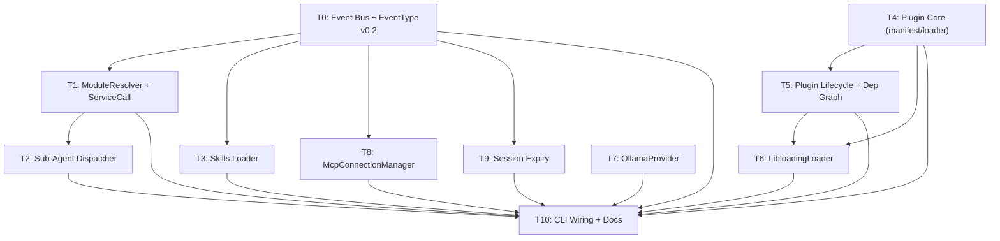

# AgentJ v0.2 Ecosystem Implementation Plan

> **For agentic workers:** REQUIRED SUB-SKILL: Use `superpowers:subagent-driven-development` (recommended) or `superpowers:executing-plans` to implement this plan task-by-task. TDD order is enforced — `test_code` MUST be written and verified failing before `impl_code`.

> **Plan split (2 of 3):** the AgentJ roadmap is split into three independent implementation plans by version priority — this is **Plan 2 (v0.2, ecosystem expansion)**. Sibling plans: `2026-08-09-agentj-v0.1-plan.md` (core, T0-T18, MUST be shipped first) and `2026-08-09-agentj-v0.3-plan.md` (commercial: Web Dashboard / usage stats / License).

## Agent Worker Instructions

- Required sub-skills: `superpowers:subagent-driven-development` (preferred) or `superpowers:executing-plans`
- Execution mode: `subagent-driven-development`
- Required verification: `cargo test --workspace`, `cargo clippy --workspace -- -D warnings`
- Version bump: this plan bumps **0.1.0 → 0.2.0** (feature → minor, per AGENTS.md) — applied in T10.
- **Baseline:** requires the v0.1 plan (`2026-08-09-agentj-v0.1-plan.md`) to be merged first — workspace, `agentj-core/session/model/tools/context/mcp/ipc/cli` crates and their traits must exist at v0.1.0. Do NOT start from an empty repo.
- **Additive-only rule:** with ONE exception (T1 adds the `KernelMessage::ServiceCall` variant), this plan makes NO breaking changes to the v0.1 public API — every extension is additive per design §7「接口契约先行」.
- **Cargo.toml rule:** dependency additions required by the code are listed inside `impl_code` and applied via `cargo add`; they do NOT count toward the 3-file limit.
- **RED semantics for Rust:** when a test references symbols that do not exist yet, the RED state is a *compile error* — acceptable and proves the feature is absent. After `impl_code`, the tests must compile and PASS. Never skip the failing-first check.

## Global Constraints

- Rust version: 1.96+ (stable toolchain, `rust-version = "1.96"`)
- All dependencies: latest stable versions at time of execution (use `cargo add`)
- Rust functions: ≤ 50 lines, ≤ 120 chars per line
- No `unwrap()` / `expect()` in library code (use `Result` + `?`); tests may use them
- No type-error suppression (`as any`, `@ts-ignore`, or Rust equivalents)
- Commit messages in English
- Cargo workspace at repo root, all crates flattened in project root (`members = ["agentj-*"]`)
- New crates in this plan: `agentj-skills` (T3), `agentj-plugin` (T4-T6), `agentj-plugin-fixture` (T6, dev fixture)
- Additive-only to v0.1 public API; the one allowed break is T1's `KernelMessage::ServiceCall` variant (matching arms must add a wildcard arm, design §7 #3)

---

## Architecture Notes

- **Event bus (T0)**: v0.1 defined `EventType`/`EventHandler` and `ModuleRegister::on_event` but the Kernel never consumed the registered handlers. T0 wires them: a shared `EventBus` (`publish(event)` → matching handlers), Kernel drains `register.events` after `init()` and auto-publishes `ModuleLoaded`/`ModuleFailed`/`ModuleStopped` on lifecycle transitions (design §模块生命周期状态机「查询与事件」). `EventType` gains the v0.2 variants from design §7 #4 (`ModuleLoading/Disabled/Enabled/Reloaded`, `McpConnecting/Connected/Disconnected/Reconnecting/Closed`).
- **Service-location channel (T1)**: design §7「能力接口与通道分离」— the v0.1 message bus stays; T1 layers a `ModuleResolver` service-location channel on top. Modules keep implementing capability traits (`&self` + Send + Sync); the Kernel exposes `resolve::<T>(id)`. `KernelMessage::ServiceCall` is added (the ONE allowed breaking change) so modules can route service calls through the bus; the reply rides a oneshot wrapped in `Arc<Mutex<Option<…>>>` to keep the enum `Clone`.
- **Sub-Agent Dispatcher (T2)**: `dispatch(task_spec)` spawns parallel `AgentLoop` instances on cloned `KernelContext`s, one fresh session each, and returns a `JoinHandle<SubAgentResult>` (design: "parallel sub-tasks using AgentLoop instances, collects results").
- **Skills Loader (T3)**: multi-path priority `.aj/skills` > `.agents/skills` > `.claude/skills` > builtin (design §5). Same-name → highest priority wins; different-name → all loaded. Registers tools/providers/event handlers through the v0.1 `ModuleRegister`.
- **Plugin lifecycle (T4-T6)**: design §插件生命周期 / decision #12 — `PluginLoader` trait abstracts loading (`LibloadingLoader` first, `WasmLoader` deferred). The Kernel 6-state machine is extended with `Loading/Disabled/Reloading`; dependency graph via manifest `dependencies` + topological init / reverse-topological shutdown (cycle → `PluginError::DependencyCycle`); reload failure rolls back to the previous version (`PluginError::ReloadFailed`); tool name conflicts use the v0.1 `ReplacePolicy` contract → `PluginError::ToolConflict`.
- **MCP long-lived connections (T8)**: design §MCP 连接生命周期 / decision #11 — `McpConnectionManager` owns the connection state machine, ref-counted sharing across consumers, idle-timeout reclamation (default 60s), exponential-backoff reconnect (500ms×2, cap 30s, max 5), cascade `ToolRegistry::unregister_by_source(Mcp{server_id})` on Disconnected/Failed/Closed (ghost-tool cleanup, M2 gap), tool re-list diff on reconnect (M3 gap), and graceful `Closing → Closed` (MCP `shutdown` notification, then force-kill fallback reusing v0.1 `kill_on_drop`). Mid-call crash → `ToolError::ServerUnavailable` (contract from v0.1 T2).
- **Session expire (T9)**: v0.1 T17 fixed the `archive/delete` contract; T9 adds TTL-based expiry scan that archives stale sessions and publishes `EventType::SessionExpired` (design 遗留问题「Session 过期回收」).
- **Model expansion (T7)**: `OllamaProvider` implements the v0.1 `ModelProvider` trait against Ollama's `/api/chat` SSE endpoint. OpenAI-compatible endpoints were already covered by v0.1 T8's `OpenAICompatibleProvider`.
- **Deferred (blocked on external research — NOT template tasks in this plan):**
  - opencode/claude code plugin manifest compat (design §6, plan Phase B5) — blocked on manifest-format research.
  - `WasmLoader` (design decision #12, optional) — blocked on WASM runtime selection research.
  - TUI frontend (design 非目标, v0.2+) — not scoped here.

---

## Tasks

### T0: Add event bus publish/subscribe and extend EventType for v0.2 [P0] [Sequential]

```yaml
- id: T0
  title: "Add event bus publish/subscribe and extend EventType for v0.2"
  files:
    - agentj-core/src/hooks.rs
    - agentj-core/src/module.rs
    - agentj-core/src/kernel.rs
  depends_on: []
  breaking: false
  ac:
    - given: a Kernel with a spy module whose init registers an EventHandler via ModuleRegister.on_event
      when: running `cargo test -p agentj-core`
      then: >-
        the spy receives ModuleLoaded on register success and ModuleStopped after shutdown;
        an init-failing module triggers ModuleFailed; EventBus::publish fans out only to
        handlers whose subscribed event matches; the v0.2 EventType variants
        (ModuleLoading/ModuleDisabled/ModuleEnabled/ModuleReloaded,
        McpConnecting/McpConnected/McpDisconnected/McpReconnecting/McpClosed) construct, clone,
        and compare correctly
  regression:
    - "cargo test -p agentj-core (all v0.1 core tests must keep passing: types, module, kernel, agent_loop, tool source)"
  test_code: |
    // In agentj-core/src/hooks.rs (tests module)
    #[cfg(test)]
    mod tests {
        use super::*;
        use crate::error::*;
        use crate::kernel::Kernel;
        use crate::module::*;
        use crate::types::*;
        use std::sync::{Arc, Mutex};

        struct SpyHandler { events: Arc<Mutex<Vec<EventType>>> }
        impl EventHandler for SpyHandler {
            fn on_event(&self, event: &EventType, _ctx: &KernelContext) {
                self.events.lock().unwrap().push(event.clone());
            }
        }

        /// Minimal module used to exercise the kernel's lifecycle event publishing.
        struct LifecycleModule;
        impl Module for LifecycleModule {
            fn id(&self) -> ModuleId { "lm".into() }
            fn metadata(&self) -> ModuleMetadata {
                ModuleMetadata { id: "lm".into(), name: "lm".into(), version: "1".into(), description: "".into(), author: "".into() }
            }
            fn init(&mut self, _ctx: &KernelContext, _r: &mut ModuleRegister) -> Result<(), ModuleError> { Ok(()) }
            fn shutdown(&mut self) -> Result<(), ModuleError> { Ok(()) }
        }
        impl KernelModule for LifecycleModule {
            fn handle(&mut self, _msg: &KernelMessage) -> Result<KernelResponse, ModuleError> { Ok(KernelResponse::Handled) }
        }

        fn dummy_context() -> KernelContext {
            KernelContext {
                session: Arc::new(NoopSession),
                tools: Arc::new(ToolRegistry::new()),
                providers: Arc::new(ProviderRegistry::new()),
                config: Arc::new(NoopConfig),
            }
        }
        struct NoopSession;
        impl SessionStore for NoopSession {
            fn create(&self) -> Result<SessionId, ModuleError> { Ok("s".into()) }
            fn append(&self, _s: &SessionId, _m: ChatMessage) -> Result<(), ModuleError> { Ok(()) }
            fn get(&self, _s: &SessionId) -> Result<Vec<ChatMessage>, ModuleError> { Ok(vec![]) }
            fn estimate_tokens(&self, _s: &SessionId) -> Result<usize, ModuleError> { Ok(0) }
        }
        struct NoopConfig;
        impl ConfigProvider for NoopConfig {
            fn get_str(&self, _k: &str) -> Option<String> { None }
            fn get_int(&self, _k: &str) -> Option<i64> { None }
            fn providers(&self) -> Vec<(String, String)> { vec![] }
        }

        #[test]
        fn event_bus_publishes_to_matching_handlers() {
            let bus = EventBus::with_ctx(Arc::new(dummy_context()));
            let spy = Arc::new(SpyHandler { events: Arc::new(Mutex::new(vec![])) });
            bus.register(EventType::ModuleLoaded("m".into()), spy.clone());
            bus.register(EventType::ModuleStopped("m".into()), spy.clone());
            bus.publish(&EventType::ModuleLoaded("m".into()));
            bus.publish(&EventType::ModuleStopped("m".into()));
            assert_eq!(spy.events.lock().unwrap().len(), 2);
        }

        #[test]
        fn event_bus_filters_non_matching_events() {
            let bus = EventBus::with_ctx(Arc::new(dummy_context()));
            let spy = Arc::new(SpyHandler { events: Arc::new(Mutex::new(vec![])) });
            bus.register(EventType::ModuleLoaded("m".into()), spy.clone());
            bus.publish(&EventType::ModuleFailed("m".into()));
            assert!(spy.events.lock().unwrap().is_empty());
        }

        #[test]
        fn event_bus_without_ctx_is_a_noop() {
            let bus = EventBus::new();
            let spy = Arc::new(SpyHandler { events: Arc::new(Mutex::new(vec![])) });
            bus.register(EventType::ModuleLoaded("m".into()), spy.clone());
            bus.publish(&EventType::ModuleLoaded("m".into()));
            assert!(spy.events.lock().unwrap().is_empty());
        }

        #[tokio::test]
        async fn kernel_publishes_lifecycle_events() {
            // design §模块生命周期状态机「查询与事件」: Kernel auto-publishes ModuleLoaded on
            // register success and ModuleStopped after graceful shutdown.
            let spy = Arc::new(SpyHandler { events: Arc::new(Mutex::new(vec![])) });
            let mut kernel = Kernel::new();
            kernel.events().register(EventType::ModuleLoaded("lm".into()), spy.clone());
            kernel.events().register(EventType::ModuleStopped("lm".into()), spy.clone());
            let mut register = ModuleRegister::new(Arc::new(ToolRegistry::new()), Arc::new(ProviderRegistry::new()));
            kernel.register_module(Box::new(LifecycleModule), &dummy_context(), &mut register).unwrap();

            let handle = kernel.start();
            kernel.sender().send(KernelMessage::Shutdown).unwrap();
            handle.await.unwrap().unwrap();

            let events = spy.events.lock().unwrap();
            assert!(events.contains(&EventType::ModuleLoaded("lm".into())), "ModuleLoaded must be published on register");
            assert!(events.contains(&EventType::ModuleStopped("lm".into())), "ModuleStopped must be published after shutdown");
        }

        /// init() failure must publish ModuleFailed (design §模块生命周期状态机「查询与事件」).
        struct FailingModule;
        impl Module for FailingModule {
            fn id(&self) -> ModuleId { "fm".into() }
            fn metadata(&self) -> ModuleMetadata {
                ModuleMetadata { id: "fm".into(), name: "fm".into(), version: "1".into(), description: "".into(), author: "".into() }
            }
            fn init(&mut self, _ctx: &KernelContext, _r: &mut ModuleRegister) -> Result<(), ModuleError> {
                Err(ModuleError::Init("boom".into()))
            }
            fn shutdown(&mut self) -> Result<(), ModuleError> { Ok(()) }
        }
        impl KernelModule for FailingModule {
            fn handle(&mut self, _msg: &KernelMessage) -> Result<KernelResponse, ModuleError> { Ok(KernelResponse::Handled) }
        }

        #[tokio::test]
        async fn kernel_publishes_module_failed_on_init_error() {
            let spy = Arc::new(SpyHandler { events: Arc::new(Mutex::new(vec![])) });
            let mut kernel = Kernel::new();
            kernel.events().register(EventType::ModuleFailed("fm".into()), spy.clone());
            let mut register = ModuleRegister::new(Arc::new(ToolRegistry::new()), Arc::new(ProviderRegistry::new()));
            assert!(kernel.register_module(Box::new(FailingModule), &dummy_context(), &mut register).is_err());
            assert!(spy.events.lock().unwrap().contains(&EventType::ModuleFailed("fm".into())));
        }

        #[test]
        fn v02_event_type_variants_exist() {
            let loading = EventType::ModuleLoading("m".into());
            let disabled = EventType::ModuleDisabled("m".into());
            let enabled = EventType::ModuleEnabled("m".into());
            let reloaded = EventType::ModuleReloaded("m".into());
            let connecting = EventType::McpConnecting("srv".into());
            let connected = EventType::McpConnected("srv".into());
            let closed = EventType::McpClosed("srv".into());
            assert_ne!(loading, enabled);
            assert_ne!(connecting, closed);
            assert_ne!(connected, closed);
            assert_eq!(closed, EventType::McpClosed("srv".into()));
        }
    }
  impl_code: |
    # agentj-core/src/hooks.rs (new file)
    use std::sync::{Arc, Mutex, RwLock};
    use crate::module::{EventHandler, EventType, KernelContext};

    /// Event bus: publish(event) fans out to every handler whose subscribed event matches.
    /// v0.2 consumes the v0.1 EventType/EventHandler contract (design §7 预留接口 #4).
    /// The KernelContext handed to handlers is stored on the bus (Kernel sets it at first
    /// register_module); non-module publishers (session store, MCP manager) use the Kernel's
    /// bus in production or `with_ctx` in tests.
    /// Handlers are `Arc<dyn EventHandler>` (shared, cloneable — tests register an Arc and
    /// keep a clone to assert on after publish). The Kernel converts v0.1's Box registrations
    /// from `ModuleRegister.events` via `Arc::from(box)` at register time.
    pub struct EventBus {
        handlers: Arc<Mutex<Vec<(EventType, Arc<dyn EventHandler>)>>>,
        ctx: Arc<RwLock<Option<Arc<KernelContext>>>>,
    }

    impl EventBus {
        pub fn new() -> Self {
            Self { handlers: Arc::new(Mutex::new(vec![])), ctx: Arc::new(RwLock::new(None)) }
        }

        pub fn with_ctx(ctx: Arc<KernelContext>) -> Self {
            Self { handlers: Arc::new(Mutex::new(vec![])), ctx: Arc::new(RwLock::new(Some(ctx))) }
        }

        pub fn set_ctx(&self, ctx: Option<Arc<KernelContext>>) {
            *self.ctx.write().unwrap() = ctx;
        }

        pub fn register(&self, event: EventType, handler: Arc<dyn EventHandler>) {
            self.handlers.lock().unwrap().push((event, handler));
        }

        pub fn publish(&self, event: &EventType) {
            let Some(ctx) = self.ctx.read().unwrap().clone() else { return };
            let handlers = self.handlers.lock().unwrap();
            for (sub, handler) in handlers.iter() {
                if sub == event {
                    handler.on_event(event, &ctx);
                }
            }
        }

        pub fn handler_count(&self) -> usize {
            self.handlers.lock().unwrap().len()
        }
    }

    # agentj-core/src/module.rs — extend EventType (additive; v0.1 variants preserved).
    // Add to the existing enum, after SessionExpired(SessionId):
    //   // v0.2 扩展（design §7 #4）：插件生命周期 + MCP 连接生命周期事件
    //   ModuleLoading(ModuleId),
    //   ModuleDisabled(ModuleId),
    //   ModuleEnabled(ModuleId),
    //   ModuleReloaded(ModuleId),
    //   McpConnecting(String),
    //   McpConnected(String),
    //   McpDisconnected(String),
    //   McpReconnecting(String),
    //   McpClosed(String),

    # agentj-core/src/kernel.rs — wire the bus into lifecycle (additive).
    // Kernel gains two fields:
    //   events: Arc<EventBus>,
    //   ctx: Arc<std::sync::RwLock<Option<KernelContext>>>,   // retained at first register_module
    // `new()`/`with_timeouts()` initialize them (`EventBus::new()`, `RwLock::new(None)`).
    // New public API:
    //   pub fn events(&self) -> Arc<EventBus>;
    //   pub fn publish(&self, event: &EventType);  // delegates to self.events.publish (no-op until ctx is set)
    // register_module changes (behavior preserved for non-subscribers):
    //   - store ctx + hand it to the bus: *self.ctx.write() = Some(ctx.clone());
    //     self.events.set_ctx(Some(Arc::new(ctx.clone())));
    //   - after init() success: drain v0.1's Box registrations into the bus (Box → Arc):
    //       for (evt, handler) in register.events.drain(..) { self.events.register(evt, Arc::from(handler)); }
    //     then self.publish(&EventType::ModuleLoaded(id.clone()));
    //   - on init() failure: self.publish(&EventType::ModuleFailed(id.clone()));
    // shutdown_all changes:
    //   - after each module's shutdown resolves to Stopped → publish(ModuleStopped(id));
    //   - to Failed → publish(ModuleFailed(id)).
    // lib.rs: add `pub mod hooks;`

    # agentj-core/Cargo.toml — no new deps.
  verify:
    - "cargo test -p agentj-core"
    - "cargo clippy --workspace -- -D warnings"
```

### T1: Add ModuleResolver service location and KernelMessage::ServiceCall [P0] [Sequential]

```yaml
- id: T1
  title: "Add ModuleResolver service location and KernelMessage::ServiceCall"
  files:
    - agentj-core/src/resolver.rs
    - agentj-core/src/kernel.rs
    - agentj-core/src/module.rs
  depends_on: [T0]
  breaking: true
  ac:
    - given: a Kernel whose ModuleRegister has a KernelService registered under an id
      when: running `cargo test -p agentj-core`
      then: >-
        Kernel::resolve::<dyn KernelService>("echo") returns the Arc; a ServiceCall message
        routed through the kernel's sender reaches the service and the reply carries the
        service's return value; resolving a missing service returns None; a ServiceCall to an
        unknown service produces an error reply (the caller never hangs); the enum extension
        is additive — existing exhaustive matches on KernelMessage compile via wildcard arms
  regression:
    - "cargo test -p agentj-core (all v0.1 core tests must keep passing — KernelMessage now has a 3rd variant, matches updated with wildcard arm)"
  test_code: |
    // In agentj-core/src/resolver.rs (tests module)
    #[cfg(test)]
    mod tests {
        use super::*;
        use crate::module::*;
        use crate::types::*;
        use std::sync::Arc;

        struct EchoService;
        impl KernelService for EchoService {
            fn call(&self, _method: &str, params: Value) -> Result<Value, String> {
                Ok(params)
            }
        }

        #[test]
        fn service_registry_registers_and_resolves() {
            let registry = ServiceRegistry::new();
            assert!(registry.resolve::<dyn KernelService>(&"echo".into()).is_none());
            registry.register("echo".into(), Arc::new(EchoService));
            let svc = registry.resolve::<dyn KernelService>(&"echo".into()).unwrap();
            assert_eq!(svc.call("echo", serde_json::json!({"x": 1})).unwrap()["x"], 1);
        }

        #[tokio::test]
        async fn kernel_routes_service_call_and_returns_reply() {
            let mut kernel = Kernel::new();
            let services = kernel.services();
            services.register("echo".into(), Arc::new(EchoService));
            let handle = kernel.start();
            let (tx, rx) = tokio::sync::oneshot::channel();
            kernel.sender().send(KernelMessage::ServiceCall {
                service: "echo".into(),
                method: "echo".into(),
                params: serde_json::json!({"hello": "world"}),
                reply: Arc::new(std::sync::Mutex::new(Some(tx))),
            }).unwrap();
            // rx: oneshot::Receiver<Result<Value, String>> → rx.await yields
            // Result<Result<Value,String>, RecvError>; timeout() wraps that with Elapsed, so
            // TWO expects peel Elapsed then RecvError — leaving Result<Value, String>.
            let reply: Result<Value, String> = tokio::time::timeout(std::time::Duration::from_secs(2), rx).await
                .expect("reply must arrive")
                .expect("sender dropped without sending");
            assert_eq!(reply.unwrap()["hello"], "world");
            kernel.sender().send(KernelMessage::Shutdown).unwrap();
            handle.await.unwrap().unwrap();
        }

        #[tokio::test]
        async fn service_call_to_unknown_service_returns_error_reply() {
            let mut kernel = Kernel::new();
            let handle = kernel.start();
            let (tx, rx) = tokio::sync::oneshot::channel();
            kernel.sender().send(KernelMessage::ServiceCall {
                service: "ghost".into(),
                method: "x".into(),
                params: serde_json::json!({}),
                reply: Arc::new(std::sync::Mutex::new(Some(tx))),
            }).unwrap();
            let reply: Result<Value, String> = tokio::time::timeout(std::time::Duration::from_secs(2), rx).await
                .expect("reply must arrive for unknown service")
                .expect("sender dropped without sending");
            assert!(reply.is_err(), "unknown service must produce an error reply, not hang");
            kernel.sender().send(KernelMessage::Shutdown).unwrap();
            handle.await.unwrap().unwrap();
        }
    }
  impl_code: |
    # agentj-core/src/resolver.rs (new file)
    use std::any::Any;
    use std::collections::HashMap;
    use std::sync::{Arc, RwLock};
    use serde_json::Value;
    use crate::types::ModuleId;

    /// v0.2 service-location channel (design §7 预留接口 #1): capability interfaces stay
    /// `&self + Send + Sync`; this is how the Kernel reaches them without message routing.
    pub trait ModuleResolver: Send + Sync {
        fn resolve<T: 'static + Send + Sync>(&self, id: &ModuleId) -> Option<Arc<T>>;
    }

    /// A routable service invoked by KernelMessage::ServiceCall.
    pub trait KernelService: Send + Sync {
        fn call(&self, method: &str, params: Value) -> Result<Value, String>;
    }

    #[derive(Default)]
    pub struct ServiceRegistry {
        services: RwLock<HashMap<ModuleId, Arc<dyn Any + Send + Sync>>>,
    }

    impl ServiceRegistry {
        pub fn new() -> Self { Self::default() }

        pub fn register<T: 'static + Send + Sync>(&self, id: ModuleId, service: Arc<T>) {
            self.services.write().unwrap().insert(id, service);
        }

        pub fn unregister(&self, id: &ModuleId) {
            self.services.write().unwrap().remove(id);
        }

        pub fn get<T: 'static + Send + Sync>(&self, id: &ModuleId) -> Option<Arc<T>> {
            let svc = self.services.read().unwrap().get(id)?.clone();
            svc.downcast::<T>().ok()
        }
    }

    impl ModuleResolver for ServiceRegistry {
        fn resolve<T: 'static + Send + Sync>(&self, id: &ModuleId) -> Option<Arc<T>> {
            self.get(id)
        }
    }

    # agentj-core/src/module.rs — add to ModuleRegister (additive):
    //   pub services: Arc<ServiceRegistry>,
    // `ModuleRegister::new(tools, providers)` initializes it; new method:
    //   pub fn register_service<T: 'static + Send + Sync>(&self, id: ModuleId, service: Arc<T>)
    //       -> Result<(), ModuleError> { self.services.register(id, service); Ok(()) }
    //   pub fn register_kernel_service(&self, id: ModuleId, service: Arc<dyn KernelService>)
    //       -> Result<(), ModuleError> { self.services.register(id, service); Ok(()) }
    // lib.rs: add `pub mod resolver;` and re-export ServiceRegistry, ModuleResolver, KernelService.

    # agentj-core/src/kernel.rs — additive changes:
    // Kernel gains `services: Arc<ServiceRegistry>`, exposed via `pub fn services(&self) -> Arc<ServiceRegistry>`
    // and `pub fn resolve<T: 'static + Send + Sync>(&self, id: &ModuleId) -> Option<Arc<T>>`
    // (delegates to services.resolve). ModuleRegister::new gains the services Arc (Kernel passes
    // its own when constructing registers in tests/CLI — signature: `ModuleRegister::new(tools, providers)` stays,
    // kernel constructs it with services attached via a new `ModuleRegister::with_services(tools, providers, services)`).
    // KernelMessage gains the ONE allowed breaking variant (in module.rs):
    //   ServiceCall {
    //       service: ModuleId,
    //       method: String,
    //       params: Value,
    //       reply: Arc<std::sync::Mutex<Option<tokio::sync::oneshot::Sender<Result<Value, String>>>>>,
    //   }
    // (Arc keeps the enum Clone-able; the event loop matches it BEFORE broadcast:
    //    if let Some(svc) = self.services.get::<dyn KernelService>(&msg.service) {
    //        let out = svc.call(&msg.method, msg.params.clone());
    //        if let Some(tx) = msg.reply.lock().unwrap().take() { let _ = tx.send(out); }
    //    } else if let Some(tx) = msg.reply.lock().unwrap().take() {
    //        // unknown service: reply with an error so the caller never hangs
    //        let _ = tx.send(Err(format!("service '{}' not found", msg.service)));
    //    }
    //  non-ServiceCall messages fall through to the existing broadcast; every existing
    //  exhaustive match on KernelMessage gains `_ => {}` / `_ => continue` wildcard arms.)
  verify:
    - "cargo test -p agentj-core"
    - "cargo clippy --workspace -- -D warnings"
```

### T2: Add the Sub-Agent Dispatcher [P0] [Sequential]

```yaml
- id: T2
  title: "Add the Sub-Agent Dispatcher"
  files:
    - agentj-core/src/dispatcher.rs
    - agentj-core/src/lib.rs
  depends_on: [T1]
  breaking: false
  ac:
    - given: a Dispatcher wired with a scripted MockModelProvider (two deltas + Done)
      when: running `cargo test -p agentj-core`
      then: >-
        dispatch() returns a JoinHandle; awaiting two parallel dispatches yields two
        SubAgentResult values whose final_response each join to the scripted text; each
        dispatch runs in its own fresh session (session_ids differ)
  regression:
    - "cargo test -p agentj-core (all v0.1 core tests must keep passing)"
  test_code: |
    // In agentj-core/src/dispatcher.rs (tests module) — inline mocks, NO domain imports
    #[cfg(test)]
    mod tests {
        use super::*;
        use crate::error::*;
        use crate::module::*;
        use crate::types::*;
        use async_trait::async_trait;
        use futures::stream::{self, BoxStream};
        use std::sync::atomic::{AtomicU64, Ordering};
        use std::sync::{Arc, Mutex};

        struct MockProvider { chunks: Vec<String> }
        #[async_trait]
        impl ModelProvider for MockProvider {
            async fn chat_stream(&self, _m: Vec<ChatMessage>, _t: Vec<ToolDefinition>, _o: ModelOptions)
                -> Result<BoxStream<'static, Result<ModelEvent, ModelError>>, ModelError> {
                let chunks: Vec<_> = self.chunks.iter().map(|s| Ok(ModelEvent::Delta(s.clone())))
                    .chain(std::iter::once(Ok(ModelEvent::Done))).collect();
                Ok(Box::pin(stream::iter(chunks)))
            }
            async fn chat(&self, _m: Vec<ChatMessage>, _o: ModelOptions) -> Result<ChatResponse, ModelError> {
                Ok(ChatResponse { content: "mock".into(), tool_calls: vec![] })
            }
        }

        struct MockSession { history: Mutex<Vec<ChatMessage>> }
        impl SessionStore for MockSession {
            fn create(&self) -> Result<SessionId, ModuleError> { Ok(uuid_like()) }
            fn append(&self, _s: &SessionId, m: ChatMessage) -> Result<(), ModuleError> {
                self.history.lock().unwrap().push(m); Ok(())
            }
            fn get(&self, _s: &SessionId) -> Result<Vec<ChatMessage>, ModuleError> {
                Ok(self.history.lock().unwrap().clone())
            }
            fn estimate_tokens(&self, _s: &SessionId) -> Result<usize, ModuleError> { Ok(0) }
        }
        // In tests, SessionId = String — a counter keeps ids distinct across dispatches.
        static SESSION_SEQ: AtomicU64 = AtomicU64::new(0);
        fn uuid_like() -> String { format!("s{}", SESSION_SEQ.fetch_add(1, Ordering::SeqCst)) }

        struct MockConfig;
        impl ConfigProvider for MockConfig {
            fn get_str(&self, _k: &str) -> Option<String> { None }
            fn get_int(&self, _k: &str) -> Option<i64> { None }
            fn providers(&self) -> Vec<(String, String)> { vec![] }
        }

        struct MockPipeline;
        impl ContextPipeline for MockPipeline {
            fn assemble(&self, system: &str, history: &[ChatMessage], _t: &[(ToolCall, String)]) -> Vec<ChatMessage> {
                let mut msgs = vec![ChatMessage::system(system)];
                msgs.extend_from_slice(history);
                msgs
            }
            fn reflux(&self, history: &mut Vec<ChatMessage>, tc: &ToolCall, result: String) {
                history.push(ChatMessage { role: Role::Assistant, content: String::new(), tool_call_id: None, tool_calls: vec![tc.clone()] });
                history.push(ChatMessage::tool_result(&tc.id, result));
            }
        }

        #[tokio::test]
        async fn dispatcher_runs_parallel_sub_agents() {
            let tools = Arc::new(ToolRegistry::new());
            let providers = Arc::new(ProviderRegistry::new());
            providers.register("mock".into(), Arc::new(MockProvider { chunks: vec!["Hello".into(), " world".into()] }));
            let ctx = KernelContext {
                session: Arc::new(MockSession { history: Mutex::new(vec![]) }),
                tools,
                providers,
                config: Arc::new(MockConfig),
            };
            let dispatcher = Dispatcher::new(ctx, Arc::new(MockPipeline), "You are helpful.".into());

            let a = dispatcher.dispatch(TaskSpec { prompt: "task a".into(), system_prompt: None });
            let b = dispatcher.dispatch(TaskSpec { prompt: "task b".into(), system_prompt: None });
            let (ra, rb) = tokio::join!(a, b);
            let ra = ra.unwrap().unwrap();
            let rb = rb.unwrap().unwrap();
            assert_eq!(ra.final_response, "Hello world");
            assert_eq!(rb.final_response, "Hello world");
            assert_ne!(ra.session_id, rb.session_id, "each sub-agent gets its own session");
        }
    }
  impl_code: |
    # agentj-core/src/dispatcher.rs (new file)
    use std::sync::Arc;
    use tokio::task::JoinHandle;
    use crate::agent_loop::AgentLoop;
    use crate::error::KernelError;
    use crate::module::{ContextPipeline, KernelContext};
    use crate::types::SessionId;

    /// One parallel sub-task: a fresh session run through its own AgentLoop instance.
    #[derive(Debug, Clone)]
    pub struct TaskSpec {
        pub prompt: String,
        pub system_prompt: Option<String>,
    }

    #[derive(Debug)]
    pub struct SubAgentResult {
        pub session_id: SessionId,
        pub final_response: String,
    }

    /// Spawns parallel sub-agents (design v0.2 Sub-Agent Dispatcher). Each dispatch clones the
    /// shared KernelContext (trait objects are Arc-shared) and runs a fresh session.
    #[derive(Clone)]
    pub struct Dispatcher {
        ctx: KernelContext,
        pipeline: Arc<dyn ContextPipeline>,
        default_system_prompt: String,
    }

    impl Dispatcher {
        pub fn new(ctx: KernelContext, pipeline: Arc<dyn ContextPipeline>, default_system_prompt: String) -> Self {
            Self { ctx, pipeline, default_system_prompt }
        }

        pub fn dispatch(&self, spec: TaskSpec) -> JoinHandle<Result<SubAgentResult, String>> {
            let ctx = self.ctx.clone();
            let pipeline = Arc::clone(&self.pipeline);
            let system = spec.system_prompt.unwrap_or_else(|| self.default_system_prompt.clone());
            tokio::spawn(async move {
                let agent = AgentLoop::new(ctx, pipeline, system);
                let sid = agent.create_session().map_err(|e| e.to_string())?;
                let response = agent.run_turn(&sid, &spec.prompt).await
                    .map_err(|e| match e {
                        KernelError::MessageRouteFailed { reason, .. } => reason,
                        other => other.to_string(),
                    })?;
                Ok(SubAgentResult { session_id: sid, final_response: response })
            })
        }
    }

    # agentj-core/src/lib.rs — add `pub mod dispatcher;`
    # agentj-core/Cargo.toml — no new deps (uses existing async-trait/futures/tokio).
  verify:
    - "cargo test -p agentj-core"
    - "cargo clippy --workspace -- -D warnings"
```

### T3: Add the agentj-skills crate with multi-path priority loading [P0] [Parallel with T1, T5, T8, T9]

```yaml
- id: T3
  title: "Add the agentj-skills crate with multi-path priority loading"
  files:
    - agentj-skills/Cargo.toml
    - agentj-skills/src/lib.rs
    - agentj-skills/src/loader.rs
  depends_on: [T0]
  breaking: false
  ac:
    - given: a temp dir with .aj/skills/echo/SKILL.md, .claude/skills/echo/SKILL.md, and .claude/skills/grep/SKILL.md
      when: running `cargo test -p agentj-skills`
      then: >-
        load_skills returns exactly two skills: "echo" (from .aj — higher priority wins over
        the same-name .claude copy) and "grep" (different name, loaded from .claude);
        each skill's description equals its SKILL.md content
  regression:
    - "cargo test -p agentj-core (T0 event bus — EventType/EventBus unchanged)"
  test_code: |
    // In agentj-skills/src/loader.rs (tests module)
    #[cfg(test)]
    mod tests {
        use super::*;

        fn write_skill(dir: &std::path::Path, name: &str, content: &str) {
            let skill_dir = dir.join(name);
            std::fs::create_dir_all(&skill_dir).unwrap();
            std::fs::write(skill_dir.join("SKILL.md"), content).unwrap();
        }

        #[test]
        fn same_name_higher_priority_wins() {
            let dir = tempfile::TempDir::new().unwrap();
            write_skill(&dir.path().join(".aj/skills"), "echo", "AJ VERSION");
            write_skill(&dir.path().join(".claude/skills"), "echo", "CLAUDE VERSION");
            let skills = load_skills(dir.path()).unwrap();
            let echo = skills.iter().find(|s| s.name == "echo").unwrap();
            assert_eq!(echo.description, "AJ VERSION", ".aj wins over .claude for same name");
            assert_eq!(echo.priority, SkillPriority::Aj);
        }

        #[test]
        fn different_names_all_loaded() {
            let dir = tempfile::TempDir::new().unwrap();
            write_skill(&dir.path().join(".aj/skills"), "ajskill", "AJ");
            write_skill(&dir.path().join(".claude/skills"), "claudeskill", "CLAUDE");
            let skills = load_skills(dir.path()).unwrap();
            assert_eq!(skills.len(), 2);
            assert!(skills.iter().any(|s| s.name == "ajskill"));
            assert!(skills.iter().any(|s| s.name == "claudeskill"));
        }

        #[test]
        fn empty_dir_loads_nothing() {
            let dir = tempfile::TempDir::new().unwrap();
            let skills = load_skills(dir.path()).unwrap();
            assert!(skills.is_empty());
        }
    }
  impl_code: |
    # agentj-skills/Cargo.toml
    [package]
    name = "agentj-skills"
    version.workspace = true
    edition.workspace = true
    rust-version.workspace = true

    [dependencies]
    agentj-core = { path = "../agentj-core" }
    tracing = "0.1"

    [dev-dependencies]
    tempfile = "3"

    # agentj-skills/src/lib.rs
    pub mod loader;
    pub use loader::{load_skills, Skill, SkillPriority};

    # agentj-skills/src/loader.rs
    use std::collections::HashMap;
    use std::path::{Path, PathBuf};

    /// Priority order (design §5): .aj > .agents > .claude > builtin.
    #[derive(Debug, Clone, Copy, PartialEq, Eq, PartialOrd, Ord)]
    pub enum SkillPriority {
        Builtin,
        Claude,
        Agents,
        Aj,
    }

    #[derive(Debug, Clone)]
    pub struct Skill {
        pub name: String,
        pub path: PathBuf,
        pub description: String,
        pub priority: SkillPriority,
    }

    /// Scan `base` for `.aj/skills`, `.agents/skills`, `.claude/skills`; each skill is a
    /// subdirectory containing SKILL.md. Same-name skills: highest priority wins (map merge
    /// with max). Different-name skills: all loaded.
    pub fn load_skills(base: &Path) -> Result<Vec<Skill>, Box<dyn std::error::Error>> {
        let mut merged: HashMap<String, Skill> = HashMap::new();
        for (subdir, priority) in [
            (".aj/skills", SkillPriority::Aj),
            (".agents/skills", SkillPriority::Agents),
            (".claude/skills", SkillPriority::Claude),
        ] {
            let dir = base.join(subdir);
            if !dir.is_dir() { continue; }
            for entry in std::fs::read_dir(&dir)? {
                let entry = entry?;
                let skill_dir = entry.path();
                if !skill_dir.is_dir() { continue; }
                let md_path = skill_dir.join("SKILL.md");
                if !md_path.is_file() { continue; }
                let name = entry.file_name().to_string_lossy().to_string();
                let description = std::fs::read_to_string(&md_path)?;
                let candidate = Skill { name: name.clone(), path: skill_dir, description, priority };
                match merged.get(&name) {
                    Some(existing) if existing.priority >= candidate.priority => {}
                    _ => { merged.insert(name, candidate); }
                }
            }
        }
        Ok(merged.into_values().collect())
    }
  verify:
    - "cargo test -p agentj-skills"
    - "cargo clippy --workspace -- -D warnings"
```

### T4: Add the agentj-plugin crate: manifest, PluginLoader trait, PluginInstance bridge [P0] [Parallel with T0, T7]

```yaml
- id: T4
  title: "Add the agentj-plugin crate: manifest, PluginLoader trait, PluginInstance bridge"
  files:
    - agentj-plugin/Cargo.toml
    - agentj-plugin/src/lib.rs
    - agentj-plugin/src/manifest.rs
  depends_on: []
  breaking: false
  ac:
    - given: a PluginManifest and an in-memory FakeLoader
      when: running `cargo test -p agentj-plugin`
      then: >-
        manifest parses from TOML and round-trips to a PluginId; FakeLoader.load returns a
        PluginInstance whose as_module().id() equals the manifest id; unload returns Ok;
        PluginError::ManifestInvalid is produced for a manifest missing the id field
  regression:
    - "cargo test -p agentj-core (v0.1 core tests must keep passing — plugin depends only on core traits)"
  test_code: |
    // In agentj-plugin/src/lib.rs (tests module)
    #[cfg(test)]
    mod tests {
        use super::*;
        use agentj_core::module::{Module, ModuleError, ModuleMetadata, KernelContext, ModuleRegister};
        use agentj_core::types::ModuleId;

        // ---- fake module used by the fake loader ----
        struct FakeModule { id: ModuleId }
        impl Module for FakeModule {
            fn id(&self) -> ModuleId { self.id.clone() }
            fn metadata(&self) -> ModuleMetadata {
                ModuleMetadata { id: self.id.clone(), name: "fake".into(), version: "0.1".into(), description: "".into(), author: "".into() }
            }
            fn init(&mut self, _ctx: &KernelContext, _r: &mut ModuleRegister) -> Result<(), ModuleError> { Ok(()) }
            fn shutdown(&mut self) -> Result<(), ModuleError> { Ok(()) }
        }

        struct FakeInstance { manifest: PluginManifest, module: FakeModule }
        impl PluginInstance for FakeInstance {
            fn manifest(&self) -> &PluginManifest { &self.manifest }
            fn as_module(&self) -> &dyn Module { &self.module }
        }

        struct FakeLoader;
        impl PluginLoader for FakeLoader {
            fn load(&self, manifest: &PluginManifest) -> Result<Box<dyn PluginInstance>, PluginError> {
                Ok(Box::new(FakeInstance {
                    manifest: manifest.clone(),
                    module: FakeModule { id: manifest.id.clone() },
                }))
            }
            fn unload(&self, _instance: Box<dyn PluginInstance>) -> Result<(), PluginError> { Ok(()) }
        }

        #[test]
        fn manifest_parses_from_toml() {
            let toml_str = r#"
                id = "my-plugin"
                name = "My Plugin"
                version = "1.0.0"
                dependencies = ["base"]
            "#;
            let manifest: PluginManifest = toml::from_str(toml_str).unwrap();
            assert_eq!(manifest.id, "my-plugin");
            assert_eq!(manifest.dependencies, vec!["base".to_string()]);
        }

        #[test]
        fn manifest_missing_id_is_invalid() {
            let result: Result<PluginManifest, toml::de::Error> = toml::from_str("name = 'x'\n");
            assert!(result.is_err(), "missing id must fail deserialization");
        }

        #[test]
        fn fake_loader_loads_and_bridges_to_module() {
            let manifest = PluginManifest { id: "p1".into(), name: "P1".into(), version: "1".into(), description: "".into(), author: "".into(), dependencies: vec![] };
            let loader = FakeLoader;
            let instance = loader.load(&manifest).unwrap();
            assert_eq!(instance.manifest().id, "p1");
            assert_eq!(instance.as_module().id(), "p1");
            loader.unload(instance).unwrap();
        }
    }
  impl_code: |
    # agentj-plugin/Cargo.toml
    [package]
    name = "agentj-plugin"
    version.workspace = true
    edition.workspace = true
    rust-version.workspace = true

    [dependencies]
    agentj-core = { path = "../agentj-core" }
    serde = { version = "1", features = ["derive"] }
    toml = "0.8"
    thiserror = "2"

    # agentj-plugin/src/lib.rs
    pub mod manifest;
    pub use manifest::{PluginError, PluginManifest};
    use crate::manifest::PluginManifest;

    /// A loaded plugin, bridged to the kernel as a `Module` (design §插件生命周期).
    /// The kernel only ever sees this — loading mechanism and lifecycle are decoupled.
    pub trait PluginInstance: Send + Sync {
        fn manifest(&self) -> &PluginManifest;
        fn as_module(&self) -> &dyn agentj_core::module::Module;
    }

    /// Abstracts the plugin loading mechanism (design decision #12): `LibloadingLoader`
    /// is v0.2's first loader, `WasmLoader` is deferred/optional.
    pub trait PluginLoader: Send + Sync {
        fn load(&self, manifest: &PluginManifest) -> Result<Box<dyn PluginInstance>, PluginError>;
        fn unload(&self, instance: Box<dyn PluginInstance>) -> Result<(), PluginError>;
    }

    # agentj-plugin/src/manifest.rs
    use agentj_core::module::ToolSource;
    use agentj_core::types::ModuleId;
    use serde::Deserialize;

    #[derive(Debug, thiserror::Error)]
    pub enum PluginError {
        #[error("plugin '{id}' manifest invalid: {reason}")]
        ManifestInvalid { id: String, reason: String },
        #[error("plugin dependency cycle: {0:?}")]
        DependencyCycle(Vec<String>),
        #[error("plugin '{id}' reload failed, rolled back to previous version")]
        ReloadFailed { id: String },
        #[error("tool '{name}' already registered by {existing:?}")]
        ToolConflict { name: String, existing: ToolSource },
        #[error("plugin '{id}' load failed: {reason}")]
        LoadFailed { id: String, reason: String },
        #[error("plugin '{id}' not found")]
        NotFound(ModuleId),
    }

    /// Declarative plugin descriptor (design §插件生命周期). `dependencies` feeds the
    /// topological init / reverse-topological shutdown order (T5).
    #[derive(Debug, Clone, Deserialize)]
    pub struct PluginManifest {
        pub id: String,
        pub name: String,
        pub version: String,
        #[serde(default)]
        pub description: String,
        #[serde(default)]
        pub author: String,
        #[serde(default)]
        pub dependencies: Vec<String>,
    }
  verify:
    - "cargo test -p agentj-plugin"
    - "cargo clippy --workspace -- -D warnings"
```

### T5: Add the plugin lifecycle state machine and dependency graph [P0] [Parallel with T3, T8, T9]

```yaml
- id: T5
  title: "Add the plugin lifecycle state machine and dependency graph"
  files:
    - agentj-plugin/src/state_machine.rs
    - agentj-plugin/src/plugin_manager.rs
    - agentj-plugin/src/lib.rs
  depends_on: [T4]
  breaking: false
  ac:
    - given: three plugins (A no deps, B depends on A, C depends on A) registered in order C, B, A
      when: running `cargo test -p agentj-plugin`
      then: >-
        topological init order is [A, B, C] (dependencies first) regardless of registration
        order; shutdown order is reverse-topological [C, B, A]; a cycle (A depends on B,
        B depends on A) yields PluginError::DependencyCycle; a state machine transitions
        Ready→Disabled→Ready→Reloading→Ready and a failed reload rolls back with
        PluginError::ReloadFailed while the previous instance stays Ready
  regression:
    - "cargo test -p agentj-plugin (T4 manifest/loader tests must keep passing)"
    - "cargo test -p agentj-core (T0 event bus — plugin publishes Module* lifecycle events through it)"
  test_code: |
    // In agentj-plugin/src/plugin_manager.rs (tests module)
    #[cfg(test)]
    mod tests {
        use super::*;
        use crate::manifest::{PluginError, PluginManifest};
        use agentj_core::module::{ReplacePolicy, Tool, ToolRegistry, ToolSource};
        use std::sync::Arc;

        fn deps(id: &str, d: Vec<&str>) -> PluginManifest {
            PluginManifest {
                id: id.into(), name: id.into(), version: "1".into(),
                description: "".into(), author: "".into(),
                dependencies: d.into_iter().map(String::from).collect(),
            }
        }

        #[test]
        fn topological_init_dependencies_first() {
            let manifests = vec![deps("c", vec!["a"]), deps("b", vec!["a"]), deps("a", vec![])];
            let order = resolve_init_order(&manifests).unwrap();
            // HashMap iteration order is not deterministic — assert the invariant, not an
            // exact sequence: a must precede b and c; b and c are mutually unordered.
            assert_eq!(order.len(), 3);
            let pos = |id: &str| order.iter().position(|x| x == id).unwrap();
            assert!(pos("a") < pos("b"), "a must init before b, got {order:?}");
            assert!(pos("a") < pos("c"), "a must init before c, got {order:?}");
        }

        #[test]
        fn reverse_topological_shutdown_order() {
            let order = vec!["a", "b", "c"];
            assert_eq!(resolve_shutdown_order(&order), vec!["c", "b", "a"]);
        }

        #[test]
        fn dependency_cycle_is_detected() {
            let manifests = vec![deps("a", vec!["b"]), deps("b", vec!["a"])];
            let err = resolve_init_order(&manifests).unwrap_err();
            assert!(matches!(err, PluginError::DependencyCycle(_)));
        }

        struct DummyTool;
        impl Tool for DummyTool {
            fn name(&self) -> &str { "dummy" }
            fn description(&self) -> &str { "" }
            fn input_schema(&self) -> serde_json::Value { serde_json::json!({}) }
            fn execute(&self, _i: serde_json::Value) -> Result<serde_json::Value, agentj_core::error::ToolError> {
                Ok(serde_json::Value::Null)
            }
        }

        #[test]
        fn plugin_tool_conflict_rejected_with_existing_source() {
            // design P5: Reject policy on a taken name → PluginError::ToolConflict with the
            // existing owner's source
            let registry = ToolRegistry::new();
            registry.register_tool_with_source(Arc::new(DummyTool), ToolSource::Builtin, ReplacePolicy::Reject).unwrap();
            let err = register_plugin_tool(&registry, Arc::new(DummyTool), "p1", ReplacePolicy::Reject).unwrap_err();
            assert!(matches!(err, PluginError::ToolConflict { ref name, ref existing }
                if name == "dummy" && *existing == ToolSource::Builtin));
            // Replace policy overwrites and succeeds
            assert!(register_plugin_tool(&registry, Arc::new(DummyTool), "p1", ReplacePolicy::Replace).is_ok());
        }

        #[test]
        fn state_machine_transitions_and_reload_rollback() {
            let mut sm = PluginStateMachine::new("p1");
            assert_eq!(sm.state(), PluginState::Unloaded);
            sm.begin_loading(); assert_eq!(sm.state(), PluginState::Loading);
            sm.initialized();  assert_eq!(sm.state(), PluginState::Ready);
            sm.disable();      assert_eq!(sm.state(), PluginState::Disabled);
            sm.enable();       assert_eq!(sm.state(), PluginState::Ready);
            sm.begin_reload(); assert_eq!(sm.state(), PluginState::Reloading);
            sm.reload_failed(); // rollback
            assert_eq!(sm.state(), PluginState::Ready);
            assert_eq!(sm.last_error(), Some("reload failed".to_string()));
        }
    }
  impl_code: |
    # agentj-plugin/src/state_machine.rs (new file)
    use crate::manifest::PluginError;

    /// Plugin lifecycle state — the Kernel 6-state machine (design §模块生命周期状态机)
    /// extended with Loading/Disabled/Reloading (design §插件生命周期).
    #[derive(Debug, Clone, Copy, PartialEq, Eq)]
    pub enum PluginState {
        Unloaded, Loading, Initializing, Ready, Disabled, Reloading, Stopping, Stopped, Failed,
    }

    pub struct PluginStateMachine {
        id: String,
        state: PluginState,
        last_error: Option<String>,
    }

    impl PluginStateMachine {
        pub fn new(id: String) -> Self {
            Self { id, state: PluginState::Unloaded, last_error: None }
        }

        pub fn state(&self) -> PluginState { self.state }
        pub fn last_error(&self) -> Option<&str> { self.last_error.as_deref() }

        pub fn begin_loading(&mut self) { self.state = PluginState::Loading; }
        pub fn initialized(&mut self) { self.state = PluginState::Ready; }
        pub fn disable(&mut self) { if matches!(self.state, PluginState::Ready) { self.state = PluginState::Disabled; } }
        pub fn enable(&mut self) { if matches!(self.state, PluginState::Disabled) { self.state = PluginState::Ready; } }
        pub fn begin_reload(&mut self) { if matches!(self.state, PluginState::Ready) { self.state = PluginState::Reloading; } }
        pub fn reload_failed(&mut self) { self.state = PluginState::Ready; self.last_error = Some("reload failed".into()); }
        pub fn mark_failed(&mut self, err: &str) { self.state = PluginState::Failed; self.last_error = Some(err.into()); }
        pub fn stopping(&mut self) { self.state = PluginState::Stopping; }
        pub fn stopped(&mut self) { self.state = PluginState::Stopped; }
    }

    # agentj-plugin/src/plugin_manager.rs (new file)
    use std::collections::{HashMap, VecDeque};
    use std::sync::Arc;
    use agentj_core::module::{ReplacePolicy, Tool, ToolRegistry, ToolSource};
    use crate::manifest::{PluginError, PluginManifest};

    /// Kahn's algorithm over manifest dependencies. Cycle → PluginError::DependencyCycle.
    pub fn resolve_init_order(manifests: &[PluginManifest]) -> Result<Vec<String>, PluginError> {
        let mut deps: HashMap<String, Vec<String>> = manifests.iter()
            .map(|m| (m.id.clone(), m.dependencies.clone())).collect();
        let mut order = Vec::with_capacity(manifests.len());
        let mut frontier: VecDeque<String> = deps.iter()
            .filter(|(_, d)| d.is_empty())
            .map(|(id, _)| id.clone()).collect();
        // Decrement in-degree style: repeatedly pick plugins whose deps are all in `order`.
        while let Some(id) = frontier.pop_front() {
            if order.contains(&id) { continue; }
            order.push(id.clone());
            for (cand, cand_deps) in deps.iter() {
                if order.contains(cand) { continue; }
                if cand_deps.iter().all(|d| order.contains(d)) {
                    frontier.push_back(cand.clone());
                }
            }
        }
        if order.len() != manifests.len() {
            let leftover: Vec<String> = manifests.iter().map(|m| m.id.clone())
                .filter(|id| !order.contains(id)).collect();
            return Err(PluginError::DependencyCycle(leftover));
        }
        Ok(order)
    }

    /// Reverse-topological shutdown: reverse of the init order (dependencies exit last).
    pub fn resolve_shutdown_order(init_order: &[String]) -> Vec<String> {
        init_order.iter().rev().cloned().collect()
    }

    /// Register a plugin-owned tool. With `ReplacePolicy::Reject` (design P5 default), a
    /// name already taken by any source fails with `PluginError::ToolConflict` carrying the
    /// existing owner's source; `Replace` overwrites (the plugin explicitly declared intent).
    pub fn register_plugin_tool(
        registry: &ToolRegistry,
        tool: Arc<dyn Tool>,
        plugin_id: &str,
        policy: ReplacePolicy,
    ) -> Result<(), PluginError> {
        let name = tool.name().to_string();
        let existing = registry.tools().iter()
            .find(|e| e.tool.name() == name)
            .map(|e| e.source.clone());
        if let Some(existing) = existing {
            if policy == ReplacePolicy::Reject {
                return Err(PluginError::ToolConflict { name, existing });
            }
        }
        registry.register_tool_with_source(
            tool,
            ToolSource::Plugin { plugin_id: plugin_id.into() },
            policy,
        ).map_err(|_| PluginError::ToolConflict { name, existing: ToolSource::Builtin })
    }

    # agentj-plugin/src/lib.rs — add `pub mod state_machine; pub mod plugin_manager;`
    # and re-export PluginState/PluginStateMachine/resolve_init_order/resolve_shutdown_order/
    # register_plugin_tool. (The PluginManager wiring with the kernel/event-bus integration is
    # T10's CLI wiring; the state machine, graph, and tool-conflict contract are pure and fully
    # unit-tested here.)
  verify:
    - "cargo test -p agentj-plugin"
    - "cargo clippy --workspace -- -D warnings"
```

### T6: Add the LibloadingLoader with a cdylib plugin fixture [P1] [Parallel with T3, T8, T9]

```yaml
- id: T6
  title: "Add the LibloadingLoader with a cdylib plugin fixture"
  files:
    - agentj-plugin/src/libloading_loader.rs
    - agentj-plugin/Cargo.toml
    - agentj-plugin-fixture/src/lib.rs
  depends_on: [T4, T5]
  breaking: false
  ac:
    - given: the agentj-plugin-fixture cdylib built as a workspace member
      when: running `cargo test -p agentj-plugin`
      then: >-
        LibloadingLoader.load() resolves the fixture library, calls its agentj_plugin_load
        export, and returns a PluginInstance whose as_module().id() is "fixture-plugin";
        unload() succeeds; loading a non-existent path returns PluginError::LoadFailed
  regression:
    - "cargo test -p agentj-plugin (T4 + T5 tests must keep passing)"
  test_code: |
    // In agentj-plugin/src/libloading_loader.rs (tests module)
    #[cfg(test)]
    mod tests {
        use super::*;
        use crate::manifest::PluginManifest;
        use agentj_core::module::Module;

        #[test]
        fn libloading_loader_loads_fixture_plugin() {
            // The fixture crate builds a cdylib; libloading loads it at runtime.
            let manifest = PluginManifest {
                id: "fixture-plugin".into(), name: "Fixture".into(), version: "1".into(),
                description: "".into(), author: "".into(), dependencies: vec![],
            };
            let loader = LibloadingLoader::new(fixture_lib_path());
            let instance = loader.load(&manifest).unwrap();
            assert_eq!(instance.as_module().id(), "fixture-plugin");
            loader.unload(instance).unwrap();
        }

        #[test]
        fn libloading_loader_missing_lib_fails() {
            let loader = LibloadingLoader::new("/nonexistent/lib.so".into());
            let manifest = PluginManifest { id: "x".into(), name: "x".into(), version: "1".into(), description: "".into(), author: "".into(), dependencies: vec![] };
            assert!(matches!(loader.load(&manifest), Err(PluginError::LoadFailed { .. })));
        }

        fn fixture_lib_path() -> String {
            // Build artifacts land under target/<profile>/; the fixture is built as a
            // workspace member so this resolves its cdylib next to the other build outputs.
            let manifest_dir = env!("CARGO_MANIFEST_DIR");
            let profile = std::env::var("PROFILE").unwrap_or_else(|_| "debug".into());
            let ext = if cfg!(target_os = "macos") { "dylib" } else { "so" };
            let mut path = std::path::PathBuf::from(manifest_dir);
            path.push(".."); path.push("target"); path.push(profile);
            path.push(format!("libagentj_plugin_fixture.{ext}"));
            path.to_string_lossy().to_string()
        }
    }
  impl_code: |
    # agentj-plugin/src/libloading_loader.rs (new file)
    use crate::{PluginInstance, PluginLoader};
    use crate::manifest::{PluginError, PluginManifest};

    /// Loads native plugins (.so/.dylib) via libloading — v0.2 first loader
    /// (design decision #12; trust model = user-installed).
    pub struct LibloadingLoader {
        lib_path: String,
    }

    impl LibloadingLoader {
        pub fn new(lib_path: String) -> Self { Self { lib_path } }
    }

    /// C-ABI contract shared with plugin cdylibs (see agentj-plugin-fixture):
    ///   agentj_plugin_load() -> *mut c_void   // ownership of Box<dyn PluginInstance> moves to caller
    ///   agentj_plugin_abi_version() -> u32    // guard: must equal 1
    pub const ABI_VERSION: u32 = 1;

    /// Keeps the cdylib mapped for as long as the instance is alive. Fields drop in
    /// declaration order: `inner` (the plugin's code/data) is dropped BEFORE `_lib`
    /// (the mapped library) — no use-after-unmap.
    pub struct LibPluginInstance {
        inner: Box<dyn PluginInstance>,
        _lib: libloading::Library,
    }

    impl PluginInstance for LibPluginInstance {
        fn manifest(&self) -> &PluginManifest { self.inner.manifest() }
        fn as_module(&self) -> &dyn agentj_core::module::Module { self.inner.as_module() }
    }

    impl PluginLoader for LibloadingLoader {
        fn load(&self, manifest: &PluginManifest) -> Result<Box<dyn PluginInstance>, PluginError> {
            // Safety: the fixture cdylib is compiled from this workspace with the same
            // PluginInstance layout; ABI version guards against mismatched binaries.
            let lib = unsafe { libloading::Library::new(&self.lib_path) }
                .map_err(|e| PluginError::LoadFailed { id: manifest.id.clone(), reason: e.to_string() })?;
            unsafe {
                let abi: libloading::Symbol<unsafe extern "C" fn() -> u32> = lib.get(b"agentj_plugin_abi_version")
                    .map_err(|e| PluginError::LoadFailed { id: manifest.id.clone(), reason: e.to_string() })?;
                if abi() != ABI_VERSION {
                    return Err(PluginError::LoadFailed { id: manifest.id.clone(), reason: "ABI version mismatch".into() });
                }
                let load: libloading::Symbol<unsafe extern "C" fn() -> *mut std::ffi::c_void> = lib.get(b"agentj_plugin_load")
                    .map_err(|e| PluginError::LoadFailed { id: manifest.id.clone(), reason: e.to_string() })?;
                let raw = load();
                if raw.is_null() {
                    return Err(PluginError::LoadFailed { id: manifest.id.clone(), reason: "null instance".into() });
                }
                let inner: Box<dyn PluginInstance> = *Box::from_raw(raw as *mut Box<dyn PluginInstance>);
                // `lib` moves into the wrapper → the library stays mapped for the instance's lifetime
                Ok(Box::new(LibPluginInstance { inner, _lib: lib }))
            }
        }

        fn unload(&self, _instance: Box<dyn PluginInstance>) -> Result<(), PluginError> {
            Ok(()) // dropping the instance drops the wrapper → inner first, then the Library
        }
    }

    # agentj-plugin/Cargo.toml — add `libloading = "0.8"`

    # agentj-plugin-fixture/Cargo.toml (workspace member — new crate, dev fixture only)
    [package]
    name = "agentj-plugin-fixture"
    version.workspace = true
    edition.workspace = true
    rust-version.workspace = true
    publish = false

    [lib]
    crate-type = ["cdylib"]

    [dependencies]
    agentj-plugin = { path = "../agentj-plugin" }
    agentj-core = { path = "../agentj-core" }

    # agentj-plugin-fixture/src/lib.rs
    //! Test plugin exported as a cdylib for LibloadingLoader's integration test.
    use agentj_core::module::{KernelContext, Module, ModuleError, ModuleMetadata, ModuleRegister};
    use agentj_core::types::ModuleId;
    use agentj_plugin::{PluginInstance, PluginManifest};

    struct FixtureModule;
    impl Module for FixtureModule {
        fn id(&self) -> ModuleId { "fixture-plugin".into() }
        fn metadata(&self) -> ModuleMetadata {
            ModuleMetadata { id: "fixture-plugin".into(), name: "Fixture".into(), version: "1".into(), description: "".into(), author: "".into() }
        }
        fn init(&mut self, _ctx: &KernelContext, _r: &mut ModuleRegister) -> Result<(), ModuleError> { Ok(()) }
        fn shutdown(&mut self) -> Result<(), ModuleError> { Ok(()) }
    }

    struct FixtureInstance { manifest: PluginManifest, module: FixtureModule }
    impl PluginInstance for FixtureInstance {
        fn manifest(&self) -> &PluginManifest { &self.manifest }
        fn as_module(&self) -> &dyn Module { &self.module }
    }

    #[no_mangle]
    pub extern "C" fn agentj_plugin_abi_version() -> u32 { agentj_plugin::libloading_loader::ABI_VERSION }

    /// Leaks a Box<dyn PluginInstance> to the loader (caller takes ownership).
    #[no_mangle]
    pub extern "C" fn agentj_plugin_load() -> *mut std::ffi::c_void {
        let manifest = PluginManifest {
            id: "fixture-plugin".into(), name: "Fixture".into(), version: "1".into(),
            description: "".into(), author: "".into(), dependencies: vec![],
        };
        let instance: Box<dyn PluginInstance> = Box::new(FixtureInstance { manifest, module: FixtureModule });
        Box::into_raw(Box::new(instance)) as *mut std::ffi::c_void
    }

    # agentj-plugin/src/lib.rs — add `pub mod libloading_loader;`
  verify:
    - "cargo build -p agentj-plugin-fixture"   # fixture cdylib must exist before the loader test runs
    - "cargo test -p agentj-plugin"
    - "cargo clippy --workspace -- -D warnings"
```

### T7: Add the OllamaProvider to agentj-model [P0] [Parallel with T0, T4]

```yaml
- id: T7
  title: "Add the OllamaProvider to agentj-model"
  files:
    - agentj-model/src/ollama.rs
    - agentj-model/src/lib.rs
    - agentj-model/Cargo.toml
  depends_on: []
  breaking: false
  ac:
    - given: a wiremock server serving the Ollama /api/chat SSE stream
      when: running `cargo test -p agentj-model`
      then: >-
        ollama_provider_streams_sse passes and collected chunks join to "Hello world";
        a 404 from /api/chat maps to ModelError::Api { status: 404, .. }
  regression:
    - "cargo test -p agentj-model (T7 mock + T8 openai_compat tests must keep passing)"
  test_code: |
    // In agentj-model/src/ollama.rs (tests module)
    #[cfg(test)]
    mod tests {
        use super::*;
        use futures::StreamExt;
        use wiremock::matchers::{method, path};
        use wiremock::{Mock, MockServer, ResponseTemplate};

        #[tokio::test]
        async fn ollama_provider_streams_sse() {
            let server = MockServer::start().await;
            let sse_body = concat!(
                "{\"model\":\"llama3\",\"message\":{\"role\":\"assistant\",\"content\":\"Hello\"},\"done\":false}\n",
                "{\"model\":\"llama3\",\"message\":{\"role\":\"assistant\",\"content\":\" world\"},\"done\":false}\n",
                "{\"model\":\"llama3\",\"message\":{\"role\":\"assistant\",\"content\":\"\"},\"done\":true}\n"
            );
            Mock::given(method("POST"))
                .and(path("/api/chat"))
                .respond_with(
                    ResponseTemplate::new(200).set_body_string(sse_body)
                        .insert_header("content-type", "application/x-ndjson"),
                )
                .mount(&server).await;

            let provider = OllamaProvider::new(server.uri(), "llama3".into());
            let mut stream = provider.chat_stream(
                vec![ChatMessage::user("hi")], vec![],
                ModelOptions { model: "llama3".into(), ..Default::default() },
            ).await.unwrap();
            let mut chunks = vec![];
            while let Some(result) = stream.next().await {
                match result.unwrap() {
                    ModelEvent::Delta(t) => chunks.push(t),
                    ModelEvent::Done => break,
                    _ => {}
                }
            }
            assert_eq!(chunks.join(""), "Hello world");
        }

        #[tokio::test]
        async fn api_error_maps_to_model_error() {
            let server = MockServer::start().await;
            Mock::given(method("POST")).and(path("/api/chat"))
                .respond_with(ResponseTemplate::new(404).set_body_string("not found"))
                .mount(&server).await;
            let provider = OllamaProvider::new(server.uri(), "m".into());
            let result = provider.chat_stream(vec![], vec![], ModelOptions::default()).await;
            assert!(matches!(result, Err(ModelError::Api { status: 404, .. })));
        }
    }
  impl_code: |
    # agentj-model/src/lib.rs — add `pub mod ollama;`

    # agentj-model/src/ollama.rs
    use agentj_core::error::ModelError;
    use agentj_core::module::ModelProvider;
    use agentj_core::types::*;
    use async_trait::async_trait;
    use futures::stream::{self, BoxStream};
    use futures::{StreamExt, TryStreamExt};
    use reqwest::Client;
    use serde_json::Value;
    use tokio::io::{AsyncBufReadExt, BufReader};
    use tokio_util::io::StreamReader;

    /// Ollama local-model provider (design v0.2+ 模型扩展). Talks NDJSON over POST /api/chat.
    pub struct OllamaProvider {
        base_url: String,
        model: String,
        client: Client,
    }

    impl OllamaProvider {
        pub fn new(base_url: String, model: String) -> Self {
            Self { base_url: base_url.trim_end_matches('/').to_string(), model, client: Client::new() }
        }

        async fn open_stream(
            &self,
            messages: &[ChatMessage],
            options: &ModelOptions,
        ) -> Result<BoxStream<'static, Result<ModelEvent, ModelError>>, ModelError> {
            let url = format!("{}/api/chat", self.base_url);
            let response = self.client.post(&url)
                .json(&serde_json::json!({
                    "model": options.model,
                    "messages": messages,
                    "stream": true,
                }))
                .send().await
                .map_err(|e| ModelError::Network(e.to_string()))?;
            let status = response.status().as_u16();
            if status != 200 {
                let msg = response.text().await.unwrap_or_default();
                return Err(ModelError::Api { status, message: msg });
            }
            // bytes_stream() is a Stream, not AsyncRead — StreamReader bridges it to the
            // line reader (tokio-util); each NDJSON line becomes one ModelEvent.
            let byte_stream = response.bytes_stream()
                .map(|r| r.map_err(std::io::Error::other));
            let reader = BufReader::new(StreamReader::new(byte_stream));
            let stream = stream::unfold(reader, |mut reader| async move {
                let mut line = String::new();
                loop {
                    match reader.read_line(&mut line).await {
                        Ok(0) => return None,          // EOF
                        Ok(_) => {}
                        Err(_) => return None,          // transport error ends the stream
                    }
                    let trimmed = line.trim().to_string();
                    line.clear();
                    let json: Value = match serde_json::from_str(&trimmed) {
                        Ok(v) => v,
                        Err(_) => continue,
                    };
                    if json.get("done").and_then(|d| d.as_bool()).unwrap_or(false) {
                        return Some((Ok(ModelEvent::Done), reader));
                    }
                    let content = json["message"]["content"].as_str().unwrap_or("").to_string();
                    if !content.is_empty() {
                        return Some((Ok(ModelEvent::Delta(content)), reader));
                    }
                }
            });
            Ok(Box::pin(stream))
        }
    }

    #[async_trait]
    impl ModelProvider for OllamaProvider {
        async fn chat_stream(
            &self,
            messages: Vec<ChatMessage>,
            _tools: Vec<ToolDefinition>,
            options: ModelOptions,
        ) -> Result<BoxStream<'static, Result<ModelEvent, ModelError>>, ModelError> {
            self.open_stream(&messages, &options).await
        }

        async fn chat(
            &self,
            messages: Vec<ChatMessage>,
            options: ModelOptions,
        ) -> Result<ChatResponse, ModelError> {
            let url = format!("{}/api/chat", self.base_url);
            let response = self.client.post(&url)
                .json(&serde_json::json!({ "model": options.model, "messages": messages, "stream": false }))
                .send().await
                .map_err(|e| ModelError::Network(e.to_string()))?;
            let status = response.status().as_u16();
            if status != 200 {
                let msg = response.text().await.unwrap_or_default();
                return Err(ModelError::Api { status, message: msg });
            }
            let json: Value = response.json().await.map_err(|e| ModelError::Network(e.to_string()))?;
            let content = json["message"]["content"].as_str().unwrap_or("").to_string();
            Ok(ChatResponse { content, tool_calls: vec![] })
        }
    }

    # agentj-model/Cargo.toml — add `tokio = { version = "1", features = ["io-util"] }` and
    #   `tokio-util = { version = "0.7", features = ["io"] }` (StreamReader bridges bytes_stream
    #   — a Stream — to the AsyncRead the line reader needs). futures/reqwest already present.
  verify:
    - "cargo test -p agentj-model"
    - "cargo clippy --workspace -- -D warnings"
```

### T8: Add the McpConnectionManager with long-lived connection lifecycle [P1] [Parallel with T1, T3, T5, T9]

```yaml
- id: T8
  title: "Add the McpConnectionManager with long-lived connection lifecycle"
  files:
    - agentj-mcp/src/transport.rs
    - agentj-mcp/src/connection_manager.rs
    - agentj-mcp/src/lib.rs
  depends_on: [T0]
  breaking: false
  ac:
    - given: the v0.1 mcp_echo.sh fixture server and an McpConnectionManager with a short idle timeout
      when: running `cargo test -p agentj-mcp`
      then: >-
        connect() registers the echo tool with ToolSource::Mcp{server_id}; execute() returns
        "echo: hello"; a crash fixture that exits mid-call triggers ToolError::ServerUnavailable,
        the connection reconnects (fresh process, tools refreshed via clean-slate re-register),
        and the tool works again; acquire()/release() share one connection and release-to-zero
        with idle timeout closes it (state Closed) and unregisters its tools; a failed connect
        (handshake error) leaves a Failed tombstone observable via state() — the same fail()
        path that caps reconnect retries (max_reconnect)
  regression:
    - "cargo test -p agentj-mcp (v0.1 McpClient tests must keep passing)"
  test_code: |
    // In agentj-mcp/src/connection_manager.rs (tests module)
    #[cfg(test)]
    mod tests {
        use super::*;
        use agentj_core::module::{ToolRegistry, ToolSource};
        use std::sync::Arc;
        use std::time::Duration;

        fn manager(registry: Arc<ToolRegistry>, idle: Duration) -> McpConnectionManager {
            McpConnectionManager::new(registry, idle, Duration::from_millis(500), 2, Arc::new(EventBus::new()))
        }

        fn echo_script() -> String {
            format!("{}/tests/fixtures/mcp_echo.sh", env!("CARGO_MANIFEST_DIR"))
        }

        #[tokio::test]
        async fn connect_registers_tool_with_source() {
            let registry = Arc::new(ToolRegistry::new());
            let mgr = manager(registry.clone(), Duration::from_secs(60));
            mgr.connect("srv1".into(), echo_script()).await.unwrap();
            assert_eq!(mgr.state("srv1"), Some(ConnectionState::Ready));
            let tools = registry.tools();
            assert_eq!(tools.len(), 1);
            assert_eq!(tools[0].source, ToolSource::Mcp { server_id: "srv1".into() });
        }

        #[tokio::test]
        async fn execute_round_trips_tool_call() {
            let registry = Arc::new(ToolRegistry::new());
            let mgr = manager(registry.clone(), Duration::from_secs(60));
            mgr.connect("srv1".into(), echo_script()).await.unwrap();
            let out = mgr.execute("srv1", "echo", serde_json::json!({"text": "hello"})).await.unwrap();
            assert_eq!(out.as_str().unwrap(), "echo: hello");
        }

        #[tokio::test]
        async fn crash_mid_call_triggers_unavailable_and_reconnect() {
            let registry = Arc::new(ToolRegistry::new());
            let mgr = manager(registry.clone(), Duration::from_secs(60));
            let crash = format!("{}/tests/fixtures/mcp_crash_after_2.sh", env!("CARGO_MANIFEST_DIR"));
            mgr.connect("srv1".into(), crash).await.unwrap();
            // the fixture serves exactly 2 tool calls, then exits; calls 1-2 succeed, call 3
            // hits a dead server → ServerUnavailable → reconnect (fresh process) → tool works again
            assert!(mgr.execute("srv1", "echo", serde_json::json!({"text": "a"})).await.is_ok());
            assert!(mgr.execute("srv1", "echo", serde_json::json!({"text": "b"})).await.is_ok());
            let result = mgr.execute("srv1", "echo", serde_json::json!({"text": "c"})).await;
            assert!(matches!(result, Err(ToolError::ServerUnavailable { server_id, .. }) if server_id == "srv1"));
            let out = mgr.execute("srv1", "echo", serde_json::json!({"text": "d"})).await;
            assert!(out.is_ok(), "tool must work after reconnect, got: {out:?}");
        }

        #[tokio::test]
        async fn release_to_zero_with_idle_timeout_closes_and_unregisters() {
            let registry = Arc::new(ToolRegistry::new());
            let mgr = manager(registry.clone(), Duration::from_millis(50));
            mgr.connect("srv1".into(), echo_script()).await.unwrap();
            assert_eq!(registry.tools().len(), 1);
            mgr.acquire("srv1").unwrap(); // refcount 2
            mgr.release("srv1");          // 1
            mgr.release("srv1");          // 0 → idle timer starts
            tokio::time::sleep(Duration::from_millis(150)).await;
            mgr.reap_idle().await;
            assert_eq!(mgr.state("srv1"), Some(ConnectionState::Closed));
            assert!(registry.tools().is_empty(), "ghost tools must be unregistered on close");
        }

        #[tokio::test]
        async fn reconnect_exhaustion_lands_in_failed() {
            let registry = Arc::new(ToolRegistry::new());
            let mgr = manager(registry.clone(), Duration::from_secs(60));
            // /nonexistent script → every reconnect attempt fails; after max_reconnect → Failed
            mgr.connect("srv1".into(), "/nonexistent/mcp_server.sh".into()).await.unwrap_err();
            assert_eq!(mgr.state("srv1"), Some(ConnectionState::Failed));
        }
    }
  impl_code: |
    # agentj-mcp/src/transport.rs (extracted from v0.1 lib.rs — move McpTransport here, make it shared)
    // McpTransport from v0.1 moves to transport.rs unchanged, EXCEPT it becomes shareable:
    //   pub struct McpTransport { stdin: ChildStdin, stdout: BufReader<ChildStdout>, _child: Child, next_id: u64 }
    //   pub async fn request(&mut self, method: &str, params: Value) -> Result<Value, Box<dyn std::error::Error>>
    // The connection manager wraps it in Arc<std::sync::Mutex<McpTransport>> for concurrent use.
    // Add one method (used by McpConnectionManager::close for graceful exit confirmation,
    // design §MCP 连接生命周期「优雅关闭」):
    //   use std::time::{Duration, Instant};
    //   pub async fn wait_exit(&mut self, timeout: Duration) -> bool {
    //       let deadline = Instant::now() + timeout;
    //       while Instant::now() < deadline {
    //           if let Ok(Some(_)) = self._child.try_wait() { return true; }
    //           tokio::time::sleep(Duration::from_millis(20)).await;
    //       }
    //       false // force-kill fallback (kill_on_drop) applies on drop
    //   }

    # agentj-mcp/src/connection_manager.rs (new file)
    use std::collections::HashMap;
    use std::sync::atomic::{AtomicUsize, Ordering};
    use std::sync::{Arc, Mutex, RwLock};
    use std::time::{Duration, Instant};
    use agentj_core::error::ToolError;
    use agentj_core::hooks::EventBus;
    use agentj_core::module::{EventType, Tool, ToolRegistry, ToolSource};
    use serde_json::Value;
    use tokio::process::Command;
    use crate::transport::McpTransport;

    /// Long-lived MCP connection state (design §MCP 连接生命周期).
    #[derive(Debug, Clone, Copy, PartialEq, Eq)]
    pub enum ConnectionState {
        Connecting, Connected, Ready, Disconnected, Reconnecting, Closing, Closed, Failed,
    }

    pub struct McpConnection {
        server_id: String,
        command: String,
        state: Mutex<ConnectionState>,
        refs: AtomicUsize,
        idle_since: Mutex<Option<Instant>>,
        transport: RwLock<Option<Arc<Mutex<McpTransport>>>>,
        registered_tools: Mutex<Vec<String>>,
    }

    /// Owns all long-lived MCP connections: ref-counted sharing, idle reclamation,
    /// exponential-backoff reconnect, cascade ghost-tool unregistration (decision #11).
    pub struct McpConnectionManager {
        registry: Arc<ToolRegistry>,
        connections: RwLock<HashMap<String, Arc<McpConnection>>>,
        idle_timeout: Duration,
        reconnect_base: Duration,
        max_reconnect: u32,
        events: Arc<EventBus>,
    }

    impl McpConnectionManager {
        pub fn new(
            registry: Arc<ToolRegistry>,
            idle_timeout: Duration,
            reconnect_base: Duration,
            max_reconnect: u32,
            events: Arc<EventBus>,
        ) -> Self {
            Self { registry, connections: RwLock::new(HashMap::new()), idle_timeout, reconnect_base, max_reconnect, events }
        }

        pub fn state(&self, server_id: &str) -> Option<ConnectionState> {
            self.connections.read().unwrap().get(server_id).map(|c| *c.state.lock().unwrap())
        }

        pub fn acquire(&self, server_id: &str) -> Result<Arc<McpConnection>, ToolError> {
            let conn = self.connections.read().unwrap().get(server_id).cloned()
                .ok_or_else(|| ToolError::ServerUnavailable { server_id: server_id.into(), reason: "not connected".into() })?;
            if !matches!(*conn.state.lock().unwrap(), ConnectionState::Ready) {
                return Err(ToolError::ServerUnavailable { server_id: server_id.into(), reason: "not ready".into() });
            }
            conn.refs.fetch_add(1, Ordering::SeqCst);
            *conn.idle_since.lock().unwrap() = None;
            Ok(conn)
        }

        pub fn release(&self, server_id: &str) {
            if let Some(conn) = self.connections.read().unwrap().get(server_id) {
                let remaining = conn.refs.fetch_sub(1, Ordering::SeqCst).saturating_sub(1);
                if remaining == 0 {
                    *conn.idle_since.lock().unwrap() = Some(Instant::now());
                }
            }
        }

        /// Idle reclamation: close connections idle beyond the timeout (called by a
        /// periodic background task in the CLI wiring, T10).
        pub async fn reap_idle(&self) {
            let idle: Vec<String> = self.connections.read().unwrap().iter()
                .filter(|(_, c)| {
                    if c.refs.load(Ordering::SeqCst) > 0 { return false; }
                    matches!(c.idle_since.lock().unwrap(), Some(t) if t.elapsed() >= self.idle_timeout)
                })
                .map(|(id, _)| id.clone()).collect();
            for id in idle {
                self.close(&id).await;
            }
        }

        pub async fn connect(&self, server_id: String, command: String) -> Result<(), ToolError> {
            self.publish(&EventType::McpConnecting(server_id.clone()));
            let conn = match self.handshake(&server_id, &command).await {
                Ok(conn) => conn,
                Err(e) => {
                    self.fail(&server_id, &e.to_string()).await; // Failed tombstone
                    return Err(e);
                }
            };
            self.connections.write().unwrap().insert(server_id.clone(), Arc::new(conn));
            if let Err(e) = self.register_tools(&server_id, &command).await {
                self.fail(&server_id, &e.to_string()).await;
                return Err(e);
            }
            if let Some(c) = self.connections.read().unwrap().get(&server_id) {
                *c.state.lock().unwrap() = ConnectionState::Ready;
            }
            self.publish(&EventType::McpConnected(server_id.clone()));
            Ok(())
        }

        async fn handshake(&self, server_id: &str, command: &str) -> Result<McpConnection, ToolError> {
            let mut child = Command::new("sh").arg("-c").arg(command)
                .stdin(std::process::Stdio::piped())
                .stdout(std::process::Stdio::piped())
                .stderr(std::process::Stdio::inherit())
                .kill_on_drop(true)
                .spawn()
                .map_err(|e| ToolError::ExecutionFailed { name: server_id.into(), reason: e.to_string() })?;
            let stdin = child.stdin.take().unwrap();
            let stdout = child.stdout.take().unwrap();
            let transport = McpTransport::new(stdin, stdout, child);
            let mut guard = transport;
            guard.request("initialize", serde_json::json!({
                "protocolVersion": "2024-11-05", "capabilities": {},
                "clientInfo": { "name": "agentj", "version": "0.2" },
            })).await.map_err(|e| ToolError::ServerUnavailable { server_id: server_id.into(), reason: e.to_string() })?;
            Ok(McpConnection {
                server_id: server_id.into(),
                command: command.into(),
                state: Mutex::new(ConnectionState::Connected),
                refs: AtomicUsize::new(1),
                idle_since: Mutex::new(None),
                transport: RwLock::new(Some(Arc::new(Mutex::new(guard)))),
                registered_tools: Mutex::new(vec![]),
            })
        }

        async fn register_tools(&self, server_id: &str, command: &str) -> Result<(), ToolError> {
            let conn = self.connections.read().unwrap().get(server_id).cloned().unwrap();
            let tools_resp = {
                let tx = conn.transport.read().unwrap().clone().unwrap();
                tx.lock().unwrap().request("tools/list", serde_json::json!({})).await
                    .map_err(|e| ToolError::ServerUnavailable { server_id: server_id.into(), reason: e.to_string() })?
            };
            let tools = tools_resp["tools"].as_array().cloned().unwrap_or_default();
            let mut names = vec![];
            for def in tools {
                let name = def["name"].as_str().unwrap_or("unknown").to_string();
                names.push(name.clone());
                let tool = McpSharedTool { server_id: server_id.into(), name: name.clone(), description: def["description"].as_str().unwrap_or("").to_string(), input_schema: def["inputSchema"].clone() };
                let _ = self.registry.register_tool_with_source(
                    Arc::new(tool), ToolSource::Mcp { server_id: server_id.into() }, agentj_core::module::ReplacePolicy::Replace,
                );
            }
            *conn.registered_tools.lock().unwrap() = names;
            Ok(())
        }

        pub async fn execute(&self, server_id: &str, tool: &str, input: Value) -> Result<Value, ToolError> {
            let conn = self.connections.read().unwrap().get(server_id).cloned()
                .ok_or_else(|| ToolError::ServerUnavailable { server_id: server_id.into(), reason: "not connected".into() })?;
            let tx = conn.transport.read().unwrap().clone()
                .ok_or_else(|| ToolError::ServerUnavailable { server_id: server_id.into(), reason: "transport closed".into() })?;
            let resp = tx.lock().unwrap().request("tools/call", serde_json::json!({ "name": tool, "arguments": input })).await;
            match resp {
                Ok(r) => Ok(r["content"][0]["text"].clone()),
                Err(e) => {
                    // mid-call crash → unregister ghosts, transition to Reconnecting
                    self.registry.unregister_by_source(&ToolSource::Mcp { server_id: server_id.into() });
                    self.publish(&EventType::McpDisconnected(server_id.into()));
                    self.connections.write().unwrap().remove(server_id);
                    self.reconnect(server_id, &conn.command).await;
                    Err(ToolError::ServerUnavailable { server_id: server_id.into(), reason: e.to_string() })
                }
            }
        }

        async fn reconnect(&self, server_id: &str, command: &str) {
            self.publish(&EventType::McpReconnecting(server_id.into()));
            let mut delay = self.reconnect_base;
            for _ in 0..self.max_reconnect {
                tokio::time::sleep(delay).await;
                match self.handshake(server_id, command).await {
                    Ok(conn) => {
                        self.connections.write().unwrap().insert(server_id.into(), Arc::new(conn));
                        // tool diff (design M3): start from a clean slate so a tool that
                        // disappeared from the new tools/list is not left registered
                        self.registry.unregister_by_source(&ToolSource::Mcp { server_id: server_id.into() });
                        if self.register_tools(server_id, command).await.is_ok() {
                            if let Some(c) = self.connections.read().unwrap().get(server_id) {
                                *c.state.lock().unwrap() = ConnectionState::Ready;
                            }
                            self.publish(&EventType::McpConnected(server_id.into()));
                            return;
                        }
                        // tool registration failed → drop this connection, retry
                        self.connections.write().unwrap().remove(server_id);
                    }
                    Err(_) => {}
                }
                delay = (delay * 2).min(Duration::from_secs(30)); // 500ms ×2, cap 30s
            }
            self.fail(server_id, "max reconnect attempts exceeded").await;
        }

        async fn close(&self, server_id: &str) {
            if let Some(conn) = self.connections.read().unwrap().get(server_id) {
                *conn.state.lock().unwrap() = ConnectionState::Closing;
                if let Some(tx) = conn.transport.read().unwrap().clone() {
                    // graceful: MCP shutdown notification, then wait briefly for the server's
                    // exit confirmation; the child's kill_on_drop is the force-kill fallback
                    let mut guard = tx.lock().unwrap();
                    let _ = guard.request("shutdown", serde_json::json!({})).await;
                    let _ = guard.wait_exit(Duration::from_millis(500)).await;
                }
                // drop the transport (kill_on_drop reaps any surviving child), keep the
                // Closed tombstone so state() reports Closed
                *conn.transport.write().unwrap() = None;
                *conn.state.lock().unwrap() = ConnectionState::Closed;
            }
            self.registry.unregister_by_source(&ToolSource::Mcp { server_id: server_id.into() });
            self.publish(&EventType::McpClosed(server_id.into()));
        }

        async fn fail(&self, server_id: &str, reason: &str) {
            match self.connections.read().unwrap().get(server_id) {
                Some(conn) => { *conn.state.lock().unwrap() = ConnectionState::Failed; }
                None => { self.insert_failed(server_id).await; }
            }
            self.registry.unregister_by_source(&ToolSource::Mcp { server_id: server_id.into() });
            self.publish(&EventType::McpDisconnected(server_id.into()));
            tracing::warn!(server_id, reason, "MCP connection failed");
        }

        /// Leave a Failed tombstone so state() is observable after a failed connect/reconnect.
        async fn insert_failed(&self, server_id: &str) {
            let conn = McpConnection {
                server_id: server_id.into(),
                command: String::new(),
                state: Mutex::new(ConnectionState::Failed),
                refs: AtomicUsize::new(0),
                idle_since: Mutex::new(None),
                transport: RwLock::new(None),
                registered_tools: Mutex::new(vec![]),
            };
            self.connections.write().unwrap().insert(server_id.into(), Arc::new(conn));
        }

        fn publish(&self, event: &EventType) {
            self.events.publish(event);
        }
    }

    /// A tool backed by a long-lived connection (registered with ToolSource::Mcp).
    struct McpSharedTool {
        server_id: String,
        name: String,
        description: String,
        input_schema: Value,
    }
    impl Tool for McpSharedTool {
        fn name(&self) -> &str { &self.name }
        fn description(&self) -> &str { &self.description }
        fn input_schema(&self) -> Value { self.input_schema.clone() }
        fn execute(&self, _input: Value) -> Result<Value, ToolError> {
            // Execution goes through McpConnectionManager::execute, not this raw path.
            Err(ToolError::ExecutionFailed { name: self.name.clone(), reason: "use McpConnectionManager::execute".into() })
        }
    }

    # agentj-mcp/src/lib.rs — add `pub mod connection_manager; pub mod transport;`
    #   and re-export ConnectionState / McpConnectionManager. McpClient (v0.1) keeps working.
    # agentj-mcp/Cargo.toml — no new deps.

    # agentj-mcp/tests/fixtures/mcp_crash_after_2.sh — create and chmod +x:
    #   #!/bin/bash
    #   # Serves 2 tool calls then exits — exercises mid-call crash + reconnect.
    #   read line; echo '{"jsonrpc":"2.0","id":0,"result":{"protocolVersion":"2024-11-05","serverInfo":{"name":"crash","version":"1.0"},"capabilities":{}}}'
    #   read line; echo '{"jsonrpc":"2.0","id":1,"result":{"tools":[{"name":"echo","description":"Echo","inputSchema":{"type":"object","properties":{"text":{"type":"string"}}}}]}}'
    #   read line; echo '{"jsonrpc":"2.0","id":2,"result":{"content":[{"type":"text","text":"echo: a"}]}}'
    #   read line; echo '{"jsonrpc":"2.0","id":3,"result":{"content":[{"type":"text","text":"echo: b"}]}}'
    #   exit 1   # crash after 2 calls — next request finds a dead server
  verify:
    - "cargo test -p agentj-mcp"
    - "cargo clippy --workspace -- -D warnings"
```

### T9: Add session expiry TTL scan with SessionExpired events [P1] [Parallel with T1, T3, T5, T8]

```yaml
- id: T9
  title: "Add session expiry TTL scan with SessionExpired events"
  files:
    - agentj-session/src/lib.rs
    - agentj-session/Cargo.toml
  depends_on: [T0]
  breaking: false
  ac:
    - given: an InMemoryStore with one active session and an EventBus with a SessionExpired spy
      when: running `cargo test -p agentj-session`
      then: >-
        scan_expired(ttl, now) archives sessions whose last activity is older than ttl
        (state becomes Archived) and publishes SessionExpired; sessions younger than ttl stay
        Active; the scan returns the count of expired sessions; no error for an empty store
  regression:
    - "cargo test -p agentj-session (T6 + T17 v0.1 session tests must keep passing)"
  test_code: |
    // In agentj-session/src/lib.rs (tests module) — extends the v0.1 session tests
    use agentj_core::hooks::EventBus;
    use agentj_core::module::{ConfigProvider, EventHandler, EventType, KernelContext, ProviderRegistry, SessionStatus, ToolRegistry};

    struct ExpirySpy { events: Arc<Mutex<Vec<EventType>>> }
    impl EventHandler for ExpirySpy {
        fn on_event(&self, event: &EventType, _ctx: &KernelContext) {
            self.events.lock().unwrap().push(event.clone());
        }
    }

    struct NoopCfg;
    impl ConfigProvider for NoopCfg {
        fn get_str(&self, _k: &str) -> Option<String> { None }
        fn get_int(&self, _k: &str) -> Option<i64> { None }
        fn providers(&self) -> Vec<(String, String)> { vec![] }
    }

    #[test]
    fn scan_expired_archives_and_publishes() -> Result<(), ModuleError> {
        // injectable clock: everything is created at t=90s (deterministic — last_activity
        // must be comparable against the explicit now_epoch, NOT the real wall clock)
        let store = Arc::new(InMemoryStore::with_clock(|| 90));
        let sid = store.create()?;
        store.append(&sid, ChatMessage::user("hello"))?;

        // ctx-carrying bus: the store publishes through it; the ctx reuses the store itself
        let ctx = KernelContext {
            session: store.clone(),
            tools: Arc::new(ToolRegistry::new()),
            providers: Arc::new(ProviderRegistry::new()),
            config: Arc::new(NoopCfg),
        };
        let bus = EventBus::with_ctx(Arc::new(ctx));
        let spy = Arc::new(ExpirySpy { events: Arc::new(Mutex::new(vec![])) });
        // EventBus matches by exact equality (T0) — subscribe to the ACTUAL session id
        bus.register(EventType::SessionExpired(sid.clone()), spy.clone());

        // now = 100, ttl = 5s → last_activity (90) is stale → expired
        let count = store.scan_expired(std::time::Duration::from_secs(5), 100, &bus)?;
        assert_eq!(count, 1);
        assert_eq!(store.status(&sid)?, SessionStatus::Archived);
        assert!(matches!(spy.events.lock().unwrap()[0], EventType::SessionExpired(ref s) if *s == sid));
        Ok(())
    }

    #[test]
    fn scan_keeps_fresh_sessions_active() -> Result<(), ModuleError> {
        let store = Arc::new(InMemoryStore::new());
        let sid = store.create()?;
        let count = store.scan_expired(std::time::Duration::from_secs(60), 0, &EventBus::new())?;
        assert_eq!(count, 0);
        assert_eq!(store.status(&sid)?, SessionStatus::Active);
        Ok(())
    }
  impl_code: |
    # agentj-session/src/lib.rs — extend InMemoryStore (additive; v0.1 semantics preserved)
    use std::collections::HashMap;
    use std::sync::{Arc, Mutex};
    use agentj_core::error::ModuleError;
    use agentj_core::hooks::EventBus;
    use agentj_core::module::{SessionStatus, SessionStore};
    use agentj_core::types::{ChatMessage, SessionId};

    // InMemoryStore gains an activity ledger + injectable clock for deterministic expiry tests:
    //   clock: fn() -> u64,                                  // unix seconds; SystemTime by default
    //   last_activity: Mutex<HashMap<SessionId, u64>>,       // unix seconds of last append
    //   pub fn new() -> Self                                 // clock = SystemTime::now epoch secs
    //   pub fn with_clock(clock: fn() -> u64) -> Self        // test-only clock injection
    //   fn now(&self) -> u64 { (self.clock)() }
    // create()/append() record last_activity via self.now(); status handling stays exactly as
    // in v0.1 T17 (archive/delete/InactiveSession/NotFound).

    // New public API:
    //   pub fn scan_expired(&self, ttl: Duration, now_epoch: u64, bus: &EventBus)
    //       -> Result<usize, ModuleError>
    //       // archives every Active session whose last_activity is older than ttl
    //       // (now_epoch.saturating_sub(last_activity) > ttl.as_secs() — saturating so a
    //       // now_epoch that predates last_activity is never treated as expired), publishes
    //       // EventType::SessionExpired(session_id) per archived session, returns the count.
    //   pub fn spawn_expiry_loop(self: Arc<Self>, bus: Arc<EventBus>, ttl: Duration, interval: Duration)
    //       // production: tokio::spawn loop that every `interval` runs scan_expired with the
    //       // current unix time (SystemTime); used by CLI wiring (T10).

    # agentj-session/Cargo.toml — add `tokio = { version = "1", features = ["time", "rt"] }` for spawn_expiry_loop.
  verify:
    - "cargo test -p agentj-session"
    - "cargo clippy --workspace -- -D warnings"
```

### T10: Wire v0.2 modules into the CLI and sync docs [P1] [Sequential]

```yaml
- id: T10
  title: "Wire v0.2 modules into the CLI and sync docs"
  files:
    - agentj-cli/src/main.rs
    - AGENTS.md
    - README.md
  depends_on: [T0, T1, T2, T3, T4, T5, T6, T7, T8, T9]
  breaking: false
  ac:
    - given: the full v0.2 workspace
      when: running `cargo test --workspace` and `cargo clippy --workspace -- -D warnings`
      then: >-
        all workspace gates pass with the new crates (agentj-skills, agentj-plugin,
        agentj-plugin-fixture) in the member list and docs updated to 0.2.0 with the new
        feature checklist
  regression:
    - "cargo test --workspace (full suite — all prior v0.1 + v0.2 tasks must keep passing)"
  test_code: |
    // Wiring task — the gate is the workspace build + tests. No new unit test is added here;
    // the CLI gains a skills/plugin registry hook (registering into KernelContext) and the
    // McpConnectionManager + session expiry loop are started on the real Kernel.
    // RED step: n/a (existing tests must stay green). GREEN: `cargo test --workspace` exit 0.
  impl_code: |
    # agentj-cli/src/main.rs — additive wiring (v0.1 serve/run flow preserved):
    //   - after building the KernelContext, construct:
    //       let events = kernel.events();
    //       let mcp_manager = Arc::new(McpConnectionManager::new(
    //           Arc::clone(&ctx.tools), Duration::from_secs(60), Duration::from_millis(500), 5, events));
    //       let skills = load_skills(Path::new(".")).unwrap_or_default();
    //       for skill in &skills { tracing::info!(skill = %skill.name, priority = ?skill.priority, "loaded"); }
    //   - spawn the MCP idle reaper + session expiry loop as background tasks
    //     (spawn_expiry_loop spawns its own tokio task internally):
    //       tokio::spawn({ let m = mcp_manager.clone(); async move { loop { m.reap_idle().await; tokio::time::sleep(Duration::from_secs(10)).await; } } });
    //       session_store.clone().spawn_expiry_loop(events, Duration::from_secs(3600), Duration::from_secs(60));
    //   - keep the existing AgentLoopModule + serve_stdio/signal wiring from v0.1.
    # Cargo.toml (root) — members already wildcard "agentj-*"; new crates picked up automatically.

    # AGENTS.md — sync:
    #   - version: 0.2.0
    #   - crate list: + agentj-skills, agentj-plugin (+ agentj-plugin-fixture, dev-only)
    #   - architecture notes: event bus, ModuleResolver service location, plugin lifecycle,
    #     McpConnectionManager long-lived connections, session expiry
    #   - verification gates unchanged: cargo test --workspace, cargo clippy --workspace -- -D warnings

    # README.md — sync:
    #   - version tagline: v0.2.0
    #   - Features checklist: + event/hook system, sub-agent dispatcher, skills loader,
    #     plugin loader (libloading), Ollama provider, long-lived MCP connections, session expiry
    #   - Project structure tree: + agentj-skills, agentj-plugin
  verify:
    - "cargo test --workspace"
    - "cargo clippy --workspace -- -D warnings"
```

---

## Dependency Graph



> T1 and T2 are serialized behind T0/T1 for **file isolation**, not function: T0/T1/T2 all add a `pub mod` line to `agentj-core/src/lib.rs`, and T0/T1 both extend `module.rs`/`kernel.rs` — subagent-driven development would conflict on the same file if run in parallel. Same for T6 behind T5 (`agentj-plugin/src/lib.rs`).

## Parallel Execution Groups

- **Group A** (after v0.2 baseline): T0, T4, T7 — independent, 3 parallel tasks (disjoint files: agentj-core / agentj-plugin / agentj-model)
- **Group B** (after Group A): T1, T3, T5, T8, T9 — 5 parallel tasks (T1/T3/T8/T9 after T0; T5 after T4)
- **Group C** (after Group B): T2 (after T1, serialized on agentj-core lib.rs), T6 (after T4+T5, serialized on agentj-plugin lib.rs + fixture build) — 2 parallel tasks
- **Group D** (after all): T10 — CLI wiring + docs + version bump

## Deferred (blocked — not template tasks)

| Item | Blocked on | Notes |
|------|-----------|-------|
| opencode/claude code plugin manifest compat (design §6) | Manifest-format research | Plan Phase B5; bridge manifests → AgentJ Module format |
| `WasmLoader` (design decision #12, optional) | WASM runtime selection research | Sandbox + capability whitelist + resource limits |
| TUI frontend (design 非目标, v0.2+) | — | IPC protocol already reserved for it |
| `ModuleResolver` v0.1-mode completion | — | T1 adds the channel; Kernel facade polish is v0.3 work |
