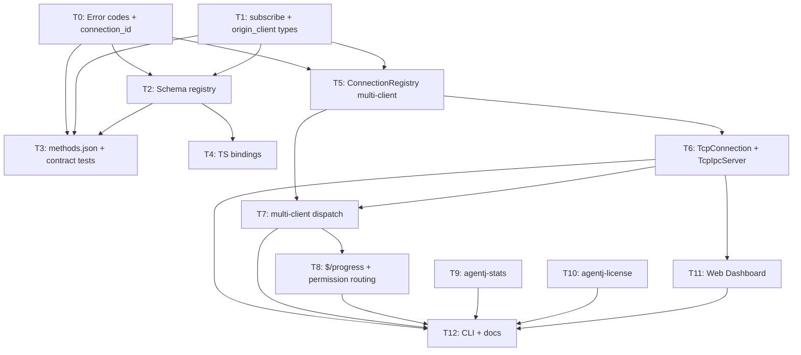

# AgentJ v0.4 Commercial Implementation Plan

> **⚠️ 文件名错位说明（2026-08-16 版本重编号所致，2026-08-30 追注）：** 本文件
> 位于 `2026-08-09-agentj-v0.3-plan.md`，但内容是 **v0.4（商用扩展）** 计划。
> 版本对应关系：ecosystem = v0.3（见 `2026-08-09-agentj-v0.2-plan.md`），
> commercial = v0.4（本文件）。文件名保留不改以维持外部引用稳定；阅读时以内容为准。

> **⚠️ 与 core-design 的差距公示（2026-08-30 追注）：** 对照
> `docs/superpowers/specs/2026-08-09-agentj-core-design.md` 的目标表，其
> **v0.3 内核调度全量重构承诺（决策 #18：AgentLoop 主循环 + Sub-Agent 全量迁入
> `KernelMessage` 消息总线、`ModelResponse`/`ToolCallRequest`/`ToolCallResult`
> 全变体接线、协议面零变化）从未在任何计划文件中落地**——本计划（v0.4 商用）
> 直接跳过了它。由此产生两点后果，后续工作必须知悉：
>
> 1. **需要为决策 #18 单独立一份设计**（core-design 已声明"任务骨架待定，执行前
>    需 `jskill-feature-design`"）。在落地前，README/AGENTS.md 中"内核调度"的
>    表述与代码现状（编排直调 trait 对象）之间仍存在核心设计自我批评的差距。
> 2. **迁移成本已高于 core-design 当时的预估。** 本计划（v0.4）在 AgentLoop
>    直调路径上叠加了守护内核能力：`$/progress`/订阅经 `ConnectionRegistry`
>    广播（T8）、权限属主路由经 notifier 闭包（T8）、run 互斥经 registry（T7）。
>    未来决策 #18 重构如将 AgentLoop 迁入总线，必须同时迁移这些已建成的
>    通知/路由路径，兼容性评估成本相应上升——这不再是"纯内部行为"的零成本重构。

> **For agentic workers:** REQUIRED SUB-SKILL: Use `superpowers:subagent-driven-development` (recommended) or `superpowers:executing-plans` to implement this plan task-by-task. TDD order is enforced — `test_code` MUST be written and verified failing before `impl_code`.

> **Plan split (3 of 3):** the AgentJ roadmap is split into three independent implementation plans by version priority — this is **Plan 3 (v0.4, commercial expansion)**. Sibling plans: `2026-08-09-agentj-v0.1-plan.md` (Plan 1, v0.1, core, shipped), `2026-08-15-agentj-permission-plan.md` (v0.2, permission system, shipped), and `2026-08-09-agentj-v0.2-plan.md` (Plan 2, v0.3, ecosystem, T0-T11, shipped). Execute v0.1 → v0.2 → v0.3 → v0.4 in order. (Version renumbering 2026-08-16: ecosystem = v0.3, commercial = v0.4.) **GAP:** core-design 决策 #18（AgentLoop 全量迁入消息总线，原 v0.3 目标）无任何计划覆盖，需先经 `jskill-feature-design` 单独立设计后方可排计划 — 见文件顶部「差距公示」。

> **✅ DESIGN FROZEN (T0-T8, T11, T12):** the daemon-kernel design (`docs/superpowers/specs/2026-08-15-agentj-daemon-kernel-design.md`) has **finalized** the Connection trait + TcpConnection + multi-client serving (决策 #1/#2/#3/#4/#5/#6/#7/#9), `--token`/`--max-connections`, and the protocol additive extensions (`session/subscribe` / `session/unsubscribe` / `$/permissionRequest.origin_client` / `-32805 SessionBusy` / `-32806 NotAuthorized` / `initialize` `connection_id`+`multi_client`). **T9 (usage stats) and T10 (license) remain `[design-pending]`** — no design doc covers them yet; their interface is provisional and will change.

> **⚠️ PREREQUISITE NOT YET LANDED:** the daemon-kernel design lists the protocol wire types (`session/subscribe`, `-32805`/`-32806`, `connection_id`/`multi_client`, `origin_client`) as **前置条件 (to be added)**. They are **NOT** present in `agentj-protocol` today — error codes stop at `-32804`, and `session.rs`/`permission.rs`/`lifecycle.rs` have no subscribe/origin_client/connection_id types. Tasks **T0-T4** add them. The `Connection` trait + `ConnectionRegistry` + `StdioConnection` **already landed** in v0.1 (T13/T14) — `agentj-ipc/src/lib.rs` has them. T5-T8 build the multi-client serving capability on top.

## Agent Worker Instructions

- Required sub-skills: `superpowers:subagent-driven-development` (preferred) or `superpowers:executing-plans`
- Execution mode: `subagent-driven-development`
- Required verification: `cargo test --workspace`, `cargo clippy --workspace -- -D warnings`, `cargo test -p agentj-protocol -- drift`
- Version bump: this plan bumps **0.3.0 → 0.4.0** (feature → minor, per AGENTS.md) — applied in T12.
- **Baseline:** requires v0.1 + v0.2 + v0.3 plans merged (workspace at 0.3.0, 14 crates, 233 tests).
- **Design-pending rule:** T9/T10 are marked `[design-pending]`; their provisional code is the *minimum* the design commits to, not the final interface. Re-validate before a future v0.4-commercial design lands.
- **Cargo.toml rule:** dependency additions required by the code are listed inside `impl_code` and applied via `cargo add`; they do NOT count toward the 3-file limit.
- **RED semantics for Rust:** when a test references symbols that do not exist yet, the RED state is a *compile error* — acceptable and proves the feature is absent. After `impl_code`, the tests must compile and PASS.

## Global Constraints

- Rust version: 1.96+ (stable toolchain, `rust-version = "1.96"`, edition 2024)
- All dependencies: latest stable versions at time of execution (use `cargo add`)
- Rust functions: ≤ 50 lines, ≤ 120 chars per line
- No `unwrap()` / `expect()` in library code (use `Result` + `?` or poison-tolerant lock handling); tests may use them
- No type-error suppression (`as any`, `@ts-ignore`, or Rust equivalents)
- Protocol wire fields are snake_case; value enums carry `#[serde(other)]` + `#[schemars(skip)]` `Unknown` variant
- `schemas/*.json` are committed artifacts with a CI drift gate (`cargo test -p agentj-protocol -- drift`)
- `protocol/methods.json` is the method registry — every added method must resolve params/result to committed schema files
- Commit messages in English; `docs/superpowers/specs/` docs in Chinese
- Cargo workspace at repo root, all crates under `crates/` (`members = ["crates/*"]`)
- New crates in this plan: `agentj-stats` (T9), `agentj-license` (T10); the dashboard is a frontend (non-Rust, lives outside the workspace)

---

## Architecture Notes

- **Frontend-agnostic protocol**: the Web Dashboard is a *protocol consumer* over JSON-RPC; it must NOT bypass the IPC layer (design 概述).
- **Connection trait already landed (v0.1 T13)**: `agentj-ipc/src/lib.rs` defines `Connection` (`id`/`kind`/`send`/`recv`/`peer_desc`, `#[async_trait]`), `ConnectionRegistry` (`conns`/`session_owner`/`pending_runs`), `StdioConnection`, and a transport-agnostic `serve_stdio`. T5 extends the registry for multi-client; T6 adds `TcpConnection`; T7/T8 add dispatch + notification routing; the stdio path stays unchanged.
- **Interior mutability (T5)**: `IpcServer.registry` is currently a plain `ConnectionRegistry` field while `handle_request(&self)` runs under `&self`. Multi-client routing (send_to / broadcast) requires shared mutable access → `registry` becomes `Arc<tokio::sync::Mutex<ConnectionRegistry>>` (or `RwLock`). `serve_stdio`'s direct `self.registry.conns.get_mut(..)` access is rewritten to the new accessor.
- **`$/progress` is NOT currently emitted**: `dispatch_session_run` aggregates `AgentEvent::Delta` into text and never emits `$/progress`. T8 adds emission + broadcasting (design 决策 #4).
- **`$/permissionRequest` is currently hardcoded to stdout**: `serve_stdio` installs a notifier closure that writes to `std::io::stdout()`. T8 redirects it through the registry to the session owner. The permission notifier signature gains `session_id` so the IPC layer can resolve `session_owner` → connection (design 决策 #5).
- **`initialize` is NOT currently dispatched**: `handle_request` handles only `session/new`, `session/run`, `shutdown`, `permission/respond`, `$/cancelRequest`. T7 adds `initialize` (token auth + `connection_id`/`multi_client` in the result) and `session/subscribe`/`session/unsubscribe`.
- **Usage stats (design 目标 v0.4+)**: token/call accounting hooks into the model provider and agent loop; consumed by the dashboard and future billing. **[design-pending]** (T9).
- **License management (design 目标 v0.4+)**: license key format, validation, and entitlement checks gate commercial features. **[design-pending]** (T10).
- **Deferred (not scoped here):** IDE deep integration (VS Code/JetBrains); TUI (separate concern); WebSocket gateway (Connection abstraction reserves a slot, design 非目标).

---

## Tasks

### T0: Add `SessionBusy`/`NotAuthorized` error codes and `connection_id`/`multi_client` to `initialize` [P0] [Sequential]

> **Design alignment**: daemon-kernel design 错误处理 (`-32805`/`-32806`) + 决策 #6 (`initialize` `connection_id` + `capabilities.multi_client`). Protocol wire types are **additive only**.

```yaml
- id: T0
  title: "Add SessionBusy/NotAuthorized error codes and connection_id/multi_client to initialize"
  files:
    - crates/agentj-protocol/src/base.rs
    - crates/agentj-protocol/src/lifecycle.rs
    - crates/agentj-protocol/tests/contract.rs
  depends_on: []
  breaking: false
  ac:
    - given: the error_codes module
      when: adding SESSION_BUSY and NOT_AUTHORIZED
      then: SESSION_BUSY == -32805 and NOT_AUTHORIZED == -32806 in the reserved agentj block
    - given: an InitializeResult
      when: serializing with connection_id and capabilities.multi_client
      then: connection_id is emitted as a string field, capabilities.multi_client is true, and a None connection_id omits the field entirely
  regression:
    - "cargo test -p agentj-protocol (all existing base/lifecycle/contract tests must keep passing)"
  test_code: |
    // In crates/agentj-protocol/src/base.rs, tests module — extend the existing
    // error_codes_have_reserved_values test:
    #[test]
    fn error_codes_have_reserved_values() {
        assert_eq!(error_codes::PARSE_ERROR, -32700);
        assert_eq!(error_codes::METHOD_NOT_FOUND, -32601);
        assert_eq!(error_codes::REQUEST_CANCELLED, -32800);
        assert_eq!(error_codes::SERVER_NOT_INITIALIZED, -32801);
        assert_eq!(error_codes::SESSION_NOT_FOUND, -32802);
        assert_eq!(error_codes::SESSION_INACTIVE, -32803);
        assert_eq!(error_codes::INVALID_VERSION, -32804);
        assert_eq!(error_codes::SESSION_BUSY, -32805);      // new
        assert_eq!(error_codes::NOT_AUTHORIZED, -32806);    // new
    }

    // In crates/agentj-protocol/src/lifecycle.rs, tests module:
    #[test]
    fn initialize_result_with_connection_id() {
        let r = InitializeResult {
            protocol_version: "0.4.0".into(),
            capabilities: Some(serde_json::json!({"multi_client": true})),
            server_info: ServerInfo { name: "agentj".into(), version: "0.4.0".into() },
            connection_id: Some("conn-1".into()),
        };
        let json = serde_json::to_value(&r).unwrap();
        assert_eq!(json["connection_id"], "conn-1");
        assert_eq!(json["capabilities"]["multi_client"], true);
    }

    #[test]
    fn initialize_result_without_connection_id_omits_field() {
        let r = InitializeResult {
            protocol_version: "0.4.0".into(),
            capabilities: None,
            server_info: ServerInfo { name: "agentj".into(), version: "0.4.0".into() },
            connection_id: None,
        };
        let json = serde_json::to_value(&r).unwrap();
        assert!(json.get("connection_id").is_none(), "connection_id must be optional/additive");
    }
  impl_code: |
    # crates/agentj-protocol/src/base.rs — error_codes module, add after INVALID_VERSION:
        pub const SESSION_BUSY: i32 = -32805;      // same session already running (design 错误处理)
        pub const NOT_AUTHORIZED: i32 = -32806;    // non-owner permission/respond or $/cancelRequest

    # crates/agentj-protocol/src/lifecycle.rs — InitializeResult gains an additive field:
    #[derive(Debug, Clone, Serialize, Deserialize, JsonSchema)]
    pub struct InitializeResult {
        pub protocol_version: String,
        #[serde(skip_serializing_if = "Option::is_none")]
        pub capabilities: Option<serde_json::Value>,
        pub server_info: ServerInfo,
        /// This connection's unique id in a multi-client kernel (design 决策 #6).
        /// Absent in single-client (stdio) mode. Capability flag: capabilities.multi_client.
        #[serde(skip_serializing_if = "Option::is_none")]
        pub connection_id: Option<String>,
    }

    # crates/agentj-protocol/tests/contract.rs — the existing initialize_response_wire_shape
    # test constructs InitializeResult WITHOUT the new field; add `connection_id: None` to it
    # (compiler-enforced — the workspace must compile after this task):
    #     result: serde_json::to_value(InitializeResult {
    #         protocol_version: "0.1.0".into(),
    #         capabilities: Some(serde_json::json!({"streaming": true})),
    #         server_info: ServerInfo { name: "agentj".into(), version: "0.1.0".into() },
    #         connection_id: None,   // added
    #     })
  verify:
    - "cargo test -p agentj-protocol"
    - "cargo clippy -p agentj-protocol -- -D warnings"
```

### T1: Add `session/subscribe` wire types and `origin_client` to `$/permissionRequest` [P0] [Sequential]

> **Design alignment**: 决策 #4 (`session/subscribe`) + 决策 #5 (`$/permissionRequest.origin_client`). `session/unsubscribe` reuses the existing `SessionIdParams`.

```yaml
- id: T1
  title: "Add session/subscribe wire types and origin_client to $/permissionRequest"
  files:
    - crates/agentj-protocol/src/session.rs
    - crates/agentj-protocol/src/permission.rs
  depends_on: []
  breaking: false
  ac:
    - given: a SessionSubscribeParams
      when: serializing
      then: session_id and optional progress_token roundtrip with snake_case field names
    - given: a PermissionRequestParams
      when: serializing with origin_client
      then: origin_client is emitted; a None origin_client omits the field (additive, no break for single-client)
  regression:
    - "cargo test -p agentj-protocol (existing session/permission tests must keep passing)"
  test_code: |
    // In crates/agentj-protocol/src/session.rs, tests module:
    #[test]
    fn session_subscribe_params_serialize() {
        let p = SessionSubscribeParams {
            session_id: "s1".into(),
            progress_token: Some(ProgressToken::Str("tok".into())),
        };
        let json = serde_json::to_value(&p).unwrap();
        assert_eq!(json["session_id"], "s1");
        assert_eq!(json["progress_token"], "tok");
    }

    #[test]
    fn session_subscribe_params_progress_token_optional() {
        let p = SessionSubscribeParams { session_id: "s1".into(), progress_token: None };
        let json = serde_json::to_value(&p).unwrap();
        assert!(json.get("progress_token").is_none());
    }

    // In crates/agentj-protocol/src/permission.rs, tests module:
    #[test]
    fn permission_request_params_with_origin_client() {
        let p = PermissionRequestParams {
            request_id: "req-1".into(),
            tool: "bash".into(),
            args: serde_json::json!({"command": "ls"}),
            reason: "tool default mode is ask".into(),
            origin_client: Some("conn-a".into()),
        };
        let json = serde_json::to_value(&p).unwrap();
        assert_eq!(json["origin_client"], "conn-a");
    }

    #[test]
    fn permission_request_params_without_origin_client_omits_field() {
        let p = PermissionRequestParams {
            request_id: "req-1".into(),
            tool: "bash".into(),
            args: serde_json::json!({"command": "ls"}),
            reason: "tool default mode is ask".into(),
            origin_client: None,
        };
        let json = serde_json::to_value(&p).unwrap();
        assert!(json.get("origin_client").is_none());
    }
  impl_code: |
    # crates/agentj-protocol/src/session.rs — add the subscribe params type:
    /// `session/subscribe` params — subscribe to a session's running progress
    /// (design 决策 #4: broadcast subscription). `$/progress` broadcasts to all subscribers.
    #[derive(Debug, Clone, Serialize, Deserialize, JsonSchema)]
    pub struct SessionSubscribeParams {
        pub session_id: SessionId,
        #[serde(skip_serializing_if = "Option::is_none")]
        pub progress_token: Option<ProgressToken>,
    }

    # crates/agentj-protocol/src/permission.rs — PermissionRequestParams gains origin_client:
    pub struct PermissionRequestParams {
        pub request_id: String,
        pub tool: String,
        pub args: serde_json::Value,
        pub reason: String,
        /// Connection id of the client that initiated the run (design 决策 #5).
        /// Absent in single-client (stdio) mode — additive.
        #[serde(skip_serializing_if = "Option::is_none")]
        pub origin_client: Option<String>,
    }
  verify:
    - "cargo test -p agentj-protocol"
    - "cargo clippy -p agentj-protocol -- -D warnings"
```

> **Note on T1's cross-crate compile fix:** adding `origin_client` to `PermissionRequestParams` breaks the ONE construction in `crates/agentj-permission/src/module.rs::register_ask` (it builds `PermissionRequestParams { request_id, tool, args, reason }`). The worker MUST add `origin_client: None` there for the workspace to compile. This is a 1-line mechanical fix outside T1's file list — commit it as `chore(permission): add origin_client placeholder`. T8 replaces `None` with the real owner id.

### T2: Register new wire types in schema generation and regenerate schemas [P0] [Sequential]

```yaml
- id: T2
  title: "Register new wire types in schema generation and regenerate schemas"
  files:
    - crates/agentj-protocol/src/schema.rs
    - schemas/SessionSubscribeParams.json
    - schemas/InitializeResult.json
  depends_on: [T0, T1]
  breaking: false
  ac:
    - given: generate_schemas()
      when: SessionSubscribeParams is registered
      then: the drift test passes and new committed schemas exist (SessionSubscribeParams.json; InitializeResult.json + PermissionRequestParams.json updated with the new fields)
  regression:
    - "cargo test -p agentj-protocol -- drift (drift gate must keep passing)"
  test_code: |
    // In crates/agentj-protocol/src/schema.rs, tests module — extend drift_registered_types_are_known:
    #[test]
    fn drift_registered_types_are_known() {
        let schemas = generate_schemas();
        assert!(schemas.contains_key("RequestMessage"));
        assert!(schemas.contains_key("InitializeParams"));
        assert!(schemas.contains_key("SessionRunParams"));
        assert!(schemas.contains_key("ProgressValue"));
        assert!(schemas.contains_key("KernelStatusResult"));
        assert!(schemas.contains_key("SessionSubscribeParams"));   // new
        assert!(schemas.contains_key("PermissionRequestParams"));
    }
  impl_code: |
    # crates/agentj-protocol/src/schema.rs — add SessionSubscribeParams to imports + generate_schemas():
    use crate::session::{
        SessionIdParams, SessionNewResult, SessionRunParams, SessionRunResult,
        SessionStatusResult, SessionSubscribeParams,   // new
    };
    // in generate_schemas():
        m.insert("SessionSubscribeParams".into(), schema_for!(SessionSubscribeParams));
    # Then regenerate the committed schemas (InitializeResult.json and
    # PermissionRequestParams.json are automatically updated — they are not hand-edited):
    #   cargo run -p agentj-protocol --bin gen_schemas
  verify:
    - "cargo run -p agentj-protocol --bin gen_schemas"
    - "cargo test -p agentj-protocol -- drift"
    - "cargo test -p agentj-protocol"
```

### T3: Update the method registry (14→16) and add contract wire-shape tests [P0] [Sequential]

```yaml
- id: T3
  title: "Update the method registry and add contract wire-shape tests"
  files:
    - protocol/methods.json
    - crates/agentj-protocol/tests/registry.rs
    - crates/agentj-protocol/tests/contract.rs
  depends_on: [T0, T1, T2]
  breaking: false
  ac:
    - given: protocol/methods.json
      when: adding session/subscribe and session/unsubscribe entries
      then: the registry lists 16 methods; the registry test's count assertion is 16; every params/result ref resolves to a committed schema file
    - given: contract.rs
      when: adding subscribe/permission wire-shape tests
      then: session/subscribe request and $/permissionRequest (with origin_client) notification wire shapes match schema
  regression:
    - "cargo test -p agentj-protocol --test registry (all 16 methods, schema refs resolve, directions valid)"
  test_code: |
    // In crates/agentj-protocol/tests/registry.rs — extend registry_lists_all_v01_methods:
    //   add "session/subscribe" and "session/unsubscribe" to the expected list, and:
        assert_eq!(methods.len(), 16, "unexpected method count");   // 14 -> 16

    // In crates/agentj-protocol/tests/contract.rs — add:
    use agentj_protocol::permission::PermissionRequestParams;
    use agentj_protocol::session::SessionSubscribeParams;

    #[test]
    fn session_subscribe_request_wire_shape() {
        let req = RequestMessage {
            jsonrpc: "2.0".into(),
            id: Id::Number(11),
            method: "session/subscribe".into(),
            params: Some(serde_json::to_value(SessionSubscribeParams {
                session_id: "s1".into(),
                progress_token: Some(ProgressToken::Str("tok-sub".into())),
            }).unwrap()),
        };
        let json = serde_json::to_value(req).unwrap();
        assert_eq!(json["method"], "session/subscribe");
        assert_eq!(json["params"]["progress_token"], "tok-sub");
    }

    #[test]
    fn permission_request_notification_wire_shape_with_origin_client() {
        let n = NotificationMessage {
            jsonrpc: "2.0".into(),
            method: "$/permissionRequest".into(),
            params: Some(serde_json::to_value(PermissionRequestParams {
                request_id: "req-9".into(),
                tool: "bash".into(),
                args: serde_json::json!({"command": "ls"}),
                reason: "tool default ask".into(),
                origin_client: Some("conn-a".into()),
            }).unwrap()),
        };
        let json = serde_json::to_value(n).unwrap();
        assert_eq!(json["method"], "$/permissionRequest");
        assert_eq!(json["params"]["origin_client"], "conn-a");
    }
  impl_code: |
    # protocol/methods.json — append to the "methods" array (after session/delete):
        { "method": "session/subscribe", "kind": "request", "direction": "client_to_server", "params": "SessionSubscribeParams", "result": null },
        { "method": "session/unsubscribe", "kind": "request", "direction": "client_to_server", "params": "SessionIdParams", "result": null }
  verify:
    - "cargo test -p agentj-protocol --test registry"
    - "cargo test -p agentj-protocol --test contract"
    - "cargo test -p agentj-protocol"
```

### T4: Regenerate TypeScript bindings [P0] [Sequential]

```yaml
- id: T4
  title: "Regenerate TypeScript bindings for new wire types"
  files:
    - bindings/ts/types.d.ts
    - bindings/ts/index.ts
  depends_on: [T2]
  breaking: false
  ac:
    - given: the updated schemas from T2
      when: running the TS binding generator
      then: types.d.ts contains SessionSubscribeParams, PermissionRequestParams.origin_client?, and InitializeResult.connection_id?; tsc --noEmit passes
  regression:
    - "cd bindings/ts && npm run build (tsc --noEmit exit 0)"
  test_code: |
    # No unit test here — the deliverable is the regenerated binding + the tsc build gate.
    # RED: grep finds no SessionSubscribeParams in types.d.ts.
    #   grep -c "SessionSubscribeParams" bindings/ts/types.d.ts  -> 0
  impl_code: |
    # cd bindings/ts && npm install && npm run generate && npm run build
    # Expected: types.d.ts regenerated with SessionSubscribeParams, PermissionRequestParams
    # (origin_client?), InitializeResult (connection_id?).
  verify:
    - "cd bindings/ts && npm run generate && npm run build"
    - "grep -c 'SessionSubscribeParams' bindings/ts/types.d.ts"
```

### T5: Extend `ConnectionRegistry` for multi-client routing [P0] [Sequential]

> **Design alignment**: 决策 #1/#4/#5/#7. The registry (already landed in v0.1) gains shared-access + routing methods. This task does NOT touch `handle_request` dispatch or notifications — it is the data-structure foundation.

```yaml
- id: T5
  title: "Extend ConnectionRegistry for multi-client routing"
  files:
    - crates/agentj-ipc/src/lib.rs
  depends_on: [T0, T1]
  breaking: true
  ac:
    - given: a ConnectionRegistry with two registered connections
      when: one subscribes to a session and broadcast_to_session is called
      then: only the subscriber receives the message; send_to routes to a specific connection; unregister releases session ownership and drops that connection's subscriptions
    - given: a session with an active run
      when: try_acquire_run is called twice
      then: the first returns true, the second returns false (mutual exclusion); release_run makes it acquirable again
  regression:
    - "cargo test -p agentj-ipc (existing stdio serve + permission contract tests must keep passing)"
  test_code: |
    // In crates/agentj-ipc/src/lib.rs tests module:
    use std::collections::HashSet;

    struct FakeConn { id: String, sent: std::sync::Mutex<Vec<String>> }
    // implement Connection for FakeConn (send pushes to `sent`; recv returns None; kind Stdio)

    #[test]
    fn registry_routes_broadcast_to_subscribers_only() {
        let mut reg = ConnectionRegistry::new();
        let a = reg.register(Box::new(fake_conn("a")));
        let b = reg.register(Box::new(fake_conn("b")));
        reg.subscribe(&"s1".to_string(), &a);
        reg.broadcast_to_session(&"s1".to_string(), "hello");
        assert!(sent_count(&reg, &a) == 1, "subscriber a must receive the broadcast");
        assert!(sent_count(&reg, &b) == 0, "non-subscriber b must NOT receive it");
    }

    #[test]
    fn registry_unregister_releases_owner_and_subscriptions() {
        let mut reg = ConnectionRegistry::new();
        let a = reg.register(Box::new(fake_conn("a")));
        reg.set_session_owner(&"s1".to_string(), &a);
        reg.subscribe(&"s1".to_string(), &a);
        reg.unregister(&a);
        assert!(reg.session_owner(&"s1".to_string()).is_none(), "owner released on disconnect");
        // broadcast after unsubscribe is a no-op (no panic, no delivery)
        reg.broadcast_to_session(&"s1".to_string(), "hello");
    }

    #[test]
    fn registry_run_mutex_is_exclusive() {
        let mut reg = ConnectionRegistry::new();
        assert!(reg.try_acquire_run(&"s1".to_string()));
        assert!(!reg.try_acquire_run(&"s1".to_string()), "second run must be rejected (busy)");
        reg.release_run(&"s1".to_string());
        assert!(reg.try_acquire_run(&"s1".to_string()));
    }
  impl_code: |
    # crates/agentj-ipc/src/lib.rs — ConnectionRegistry gains subscribers + routing. The
    # pending_runs field changes from `HashMap<SessionId, ()>` (dead_code) to `HashSet<SessionId>`.
    # Lock discipline: the registry becomes `Arc<std::sync::RwLock<ConnectionRegistry>>` on
    # IpcServer (sync lock — Connection::send is sync, and the notifier in T8 is a sync Fn that
    # must route without awaiting). All locks are held briefly, never across an await point, and
    # use poison-tolerant `if let Ok(..)` (no .unwrap() — Global Constraints).
    pub struct ConnectionRegistry {
        conns: HashMap<String, Box<dyn Connection>>,
        session_owner: HashMap<SessionId, String>,
        pending_runs: HashSet<SessionId>,
        subscribers: HashMap<SessionId, HashSet<String>>,   // new
    }

    impl ConnectionRegistry {
        pub fn send_to(&self, conn_id: &str, msg: &str) -> Result<(), IpcError> {
            match self.conns.get(conn_id) {
                Some(conn) => conn.send(msg),
                None => Ok(()), // connection gone — drop the response (design 错误处理)
            }
        }
        pub fn subscribe(&mut self, session: &SessionId, conn_id: &str) {
            self.subscribers.entry(session.clone()).or_default().insert(conn_id.to_string());
        }
        pub fn unsubscribe(&mut self, session: &SessionId, conn_id: &str) {
            if let Some(s) = self.subscribers.get_mut(session) {
                s.remove(conn_id);
                if s.is_empty() { self.subscribers.remove(session); }
            }
        }
        pub fn broadcast_to_session(&self, session: &SessionId, msg: &str) {
            if let Some(subs) = self.subscribers.get(session) {
                for conn_id in subs { let _ = self.send_to(conn_id, msg); }
            }
        }
        pub fn try_acquire_run(&mut self, session: &SessionId) -> bool {
            self.pending_runs.insert(session.clone())
        }
        pub fn release_run(&mut self, session: &SessionId) {
            self.pending_runs.remove(session);
        }
        // unregister now releases ownership + implicit unsubscribe (design 错误处理):
        pub fn unregister(&mut self, id: &str) -> Option<Box<dyn Connection>> {
            self.session_owner.retain(|_, owner| owner != id);
            for subs in self.subscribers.values_mut() { subs.remove(id); }
            self.subscribers.retain(|_, s| !s.is_empty());
            self.conns.remove(id)
        }
    }

    # IpcServer: change `registry: ConnectionRegistry` to `registry: Arc<RwLock<ConnectionRegistry>>`
    # and rewire serve_stdio's direct `self.registry.conns.get_mut(..)` access to lock-based
    # access (write().unwrap() -> if let Ok). stdio single-connection behavior is unchanged.
  verify:
    - "cargo test -p agentj-ipc"
    - "cargo clippy --workspace -- -D warnings"
```

### T6: Add `TcpConnection` and the multi-connection `TcpIpcServer` [P0] [Sequential]

> **Design alignment**: 决策 #1/#3. `TcpConnection` implements the existing `Connection` trait; `TcpIpcServer` serves N concurrent connections through ONE shared `IpcServer` (kernel + AgentLoop). `--max-connections` (default 16) refused here; `--token` is checked at initialize-time in T7.

```yaml
- id: T6
  title: "Add TcpConnection and the multi-connection TcpIpcServer"
  files:
    - crates/agentj-ipc/src/tcp.rs
    - crates/agentj-ipc/src/lib.rs
  depends_on: [T5]
  breaking: false
  ac:
    - given: a TcpIpcServer bound on an ephemeral port with the stub AgentLoop+Kernel
      when: two clients connect and each send session/new
      then: each receives a valid session_id response; disconnecting one client does not affect the other; shutdown closes the listener and triggers kernel graceful shutdown
    - given: a server started with max_connections=2
      when: a third client connects while two are active
      then: the third connection is refused (socket closed)
  regression:
    - "cargo test -p agentj-ipc (existing stdio contract tests must keep passing)"
  test_code: |
    // In crates/agentj-ipc/src/tcp.rs tests module:
    use tokio::io::{AsyncBufReadExt, AsyncWriteExt, BufReader};
    use tokio::net::TcpStream;

    async fn send_line(addr: std::net::SocketAddr, raw: &str) -> String {
        let mut stream = TcpStream::connect(addr).await.unwrap();
        let (r, mut w) = stream.split();
        let mut reader = BufReader::new(r);
        let mut line = String::new();
        w.write_all(raw.as_bytes()).await.unwrap();
        w.write_all(b"\n").await.unwrap();
        reader.read_line(&mut line).await.unwrap();
        line
    }

    #[tokio::test]
    async fn two_clients_serve_independently() {
        let mut server = TcpIpcServer::bind(
            "127.0.0.1:0", stub_agent_loop(), Kernel::new(),
            None, 16, // no token, default max connections
        ).await.unwrap();
        let addr = server.local_addr().unwrap();
        let handle = tokio::spawn(async move { server.run().await.unwrap() });

        let a = send_line(addr, r#"{"jsonrpc":"2.0","id":1,"method":"session/new"}"#).await;
        let b = send_line(addr, r#"{"jsonrpc":"2.0","id":2,"method":"session/new"}"#).await;
        assert!(a.contains("\"session_id\""), "a: {a}");
        assert!(b.contains("\"session_id\""), "b: {b}");
        // a client disconnecting must not affect the listener or the other client
        let c = send_line(addr, r#"{"jsonrpc":"2.0","id":3,"method":"session/new"}"#).await;
        assert!(c.contains("\"session_id\""), "c: {c}");
        handle.abort();
    }

    #[tokio::test]
    async fn max_connections_refuses_third_client() {
        let mut server = TcpIpcServer::bind(
            "127.0.0.1:0", stub_agent_loop(), Kernel::new(), None, 2,
        ).await.unwrap();
        let addr = server.local_addr().unwrap();
        let handle = tokio::spawn(async move { server.run().await.unwrap() });
        // hold two connections open
        let c1 = TcpStream::connect(addr).await.unwrap();
        let c2 = TcpStream::connect(addr).await.unwrap();
        tokio::time::sleep(std::time::Duration::from_millis(50)).await; // let accept register them
        // third connection must be refused (read returns 0 bytes / EOF)
        let mut c3 = TcpStream::connect(addr).await.unwrap();
        let mut buf = [0u8; 1];
        let n = c3.read(&mut buf).await.unwrap_or(0);
        assert_eq!(n, 0, "third connection must be closed by the server");
        drop((c1, c2));
        handle.abort();
    }

    #[tokio::test]
    async fn last_connection_disconnect_triggers_graceful_shutdown() {
        let mut server = TcpIpcServer::bind(
            "127.0.0.1:0", stub_agent_loop(), Kernel::new(), None, 16,
        ).await.unwrap();
        let addr = server.local_addr().unwrap();
        // one client connects, then disconnects (the only connection)
        let c = TcpStream::connect(addr).await.unwrap();
        drop(c);
        // run() must return (graceful shutdown) once the last connection is gone
        tokio::time::timeout(std::time::Duration::from_secs(5), server.run()).await
            .expect("server must shut down gracefully after the last client disconnects")
            .unwrap();
    }
  impl_code: |
    # crates/agentj-ipc/src/tcp.rs (new file) — `pub mod tcp;` added to lib.rs.

    /// TCP transport — implements the v0.1 Connection trait (design 决策 #1).
    /// send/recv split: `send` is sync (Connection trait contract) and writes via a blocking
    /// `std::net::TcpStream` write half (try_clone of the accepted stream); `recv` is async via
    /// a tokio BufReader read half. Do NOT block_on inside the async serve loop (the StdioConnection
    /// comment already documents why block_on panics in async context).
    pub struct TcpConnection {
        id: String,
        reader: BufReader<tokio::net::tcp::OwnedReadHalf>,
        writer: std::sync::Mutex<std::net::TcpStream>, // sync write path for `send`
        peer: String,
    }

    impl TcpConnection {
        pub fn new(stream: TcpStream) -> Result<Self, IpcError> {
            let peer = stream.peer_addr().map(|a| a.to_string()).unwrap_or_else(|_| "unknown".into());
            let std_stream: std::net::TcpStream = stream.into_std()
                .unwrap_or_else(|e| e.into_inner());
            let writer = std_stream.try_clone()
                .map_err(|e| IpcError::InvalidRequest(e.to_string()))?;
            let tokio_stream = tokio::net::TcpStream::from_std(std_stream)
                .map_err(|e| IpcError::InvalidRequest(e.to_string()))?;
            let (r, _w) = tokio_stream.into_split();
            Ok(Self {
                id: format!("tcp-{peer}"),
                reader: BufReader::new(r),
                writer: std::sync::Mutex::new(writer),
                peer,
            })
        }
    }

    #[async_trait]
    impl Connection for TcpConnection {
        fn id(&self) -> String { self.id.clone() }
        fn kind(&self) -> TransportKind { TransportKind::Tcp }
        fn send(&self, msg: &str) -> Result<(), IpcError> {
            use std::io::Write;
            if let Ok(mut w) = self.writer.lock() {
                w.write_all(msg.as_bytes()).map_err(|e| IpcError::InvalidRequest(e.to_string()))?;
                w.write_all(b"\n").map_err(|e| IpcError::InvalidRequest(e.to_string()))?;
                w.flush().map_err(|e| IpcError::InvalidRequest(e.to_string()))?;
            }
            Ok(())
        }
        async fn recv(&mut self) -> Option<Result<String, IpcError>> {
            let mut line = String::new();
            match self.reader.read_line(&mut line).await {
                Ok(0) => None,
                Ok(_) => Some(Ok(line)),
                Err(e) => Some(Err(IpcError::InvalidRequest(e.to_string()))),
            }
        }
        fn peer_desc(&self) -> String { self.peer.clone() }
    }

    /// Multi-connection JSON-RPC over TCP — the Web Dashboard's protocol entry.
    /// ONE shared IpcServer (shared Kernel + AgentLoop) serves ALL connections.
    pub struct TcpIpcServer {
        listener: TcpListener,
        shared: Arc<IpcServer>,
        max_connections: usize,
        token: Option<String>,
        active: Arc<std::sync::atomic::AtomicUsize>,
    }

    impl TcpIpcServer {
        pub async fn bind(
            addr: &str, agent_loop: AgentLoop, kernel: Kernel,
            token: Option<String>, max_connections: usize,
        ) -> Result<Self, IpcError> { /* TcpListener::bind + IpcServer::new (shared) */ }
        pub fn local_addr(&self) -> Result<std::net::SocketAddr, IpcError> { /* .. */ }
        pub async fn run(&mut self) -> Result<(), IpcError> {
            loop {
                tokio::select! {
                    res = self.listener.accept() => {
                        let (stream, _) = res.map_err(|e| IpcError::InvalidRequest(e.to_string()))?;
                        if self.active.load(Ordering::SeqCst) >= self.max_connections {
                            drop(stream); // refuse: close the socket (design 错误处理)
                            continue;
                        }
                        self.active.fetch_add(1, Ordering::SeqCst);
                        let shared = Arc::clone(&self.shared);
                        let token = self.token.clone();
                        let active = Arc::clone(&self.active);
                        tokio::spawn(async move {
                            let conn = TcpConnection::new(stream)?;
                            if let Err(e) = shared.serve_connection(conn, token.as_deref()).await {
                                tracing::error!(error = %e, "tcp connection error");
                            }
                            active.fetch_sub(1, Ordering::SeqCst);
                            // last connection disconnected -> graceful shutdown (design 错误处理):
                            // when active reaches 0, signal_shutdown() so the accept loop breaks.
                            if active.load(Ordering::SeqCst) == 0 {
                                let _ = shared.signal_shutdown();
                            }
                        });
                    }
                    _ = tokio::time::sleep(std::time::Duration::from_millis(50)) => {
                        if self.shared.shutdown_requested() { break; }
                    }
                }
            }
            Ok(())
        }
    }

    # crates/agentj-ipc/src/lib.rs — IpcServer gains `serve_connection(&self, conn, token)` (the
    # transport-agnostic per-connection loop, filled in T7/T8) and `pub mod tcp;`.
  verify:
    - "cargo test -p agentj-ipc"
    - "cargo clippy --workspace -- -D warnings"
```

> **T6 note:** `TcpConnection::new` returns `Result<Self, IpcError>` and maps `try_clone`/`from_std` failures via `map_err` (no `.expect()` in lib code — Global Constraints). `send` uses a blocking `std::net::TcpStream` write half (sync, matching the `Connection::send` sync contract); `recv` is async via the tokio read half.

### T7: Add multi-client protocol dispatch (initialize / subscribe / token / owner validation / run mutex) [P0] [Sequential]

> **Design alignment**: 决策 #4/#5/#6/#7. Extends `handle_request` with the connection-aware dispatch. The stdio single-client path remains a wrapper delegating to a sentinel connection id.

```yaml
- id: T7
  title: "Add multi-client protocol dispatch to the serve loop"
  files:
    - crates/agentj-ipc/src/lib.rs
  depends_on: [T5, T6]
  breaking: true
  ac:
    - given: a client with a mismatched --token
      when: sending initialize
      then: the response carries -32806 NotAuthorized
    - given: a session owned by client A
      when: client B sends permission/respond for A's pending approval
      then: B receives -32806 NotAuthorized
    - given: a session with an active run
      when: a second session/run arrives on the same session
      then: the second run returns -32805 SessionBusy
    - given: two clients connected to the same kernel
      when: each sends initialize
      then: each result carries a distinct connection_id and capabilities.multi_client=true
  regression:
    - "cargo test -p agentj-ipc (existing stdio dispatch + permission tests must keep passing)"
  test_code: |
    // In crates/agentj-ipc/src/lib.rs tests module:
    #[tokio::test]
    async fn initialize_returns_connection_id_and_multi_client() {
        let server = Arc::new(IpcServer::new(stub_agent_loop(), Kernel::new()));
        // register a fake connection so routing has a target
        let conn_id = register_fake_conn(&server);
        let resp = server.handle_request_from(
            r#"{"jsonrpc":"2.0","id":1,"method":"initialize","params":{"protocol_version":"0.4.0"}}"#,
            &conn_id,
        ).await.unwrap();
        let v: serde_json::Value = serde_json::from_str(&resp).unwrap();
        assert_eq!(v["result"]["connection_id"], conn_id);
        assert_eq!(v["result"]["capabilities"]["multi_client"], true);
    }

    #[tokio::test]
    async fn initialize_with_wrong_token_is_rejected() {
        let server = Arc::new(IpcServer::new(stub_agent_loop(), Kernel::new()));
        server.set_token(Some("secret".into()));
        let conn_id = register_fake_conn(&server);
        let resp = server.handle_request_from(
            r#"{"jsonrpc":"2.0","id":1,"method":"initialize","params":{"protocol_version":"0.4.0","token":"wrong"}}"#,
            &conn_id,
        ).await.unwrap();
        assert!(resp.contains(r#""code":-32806"#), "wrong token must be NotAuthorized: {resp}");
    }

    #[tokio::test]
    async fn non_owner_permission_respond_is_rejected() {
        // (blocking_run_server helper exists in lib.rs tests) — A owns the session, B responds.
        let (server, _module) = blocking_run_server();
        let server = Arc::new(server);
        let a = register_fake_conn(&server);
        let b = register_fake_conn(&server);
        // A creates + runs a session that blocks on Ask (see blocking_run_server fixture)
        let new_resp = server.handle_request_from(
            r#"{"jsonrpc":"2.0","id":1,"method":"session/new"}"#, &a).await.unwrap();
        let sid = extract_sid(&new_resp);
        let run_raw = format!(r#"{{"jsonrpc":"2.0","id":2,"method":"session/run","params":{{"session_id":"{sid}","content":"hi"}}}}"#);
        let run_task = tokio::spawn({ let s = server.clone(); async move {
            s.handle_request_from(&run_raw, &a).await.unwrap()
        }});
        // wait for the Ask to register, then B tries to respond
        tokio::time::sleep(std::time::Duration::from_millis(50)).await;
        let resp = server.handle_request_from(
            r#"{"jsonrpc":"2.0","id":9,"method":"permission/respond","params":{"request_id":"req-x","decision":"allow"}}"#,
            &b).await.unwrap();
        assert!(resp.contains(r#""code":-32806"#), "non-owner respond must be NotAuthorized: {resp}");
        let _ = run_task.await;
    }

    #[tokio::test]
    async fn concurrent_run_on_same_session_is_rejected() {
        let server = Arc::new(IpcServer::new(stub_agent_loop(), Kernel::new()));
        let a = register_fake_conn(&server);
        let new_resp = server.handle_request_from(
            r#"{"jsonrpc":"2.0","id":1,"method":"session/new"}"#, &a).await.unwrap();
        let sid = extract_sid(&new_resp);
        let run1 = format!(r#"{{"jsonrpc":"2.0","id":2,"method":"session/run","params":{{"session_id":"{sid}","content":"hi"}}}}"#);
        let run2 = format!(r#"{{"jsonrpc":"2.0","id":3,"method":"session/run","params":{{"session_id":"{sid}","content":"again"}}}}"#);
        // run1 blocks (mock emits a Delta then Done — use a slow stream or the blocking fixture)
        let r1 = server.handle_request_from(&run1, &a).await.unwrap();
        let r2 = server.handle_request_from(&run2, &a).await.unwrap();
        assert!(r2.contains(r#""code":-32805"#), "second run must be SessionBusy: {r2}");
    }
  impl_code: |
    # crates/agentj-ipc/src/lib.rs — the connection-aware dispatch. Key changes:

    # 1. IpcServer gains `token: Option<String>` and a connection-aware entry point. The old
    #    `handle_request(&self, raw)` becomes a wrapper delegating to a sentinel stdio id so
    #    existing tests keep compiling/passing:
    pub async fn handle_request(&self, raw: &str) -> Result<String, IpcError> {
        self.handle_request_from(raw, "stdio").await
    }
    pub async fn handle_request_from(&self, raw: &str, conn_id: &str) -> Result<String, IpcError> {
        // parse (existing), then match method with the added arms:
        //   "initialize"    => self.dispatch_initialize(&req, conn_id).await
        //   "session/subscribe"   => self.dispatch_subscribe(&req, conn_id)
        //   "session/unsubscribe" => self.dispatch_unsubscribe(&req, conn_id)
        //   "session/new"   => self.dispatch_session_new(conn_id)   // records owner = conn_id
        //   "session/run"   => self.dispatch_session_run(&req, conn_id).await  // mutex + owner
        //   "permission/respond" => self.dispatch_permission_respond(&req, conn_id)  // owner check
        //   ... existing shutdown / $/cancelRequest unchanged
    }

    # 2. initialize: token check + connection_id/multi_client result:
    fn dispatch_initialize(&self, req: &JsonRpcRequest, conn_id: &str) -> Result<Value, DispatchError> {
        let params: InitializeParams = serde_json::from_value(
            req.params.clone().unwrap_or(serde_json::json!({})))
            .map_err(|e| DispatchError::invalid_params(e.to_string()))?;
        if let Some(expected) = &self.token {
            let provided = params.token.as_deref().unwrap_or("");   // (see note: token is a params field)
            if provided != expected {
                return Err(DispatchError { code: agentj_protocol::base::error_codes::NOT_AUTHORIZED,
                                           message: "NotAuthorized".into() });
            }
        }
        Ok(serde_json::json!({
            "protocol_version": "0.4.0",
            "capabilities": { "multi_client": true },
            "server_info": { "name": "agentj", "version": "0.4.0" },
            "connection_id": conn_id,
        }))
    }

    # 3. session/new records the owner; session/run acquires the run mutex (else -32805) and
    #    releases it on every exit path; permission/respond checks session_owner == conn_id
    #    (else -32806). subscribe/unsubscribe call registry.subscribe/unsubscribe.

    # NOTE: the token travels as an initialize `params.token` string (design 错误处理: 客户端
    # initialize 携带 token). This requires InitializeParams to gain an additive
    # `token: Option<String>` field — fold that 1-line protocol addition here (or into T0).
    # If folded here, T0's InitializeParams stays as-is and this task adds the field.
  verify:
    - "cargo test -p agentj-ipc"
    - "cargo clippy --workspace -- -D warnings"
```

### T8: Add `$/progress` emission and `$/permissionRequest` owner routing [P0] [Sequential]

> **Design alignment**: 决策 #4 (`$/progress` broadcast) + 决策 #5 (permission directed to owner). This is the notification path — the parts that make the dashboard/observer able to see progress and the owner able to approve.

```yaml
- id: T8
  title: "Add $/progress emission and $/permissionRequest owner routing"
  files:
    - crates/agentj-ipc/src/lib.rs
    - crates/agentj-permission/src/module.rs
  depends_on: [T7]
  breaking: true
  ac:
    - given: client A runs session/run and client B has subscribed to the same session
      when: the run emits AgentEvent::Delta
      then: B receives a $/progress notification with the delta; A (owner) also receives it
    - given: a run that triggers a permission Ask
      when: the Ask fires
      then: the $/permissionRequest notification is routed to the session owner with origin_client set, and NOT to other subscribers
  regression:
    - "cargo test -p agentj-permission (existing notifier tests must keep passing)"
    - "cargo test -p agentj-ipc (existing stdio permission flow must keep passing)"
  test_code: |
    // In crates/agentj-ipc/src/lib.rs tests module:
    #[tokio::test]
    async fn subscriber_receives_progress_broadcast() {
        // A creates a session, B subscribes; A runs (stub AgentLoop emits Delta "hello").
        let server = Arc::new(IpcServer::new(stub_agent_loop(), Kernel::new()));
        let a = register_fake_conn(&server);
        let b = register_fake_conn(&server);
        let new_resp = server.handle_request_from(
            r#"{"jsonrpc":"2.0","id":1,"method":"session/new"}"#, &a).await.unwrap();
        let sid = extract_sid(&new_resp);
        // B subscribes
        server.handle_request_from(
            &format!(r#"{{"jsonrpc":"2.0","id":2,"method":"session/subscribe","params":{{"session_id":"{sid}"}}}}"#),
            &b).await.unwrap();
        // A runs
        server.handle_request_from(
            &format!(r#"{{"jsonrpc":"2.0","id":3,"method":"session/run","params":{{"session_id":"{sid}","content":"hi"}}}}"#),
            &a).await.unwrap();
        // B's fake connection must have received a $/progress notification
        let b_sent = drain_sent(&server, &b);
        assert!(b_sent.iter().any(|m| m.contains("$/progress") && m.contains("hello")),
            "subscriber B must receive $/progress deltas: {b_sent:?}");
    }

    #[tokio::test]
    async fn permission_request_is_routed_to_owner_only() {
        // blocking_run_server fixture emits a bash ToolCall -> Ask.
        let (server, _module) = blocking_run_server();
        let server = Arc::new(server);
        let a = register_fake_conn(&server);
        let b = register_fake_conn(&server);
        let new_resp = server.handle_request_from(
            r#"{"jsonrpc":"2.0","id":1,"method":"session/new"}"#, &a).await.unwrap();
        let sid = extract_sid(&new_resp);
        let run_raw = format!(r#"{{"jsonrpc":"2.0","id":2,"method":"session/run","params":{{"session_id":"{sid}","content":"hi"}}}}"#);
        let run_task = tokio::spawn({ let s = server.clone(); async move {
            s.handle_request_from(&run_raw, &a).await.unwrap()
        }});
        tokio::time::sleep(std::time::Duration::from_millis(100)).await; // let Ask fire
        let a_sent = drain_sent(&server, &a);
        let b_sent = drain_sent(&server, &b);
        assert!(a_sent.iter().any(|m| m.contains("$/permissionRequest") && m.contains("\"origin_client\":\"" )),
            "owner A must receive $/permissionRequest with origin_client: {a_sent:?}");
        assert!(!b_sent.iter().any(|m| m.contains("$/permissionRequest")),
            "non-owner B must NOT receive $/permissionRequest: {b_sent:?}");
        // resolve the pending Ask so the run completes
        let _ = server.handle_request_from(
            r#"{"jsonrpc":"2.0","id":9,"method":"$/cancelRequest","params":{"id":5}}"#, &a).await.unwrap();
        let _ = run_task.await;
    }
  impl_code: |
    # crates/agentj-permission/src/module.rs — notifier gains session_id (the routing key):
    type Notifier = Arc<dyn Fn(&PermissionRequestParams, &str) + Send + Sync>;   // + session_id
    // in register_ask, the notifier call becomes (poison-tolerant, no .unwrap()):
        if let Ok(guard) = self.notifier.lock() {
            if let Some(f) = guard.clone() {
                f(&params, &ctx.session_id);
            }
        }

    # crates/agentj-ipc/src/lib.rs — the notifier closure now routes to the owner instead of
    # stdout. It reads session_owner -> owner conn_id, builds the $/permissionRequest with
    # origin_client = owner, and send_to the owner (single-client stdio fallback: owner is the
    # sentinel "stdio" id -> StdioConnection::send writes to stdout, preserving v0.1 behavior):
    if let Some(module) = &self.permission_module {
        let registry = Arc::clone(&self.registry);
        let notifier: Notifier = Arc::new(move |p: &PermissionRequestParams, session_id: &str| {
            let owner = registry.read().ok().and_then(|r| r.session_owner(session_id).cloned());
            let msg = serde_json::json!({
                "jsonrpc": "2.0",
                "method": "$/permissionRequest",
                "params": {
                    "request_id": p.request_id,
                    "tool": p.tool,
                    "args": p.args,
                    "reason": p.reason,
                    "origin_client": owner,
                },
            });
            if let Some(owner) = owner {
                if let Ok(r) = registry.read() { let _ = r.send_to(&owner, &msg.to_string()); }
            }
        });
        module.set_notifier(notifier);
    }

    # dispatch_session_run: while consuming the AgentEvent stream, emit $/progress notifications
    # (design 决策 #4) and broadcast them to the session's subscribers + the owner:
    #   while let Some(event) = rx.recv().await {
    #       match event {
    #           AgentEvent::Delta(d) => {
    #               text.push_str(&d);
    #               let progress = serde_json::json!({
    #                   "jsonrpc": "2.0", "method": "$/progress",
    #                   "params": { "token": progress_token, "value": { "kind": "text", "delta": d } },
    #               }).to_string();
    #               if let Ok(r) = self.registry.read() { r.broadcast_to_session(&sid, &progress); }
    #           }
    #           ... (Done / ToolCall / ToolResult / Error arms as before)
    #       }
    #   }
    #   // The owner is registered as a subscriber on session/run start, so the owner also gets
    #   // the broadcast (design 决策 #4: 广播给所有订阅者 + 发起方).
  verify:
    - "cargo test -p agentj-ipc"
    - "cargo test -p agentj-permission"
    - "cargo clippy --workspace -- -D warnings"
```

### T9: Add the `agentj-stats` crate with usage accounting [P1] [Sequential] [design-pending]

> **Design alignment**: design 目标 v0.4+ (用量统计). **[design-pending]** — no design doc finalizes the counting model / persistence / query API yet; the provisional crate below is the minimum the design commits to.

```yaml
- id: T9
  title: "Add the agentj-stats crate with usage accounting"
  files:
    - crates/agentj-stats/Cargo.toml
    - crates/agentj-stats/src/lib.rs
  depends_on: []
  breaking: false
  ac:
    - given: a UsageCollector and a session id
      when: running cargo test -p agentj-stats
      then: record_token_usage(session, prompt_tokens, completion_tokens) accumulates per-session and global totals; get_session_totals returns the recorded values; a zero-input record is a no-op; totals are consistent after multiple records
  regression:
    - "cargo test --workspace (all v0.1-v0.3 tests must keep passing — agentj-stats is additive)"
  test_code: |
    // In crates/agentj-stats/src/lib.rs tests module:
    #[test]
    fn records_and_accumulates_totals() {
        let collector = UsageCollector::new();
        collector.record_token_usage("s1".into(), 100, 20);
        collector.record_token_usage("s1".into(), 50, 30);
        collector.record_token_usage("s2".into(), 10, 5);

        let s1 = collector.get_session_totals("s1").unwrap();
        assert_eq!(s1.prompt_tokens, 150);
        assert_eq!(s1.completion_tokens, 50);
        assert_eq!(s1.turns, 2);

        let global = collector.get_global_totals();
        assert_eq!(global.prompt_tokens, 160);
        assert_eq!(global.completion_tokens, 55);

        assert!(collector.get_session_totals("nope").is_none());
    }

    #[test]
    fn zero_record_is_noop() {
        let collector = UsageCollector::new();
        collector.record_token_usage("s1".into(), 0, 0);
        assert!(collector.get_session_totals("s1").is_none(), "zero record must not create an entry");
    }
  impl_code: |
    # crates/agentj-stats/Cargo.toml
    [package]
    name = "agentj-stats"
    version.workspace = true
    edition.workspace = true
    rust-version.workspace = true
    [dependencies]
    agentj-core = { path = "../agentj-core" }

    # crates/agentj-stats/src/lib.rs — POISON-TOLERANT locks (no .unwrap() in lib code):
    use std::collections::HashMap;
    use std::sync::Mutex;
    use agentj_core::types::SessionId;

    #[derive(Debug, Clone, Copy, Default, PartialEq, Eq)]
    pub struct SessionUsage {
        pub prompt_tokens: u64,
        pub completion_tokens: u64,
        pub turns: u64,
    }

    pub struct UsageCollector {
        sessions: Mutex<HashMap<SessionId, SessionUsage>>,
    }

    impl UsageCollector {
        pub fn new() -> Self { Self { sessions: Mutex::new(HashMap::new()) } }

        pub fn record_token_usage(&self, session: SessionId, prompt_tokens: u64, completion_tokens: u64) {
            if prompt_tokens == 0 && completion_tokens == 0 { return; }
            if let Ok(mut map) = self.sessions.lock() {
                let usage = map.entry(session).or_default();
                usage.prompt_tokens += prompt_tokens;
                usage.completion_tokens += completion_tokens;
                usage.turns += 1;
            }
        }

        pub fn get_session_totals(&self, session: &str) -> Option<SessionUsage> {
            self.sessions.lock().ok().and_then(|map| map.get(session).copied())
        }

        pub fn get_global_totals(&self) -> SessionUsage {
            let mut total = SessionUsage::default();
            if let Ok(map) = self.sessions.lock() {
                for usage in map.values() {
                    total.prompt_tokens += usage.prompt_tokens;
                    total.completion_tokens += usage.completion_tokens;
                    total.turns += usage.turns;
                }
            }
            total
        }
    }

    impl Default for UsageCollector {
        fn default() -> Self { Self::new() }
    }
  verify:
    - "cargo test -p agentj-stats"
    - "cargo clippy --workspace -- -D warnings"
```

### T10: Add the `agentj-license` crate with license validation [P1] [Sequential] [design-pending]

> **Design alignment**: design 目标 v0.4+ (License 管理). **[design-pending]** — key format / payload schema / expiry policy are provisional.

```yaml
- id: T10
  title: "Add the agentj-license crate with license validation"
  files:
    - crates/agentj-license/Cargo.toml
    - crates/agentj-license/src/lib.rs
  depends_on: []
  breaking: false
  ac:
    - given: a LicenseValidator seeded with a test public key
      when: running cargo test -p agentj-license
      then: a license key signed by the matching private key validates and exposes its entitlements; a malformed key returns LicenseError::InvalidKey; an expired license returns LicenseError::Expired; a feature not in entitlements fails check_entitlement
  regression:
    - "cargo test --workspace (all v0.1-v0.3 tests must keep passing — agentj-license is additive)"
  test_code: |
    // In crates/agentj-license/src/lib.rs tests module (helpers live HERE, not in impl comments):
    fn now() -> u64 {
        std::time::SystemTime::now().duration_since(std::time::UNIX_EPOCH).unwrap().as_secs()
    }
    fn test_signing_key() -> SigningKey { SigningKey::from_bytes(&[7u8; 32]) }
    fn test_validator() -> LicenseValidator { LicenseValidator::new(test_signing_key().verifying_key()) }
    fn test_signed_key(feature: &str, expires_at: u64) -> String {
        let signing = test_signing_key();
        let payload = serde_json::json!({"entitlements": [feature], "expires_at": expires_at}).to_string();
        let sig = signing.sign(payload.as_bytes());
        format!("{}.{}",
            base64::engine::general_purpose::STANDARD.encode(payload.as_bytes()),
            base64::engine::general_purpose::STANDARD.encode(sig.to_bytes()))
    }

    #[test]
    fn valid_key_validates_and_exposes_entitlements() {
        let validator = test_validator();
        let key = test_signed_key("dashboard", now() + 1_000_000); // far future (offset, not year*secs)
        let license = validator.validate(&key).unwrap();
        assert!(license.entitlements.iter().any(|e| e.as_str() == "dashboard"));
        assert!(validator.check_entitlement(&license, "dashboard"));
        assert!(!validator.check_entitlement(&license, "billing"));
    }

    #[test]
    fn malformed_key_is_invalid() {
        let validator = test_validator();
        assert!(matches!(validator.validate("not-a-key"), Err(LicenseError::InvalidKey)));
    }

    #[test]
    fn expired_license_is_rejected() {
        let validator = test_validator();
        let key = test_signed_key("dashboard", now() - 1_000_000); // already past
        assert!(matches!(validator.validate(&key), Err(LicenseError::Expired)));
    }

    #[test]
    fn never_expiring_license_is_valid() {
        let validator = test_validator();
        let key = test_signed_key("dashboard", 0); // 0 = never expires
        assert!(validator.validate(&key).is_ok());
    }
  impl_code: |
    # crates/agentj-license/Cargo.toml
    [package]
    name = "agentj-license"
    version.workspace = true
    edition.workspace = true
    rust-version.workspace = true
    [dependencies]
    base64 = "0.22"
    ed25519-dalek = { version = "2", features = ["rand_core"] }
    serde_json = "1"
    thiserror = "2"

    # crates/agentj-license/src/lib.rs — no unwrap in lib code (all `?` / map_err):
    use base64::Engine as _;
    use ed25519_dalek::{Signature, Signer, SigningKey, Verifier, VerifyingKey};

    #[derive(Debug, thiserror::Error)]
    pub enum LicenseError {
        #[error("license key is invalid")]
        InvalidKey,
        #[error("license expired")]
        Expired,
        #[error("license payload malformed: {0}")]
        Malformed(String),
    }

    #[derive(Debug, Clone)]
    pub struct License {
        pub entitlements: Vec<String>,
        pub expires_at: u64, // unix seconds; 0 = never
    }

    /// Ed25519-signed license key: `base64(payload_json).base64(signature)`.
    /// [design-pending: key format, payload schema, expiry policy land with the v0.4 design.]
    pub struct LicenseValidator { verifying_key: VerifyingKey }

    impl LicenseValidator {
        pub fn new(verifying_key: VerifyingKey) -> Self { Self { verifying_key } }

        pub fn validate(&self, key: &str) -> Result<License, LicenseError> {
            let (payload_b64, sig_b64) = key.split_once('.').ok_or(LicenseError::InvalidKey)?;
            let payload = base64::engine::general_purpose::STANDARD.decode(payload_b64)
                .map_err(|_| LicenseError::InvalidKey)?;
            let sig_bytes = base64::engine::general_purpose::STANDARD.decode(sig_b64)
                .map_err(|_| LicenseError::InvalidKey)?;
            let signature = Signature::from_slice(&sig_bytes).map_err(|_| LicenseError::InvalidKey)?;
            self.verifying_key.verify(&payload, &signature).map_err(|_| LicenseError::InvalidKey)?;

            let json: serde_json::Value = serde_json::from_slice(&payload)
                .map_err(|e| LicenseError::Malformed(e.to_string()))?;
            let entitlements = json["entitlements"].as_array()
                .map(|a| a.iter().filter_map(|v| v.as_str().map(String::from)).collect())
                .unwrap_or_default();
            let expires_at = json["expires_at"].as_u64().unwrap_or(0);
            let now = std::time::SystemTime::now().duration_since(std::time::UNIX_EPOCH)
                .map_err(|e| LicenseError::Malformed(e.to_string()))?.as_secs();
            if expires_at != 0 && now > expires_at { return Err(LicenseError::Expired); }
            Ok(License { entitlements, expires_at })
        }

        pub fn check_entitlement(&self, license: &License, feature: &str) -> bool {
            license.entitlements.iter().any(|e| e == feature)
        }
    }
  verify:
    - "cargo test -p agentj-license"
    - "cargo clippy --workspace -- -D warnings"
```

### T11: Add the Web Dashboard as a JSON-RPC protocol consumer [P2] [Sequential]

> **Design alignment**: 决策 #4/#6. The dashboard consumes `connection_id` + `multi_client` from `initialize` and `session/subscribe`s running sessions. Wire fields are **snake_case** (`connection_id`, `multi_client`).

```yaml
- id: T11
  title: "Add the Web Dashboard as a JSON-RPC protocol consumer"
  files:
    - web-dashboard/src/jsonrpc.ts
    - web-dashboard/src/jsonrpc.test.ts
    - web-dashboard/src/App.tsx
  depends_on: [T6]
  breaking: false
  ac:
    - given: the agentj TCP IPC server running and the dashboard dev server
      when: running npm test and npm run build
      then: the jsonrpc client opens a TCP connection, reads connection_id + multi_client from the initialize result, sends session/new and parses session_id; the dashboard renders a module-status panel from kernel/status; the build produces static assets with no type errors
  regression:
    - "n/a (new frontend project — no prior frontend tests)"
  test_code: |
    // In web-dashboard/src/jsonrpc.ts — the protocol client (provisional contract):
    export interface RpcRequest {
      jsonrpc: '2.0';
      id: number;
      method: string;
      params?: Record<string, unknown>;
    }
    export interface RpcResponse {
      jsonrpc: '2.0';
      id: number | null;
      result?: unknown;
      error?: { code: number; message: string };
    }

    // test (vitest): the mock transport returns a JSON-RPC RESPONSE STRING (request() does
    // JSON.parse on it — an object would throw).
    //   import { describe, expect, it } from 'vitest';
    //   import { RpcClient } from './jsonrpc';
    //   describe('RpcClient', () => {
    //     it('sends a request and parses the response', async () => {
    //       const client = new RpcClient({
    //         send: async () => JSON.stringify({ jsonrpc: '2.0', id: 1, result: { session_id: 's1' } }),
    //       });
    //       const result = await client.request('session/new', {});
    //       expect(result).toEqual({ session_id: 's1' });
    //     });
    //   });
  impl_code: |
    # web-dashboard/package.json — new frontend project (TypeScript + Vite + React + vitest).
    # Scaffolding config (package.json, vite.config.ts, tsconfig.json) created by `npm create vite`
    # — like Cargo.toml, does not count toward the 3-file limit.

    # web-dashboard/src/jsonrpc.ts
    import net from 'node:net';

    export class RpcClient {
      constructor(private readonly send: (line: string) => Promise<string>) {}

      async request(method: string, params: Record<string, unknown> = {}): Promise<unknown> {
        const id = Date.now();
        const line = JSON.stringify({ jsonrpc: '2.0', id, method, params });
        const raw = await this.send(line);
        const response = JSON.parse(raw) as RpcResponse;
        if (response.error) throw new Error(`${response.error.code}: ${response.error.message}`);
        return response.result;
      }

      static connect(port: number, host = '127.0.0.1'): RpcClient {
        const socket = net.createConnection({ port, host });
        let buffer = '';
        return new RpcClient((line) => new Promise((resolve, reject) => {
          socket.write(line + '\n');
          const onData = (chunk: Buffer) => {
            buffer += chunk.toString();
            const idx = buffer.indexOf('\n');
            if (idx >= 0) {
              const response = buffer.slice(0, idx);
              buffer = buffer.slice(idx + 1);
              socket.off('data', onData);
              resolve(response);
            }
          };
          socket.on('data', onData);
          socket.on('error', reject);
        }));
      }
    }

    // session/subscribe consumption (design 决策 #4) — snake_case wire fields (AGENTS.md):
    //   const init = await client.request('initialize', { protocol_version: '0.4.0' }) as {
    //     connection_id?: string; capabilities?: { multi_client?: boolean };
    //   };
    //   const connectionId = init.connection_id;               // design 决策 #6 (snake_case)
    //   const multiClient = init.capabilities?.multi_client ?? false;
    //   await client.request('session/subscribe', { session_id: 's1', progress_token: 'dash-1' });

    # web-dashboard/src/App.tsx — provisional shell: a module-status panel fed by
    # `kernel/status` (KernelStatusResult: { version, modules: [{ id, state }] }).
    //   export function App() {
    //     const [modules, setModules] = useState<{ id: string; state: string }[]>([]);
    //     useEffect(() => {
    //       client.request('kernel/status', {}).then((r) =>
    //         setModules((r as { modules: { id: string; state: string }[] }).modules));
    //     }, []);
    //     return (
    //       <main>
    //         <h1>AgentJ Dashboard</h1>
    //         <ul>{modules.map((m) => <li key={m.id}>{m.id}: {m.state}</li>)}</ul>
    //       </main>
    //     );
    //   }
  verify:
    - "npm test && npm run build (in web-dashboard/)"
```

### T12: Wire v0.4 into the CLI, bump version to 0.4.0, and sync docs [P1] [Sequential]

> **Design alignment**: 决策 #3 (按需常驻) — `serve --port` / `run --attach` / `dashboard`. This is the integration + release task.

```yaml
- id: T12
  title: "Wire v0.4 into the CLI, bump version to 0.4.0, and sync docs"
  files:
    - crates/agentj-cli/src/main.rs
    - AGENTS.md
    - README.md
  depends_on: [T6, T7, T8, T9, T10, T11]
  breaking: false
  ac:
    - given: the full v0.4 workspace and the dashboard project
      when: running cargo test --workspace and cargo clippy --workspace -- -D warnings
      then: all workspace gates pass with agentj-stats and agentj-license in the member list; the CLI gains `serve --port <p>` (resident kernel over TCP, 127.0.0.1), `run --attach tcp://127.0.0.1:<p>`, and the `dashboard` subcommand; the usage collector is wired into the agent loop; docs updated to 0.4.0
    - given: a built agentj binary
      when: spawning `agentj serve --port <ephemeral>` and connecting a TCP client
      then: the client receives a session_id; the last connection disconnect triggers graceful shutdown (design 错误处理)
  regression:
    - "cargo test --workspace (full suite — all prior v0.1 + v0.2 + v0.3 tasks must keep passing)"
  test_code: |
    // Wiring task — the gate is the workspace build + tests + a CLI e2e spawn test.
    // New e2e (crates/agentj-cli/tests/e2e_serve.rs): spawn the binary with `serve --port 0`,
    // parse the bound address from stdout, connect a TCP client, send session/new, assert a
    // session_id response, then drop the client and assert the process exits (graceful shutdown).
    // RED: n/a (new binary-level test). GREEN: `cargo test --workspace` exit 0.
  impl_code: |
    # crates/agentj-cli/src/main.rs — additive wiring (v0.1 run/serve flow preserved):
    //   - build the UsageCollector and attach it to AgentLoop (provisional: AgentLoop gains an
    //     optional `usage: Option<Arc<UsageCollector>>` field recorded at turn completion —
    //     [design-pending: exact accounting hook]);
    //   - new subcommands:
    //       /// Serve the JSON-RPC API over TCP for the Web Dashboard (resident kernel).
    //       Serve {
    //           #[arg(long, default_value_t = 4096)] port: u16,
    //           #[arg(long)] token: Option<String>,
    //           #[arg(long, default_value_t = 16)] max_connections: usize,
    //       }
    //       /// Run a prompt by attaching to a resident kernel instead of an embedded one.
    //       Run {
    //           prompt: String,
    //           #[arg(long)] attach: Option<String>, // e.g. "tcp://127.0.0.1:4096"
    //       }
    //       /// Serve the JSON-RPC API over TCP for the Web Dashboard.
    //       Dashboard { port: u16 }
    //     `serve --port` binds TcpIpcServer on 127.0.0.1:<port> (design 决策 #3), reusing the
    //     same Kernel wiring as serve, running until SIGINT/SIGTERM or last-connection-disconnect.
    //     `run --attach` connects a TCP client to the resident kernel instead of creating a Kernel.

    # Cargo.toml (root) — members wildcard "crates/*" picks up crates/agentj-stats/agentj-license.

    # AGENTS.md — sync:
    #   - version: 0.4.0
    #   - crate list: + agentj-stats, agentj-license (+ web-dashboard/ as a frontend project)
    #   - architecture: TCP multi-connection IPC (TcpConnection + serve --port / run --attach),
    #     protocol 16 methods (session/subscribe + session/unsubscribe), usage accounting, license
    #   - method surface: 14 -> 16 methods

    # README.md — sync:
    #   - version tagline: v0.4.0
    #   - Features checklist: + Web Dashboard, usage stats, license management, resident kernel
    #   - Project structure tree: + agentj-stats, agentj-license, web-dashboard
    #   - Protocol method list: 14 -> 16 (session/subscribe + session/unsubscribe)

    # .agents/summary/summary_and_next.md — MANDATORY (AGENTS.md post-phase rule): rewrite with the
    # current feature's progress + verification results + remaining issues + next steps, and update
    # the 待实施 table (Plan 3 -> 已完成). Commit the three files TOGETHER as:
    #   docs: auto-sync AGENTS.md, README.md, summary after v0.4 completion
  verify:
    - "cargo test --workspace"
    - "cargo clippy --workspace -- -D warnings"
    - "cargo test -p agentj-protocol -- drift"
```

---

## Dependency Graph



## Parallel Execution Groups

- **Group A (Level 0, 4 parallel):** T0, T1, T9, T10 — file-disjoint (protocol base/lifecycle vs session/permission vs two new crates)
- **Group B (Level 1, 2 parallel):** T2 (needs T0+T1), T5 (needs T0+T1)
- **Group C (Level 2, 3 parallel):** T3 (needs T0+T1+T2), T4 (needs T2), T6 (needs T5)
- **Group D (Level 3, 2 parallel):** T7 (needs T5+T6), T11 (needs T6)
- **Group E (Level 4):** T8 (needs T7)
- **Group F (Level 5):** T12 (needs T6+T7+T8+T9+T10+T11)

## Design-pending status

| Task | Design commitment | Pending decisions |
|------|-------------------|-------------------|
| T0-T8 (daemon-kernel) | ✅ **定稿**（守护内核设计 决策 #1-#7/#9）：Connection trait + TcpConnection + ConnectionRegistry 多连接；subscribe 广播 / permission 定向 / -32805/-32806；--token / --max-connections；initialize connection_id/multi_client | WebSocket gateway 仍为未来预留（Connection trait 新实现即可，不在 v0.4 范围） |
| T9 Usage stats | v0.4+ 目标：用量统计 | Counting model (tokens/calls/credits), persistence, query API |
| T10 License | v0.4+ 目标：License 管理 | Key format, payload schema, expiry policy, commercial feature gating |
| T11 Dashboard | ✅ **定稿**（守护内核设计 决策 #4/#6）：connection_id / multi_client 消费；session/subscribe 观测运行任务 | Framework, theming, feature set, kernel/status schema 细化 |
| T12 CLI | ✅ **定稿**（决策 #3）：serve --port / run --attach / dashboard | UsageCollector hook 点（design-pending） |
