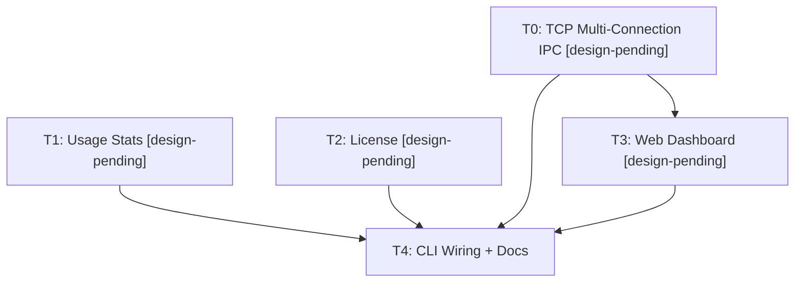

# AgentJ v0.3 Commercial Implementation Plan (thin — design pending)

> **For agentic workers:** REQUIRED SUB-SKILL: Use `superpowers:subagent-driven-development` (recommended) or `superpowers:executing-plans` to implement this plan task-by-task. TDD order is enforced — `test_code` MUST be written and verified failing before `impl_code`.

> **Plan split (3 of 3):** the AgentJ roadmap is split into three independent implementation plans by version priority — this is **Plan 3 (v0.3, commercial expansion)**. Sibling plans: `2026-08-09-agentj-v0.1-plan.md` (core, T0-T18) and `2026-08-09-agentj-v0.2-plan.md` (ecosystem, T0-T10). Execute v0.1 → v0.2 → v0.3 in order.

> **⚠️ DESIGN-PENDING PLAN (thin):** the design spec (`docs/superpowers/specs/2026-08-09-agentj-core-design.md`) commits to the v0.3+ goals — Web Dashboard (JSON-RPC protocol consumer), usage stats, License management — but contains **no detailed design** for them (no architecture, interfaces, or decisions). Per the approved split, this plan scopes only the design-committed items with minimal provisional contracts. **Run `jskill-feature-design` for v0.3 BEFORE executing this plan**; interface changes are expected. Tasks below marked **[design-pending]** are provisional.

## Agent Worker Instructions

- Required sub-skills: `superpowers:subagent-driven-development` (preferred) or `superpowers:executing-plans`
- Execution mode: `subagent-driven-development`
- Required verification: `cargo test --workspace`, `cargo clippy --workspace -- -D warnings`
- Version bump: this plan bumps **0.2.0 → 0.3.0** (feature → minor, per AGENTS.md) — applied in T4.
- **Baseline:** requires v0.1 + v0.2 plans merged (workspace with all crates at 0.2.0).
- **Design-pending rule:** every task marked `[design-pending]` must be re-validated against the v0.3 design document once it exists; the provisional code here is the *minimum* the design commits to, not the final interface.
- **Cargo.toml rule:** dependency additions required by the code are listed inside `impl_code` and applied via `cargo add`; they do NOT count toward the 3-file limit.
- **RED semantics for Rust:** when a test references symbols that do not exist yet, the RED state is a *compile error* — acceptable and proves the feature is absent. After `impl_code`, the tests must compile and PASS.

## Global Constraints

- Rust version: 1.96+ (stable toolchain, `rust-version = "1.96"`)
- All dependencies: latest stable versions at time of execution (use `cargo add`)
- Rust functions: ≤ 50 lines, ≤ 120 chars per line
- No `unwrap()` / `expect()` in library code (use `Result` + `?`); tests may use them
- No type-error suppression (`as any`, `@ts-ignore`, or Rust equivalents)
- Commit messages in English
- Cargo workspace at repo root, all crates flattened in project root (`members = ["agentj-*"]`)
- New crates in this plan: `agentj-stats` (T1), `agentj-license` (T2); the dashboard is a frontend (non-Rust, lives outside the workspace)

---

## Architecture Notes

- **Frontend-agnostic protocol (design 概述)**: "通过 stdio + JSON-RPC 协议暴露内核能力，CLI、TUI、Web Dashboard、IDE 插件均可作为协议消费者" — the Web Dashboard is a *protocol consumer* over JSON-RPC; it must NOT bypass the IPC layer.
- **IPC multi-connection (design 遗留问题)**: "v0.3 Web Dashboard 多连接时的连接生命周期再设计" — v0.1/v0.2 `serve_stdio` is a single-client model (EOF closes). v0.3 T0 adds a TCP listener with concurrent clients; the stdio path stays unchanged.
- **Module status for dashboards (design §模块生命周期状态机)**: "调用方（IPC/CLI/未来 Web Dashboard）可感知哪些模块可用" — `Kernel::module_state(id)` already exists; the dashboard consumes it via a `kernel/status` IPC method (provisional).
- **Usage stats (design 目标 v0.3+)**: token/call accounting hooks into the model provider and agent loop; consumed by the dashboard and future billing. **[design-pending]**.
- **License management (design 目标 v0.3+)**: license key format, validation, and entitlement checks gate commercial features. **[design-pending]**.
- **Deferred (not scoped here):** IDE deep integration (VS Code/JetBrains, design 非目标 v0.3+); TUI (design 非目标 v0.2+, separate concern).

---

## Tasks

### T0: Add a TCP multi-connection JSON-RPC server to agentj-ipc [P0] [Sequential] [design-pending]

```yaml
- id: T0
  title: "Add a TCP multi-connection JSON-RPC server to agentj-ipc"
  files:
    - agentj-ipc/src/tcp.rs
    - agentj-ipc/src/lib.rs
  depends_on: []
  breaking: false
  ac:
    - given: a TcpIpcServer bound on an ephemeral port with the real stub AgentLoop+Kernel
      when: running `cargo test -p agentj-ipc`
      then: >-
        two concurrent clients can each send session/new and receive valid session_id
        responses; a client disconnecting does not affect the other; shutdown closes the
        listener and triggers kernel graceful shutdown; the existing stdio path still passes
        its contract tests
  regression:
    - "cargo test -p agentj-ipc (all v0.1 stdio contract tests must keep passing)"
  test_code: |
    // In agentj-ipc/src/tcp.rs (tests module)
    #[cfg(test)]
    mod tests {
        use super::*;
        use tokio::io::{AsyncBufReadExt, AsyncWriteExt, BufReader};
        use tokio::net::TcpStream;

        #[tokio::test]
        async fn two_clients_serve_independently() {
            let mut server = TcpIpcServer::bind("127.0.0.1:0", stub_agent_loop(), Kernel::new()).await.unwrap();
            let addr = server.local_addr().unwrap();
            let handle = tokio::spawn(async move { server.run().await.unwrap() });

            async fn client_request(addr: std::net::SocketAddr, id: u64) -> String {
                let mut stream = TcpStream::connect(addr).await.unwrap();
                let (r, mut w) = stream.split();
                let mut reader = BufReader::new(r);
                let mut line = String::new();
                w.write_all(format!(r#"{{"jsonrpc":"2.0","id":{id},"method":"session/new"}}"#).as_bytes()).await.unwrap();
                w.write_all(b"\n").await.unwrap();
                reader.read_line(&mut line).await.unwrap();
                line
            }

            let a = client_request(addr, 1);
            let b = client_request(addr, 2);
            let (ra, rb) = tokio::join!(a, b);
            assert!(ra.contains(r#""session_id""#));
            assert!(rb.contains(r#""session_id""#));

            // a client disconnecting must not affect the listener or the other client
            drop(ra);
            let c = client_request(addr, 3).await;
            assert!(c.contains(r#""session_id""#));
            handle.abort();
        }
    }
  impl_code: |
    # agentj-ipc/src/tcp.rs (new file)
    use std::sync::Arc;
    use std::time::Duration;
    use tokio::io::{AsyncBufReadExt, AsyncWriteExt, BufReader};
    use tokio::net::{TcpListener, TcpStream};
    use agentj_core::agent_loop::AgentLoop;
    use agentj_core::kernel::Kernel;
    use crate::{IpcError, IpcServer};

    /// Multi-connection JSON-RPC over TCP — the Web Dashboard's protocol entry (design 概述:
    /// Web Dashboard 作为 JSON-RPC 协议消费者). ONE shared IpcServer (shared Kernel + AgentLoop)
    /// serves ALL connections, so module lifecycle stays centralized; each connection is just a
    /// read/write loop calling `handle_request` (&self — safe for concurrent use: AgentLoop and
    /// InMemoryStore are internally synchronized). [design-pending: connection auth / rate
    /// limiting / max-connections policies land with the v0.3 design.]
    pub struct TcpIpcServer {
        listener: TcpListener,
        shared: Arc<IpcServer>,
    }

    impl TcpIpcServer {
        pub async fn bind(addr: &str, agent_loop: AgentLoop, kernel: Kernel) -> Result<Self, IpcError> {
            let listener = TcpListener::bind(addr).await
                .map_err(|e| IpcError::InvalidRequest(e.to_string()))?;
            // IpcServer::new starts the kernel's event loop; every connection shares it
            let shared = Arc::new(IpcServer::new(agent_loop, kernel));
            Ok(Self { listener, shared })
        }

        pub fn local_addr(&self) -> Result<std::net::SocketAddr, IpcError> {
            self.listener.local_addr().map_err(|e| IpcError::InvalidRequest(e.to_string()))
        }

        pub async fn run(&mut self) -> Result<(), IpcError> {
            // Graceful shutdown (design 遗留问题: multi-connection lifecycle): when ANY client
            // sends `shutdown`, the shared server's flag flips and this accept loop exits — the
            // listener closes and the kernel's graceful shutdown chain runs (T4 wiring awaits
            // the kernel handle after run() returns).
            loop {
                tokio::select! {
                    res = self.listener.accept() => {
                        let (stream, _) = res.map_err(|e| IpcError::InvalidRequest(e.to_string()))?;
                        let shared = Arc::clone(&self.shared);
                        tokio::spawn(async move {
                            if let Err(e) = handle_connection(stream, &shared).await {
                                tracing::error!(error = %e, "tcp connection error");
                            }
                        });
                    }
                    _ = tokio::time::sleep(Duration::from_millis(50)) => {
                        if self.shared.shutdown_requested() { break; }
                    }
                }
            }
            Ok(())
        }
    }

    async fn handle_connection(stream: TcpStream, server: &Arc<IpcServer>) -> Result<(), IpcError> {
        let (r, mut w) = stream.into_split();
        let mut reader = BufReader::new(r);
        let mut line = String::new();
        loop {
            line.clear();
            let n = reader.read_line(&mut line).await?;
            if n == 0 { break; } // client closed
            if line.trim().is_empty() { continue; }
            let response = server.handle_request(line.trim()).await
                .unwrap_or_else(|e| format!(r#"{{"jsonrpc":"2.0","id":null,"error":{{"code":-32603,"message":"{e}"}}}}"#));
            w.write_all(response.as_bytes()).await?;
            w.write_all(b"\n").await?;
            w.flush().await?;
            if server.shutdown_requested() { break; }
        }
        Ok(())
    }

    # agentj-ipc/src/lib.rs — add `pub mod tcp;`
    # agentj-ipc/Cargo.toml — add `tokio = { version = "1", features = ["net", "io-util", "sync", "rt", "macros", "time"] }`.
    # (stub_agent_loop + MockConfig are reused from the v0.1 stdio tests — they are test helpers
    #  in the same agentj-ipc crate; re-export them as `pub(crate)` in lib.rs's test module if needed.)
  verify:
    - "cargo test -p agentj-ipc"
    - "cargo clippy --workspace -- -D warnings"
```

### T1: Add the agentj-stats crate with usage accounting [P0] [Sequential] [design-pending]

```yaml
- id: T1
  title: "Add the agentj-stats crate with usage accounting"
  files:
    - agentj-stats/Cargo.toml
    - agentj-stats/src/lib.rs
  depends_on: []
  breaking: false
  ac:
    - given: a UsageCollector and a session id
      when: running `cargo test -p agentj-stats`
      then: >-
        record_token_usage(session, prompt_tokens, completion_tokens) accumulates per-session
        and global totals; get_session_totals returns the recorded values; a zero-input record
        is a no-op; totals are consistent after multiple records
  regression:
    - "cargo test --workspace (all v0.1 + v0.2 tests must keep passing — agentj-stats is additive)"
  test_code: |
    // In agentj-stats/src/lib.rs (tests module)
    #[cfg(test)]
    mod tests {
        use super::*;

        #[test]
        fn records_and_accumulates_totals() {
            let collector = UsageCollector::new();
            collector.record_token_usage("s1".into(), 100, 20);
            collector.record_token_usage("s1".into(), 50, 30);
            collector.record_token_usage("s2".into(), 10, 5);

            let s1 = collector.get_session_totals("s1").unwrap();
            assert_eq!(s1.prompt_tokens, 150);
            assert_eq!(s1.completion_tokens, 50);
            assert_eq!(s1.turns, 2);

            let global = collector.get_global_totals();
            assert_eq!(global.prompt_tokens, 160);
            assert_eq!(global.completion_tokens, 55);

            assert!(collector.get_session_totals("nope").is_none());
        }

        #[test]
        fn zero_record_is_noop() {
            let collector = UsageCollector::new();
            collector.record_token_usage("s1".into(), 0, 0);
            // a zero record creates NO entry (early return in record_token_usage)
            assert!(collector.get_session_totals("s1").is_none(), "zero record must not create an entry");
        }
    }
  impl_code: |
    # agentj-stats/Cargo.toml
    [package]
    name = "agentj-stats"
    version.workspace = true
    edition.workspace = true
    rust-version.workspace = true

    [dependencies]
    agentj-core = { path = "../agentj-core" }

    # agentj-stats/src/lib.rs
    use std::collections::HashMap;
    use std::sync::Mutex;
    use agentj_core::types::SessionId;

    /// Per-session usage totals. [design-pending: the v0.3 design decides what counts
    /// (tokens/tool calls/credits), persistence, and how the dashboard queries it.]
    #[derive(Debug, Clone, Copy, Default, PartialEq, Eq)]
    pub struct SessionUsage {
        pub prompt_tokens: u64,
        pub completion_tokens: u64,
        pub turns: u64,
    }

    pub struct UsageCollector {
        sessions: Mutex<HashMap<SessionId, SessionUsage>>,
    }

    impl UsageCollector {
        pub fn new() -> Self {
            Self { sessions: Mutex::new(HashMap::new()) }
        }

        pub fn record_token_usage(&self, session: SessionId, prompt_tokens: u64, completion_tokens: u64) {
            if prompt_tokens == 0 && completion_tokens == 0 { return; }
            let mut map = self.sessions.lock().unwrap();
            let usage = map.entry(session).or_default();
            usage.prompt_tokens += prompt_tokens;
            usage.completion_tokens += completion_tokens;
            usage.turns += 1;
        }

        pub fn get_session_totals(&self, session: &str) -> Option<SessionUsage> {
            self.sessions.lock().unwrap().get(session).copied()
        }

        pub fn get_global_totals(&self) -> SessionUsage {
            // manual fold — SessionUsage deliberately derives no Sum
            let mut total = SessionUsage::default();
            for usage in self.sessions.lock().unwrap().values() {
                total.prompt_tokens += usage.prompt_tokens;
                total.completion_tokens += usage.completion_tokens;
                total.turns += usage.turns;
            }
            total
        }
    }

    impl Default for UsageCollector {
        fn default() -> Self { Self::new() }
    }
  verify:
    - "cargo test -p agentj-stats"
    - "cargo clippy --workspace -- -D warnings"
```

### T2: Add the agentj-license crate with license validation [P1] [Sequential] [design-pending]

```yaml
- id: T2
  title: "Add the agentj-license crate with license validation"
  files:
    - agentj-license/Cargo.toml
    - agentj-license/src/lib.rs
  depends_on: []
  breaking: false
  ac:
    - given: a LicenseValidator seeded with a test public key
      when: running `cargo test -p agentj-license`
      then: >-
        a license key signed by the matching private key validates and exposes its
        entitlements; an invalid/malformed key returns LicenseError::InvalidKey;
        an expired license returns LicenseError::Expired; a feature not in the
        entitlements fails check_entitlement
  regression:
    - "cargo test --workspace (all v0.1 + v0.2 tests must keep passing — agentj-license is additive)"
  test_code: |
    // In agentj-license/src/lib.rs (tests module)
    #[cfg(test)]
    mod tests {
        use super::*;
        use base64::Engine as _;

        #[test]
        fn valid_key_validates_and_exposes_entitlements() {
            let validator = test_validator();
            let key = test_signed_key("dashboard", now() + 1_000_000); // far future
            let license = validator.validate(&key).unwrap();
            // Vec<String>::contains needs &String — use any() with &str comparison instead
            assert!(license.entitlements.iter().any(|e| e.as_str() == "dashboard"));
            assert!(validator.check_entitlement(&license, "dashboard"));
            assert!(!validator.check_entitlement(&license, "billing"));
        }

        #[test]
        fn malformed_key_is_invalid() {
            let validator = test_validator();
            assert!(matches!(validator.validate("not-a-key"), Err(LicenseError::InvalidKey)));
        }

        #[test]
        fn expired_license_is_rejected() {
            let validator = test_validator();
            let key = test_signed_key("dashboard", now() - 1_000_000); // already past
            assert!(matches!(validator.validate(&key), Err(LicenseError::Expired)));
        }

        #[test]
        fn never_expiring_license_is_valid() {
            let validator = test_validator();
            let key = test_signed_key("dashboard", 0); // 0 = never expires
            assert!(validator.validate(&key).is_ok());
        }
    }
  impl_code: |
    # agentj-license/Cargo.toml
    [package]
    name = "agentj-license"
    version.workspace = true
    edition.workspace = true
    rust-version.workspace = true

    [dependencies]
    base64 = "0.22"
    ed25519-dalek = { version = "2", features = ["rand_core"] }
    thiserror = "2"

    # agentj-license/src/lib.rs
    use base64::Engine as _;
    use ed25519_dalek::{Signature, Signer, SigningKey, Verifier, VerifyingKey};

    #[derive(Debug, thiserror::Error)]
    pub enum LicenseError {
        #[error("license key is invalid")]
        InvalidKey,
        #[error("license expired")]
        Expired,
        #[error("license payload malformed: {0}")]
        Malformed(String),
    }

    #[derive(Debug, Clone)]
    pub struct License {
        pub entitlements: Vec<String>,
        pub expires_at: u64, // unix seconds; 0 = never
    }

    /// Ed25519-signed license key: `base64(payload_json).base64(signature)`.
    /// [design-pending: key format, payload schema, and expiry policy land with the v0.3 design.]
    pub struct LicenseValidator {
        verifying_key: VerifyingKey,
    }

    impl LicenseValidator {
        pub fn new(verifying_key: VerifyingKey) -> Self { Self { verifying_key } }

        pub fn validate(&self, key: &str) -> Result<License, LicenseError> {
            let (payload_b64, sig_b64) = key.split_once('.').ok_or(LicenseError::InvalidKey)?;
            let payload = base64::engine::general_purpose::STANDARD.decode(payload_b64)
                .map_err(|_| LicenseError::InvalidKey)?;
            let sig_bytes = base64::engine::general_purpose::STANDARD.decode(sig_b64)
                .map_err(|_| LicenseError::InvalidKey)?;
            let signature = Signature::from_slice(&sig_bytes).map_err(|_| LicenseError::InvalidKey)?;
            self.verifying_key.verify(&payload, &signature).map_err(|_| LicenseError::InvalidKey)?;

            let json: serde_json::Value = serde_json::from_slice(&payload)
                .map_err(|e| LicenseError::Malformed(e.to_string()))?;
            let entitlements = json["entitlements"].as_array()
                .map(|a| a.iter().filter_map(|v| v.as_str().map(String::from)).collect())
                .unwrap_or_default();
            let expires_at = json["expires_at"].as_u64().unwrap_or(0);
            let now = std::time::SystemTime::now().duration_since(std::time::UNIX_EPOCH)
                .map_err(|e| LicenseError::Malformed(e.to_string()))?.as_secs();
            if expires_at != 0 && now > expires_at {
                return Err(LicenseError::Expired);
            }
            Ok(License { entitlements, expires_at })
        }

        pub fn check_entitlement(&self, license: &License, feature: &str) -> bool {
            license.entitlements.iter().any(|e| e == feature)
        }
    }

    # agentj-license/Cargo.toml — add `serde_json = "1"`
    # Tests use a deterministic test keypair + epoch-relative expiry (NEVER multiply a "year"
    # by seconds-per-year — that lands decades in the future; use offsets from the real now):
    #   fn now() -> u64 { std::time::SystemTime::now().duration_since(std::time::UNIX_EPOCH).unwrap().as_secs() }
    #   fn test_signing_key() -> SigningKey { SigningKey::from_bytes(&[7u8; 32]) }
    #   fn test_validator() -> LicenseValidator { LicenseValidator::new(test_signing_key().verifying_key()) }
    #   fn test_signed_key(feature: &str, expires_at: u64) -> String {
    #       let signing = test_signing_key();
    #       let payload = serde_json::json!({"entitlements": [feature], "expires_at": expires_at}).to_string();
    #       let sig = signing.sign(payload.as_bytes());
    #       format!("{}.{}",
    #           base64::engine::general_purpose::STANDARD.encode(payload.as_bytes()),
    #           base64::engine::general_purpose::STANDARD.encode(sig.to_bytes()))
    #   }
  verify:
    - "cargo test -p agentj-license"
    - "cargo clippy --workspace -- -D warnings"
```

### T3: Add the Web Dashboard as a JSON-RPC protocol consumer [P2] [Sequential] [design-pending]

```yaml
- id: T3
  title: "Add the Web Dashboard as a JSON-RPC protocol consumer"
  files:
    - web-dashboard/src/jsonrpc.ts
    - web-dashboard/src/jsonrpc.test.ts
    - web-dashboard/src/App.tsx
  depends_on: [T0]
  breaking: false
  ac:
    - given: the agentj TCP IPC server running and the dashboard dev server
      when: running the dashboard's own test/build (`npm test`, `npm run build`)
      then: >-
        the jsonrpc client opens a TCP connection, sends session/new, and parses the
        session_id; the dashboard renders a module-status panel from the kernel/status
        response; the build produces static assets with no type errors
  regression:
    - "n/a (new frontend project — no prior frontend tests)"
  test_code: |
    // In web-dashboard/src/jsonrpc.ts — the protocol client (provisional contract):
    export interface RpcRequest {
      jsonrpc: '2.0';
      id: number;
      method: string;
      params?: Record<string, unknown>;
    }
    export interface RpcResponse {
      jsonrpc: '2.0';
      id: number | null;
      result?: unknown;
      error?: { code: number; message: string };
    }

    // test (vitest): the mock transport returns a JSON-RPC RESPONSE STRING (request() does
    // JSON.parse on it — an object would throw).
    //   import { describe, expect, it } from 'vitest';
    //   import { RpcClient } from './jsonrpc';
    //   describe('RpcClient', () => {
    //     it('sends a request and parses the response', async () => {
    //       const client = new RpcClient({
    //         send: async () => JSON.stringify({ jsonrpc: '2.0', id: 1, result: { session_id: 's1' } }),
    //       });
    //       const result = await client.request('session/new', {});
    //       expect(result).toEqual({ session_id: 's1' });
    //     });
    //   });
  impl_code: |
    # web-dashboard/package.json — new frontend project (TypeScript + Vite + React + vitest).
    # Scaffolding config (package.json, vite.config.ts, tsconfig.json) is created by `npm create
    # vite` per the code below — like Cargo.toml, it does not count toward the 3-file limit.
    # [design-pending: framework, theming, and dashboard feature set land with the v0.3 design.]

    # web-dashboard/src/jsonrpc.ts
    // Minimal JSON-RPC-over-TCP client for the dashboard. Node's net.Socket delivers the
    // line protocol; the same wire format as the CLI's stdio mode (design 概述: 前端无关).
    // (In-browser use would swap the transport for a WebSocket gateway — v0.3 design decision.)
    import net from 'node:net';

    export class RpcClient {
      constructor(
        private readonly send: (line: string) => Promise<string>,
      ) {}

      async request(method: string, params: Record<string, unknown> = {}): Promise<unknown> {
        const id = Date.now();
        const line = JSON.stringify({ jsonrpc: '2.0', id, method, params });
        const raw = await this.send(line);
        const response = JSON.parse(raw) as RpcResponse;
        if (response.error) {
          throw new Error(`${response.error.code}: ${response.error.message}`);
        }
        return response.result;
      }

      static connect(port: number, host = '127.0.0.1'): RpcClient {
        const socket = net.createConnection({ port, host });
        let buffer = '';
        return new RpcClient((line) => new Promise((resolve, reject) => {
          socket.write(line + '\n');
          const onData = (chunk: Buffer) => {
            buffer += chunk.toString();
            const idx = buffer.indexOf('\n');
            if (idx >= 0) {
              const response = buffer.slice(0, idx);
              buffer = buffer.slice(idx + 1);
              socket.off('data', onData);
              resolve(response);
            }
          };
          socket.on('data', onData);
          socket.on('error', reject);
        }));
      }
    }

    # web-dashboard/src/App.tsx — provisional shell: a module-status panel fed by
    # `kernel/status` (a provisional IPC method returning Kernel::module_state for each
    # registered module; the v0.3 design finalizes the payload schema).
    //   export function App() {
    //     const [modules, setModules] = useState<Record<string, string>>({});
    //     useEffect(() => {
    //       client.request('kernel/status', {}).then((r) => setModules(r as Record<string, string>));
    //     }, []);
    //     return (
    //       <main>
    //         <h1>AgentJ Dashboard</h1>
    //         <ul>{Object.entries(modules).map(([id, state]) => <li key={id}>{id}: {state}</li>)}</ul>
    //       </main>
    //     );
    //   }
  verify:
    - "npm test && npm run build (in web-dashboard/)"
```

### T4: Wire v0.3 into the CLI and sync docs [P1] [Sequential]

```yaml
- id: T4
  title: "Wire v0.3 into the CLI and sync docs"
  files:
    - agentj-cli/src/main.rs
    - AGENTS.md
    - README.md
  depends_on: [T0, T1, T2, T3]
  breaking: false
  ac:
    - given: the full v0.3 workspace and the dashboard project
      when: running `cargo test --workspace` and `cargo clippy --workspace -- -D warnings`
      then: >-
        all workspace gates pass with agentj-stats and agentj-license in the member list;
        the CLI gains a `dashboard` subcommand that starts the TCP IPC server and the usage
        collector is wired into the agent loop; docs updated to 0.3.0 with the new features
  regression:
    - "cargo test --workspace (full suite — all prior v0.1 + v0.2 + v0.3 tasks must keep passing)"
  test_code: |
    // Wiring task — the gate is the workspace build + tests. No new unit test is added here;
    // the CLI starts the TCP server for `agentj dashboard` and attaches the UsageCollector to
    // the agent loop. RED: n/a. GREEN: `cargo test --workspace` exit 0.
  impl_code: |
    # agentj-cli/src/main.rs — additive wiring (v0.1 serve/run flow preserved):
    //   - build the UsageCollector and attach it to AgentLoop (provisional: AgentLoop gains an
    //     optional `usage: Option<Arc<UsageCollector>>` field recorded at turn completion —
    //     [design-pending: exact accounting hook]);
    //   - new subcommand:
    //       /// Serve the JSON-RPC API over TCP for the Web Dashboard.
    //       Dashboard { port: u16 }
    //     which binds TcpIpcServer on 127.0.0.1:<port>, reusing the same Kernel wiring as serve,
    //     and runs until SIGINT/SIGTERM (v0.1 signal handling reused).
    # Cargo.toml (root) — members wildcard "agentj-*" picks up agentj-stats/agentj-license.

    # AGENTS.md — sync:
    #   - version: 0.3.0
    #   - crate list: + agentj-stats, agentj-license (+ web-dashboard/ as a frontend project)
    #   - architecture notes: TCP multi-connection IPC, usage accounting, license validation
    #   - verification gates unchanged.

    # README.md — sync:
    #   - version tagline: v0.3.0
    #   - Features checklist: + Web Dashboard (JSON-RPC consumer), usage stats, license management
    #   - Project structure tree: + agentj-stats, agentj-license, web-dashboard
  verify:
    - "cargo test --workspace"
    - "cargo clippy --workspace -- -D warnings"
```

---

## Dependency Graph



## Parallel Execution Groups

- **Group A**: T0, T1, T2 — independent, 3 parallel tasks
- **Group B**: T3 (depends on T0), plus nothing else — sequential
- **Group C**: T4 — CLI wiring + docs + version bump (waits for all)

## Design-pending summary (execute `jskill-feature-design` for v0.3 BEFORE development)

| Task | Design commitment | Pending decisions |
|------|-------------------|-------------------|
| T0 TCP IPC | Web Dashboard 是 JSON-RPC 协议消费者；IPC 多连接再设计 | Auth, rate limiting, max connections, WebSocket gateway |
| T1 Usage stats | v0.3+ 目标：用量统计 | Counting model (tokens/calls/credits), persistence, query API |
| T2 License | v0.3+ 目标：License 管理 | Key format, payload schema, expiry policy, commercial feature gating |
| T3 Dashboard | 前端无关协议 + module_state 可感知 | Framework, theming, feature set, kernel/status schema |
