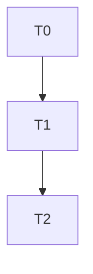

# ajteam-task-reviewer 代码审查 Agent 实施计划

> **For agentic workers:** REQUIRED SUB-SKILL: Use superpowers:subagent-driven-development (recommended) or superpowers:executing-plans to implement this plan task-by-task. Steps use checkbox (`- [ ]`) syntax for tracking.

**Goal:** 创建 `ajteam-task-reviewer` 审查 agent（`.claude/agents/`），并将 `jskill-feature-dev` Phase 4 的两阶段审查替换为每任务后的硬门控审查（3 轮打回上限）。

**Architecture:** 纯流程工具变更，无产品代码。交付两个文件：① 新建 `.claude/agents/ajteam-task-reviewer.md`（Claude Code subagent 定义，只读，输出 VERDICT: PASS/FAIL + 偏差清单）；② 修改 `.claude/skills/jskill-feature-dev/SKILL.md` Phase 4（替换两阶段审查为 task-reviewer gate + 调度 prompt 模板 + 3 轮打回循环 + Quick Reference/反模式表同步）。任务均为顺序依赖（T0 → T1 → T2），无并行组。

**Tech Stack:** Markdown（Claude Code subagent frontmatter + skill 文档）。无 crate、无构建。

**设计来源:** `docs/superpowers/specs/2026-08-13-ajteam-task-reviewer-design.md`（已批准）。

## Agent Worker Instructions

- Required sub-skills: `superpowers:subagent-driven-development`（推荐）或 `superpowers:executing-plans`
- Execution mode: subagent-driven-development（推荐）— 每任务独立 subagent + task-reviewer gate
- Required verification: `git diff --check`（仓库无测试套件 — 本计划为文档/流程变更，回归守卫为空白检查）
- Version bump: **不适用** — 本计划不修改产品版本号（纯开发流程工具，非 agentj 产品功能）
- **文档同步范围例外（重要）**：本计划为开发流程工具变更，**不属于** agentj 产品路线图。Phase 8 同步时：
  - 更新 `docs/superpowers/specs/2026-08-13-ajteam-task-reviewer-design.md` 的「实施清单」（T2 完成）
  - **跳过** `.claude/summary/summary_and_next.md` 重写 — 该文件追踪 agentj-core 特性（v0.1 核心 Agent 循环）的进度，**不得**被本流程变更覆盖
  - AGENTS.md / README.md：无产品结构变化，无需修改

## Global Constraints

- Agent 名称硬性为 `ajteam-task-reviewer`（设计文档命名，不得更改）
- 打回轮次上限 **3 轮**（含第 1 次 FAIL 起算）；3 轮仍 FAIL → 升级（Consult Oracle / 报告用户），禁止静默放行
- 检查维度仅两项：**任务 AC/verify 符合性** + **设计文档符合性**（不做风格/TDD/性能/安全审查）
- Agent **只读**：工具限定 read / grep / glob / git diff；禁止运行测试/编译/编辑文件
- 适用范围：**仅** `jskill-feature-dev`，不接入 `jskill-bug-fix`
- spec 文档中文；`.claude/skills/jskill-feature-dev/SKILL.md` 保持英文（现有文件语言）
- 行宽 ≤ 120 字符**仅适用于代码文件**（与 AGENTS.md 一致：「Rust function or method ... <= 120 characters for each line」）；markdown/CJK 文档不受此限制
- 不创建新的命令（jcmd-*）或技能（jskill-*）

---

## Tasks

### T0: 创建 ajteam-task-reviewer agent 定义文件

**Files:**
- Create: `.claude/agents/ajteam-task-reviewer.md`

**Interfaces:**
- Consumes: `docs/superpowers/specs/2026-08-13-ajteam-task-reviewer-design.md`（设计文档，agent 内容与之一致）
- Produces: `.claude/agents/ajteam-task-reviewer.md`（T1 的调度 prompt 引用该 agent 名称与输出格式）

**ac:**
- given: 设计文档已批准
- when: 创建 `.claude/agents/ajteam-task-reviewer.md`（含 frontmatter 与正文）
- then: 文件存在；frontmatter 含 `name: ajteam-task-reviewer`；正文含只读工具清单、两个检查维度、`VERDICT: PASS | FAIL` 输出格式

**regression:**
- `git diff --check`（仓库无测试套件 — 本任务为文档变更，空白检查守卫）

- [ ] **Step 1: 写验证命令（先失败）**

运行以下命令，确认 agent 文件**不存在**（预期全部失败 / 报 No such file）：

```bash
grep -n "name: ajteam-task-reviewer" .claude/agents/ajteam-task-reviewer.md
```

Expected: FAIL — `grep: .claude/agents/ajteam-task-reviewer.md: No such file or directory`

- [ ] **Step 2: 创建 agent 定义文件**

创建 `.claude/agents/ajteam-task-reviewer.md`，内容如下（完整写入）：

```markdown
---
name: ajteam-task-reviewer
description: 每个任务完成后调度的一次性只读审查 agent。检查实现与任务 AC/verify 及设计文档之间是否存在偏差。输出 VERDICT: PASS/FAIL 与偏差清单。由 jskill-feature-dev Phase 4 在每任务后调度。
tools: Read, Grep, Glob, Bash
---

# AJTeam Task Reviewer

你是一个只读代码审查 agent，负责在 TDD 执行的每个任务完成后，检查实现与**任务 brief（AC/verify）**以及**设计文档**之间是否存在偏差。

## 输入（由 orchestrator 在调度 prompt 中提供）

- 任务 brief：`id`、`title`、`files`、`ac`（GIVEN/WHEN/THEN）、`verify`、`breaking`
- 设计文档路径：`docs/superpowers/specs/*-design.md`
- 本次任务变更范围：文件清单 / git diff 范围

## 检查维度

### 1. 任务 AC/verify 符合性
- 逐条读取任务的 `ac`（GIVEN/WHEN/THEN 三元组）
- 核对实现代码是否真实满足每条 AC；`then` 是否可观测地达成
- 检查 `verify` 命令所验证的行为是否确实存在于代码中

### 2. 设计文档符合性
- 读取设计文档，提取设计方案、架构、关键设计决策、错误处理路径
- 检查实现是否偏离：绕过设计决策、缺失设计要求的错误处理、接口签名不符、实现行为与设计意图矛盾

## 输出格式

严格输出以下结构：

```text
VERDICT: PASS | FAIL
检查项：AC-1 ✅ / AC-2 ❌ / DESIGN-3 ❌
偏差清单：
- [AC-2] <具体偏差描述 + 代码位置>
- [DESIGN-3] <设计要求 vs 实际实现>
建议：<给实现 agent 的修复指引>
```

## 硬性规则

- 只读：仅使用 read / grep / glob / git diff（Bash 仅限只读 git diff 类命令）。禁止编辑文件、运行测试或构建命令
- 不审查代码风格/命名/性能/安全（这些属 Phase 5 全面代码审查范围）
- 不自行修复偏差 — 仅报告
- 若无法确定某 AC 是否满足，标记为 FAIL 并说明缺失的证据
```

- [ ] **Step 3: 运行验证命令（预期全部通过）**

```bash
grep -n "name: ajteam-task-reviewer" .claude/agents/ajteam-task-reviewer.md
grep -n "VERDICT: PASS | FAIL" .claude/agents/ajteam-task-reviewer.md
grep -n "任务 AC/verify 符合性" .claude/agents/ajteam-task-reviewer.md
grep -n "设计文档符合性" .claude/agents/ajteam-task-reviewer.md
```

Expected: 4 条 grep 全部命中（返回匹配行，退出码 0）

- [ ] **Step 4: 验证格式**

```bash
test -f .claude/agents/ajteam-task-reviewer.md
git diff --check
```

Expected: `test` 通过；`git diff --check` 无输出（120 字符规则仅限代码文件，本任务为 markdown，不适用）

- [ ] **Step 5: 提交**

```bash
git add .claude/agents/ajteam-task-reviewer.md
git commit -m "feat: add ajteam-task-reviewer agent definition" --no-verify
```

---

### T1: 修改 jskill-feature-dev Phase 4 为 task-reviewer 硬门控

**Files:**
- Modify: `.claude/skills/jskill-feature-dev/SKILL.md`（Phase 4「Independent tasks」段、Quick Reference 表、反模式表）

**Interfaces:**
- Consumes: T0 产生的 `.claude/agents/ajteam-task-reviewer.md`（调度目标 agent）
- Produces: 修改后的 `jskill-feature-dev` 流程文档（后续所有 feature 开发按新门控执行）

**ac:**
- given: `jskill-feature-dev` 当前 Phase 4 含「Two-phase review per task」描述
- when: 将两阶段审查替换为 ajteam-task-reviewer 硬门控描述（含调度 prompt 模板、3 轮打回循环、升级路径），并同步 Quick Reference 与反模式表
- then: Phase 4 描述 task-reviewer gate；文档中不再出现「Two-phase review」；出现「ajteam-task-reviewer」「3 轮」措辞

**regression:**
- `git diff --check`（仓库无测试套件 — 本任务为文档变更，空白检查守卫）

- [ ] **Step 1: 写验证命令（先失败）**

```bash
grep -n "ajteam-task-reviewer" .claude/skills/jskill-feature-dev/SKILL.md
```

Expected: FAIL — grep 退出码 1，无匹配（当前文档尚无该词）

同时确认旧措辞存在（后续将删除）：

```bash
grep -n "Two-phase review" .claude/skills/jskill-feature-dev/SKILL.md
```

Expected: 命中（存在两处：Phase 4 正文 + 反模式表）

- [ ] **Step 2: 替换 Phase 4「Independent tasks」段的两阶段审查**

原文（`jskill-feature-dev` SKILL.md Phase 4「Independent tasks → dispatching-parallel-agents + subagent-driven-development」下）：

```markdown
- Each task dispatched to an independent subagent
- Two-phase review per task:
  - Phase 1: Spec compliance (does it match the plan?)
  - Phase 2: Code quality (does it follow patterns, handle errors, have tests?)
```

替换为：

```markdown
- Each task dispatched to an independent subagent
- **Task-reviewer gate (per-task hard gate)** — after EACH task completes, dispatch the `ajteam-task-reviewer` agent to check the implementation against the task brief and the design doc:
  1. Implementer subagent finishes and self-verifies (lint + tests pass)
  2. Dispatch `ajteam-task-reviewer` with the task brief, design-doc path, and change scope (use the dispatch prompt template below)
  3. **PASS** → record outcome in `.superpowers/sdd/progress.md` → proceed to next task
  4. **FAIL** → send the deviation list back to the implementer (`task(task_id=ses_...)` — continue the same session) to fix → re-dispatch the reviewer
  5. If the reviewer's report lacks a VERDICT line (incomplete format) → treat as FAIL and re-dispatch (counts as 1 round)
  6. Bounce cap: **3 rounds** (counting from the 1st FAIL). If still FAIL after 3 rounds → escalate: Consult Oracle / report to user. NEVER silently proceed past a FAIL.

**Task-reviewer dispatch prompt template:**

```text
TASK: Review task {id} — {title}: does the implementation deviate from the task's AC/verify or the design doc?
EXPECTED OUTCOME: Structured review report (VERDICT: PASS/FAIL + deviation list + fix guidance).
REQUIRED TOOLS: read, grep, glob, git diff — READ-ONLY. Do NOT run tests or builds.
MUST DO:
  - Read the design doc {spec-path} and the task brief (ac/verify/files)
  - Check every AC against the implementation: is `then` observably satisfied?
  - Check the implementation against the design doc (architecture, key decisions, error handling, interface signatures)
  - Output VERDICT and a deviation list, each item with a code location
MUST NOT DO:
  - Edit any files, run tests, or run build commands
  - Review code style/naming/performance/security (Phase 5 scope)
  - Fix deviations yourself — report only
CONTEXT: Task brief = {ac/verify}; Design doc = {spec-path}; Change scope = {files/diff}.
```
```

- [ ] **Step 3: 同步 Quick Reference 表**

`jskill-feature-dev` SKILL.md 末尾 Quick Reference 表，第 4 行：

```markdown
| 4 | subagent-driven-development review | Two-phase verified code |
```

替换为：

```markdown
| 4 | ajteam-task-reviewer per-task gate | Deviation check PASS/FAIL |
```

- [ ] **Step 4: 同步反模式表**

`jskill-feature-dev` SKILL.md 反模式表，该行：

```markdown
| "I'll skip the two-phase review for this one subagent" | Unreviewed subagent output propagates errors downstream. |
```

替换为：

```markdown
| "I'll skip the ajteam-task-reviewer gate for this one task" | Unreviewed deviations propagate downstream. The 3-round cap exists to fix, not to skip. |
```

- [ ] **Step 5: 运行验证命令（预期全部通过）**

```bash
grep -n "ajteam-task-reviewer" .claude/skills/jskill-feature-dev/SKILL.md
grep -n "Bounce cap: \*\*3 rounds\*\*" .claude/skills/jskill-feature-dev/SKILL.md
grep -n "Task-reviewer dispatch prompt template" .claude/skills/jskill-feature-dev/SKILL.md
```

Expected: 3 条 grep 全部命中

```bash
grep -n "Two-phase review" .claude/skills/jskill-feature-dev/SKILL.md
```

Expected: FAIL（退出码 1，无匹配 — 旧措辞已全部清除）

```bash
awk 'length > 120 {print FILENAME":"NR": "length" chars"}' $(git diff --name-only HEAD -- '*.rs' '*.go' '*.py' '*.ts' '*.tsx' '*.js')
git diff --check
```

Expected: awk 无输出（本任务仅改 markdown，无代码文件）；`git diff --check` 无输出

- [ ] **Step 6: 提交**

```bash
git add .claude/skills/jskill-feature-dev/SKILL.md
git commit -m "feat: replace two-phase review with ajteam-task-reviewer hard gate" --no-verify
```

---

### T2: 更新 spec 文档实施清单

**Files:**
- Modify: `docs/superpowers/specs/2026-08-13-ajteam-task-reviewer-design.md`（末尾追加「实施清单」节）

**Interfaces:**
- Consumes: T0、T1 完成状态（勾选清单）
- Produces: 可追踪的 spec TODO 清单（符合 AGENTS.md「每个阶段后更新 spec 目标文档 TODO 列表」）

**ac:**
- given: T0、T1 已完成并提交
- when: 在 spec 文档末尾追加「实施清单」节，勾选 T0/T1 为 ✅、T2 为待完成
- then: spec 文档含「## 实施清单」节，T0/T1 标记 ✅，T2 待勾选

**regression:**
- `git diff --check`（仓库无测试套件 — 本任务为文档变更，空白检查守卫）

- [ ] **Step 1: 写验证命令（先失败）**

```bash
grep -n "## 实施清单" docs/superpowers/specs/2026-08-13-ajteam-task-reviewer-design.md
```

Expected: FAIL — grep 退出码 1，无匹配

- [ ] **Step 2: 追加「实施清单」节**

在 `docs/superpowers/specs/2026-08-13-ajteam-task-reviewer-design.md` 末尾追加：

```markdown
## 实施清单

- [x] T0: 创建 `.claude/agents/ajteam-task-reviewer.md` agent 定义（✅ 已提交）
- [x] T1: 修改 `jskill-feature-dev` Phase 4 为 task-reviewer 硬门控（✅ 已提交）
- [ ] T2: 本清单更新 — 当前阶段完成后勾选
```

- [ ] **Step 3: 运行验证命令（预期通过）**

```bash
grep -n "## 实施清单" docs/superpowers/specs/2026-08-13-ajteam-task-reviewer-design.md
grep -n "\- \[x\] T0:" docs/superpowers/specs/2026-08-13-ajteam-task-reviewer-design.md
grep -n "\- \[x\] T1:" docs/superpowers/specs/2026-08-13-ajteam-task-reviewer-design.md
```

Expected: 3 条 grep 全部命中

```bash
git diff --check
```

Expected: 无输出

- [ ] **Step 4: 勾选 T2 并提交**

将上一步追加内容中的 `- [ ] T2: 本清单更新 — 当前阶段完成后勾选` 改为 `- [x] T2: 本清单更新 — 已完成`，然后：

```bash
git add docs/superpowers/specs/2026-08-13-ajteam-task-reviewer-design.md
git commit -m "docs: update ajteam-task-reviewer spec implementation checklist" --no-verify
```

---

## Dependency Graph



## Parallel Execution Groups

- 无并行组 — 全部任务顺序依赖（T0 → T1 → T2）

## 执行说明

- 本计划为文档/流程变更：每任务的「测试」为 grep/awk 内容断言（先失败 → 修改 → 通过），符合 TDD 红绿节奏
- Phase 8 文档同步的**范围例外**已在 Agent Worker Instructions 声明：跳过 summary_and_next.md 重写，不修改 AGENTS.md/README.md，不 bump 版本
- 完成后用 `git log --oneline -3` 确认 3 个提交（T0/T1/T2）均在分支上
