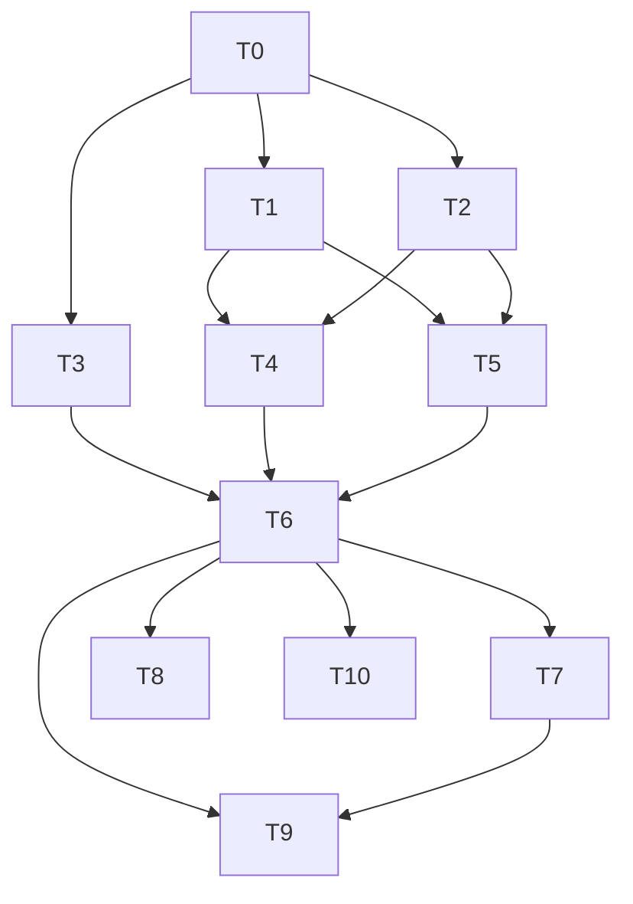

# AgentJ IPC Protocol Contract Implementation Plan

> **For agentic workers:** REQUIRED SUB-SKILL: Use `superpowers:subagent-driven-development` (recommended) or `superpowers:executing-plans` to implement this plan task-by-task. TDD order is enforced — `test_code` MUST be written and verified failing before `impl_code`.

**Goal:** Produce the authoritative, language-neutral AgentJ UI interface contract — JSON Schema (`schemas/*.json`), method registry (`protocol/methods.json`), human-readable spec (`docs/specs/ipc-protocol.md`), and the Rust `agentj-protocol` crate that generates/validates them — before any kernel or frontend code exists.

**Architecture:** A single self-contained leaf crate `agentj-protocol` (serde + schemars only, zero kernel coupling) defines the canonical JSON-RPC 2.0 wire types (envelope, error codes, all v0.1 method params/results, streaming types). `schemars` generates `schemas/*.json` from these types; a hand-maintained `protocol/methods.json` binds method strings to their schema types (direction/kind); contract tests + a drift gate pin the wire format to the schemas; a TypeScript binding test proves cross-language consumability.

**Tech Stack:** Rust 1.96+, serde + serde_json + schemars (derive), JSON-RPC 2.0, JSON Schema 2020-12, json-schema-to-typescript + tsc (for the TS binding test only).

## Agent Worker Instructions

- Required sub-skills: `superpowers:subagent-driven-development` (preferred) or `superpowers:executing-plans`
- Execution mode: `subagent-driven-development`
- Required verification: `cargo test --workspace`, `cargo clippy --workspace -- -D warnings`
- Version bump: **none** — this plan scaffolds the first workspace code at `0.1.0` (no prior version to bump; coordinated with the v0.1 core plan, which also scaffolds at `0.1.0`).
- **RED semantics for Rust:** when a test references symbols that do not exist yet, the RED state is a *compile error* — acceptable and proves the feature is absent. After `impl_code`, tests must compile and PASS.
- **Cargo.toml rule:** dependency additions listed inside `impl_code` are applied via `cargo add` and do NOT count toward the 3-file limit.
- **Scaffolding rule:** T0 creates the crate with `lib.rs` declaring all six modules and creates empty placeholder files (`base.rs`, `types.rs`, `lifecycle.rs`, `session.rs`, `streaming.rs`, `schema.rs`) plus `rust-toolchain.toml`, each containing only a `//!` doc comment (or the 2-line toolchain config). These empty scaffolds are analogous to the Cargo.toml dependency rule and do NOT count toward the 3-file limit; T1–T5 fill them in with no further `lib.rs` edits, keeping those tasks file-isolated and parallel-safe.

## Global Constraints

- Rust version: 1.96+ (stable, `rust-version = "1.96"`)
- All dependencies: latest stable at time of execution (`cargo add`)
- Rust functions: ≤ 50 lines, ≤ 120 chars per line
- No `unwrap()` / `expect()` in library code (use `Result` + `?`); tests may use them
- No type-error suppression (`as any`, `@ts-ignore`, or Rust equivalents)
- Commit messages in English
- Cargo workspace at repo root, crates flattened (`members = ["agentj-*"]`)

## Plan-Level Decisions (resolved from design spec)

1. **Crate home** — the design's decision #6 names "agentj-core 类型 + agentj-ipc 生成入口" as the schema source. Because the workspace is not yet scaffolded and the contract must be free of kernel coupling, this plan realizes that intent as a **dedicated leaf crate `agentj-protocol`** (serde + schemars only). It defines the canonical wire types; v0.1's `agentj-core` and `agentj-ipc` will consume them. **Integration point for v0.1:** `agentj-core` T2 should import `Role`/`ChatMessage`/`ToolCall`/`Attachment`/`ToolDefinition`/`SessionId`/`ModuleState` from `agentj-protocol` rather than redefining them; `agentj-ipc` T13/T14 uses `agentj-protocol`'s envelope + method types for its wire format. This preserves the design's zero-drift property (kernel serializes with the same types the schema is generated from).
2. **Wire field naming** — the design's method table mixes camelCase (`protocolVersion`, `clientInfo`) and snake_case (`session_id`). Normalized to **snake_case** on the wire (`protocol_version`, `client_info`, `progress_token`), matching v0.1's existing serde types (`session_id`, `tool_calls`, `input_schema`). This IS a wire-format change vs the design's literal tables/sequence diagrams; it is confirmed here and recorded in the spec's changelog (T9 §11). The human spec (T9) is the authoritative contract and uses snake_case consistently.
3. **Artifact paths** (finalized per design 遗留问题) — `docs/specs/ipc-protocol.md`, top-level `schemas/*.json` (one file per type, PascalCase filename), top-level `protocol/methods.json`.
4. **Enum forward-compatibility** — design decision #2 / spec §9 require "unknown enum values never fatal". The value enums (`Role`, `ModuleState`, `SessionStatus`) each carry a `#[serde(other)]` + `#[schemars(skip)]` `Unknown` unit variant: unknown values deserialize into `Unknown` (never an error), the schema documents only the KNOWN contract values. For the `kind`-tagged `ProgressValue` (a discriminated union, not a value enum), an unknown `kind` is ignorable by consumers per the `$/`-prefix convention (design decision #5); this is consumer-side runtime behavior documented in T9 §7/§9 and deferred to v0.1's server/client.
5. **`progress_token` semantics** (design delegated "实现计划阶段定稿") — `session/run`'s `progress_token` is client-OPTIONAL. When provided, the server echoes it in every `$/progress` for that request. When omitted, the server uses the request's `id` (as `ProgressToken::Number`/`Str`) as the token — deterministic, and the client already knows its own request id, so no extra "announce the token" round-trip is needed. Documented in T9 §7.

## File Structure

| File | Responsibility |
|------|----------------|
| `Cargo.toml` | Workspace root (`members = ["agentj-*"]`) |
| `rust-toolchain.toml` | Stable toolchain (scaffold, created in T0) |
| `agentj-protocol/Cargo.toml` | Crate manifest (serde, serde_json, schemars) |
| `agentj-protocol/src/lib.rs` | Module declarations (all six, set once in T0) |
| `agentj-protocol/src/base.rs` | JSON-RPC 2.0 envelope + error codes + `ProgressToken` |
| `agentj-protocol/src/types.rs` | Shared payload types |
| `agentj-protocol/src/lifecycle.rs` | Lifecycle method types |
| `agentj-protocol/src/session.rs` | Session method types |
| `agentj-protocol/src/streaming.rs` | Streaming + kernel method types |
| `agentj-protocol/src/schema.rs` | `generate_schemas()` registry |
| `agentj-protocol/src/bin/gen_schemas.rs` | CLI binary that writes `schemas/*.json` |
| `schemas/*.json` | Committed generated JSON Schema (one per type) |
| `protocol/methods.json` | Method registry (hand-maintained) |
| `docs/specs/ipc-protocol.md` | Human-readable protocol spec |
| `bindings/ts/package.json` | TS binding test tooling |
| `bindings/ts/generate.mjs` | Generates `types.d.ts` from schemas |
| `bindings/ts/index.ts` | Generated TS types consumer (compiled by tsc) |

---

## Tasks

### T0: Scaffold workspace + crate skeleton [P0] [Sequential]

```yaml
- id: T0
  title: "Scaffold workspace and agentj-protocol crate skeleton"
  files:
    - Cargo.toml
    - agentj-protocol/Cargo.toml
    - agentj-protocol/src/lib.rs
  depends_on: []
  breaking: false
  ac:
    - given: an empty repository
      when: running `cargo test -p agentj-protocol`
      then: the crate smoke test passes (test result: ok, 1 passed) — proving the workspace builds with a real member crate
  regression:
    - "cargo build --workspace (empty workspace — no prior tests)"
  test_code: |
    # In agentj-protocol/src/lib.rs (smoke test — proves the crate + workspace build)
    #[cfg(test)]
    mod smoke {
        #[test]
        fn crate_loads() {
            assert_eq!(2 + 2, 4);
        }
    }
  impl_code: |
    # Cargo.toml (workspace root)
    [workspace]
    resolver = "2"
    members = ["agentj-*"]

    [workspace.package]
    version = "0.1.0"
    edition = "2024"
    rust-version = "1.96"

    # rust-toolchain.toml (scaffold)
    [toolchain]
    channel = "stable"

    # agentj-protocol/Cargo.toml
    [package]
    name = "agentj-protocol"
    version.workspace = true
    edition.workspace = true
    rust-version.workspace = true

    [dependencies]
    serde = { version = "1", features = ["derive"] }
    serde_json = "1"
    schemars = { version = "1", features = ["derive"] }

    # agentj-protocol/src/lib.rs — declares ALL modules once (T0 owns lib.rs)
    //! AgentJ IPC protocol contract — canonical wire types + schema generation.
    pub mod base;
    pub mod types;
    pub mod lifecycle;
    pub mod session;
    pub mod streaming;
    pub mod schema;

    #[cfg(test)]
    mod smoke {
        #[test]
        fn crate_loads() {
            assert_eq!(2 + 2, 4);
        }
    }

    # Empty placeholder files (scaffolding — filled in by T1/T2/T3/T4/T5/T6):
    #   agentj-protocol/src/base.rs      ->  //! JSON-RPC 2.0 base protocol types.
    #   agentj-protocol/src/types.rs     ->  //! Shared payload types.
    #   agentj-protocol/src/lifecycle.rs ->  //! Lifecycle method types.
    #   agentj-protocol/src/session.rs   ->  //! Session method types.
    #   agentj-protocol/src/streaming.rs ->  //! Streaming + kernel method types.
    #   agentj-protocol/src/schema.rs    ->  //! Schema generation registry.
  verify:
    - "cargo test -p agentj-protocol"
    - "cargo clippy --workspace -- -D warnings"
```

### T1: Define base protocol envelope + error codes [P0] [Parallel with T2, T3]

```yaml
- id: T1
  title: "Define JSON-RPC 2.0 base envelope, error codes, and ProgressToken"
  files:
    - agentj-protocol/src/base.rs
  depends_on: [T0]
  breaking: false
  ac:
    - given: the crate skeleton from T0
      when: running `cargo test -p agentj-protocol`
      then: envelope tests pass (RequestMessage serializes to JSON-RPC 2.0 shape, error codes have reserved values, ResponseMessage untagged result/error, Id tolerates null, error response with data + null id roundtrips, ProgressToken untagged number/string, base types generate JSON Schema)
  regression:
    - "cargo test -p agentj-protocol (T0 smoke test keeps passing)"
  test_code: |
    // In agentj-protocol/src/base.rs (tests module)
    #[cfg(test)]
    mod tests {
        use super::*;

        #[test]
        fn request_serializes_to_jsonrpc_2_0() {
            let req = RequestMessage {
                jsonrpc: "2.0".into(),
                id: Id::Number(1),
                method: "session/new".into(),
                params: Some(serde_json::json!({})),
            };
            let json = serde_json::to_value(&req).unwrap();
            assert_eq!(json["jsonrpc"], "2.0");
            assert_eq!(json["id"], 1);
            assert_eq!(json["method"], "session/new");
            assert!(json.get("params").is_some());
        }

        #[test]
        fn notification_has_no_id() {
            let n = NotificationMessage {
                jsonrpc: "2.0".into(),
                method: "initialized".into(),
                params: Some(serde_json::json!({})),
            };
            let json = serde_json::to_value(&n).unwrap();
            assert!(json.get("id").is_none());
            assert_eq!(json["method"], "initialized");
        }

        #[test]
        fn response_success_and_error_are_distinct() {
            let ok = ResponseMessage::Success {
                jsonrpc: "2.0".into(),
                id: Id::Number(1),
                result: serde_json::json!({"session_id": "s1"}),
            };
            let err = ResponseMessage::Error {
                jsonrpc: "2.0".into(),
                id: Id::Number(1),
                error: ErrorObject { code: error_codes::INVALID_PARAMS, message: "bad".into(), data: None },
            };
            let ok_json = serde_json::to_value(&ok).unwrap();
            let err_json = serde_json::to_value(&err).unwrap();
            assert!(ok_json.get("result").is_some());
            assert!(ok_json.get("error").is_none());
            assert!(err_json.get("error").is_some());
            assert!(err_json.get("result").is_none());
        }

        #[test]
        fn error_response_with_data_and_null_id_roundtrips() {
            // Parse-error responses carry id=null (JSON-RPC 2.0 §5) and optional data.
            let err = ResponseMessage::Error {
                jsonrpc: "2.0".into(),
                id: Id::Null,
                error: ErrorObject {
                    code: error_codes::PARSE_ERROR,
                    message: "invalid json".into(),
                    data: Some(serde_json::json!({"line": 3})),
                },
            };
            let json = serde_json::to_value(&err).unwrap();
            assert_eq!(json["id"], serde_json::Value::Null);
            assert_eq!(json["error"]["code"], -32700);
            assert_eq!(json["error"]["data"]["line"], 3);
        }

        #[test]
        fn error_codes_have_reserved_values() {
            assert_eq!(error_codes::PARSE_ERROR, -32700);
            assert_eq!(error_codes::METHOD_NOT_FOUND, -32601);
            assert_eq!(error_codes::REQUEST_CANCELLED, -32800);
            assert_eq!(error_codes::SERVER_NOT_INITIALIZED, -32801);
            assert_eq!(error_codes::SESSION_NOT_FOUND, -32802);
            assert_eq!(error_codes::SESSION_INACTIVE, -32803);
            assert_eq!(error_codes::INVALID_VERSION, -32804);
        }

        #[test]
        fn id_accepts_number_string_and_null() {
            let num: Id = serde_json::from_value(serde_json::json!(42)).unwrap();
            let s: Id = serde_json::from_value(serde_json::json!("abc")).unwrap();
            let n: Id = serde_json::from_value(serde_json::json!(null)).unwrap();
            assert!(matches!(num, Id::Number(42)));
            assert!(matches!(s, Id::Str(_)));
            assert!(matches!(n, Id::Null));
        }

        #[test]
        fn progress_token_untagged_number_and_string() {
            let n: ProgressToken = serde_json::from_value(serde_json::json!(7)).unwrap();
            let s: ProgressToken = serde_json::from_value(serde_json::json!("tok")).unwrap();
            assert!(matches!(n, ProgressToken::Number(7)));
            assert!(matches!(s, ProgressToken::Str(_)));
        }

        #[test]
        fn base_types_generate_json_schema() {
            let s = schemars::schema_for!(RequestMessage);
            let json = serde_json::to_value(&s).unwrap();
            assert_eq!(json["type"], "object");
            assert!(json["properties"].get("jsonrpc").is_some());
        }
    }
  impl_code: |
    # agentj-protocol/src/base.rs
    use schemars::JsonSchema;
    use serde::{Deserialize, Serialize};

    /// JSON-RPC 2.0 request/notification id. `Null` is used only in error responses
    /// where the request id could not be determined (e.g. parse error — JSON-RPC 2.0 §5).
    #[derive(Debug, Clone, PartialEq, Serialize, Deserialize, JsonSchema)]
    #[serde(untagged)]
    pub enum Id {
        Number(i64),
        Str(String),
        Null,
    }

    /// Streaming progress token — independent of the request id (design 决策 #3).
    #[derive(Debug, Clone, PartialEq, Serialize, Deserialize, JsonSchema)]
    #[serde(untagged)]
    pub enum ProgressToken {
        Number(i64),
        Str(String),
    }

    #[derive(Debug, Clone, Serialize, Deserialize, JsonSchema)]
    pub struct RequestMessage {
        pub jsonrpc: String,
        pub id: Id,
        pub method: String,
        #[serde(skip_serializing_if = "Option::is_none")]
        pub params: Option<serde_json::Value>,
    }

    #[derive(Debug, Clone, Serialize, Deserialize, JsonSchema)]
    pub struct NotificationMessage {
        pub jsonrpc: String,
        pub method: String,
        #[serde(skip_serializing_if = "Option::is_none")]
        pub params: Option<serde_json::Value>,
    }

    #[derive(Debug, Clone, Serialize, Deserialize, JsonSchema)]
    pub struct ErrorObject {
        pub code: i32,
        pub message: String,
        #[serde(skip_serializing_if = "Option::is_none")]
        pub data: Option<serde_json::Value>,
    }

    /// A JSON-RPC 2.0 response: exactly one of `result` (success) or `error` (failure).
    #[derive(Debug, Clone, Serialize, Deserialize, JsonSchema)]
    #[serde(untagged)]
    pub enum ResponseMessage {
        Success { jsonrpc: String, id: Id, result: serde_json::Value },
        Error { jsonrpc: String, id: Id, error: ErrorObject },
    }

    /// Protocol error codes — JSON-RPC reserved range plus the agentj block
    /// (design 决策 #4). The JSON-RPC `-32000..-32099` server-error range is
    /// implementation-defined and reserved (documented in the spec, no constant).
    pub mod error_codes {
        // JSON-RPC 2.0 reserved
        pub const PARSE_ERROR: i32 = -32700;
        pub const INVALID_REQUEST: i32 = -32600;
        pub const METHOD_NOT_FOUND: i32 = -32601;
        pub const INVALID_PARAMS: i32 = -32602;
        pub const INTERNAL_ERROR: i32 = -32603;
        // agentj reserved block
        pub const REQUEST_CANCELLED: i32 = -32800;
        pub const SERVER_NOT_INITIALIZED: i32 = -32801;
        pub const SESSION_NOT_FOUND: i32 = -32802;
        pub const SESSION_INACTIVE: i32 = -32803;
        pub const INVALID_VERSION: i32 = -32804;
    }
  verify:
    - "cargo test -p agentj-protocol"
    - "cargo clippy --workspace -- -D warnings"
```

### T2: Define shared payload types [P0] [Parallel with T1, T3]

```yaml
- id: T2
  title: "Define shared payload types (Role/ChatMessage/ToolCall/Attachment/ToolDefinition/SessionId/ModuleState/SessionStatus)"
  files:
    - agentj-protocol/src/types.rs
  depends_on: [T0]
  breaking: false
  ac:
    - given: the crate skeleton from T0
      when: running `cargo test -p agentj-protocol`
      then: shared type tests pass (Role/ModuleState/SessionStatus lowercase serialization, ChatMessage roundtrip, ToolCall roundtrip, unknown enum values tolerated into `Unknown`, schemas generated)
  regression:
    - "cargo test -p agentj-protocol (T0 smoke test keeps passing)"
  test_code: |
    // In agentj-protocol/src/types.rs (tests module)
    #[cfg(test)]
    mod tests {
        use super::*;

        #[test]
        fn role_serializes_lowercase() {
            assert_eq!(serde_json::to_value(Role::System).unwrap(), "system");
            assert_eq!(serde_json::to_value(Role::Assistant).unwrap(), "assistant");
            let r: Role = serde_json::from_value(serde_json::json!("tool")).unwrap();
            assert_eq!(r, Role::Tool);
        }

        #[test]
        fn unknown_enum_values_are_tolerated_not_fatal() {
            let r: Role = serde_json::from_value(serde_json::json!("weird-role")).unwrap();
            assert_eq!(r, Role::Unknown);
            let s: ModuleState = serde_json::from_value(serde_json::json!("future-state")).unwrap();
            assert_eq!(s, ModuleState::Unknown);
            let st: SessionStatus = serde_json::from_value(serde_json::json!("pending")).unwrap();
            assert_eq!(st, SessionStatus::Unknown);
        }

        #[test]
        fn chatmessage_roundtrip() {
            let m = ChatMessage {
                role: Role::User,
                content: "hello".into(),
                tool_call_id: None,
                tool_calls: vec![],
            };
            let json = serde_json::to_value(&m).unwrap();
            assert_eq!(json["role"], "user");
            assert!(json.get("tool_call_id").is_none());
            assert!(json.get("tool_calls").is_none());
            let back: ChatMessage = serde_json::from_value(json).unwrap();
            assert_eq!(back.content, "hello");
        }

        #[test]
        fn module_state_and_session_status_serialize_lowercase() {
            assert_eq!(serde_json::to_value(ModuleState::Ready).unwrap(), "ready");
            assert_eq!(serde_json::to_value(SessionStatus::Active).unwrap(), "active");
        }

        #[test]
        fn tool_call_roundtrip() {
            let tc = ToolCall { id: "call-1".into(), name: "bash".into(), arguments: serde_json::json!({"cmd":"ls"}) };
            let back: ToolCall = serde_json::from_str(&serde_json::to_string(&tc).unwrap()).unwrap();
            assert_eq!(back.name, "bash");
            assert_eq!(back.arguments["cmd"], "ls");
        }

        #[test]
        fn shared_types_generate_json_schema() {
            let s = schemars::schema_for!(ChatMessage);
            let json = serde_json::to_value(&s).unwrap();
            assert_eq!(json["type"], "object");
            assert!(json["properties"].get("role").is_some());
        }
    }
  impl_code: |
    # agentj-protocol/src/types.rs
    use schemars::JsonSchema;
    use serde::{Deserialize, Serialize};

    pub type SessionId = String;

    #[derive(Debug, Clone, Copy, PartialEq, Eq, Serialize, Deserialize, JsonSchema)]
    #[serde(rename_all = "lowercase")]
    pub enum Role {
        System,
        User,
        Assistant,
        Tool,
        // Forward-compat: unknown roles are preserved as `Unknown`, never a parse error
        // (design 决策 #2 / spec §9). Excluded from the schema — schema lists known values.
        #[serde(other)]
        #[schemars(skip)]
        Unknown,
    }

    #[derive(Debug, Clone, Serialize, Deserialize, JsonSchema)]
    pub struct ToolCall {
        pub id: String,
        pub name: String,
        pub arguments: serde_json::Value,
    }

    #[derive(Debug, Clone, Serialize, Deserialize, JsonSchema)]
    pub struct ChatMessage {
        pub role: Role,
        pub content: String,
        #[serde(skip_serializing_if = "Option::is_none")]
        pub tool_call_id: Option<String>,
        #[serde(skip_serializing_if = "Vec::is_empty", default)]
        pub tool_calls: Vec<ToolCall>,
    }

    #[derive(Debug, Clone, Serialize, Deserialize, JsonSchema)]
    pub struct Attachment {
        #[serde(skip_serializing_if = "Option::is_none")]
        pub path: Option<String>,
        #[serde(skip_serializing_if = "Option::is_none")]
        pub content: Option<String>,
        #[serde(skip_serializing_if = "Option::is_none")]
        pub mime: Option<String>,
    }

    #[derive(Debug, Clone, Serialize, Deserialize, JsonSchema)]
    pub struct ToolDefinition {
        pub name: String,
        pub description: String,
        pub input_schema: serde_json::Value,
    }

    #[derive(Debug, Clone, Copy, PartialEq, Eq, Serialize, Deserialize, JsonSchema)]
    #[serde(rename_all = "lowercase")]
    pub enum ModuleState {
        Unloaded,
        Initializing,
        Ready,
        Stopping,
        Stopped,
        Failed,
        #[serde(other)]
        #[schemars(skip)]
        Unknown,
    }

    #[derive(Debug, Clone, Copy, PartialEq, Eq, Serialize, Deserialize, JsonSchema)]
    #[serde(rename_all = "lowercase")]
    pub enum SessionStatus {
        Active,
        Archived,
        Deleted,
        #[serde(other)]
        #[schemars(skip)]
        Unknown,
    }
  verify:
    - "cargo test -p agentj-protocol"
    - "cargo clippy --workspace -- -D warnings"
```

### T3: Define lifecycle method types [P0] [Parallel with T1, T2]

```yaml
- id: T3
  title: "Define lifecycle method types (initialize/initialized/shutdown/exit)"
  files:
    - agentj-protocol/src/lifecycle.rs
  depends_on: [T0]
  breaking: false
  ac:
    - given: the crate skeleton from T0
      when: running `cargo test -p agentj-protocol`
      then: lifecycle type tests pass (InitializeParams/Result serialize snake_case, capabilities/version/client_info/server_info present, ServerInfo/ClientInfo roundtrip, schemas generated)
  regression:
    - "cargo test -p agentj-protocol (T0 smoke test keeps passing)"
  test_code: |
    // In agentj-protocol/src/lifecycle.rs (tests module)
    #[cfg(test)]
    mod tests {
        use super::*;

        #[test]
        fn initialize_params_serialize() {
            let p = InitializeParams {
                protocol_version: "0.1.0".into(),
                capabilities: Some(serde_json::json!({"streaming": true})),
                client_info: Some(ClientInfo { name: "cli".into(), version: "0.1.0".into() }),
            };
            let json = serde_json::to_value(&p).unwrap();
            assert_eq!(json["protocol_version"], "0.1.0");
            assert_eq!(json["capabilities"]["streaming"], true);
            assert_eq!(json["client_info"]["name"], "cli");
        }

        #[test]
        fn initialize_result_roundtrip() {
            let r = InitializeResult {
                protocol_version: "0.1.0".into(),
                capabilities: Some(serde_json::json!({"streaming": true})),
                server_info: ServerInfo { name: "agentj".into(), version: "0.1.0".into() },
            };
            let back: InitializeResult = serde_json::from_str(&serde_json::to_string(&r).unwrap()).unwrap();
            assert_eq!(back.protocol_version, "0.1.0");
            assert_eq!(back.server_info.name, "agentj");
        }

        #[test]
        fn lifecycle_types_generate_json_schema() {
            let s = schemars::schema_for!(InitializeParams);
            let json = serde_json::to_value(&s).unwrap();
            assert_eq!(json["type"], "object");
            assert!(json["properties"].get("protocol_version").is_some());
        }
    }
  impl_code: |
    # agentj-protocol/src/lifecycle.rs
    use schemars::JsonSchema;
    use serde::{Deserialize, Serialize};

    #[derive(Debug, Clone, Serialize, Deserialize, JsonSchema)]
    pub struct ClientInfo {
        pub name: String,
        pub version: String,
    }

    #[derive(Debug, Clone, Serialize, Deserialize, JsonSchema)]
    pub struct ServerInfo {
        pub name: String,
        pub version: String,
    }

    /// `initialize` request params (design 决策 #2).
    #[derive(Debug, Clone, Serialize, Deserialize, JsonSchema)]
    pub struct InitializeParams {
        pub protocol_version: String,
        #[serde(skip_serializing_if = "Option::is_none")]
        pub capabilities: Option<serde_json::Value>,
        #[serde(skip_serializing_if = "Option::is_none")]
        pub client_info: Option<ClientInfo>,
    }

    #[derive(Debug, Clone, Serialize, Deserialize, JsonSchema)]
    pub struct InitializeResult {
        pub protocol_version: String,
        #[serde(skip_serializing_if = "Option::is_none")]
        pub capabilities: Option<serde_json::Value>,
        pub server_info: ServerInfo,
    }

    // `initialized`, `shutdown`, `exit` carry no params — represented as
    // `params: null` in the registry, no dedicated structs.
  verify:
    - "cargo test -p agentj-protocol"
    - "cargo clippy --workspace -- -D warnings"
```

### T4: Define session method types [P0] [Parallel with T5]

```yaml
- id: T4
  title: "Define session method types (new/run/status/archive/delete)"
  files:
    - agentj-protocol/src/session.rs
  depends_on: [T1, T2]
  breaking: false
  ac:
    - given: base types from T1 and shared types from T2
      when: running `cargo test -p agentj-protocol`
      then: session type tests pass (SessionRunParams with progress_token from base, SessionRunResult with tool_calls, SessionStatusResult, SessionIdParams roundtrip)
  regression:
    - "cargo test -p agentj-protocol (T1 + T2 tests keep passing)"
  test_code: |
    // In agentj-protocol/src/session.rs (tests module)
    #[cfg(test)]
    mod tests {
        use super::*;
        use crate::base::ProgressToken;
        use crate::types::SessionStatus;

        #[test]
        fn session_new_result_roundtrip() {
            let r = SessionNewResult { session_id: "s1".into() };
            assert_eq!(serde_json::to_value(&r).unwrap()["session_id"], "s1");
        }

        #[test]
        fn session_run_params_serialize() {
            let p = SessionRunParams {
                session_id: "s1".into(),
                content: "hi".into(),
                attachments: None,
                progress_token: None,
            };
            let json = serde_json::to_value(&p).unwrap();
            assert_eq!(json["session_id"], "s1");
            assert!(json.get("attachments").is_none());
            assert!(json.get("progress_token").is_none());
        }

        #[test]
        fn session_run_params_with_progress_token() {
            let p = SessionRunParams {
                session_id: "s1".into(),
                content: "hi".into(),
                attachments: Some(vec![crate::types::Attachment { path: Some("a.txt".into()), content: None, mime: None }]),
                progress_token: Some(ProgressToken::Str("tok".into())),
            };
            let json = serde_json::to_value(&p).unwrap();
            assert_eq!(json["progress_token"], "tok");
            assert_eq!(json["attachments"][0]["path"], "a.txt");
        }

        #[test]
        fn session_status_result_serialize() {
            let r = SessionStatusResult { status: SessionStatus::Archived };
            assert_eq!(serde_json::to_value(&r).unwrap()["status"], "archived");
        }

        #[test]
        fn session_id_params_roundtrip() {
            let p = SessionIdParams { session_id: "s9".into() };
            let back: SessionIdParams = serde_json::from_str(&serde_json::to_string(&p).unwrap()).unwrap();
            assert_eq!(back.session_id, "s9");
        }
    }
  impl_code: |
    # agentj-protocol/src/session.rs
    use schemars::JsonSchema;
    use serde::{Deserialize, Serialize};

    use crate::base::ProgressToken;
    use crate::types::{Attachment, SessionId, SessionStatus, ToolCall};

    #[derive(Debug, Clone, Serialize, Deserialize, JsonSchema)]
    pub struct SessionNewResult {
        pub session_id: SessionId,
    }

    #[derive(Debug, Clone, Serialize, Deserialize, JsonSchema)]
    pub struct SessionRunParams {
        pub session_id: SessionId,
        pub content: String,
        #[serde(skip_serializing_if = "Option::is_none")]
        pub attachments: Option<Vec<Attachment>>,
        #[serde(skip_serializing_if = "Option::is_none")]
        pub progress_token: Option<ProgressToken>,
    }

    #[derive(Debug, Clone, Serialize, Deserialize, JsonSchema)]
    pub struct SessionRunResult {
        pub content: String,
        #[serde(skip_serializing_if = "Option::is_none")]
        pub tool_calls: Option<Vec<ToolCall>>,
    }

    #[derive(Debug, Clone, Serialize, Deserialize, JsonSchema)]
    pub struct SessionIdParams {
        pub session_id: SessionId,
    }

    #[derive(Debug, Clone, Serialize, Deserialize, JsonSchema)]
    pub struct SessionStatusResult {
        pub status: SessionStatus,
    }
  verify:
    - "cargo test -p agentj-protocol"
    - "cargo clippy --workspace -- -D warnings"
```

### T5: Define streaming + kernel method types [P0] [Parallel with T4]

```yaml
- id: T5
  title: "Define streaming and kernel method types (progress/cancelRequest/kernel-status)"
  files:
    - agentj-protocol/src/streaming.rs
  depends_on: [T1, T2]
  breaking: false
  ac:
    - given: base types from T1 and shared types from T2
      when: running `cargo test -p agentj-protocol`
      then: streaming/kernel type tests pass (ProgressValue kind-tagged text/tool_call/tool_result, CancelParams roundtrip, KernelStatusResult with modules)
  regression:
    - "cargo test -p agentj-protocol (T1 + T2 tests keep passing)"
  test_code: |
    // In agentj-protocol/src/streaming.rs (tests module)
    #[cfg(test)]
    mod tests {
        use super::*;
        use crate::base::Id;
        use crate::types::{ModuleState, ToolCall};

        #[test]
        fn progress_value_text_kind() {
            let v = ProgressValue::Text { delta: "hello".into() };
            let json = serde_json::to_value(&v).unwrap();
            assert_eq!(json["kind"], "text");
            assert_eq!(json["delta"], "hello");
        }

        #[test]
        fn progress_value_tool_call_kind() {
            let v = ProgressValue::ToolCall {
                tool_call: ToolCall { id: "c1".into(), name: "bash".into(), arguments: serde_json::json!({}) },
            };
            let json = serde_json::to_value(&v).unwrap();
            assert_eq!(json["kind"], "tool_call");
            assert_eq!(json["tool_call"]["name"], "bash");
        }

        #[test]
        fn progress_value_tool_result_kind() {
            let v = ProgressValue::ToolResult { tool_call_id: "c1".into(), content: "ok".into() };
            let json = serde_json::to_value(&v).unwrap();
            assert_eq!(json["kind"], "tool_result");
            assert_eq!(json["tool_call_id"], "c1");
        }

        #[test]
        fn cancel_params_roundtrip() {
            let p = CancelParams { id: Id::Number(5) };
            let back: CancelParams = serde_json::from_str(&serde_json::to_string(&p).unwrap()).unwrap();
            assert_eq!(back.id, Id::Number(5));
        }

        #[test]
        fn kernel_status_result_serialize() {
            let r = KernelStatusResult {
                version: "0.1.0".into(),
                modules: vec![ModuleInfo { id: "m1".into(), state: ModuleState::Ready }],
            };
            let json = serde_json::to_value(&r).unwrap();
            assert_eq!(json["version"], "0.1.0");
            assert_eq!(json["modules"][0]["state"], "ready");
        }

        #[test]
        fn streaming_types_generate_json_schema() {
            let s = schemars::schema_for!(ProgressValue);
            let json = serde_json::to_value(&s).unwrap();
            assert!(json.get("anyOf").is_some() || json.get("oneOf").is_some());
        }
    }
  impl_code: |
    # agentj-protocol/src/streaming.rs
    use schemars::JsonSchema;
    use serde::{Deserialize, Serialize};

    use crate::base::Id;
    use crate::types::{ModuleState, ToolCall};

    #[derive(Debug, Clone, Serialize, Deserialize, JsonSchema)]
    pub struct ProgressParams {
        pub token: crate::base::ProgressToken,
        pub value: ProgressValue,
    }

    /// `$/progress` payload, discriminated by `kind` (design 决策 #3).
    /// An unknown `kind` is ignorable by consumers (per `$/`-prefix convention,
    /// design 决策 #5) — consumer-side behavior documented in the spec, deferred to v0.1.
    #[derive(Debug, Clone, Serialize, Deserialize, JsonSchema)]
    #[serde(tag = "kind", rename_all = "snake_case")]
    pub enum ProgressValue {
        Text { delta: String },
        ToolCall { tool_call: ToolCall },
        ToolResult { tool_call_id: String, content: String },
    }

    #[derive(Debug, Clone, Serialize, Deserialize, JsonSchema)]
    pub struct CancelParams {
        pub id: Id,
    }

    #[derive(Debug, Clone, Serialize, Deserialize, JsonSchema)]
    pub struct KernelStatusResult {
        pub version: String,
        pub modules: Vec<ModuleInfo>,
    }

    #[derive(Debug, Clone, Serialize, Deserialize, JsonSchema)]
    pub struct ModuleInfo {
        pub id: String,
        pub state: ModuleState,
    }
  verify:
    - "cargo test -p agentj-protocol"
    - "cargo clippy --workspace -- -D warnings"
```

### T6: Add schema generation + committed schemas + drift gate [P0] [Sequential]

```yaml
- id: T6
  title: "Add schema generation entry, commit schemas, and drift-gate test"
  files:
    - agentj-protocol/src/schema.rs
    - agentj-protocol/src/bin/gen_schemas.rs
  depends_on: [T3, T4, T5]
  breaking: false
  ac:
    - given: all method/type definitions from T3-T5
      when: running `cargo run -p agentj-protocol --bin gen_schemas` then `cargo test -p agentj-protocol -- drift`
      then: schemas are generated for every registered type, `schemas/*.json` files are written/committed, and the drift test passes (fails only if a committed schema diverges)
  regression:
    - "cargo test -p agentj-protocol (all T1-T5 type tests keep passing)"
  test_code: |
    // In agentj-protocol/src/schema.rs (tests module)
    #[cfg(test)]
    mod tests {
        use super::*;
        use std::fs;

        fn schemas_dir() -> std::path::PathBuf {
            std::path::Path::new(env!("CARGO_MANIFEST_DIR")).join("../schemas")
        }

        #[test]
        fn drift_registered_types_are_known() {
            let schemas = generate_schemas();
            assert!(schemas.contains_key("RequestMessage"));
            assert!(schemas.contains_key("InitializeParams"));
            assert!(schemas.contains_key("SessionRunParams"));
            assert!(schemas.contains_key("ProgressValue"));
            assert!(schemas.contains_key("KernelStatusResult"));
        }

        #[test]
        fn drift_committed_schemas_match_generated() {
            let generated = generate_schemas();
            let dir = schemas_dir();
            assert!(dir.is_dir(), "schemas/ directory missing — run `cargo run --bin gen_schemas`");
            for (name, schema) in &generated {
                let path = dir.join(format!("{name}.json"));
                let committed: serde_json::Value =
                    serde_json::from_str(&fs::read_to_string(&path).unwrap_or_else(|_| {
                        panic!("missing committed schema for {name}")
                    }))
                    .unwrap();
                let regenerated = serde_json::to_value(schema).unwrap();
                assert_eq!(committed, regenerated, "drift detected for {name} — re-run `cargo run --bin gen_schemas`");
            }
        }
    }
  impl_code: |
    # agentj-protocol/src/schema.rs
    use std::collections::BTreeMap;
    use schemars::schema::RootSchema;
    use schemars::schema_for;

    use crate::base::{ErrorObject, Id, NotificationMessage, ProgressToken, RequestMessage, ResponseMessage};
    use crate::lifecycle::{ClientInfo, InitializeParams, InitializeResult, ServerInfo};
    use crate::session::{SessionIdParams, SessionNewResult, SessionRunParams, SessionRunResult, SessionStatusResult};
    use crate::streaming::{CancelParams, KernelStatusResult, ModuleInfo, ProgressParams, ProgressValue};
    use crate::types::{Attachment, ChatMessage, ModuleState, Role, SessionStatus, ToolCall, ToolDefinition};

    /// Map of type name -> JSON Schema, the single machine source of truth.
    pub fn generate_schemas() -> BTreeMap<String, RootSchema> {
        let mut m = BTreeMap::new();
        m.insert("Id".into(), schema_for!(Id));
        m.insert("ProgressToken".into(), schema_for!(ProgressToken));
        m.insert("RequestMessage".into(), schema_for!(RequestMessage));
        m.insert("NotificationMessage".into(), schema_for!(NotificationMessage));
        m.insert("ResponseMessage".into(), schema_for!(ResponseMessage));
        m.insert("ErrorObject".into(), schema_for!(ErrorObject));
        m.insert("Role".into(), schema_for!(Role));
        m.insert("ToolCall".into(), schema_for!(ToolCall));
        m.insert("ChatMessage".into(), schema_for!(ChatMessage));
        m.insert("Attachment".into(), schema_for!(Attachment));
        m.insert("ToolDefinition".into(), schema_for!(ToolDefinition));
        m.insert("ModuleState".into(), schema_for!(ModuleState));
        m.insert("SessionStatus".into(), schema_for!(SessionStatus));
        m.insert("ClientInfo".into(), schema_for!(ClientInfo));
        m.insert("ServerInfo".into(), schema_for!(ServerInfo));
        m.insert("InitializeParams".into(), schema_for!(InitializeParams));
        m.insert("InitializeResult".into(), schema_for!(InitializeResult));
        m.insert("SessionNewResult".into(), schema_for!(SessionNewResult));
        m.insert("SessionRunParams".into(), schema_for!(SessionRunParams));
        m.insert("SessionRunResult".into(), schema_for!(SessionRunResult));
        m.insert("SessionIdParams".into(), schema_for!(SessionIdParams));
        m.insert("SessionStatusResult".into(), schema_for!(SessionStatusResult));
        m.insert("ProgressParams".into(), schema_for!(ProgressParams));
        m.insert("ProgressValue".into(), schema_for!(ProgressValue));
        m.insert("CancelParams".into(), schema_for!(CancelParams));
        m.insert("KernelStatusResult".into(), schema_for!(KernelStatusResult));
        m.insert("ModuleInfo".into(), schema_for!(ModuleInfo));
        m
    }

    # agentj-protocol/src/bin/gen_schemas.rs
    use std::fs;
    use std::path::Path;
    use agentj_protocol::schema::generate_schemas;

    fn main() -> Result<(), Box<dyn std::error::Error>> {
        let dir = Path::new(env!("CARGO_MANIFEST_DIR")).join("../schemas");
        fs::create_dir_all(&dir)?;
        let schemas = generate_schemas();
        let count = schemas.len();
        for (name, schema) in schemas {
            let path = dir.join(format!("{name}.json"));
            fs::write(&path, serde_json::to_string_pretty(&schema)? + "\n")?;
        }
        println!("wrote {count} schemas to {}", dir.display());
        Ok(())
    }
  verify:
    - "cargo run -p agentj-protocol --bin gen_schemas"
    - "cargo test -p agentj-protocol -- drift"
    - "cargo clippy --workspace -- -D warnings"
```

### T7: Add method registry + consistency validation [P0] [Sequential]

```yaml
- id: T7
  title: "Add method registry (protocol/methods.json) and consistency validation"
  files:
    - protocol/methods.json
    - agentj-protocol/tests/registry.rs
  depends_on: [T6]
  breaking: false
  ac:
    - given: committed schemas from T6
      when: running `cargo test -p agentj-protocol --test registry`
      then: the registry lists all 12 methods with valid direction/kind (including "both" for $/cancelRequest), and every params/result reference resolves to a committed schema file
  regression:
    - "cargo test -p agentj-protocol (all T1-T6 tests keep passing)"
  test_code: |
    // agentj-protocol/tests/registry.rs
    use std::fs;
    use std::path::Path;

    fn repo_root() -> std::path::PathBuf {
        Path::new(env!("CARGO_MANIFEST_DIR")).join("..")
    }

    #[test]
    fn registry_lists_all_v01_methods() {
        let reg: serde_json::Value =
            serde_json::from_str(&fs::read_to_string(repo_root().join("protocol/methods.json")).unwrap()).unwrap();
        let methods = reg["methods"].as_array().unwrap();
        let names: Vec<&str> = methods.iter().map(|m| m["method"].as_str().unwrap()).collect();
        for expected in [
            "initialize", "initialized", "shutdown", "exit",
            "session/new", "session/run", "session/status", "session/archive", "session/delete",
            "kernel/status", "$/cancelRequest", "$/progress",
        ] {
            assert!(names.contains(&expected), "missing method {expected}");
        }
        assert_eq!(methods.len(), 12, "unexpected method count");
    }

    #[test]
    fn registry_schema_refs_resolve_to_committed_files() {
        let reg: serde_json::Value =
            serde_json::from_str(&fs::read_to_string(repo_root().join("protocol/methods.json")).unwrap()).unwrap();
        for m in reg["methods"].as_array().unwrap() {
            for field in ["params", "result"] {
                if let Some(ty) = m.get(field).and_then(|v| v.as_str()) {
                    let path = repo_root().join(format!("schemas/{ty}.json"));
                    assert!(path.exists(), "schema ref {ty} (method {}) missing", m["method"]);
                }
            }
        }
    }

    #[test]
    fn registry_directions_are_valid() {
        let reg: serde_json::Value =
            serde_json::from_str(&fs::read_to_string(repo_root().join("protocol/methods.json")).unwrap()).unwrap();
        for m in reg["methods"].as_array().unwrap() {
            let dir = m["direction"].as_str().unwrap();
            assert!(
                dir == "client_to_server" || dir == "server_to_client" || dir == "both",
                "bad direction for {}", m["method"]
            );
        }
    }
  impl_code: |
    # protocol/methods.json — the method registry (hand-maintained)
    {
      "protocol_version": "0.1.0",
      "methods": [
        { "method": "initialize", "kind": "request", "direction": "client_to_server", "params": "InitializeParams", "result": "InitializeResult" },
        { "method": "initialized", "kind": "notification", "direction": "client_to_server", "params": null, "result": null },
        { "method": "shutdown", "kind": "request", "direction": "client_to_server", "params": null, "result": null },
        { "method": "exit", "kind": "notification", "direction": "client_to_server", "params": null, "result": null },
        { "method": "session/new", "kind": "request", "direction": "client_to_server", "params": null, "result": "SessionNewResult" },
        { "method": "session/run", "kind": "request", "direction": "client_to_server", "params": "SessionRunParams", "result": "SessionRunResult" },
        { "method": "session/status", "kind": "request", "direction": "client_to_server", "params": "SessionIdParams", "result": "SessionStatusResult" },
        { "method": "session/archive", "kind": "request", "direction": "client_to_server", "params": "SessionIdParams", "result": null },
        { "method": "session/delete", "kind": "request", "direction": "client_to_server", "params": "SessionIdParams", "result": null },
        { "method": "kernel/status", "kind": "request", "direction": "client_to_server", "params": null, "result": "KernelStatusResult" },
        { "method": "$/cancelRequest", "kind": "notification", "direction": "both", "params": "CancelParams", "result": null },
        { "method": "$/progress", "kind": "notification", "direction": "server_to_client", "params": "ProgressParams", "result": null }
      ]
    }
  verify:
    - "cargo test -p agentj-protocol --test registry"
    - "cargo clippy --workspace -- -D warnings"
```

### T8: Add wire-format contract tests [P0] [Sequential]

```yaml
- id: T8
  title: "Add wire-format contract tests (serialize against committed schemas)"
  files:
    - agentj-protocol/tests/contract.rs
  depends_on: [T6]
  breaking: false
  ac:
    - given: committed schemas from T6
      when: running `cargo test -p agentj-protocol --test contract`
      then: representative request/response/notification payloads serialize to the exact wire shape (snapshot assertions per message type)
  regression:
    - "cargo test -p agentj-protocol (all T1-T6 tests keep passing)"
  test_code: |
    // agentj-protocol/tests/contract.rs
    use agentj_protocol::base::{Id, NotificationMessage, ProgressToken, RequestMessage, ResponseMessage};
    use agentj_protocol::lifecycle::{ClientInfo, InitializeParams, InitializeResult, ServerInfo};
    use agentj_protocol::session::{SessionNewResult, SessionRunParams, SessionRunResult};
    use agentj_protocol::streaming::{ProgressParams, ProgressValue};
    use agentj_protocol::types::ToolCall;

    #[test]
    fn initialize_request_wire_shape() {
        let req = RequestMessage {
            jsonrpc: "2.0".into(),
            id: Id::Number(1),
            method: "initialize".into(),
            params: Some(serde_json::to_value(InitializeParams {
                protocol_version: "0.1.0".into(),
                capabilities: Some(serde_json::json!({"streaming": true})),
                client_info: Some(ClientInfo { name: "cli".into(), version: "0.1.0".into() }),
            }).unwrap()),
        };
        let json = serde_json::to_value(req).unwrap();
        assert_eq!(json["jsonrpc"], "2.0");
        assert_eq!(json["id"], 1);
        assert_eq!(json["method"], "initialize");
        assert_eq!(json["params"]["protocol_version"], "0.1.0");
        assert_eq!(json["params"]["client_info"]["name"], "cli");
    }

    #[test]
    fn initialize_response_wire_shape() {
        let resp = ResponseMessage::Success {
            jsonrpc: "2.0".into(),
            id: Id::Number(1),
            result: serde_json::to_value(InitializeResult {
                protocol_version: "0.1.0".into(),
                capabilities: Some(serde_json::json!({"streaming": true})),
                server_info: ServerInfo { name: "agentj".into(), version: "0.1.0".into() },
            }).unwrap(),
        };
        let json = serde_json::to_value(resp).unwrap();
        assert_eq!(json["result"]["server_info"]["name"], "agentj");
    }

    #[test]
    fn session_run_request_wire_shape() {
        let req = RequestMessage {
            jsonrpc: "2.0".into(),
            id: Id::Str("req-1".into()),
            method: "session/run".into(),
            params: Some(serde_json::to_value(SessionRunParams {
                session_id: "s1".into(),
                content: "hi".into(),
                attachments: None,
                progress_token: Some(ProgressToken::Str("tok-1".into())),
            }).unwrap()),
        };
        let json = serde_json::to_value(req).unwrap();
        assert_eq!(json["params"]["progress_token"], "tok-1");
    }

    #[test]
    fn session_new_response_wire_shape() {
        let resp = ResponseMessage::Success {
            jsonrpc: "2.0".into(),
            id: Id::Number(2),
            result: serde_json::to_value(SessionNewResult { session_id: "s1".into() }).unwrap(),
        };
        let json = serde_json::to_value(resp).unwrap();
        assert_eq!(json["result"]["session_id"], "s1");
    }

    #[test]
    fn progress_notification_wire_shape() {
        let n = NotificationMessage {
            jsonrpc: "2.0".into(),
            method: "$/progress".into(),
            params: Some(serde_json::to_value(ProgressParams {
                token: ProgressToken::Str("tok-1".into()),
                value: ProgressValue::Text { delta: "hel".into() },
            }).unwrap()),
        };
        let json = serde_json::to_value(n).unwrap();
        assert_eq!(json["method"], "$/progress");
        assert_eq!(json["params"]["value"]["kind"], "text");
        assert_eq!(json["params"]["value"]["delta"], "hel");
    }

    #[test]
    fn tool_call_progress_wire_shape() {
        let n = NotificationMessage {
            jsonrpc: "2.0".into(),
            method: "$/progress".into(),
            params: Some(serde_json::to_value(ProgressParams {
                token: ProgressToken::Number(9),
                value: ProgressValue::ToolCall {
                    tool_call: ToolCall { id: "c1".into(), name: "bash".into(), arguments: serde_json::json!({}) },
                },
            }).unwrap()),
        };
        let json = serde_json::to_value(n).unwrap();
        assert_eq!(json["params"]["value"]["kind"], "tool_call");
        assert_eq!(json["params"]["value"]["tool_call"]["name"], "bash");
    }

    #[test]
    fn session_run_result_roundtrip() {
        let r = SessionRunResult { content: "done".into(), tool_calls: None };
        let back: SessionRunResult = serde_json::from_str(&serde_json::to_string(&r).unwrap()).unwrap();
        assert_eq!(back.content, "done");
        assert!(back.tool_calls.is_none());
    }
  verify:
    - "cargo test -p agentj-protocol --test contract"
    - "cargo clippy --workspace -- -D warnings"
```

### T9: Write human-readable protocol spec [P1] [Sequential]

```yaml
- id: T9
  title: "Write the human-readable IPC protocol spec (docs/specs/ipc-protocol.md)"
  files:
    - docs/specs/ipc-protocol.md
  depends_on: [T6, T7]
  breaking: false
  ac:
    - given: committed schemas (T6) and method registry (T7)
      when: reviewing docs/specs/ipc-protocol.md
      then: the spec contains all 11 outline sections from the design, documents the error-code table (incl. -32000..-32099 range and null-id parse-error case), documents progress_token server-assignment semantics (§7), documents enum forward-compat (§9), notes batch-not-enabled, and lists exactly the 12 methods matching the registry
  regression:
    - "n/a — documentation only; cargo test --workspace must still pass"
  test_code: |
    # Documentation task — no unit test. Content gate is the verify commands below:
    # 11 section headers present + all 12 method names present in the file.
  impl_code: |
    # docs/specs/ipc-protocol.md — human-readable spec (Chinese narrative), 11 sections:
    #   1. Scope & Conformance (RFC 2119 MUST/SHOULD/MAY)
    #   2. 传输与帧 — stdio/TCP = NDJSON (一行一条消息); WebSocket = 原生帧(预留); 消息大小上限
    #   3. 基础协议 — RequestMessage/NotificationMessage/ResponseMessage 信封; Id 规则(会话内不复用;
    #      解析错误响应允许 id=null, JSON-RPC 2.0 §5); ErrorObject; 错误码表(JSON-RPC 保留段
    #      -32700..-32000 + -32000..-32099 实现自定义 + agentj 块 -32800..-32804); `$/` 扩展约定;
    #      batch 语义保留但 v0.1 未启用 (v0.2+ 再议, 见设计 遗留问题)
    #   4. 生命周期 — initialize/initialized/shutdown/exit; 协议版本协商(semver) + 能力交换;
    #      版本不兼容 -> -32804 InvalidVersion
    #   5. 消息顺序与并发 — 响应大致按序、顺序无关时可重排
    #   6. 取消 — $/cancelRequest {id}; 被取消请求仍须响应(RequestCancelled -32800)
    #   7. 进度与流式 — $/progress {token, value}; value 判别 kind = text/tool_call/tool_result;
    #      progress_token 语义: 客户端可选, 缺省时服务端用请求 id 作 token (见 Plan-Level Decision #5);
    #      未知 kind 可忽略 ($/ 前缀约定)
    #   8. 方法面 — 每方法一节(能力声明→请求→响应→部分结果→error.data), 12 个方法, 蛇形字段名
    #   9. 枚举与向前兼容 — 值枚举(Role/ModuleState/SessionStatus)未知值 -> Unknown 变体, 不致命;
    #      schema 只列已知值; 加性纪律 + @since
    #   10. 机器可读模型 — 指向 schemas/*.json + protocol/methods.json
    #   11. 版本化与变更日志 — semantic version; 逐版本 changelog; 记录 snake_case 归一化决策
    #
    # 方法面表 (与 protocol/methods.json 一致, snake_case 字段):
    #   initialize | request | C→S | InitializeParams | InitializeResult
    #   initialized | notification | C→S | - | -
    #   shutdown | request | C→S | - | null
    #   exit | notification | C→S | - | -
    #   session/new | request | C→S | - | SessionNewResult
    #   session/run | request | C→S | SessionRunParams | SessionRunResult (+$/progress 流)
    #   session/status | request | C→S | SessionIdParams | SessionStatusResult
    #   session/archive | request | C→S | SessionIdParams | null
    #   session/delete | request | C→S | SessionIdParams | null
    #   kernel/status | request | C→S | - | KernelStatusResult
    #   $/cancelRequest | notification | both | CancelParams | -
    #   $/progress | notification | S→C | ProgressParams | -
  verify:
    - "test \"$(grep -c '^## ' docs/specs/ipc-protocol.md)\" -ge 11"
    - "for m in initialize initialized shutdown exit session/new session/run session/status session/archive session/delete kernel/status '$/cancelRequest' '$/progress'; do grep -q \"$m\" docs/specs/ipc-protocol.md || exit 1; done"
    - "cargo test --workspace"
```

### T10: Add cross-language TypeScript binding test [P1] [Sequential]

```yaml
- id: T10
  title: "Add TypeScript binding test (generate types from schemas, compile)"
  files:
    - bindings/ts/package.json
    - bindings/ts/generate.mjs
    - bindings/ts/index.ts
  depends_on: [T6]
  breaking: false
  ac:
    - given: committed schemas from T6 and node/npm available
      when: running `npm install && npm run generate && npm run build` in bindings/ts
      then: json-schema-to-typescript generates `types.d.ts` from schemas/*.json and `tsc --noEmit` compiles index.ts with no type errors
  regression:
    - "n/a — separate TS project; cargo workspace unaffected (cargo test --workspace must still pass)"
  test_code: |
    # No unit test — the gate is the generated types compiling under tsc.
    # index.ts imports the generated types and asserts a representative shape
    # (real usage of InitializeParams / SessionRunResult catches drift).
  impl_code: |
    # bindings/ts/package.json
    {
      "name": "agentj-protocol-bindings",
      "private": true,
      "version": "0.1.0",
      "type": "module",
      "scripts": {
        "generate": "node generate.mjs",
        "build": "tsc --noEmit"
      },
      "devDependencies": {
        "json-schema-to-typescript": "^14.0.0",
        "typescript": "^5.5.0"
      }
    }

    # bindings/ts/generate.mjs — generates types.d.ts from schemas/*.json
    import { compile } from "json-schema-to-typescript";
    import { readdir, readFile, writeFile } from "node:fs/promises";
    import { join } from "node:path";

    const schemasDir = join(process.cwd(), "..", "..", "schemas");
    const files = (await readdir(schemasDir)).filter((f) => f.endsWith(".json"));
    const decls = [];
    for (const f of files) {
      const schema = JSON.parse(await readFile(join(schemasDir, f), "utf8"));
      const name = f.replace(/\.json$/, "");
      decls.push(await compile(schema, name, { bannerComment: "" }));
    }
    await writeFile(join(process.cwd(), "types.d.ts"), decls.join("\n"));

    # bindings/ts/index.ts — imports generated types; tsc --noEmit must pass
    import type { InitializeParams, InitializeResult, SessionRunParams, SessionRunResult } from "./types";

    const params: InitializeParams = {
      protocol_version: "0.1.0",
      client_info: { name: "cli", version: "0.1.0" },
    };
    const run: SessionRunParams = { session_id: "s1", content: "hi" };
    const result: InitializeResult = {
      protocol_version: "0.1.0",
      server_info: { name: "agentj", version: "0.1.0" },
    };
    const runResult: SessionRunResult = { content: "done" };
    void [params, run, result, runResult];
  verify:
    - "cd bindings/ts && npm install && npm run generate && npm run build"
    - "cargo test --workspace"
```

---

## Dependency Graph



## Parallel Execution Groups

- **Group A** (after T0): T1, T2, T3 — independent (base vs types vs lifecycle; each edits only its own module file)
- **Group B** (after T1+T2): T4, T5 — independent (session vs streaming; each edits only its own module file)
- **Group C** (after T3+T4+T5): T6 — schema generation (depends on all types)
- **Group D** (after T6): T7, T8, T9, T10 — registry, contract tests, spec doc, TS binding (all read committed schemas; T9 also needs T7's registry)

## Scope Notes

- **In scope:** canonical wire types, schema generation + drift gate, method registry, human spec, wire-format contract tests, TS binding test.
- **Out of scope (deferred, per design 非目标):** runtime IPC server (initialize handshake enforcement, method dispatch, streaming server, unknown-enum/unknown-kind tolerance behavior) — that is v0.1 `agentj-ipc` T13/T14, which consumes these types; TCP/WebSocket transports (v0.3/future); v0.2/v0.3 method schemas; meta-model codegen (方案 B).
