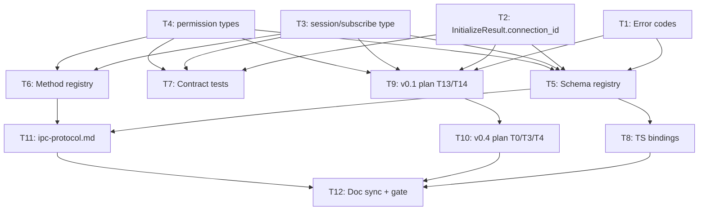

# Plan: Daemon Kernel (Resident API Service) — Connection Contract + TCP Serving

> **For agentic workers:** REQUIRED SUB-SKILL: Use superpowers:subagent-driven-development (recommended) or superpowers:executing-plans to implement this plan task-by-task. Steps use checkbox (`- [ ]`) syntax for tracking.

**Goal:** Introduce the unified `Connection` transport abstraction (stdio/TCP) as a v0.1 contract with a v0.4 multi-client resident-kernel serving capability, so all UIs on one PC share one kernel instance and can resume tasks.

**Architecture:** `agentj-ipc` gains a `Connection` trait (stdio/TCP/Unix-socket are implementations) plus a `ConnectionRegistry` (connection_id → Connection, session_id → owner). Protocol extensions are strictly additive: `initialize` gains `multi_client` capability + `connection_id`, new `session/subscribe` / `session/unsubscribe` methods, `$/permissionRequest` gains `origin_client`, new error codes `-32805 SessionBusy` / `-32806 NotAuthorized`. Contract lands in v0.1 (T13 builds `StdioConnection` directly), serving capability lands in v0.4 (`TcpConnection` + `serve --port` / `run --attach`).

**Tech Stack:** Rust (tokio, serde, schemars), JSON-RPC 2.0 over NDJSON, TypeScript bindings (json-schema-to-typescript).

## Global Constraints

- Rust 1.96+ (workspace `rust-version = "1.96"`, edition 2024)
- Wire fields are snake_case (existing convention)
- Protocol changes are strictly additive: new methods/fields only, never break existing wire shape
- Value enums carry `#[serde(other)]` + `#[schemars(skip)]` `Unknown` variant for forward compatibility
- `schemas/*.json` are committed artifacts with a CI drift gate (`cargo test -p agentj-protocol -- drift`)
- `protocol/methods.json` is the method registry — every added method must resolve params/result to committed schema files
- Crate boundary: `agentj-protocol` stays a leaf crate (serde + serde_json + schemars only, zero kernel coupling)
- Rust functions < 50 lines, lines ≤ 120 chars
- Commit messages in English; `docs/superpowers/` docs in Chinese
- Version bump: feature → minor (0.1.0 → 0.2.0). NOTE: the v0.1 core crate (agentj-core/agentj-ipc) does not exist yet — this plan only modifies the existing `agentj-protocol` crate + plan/spec docs; version bump is handled in T11/T12 doc sync, actual crate version bump deferred to v0.1 plan execution.

## Scope Boundaries (delegations to other plans)

This plan covers the protocol contract (T1-T8) and plan/spec alignment (T9-T12) for the daemon-kernel capability. Two design goals are **explicitly delegated to the v0.3 ecosystem plan** (not tasks here — they are v0.3-dependencies per the design spec; version renumbering 2026-08-16: ecosystem = v0.3, commercial incl. this daemon-kernel capability = v0.4):

- **G3 历史级接续** (FileBackedStore session disk persistence + startup recovery) → v0.3 plan (file `2026-08-09-agentj-v0.2-plan.md`, Plan 2/v0.3), design spec §会话持久化与恢复. Not re-implemented here.
- **G5 资源级复用** (McpConnectionManager long-lived connections, allow_always session state, model catalog cache) → v0.3 plan, design spec §MCP 连接生命周期 (v0.3). The shared-single-kernel mechanism is designed here (T10); the resource reuse internals land in v0.3.

Executor note: T9/T10 rework the v0.1/v0.4 plan docs to *reference* these delegations; no v0.3 code is written in this plan.

---
---

# Part A — Protocol Contract (agentj-protocol, executable NOW)

> These tasks are executable immediately: `agentj-protocol` is the only existing crate, and the wire types are the machine source of truth. No kernel crate exists yet.

## T1: Add `SessionBusy` and `NotAuthorized` error codes

**Files:**
- Modify: `agentj-protocol/src/base.rs` (error_codes module)
- Test: inline `#[cfg(test)] mod tests` in `agentj-protocol/src/base.rs`

**Interfaces:**
- Consumes: existing `error_codes` module (`base.rs:68-81`)
- Produces: `error_codes::SESSION_BUSY: i32 = -32805`, `error_codes::NOT_AUTHORIZED: i32 = -32806`

- [ ] **Step 1: Write the failing test**

```rust
// In agentj-protocol/src/base.rs, tests module — extend the existing error_codes test:
    #[test]
    fn error_codes_have_reserved_values() {
        assert_eq!(error_codes::PARSE_ERROR, -32700);
        assert_eq!(error_codes::METHOD_NOT_FOUND, -32601);
        assert_eq!(error_codes::REQUEST_CANCELLED, -32800);
        assert_eq!(error_codes::SERVER_NOT_INITIALIZED, -32801);
        assert_eq!(error_codes::SESSION_NOT_FOUND, -32802);
        assert_eq!(error_codes::SESSION_INACTIVE, -32803);
        assert_eq!(error_codes::INVALID_VERSION, -32804);
        assert_eq!(error_codes::SESSION_BUSY, -32805);
        assert_eq!(error_codes::NOT_AUTHORIZED, -32806);
    }
```

- [ ] **Step 2: Run test to verify it fails**

Run: `cargo test -p agentj-protocol error_codes_have_reserved_values`
Expected: FAIL — compile error `no field SESSION_BUSY on type error_codes` (constants do not exist yet)

- [ ] **Step 3: Write minimal implementation**

```rust
// In agentj-protocol/src/base.rs, error_codes module:
    // agentj reserved block
    pub const REQUEST_CANCELLED: i32 = -32800;
    pub const SERVER_NOT_INITIALIZED: i32 = -32801;
    pub const SESSION_NOT_FOUND: i32 = -32802;
    pub const SESSION_INACTIVE: i32 = -32803;
    pub const INVALID_VERSION: i32 = -32804;
    pub const SESSION_BUSY: i32 = -32805;      // design 错误处理: same session already running
    pub const NOT_AUTHORIZED: i32 = -32806;    // design 错误处理: non-owner respond/cancel
```

- [ ] **Step 4: Run test to verify it passes**

Run: `cargo test -p agentj-protocol`
Expected: PASS (all base tests)

- [ ] **Step 5: Commit**

```bash
git add agentj-protocol/src/base.rs
git commit -m "feat(protocol): add SessionBusy and NotAuthorized error codes"
```

---

## T2: Add `connection_id` + `multi_client` capability to `initialize` result

**Files:**
- Modify: `agentj-protocol/src/lifecycle.rs`
- Test: inline tests in `agentj-protocol/src/lifecycle.rs`

**Interfaces:**
- Consumes: `InitializeResult` (`lifecycle.rs:27-32`)
- Produces: `InitializeResult` gains `connection_id: Option<String>` (`#[serde(skip_serializing_if = "Option::is_none")]`) and documented `capabilities.multi_client: bool` convention (capabilities stays `Option<serde_json::Value>` — additive, no new struct)

- [ ] **Step 1: Write the failing test**

```rust
// In agentj-protocol/src/lifecycle.rs, tests module:
    #[test]
    fn initialize_result_with_connection_id() {
        let r = InitializeResult {
            protocol_version: "0.2.0".into(),
            capabilities: Some(serde_json::json!({"multi_client": true})),
            server_info: ServerInfo { name: "agentj".into(), version: "0.1.0".into() },
            connection_id: Some("conn-1".into()),
        };
        let json = serde_json::to_value(&r).unwrap();
        assert_eq!(json["connection_id"], "conn-1");
        assert_eq!(json["capabilities"]["multi_client"], true);
    }

    #[test]
    fn initialize_result_without_connection_id_omits_field() {
        let r = InitializeResult {
            protocol_version: "0.2.0".into(),
            capabilities: None,
            server_info: ServerInfo { name: "agentj".into(), version: "0.1.0".into() },
            connection_id: None,
        };
        let json = serde_json::to_value(&r).unwrap();
        assert!(json.get("connection_id").is_none(), "connection_id must be optional/additive");
    }
```

- [ ] **Step 2: Run test to verify it fails**

Run: `cargo test -p agentj-protocol initialize_result`
Expected: FAIL — compile error: `struct InitializeResult has no field named connection_id`

- [ ] **Step 3: Write minimal implementation**

```rust
// In agentj-protocol/src/lifecycle.rs:
#[derive(Debug, Clone, Serialize, Deserialize, JsonSchema)]
pub struct InitializeResult {
    pub protocol_version: String,
    #[serde(skip_serializing_if = "Option::is_none")]
    pub capabilities: Option<serde_json::Value>,
    pub server_info: ServerInfo,
    /// This connection's unique id in a multi-client kernel (design 决策 #6).
    /// Absent in single-client (stdio) mode. Capability flag: `capabilities.multi_client`.
    #[serde(skip_serializing_if = "Option::is_none")]
    pub connection_id: Option<String>,
}
```

- [ ] **Step 4: Fix the two pre-existing test constructions that now fail**

```rust
// In lifecycle.rs, the existing `initialize_result_roundtrip` test constructs InitializeResult —
// add the new field (grep all InitializeResult { ... } literal constructions in this file and tests/contract.rs):
    let r = InitializeResult {
        protocol_version: "0.1.0".into(),
        capabilities: Some(serde_json::json!({"streaming": true})),
        server_info: ServerInfo { name: "agentj".into(), version: "0.1.0".into() },
        connection_id: None, // ← added
    };
```

- [ ] **Step 5: Run test to verify it passes**

Run: `cargo test -p agentj-protocol`
Expected: PASS (all lifecycle + contract tests — contract.rs `initialize_response_wire_shape` also needs `connection_id: None`)

- [ ] **Step 6: Commit**

```bash
git add agentj-protocol/src/lifecycle.rs agentj-protocol/tests/contract.rs
git commit -m "feat(protocol): add connection_id and multi_client capability to initialize result"
```

---

## T3: Add `session/subscribe` and `session/unsubscribe` wire types

**Files:**
- Modify: `agentj-protocol/src/session.rs`
- Test: inline tests in `agentj-protocol/src/session.rs`

**Interfaces:**
- Consumes: `ProgressToken` (`base.rs`), `SessionId` (`types.rs`)
- Produces: `SessionSubscribeParams { session_id: SessionId, progress_token: Option<ProgressToken> }`; `session/unsubscribe` reuses existing `SessionIdParams` (no new type)

- [ ] **Step 1: Write the failing test**

```rust
// In agentj-protocol/src/session.rs, tests module:
    #[test]
    fn session_subscribe_params_serialize() {
        let p = SessionSubscribeParams {
            session_id: "s1".into(),
            progress_token: Some(ProgressToken::Str("tok".into())),
        };
        let json = serde_json::to_value(&p).unwrap();
        assert_eq!(json["session_id"], "s1");
        assert_eq!(json["progress_token"], "tok");
    }

    #[test]
    fn session_subscribe_params_progress_token_optional() {
        let p = SessionSubscribeParams {
            session_id: "s1".into(),
            progress_token: None,
        };
        let json = serde_json::to_value(&p).unwrap();
        assert!(json.get("progress_token").is_none(), "progress_token must be optional");
    }
```

- [ ] **Step 2: Run test to verify it fails**

Run: `cargo test -p agentj-protocol session_subscribe`
Expected: FAIL — compile error: `cannot find type SessionSubscribeParams`

- [ ] **Step 3: Write minimal implementation**

```rust
// In agentj-protocol/src/session.rs:
/// `session/subscribe` params — subscribe to a session's running progress
/// (design 决策 #4: 广播订阅). `$/progress` notifications broadcast to all subscribers.
#[derive(Debug, Clone, Serialize, Deserialize, JsonSchema)]
pub struct SessionSubscribeParams {
    pub session_id: SessionId,
    #[serde(skip_serializing_if = "Option::is_none")]
    pub progress_token: Option<ProgressToken>,
}
```

- [ ] **Step 4: Run test to verify it passes**

Run: `cargo test -p agentj-protocol`
Expected: PASS

- [ ] **Step 5: Commit**

```bash
git add agentj-protocol/src/session.rs
git commit -m "feat(protocol): add session/subscribe wire type"
```

---

## T4: Add permission wire types (`origin_client` routing)

**Files:**
- Create: `agentj-protocol/src/permission.rs`
- Modify: `agentj-protocol/src/lib.rs` (add `pub mod permission;`)
- Test: inline tests in `agentj-protocol/src/permission.rs`

**Interfaces:**
- Consumes: `base.rs` module
- Produces: `PermissionRequestParams { request_id, tool, args, origin_client, reason? }`, `PermissionDecision` (enum: `allow`/`deny`/`allow_always` + `Unknown`), `PermissionRespondParams { request_id, decision }`

- [ ] **Step 1: Write the failing test**

```rust
// New file agentj-protocol/src/permission.rs, tests module:
    #[test]
    fn permission_request_params_serialize_with_origin_client() {
        let p = PermissionRequestParams {
            request_id: "req-1".into(),
            tool: "bash".into(),
            args: serde_json::json!({"cmd": "rm -rf /tmp/x"}),
            origin_client: "conn-a".into(),
            reason: None,
        };
        let json = serde_json::to_value(&p).unwrap();
        assert_eq!(json["request_id"], "req-1");
        assert_eq!(json["tool"], "bash");
        assert_eq!(json["origin_client"], "conn-a");
        assert!(json.get("reason").is_none());
    }

    #[test]
    fn permission_decision_roundtrip_and_unknown_tolerance() {
        let allow: PermissionDecision = serde_json::from_value(serde_json::json!("allow")).unwrap();
        assert!(matches!(allow, PermissionDecision::Allow));
        let always: PermissionDecision =
            serde_json::from_value(serde_json::json!("allow_always")).unwrap();
        assert!(matches!(always, PermissionDecision::AllowAlways));
        // forward compatibility: unknown decision value → Unknown, never fatal
        let unknown: PermissionDecision =
            serde_json::from_value(serde_json::json!("future_value")).unwrap();
        assert!(matches!(unknown, PermissionDecision::Unknown));
    }

    #[test]
    fn permission_respond_params_serialize() {
        let p = PermissionRespondParams {
            request_id: "req-1".into(),
            decision: PermissionDecision::Deny,
        };
        let json = serde_json::to_value(&p).unwrap();
        assert_eq!(json["request_id"], "req-1");
        assert_eq!(json["decision"], "deny");
    }

    #[test]
    fn permission_types_generate_json_schema() {
        let s = schemars::schema_for!(PermissionRequestParams);
        let json = serde_json::to_value(&s).unwrap();
        assert_eq!(json["type"], "object");
        assert!(json["properties"].get("origin_client").is_some());
    }
```

- [ ] **Step 2: Run test to verify it fails**

Run: `cargo test -p agentj-protocol permission`
Expected: FAIL — `unresolved import` / `cannot find module permission` (lib.rs does not declare it yet)

- [ ] **Step 3: Write minimal implementation**

```rust
// agentj-protocol/src/lib.rs — add module:
pub mod permission;

// New file agentj-protocol/src/permission.rs:
//! Permission approval wire types (design 决策 #5: 审批定向发给发起方).
use schemars::JsonSchema;
use serde::{Deserialize, Serialize};

/// S→C notification `$/permissionRequest` — directed to the run's origin client.
#[derive(Debug, Clone, Serialize, Deserialize, JsonSchema)]
pub struct PermissionRequestParams {
    pub request_id: String,
    pub tool: String,
    pub args: serde_json::Value,
    /// Connection id of the client that initiated the run (design 决策 #5).
    pub origin_client: String,
    #[serde(skip_serializing_if = "Option::is_none")]
    pub reason: Option<String>,
}

/// C→S `permission/respond` decision. Forward-compatible: unknown values → `Unknown`.
#[derive(Debug, Clone, Serialize, Deserialize, JsonSchema)]
#[serde(rename_all = "snake_case")]
pub enum PermissionDecision {
    Allow,
    Deny,
    AllowAlways,
    #[serde(other)]
    #[schemars(skip)]
    Unknown,
}

/// C→S request `permission/respond`.
#[derive(Debug, Clone, Serialize, Deserialize, JsonSchema)]
pub struct PermissionRespondParams {
    pub request_id: String,
    pub decision: PermissionDecision,
}
```

- [ ] **Step 4: Run test to verify it passes**

Run: `cargo test -p agentj-protocol`
Expected: PASS

- [ ] **Step 5: Commit**

```bash
git add agentj-protocol/src/permission.rs agentj-protocol/src/lib.rs
git commit -m "feat(protocol): add permission wire types with origin_client routing"
```

---

## T5: Register new types in schema generation + regenerate schemas

**Files:**
- Modify: `agentj-protocol/src/schema.rs`
- Regenerate (committed): `schemas/*.json` via `cargo run -p agentj-protocol --bin gen_schemas`

**Interfaces:**
- Consumes: T2 `InitializeResult`, T3 `SessionSubscribeParams`, T4 `PermissionRequestParams`/`PermissionDecision`/`PermissionRespondParams`
- Produces: new committed schemas `SessionSubscribeParams.json`, `PermissionRequestParams.json`, `PermissionDecision.json`, `PermissionRespondParams.json`; updated `InitializeResult.json` (connection_id)

- [ ] **Step 1: Write the failing test**

```rust
// In agentj-protocol/src/schema.rs, tests module — extend the existing drift test:
    #[test]
    fn drift_registered_types_are_known() {
        let schemas = generate_schemas();
        assert!(schemas.contains_key("RequestMessage"));
        assert!(schemas.contains_key("InitializeParams"));
        assert!(schemas.contains_key("SessionRunParams"));
        assert!(schemas.contains_key("ProgressValue"));
        assert!(schemas.contains_key("KernelStatusResult"));
        assert!(schemas.contains_key("SessionSubscribeParams"));
        assert!(schemas.contains_key("PermissionRequestParams"));
        assert!(schemas.contains_key("PermissionDecision"));
        assert!(schemas.contains_key("PermissionRespondParams"));
    }
```

- [ ] **Step 2: Run test to verify it fails**

Run: `cargo test -p agentj-protocol drift_registered_types_are_known`
Expected: FAIL — `contains_key("SessionSubscribeParams")` false (not yet registered)

- [ ] **Step 3: Write minimal implementation**

```rust
// In agentj-protocol/src/schema.rs — extend imports:
use crate::permission::{
    PermissionDecision, PermissionRequestParams, PermissionRespondParams,
};
use crate::session::{
    SessionIdParams, SessionNewResult, SessionRunParams, SessionRunResult,
    SessionStatusResult, SessionSubscribeParams,
};

// And in generate_schemas():
    m.insert("SessionSubscribeParams".into(), schema_for!(SessionSubscribeParams));
    m.insert("PermissionRequestParams".into(), schema_for!(PermissionRequestParams));
    m.insert("PermissionDecision".into(), schema_for!(PermissionDecision));
    m.insert("PermissionRespondParams".into(), schema_for!(PermissionRespondParams));
```

- [ ] **Step 4: Regenerate schemas and run drift gate**

Run: `cargo run -p agentj-protocol --bin gen_schemas`
Expected: 4 new files created under `schemas/` (`SessionSubscribeParams.json`, `PermissionRequestParams.json`, `PermissionDecision.json`, `PermissionRespondParams.json`), `InitializeResult.json` updated (connection_id property)

Run: `cargo test -p agentj-protocol -- drift`
Expected: PASS — committed schemas match regenerated (drift gate is the CI contract)

- [ ] **Step 5: Run full crate tests**

Run: `cargo test -p agentj-protocol`
Expected: PASS (31 unit + contract tests)

- [ ] **Step 6: Commit**

```bash
git add agentj-protocol/src/schema.rs schemas/
git commit -m "feat(protocol): register subscribe/permission types and regenerate schemas"
```

---

## T6: Update method registry with new methods

**Files:**
- Modify: `protocol/methods.json`
- Modify: `agentj-protocol/tests/registry.rs`

**Interfaces:**
- Consumes: T3 `SessionSubscribeParams`/`SessionIdParams`, T4 `PermissionRequestParams`/`PermissionRespondParams`
- Produces: registry gains `session/subscribe`, `session/unsubscribe`, `permission/respond`, `$/permissionRequest`; registry test updated to 16 methods

- [ ] **Step 1: Write the failing test**

```rust
// In agentj-protocol/tests/registry.rs — extend the expected method list:
    for expected in [
        "initialize", "initialized", "shutdown", "exit",
        "session/new", "session/run", "session/status", "session/archive", "session/delete",
        "session/subscribe", "session/unsubscribe",
        "permission/respond", "$/permissionRequest",
        "kernel/status", "$/cancelRequest", "$/progress",
    ] {
        assert!(names.contains(&expected), "missing method {expected}");
    }
    assert_eq!(methods.len(), 16, "unexpected method count");
```

- [ ] **Step 2: Run test to verify it fails**

Run: `cargo test -p agentj-protocol --test registry`
Expected: FAIL — `missing method session/subscribe` and `assertion failed: unexpected method count` (12 vs 16)

- [ ] **Step 3: Write minimal implementation**

```json
// In protocol/methods.json — append to the "methods" array (after session/delete):
    { "method": "session/subscribe", "kind": "request", "direction": "client_to_server", "params": "SessionSubscribeParams", "result": null },
    { "method": "session/unsubscribe", "kind": "request", "direction": "client_to_server", "params": "SessionIdParams", "result": null },
    { "method": "permission/respond", "kind": "request", "direction": "client_to_server", "params": "PermissionRespondParams", "result": null },
    { "method": "$/permissionRequest", "kind": "notification", "direction": "server_to_client", "params": "PermissionRequestParams", "result": null }
```

- [ ] **Step 4: Run test to verify it passes**

Run: `cargo test -p agentj-protocol --test registry`
Expected: PASS — all 16 methods present, schema refs resolve to committed files, directions valid

- [ ] **Step 5: Commit**

```bash
git add protocol/methods.json agentj-protocol/tests/registry.rs
git commit -m "feat(protocol): register subscribe/permission methods in registry"
```

---

## T7: Add contract tests for new wire shapes

**Files:**
- Modify: `agentj-protocol/tests/contract.rs`
- Test: same file (integration test)

**Interfaces:**
- Consumes: T1-T4 types
- Produces: wire-shape tests for subscribe request, permissionRequest notification, permission/respond request

- [ ] **Step 1: Write the failing test**

```rust
// In agentj-protocol/tests/contract.rs — add imports + tests:
use agentj_protocol::permission::{PermissionRequestParams, PermissionRespondParams};
use agentj_protocol::session::SessionSubscribeParams;

#[test]
fn session_subscribe_request_wire_shape() {
    let req = RequestMessage {
        jsonrpc: "2.0".into(),
        id: Id::Number(11),
        method: "session/subscribe".into(),
        params: Some(
            serde_json::to_value(SessionSubscribeParams {
                session_id: "s1".into(),
                progress_token: Some(ProgressToken::Str("tok-sub".into())),
            })
            .unwrap(),
        ),
    };
    let json = serde_json::to_value(req).unwrap();
    assert_eq!(json["method"], "session/subscribe");
    assert_eq!(json["params"]["progress_token"], "tok-sub");
}

#[test]
fn permission_request_notification_wire_shape() {
    let n = NotificationMessage {
        jsonrpc: "2.0".into(),
        method: "$/permissionRequest".into(),
        params: Some(
            serde_json::to_value(PermissionRequestParams {
                request_id: "req-9".into(),
                tool: "bash".into(),
                args: serde_json::json!({"cmd": "ls"}),
                origin_client: "conn-a".into(),
                reason: Some("tool default ask".into()),
            })
            .unwrap(),
        ),
    };
    let json = serde_json::to_value(n).unwrap();
    assert_eq!(json["method"], "$/permissionRequest");
    assert_eq!(json["params"]["origin_client"], "conn-a");
    assert_eq!(json["params"]["reason"], "tool default ask");
}

#[test]
fn permission_respond_request_wire_shape() {
    let req = RequestMessage {
        jsonrpc: "2.0".into(),
        id: Id::Number(12),
        method: "permission/respond".into(),
        params: Some(
            serde_json::to_value(PermissionRespondParams {
                request_id: "req-9".into(),
                decision: agentj_protocol::permission::PermissionDecision::AllowAlways,
            })
            .unwrap(),
        ),
    };
    let json = serde_json::to_value(req).unwrap();
    assert_eq!(json["params"]["decision"], "allow_always");
}
```

- [ ] **Step 2: Run test to verify it fails**

Run: `cargo test -p agentj-protocol --test contract`
Expected: FAIL — `unresolved import agentj_protocol::permission` (if T4 not landed) or type mismatch

- [ ] **Step 3: Run test to verify it passes** (implementation is the test itself — types already exist from T2-T4)

Run: `cargo test -p agentj-protocol --test contract`
Expected: PASS — all wire shapes match schema

- [ ] **Step 4: Commit**

```bash
git add agentj-protocol/tests/contract.rs
git commit -m "test(protocol): add wire-shape contract tests for subscribe/permission"
```

---

## T8: Regenerate TypeScript bindings

**Files:**
- Regenerate: `bindings/ts/types.d.ts` (+ `bindings/ts/index.ts` re-export if generator does so)
- Test: `tsc --noEmit` (build gate)

**Interfaces:**
- Consumes: T5 `schemas/*.json`
- Produces: TS types for `SessionSubscribeParams`, `PermissionRequestParams`, `PermissionDecision`, `PermissionRespondParams`; `InitializeResult` gains `connectionId?`

- [ ] **Step 1: Regenerate bindings from updated schemas**

Run: `cd bindings/ts && npm install && npm run generate`
Expected: `types.d.ts` regenerated — contains `SessionSubscribeParams`, `PermissionRequestParams`, `PermissionDecision`, `PermissionRespondParams`; `InitializeResult` has `connectionId?: string`

- [ ] **Step 2: Run build gate**

Run: `cd bindings/ts && npm run build`
Expected: PASS — `tsc --noEmit` exit 0

- [ ] **Step 3: Verify generated types contain new symbols**

Run: `grep -c "SessionSubscribeParams" bindings/ts/types.d.ts`
Expected: ≥ 1 match

- [ ] **Step 4: Commit**

```bash
git add bindings/ts/
git commit -m "feat(bindings): regenerate TS types for subscribe/permission wire types"
```

---

# Part B — Plan & Spec Alignment (docs, executable NOW)

> These tasks update the v0.1/v0.4 implementation plans and the human-readable protocol spec so the Connection contract and TCP serving capability are correctly scoped. No kernel code exists yet — these are planning documents.

## T9: Rework v0.1 plan T13/T14 to the Connection model

**Files:**
- Modify: `docs/superpowers/plans/2026-08-09-agentj-v0.1-plan.md`
- Test: content assertions via grep (plan doc is the deliverable)

**Interfaces:**
- Consumes: T1-T4 contract types (referenced in the reworked task)
- Produces: v0.1 T13 becomes "Add agentj-ipc with Connection trait + StdioConnection"; T14 wires CLI to the Connection-based serve loop

- [ ] **Step 1: Write the failing test (grep assertions)**

Run: `grep -n "Connection" docs/superpowers/plans/2026-08-09-agentj-v0.1-plan.md`
Expected: FAIL — no `Connection` trait reference in T13 (currently `Add the agentj-ipc crate with JSON-RPC 2.0 over stdio`)

- [ ] **Step 2: Rework T13 in the v0.1 plan**

```markdown
# In docs/superpowers/plans/2026-08-09-agentj-v0.1-plan.md, replace T13's title + description:

- id: T13
  title: "Add the agentj-ipc crate with the Connection trait and JSON-RPC 2.0 over stdio"
  # Design: docs/superpowers/specs/2026-08-15-agentj-daemon-kernel-design.md (决策 #1/#2)
  #   - Connection trait: id/kind/send/recv/peer_desc (stdio/TCP/Unix-socket implementations)
  #   - StdioConnection implements Connection for stdin/stdout NDJSON
  #   - ConnectionRegistry { conns, session_owner, pending_runs } — stdio single-connection path only
  #   - serve loop = read → handle_request → write (transport-agnostic)
  # AC additions (keep existing stdio contract tests):
  #   - StdioConnection roundtrips an NDJSON line (send/recv)
  #   - ConnectionRegistry registers a stdio connection; session_owner maps to it
```

- [ ] **Step 3: Rework T14 in the v0.1 plan**

```markdown
# Replace T14's description to note the Connection-based serve path:

- id: T14
  title: "Add the agentj-cli binary with run/serve commands (Connection model)"
  # serve_stdio now runs the unified serve loop over StdioConnection (design 决策 #2).
  # run/serve command shape unchanged; signal handling (design #13) unchanged.
```

- [ ] **Step 4: Run test to verify it passes**

Run: `grep -n "Connection trait" docs/superpowers/plans/2026-08-09-agentj-v0.1-plan.md`
Expected: ≥ 1 match (T13 title/description contains "Connection trait")

Run: `cargo test --workspace`
Expected: PASS (no code changed — plan doc only; existing 41 tests must stay green)

- [ ] **Step 5: Commit**

```bash
git add docs/superpowers/plans/2026-08-09-agentj-v0.1-plan.md
git commit -m "docs(plan): rework v0.1 T13/T14 to the Connection contract model"
```

---

## T10: Rework v0.4 plan T0/T3/T4 for the resident-kernel serving capability

**Files:**
- Modify: `docs/superpowers/plans/2026-08-09-agentj-v0.3-plan.md`
- Test: content assertions via grep

**Interfaces:**
- Consumes: T9 v0.1 Connection contract (v0.4 T0 builds on it), design spec 决策 #3/#4/#5/#9
- Produces: v0.4 T0 becomes "Add TcpConnection + multi-client serving"; T3 dashboard consumes subscribe; T4 CLI gains serve --port / run --attach; design-pending items (auth/max-connections) finalized

- [ ] **Step 1: Write the failing test (grep assertions)**

Run: `grep -n "TcpConnection\|serve --port\|session/subscribe" docs/superpowers/plans/2026-08-09-agentj-v0.3-plan.md`
Expected: FAIL — T0 currently only mentions `TcpIpcServer` (no `TcpConnection` trait impl); no `serve --port` / `session/subscribe`

- [ ] **Step 2: Rework T0 in the v0.4 plan**

```markdown
# Replace v0.4 T0's design-pending framing with the finalized design:

- id: T0
  title: "Add the TcpConnection transport and multi-client serving to agentj-ipc"
  # Design: docs/superpowers/specs/2026-08-15-agentj-daemon-kernel-design.md (决策 #1/#4/#5/#9)
  #   - TcpConnection implements the Connection trait (from v0.1 T13) for TCP NDJSON
  #   - serve loop serves N concurrent connections through ONE shared kernel
  #   - ConnectionRegistry multi-connection path: register/unregister per connection,
  #     session_owner routing, pending_runs mutex
  #   - session/subscribe + session/unsubscribe handled in the serve loop
  #     ($/progress broadcast to all subscribers of a session)
  #   - $/permissionRequest directed to origin_client; permission/respond validates owner
  #     (non-owner → -32806 NotAuthorized)
  #   - session/run on a busy session → -32805 SessionBusy
  #   - --token (optional, initialize-time) and --max-connections (default 16) — design-pending FINALIZED
  #   - permission edge semantics carried from design 错误处理:
  #     * Ask 审批超时（默认 60s）自动 Deny
  #     * owner 连接断开 → 挂起审批全部 Deny（PermissionError::RequestCancelled），run 返回拒绝
  #     * subscribe 断开 → 隐式退订，无残留订阅
  #     * 最后连接断开 → 内核优雅关闭链（信号仍可强制）
  # AC additions:
  #   - two concurrent TcpConnections both run session/new and receive session_id
  #   - A runs session/run; B subscribes and receives $/progress broadcasts; B's
  #     permission/respond for A's approval → -32806 NotAuthorized
  #   - concurrent session/run on same session → -32805 SessionBusy
```

- [ ] **Step 3: Rework T3 and T4 in the v0.4 plan**

```markdown
# T3 (Web Dashboard): note subscribe consumption + connection_id from initialize result:
#   - dashboard's jsonrpc client reads connection_id from initialize result
#   - dashboard can session/subscribe to observe a running session (design 决策 #4)

# T4 (CLI wiring): add the serve --port / run --attach commands:
#   - `agentj serve --port 4096` binds TcpConnection listener on 127.0.0.1
#   - `agentj run --attach tcp://127.0.0.1:4096` connects to a resident kernel instead of
#     spawning an embedded one (design 决策 #3 按需常驻)
```

- [ ] **Step 4: Run test to verify it passes**

Run: `grep -n "TcpConnection" docs/superpowers/plans/2026-08-09-agentj-v0.3-plan.md`
Expected: ≥ 1 match

Run: `grep -n "serve --port" docs/superpowers/plans/2026-08-09-agentj-v0.3-plan.md`
Expected: ≥ 1 match

- [ ] **Step 5: Commit**

```bash
git add docs/superpowers/plans/2026-08-09-agentj-v0.3-plan.md
git commit -m "docs(plan): rework v0.4 T0/T3/T4 for resident-kernel serving capability"
```

---

## T11: Update the human-readable protocol spec (ipc-protocol.md)

**Files:**
- Modify: `docs/specs/ipc-protocol.md`
- Test: content assertions via grep

**Interfaces:**
- Consumes: T1-T6 wire types + registry
- Produces: spec documents `session/subscribe`/`session/unsubscribe` method sections, `multi_client`/`connection_id` capability fields, `origin_client` field, `-32805`/`-32806` error codes, `shutdown` multi-connection semantics

- [ ] **Step 1: Write the failing test (grep assertions)**

Run: `grep -n "session/subscribe\|-32805\|origin_client" docs/specs/ipc-protocol.md`
Expected: FAIL — none of these are documented yet

- [ ] **Step 2: Add method sections to the spec**

```markdown
# In docs/specs/ipc-protocol.md, §8 方法面 — add three method subsections:

### session/subscribe
- 方向：C→S request，params `SessionSubscribeParams`，result `{}`（@since 0.2.0）
- 语义：订阅某 session 的运行进度；`$/progress` 通知向该 session 的所有订阅者广播
- 错误：`-32802 SessionNotFound`；`-32803 SessionInactive`
- 隐式退订：连接断开时自动退订（无需显式 unsubscribe）

### session/unsubscribe
- 方向：C→S request，params `SessionIdParams`，result `{}`（@since 0.2.0）
- 语义：退订指定 session 的进度广播；对未订阅的 session 退订为 no-op

### permission/respond
- 方向：C→S request，params `PermissionRespondParams`，result `{}`（@since 0.2.0）
- 语义：响应 `$/permissionRequest` 审批；decision 为 allow / deny / allow_always
- 错误：`-32806 NotAuthorized`（非该 run 发起方连接响应）

# And a notification section:
### $/permissionRequest（S→C notification，@since 0.2.0）
- params `PermissionRequestParams`，含 `origin_client`（该 run 的发起方连接 id）
- 服务端按 session_owner 定向路由到发起方；其余客户端不收到
```

- [ ] **Step 3: Update capability fields, error codes, and shutdown semantics**

```markdown
# §4 生命周期 initialize — document the new fields:
- result 增加 `connection_id?: string`（多客户端内核下本连接唯一标识；stdio 单客户端缺省）@since 0.2.0
- capabilities 增加 `multi_client: boolean`（服务端支持多客户端共享内核）@since 0.2.0

# §10 错误码表 — add:
| `-32805` | SessionBusy | 同 session 已有活动 run 时再次 session/run（@since 0.2.0） |
| `-32806` | NotAuthorized | 非 owner 连接的 permission/respond 或 $/cancelRequest（@since 0.2.0） |

# §4 生命周期 shutdown — clarify multi-connection semantics:
- 多客户端模式下，`shutdown` 断开请求方连接；最后一条连接断开时触发内核优雅关闭链
  （信号 SIGINT/SIGTERM 仍可强制，design 决策 #13 语义不变）
```

- [ ] **Step 4: Run test to verify it passes**

Run: `grep -n "session/subscribe" docs/specs/ipc-protocol.md`
Expected: ≥ 1 match
Run: `grep -n -- "-32805" docs/specs/ipc-protocol.md`
Expected: ≥ 1 match
Run: `grep -n "origin_client" docs/specs/ipc-protocol.md`
Expected: ≥ 1 match

- [ ] **Step 5: Commit**

```bash
git add docs/specs/ipc-protocol.md
git commit -m "docs(spec): document subscribe/permission methods and multi-connection semantics"
```

---

## T12: Sync project docs (AGENTS.md / README.md / summary) and final gate

**Files:**
- Modify: `AGENTS.md`
- Modify: `README.md`
- Modify: `.agents/summary/summary_and_next.md`
- Test: content assertions via grep + full workspace gate

**Interfaces:**
- Consumes: T1-T11 (all contract + doc changes)
- Produces: project docs reflect 16 methods, multi_client capability, subscribe/permission methods, Connection contract in v0.1 plan; summary updated for the daemon-kernel design phase

- [ ] **Step 1: Write the failing test (grep assertions)**

Run: `grep -n "16\|subscribe" README.md`
Expected: FAIL — README still says "12 个 v0.1 方法" and lists 12 methods

- [ ] **Step 2: Update AGENTS.md**

```markdown
# In AGENTS.md — Protocol section (sync the method surface):
- 方法面（16）：`initialize` / `initialized` / `shutdown` / `exit` / `session/new` / `session/run`
  / `session/status` / `session/archive` / `session/delete` / `session/subscribe` / `session/unsubscribe`
  / `permission/respond` / `kernel/status` / `$/permissionRequest` / `$/cancelRequest` / `$/progress`

# Architecture section — add a note:
- 守护内核（设计已批准，v0.1 契约 / v0.4 能力）：Connection trait 统一 stdio/TCP 传输；
  `agentj serve --port` 常驻内核多客户端共享；协议加性扩展（multi_client / subscribe / permission 定向）
  — 见 docs/superpowers/specs/2026-08-15-agentj-daemon-kernel-design.md
```

- [ ] **Step 3: Update README.md**

```markdown
# README.md — Protocol section:
- 方法面（16）：`initialize` / `initialized` / `shutdown` / `exit` / `session/new` / `session/run`
  / `session/status` / `session/archive` / `session/delete` / `session/subscribe` / `session/unsubscribe`
  / `permission/respond` / `kernel/status` / `$/permissionRequest` / `$/cancelRequest` / `$/progress`

# Features checklist — add (设计批准, 待 v0.1/v0.4 落地):
- [ ] 守护内核：Connection 统一传输抽象 + 常驻 API 服务（设计已批准，v0.1 契约 / v0.4 能力）
```

- [ ] **Step 4: Update summary_and_next.md**

```markdown
# .agents/summary/summary_and_next.md — replace with current-feature content:
> 当前功能设计文档：docs/superpowers/specs/2026-08-15-agentj-daemon-kernel-design.md
> 当前实现计划：docs/superpowers/plans/2026-08-15-agentj-daemon-kernel-plan.md

## Phase: 守护内核（常驻 API 服务）设计（2026-08-15）✅（设计 + 契约）
- ✅ 设计批准：统一 Connection 抽象（stdio/TCP/Unix socket），契约 v0.1、能力 v0.4；
  协议加性扩展（multi_client / session/subscribe / permission 定向 / -32805/-32806）
- ✅ 协议契约落地：4 新 wire 类型 + 4 新 schema + 注册表 12→16 方法 + contract tests + TS 绑定
- ✅ 计划衔接：v0.1 T13/T14 改为 Connection 模型；v0.4 T0/T3/T4 改为多客户端常驻
- ⏳ 待 v0.1 计划执行：agentj-core / agentj-ipc / agentj-cli（T0-T24）消费 agentj-protocol 类型
- ⏳ 待 v0.4 计划执行：TcpConnection + serve --port / run --attach（T0/T3/T4）
```

- [ ] **Step 5: Run full verification gate**

Run: `cargo test --workspace`
Expected: PASS — all 41 existing + new contract/registry tests (≈ 41 + ~15 new)

Run: `cargo clippy --workspace -- -D warnings`
Expected: PASS — zero warnings

Run: `cd bindings/ts && npm run build`
Expected: PASS — `tsc --noEmit` exit 0

Run: `grep -n "session/subscribe" README.md`
Expected: ≥ 1 match

- [ ] **Step 6: Commit**

```bash
git add AGENTS.md README.md .agents/summary/summary_and_next.md
git commit -m "docs: sync AGENTS.md, README.md, summary after daemon-kernel design phase"
```

---

## Dependency Graph



## Parallel Execution Groups

- **Group A (Level 0, 4 parallel):** T1, T2, T3, T4 — independent wire-type additions (different files: base.rs / lifecycle.rs / session.rs / permission.rs+lib.rs)
- **Group B (Level 1, 3 parallel):** T5, T6, T7, T9 — depend on Group A; T5 (schema.rs), T6 (methods.json+registry.rs), T7 (contract.rs), T9 (v0.1 plan) are file-disjoint
- **Group C (Level 2, 3 parallel):** T8 (needs T5 schemas), T10 (needs T9), T11 (needs T5/T6) — file-disjoint
- **Group D (Level 3):** T12 — final doc sync + full gate (waits for all)

## Execution Order (recommended serial sequence)

If run serially: T1 → T2 → T3 → T4 → T5 → T6 → T7 → T8 → T9 → T10 → T11 → T12
(T1-T4 contract types first; T5-T8 schema/bindings; T9-T10 plan alignment; T11 spec; T12 docs+gate)
