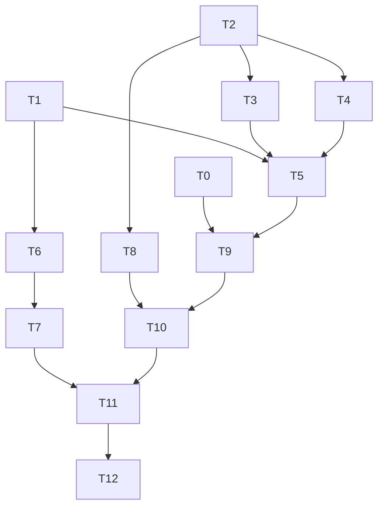

# AgentJ Permission Management System Implementation Plan

> **For agentic workers:** REQUIRED SUB-SKILL: Use superpowers:subagent-driven-development (recommended) or superpowers:executing-plans to implement this plan task-by-task. Steps use checkbox (`- [ ]`) syntax for tracking.

> **前置依赖（PREREQUISITE）:** This plan modifies files created by the v0.1 core plan — `2026-08-09-agentj-v0.1-plan.md` (T3 `agentj-core/src/module.rs`, T11 `agentj-core/src/agent_loop.rs`, T13 `agentj-ipc/src/lib.rs`, T14 `agentj-cli/src/main.rs`, T16 `ToolSource` contract, T5 `agentj-config/src/lib.rs`). The v0.1 plan MUST execute first; this plan's tasks reference those deliverables as given (`given: ... from v0.1 plan Tn`). Do not start this plan on an empty workspace.

**Goal:** Add a v0.1 permission management system — per-tool Allow/Ask/Deny modes plus path/command rules, enforced at `ToolRegistry::execute_async` with an IPC approval flow (`$/permissionRequest` notification + `permission/respond` method), backing design 决策 #17.

**Architecture:** New `agentj-permission` leaf crate (engine + policy model + session allow-state) implements the `PermissionChecker` capability trait defined in `agentj-core` (capability-interface/channel separation, design §7 — the trait must live in `agentj-core` to avoid a core↔permission dependency cycle). `PermissionModule` bridges the engine into the kernel via the `Module` trait and injects itself into `KernelContext`. Enforcement is a single async interception point `ToolRegistry::execute_async` (async permission gate + `spawn_blocking` delegate to the synchronous `Tool::execute`). Approval rides the existing JSON-RPC envelope: `$/permissionRequest` (S→C notification, request_id decoupled like `$/progress`) + `permission/respond` (C→S request). allow_always is session-scoped in-memory state.

**Tech Stack:** Rust 1.96+, tokio, serde/serde_json, schemars (protocol wire types), globset (path rule matching), thiserror, tracing.

## Global Constraints

- Protocol wire fields are snake_case; `$/`-prefix names are ignorable protocol extensions; value enums carry `#[serde(other)] Unknown` variants (forward compatibility) — verbatim from AGENTS.md + `docs/specs/ipc-protocol.md`.
- Protocol changes are additive-only (只加不改). Version bump required: feature → minor (0.1.0 → 0.2.0), per AGENTS.md Rules.
- Every v0.1 method/type lives in `agentj-protocol`; `schemas/*.json` are committed artifacts with a drift gate (`cargo test -p agentj-protocol -- drift`).
- `ToolRegistry` in `agentj-core` already carries `ToolSource` (Builtin/Mcp/Plugin) + `ReplacePolicy` (design 决策 #10, v0.1 plan T16).
- `Tool::execute` is synchronous (`&self, serde_json::Value) -> Result<Value, ToolError>` — permission waits must happen in the async path, never inside `Tool::execute`.
- Decision priority: Deny > Allow > Ask (rule hit short-circuits; no rule hit falls back to the tool's default mode).
- Builtin tool defaults: bash=Ask, write=Ask, read/glob/grep=Allow, MCP/plugin=Ask. Approval timeout default 60s → auto-Deny. allow_always is session-scoped in-memory only (never written back to config).
- Function/method bodies ≤50 lines, lines ≤120 chars (AGENTS.md Rules). Rust clippy must be clean with `-D warnings`.
- Commit messages in English; spec docs under `docs/` in Chinese.

## Plan-Level Decisions (resolved during planning)

1. **`PermissionChecker` trait lives in `agentj-core`** (`agentj-core/src/permission.rs`), NOT in `agentj-permission` as the design doc's interface block literally reads. The design's own architecture diagram (KernelContext injects the checker) forces this: `KernelContext` is `agentj-core`, so the trait it holds must be defined there. `agentj-permission` implements the trait. This matches the existing pattern (`Tool`/`SessionStore` traits in core, implementations in `agentj-tools`/`agentj-session`) and keeps the dependency direction acyclic: `agentj-permission → agentj-core → agentj-protocol`.
2. **`ToolRegistry` holds an optional checker**: `RwLock<Option<Arc<dyn PermissionChecker>>>` + `set_permission_checker()`. `execute_async` skips the gate when `None` (no PermissionModule registered → v0.1 pre-permission behavior preserved, existing tests unaffected). Enforcement is still a single point; `AgentLoop::execute_tool_calls` always calls `execute_async`. `KernelContext` additionally exposes a `permission()` accessor (§7 reservation) that delegates to the registry's checker — the design's "inject into KernelContext" is satisfied through the registry it already owns.
3. **Path rules match with `globset`** (ripgrep-team crate, pure Rust, supports `**`). Command rules use `starts_with` prefix matching. **Path matching semantics**: normalize the argument path lexically first — `workspace_root.join(path)` then strip `..` segments (lexical normalization, no filesystem access) — and (a) reject if the result escapes `workspace_root` (`PermissionEffect::Deny` for escape), (b) match the **relative** argument against the relative glob patterns (patterns are user-specified relative to workspace root, e.g. `src/**`, `.env`). This avoids the globset absolute-vs-relative mismatch.
4. **Wire types**: `PermissionRequestParams` (notification), `PermissionRespondParams` + `PermissionRespondResult` (request) added to `agentj-protocol/src/permission.rs`, registered in `protocol/methods.json`, schemas regenerated (drift gate). `request_id` is an opaque string decoupled from the JSON-RPC request id (mirrors `$/progress` token design). `agentj-permission` depends on `agentj-protocol` and uses the protocol wire type directly in its notifier callback (no duplicate struct).
5. **Approval channel**: `PermissionModule` owns `Arc<Mutex<HashMap<PermissionRequestId, PendingRequest>>>` where `PendingRequest` holds the oneshot sender **plus the request args** (needed to derive the allow_always fingerprint). `check()` returns `Ask{request_id}` and registers the pending entry; `await_approval()` awaits the oneshot with a 60s timeout → constructs `PermissionError::RequestTimeout` → returns `Deny`. `respond()` resolves the request_id; `AllowAlways` derives the fingerprint from the stored args and grants it to `SessionAllowState` for the session.
6. **`execute_tool_calls` gains a `session_id: &str` and `workspace_root: &Path` parameter** (breaking signature change inside `agentj-core`; caller `run_turn_stream` passes the real session id and current directory — never `""`, or allow_always session-scoping breaks). `PermissionContext.session_id`/`workspace_root` are populated from them; `ToolSource` is looked up from the registry's source map (v0.1 T16), not hardcoded.
7. **`PermissionModule` implements `Module`** (design 决策 #17 explicit): `id()` = "permission", `metadata()`, `init()` no-op (checker injection happens via registry), `shutdown()` clears session state + resolves all pending approvals to `Deny`. The CLI registers it with the kernel (`register_module`) so kernel graceful shutdown triggers cleanup.
8. **Factory default modes** (design decision table) are a built-in table in `agentj-permission`: bash=Ask, write=Ask, read/glob/grep=Allow, MCP/plugin=Ask. Engine fallback for an unknown tool consults this table, NOT a uniform `ToolPolicy::default()` (which is Ask for everything — that would wrongly prompt read/glob/grep).
9. **Cancellation handling**: `$/cancelRequest` for an in-flight `session/run` (or client disconnect / session termination) resolves all pending approvals of that session to `Deny { reason: "cancelled" }` — the `PermissionError::RequestCancelled` variant exists for error-type completeness (design 错误处理), while the observable approval surface is `PermissionDecision::Deny` reaching `ToolError::PermissionDenied` via `execute_async`. `permission/respond` for an **unknown** request_id returns an error response (`IpcError::InvalidRequest`), never silent success.

## File Structure

| File | Responsibility |
|------|----------------|
| `agentj-protocol/src/permission.rs` (create) | Wire types: `PermissionRequestParams`, `PermissionRespondParams`, `PermissionRespondResult`, `PermissionDecision` enum |
| `agentj-protocol/src/lib.rs` (modify) | `pub mod permission;` |
| `protocol/methods.json` (modify) | Register `$/permissionRequest` + `permission/respond` |
| `agentj-core/src/permission.rs` (create) | `PermissionChecker` trait, `PermissionContext`, `PermissionDecision`, `PermissionRequestId` (capability interface) |
| `agentj-core/src/module.rs` (modify) | `ToolRegistry::execute_async`, `set_permission_checker`, optional checker field |
| `agentj-core/src/agent_loop.rs` (modify) | `execute_tool_calls` routes through `execute_async` with `workspace_root` |
| `agentj-permission/Cargo.toml` + `agentj-permission/src/{lib,error,policy,engine,session_allow,module}.rs` (create) | New leaf crate: error enum, policy model, decision engine, session allow-state, `PermissionModule` |
| `agentj-config/src/*` (modify) | `[permission]` TOML section → `PermissionConfig` → `ToolPolicy` |
| `agentj-ipc/src/lib.rs` (modify) | `permission/respond` handler + `$/permissionRequest` notification emission |
| `agentj-cli/src/main.rs` (modify) | Create `PermissionModule`, wire kernel + IPC channels |
| Workspace `Cargo.toml` (modify) | Register `agentj-permission` member; bump version 0.1.0 → 0.2.0 |

---

## Tasks

### T0: Add permission wire types to agentj-protocol [P0] [Sequential]

```yaml
- id: T0
  title: "Add permission wire types to agentj-protocol"
  files:
    - agentj-protocol/src/permission.rs
    - agentj-protocol/src/lib.rs
    - protocol/methods.json
  depends_on: []
  breaking: false
  ac:
    - given: a protocol crate with the existing streaming.rs $/progress types
      when: running `cargo test -p agentj-protocol`
      then: permission wire type tests pass — request/respond params serialize to snake_case fields and the decision enum round-trips with an Unknown fallback
    - given: the registry file protocol/methods.json
      when: running `cargo run -p agentj-protocol --bin gen_schemas && cargo test -p agentj-protocol -- drift`
      then: new permission schemas are generated (PermissionRequestParams / PermissionRespondParams / PermissionRespondResult / PermissionDecision) and the drift gate passes (generated == committed)
  regression:
    - "cargo test -p agentj-protocol (existing 31 unit + 7 contract + 3 registry tests keep passing)"
  test_code: |
    // In agentj-protocol/src/permission.rs (tests module)
    #[cfg(test)]
    mod tests {
        use super::*;

        #[test]
        fn permission_request_params_serialize_snake_case() {
            let p = PermissionRequestParams {
                request_id: "r1".into(),
                tool: "bash".into(),
                args: serde_json::json!({"cmd": "ls"}),
                reason: "tool default mode is ask".into(),
            };
            let json = serde_json::to_value(&p).unwrap();
            assert_eq!(json["request_id"], "r1");
            assert_eq!(json["tool"], "bash");
            assert_eq!(json["args"]["cmd"], "ls");
            assert_eq!(json["reason"], "tool default mode is ask");
        }

        #[test]
        fn permission_respond_params_roundtrip() {
            let p = PermissionRespondParams {
                request_id: "r1".into(),
                decision: PermissionDecision::Allow,
            };
            let json = serde_json::to_value(&p).unwrap();
            assert_eq!(json["decision"], "allow");
            let back: PermissionRespondParams =
                serde_json::from_value(json).unwrap();
            assert!(matches!(back.decision, PermissionDecision::Allow));
        }

        #[test]
        fn permission_decision_allow_always_roundtrip() {
            let p = PermissionRespondParams {
                request_id: "r1".into(),
                decision: PermissionDecision::AllowAlways,
            };
            let json = serde_json::to_value(&p).unwrap();
            assert_eq!(json["decision"], "allow_always");
        }

        #[test]
        fn permission_decision_unknown_kind_falls_back() {
            // Forward compatibility: an unknown decision value must deserialize
            // to the Unknown variant instead of failing (serde(other)).
            let v: PermissionDecision = serde_json::from_str("\"maybe\"").unwrap();
            assert!(matches!(v, PermissionDecision::Unknown));
        }

        #[test]
        fn permission_respond_result_serialize() {
            let r = PermissionRespondResult {};
            let json = serde_json::to_value(&r).unwrap();
            assert!(json.is_object() && json.as_object().unwrap().is_empty());
        }

        #[test]
        fn permission_types_generate_json_schema() {
            assert!(schemars::schema_for!(PermissionRequestParams)
                .schema.is_object());
            assert!(schemars::schema_for!(PermissionRespondParams)
                .schema.is_object());
        }
    }
  impl_code: |
    # agentj-protocol/src/permission.rs
    //! Permission flow wire types (design 决策 #17). Additive-only: these mirror the
    //! $/progress token-decoupling pattern — request_id is opaque and independent of
    //! the JSON-RPC request id.

    use schemars::JsonSchema;
    use serde::{Deserialize, Serialize};

    /// S→C notification: a tool call is awaiting user approval (`Ask` decision).
    #[derive(Debug, Clone, Serialize, Deserialize, JsonSchema)]
    pub struct PermissionRequestParams {
        /// Opaque id decoupled from the JSON-RPC request id (like $/progress token).
        pub request_id: String,
        /// Tool name, e.g. "bash".
        pub tool: String,
        /// Raw tool arguments (contains `cmd` for bash, `path` for file tools).
        pub args: serde_json::Value,
        /// Human-readable reason (tool default mode / matched rule).
        pub reason: String,
    }

    /// C→S request: the client's decision on a pending permission request.
    #[derive(Debug, Clone, Serialize, Deserialize, JsonSchema)]
    pub struct PermissionRespondParams {
        pub request_id: String,
        pub decision: PermissionDecision,
    }

    /// `permission/respond` success result — empty object.
    #[derive(Debug, Clone, Serialize, Deserialize, JsonSchema)]
    pub struct PermissionRespondResult {}

    /// Decision value in `PermissionRespondParams`. `Unknown` tolerates forward
    /// values (serde(other)); schema lists only the known values.
    #[derive(Debug, Clone, PartialEq, Serialize, Deserialize, JsonSchema)]
    #[serde(rename_all = "snake_case")]
    pub enum PermissionDecision {
        Allow,
        Deny,
        AllowAlways,
        #[serde(other)]
        #[schemars(skip)]
        Unknown,
    }

    # agentj-protocol/src/lib.rs — add `pub mod permission;`

    # protocol/methods.json — add these entries to the "methods" array
    # (protocol_version stays unchanged here — the version fields are owned by T10,
    # which bumps them to 0.2.0 in lockstep with the workspace Cargo.toml):
    # { "method": "$/permissionRequest", "kind": "notification", "direction": "server_to_client", "params": "PermissionRequestParams", "result": null },
    # { "method": "permission/respond", "kind": "request", "direction": "client_to_server", "params": "PermissionRespondParams", "result": "PermissionRespondResult" }
  verify:
    - "cargo test -p agentj-protocol"
    - "cargo run -p agentj-protocol --bin gen_schemas && cargo test -p agentj-protocol -- drift"
    - "cargo clippy --workspace -- -D warnings"
```

### T1: Add the PermissionChecker capability trait to agentj-core [P0] [Parallel with T0]

```yaml
- id: T1
  title: "Add the PermissionChecker capability trait to agentj-core"
  files:
    - agentj-core/src/permission.rs
    - agentj-core/src/lib.rs
  depends_on: []
  breaking: false
  ac:
    - given: the agentj-core crate with module traits from v0.1 plan T3
      when: running `cargo test -p agentj-core`
      then: permission trait tests pass — PermissionContext builds, PermissionDecision variants are constructible, and a mock PermissionChecker returns Ask with a request id
  regression:
    - "cargo test -p agentj-core (T2/T3/T4/T16 module + kernel tests keep passing — trait addition is additive)"
  test_code: |
    // In agentj-core/src/permission.rs (tests module)
    #[cfg(test)]
    mod tests {
        use super::*;
        use crate::module::ToolSource;
        use std::path::PathBuf;

        struct MockChecker;
        impl PermissionChecker for MockChecker {
            fn check(&self, _ctx: &PermissionContext) -> PermissionDecision {
                PermissionDecision::Ask {
                    request_id: PermissionRequestId("req-1".into()),
                }
            }
            async fn await_approval(
                &self,
                _request_id: &PermissionRequestId,
            ) -> PermissionDecision {
                PermissionDecision::Allow
            }
        }

        #[test]
        fn permission_context_builds() {
            let ctx = PermissionContext {
                session_id: "s1".into(),
                tool: "bash".into(),
                source: ToolSource::Builtin,
                args: serde_json::json!({"cmd": "ls"}),
                workspace_root: PathBuf::from("/tmp/ws"),
            };
            assert_eq!(ctx.tool, "bash");
            assert_eq!(ctx.workspace_root, PathBuf::from("/tmp/ws"));
        }

        #[test]
        fn decision_ask_carries_request_id() {
            let d = PermissionDecision::Ask {
                request_id: PermissionRequestId("abc".into()),
            };
            match d {
                PermissionDecision::Ask { request_id } => {
                    assert_eq!(request_id.0, "abc");
                }
                _ => panic!("expected Ask"),
            }
        }

        #[tokio::test]
        async fn mock_checker_ask_and_approval() {
            let c = MockChecker;
            let ctx = PermissionContext {
                session_id: "s1".into(),
                tool: "bash".into(),
                source: ToolSource::Builtin,
                args: serde_json::json!({}),
                workspace_root: PathBuf::from("."),
            };
            let d = c.check(&ctx);
            assert!(matches!(d, PermissionDecision::Ask { .. }));
            if let PermissionDecision::Ask { request_id } = d {
                assert!(matches!(c.await_approval(&request_id).await, PermissionDecision::Allow));
            }
        }
    }
  impl_code: |
    # agentj-core/src/permission.rs
    //! Permission capability interface (design 决策 #17, §7 capability-interface /
    //! channel separation). The trait lives in agentj-core — the same crate that
    //! holds KernelContext — so the kernel can hold Arc<dyn PermissionChecker>
    //! without a dependency cycle. agentj-permission implements it.

    use std::path::PathBuf;
    use serde::{Deserialize, Serialize};

    use crate::module::ToolSource;
    use crate::types::SessionId;

    /// Opaque approval-request id (uuid), decoupled from the JSON-RPC request id.
    #[derive(Debug, Clone, PartialEq, Eq, Hash, Serialize, Deserialize)]
    pub struct PermissionRequestId(pub String);

    /// Decision result of a permission check.
    #[derive(Debug, Clone, PartialEq)]
    pub enum PermissionDecision {
        Allow,
        Deny { reason: String },
        /// Approval pending — the implementation has registered a pending
        /// request, sent the $/permissionRequest notification, and the caller
        /// must now await_approval().
        Ask { request_id: PermissionRequestId },
    }

    /// Everything the permission engine needs to evaluate a tool invocation.
    #[derive(Debug, Clone)]
    pub struct PermissionContext {
        pub session_id: SessionId,
        pub tool: String,
        pub source: ToolSource,
        pub args: serde_json::Value,
        pub workspace_root: PathBuf,
    }

    /// Capability interface consumed by ToolRegistry::execute_async (design §7).
    pub trait PermissionChecker: Send + Sync {
        /// Synchronous decision: Allow / Deny / Ask. Ask means the implementation
        /// registered a pending request and emitted the $/permissionRequest
        /// notification; the caller must follow with await_approval().
        fn check(&self, ctx: &PermissionContext) -> PermissionDecision;

        /// Await the Ask decision (async; internally awaits the IPC response
        /// channel; timeout/cancel → Deny). Only called after check() returns Ask.
        async fn await_approval(&self, request_id: &PermissionRequestId) -> PermissionDecision;
    }

    # agentj-core/src/lib.rs — add `pub mod permission;`
  verify:
    - "cargo test -p agentj-core"
    - "cargo clippy --workspace -- -D warnings"
```

### T2: Scaffold the agentj-permission crate with policy model and error enum [P0] [Parallel with T0, T1]

```yaml
- id: T2
  title: "Scaffold the agentj-permission crate with policy model and error enum"
  files:
    - agentj-permission/Cargo.toml
    - agentj-permission/src/lib.rs
    - agentj-permission/src/error.rs
    - agentj-permission/src/policy.rs
  depends_on: []
  breaking: false
  ac:
    - given: a new workspace member agentj-permission
      when: running `cargo test -p agentj-permission`
      then: policy model tests pass — ToolPolicy defaults to Ask mode, PathRule/CommandRule construct, PermissionError variants match their messages
    - given: the builtin default-mode table
      when: querying builtin_default_mode for read/glob/grep vs bash vs write
      then: read/glob/grep → Allow, bash/write → Ask (design decision table)
  regression:
    - "cargo build --workspace (workspace resolves with the new member)"
  test_code: |
    // In agentj-permission/src/policy.rs (tests module)
    #[cfg(test)]
    mod tests {
        use super::*;

        #[test]
        fn tool_policy_default_mode_is_ask() {
            let p = ToolPolicy::default();
            assert_eq!(p.mode, PermissionMode::Ask);
            assert!(p.path_rules.is_empty());
            assert!(p.command_rules.is_empty());
        }

        #[test]
        fn path_rule_constructs() {
            let r = PathRule {
                effect: PermissionEffect::Deny,
                pattern: "../**".into(),
            };
            assert_eq!(r.effect, PermissionEffect::Deny);
            assert_eq!(r.pattern, "../**");
        }

        #[test]
        fn command_rule_constructs() {
            let r = CommandRule {
                effect: PermissionEffect::Allow,
                prefix: "npm test".into(),
            };
            assert_eq!(r.effect, PermissionEffect::Allow);
            assert_eq!(r.prefix, "npm test");
        }

        #[test]
        fn builtin_default_modes_match_design() {
            use crate::policy::PermissionMode::*;
            assert_eq!(builtin_default_mode("bash"), Ask);
            assert_eq!(builtin_default_mode("write"), Ask);
            assert_eq!(builtin_default_mode("read"), Allow);
            assert_eq!(builtin_default_mode("glob"), Allow);
            assert_eq!(builtin_default_mode("grep"), Allow);
            assert_eq!(builtin_default_mode("unknown_tool"), Ask); // conservative unknown
        }
    }

    // In agentj-permission/src/error.rs (tests module)
    #[cfg(test)]
    mod tests {
        use super::*;

        #[test]
        fn invalid_rule_error_message() {
            let e = PermissionError::InvalidRule {
                tool: "bash".into(),
                reason: "bad glob".into(),
            };
            assert!(e.to_string().contains("bash"));
            assert!(e.to_string().contains("bad glob"));
        }

        #[test]
        fn request_timeout_error_message() {
            let e = PermissionError::RequestTimeout {
                request_id: "r1".into(),
                timeout: std::time::Duration::from_secs(60),
            };
            assert!(e.to_string().contains("r1"));
        }

        #[test]
        fn request_cancelled_error_message() {
            let e = PermissionError::RequestCancelled {
                request_id: "r1".into(),
                reason: "session terminated".into(),
            };
            assert!(e.to_string().contains("r1"));
        }
    }
  impl_code: |
    # agentj-permission/Cargo.toml
    [package]
    name = "agentj-permission"
    version.workspace = true
    edition.workspace = true
    rust-version.workspace = true

    [dependencies]
    agentj-core = { path = "../agentj-core" }
    agentj-protocol = { path = "../agentj-protocol" }
    serde = { version = "1", features = ["derive"] }
    serde_json = "1"
    globset = "0.4"
    thiserror = "2"
    tokio = { version = "1", features = ["sync", "time", "macros", "rt"] }
    tracing = "0.1"
    uuid = { version = "1", features = ["v4"] }

    # agentj-permission/src/error.rs
    //! Permission error definitions (design 错误处理).
    use std::time::Duration;

    #[derive(Debug, thiserror::Error)]
    pub enum PermissionError {
        #[error("permission rule invalid for tool '{tool}': {reason}")]
        InvalidRule { tool: String, reason: String },

        #[error("permission request '{request_id}' timed out after {timeout:?}")]
        RequestTimeout { request_id: String, timeout: Duration },

        #[error("permission request '{request_id}' cancelled: {reason}")]
        RequestCancelled { request_id: String, reason: String },
    }

    # agentj-permission/src/policy.rs
    //! Tool policy model: per-tool default mode + path/command rules (design #17).
    use serde::{Deserialize, Serialize};

    /// Per-tool default mode.
    #[derive(Debug, Clone, Copy, PartialEq, Eq, Serialize, Deserialize)]
    #[serde(rename_all = "snake_case")]
    pub enum PermissionMode { Allow, Ask, Deny }

    /// Rule effect (priority Deny > Allow).
    #[derive(Debug, Clone, Copy, PartialEq, Eq, Serialize, Deserialize)]
    #[serde(rename_all = "snake_case")]
    pub enum PermissionEffect { Allow, Deny }

    /// Path rule for file tools (write/read/glob/grep); glob relative to workspace root.
    #[derive(Debug, Clone, PartialEq, Serialize, Deserialize)]
    pub struct PathRule {
        pub effect: PermissionEffect,
        pub pattern: String,
    }

    /// Command rule for bash; prefix matching.
    #[derive(Debug, Clone, PartialEq, Serialize, Deserialize)]
    pub struct CommandRule {
        pub effect: PermissionEffect,
        pub prefix: String,
    }

    /// Single-tool policy: default mode + rule tables.
    #[derive(Debug, Clone, PartialEq, Serialize, Deserialize)]
    pub struct ToolPolicy {
        #[serde(default = "default_mode_ask")]
        pub mode: PermissionMode,
        #[serde(default)]
        pub path_rules: Vec<PathRule>,
        #[serde(default)]
        pub command_rules: Vec<CommandRule>,
    }

    fn default_mode_ask() -> PermissionMode { PermissionMode::Ask }

    impl Default for ToolPolicy {
        fn default() -> Self {
            Self { mode: PermissionMode::Ask, path_rules: vec![], command_rules: vec![] }
        }
    }

    /// Design 决策 #17 factory defaults: bash=Ask, write=Ask, read/glob/grep=Allow,
    /// everything else (MCP/plugin/unknown) = Ask (conservative).
    pub fn builtin_default_mode(tool: &str) -> PermissionMode {
        match tool {
            "read" | "glob" | "grep" => PermissionMode::Allow,
            _ => PermissionMode::Ask,
        }
    }

    # agentj-permission/src/lib.rs
    //! AgentJ permission management (design 决策 #17). Leaf crate: decision engine,
    //! policy model, session allow-state. Implements agentj-core's PermissionChecker.
    //! Modules engine/session_allow/module are added incrementally by T3/T4/T5.
    pub mod error;
    pub mod policy;

    pub use error::PermissionError;
    pub use policy::{builtin_default_mode, CommandRule, PathRule, PermissionEffect, PermissionMode, ToolPolicy};
  verify:
    - "cargo test -p agentj-permission"
    - "cargo clippy --workspace -- -D warnings"
```

### T3: Add the PermissionEngine rule evaluation [P1] [Sequential, after T2]

```yaml
- id: T3
  title: "Add the PermissionEngine rule evaluation"
  files:
    - agentj-permission/src/engine.rs
  depends_on: [T2]
  breaking: false
  ac:
    - given: a ToolPolicy with path/command rules and a bash command invocation
      when: evaluating the args against the policy
      then: deny rules short-circuit over allow rules; unmatched commands fall back to the tool's default mode; command prefix matching is exact-prefix
    - given: a file tool invocation with a path argument
      when: evaluating the path (relative and ../-escape) against path rules
      then: relative paths are normalized against workspace_root before glob matching; deny outside-workspace pattern rejects
  regression:
    - "cargo test -p agentj-permission (T2 policy tests keep passing)"
  test_code: |
    // In agentj-permission/src/engine.rs (tests module)
    #[cfg(test)]
    mod tests {
        use super::*;
        use crate::policy::*;

        fn bash_policy() -> ToolPolicy {
            ToolPolicy {
                mode: PermissionMode::Ask,
                path_rules: vec![],
                command_rules: vec![
                    CommandRule { effect: PermissionEffect::Allow, prefix: "npm test".into() },
                    CommandRule { effect: PermissionEffect::Deny, prefix: "rm -rf".into() },
                ],
            }
        }

        #[test]
        fn allow_rule_hit_returns_allow() {
            let engine = PermissionEngine::new();
            let cmd = "npm test -- --watch";
            assert_eq!(engine.eval_command(&bash_policy(), cmd), EvalOutcome::Allow);
        }

        #[test]
        fn deny_rule_short_circuits_over_allow() {
            let engine = PermissionEngine::new();
            // Even if an allow rule matched first, deny wins.
            let p = ToolPolicy {
                mode: PermissionMode::Ask,
                path_rules: vec![],
                command_rules: vec![
                    CommandRule { effect: PermissionEffect::Allow, prefix: "npm".into() },
                    CommandRule { effect: PermissionEffect::Deny, prefix: "npm run evil".into() },
                ],
            };
            assert_eq!(engine.eval_command(&p, "npm run evil"), EvalOutcome::Deny);
        }

        #[test]
        fn unmatched_command_falls_back_to_mode() {
            let engine = PermissionEngine::new();
            let cmd = "curl http://example.com";
            assert_eq!(engine.eval_command(&bash_policy(), cmd), EvalOutcome::Mode(PermissionMode::Ask));
        }

        #[test]
        fn prefix_match_is_literal_prefix_not_substring() {
            let engine = PermissionEngine::new();
            // Literal-prefix semantics: a rule "npm test" matches a command that
            // STARTS with it ("npm testx" → Allow), but NOT one where it appears
            // mid-string ("echo npm test" → fall back to mode).
            let p = ToolPolicy {
                mode: PermissionMode::Ask,
                path_rules: vec![],
                command_rules: vec![CommandRule { effect: PermissionEffect::Allow, prefix: "npm test".into() }],
            };
            assert_eq!(engine.eval_command(&p, "npm testx"), EvalOutcome::Allow);
            assert_eq!(engine.eval_command(&p, "echo npm test"), EvalOutcome::Mode(PermissionMode::Ask));
        }

        fn write_policy() -> ToolPolicy {
            ToolPolicy {
                mode: PermissionMode::Ask,
                path_rules: vec![
                    PathRule { effect: PermissionEffect::Allow, pattern: "src/**".into() },
                    PathRule { effect: PermissionEffect::Deny, pattern: "../**".into() },
                    PathRule { effect: PermissionEffect::Deny, pattern: ".env".into() },
                ],
                command_rules: vec![],
            }
        }

        #[test]
        fn relative_path_matches_relative_allow_glob() {
            let engine = PermissionEngine::new();
            let root = std::path::Path::new("/ws");
            let path = "src/main.rs"; // relative to workspace root
            assert_eq!(engine.eval_path(&write_policy(), root, path), EvalOutcome::Allow);
        }

        #[test]
        fn dotdot_escape_rejected_by_deny() {
            let engine = PermissionEngine::new();
            let root = std::path::Path::new("/ws");
            // Lexically escapes the workspace root — denied regardless of rules.
            let path = "../secret.key";
            assert_eq!(engine.eval_path(&write_policy(), root, path), EvalOutcome::Deny);
        }

        #[test]
        fn dotfile_deny_rule_matches() {
            let engine = PermissionEngine::new();
            let root = std::path::Path::new("/ws");
            assert_eq!(engine.eval_path(&write_policy(), root, ".env"), EvalOutcome::Deny);
        }

        #[test]
        fn unmatched_path_falls_back_to_mode() {
            let engine = PermissionEngine::new();
            let root = std::path::Path::new("/ws");
            assert_eq!(engine.eval_path(&write_policy(), root, "docs/x.md"), EvalOutcome::Mode(PermissionMode::Ask));
        }

        #[test]
        fn path_escapes_workspace_detected() {
            let engine = PermissionEngine::new();
            // Even with no deny rule, an escape must be Deny (lexical, no fs access).
            let p = ToolPolicy::default(); // no rules, mode=Ask
            assert_eq!(engine.eval_path(&p, std::path::Path::new("/ws"), "../x"), EvalOutcome::Deny);
            assert_eq!(engine.eval_path(&p, std::path::Path::new("/ws"), "a/../../x"), EvalOutcome::Deny);
            assert_eq!(engine.eval_path(&p, std::path::Path::new("/ws"), "a/b/c"), EvalOutcome::Mode(PermissionMode::Ask));
        }
    }
  impl_code: |
    # agentj-permission/src/engine.rs
    //! Decision engine: pure rule evaluation (design #17 — Deny > Allow > Mode).
    //! Path rules match RELATIVE glob patterns (user-specified relative to the
    //! workspace root). Escapes are detected lexically (no filesystem access):
    //! resolve the argument against workspace_root, strip `..` segments, and if
    //! the result leaves the root — Deny.

    use std::path::{Component, Path, PathBuf};
    use globset::{Glob, GlobSet, GlobSetBuilder};

    use crate::policy::{PathRule, PermissionEffect, PermissionMode, ToolPolicy};

    /// Result of evaluating a single tool invocation against a policy.
    #[derive(Debug, Clone, PartialEq, Eq)]
    pub enum EvalOutcome {
        Allow,
        Deny,
        /// No rule hit — fall back to the tool's default mode.
        Mode(PermissionMode),
    }

    /// Stateless rule evaluator. (Design keeps it pure so it is trivially testable;
    /// PermissionModule owns state like pending approvals and session allow-lists.)
    #[derive(Debug, Default)]
    pub struct PermissionEngine;

    impl PermissionEngine {
        pub fn new() -> Self { Self }

        /// Evaluate a bash-style command against command rules (prefix match),
        /// then fall back to the tool's default mode.
        pub fn eval_command(&self, policy: &ToolPolicy, command: &str) -> EvalOutcome {
            let mut any_allow = false;
            for rule in &policy.command_rules {
                if command.starts_with(&rule.prefix) {
                    match rule.effect {
                        PermissionEffect::Deny => return EvalOutcome::Deny,
                        PermissionEffect::Allow => any_allow = true,
                    }
                }
            }
            if any_allow {
                EvalOutcome::Allow
            } else {
                EvalOutcome::Mode(policy.mode)
            }
        }

        /// Evaluate a file tool path argument against path rules.
        /// 1. Lexically resolve against workspace_root; if the result escapes the
        ///    root → Deny (unconditional — outside the workspace is never allowed).
        /// 2. Match the RELATIVE argument against relative glob patterns.
        ///    Deny > Allow > Mode.
        pub fn eval_path(&self, policy: &ToolPolicy, workspace_root: &Path, path: &str) -> EvalOutcome {
            if self.escapes_root(workspace_root, path) {
                return EvalOutcome::Deny;
            }
            let mut any_allow = false;
            for rule in &policy.path_rules {
                if self.glob_matches(&rule.pattern, path) {
                    match rule.effect {
                        PermissionEffect::Deny => return EvalOutcome::Deny,
                        PermissionEffect::Allow => any_allow = true,
                    }
                }
            }
            if any_allow { EvalOutcome::Allow } else { EvalOutcome::Mode(policy.mode) }
        }

        /// Lexical (no filesystem) check: does `arg` resolve outside `root`?
        fn escapes_root(&self, root: &Path, arg: &str) -> bool {
            let joined = root.join(arg);
            let normalized = lexical_normalize(&joined);
            !normalized.starts_with(root)
        }

        fn glob_matches(&self, pattern: &str, relative_path: &str) -> bool {
            // Patterns are relative globs (e.g. "src/**", ".env"); match against
            // the relative argument. Build a set per rule — rules are few.
            Glob::new(pattern)
                .map(|g| {
                    let mut b = GlobSetBuilder::new();
                    b.add(g);
                    b.build()
                })
                .map(|set| set.is_match(relative_path))
                .unwrap_or(false)
        }
    }

    /// Lexically strip `.`/`..` components without touching the filesystem.
    /// `/ws/a/../../x` → `/x`; `a/b/c` stays under `/ws`. (`..` at the root is
    /// kept — the caller compares against `root` to decide escape.)
    fn lexical_normalize(path: &Path) -> PathBuf {
        let mut out = PathBuf::new();
        for comp in path.components() {
            match comp {
                Component::CurDir => {}
                Component::ParentDir => { out.pop(); }
                other => out.push(other.as_os_str()),
            }
        }
        out
    }
  verify:
    - "cargo test -p agentj-permission"
    - "cargo clippy --workspace -- -D warnings"
```

### T4: Add the SessionAllowState (allow_always) [P1] [Parallel with T3]

```yaml
- id: T4
  title: "Add the SessionAllowState (allow_always)"
  files:
    - agentj-permission/src/session_allow.rs
  depends_on: [T2]
  breaking: false
  ac:
    - given: a session allow-state with a granted fingerprint for session s1
      when: querying whether s1 allows the same fingerprint
      then: true — the grant is visible within the session
    - given: the same fingerprint queried for a different session s2
      when: checking the allow-state
      then: false — grants are session-scoped
    - given: a session with grants
      when: calling clear_session(s1) or dropping the state
      then: the grants for s1 are gone (session end invalidates allow_always)
  regression:
    - "cargo test -p agentj-permission (T2 tests keep passing)"
  test_code: |
    // In agentj-permission/src/session_allow.rs (tests module)
    #[cfg(test)]
    mod tests {
        use super::*;

        fn fp(tool: &str, key: &str) -> RuleFingerprint {
            RuleFingerprint { tool: tool.into(), rule_key: key.into() }
        }

        #[test]
        fn grant_visible_within_session() {
            let state = SessionAllowState::new();
            let f = fp("bash", "npm test");
            state.grant("s1", f.clone());
            assert!(state.allows("s1", &f));
        }

        #[test]
        fn grant_not_visible_in_other_session() {
            let state = SessionAllowState::new();
            let f = fp("bash", "npm test");
            state.grant("s1", f.clone());
            assert!(!state.allows("s2", &f));
        }

        #[test]
        fn clear_session_removes_grants() {
            let state = SessionAllowState::new();
            let f = fp("bash", "npm test");
            state.grant("s1", f.clone());
            assert!(state.allows("s1", &f));
            state.clear_session("s1");
            assert!(!state.allows("s1", &f));
        }

        #[test]
        fn grants_are_distinct_per_fingerprint() {
            let state = SessionAllowState::new();
            state.grant("s1", fp("bash", "npm test"));
            assert!(!state.allows("s1", &fp("bash", "rm -rf")));
        }

        #[test]
        fn clear_all_removes_every_session() {
            let state = SessionAllowState::new();
            state.grant("s1", fp("bash", "a"));
            state.grant("s2", fp("bash", "b"));
            state.clear_all();
            assert!(!state.allows("s1", &fp("bash", "a")));
            assert!(!state.allows("s2", &fp("bash", "b")));
        }
    }
  impl_code: |
    # agentj-permission/src/session_allow.rs
    //! allow_always session state (design #17 — in-memory, session-scoped,
    //! never written back to config).

    use std::collections::{HashMap, HashSet};
    use std::sync::Mutex;

    /// Identifies one approved (tool, rule) combination.
    #[derive(Debug, Clone, PartialEq, Eq, Hash)]
    pub struct RuleFingerprint {
        pub tool: String,
        /// Command prefix for bash; normalized glob pattern for file tools.
        pub rule_key: String,
    }

    /// session_id → granted fingerprints. Session end clears the entry.
    #[derive(Debug, Default)]
    pub struct SessionAllowState {
        grants: Mutex<HashMap<String, HashSet<RuleFingerprint>>>,
    }

    impl SessionAllowState {
        pub fn new() -> Self {
            Self { grants: Mutex::new(HashMap::new()) }
        }

        /// Record an allow_always grant for a session.
        pub fn grant(&self, session_id: &str, fingerprint: RuleFingerprint) {
            self.grants.lock().unwrap().entry(session_id.into()).or_default().insert(fingerprint);
        }

        /// Whether this session previously granted the fingerprint.
        pub fn allows(&self, session_id: &str, fingerprint: &RuleFingerprint) -> bool {
            self.grants.lock().unwrap()
                .get(session_id)
                .map(|set| set.contains(fingerprint))
                .unwrap_or(false)
        }

        /// Clear all grants for a session (session termination).
        pub fn clear_session(&self, session_id: &str) {
            self.grants.lock().unwrap().remove(session_id);
        }

        /// Clear every session's grants (kernel shutdown).
        pub fn clear_all(&self) {
            self.grants.lock().unwrap().clear();
        }
    }
  verify:
    - "cargo test -p agentj-permission"
    - "cargo clippy --workspace -- -D warnings"
```

### T5: Add the PermissionModule (PermissionChecker + Module impl + approval channel) [P1] [Sequential, after T1, T3, T4]

```yaml
- id: T5
  title: "Add the PermissionModule (PermissionChecker + Module impl + approval channel)"
  files:
    - agentj-permission/src/module.rs
    - agentj-permission/src/lib.rs
  depends_on: [T1, T3, T4]
  breaking: false
  ac:
    - given: a PermissionModule with a bash=Ask policy and a builtin bash tool call
      when: calling check() on a non-allow-listed command
      then: returns Ask with a fresh request id and registers a pending entry; await_approval resolves via respond()
    - given: an allow_always respond for a request
      when: calling check() again for the same session + command
      then: returns Allow without asking (grant hit — fingerprint derived from the stored pending args)
    - given: a pending Ask request that never gets a respond
      when: calling await_approval with the default timeout
      then: constructs PermissionError::RequestTimeout and returns Deny after the timeout
    - given: a PermissionModule with the Module trait implemented
      when: calling id() and shutdown()
      then: id() == "permission"; shutdown() clears session grants and resolves all pending approvals to Deny
  regression:
    - "cargo test -p agentj-permission (T2/T3/T4 tests keep passing)"
  test_code: |
    // In agentj-permission/src/module.rs (tests module)
    #[cfg(test)]
    mod tests {
        use super::*;
        use agentj_core::module::{Module, ToolSource};
        use agentj_core::permission::{PermissionContext, PermissionDecision};
        use crate::policy::*;
        use crate::session_allow::RuleFingerprint;
        use std::path::PathBuf;
        use std::time::Duration;

        fn module() -> PermissionModule {
            let mut policies = std::collections::HashMap::new();
            policies.insert("bash".to_string(), ToolPolicy {
                mode: PermissionMode::Ask,
                path_rules: vec![],
                command_rules: vec![
                    CommandRule { effect: PermissionEffect::Allow, prefix: "npm test".into() },
                ],
            });
            PermissionModule::new(policies, Duration::from_millis(50))
        }

        fn ctx(module: &PermissionModule, cmd: &str) -> PermissionContext {
            PermissionContext {
                session_id: "s1".into(),
                tool: "bash".into(),
                source: ToolSource::Builtin,
                args: serde_json::json!({"cmd": cmd}),
                workspace_root: PathBuf::from("/ws"),
            }
        }

        #[tokio::test]
        async fn ask_requires_approval_flow() {
            let m = module();
            let c = ctx(&m, "curl http://example.com");
            let d = m.check(&c);
            assert!(matches!(d, PermissionDecision::Ask { .. }));
            if let PermissionDecision::Ask { request_id } = d {
                let handle = tokio::spawn({
                    let m = m.clone();
                    let rid = request_id.clone();
                    async move { m.await_approval(&rid).await }
                });
                // Give the awaiting task time to register, then respond.
                tokio::time::sleep(Duration::from_millis(10)).await;
                m.respond(&request_id, ApprovalDecision::Allow);
                assert_eq!(handle.await.unwrap(), PermissionDecision::Allow);
            }
        }

        #[tokio::test]
        async fn allow_rule_bypasses_ask() {
            let m = module();
            let c = ctx(&m, "npm test -- --watch");
            assert_eq!(m.check(&c), PermissionDecision::Allow);
        }

        #[tokio::test]
        async fn allow_always_respond_records_grant() {
            let m = module();
            let c = ctx(&m, "curl http://example.com");
            let d = m.check(&c);
            assert!(matches!(d, PermissionDecision::Ask { .. }));
            if let PermissionDecision::Ask { request_id } = d {
                // Respond allow_always THROUGH the respond() path — not direct grant.
                let handle = tokio::spawn({
                    let m = m.clone();
                    let rid = request_id.clone();
                    async move { m.await_approval(&rid).await }
                });
                tokio::time::sleep(Duration::from_millis(10)).await;
                m.respond(&request_id, ApprovalDecision::AllowAlways);
                assert_eq!(handle.await.unwrap(), PermissionDecision::Allow);
                // The SAME command in the SAME session must now be allowed without asking.
                assert_eq!(m.check(&c), PermissionDecision::Allow);
            } else {
                panic!("expected Ask");
            }
        }

        #[tokio::test]
        async fn allow_always_not_leaking_to_other_session() {
            let m = module();
            let c = ctx(&m, "curl http://example.com");
            if let PermissionDecision::Ask { request_id } = m.check(&c) {
                let handle = tokio::spawn({
                    let m = m.clone();
                    let rid = request_id.clone();
                    async move { m.await_approval(&rid).await }
                });
                tokio::time::sleep(Duration::from_millis(10)).await;
                m.respond(&request_id, ApprovalDecision::AllowAlways);
                handle.await.unwrap();
            }
            // Different session must still Ask.
            let mut c2 = ctx(&m, "curl http://example.com");
            c2.session_id = "s2".into();
            assert!(matches!(m.check(&c2), PermissionDecision::Ask { .. }));
        }

        #[tokio::test]
        async fn approval_timeout_auto_denies() {
            let m = module();
            let c = ctx(&m, "curl http://example.com");
            if let PermissionDecision::Ask { request_id } = m.check(&c) {
                let d = m.await_approval(&request_id).await;
                assert_eq!(d, PermissionDecision::Deny { reason: "timeout".into() });
            } else {
                panic!("expected Ask");
            }
        }

        #[test]
        fn module_identity_and_shutdown() {
            let mut m = module(); // Module::shutdown takes &mut self
            assert_eq!(m.id(), "permission");
            m.session_state.grant("s1", RuleFingerprint {
                tool: "bash".into(), rule_key: "x".into(),
            });
            assert!(m.session_state.allows("s1", &RuleFingerprint { tool: "bash".into(), rule_key: "x".into() }));
            Module::shutdown(&mut m).unwrap();
            assert!(!m.session_state.allows("s1", &RuleFingerprint { tool: "bash".into(), rule_key: "x".into() }));
        }

        #[tokio::test]
        async fn shutdown_resolves_pending_to_deny() {
            let mut m = module();
            let c = ctx(&m, "curl http://example.com");
            if let PermissionDecision::Ask { request_id } = m.check(&c) {
                let m2 = m.clone();
                let handle = tokio::spawn(async move { m2.await_approval(&request_id).await });
                tokio::time::sleep(Duration::from_millis(10)).await;
                Module::shutdown(&mut m).unwrap();
                assert_eq!(handle.await.unwrap(), PermissionDecision::Deny { reason: "shutdown".into() });
            } else {
                panic!("expected Ask");
            }
        }
    }
  impl_code: |
    # agentj-permission/src/module.rs
    //! PermissionModule: bridges PermissionEngine into the kernel (Module trait,
    //! design 决策 #17) and owns the approval channel.
    //!
    //! Channel design: each pending request carries a `watch::Sender<Option<Decision>>`
    //! — None while awaiting, Some once responded. `watch` is used instead of
    //! `oneshot` because respond() and await_approval() are concurrent. The entry
    //! keeps an initial receiver alive (`_keepalive`), so a respond that arrives
    //! BEFORE await_approval subscribes is still stored and delivered on subscribe
    //! (a zero-receiver `watch::Sender::send` would drop the value).

    use std::collections::HashMap;
    use std::sync::{Arc, Mutex};
    use std::time::Duration;
    use tokio::sync::watch;

    use agentj_core::module::{
        KernelContext, KernelMessage, KernelModule, KernelResponse, Module, ModuleError,
        ModuleId, ModuleMetadata, ModuleRegister, ToolSource,
    };
    use agentj_core::permission::{
        PermissionChecker, PermissionContext, PermissionDecision, PermissionRequestId,
    };
    use agentj_protocol::permission::PermissionRequestParams;
    use uuid::Uuid;

    use crate::engine::{EvalOutcome, PermissionEngine};
    use crate::error::PermissionError;
    use crate::policy::{builtin_default_mode, PermissionMode, ToolPolicy};
    use crate::session_allow::{RuleFingerprint, SessionAllowState};

    /// Decision delivered by the client via permission/respond.
    #[derive(Debug, Clone, PartialEq)]
    pub enum ApprovalDecision { Allow, Deny, AllowAlways }

    /// Pending approval entry. `decision` is None while awaiting, Some(resolved)
    /// once respond() delivers (watch keeps the value across the respond/await race).
    ///
    /// Channel design: each pending request carries a `watch::Sender<Option<Decision>>`
    /// — None while awaiting, Some once responded. `watch` is used instead of
    /// `oneshot` because respond() and await_approval() are concurrent. `register_ask`
    /// keeps a `_rx` alive in the entry (see register_ask) so a respond that arrives
    /// BEFORE await_approval subscribes is still stored and delivered — the guard
    /// against the respond/await race is exact, not approximate.
    #[derive(Debug, Clone)]
    struct PendingRequest {
        decision: Arc<watch::Sender<Option<PermissionDecision>>>,
        // Keep a receiver alive: `watch::Sender::send` with zero receivers drops the
        // value; an early respond must not be lost before await_approval subscribes.
        _keepalive: watch::Receiver<Option<PermissionDecision>>,
        tool: String,
        args: serde_json::Value,
        session_id: String,
    }

    #[derive(Clone)]
    pub struct PermissionModule {
        engine: Arc<PermissionEngine>,
        policies: Arc<HashMap<String, ToolPolicy>>,
        session_state: Arc<SessionAllowState>,
        pending: Arc<Mutex<HashMap<PermissionRequestId, PendingRequest>>>,
        timeout: Duration,
        /// Emitted when an Ask request is registered (IPC layer subscribes).
        notifier: Arc<Mutex<Option<Arc<dyn Fn(&PermissionRequestParams) + Send + Sync>>>>,
    }

    impl PermissionModule {
        pub fn new(policies: HashMap<String, ToolPolicy>, timeout: Duration) -> Self {
            Self {
                engine: Arc::new(PermissionEngine::new()),
                policies: Arc::new(policies),
                session_state: Arc::new(SessionAllowState::new()),
                pending: Arc::new(Mutex::new(HashMap::new())),
                timeout,
                notifier: Arc::new(Mutex::new(None)),
            }
        }

        /// Register the notification sink (IPC layer). Called once at startup.
        pub fn set_notifier(&self, f: Arc<dyn Fn(&PermissionRequestParams) + Send + Sync>) {
            *self.notifier.lock().unwrap() = Some(f);
        }

        /// Deliver the client's decision to a pending request. `AllowAlways`
        /// derives the fingerprint from the stored args and grants it for the
        /// request's session (session-scoped, in-memory).
        /// Returns true if the request was found and resolved; false if the
        /// request_id is unknown (caller must return an error to the client).
        pub fn respond(&self, request_id: &PermissionRequestId, decision: ApprovalDecision) -> bool {
            let Some(req) = self.pending.lock().unwrap().remove(request_id) else {
                return false; // unknown request id
            };
            let resolved = match decision {
                ApprovalDecision::Allow => PermissionDecision::Allow,
                ApprovalDecision::Deny => PermissionDecision::Deny { reason: "denied by user".into() },
                ApprovalDecision::AllowAlways => {
                    let key = rule_key_for(&req.tool, &req.args);
                    self.session_state.grant(&req.session_id, RuleFingerprint {
                        tool: req.tool.clone(),
                        rule_key: key,
                    });
                    PermissionDecision::Allow
                }
            };
            let _ = req.decision.send(Some(resolved));
            true
        }

        /// Resolve ALL pending approvals for a session to Deny (session
        /// termination / $/cancelRequest / client disconnect).
        pub fn cancel_session(&self, session_id: &str, reason: &str) -> usize {
            let mut map = self.pending.lock().unwrap();
            let mut n = 0;
            map.retain(|_rid, req| {
                if req.session_id == session_id {
                    let _ = req.decision.send(Some(PermissionDecision::Deny { reason: reason.to_string() }));
                    n += 1;
                    false
                } else {
                    true
                }
            });
            n
        }

        fn eval(&self, ctx: &PermissionContext) -> PermissionDecision {
            let policy = self.policies.get(&ctx.tool).cloned().unwrap_or_else(|| {
                // No configured policy — factory default mode (design decision table).
                ToolPolicy { mode: builtin_default_mode(&ctx.tool), path_rules: vec![], command_rules: vec![] }
            });
            let fp = RuleFingerprint {
                tool: ctx.tool.clone(),
                rule_key: rule_key_for(&ctx.tool, &ctx.args),
            };
            // 1. allow_always grant hit
            if self.session_state.allows(&ctx.session_id, &fp) {
                return PermissionDecision::Allow;
            }
            // 2. rule evaluation (Deny > Allow > Mode)
            let outcome = match ctx.source {
                ToolSource::Mcp { .. } | ToolSource::Plugin { .. } => self.eval_external(ctx, &policy),
                ToolSource::Builtin => self.eval_builtin(ctx, &policy),
            };
            match outcome {
                EvalOutcome::Allow => PermissionDecision::Allow,
                EvalOutcome::Deny => PermissionDecision::Deny { reason: "matched deny rule".into() },
                EvalOutcome::Mode(PermissionMode::Deny) => {
                    PermissionDecision::Deny { reason: "tool default mode is deny".into() }
                }
                EvalOutcome::Mode(PermissionMode::Allow) => PermissionDecision::Allow,
                EvalOutcome::Mode(PermissionMode::Ask) => self.register_ask(ctx),
            }
        }

        fn eval_builtin(&self, ctx: &PermissionContext, policy: &ToolPolicy) -> EvalOutcome {
            if ctx.tool == "bash" {
                let cmd = ctx.args.get("cmd").and_then(|v| v.as_str()).unwrap_or("");
                self.engine.eval_command(policy, cmd)
            } else if let Some(path) = ctx.args.get("path").and_then(|v| v.as_str()) {
                self.engine.eval_path(policy, &ctx.workspace_root, path)
            } else {
                EvalOutcome::Mode(policy.mode)
            }
        }

        fn eval_external(&self, ctx: &PermissionContext, policy: &ToolPolicy) -> EvalOutcome {
            // MCP/plugin tools: an allow rule wins; otherwise Ask (no default Allow).
            if let Some(path) = ctx.args.get("path").and_then(|v| v.as_str()) {
                let o = self.engine.eval_path(policy, &ctx.workspace_root, path);
                if o == EvalOutcome::Allow { return o; }
            }
            EvalOutcome::Mode(PermissionMode::Ask)
        }

        fn register_ask(&self, ctx: &PermissionContext) -> PermissionDecision {
            let request_id = PermissionRequestId(Uuid::new_v4().to_string());
            let (tx, rx) = watch::channel(None);
            self.pending.lock().unwrap().insert(request_id.clone(), PendingRequest {
                decision: Arc::new(tx),
                // Keep the initial receiver alive so an early respond() (before
                // await_approval subscribes) is stored, not silently dropped.
                _keepalive: rx,
                tool: ctx.tool.clone(),
                args: ctx.args.clone(),
                session_id: ctx.session_id.clone(),
            });
            let params = PermissionRequestParams {
                request_id: request_id.0.clone(),
                tool: ctx.tool.clone(),
                args: ctx.args.clone(),
                reason: format!("tool '{}' default mode is ask", ctx.tool),
            };
            if let Some(f) = self.notifier.lock().unwrap().clone() {
                f(&params);
            }
            PermissionDecision::Ask { request_id }
        }
    }

    /// Fingerprint key for a tool invocation: bash → cmd, file tools → path.
    fn rule_key_for(tool: &str, args: &serde_json::Value) -> String {
        if tool == "bash" {
            args.get("cmd").and_then(|v| v.as_str()).unwrap_or("").to_string()
        } else {
            args.get("path").and_then(|v| v.as_str()).unwrap_or("").to_string()
        }
    }

    impl PermissionChecker for PermissionModule {
        fn check(&self, ctx: &PermissionContext) -> PermissionDecision {
            self.eval(ctx)
        }

        async fn await_approval(&self, request_id: &PermissionRequestId) -> PermissionDecision {
            let Some(req) = self.pending.lock().unwrap().get(request_id).cloned() else {
                return PermissionDecision::Deny { reason: "request not found".into() };
            };
            let mut rx = req.decision.subscribe();
            match tokio::time::timeout(self.timeout, rx.wait_for(|d| d.is_some())).await {
                Ok(Ok(_)) => rx.borrow().clone().unwrap_or(PermissionDecision::Deny { reason: "no decision".into() }),
                Ok(Err(_)) => PermissionDecision::Deny { reason: "sender dropped".into() },
                Err(_) => {
                    tracing::warn!(
                        request_id = %request_id.0,
                        timeout_ms = self.timeout.as_millis(),
                        "permission approval timed out"
                    );
                    // Design 错误传播链: 超时 → PermissionError::RequestTimeout → Deny.
                    // (Recorded for observability; the caller surface is
                    // ToolError::PermissionDenied via execute_async.)
                    let _ = PermissionError::RequestTimeout {
                        request_id: request_id.0.clone(),
                        timeout: self.timeout,
                    };
                    PermissionDecision::Deny { reason: "timeout".into() }
                }
            }
        }
    }

    impl Module for PermissionModule {
        fn id(&self) -> ModuleId { "permission".into() }
        fn metadata(&self) -> ModuleMetadata {
            ModuleMetadata {
                id: "permission".into(),
                name: "Permission".into(),
                version: env!("CARGO_PKG_VERSION").into(),
                description: "Tool permission management".into(),
                author: "agentj".into(),
            }
        }
        fn init(&mut self, _ctx: &KernelContext, _register: &mut ModuleRegister) -> Result<(), ModuleError> {
            Ok(())
        }
        fn shutdown(&mut self) -> Result<(), ModuleError> {
            self.clear_all();
            Ok(())
        }
    }

    /// KernelModule — the v0.1 kernel's register_module accepts `Box<dyn KernelModule>`
    /// (Module + handle). The permission module participates in lifecycle only; it
    /// routes no bus messages, so handle() is a no-op (returns Handled).
    impl KernelModule for PermissionModule {
        fn handle(&mut self, _msg: &KernelMessage) -> Result<KernelResponse, ModuleError> {
            Ok(KernelResponse::Handled)
        }
    }

    impl PermissionModule {
        /// Clear session grants and resolve every pending approval to Deny.
        pub fn clear_all(&self) {
            self.session_state.clear_all();
            let mut map = self.pending.lock().unwrap();
            for (_, req) in map.drain() {
                let _ = req.decision.send(Some(PermissionDecision::Deny { reason: "shutdown".into() }));
            }
        }
    }

    # agentj-permission/src/lib.rs — extend the module list:
    #     pub mod engine;
    #     pub mod session_allow;
    #     pub mod module;
    #     pub use engine::PermissionEngine;
    #     pub use session_allow::SessionAllowState;
    #     pub use module::{ApprovalDecision, PermissionModule};
    #
    # agentj-permission/src/session_allow.rs — add `clear_all`:
    #     pub fn clear_all(&self) { self.grants.lock().unwrap().clear(); }
  verify:
    - "cargo test -p agentj-permission"
    - "cargo clippy --workspace -- -D warnings"
```

### T6: Add ToolRegistry::execute_async, source_of, and the KernelContext permission accessor [P1] [Sequential, after T1]

```yaml
- id: T6
  title: "Add ToolRegistry::execute_async, source_of, and the KernelContext permission accessor"
  files:
    - agentj-core/src/module.rs
  depends_on: [T1]
  breaking: false
  ac:
    - given: a ToolRegistry with a registered tool and a mock PermissionChecker returning Allow
      when: calling execute_async
      then: the tool executes and the result is returned
    - given: a mock PermissionChecker returning Deny
      when: calling execute_async
      then: returns ToolError::PermissionDenied and the tool does not execute
    - given: a mock PermissionChecker returning Ask then Allow
      when: calling execute_async
      then: await_approval resolves and the tool executes
    - given: a ToolRegistry with no permission checker set
      when: calling execute_async
      then: executes without a permission gate (v0.1 pre-permission behavior preserved)
    - given: a ToolRegistry whose tool was registered with ToolSource::Mcp
      when: calling source_of("tool")
      then: returns ToolSource::Mcp — T7 uses this to build PermissionContext.source, so MCP tools hit eval_external
    - given: a KernelContext holding a ToolRegistry with a checker set
      when: calling ctx.permission()
      then: returns the checker (design §7 KernelContext injection, satisfied via the registry)
  regression:
    - "cargo test -p agentj-core (T3 ToolRegistry register/get/definitions tests keep passing)"
  test_code: |
    // In agentj-core/src/module.rs (tests module — extend the existing tests mod)
    use crate::permission::{PermissionChecker, PermissionContext, PermissionDecision, PermissionRequestId};

    #[derive(Clone)]
    struct FixedChecker {
        decision: PermissionDecision,
    }
    impl PermissionChecker for FixedChecker {
        fn check(&self, _ctx: &PermissionContext) -> PermissionDecision {
            self.decision.clone()
        }
        async fn await_approval(&self, _rid: &PermissionRequestId) -> PermissionDecision {
            match &self.decision {
                PermissionDecision::Ask { .. } => PermissionDecision::Allow,
                other => other.clone(),
            }
        }
    }

    // Local config mock — v0.1 T11 pattern (no ConfigProviderImpl in v0.1).
    struct MockConfig;
    impl crate::module::ConfigProvider for MockConfig {
        fn get_str(&self, _k: &str) -> Option<String> { None }
        fn get_int(&self, _k: &str) -> Option<i64> { None }
        fn providers(&self) -> Vec<(String, String)> { vec![] }
    }

    #[test]
    fn source_of_returns_registered_source() {
        let registry = ToolRegistry::new();
        registry.register_tool_with_source(
            Arc::new(DummyTool),
            ToolSource::Mcp { server_id: "srv-1".into() },
            ReplacePolicy::Reject,
        ).unwrap();
        assert_eq!(
            registry.source_of("dummy"),
            Some(ToolSource::Mcp { server_id: "srv-1".into() })
        );
        assert_eq!(registry.source_of("missing"), None);
    }

    #[test]
    fn kernel_context_permission_accessor_resolves() {
        let registry = ToolRegistry::new();
        registry.set_permission_checker(Arc::new(FixedChecker { decision: PermissionDecision::Allow }));
        let ctx = KernelContext {
            session: Arc::new(agentj_session::InMemoryStore::new()),
            tools: Arc::new(registry),
            providers: Arc::new(ProviderRegistry::new()),
            config: Arc::new(MockConfig), // local mock — v0.1 T11 pattern (no ConfigProviderImpl in v0.1)
        };
        assert!(ctx.permission().is_some());
    }

    #[tokio::test]
    async fn execute_async_allow_runs_tool() {
        let registry = ToolRegistry::new();
        registry.register_tool_with_source(
            Arc::new(DummyTool),
            ToolSource::Builtin,
            ReplacePolicy::Reject,
        ).unwrap();
        registry.set_permission_checker(Arc::new(FixedChecker { decision: PermissionDecision::Allow }));
        let ctx = PermissionContext {
            session_id: "s1".into(),
            tool: "dummy".into(),
            source: ToolSource::Builtin,
            args: serde_json::json!({}),
            workspace_root: std::path::PathBuf::from("/ws"),
        };
        let result = registry.execute_async("dummy", serde_json::json!({}), &ctx).await;
        assert!(result.is_ok());
        assert_eq!(result.unwrap(), serde_json::Value::String("ok".into()));
    }

    #[tokio::test]
    async fn execute_async_deny_blocks_tool() {
        let registry = ToolRegistry::new();
        registry.register_tool_with_source(
            Arc::new(DummyTool),
            ToolSource::Builtin,
            ReplacePolicy::Reject,
        ).unwrap();
        registry.set_permission_checker(Arc::new(FixedChecker {
            decision: PermissionDecision::Deny { reason: "denied".into() },
        }));
        let ctx = PermissionContext {
            session_id: "s1".into(),
            tool: "dummy".into(),
            source: ToolSource::Builtin,
            args: serde_json::json!({}),
            workspace_root: std::path::PathBuf::from("/ws"),
        };
        let result = registry.execute_async("dummy", serde_json::json!({}), &ctx).await;
        assert!(matches!(result, Err(ToolError::PermissionDenied { .. })));
    }

    #[tokio::test]
    async fn execute_async_ask_then_allow_runs() {
        let registry = ToolRegistry::new();
        registry.register_tool_with_source(
            Arc::new(DummyTool),
            ToolSource::Builtin,
            ReplacePolicy::Reject,
        ).unwrap();
        registry.set_permission_checker(Arc::new(FixedChecker {
            decision: PermissionDecision::Ask { request_id: PermissionRequestId("r1".into()) },
        }));
        let ctx = PermissionContext {
            session_id: "s1".into(),
            tool: "dummy".into(),
            source: ToolSource::Builtin,
            args: serde_json::json!({}),
            workspace_root: std::path::PathBuf::from("/ws"),
        };
        let result = registry.execute_async("dummy", serde_json::json!({}), &ctx).await;
        assert!(result.is_ok());
    }

    #[tokio::test]
    async fn execute_async_without_checker_runs() {
        let registry = ToolRegistry::new();
        registry.register(Arc::new(DummyTool));
        let ctx = PermissionContext {
            session_id: "s1".into(),
            tool: "dummy".into(),
            source: ToolSource::Builtin,
            args: serde_json::json!({}),
            workspace_root: std::path::PathBuf::from("/ws"),
        };
        let result = registry.execute_async("dummy", serde_json::json!({}), &ctx).await;
        assert!(result.is_ok());
    }
  impl_code: |
    # agentj-core/src/module.rs — add the checker field to the struct and the methods below.
    // Extend the struct:
    //     pub struct ToolRegistry {
    //         tools: RwLock<HashMap<String, Arc<dyn Tool>>>,
    //         sources: RwLock<HashMap<String, ToolSource>>,   // (from T16)
    //         checker: RwLock<Option<Arc<dyn crate::permission::PermissionChecker>>>, // new
    //     }
    // new() initializes: Self { tools: .., sources: RwLock::new(HashMap::new()), checker: RwLock::new(None) }

    /// Set the permission checker (called once at kernel startup by the CLI).
    pub fn set_permission_checker(&self, checker: Arc<dyn crate::permission::PermissionChecker>) {
        *self.checker.write() = Some(checker);
    }

    /// Read-only source lookup (v0.1 T16 maintains the sources map; expose it).
    pub fn source_of(&self, name: &str) -> Option<ToolSource> {
        self.sources.read().get(name).cloned()
    }

    /// KernelContext §7 reservation: the design's "inject into KernelContext" is
    /// satisfied through the registry the context already owns. Add accessor:
    ///     impl KernelContext {
    ///         pub fn permission(&self) -> Option<Arc<dyn crate::permission::PermissionChecker>> {
    ///             self.tools.checker()
    ///         }
    ///     }
    // and ToolRegistry:
    ///     pub fn checker(&self) -> Option<Arc<dyn crate::permission::PermissionChecker>> {
    ///         self.checker.read().clone()
    ///     }

    /// Unified async execution entry (design #17 interception point): permission
    /// gate first, then spawn_blocking delegate to the synchronous Tool::execute.
    /// Without a checker, executes directly (v0.1 pre-permission behavior).
    pub async fn execute_async(
        &self,
        name: &str,
        args: serde_json::Value,
        perm_ctx: &crate::permission::PermissionContext,
    ) -> Result<serde_json::Value, ToolError> {
        if let Some(checker) = self.checker.read().clone() {
            match checker.check(perm_ctx) {
                crate::permission::PermissionDecision::Allow => {}
                crate::permission::PermissionDecision::Deny { reason } => {
                    return Err(ToolError::PermissionDenied { name: name.into(), reason });
                }
                crate::permission::PermissionDecision::Ask { request_id } => {
                    match checker.await_approval(&request_id).await {
                        crate::permission::PermissionDecision::Allow => {}
                        crate::permission::PermissionDecision::Deny { reason } => {
                            return Err(ToolError::PermissionDenied { name: name.into(), reason });
                        }
                        crate::permission::PermissionDecision::Ask { .. } => {
                            return Err(ToolError::PermissionDenied {
                                name: name.into(),
                                reason: "unexpected nested approval request".into(),
                            });
                        }
                    }
                }
            }
        }
        let tool = self.get(name).ok_or_else(|| ToolError::ToolNotFound { name: name.into() })?;
        tokio::task::spawn_blocking(move || tool.execute(args)).await
            .map_err(|e| ToolError::ExecutionFailed {
                name: name.into(),
                reason: format!("tool panic: {e}"),
            })?
    }
  verify:
    - "cargo test -p agentj-core"
    - "cargo clippy --workspace -- -D warnings"
```

### T7: Route AgentLoop::execute_tool_calls through execute_async [P1] [Sequential, after T6]

```yaml
- id: T7
  title: "Route AgentLoop::execute_tool_calls through execute_async"
  files:
    - agentj-core/src/agent_loop.rs
  depends_on: [T6]
  breaking: true
  ac:
    - given: an AgentLoop whose execute_tool_calls is invoked with tool calls and a real session_id
      when: running the tool loop against a registry with a permission checker
      then: every tool call goes through execute_async (permission gate applies) with the session_id and ToolSource-from-registry populated in PermissionContext, and results flow back via AgentEvent::ToolResult
    - given: a denied tool call
      when: the tool loop processes it
      then: AgentEvent::ToolResult carries the PermissionDenied error text and the loop continues
    - given: an MCP-sourced tool (ToolSource::Mcp)
      when: the tool loop processes it
      then: PermissionContext.source is ToolSource::Mcp{server_id} (looked up from the registry's source map, v0.1 T16), not hardcoded Builtin
  regression:
    - "cargo test -p agentj-core (T11 AgentLoop streaming tests keep passing — execute_tool_calls signature change is internal to agent_loop.rs)"
  test_code: |
    // In agentj-core/src/agent_loop.rs (tests module — extend the existing tests mod)
    use crate::permission::{PermissionChecker, PermissionContext, PermissionDecision, PermissionRequestId};

    // Local config mock — v0.1 T11 pattern.
    struct MockConfig;
    impl crate::module::ConfigProvider for MockConfig {
        fn get_str(&self, _k: &str) -> Option<String> { None }
        fn get_int(&self, _k: &str) -> Option<i64> { None }
        fn providers(&self) -> Vec<(String, String)> { vec![] }
    }

    // Minimal tool for the loop tests (agent_loop.rs tests cannot see module.rs's
    // private DummyTool — define a local one).
    struct LoopTool;
    impl crate::module::Tool for LoopTool {
        fn name(&self) -> &str { "dummy" }
        fn description(&self) -> &str { "" }
        fn input_schema(&self) -> serde_json::Value { serde_json::json!({}) }
        fn execute(&self, _input: serde_json::Value) -> Result<serde_json::Value, crate::error::ToolError> {
            Ok(serde_json::Value::String("ok".into()))
        }
    }

    struct AllowAll;
    impl PermissionChecker for AllowAll {
        fn check(&self, _ctx: &PermissionContext) -> PermissionDecision {
            PermissionDecision::Allow
        }
        async fn await_approval(&self, _rid: &PermissionRequestId) -> PermissionDecision {
            PermissionDecision::Allow
        }
    }

    #[tokio::test]
    async fn tool_loop_goes_through_execute_async() {
        // Arrange: registry with one tool + AllowAll checker, kernel ctx, pipeline.
        // (Reuse the existing T11 fixture setup: ctx, pipeline, messages, tx.)
        let tools = ToolRegistry::new();
        tools.set_permission_checker(Arc::new(AllowAll));
        tools.register(Arc::new(LoopTool));
        let ctx = KernelContext {
            session: Arc::new(agentj_session::InMemoryStore::new()),
            tools: Arc::new(tools),
            providers: Arc::new(ProviderRegistry::new()),
            config: Arc::new(MockConfig), // local mock — v0.1 T11 pattern
        };
        let pipeline = agentj_context::ContextPipeline::new();
        let mut messages = vec![];
        let mut all_tool_calls = vec![];
        let (tx, mut rx) = tokio::sync::mpsc::channel(16);
        let tc = ToolCall {
            id: "c1".into(),
            name: "dummy".into(),
            arguments: serde_json::json!({}),
        };
        AgentLoop::execute_tool_calls(
            &ctx,
            &pipeline,
            &mut messages,
            &[tc],
            &mut all_tool_calls,
            &tx,
            "session-1",              // real session id — never ""
            std::path::Path::new("/ws"),
        ).await.unwrap();
        let event = rx.recv().await.unwrap();
        assert!(matches!(event, AgentEvent::ToolResult { call_id, .. } if call_id == "c1"));
    }

    #[tokio::test]
    async fn tool_loop_denied_returns_denied_result() {
        struct DenyAll;
        impl PermissionChecker for DenyAll {
            fn check(&self, _ctx: &PermissionContext) -> PermissionDecision {
                PermissionDecision::Deny { reason: "denied".into() }
            }
            async fn await_approval(&self, _rid: &PermissionRequestId) -> PermissionDecision {
                PermissionDecision::Deny { reason: "denied".into() }
            }
        }
        let tools = ToolRegistry::new();
        tools.set_permission_checker(Arc::new(DenyAll));
        tools.register(Arc::new(LoopTool));
        let ctx = KernelContext {
            session: Arc::new(agentj_session::InMemoryStore::new()),
            tools: Arc::new(tools),
            providers: Arc::new(ProviderRegistry::new()),
            config: Arc::new(MockConfig), // local mock — v0.1 T11 pattern
        };
        let pipeline = agentj_context::ContextPipeline::new();
        let mut messages = vec![];
        let mut all_tool_calls = vec![];
        let (tx, mut rx) = tokio::sync::mpsc::channel(16);
        let tc = ToolCall { id: "c1".into(), name: "dummy".into(), arguments: serde_json::json!({}) };
        AgentLoop::execute_tool_calls(
            &ctx, &pipeline, &mut messages, &[tc], &mut all_tool_calls, &tx,
            "session-1", std::path::Path::new("/ws"),
        ).await.unwrap();
        let event = rx.recv().await.unwrap();
        match event {
            AgentEvent::ToolResult { call_id, result } => {
                assert_eq!(call_id, "c1");
                assert!(result.contains("permission denied") || result.contains("denied"), "got: {result}");
            }
            other => panic!("expected ToolResult, got {other:?}"),
        }
    }
  impl_code: |
    # agentj-core/src/agent_loop.rs — modify execute_tool_calls:
    // Add session_id + workspace_root parameters and route through execute_async.
    // ToolSource is looked up from the registry's source map (v0.1 T16) — never
    // hardcoded, so MCP/plugin tools hit eval_external with their real source.
    async fn execute_tool_calls(
        ctx: &KernelContext,
        pipeline: &dyn ContextPipeline,
        messages: &mut Vec<ChatMessage>,
        tc_list: &[ToolCall],
        all_tool_calls: &mut Vec<ToolCall>,
        tx: &mpsc::Sender<AgentEvent>,
        session_id: &str,
        workspace_root: &std::path::Path,
    ) -> Result<(), KernelError> {
        for tc in tc_list {
            let _ = tx.send(AgentEvent::ToolCall(tc.clone())).await;
            all_tool_calls.push(tc.clone());
            let source = ctx.tools.source_of(&tc.name)
                .unwrap_or(ToolSource::Builtin);
            let perm_ctx = crate::permission::PermissionContext {
                session_id: session_id.to_string(),
                tool: tc.name.clone(),
                source,
                args: tc.arguments.clone(),
                workspace_root: workspace_root.to_path_buf(),
            };
            let result = ctx.tools.execute_async(&tc.name, tc.arguments.clone(), &perm_ctx).await;
            let result_str = match result {
                Ok(val) => val.as_str().map(String::from).unwrap_or_else(|| val.to_string()),
                Err(e) => format!("Error: {e}"),
            };
            let _ = tx.send(AgentEvent::ToolResult { call_id: tc.id.clone(), result: result_str.clone() }).await;
            pipeline.reflux(messages, tc, result_str);
        }
        Ok(())
    }
    // (source_of was added in T6 — do not re-add it here.)
    //
    // Caller update: run_turn_stream passes the real session id + current directory.
  verify:
    - "cargo test -p agentj-core"
    - "cargo clippy --workspace -- -D warnings"
```

### T8: Add the [permission] config section to agentj-config [P1] [Parallel with T5, T6]

```yaml
- id: T8
  title: "Add the [permission] config section to agentj-config"
  files:
    - agentj-config/src/lib.rs
    - agentj-permission/src/policy.rs
  depends_on: [T2]
  breaking: false
  ac:
    - given: an agentj.toml with a [permission.tools.bash] section declaring a deny command rule
      when: loading it via Config::load (or parsing AgentJConfig directly)
      then: config.inner().permission contains the bash policy with the deny rule and defaults mode=ask
    - given: a config with no [permission] section
      when: loading it
      then: permission is None (engine falls back to factory defaults: bash/write=Ask, read/glob/grep=Allow, MCP/plugin=Ask)
    - given: a config with an invalid glob pattern in a path rule
      when: calling PermissionConfig::validate()
      then: returns PermissionError::InvalidRule (fail-fast)
  regression:
    - "cargo test -p agentj-config (existing layered merge tests keep passing)"
  test_code: |
    // In agentj-config/src/lib.rs (tests module — extend the existing tests mod)
    #[test]
    fn permission_section_parses() {
        // AgentJConfig is the serde struct (Config is a non-deserializable wrapper).
        let cfg: AgentJConfig = toml::from_str(r#"
            [permission.tools.bash]
            mode = "ask"
            [[permission.tools.bash.command_rules]]
            effect = "deny"
            prefix = "rm -rf /*"
        "#).unwrap();
        let pc = cfg.permission.unwrap_or_default();
        let bash = pc.tools.get("bash").unwrap();
        assert_eq!(bash.mode, agentj_permission::PermissionMode::Ask);
        assert_eq!(bash.command_rules.len(), 1);
        assert_eq!(bash.command_rules[0].effect, agentj_permission::PermissionEffect::Deny);
        assert_eq!(bash.command_rules[0].prefix, "rm -rf /*");
    }

    #[test]
    fn permission_section_defaults_when_absent() {
        let cfg: AgentJConfig = toml::from_str("").unwrap();
        assert!(cfg.permission.is_none());
        // Factory defaults kick in at the engine level, not config level:
        assert_eq!(agentj_permission::builtin_default_mode("read"), agentj_permission::PermissionMode::Allow);
        assert_eq!(agentj_permission::builtin_default_mode("bash"), agentj_permission::PermissionMode::Ask);
    }

    #[test]
    fn permission_rule_invalid_glob_fails_fast() {
        // "[**" is an unterminated glob — globset rejects it.
        let cfg: AgentJConfig = toml::from_str(r#"
            [permission.tools.write]
            mode = "ask"
            [[permission.tools.write.path_rules]]
            effect = "allow"
            pattern = "[**"
        "#).unwrap();
        let pc = cfg.permission.unwrap_or_default();
        let err = pc.validate().unwrap_err();
        assert!(matches!(err, agentj_permission::PermissionError::InvalidRule { .. }));
    }

    #[test]
    fn permission_reachable_through_config_wrapper() {
        // The permission field lives on AgentJConfig; Config::load/merge preserves it.
        let dir = std::env::temp_dir().join(format!("agentj-cfg-perm-{}", std::process::id()));
        std::fs::create_dir_all(&dir).unwrap();
        let path = dir.join("c.toml");
        std::fs::write(&path, "[permission.tools.bash]\nmode = \"ask\"\n").unwrap();
        let config = Config::load(Some(path)).unwrap();
        assert!(config.inner().permission.is_some());
        assert!(config.inner().permission.unwrap().tools.contains_key("bash"));
    }
  impl_code: |
    # agentj-permission/src/policy.rs — add the config-facing wrapper (same file, additive):
    use std::collections::HashMap;
    use crate::error::PermissionError;

    /// Top-level [permission] section.
    #[derive(Debug, Clone, Default, serde::Deserialize)]
    pub struct PermissionConfig {
        #[serde(default)]
        pub tools: HashMap<String, ToolPolicy>,
    }

    impl PermissionConfig {
        /// Validate all rule patterns compile as globs (fail-fast on config load).
        pub fn validate(&self) -> Result<(), PermissionError> {
            for (tool, policy) in &self.tools {
                for rule in &policy.path_rules {
                    globset::Glob::new(&rule.pattern).map_err(|e| PermissionError::InvalidRule {
                        tool: tool.clone(),
                        reason: format!("invalid glob '{}': {e}", rule.pattern),
                    })?;
                }
            }
            Ok(())
        }
    }

    # agentj-config/src/lib.rs — add the field to the EXISTING AgentJConfig serde struct
    // (NOT the Config wrapper — Config is `{inner: AgentJConfig}` with inner() accessor;
    //  AgentJConfig carries `#[serde(default)] pub model: ModelSection` already):
    //     pub struct AgentJConfig {
    //         #[serde(default)]
    //         pub model: ModelSection,
    //         #[serde(default)]
    //         pub permission: Option<agentj_permission::PermissionConfig>,   // NEW
    //     }
    // Default impl: `permission: None`.
    // Add `agentj-permission = { path = "../agentj-permission" }` to agentj-config/Cargo.toml.
  verify:
    - "cargo test -p agentj-config"
    - "cargo clippy --workspace -- -D warnings"
```

### T9: Wire permission/respond, $/permissionRequest, and cancel into agentj-ipc [P1] [Sequential, after T0, T5]

```yaml
- id: T9
  title: "Wire permission/respond, $/permissionRequest, and cancel into agentj-ipc"
  files:
    - agentj-ipc/src/lib.rs
  depends_on: [T0, T5]
  breaking: true
  ac:
    - given: an IPC server with a PermissionModule holding one pending Ask request
      when: receiving a permission/respond request with decision=allow
      then: the module's await_approval resolves to Allow (the approval channel is closed)
    - given: an IPC server with a PermissionModule registered as notifier
      when: the module emits an Ask request
      then: a $/permissionRequest notification is written to the client (out-of-band, snake_case wire fields)
    - given: a permission/respond request with an unknown request_id
      when: handling it
      then: returns an error response (IpcError::InvalidRequest), never silent success
    - given: a $/cancelRequest notification for an in-flight session/run whose tool call is pending approval (server.session set to that session)
      when: handling it
      then: the module's pending approvals for that session resolve to Deny with reason "cancelled" — driven entirely through the handler, no direct cancel_session call
  regression:
    - "cargo test -p agentj-ipc (T13 existing session/new + session/run + shutdown tests keep passing)"
  test_code: |
    // In agentj-ipc/src/lib.rs (tests module — extend the existing tests mod)
    // T13 has no test_server() fixture (it builds servers inline). Build one here
    // that carries a PermissionModule:
    fn permission_server() -> (IpcServer, Arc<agentj_permission::PermissionModule>) {
        let mut policies = std::collections::HashMap::new();
        policies.insert("bash".to_string(), agentj_permission::ToolPolicy {
            mode: agentj_permission::PermissionMode::Ask,
            path_rules: vec![],
            command_rules: vec![],
        });
        let module = Arc::new(agentj_permission::PermissionModule::new(
            policies,
            std::time::Duration::from_millis(50),
        ));
        // T13 pattern: stub AgentLoop + real Kernel; attach the module to the server.
        let server = IpcServer::new(stub_agent_loop(), Kernel::new());
        let mut server = server;
        server.permission_module = Some(module.clone());
        (server, module)
    }

    #[tokio::test]
    async fn permission_respond_resolves_pending_approval() {
        let (mut server, module) = permission_server();
        let ctx = PermissionContext {
            session_id: "s1".into(),
            tool: "bash".into(),
            source: ToolSource::Builtin,
            args: serde_json::json!({"cmd": "curl x"}),
            workspace_root: std::path::PathBuf::from("/ws"),
        };
        let d = module.check(&ctx);
        if let PermissionDecision::Ask { request_id } = d {
            let module2 = module.clone();
            let rid = request_id.clone();
            let handle = tokio::spawn(async move { module2.await_approval(&rid).await });
            tokio::time::sleep(std::time::Duration::from_millis(10)).await;
            let raw = format!(
                r#"{{"jsonrpc":"2.0","id":7,"method":"permission/respond","params":{{"request_id":"{}","decision":"allow"}}}}"#,
                request_id.0
            );
            let resp = server.handle_request(&raw).await.unwrap();
            assert!(resp.contains("\"result\""));
            assert!(matches!(handle.await.unwrap(), PermissionDecision::Allow));
        } else {
            panic!("expected Ask");
        }
    }

    #[tokio::test]
    async fn permission_respond_unknown_request_id_errors() {
        let (mut server, _module) = permission_server();
        let raw = r#"{"jsonrpc":"2.0","id":8,"method":"permission/respond","params":{"request_id":"nope","decision":"allow"}}"#;
        let resp = server.handle_request(raw).await.unwrap();
        assert!(resp.contains("\"error\""));
        assert!(resp.contains("-32600") || resp.contains("InvalidRequest") || resp.contains("unknown"));
    }

    #[tokio::test]
    async fn cancel_request_resolves_pending_to_deny() {
        let (mut server, module) = permission_server();
        let module = server.permission_module.clone().unwrap();
        let ctx = PermissionContext {
            session_id: "s1".into(),
            tool: "bash".into(),
            source: ToolSource::Builtin,
            args: serde_json::json!({"cmd": "curl x"}),
            workspace_root: std::path::PathBuf::from("/ws"),
        };
        if let PermissionDecision::Ask { request_id } = module.check(&ctx) {
            let module2 = module.clone();
            let rid = request_id.clone();
            let handle = tokio::spawn(async move { module2.await_approval(&rid).await });
            tokio::time::sleep(std::time::Duration::from_millis(10)).await;
            // Seed the request→session mapping the $/cancelRequest handler reads,
            // then send the notification and assert the HANDLER resolves the approval
            // (no manual cancel_session call — the mapping path is exercised).
            server.session = Some("s1".into());
            let raw = r#"{"jsonrpc":"2.0","method":"$/cancelRequest","params":{"id":5}}"#;
            let _ = server.handle_request(raw).await.unwrap();
            assert_eq!(handle.await.unwrap(), PermissionDecision::Deny { reason: "cancelled".into() });
        } else {
            panic!("expected Ask");
        }
    }
  impl_code: |
    # agentj-ipc/src/lib.rs — extend the server struct with an optional permission module
    // (add `pub permission_module: Option<Arc<agentj_permission::PermissionModule>>`
    //  and `pub session: Option<String>` — the current in-flight session id, which
    //  `$/cancelRequest` maps to for the permission module), then add to
    //  handle_request's match:
    //
    //     "permission/respond" => {
    //         let params: agentj_protocol::permission::PermissionRespondParams =
    //             serde_json::from_value(req.params.ok_or_else(|| {
    //                 IpcError::InvalidRequest("missing params".into())
    //             })?).map_err(|e| IpcError::InvalidRequest(e.to_string()))?;
    //         let module = self.permission_module.clone()
    //             .ok_or_else(|| IpcError::InvalidRequest("no permission module".into()))?;
    //         let decision = match params.decision {
    //             agentj_protocol::permission::PermissionDecision::Allow => ApprovalDecision::Allow,
    //             agentj_protocol::permission::PermissionDecision::Deny => ApprovalDecision::Deny,
    //             agentj_protocol::permission::PermissionDecision::AllowAlways => ApprovalDecision::AllowAlways,
    //             agentj_protocol::permission::PermissionDecision::Unknown => {
    //                 return Err(IpcError::InvalidRequest("unknown decision".into()));
    //             }
    //         };
    //         let rid = agentj_core::permission::PermissionRequestId(params.request_id);
    //         if !module.respond(&rid, decision) {
    //             // Unknown request_id — error, never silent success.
    //             return Err(IpcError::InvalidRequest(format!("unknown permission request: {}", rid.0)));
    //         }
    //         Ok(serde_json::json!({}))
    //     }
    //     "$/cancelRequest" => {
    //         // Cancel the in-flight session/run: resolve its pending approvals to Deny.
    //         // The server tracks `session: Option<String>` (set while a session/run
    //         // executes) — the mapping the handler reads to reach the module.
    //         let params: agentj_protocol::streaming::CancelParams = serde_json::from_value(
    //             req.params.unwrap_or(serde_json::json!({}))
    //         ).map_err(|e| IpcError::InvalidRequest(e.to_string()))?;
    //         if let Some(session_id) = self.session.clone() {
    //             if let Some(module) = &self.permission_module {
    //                 let _ = module.cancel_session(&session_id, "cancelled");
    //             }
    //         }
    //         // CancelParams is a notification — no response body.
    //         return Ok(serde_json::Value::Null);
    //     }
    //
    // In serve_stdio: before the read loop, subscribe the notifier — when the module
    // emits an Ask, write a JSON-RPC notification to stdout:
    //     module.set_notifier(Arc::new({
    //         let stdout = /* clone of the stdio writer channel */;
    //         move |p: &agentj_protocol::permission::PermissionRequestParams| {
    //             let msg = serde_json::json!({
    //                 "jsonrpc": "2.0",
    //                 "method": "$/permissionRequest",
    //                 "params": {
    //                     "request_id": p.request_id,
    //                     "tool": p.tool,
    //                     "args": p.args,
    //                     "reason": p.reason,
    //                 },
    //             });
    //             // write msg + '\n' to stdout
    //         }
    //     }));
    //
    // server.session = Some(sid) is set while a session/run is executing; the
    // $/cancelRequest handler reads it to reach the permission module (see the
    // handler sketch above — no separate id→session map needed for v0.1's
    // single in-flight session model).
  verify:
    - "cargo test -p agentj-ipc"
    - "cargo clippy --workspace -- -D warnings"
```

### T10: Wire PermissionModule into the CLI, register with the kernel, bump version [P2] [Sequential, after T8, T9]

```yaml
- id: T10
  title: "Wire PermissionModule into the CLI, register with the kernel, bump version"
  files:
    - agentj-cli/src/main.rs
    - agentj-ipc/src/lib.rs
    - Cargo.toml
    - protocol/methods.json
  depends_on: [T8, T9]
  breaking: false
  ac:
    - given: a CLI config with [permission] sections
      when: the CLI starts the kernel and IPC server
      then: a PermissionModule is constructed from the config (after PermissionConfig::validate fail-fast), registered with the kernel via register_module, its checker is set on ToolRegistry, and the IPC server holds it
    - given: a config with no [permission] section
      when: the CLI starts
      then: factory default policies apply (bash/write ask, read/glob/grep allow) — no crash
    - given: the workspace Cargo.toml
      when: bumping the version for this feature
      then: version 0.1.0 → 0.2.0 and protocol/methods.json protocol_version advances in lockstep (methods.json already lists the 2 new methods from T0)
  regression:
    - "cargo test -p agentj-cli (T14 CLI run/serve help and exit-code tests keep passing)"
  test_code: |
    // In agentj-cli/src/main.rs (tests module — extend the existing tests mod)
    // Local helper (v0.1 T14 has no load_test_config — Config::load reads a file):
    fn load_test_config(toml: &str) -> agentj_config::Config {
        let dir = std::env::temp_dir().join(format!("agentj-cli-cfg-{}", std::process::id()));
        std::fs::create_dir_all(&dir).unwrap();
        let path = dir.join("test.toml");
        std::fs::write(&path, toml).unwrap();
        agentj_config::Config::load(Some(path)).unwrap()
    }

    #[test]
    fn permission_module_built_from_config() {
        let cfg = load_test_config(r#"
            [permission.tools.bash]
            mode = "ask"
            [[permission.tools.bash.command_rules]]
            effect = "allow"
            prefix = "npm test"
        "#);
        let policies = permission_policies_from_config(&cfg);
        assert_eq!(policies.len(), 1);
        assert!(policies.contains_key("bash"));
        assert_eq!(policies["bash"].command_rules[0].prefix, "npm test");
    }

    #[test]
    fn permission_module_defaults_without_section() {
        let cfg = load_test_config("");
        let policies = permission_policies_from_config(&cfg);
        assert!(policies.is_empty()); // engine falls back to factory defaults
    }

    #[test]
    fn invalid_permission_config_fails_fast() {
        let cfg = load_test_config(r#"
            [permission.tools.write]
            mode = "ask"
            [[permission.tools.write.path_rules]]
            effect = "allow"
            pattern = "[**"
        "#);
        assert!(cfg.inner().permission.unwrap_or_default().validate().is_err());
    }
  impl_code: |
    # agentj-cli/src/main.rs
    // Add a helper that builds the policy map from config (Config is a wrapper
    // around AgentJConfig — access via inner()):
    fn permission_policies_from_config(
        cfg: &agentj_config::Config,
    ) -> std::collections::HashMap<String, agentj_permission::ToolPolicy> {
        cfg.inner().permission.clone().unwrap_or_default().tools
    }

    // In the serve/run startup path, after building the KernelContext:
    //     let permission_cfg = cfg.inner().permission.clone().unwrap_or_default();
    //     permission_cfg.validate().expect("invalid [permission] config"); // fail-fast
    //     let module = agentj_permission::PermissionModule::new(
    //         permission_cfg.tools,
    //         std::time::Duration::from_secs(60),
    //     );
    //     let module_arc = std::sync::Arc::new(module);
    //     ctx.tools.set_permission_checker(module_arc.clone());
    //     // Register with the kernel so graceful shutdown triggers PermissionModule::shutdown
    //     // (clears session grants + pending approvals) — design 决策 #17 Module trait.
    //     // v0.1 signature: register_module(&mut self, Box<dyn KernelModule>, &KernelContext,
    //     // &mut ModuleRegister) — PermissionModule implements KernelModule (no-op handle),
    //     // and the Arc value is cloned into the Box (state is shared via internal Arc).
    //     let mut register = ModuleRegister::new(Arc::clone(&ctx.tools), Arc::clone(&ctx.providers));
    //     kernel.register_module(Box::new(module_arc.clone()), &ctx, &mut register)
    //         .expect("register permission module");
    //     server.permission_module = Some(module_arc);
    // (Server struct gains `pub permission_module: Option<Arc<agentj_permission::PermissionModule>>`.)

    # Cargo.toml (workspace root)
    // Bump workspace version 0.1.0 → 0.2.0 (feature: permission system + 2 new protocol methods).
    // protocol/methods.json: advance protocol_version to "0.2.0" in lockstep.
    // (T0 already added the 2 method entries; this task owns the version fields.)
  verify:
    - "cargo test -p agentj-cli"
    - "cargo test --workspace"
    - "cargo clippy --workspace -- -D warnings"
```

### T11: Add E2E permission flow test [P2] [Sequential]

```yaml
- id: T11
  title: "Add E2E permission flow test"
  files:
    - agentj-cli/tests/e2e_permission.rs
    - agentj-cli/tests/fixtures/permission_deny.toml
    - agentj-model/src/factory.rs
  depends_on: [T7, T10]
  breaking: false
  ac:
    - given: the agentj binary (agentj-cli) started in serve mode with a bash=ask deny-rm policy
      when: sending a session/run whose mock provider streams a bash `rm -rf /x` tool call
      then: a $/permissionRequest notification is emitted; responding permission/respond with deny yields a PermissionDenied tool result in the final response
    - given: the ProviderFactory
      when: creating a provider with kind="mock"
      then: returns a MockModelProvider (v0.1 factory lacks this branch — T11 adds it so the E2E can script a tool call)
  regression:
    - "cargo test -p agentj-model (T7/T24 provider factory tests keep passing — new mock branch is additive)"
  test_code: |
    // In agentj-cli/tests/e2e_permission.rs
    use std::io::{BufRead, BufReader, Write};
    use std::process::{Command, Stdio};

    #[test]
    #[ignore] // e2e — run with -- --ignored (mirrors existing e2e convention)
    fn permission_deny_returns_denied_tool_result() {
        let dir = std::env::temp_dir().join(format!("agentj-e2e-perm-{}", std::process::id()));
        std::fs::create_dir_all(&dir).unwrap();
        let cfg = dir.join("permission_deny.toml");
        std::fs::copy(
            concat!(env!("CARGO_MANIFEST_DIR"), "/tests/fixtures/permission_deny.toml"),
            &cfg,
        ).unwrap();

        let mut child = Command::new(env!("CARGO_BIN_EXE_agentj"))
            .args(["--config", cfg.to_str().unwrap(), "serve"])
            .stdin(Stdio::piped()).stdout(Stdio::piped()).stderr(Stdio::null())
            .spawn().unwrap();
        let mut stdin = child.stdin.take().unwrap();
        let mut stdout = BufReader::new(child.stdout.take().unwrap());
        let mut line = String::new();

        // 1. initialize handshake.
        write!(stdin, r#"{{"jsonrpc":"2.0","id":1,"method":"initialize","params":{{"protocol_version":"0.2.0","client_info":{{"name":"e2e","version":"0.0.1"}}}}}}"#).unwrap();
        write!(stdin, "\n").unwrap();
        stdin.flush().unwrap();
        stdout.read_line(&mut line).unwrap();
        assert!(line.contains("protocol_version"), "initialize failed: {line}");

        // 2. session/new.
        write!(stdin, r#"{{"jsonrpc":"2.0","id":2,"method":"session/new"}}"#).unwrap();
        write!(stdin, "\n").unwrap();
        stdin.flush().unwrap();
        line.clear(); stdout.read_line(&mut line).unwrap();
        assert!(line.contains("session_id"), "session/new failed: {line}");

        // 3. session/run — the mock provider (kind="mock") streams one bash tool
        //    call `rm -rf /x` then a final text reply.
        write!(stdin, r#"{{"jsonrpc":"2.0","id":3,"method":"session/run","params":{{"session_id":"s1","content":"run"}}}}"#).unwrap();
        write!(stdin, "\n").unwrap();
        stdin.flush().unwrap();

        // 4. Read notifications: expect $/permissionRequest, respond deny, then the
        //    final session/run response must carry the denied tool result.
        let mut saw_permission_request = false;
        let mut final_seen = false;
        for _ in 0..30 {
            line.clear();
            if stdout.read_line(&mut line).unwrap() == 0 { break; }
            if line.contains("$/permissionRequest") {
                saw_permission_request = true;
                let v: serde_json::Value = serde_json::from_str(line.trim()).unwrap();
                let request_id = v["params"]["request_id"].as_str().unwrap();
                write!(stdin, r#"{{"jsonrpc":"2.0","id":4,"method":"permission/respond","params":{{"request_id":"{request_id}","decision":"deny"}}}}"#).unwrap();
                write!(stdin, "\n").unwrap();
                stdin.flush().unwrap();
            }
            if line.contains("\"result\"") && line.contains("denied") {
                final_seen = true;
                break;
            }
        }
        assert!(saw_permission_request, "no $/permissionRequest notification received");
        assert!(final_seen, "final session/run response did not report the denial");

        let _ = child.kill();
    }
  impl_code: |
    # agentj-cli/tests/fixtures/permission_deny.toml — create:
    [model]
    provider = "mock"
    [[model.providers]]
    name = "mock"
    kind = "mock"
    base_url = "mock://local"
    api_key_env = ""

    [permission.tools.bash]
    mode = "ask"
    [[permission.tools.bash.command_rules]]
    effect = "deny"
    prefix = "rm -rf"

    # agentj-model/src/factory.rs — extend ProviderFactory::create (additive):
    //     "mock" => Arc::new(MockModelProvider::new(vec![
    //         Ok(ModelEvent::ToolCall(ToolCall {
    //             id: "call_1".into(),
    //             name: "bash".into(),
    //             arguments: serde_json::json!({"cmd": "rm -rf /x"}),
    //         })),
    //         Ok(ModelEvent::Delta("done".into())),
    //         Ok(ModelEvent::Done),
    //     ])),
    // (v0.1 factory lacks the mock branch — T7's MockModelProvider + the e2e config
    //  `provider = "mock"` imply it; T11 closes the gap so the E2E can script a tool
    //  call. ModelEvent::ToolCall is already a variant used by T11's assembly tests.)
    //
    # agentj-cli/Cargo.toml — add dev-dependency `serde_json = "1"` if not present.
  verify:
    - "cargo test -p agentj-model"
    - "cargo test -p agentj-cli"
    - "cargo test --release --test e2e_permission -- --ignored"
    - "cargo clippy --workspace -- -D warnings"
```

### T12: Sync protocol spec and project docs [P2] [Sequential]

```yaml
- id: T12
  title: "Sync protocol spec and project docs"
  files:
    - docs/specs/ipc-protocol.md
    - README.md
    - AGENTS.md
  depends_on: [T11]
  breaking: false
  ac:
    - given: the updated protocol spec
      when: reviewing docs/specs/ipc-protocol.md
      then: it documents $/permissionRequest + permission/respond in the method table and a 权限审批流 subsection (request_id decoupling, 60s timeout → auto-Deny, allow_always session-scoping, deny-on-$/cancelRequest)
    - given: README.md and AGENTS.md
      when: reviewing them
      then: README lists the 2 new methods and the permission system; AGENTS.md reflects agentj-permission crate + version 0.2.0 + permission design references
  regression:
    - "cargo test --workspace (docs-only task — full suite must keep passing)"
  test_code: |
    // Documentation-only task — no Rust test code. Verification is the doc-content
    // assertions below (grep-based) plus the full suite staying green.
  impl_code: |
    # docs/specs/ipc-protocol.md — add to the method table (method registry section):
    #   | `$/permissionRequest` | notification | S→C | `{request_id, tool, args, reason}` | — | 工具等待审批（Ask 决策）|
    #   | `permission/respond` | request | C→S | `{request_id, decision}` | `{}` | 审批裁决（allow/deny/allow_always）|
    #   and a short §"权限审批流" subsection documenting the token-decoupled request_id,
    #   the 60s default timeout → auto-Deny, allow_always session-scoping, and the
    #   deny-on-$/cancelRequest behavior.
    #
    # README.md — add the two methods to the 方法面 list and note the permission system
    # in the Features checklist; bump the version tagline to 0.2.0.
    #
    # AGENTS.md — add `agentj-permission` to the crate boundaries/architecture notes;
    # sync version 0.1.0 → 0.2.0 and any protocol method count references.
  verify:
    - "grep -c 'permission/respond' docs/specs/ipc-protocol.md"  # ≥1
    - "grep -c 'permission' README.md"                            # ≥1
    - "cargo test --workspace"
    - "cargo clippy --workspace -- -D warnings"
```

---

## Dependency Graph



## Parallel Execution Groups

- **Group A (Level 0, independent):** T0 (protocol wire types), T1 (core trait), T2 (permission crate skeleton)
- **Group B (Level 1, after T2):** T3 (engine), T4 (session allow-state); T6 (execute_async, after T1)
- **Group C (Level 2):** T5 (PermissionModule, after T1+T3+T4); T7 (AgentLoop routing, after T6); T8 (config, after T2)
- **Group D (Level 3):** T9 (IPC wiring, after T0+T5)
- **Group E (Level 4):** T10 (CLI wiring + version bump, after T8+T9)
- **Group F (Level 5):** T11 (E2E, after T7+T10 — AgentLoop routing must land before the E2E asserts the permission gate)
- **Group G (Level 6):** T12 (docs sync, after T11)

Critical path: T2 → T3 → T5 → T9 → T10 → T11 → T12 (7 sequential links), with T7 → T11 joining at the end (E2E requires the AgentLoop routing). T0/T1 are off-path and parallel with the crate build.

## Version Bump

- Workspace version 0.1.0 → **0.2.0** (feature: new permission system + 2 new protocol methods). **Owned by T10**: `Cargo.toml` (workspace root) version field + `protocol/methods.json` `protocol_version` advanced in lockstep. T0 adds the two method entries to `methods.json` but does NOT touch the version fields (no contradiction). T12 syncs the version references in README.md / AGENTS.md.
- Commit messages in English (`feat: ...`); docs updates under `docs/` committed with the plan's doc-sync step.
