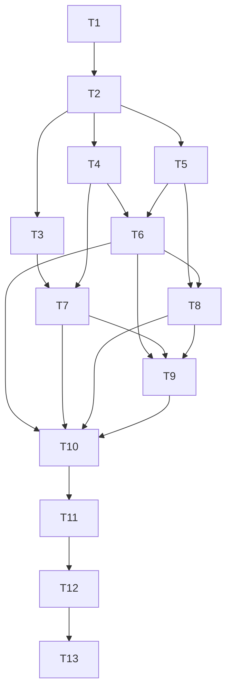

# Plan: Kernel Scheduling Full Refactor (决策 #18 兑现)

> **For agentic workers:** REQUIRED SUB-SKILL: Use superpowers:subagent-driven-development (recommended) or superpowers:executing-plans to implement this plan task-by-task. Steps use checkbox (`- [ ]`) syntax for tracking.

**Goal:** Migrate AgentLoop orchestration + tool execution + sub-agent dispatch into the `KernelMessage` bus (hybrid model), making AgentLoop a kernel `KernelModule` and retiring the direct-call path — honoring design decision #18.

**Architecture:** `KernelMessage` gains `UserRequest` (with a per-turn `mpsc::Sender<AgentEvent>` reply channel) and `ToolCallRequest` (with explicit `target` module id + oneshot reply). The kernel routes `ToolCallRequest` by `target` (deterministic single executor). AgentLoop's turn logic is extracted into a shared `TurnRunner` (tool boundary emits `ToolCallRequest` into the bus and suspends on the oneshot; model deltas flow through the per-turn channel, NOT the bus). A new `ToolExecutorModule` executes tools via `execute_async` (permission gate preserved). Sub-agents dispatch via an async `ServiceCall` (`AsyncKernelService` — the existing sync `ServiceCall` cannot await long-running dispatch). `IpcServer` stops holding `AgentLoop`; `session/run` enters via `UserRequest`. Protocol wire is untouched.

**Tech Stack:** Rust (tokio mpsc/oneshot, serde_json), JSON-RPC 2.0 IPC (unchanged wire), Mermaid diagrams in docs.

**Plan-Level Refinements to the Design Spec (flagged for review):**
1. **Async ServiceCall channel (new T3):** The design's "Sub-Agent 走 ServiceCall" hit an implementation constraint — the existing `ServiceCall` routing (`kernel.rs:169-183`) calls `KernelService::call` synchronously and sends the reply immediately. A sub-agent turn takes seconds, so a sync reply is impossible. T3 adds an `AsyncKernelService` trait + kernel routing branch: the kernel spawns the async call and sends the oneshot reply when it completes. This is additive (sync `KernelService` unchanged).
2. **`AgentEvent` + `OnTurnComplete` move to `types.rs` (new T1):** `KernelMessage::UserRequest.reply` must reference `AgentEvent`, which currently lives in `agent_loop.rs`. T1 relocates both types to `types.rs` with a re-export from `agent_loop.rs` so consumers are unaffected until the legacy type is removed (T10).

## Agent Worker Instructions

- Required sub-skills: `superpowers:subagent-driven-development` (preferred) or `superpowers:executing-plans`
- Execution mode: subagent-driven-development
- Required verification:
  - `cargo test --workspace` (full suite, includes e2e + drift gate)
  - `cargo clippy --workspace --all-targets -- -D warnings` (zero warnings)
  - `cargo fmt --all --check`
- Version bump: feature → minor (`0.4.1 → 0.5.0`, T11)
- Every commit message in English; docs under `docs/superpowers/` in Chinese

## Global Constraints

- Rust 1.96+, edition 2024; functions < 50 lines, lines ≤ 120 chars
- `agentj-protocol` / `schemas/*.json` / `protocol/methods.json` / `docs/specs/ipc-protocol.md`: ZERO changes (protocol-free refactor)
- KernelMessage derives `Debug + Clone` (tests clone it in `kernel.rs`); new fields must satisfy both
- `AgentEvent` / `OnTurnComplete` relocate to `types.rs` (T1); consumers re-export until T10 removes the legacy type
- Permission gate stays at `ToolRegistry::execute_async` (decision #17) — never bypassed
- `$cancelRequest` global inflight slot stays as-is (G2 deferred); `-32800 RequestCancelled` already in the error-code table
- Existing tests keep passing at every task boundary (each task ends build-green)

---

## T1: Relocate AgentEvent and OnTurnComplete to types.rs

**Files:**
- Modify: `crates/agentj-core/src/types.rs`
- Modify: `crates/agentj-core/src/agent_loop.rs`

**Interfaces:**
- Consumes: existing `AgentEvent` enum + `OnTurnComplete` alias in `agent_loop.rs`
- Produces: `types::AgentEvent`, `types::OnTurnComplete` (public); `agent_loop.rs` re-exports both so `agentj_core::agent_loop::{AgentEvent, AgentLoop}` still resolves

```yaml
- id: T1
  title: "Relocate AgentEvent and OnTurnComplete to types.rs with re-export"
  files:
    - crates/agentj-core/src/types.rs
    - crates/agentj-core/src/agent_loop.rs
  depends_on: []
  breaking: false
  ac:
    - given: the relocated types in types.rs
      when: a consumer imports `agentj_core::types::{AgentEvent, OnTurnComplete}`
      then: the module compiles and AgentEvent can be constructed and cloned
    - given: agent_loop.rs re-exports the relocated types
      when: a consumer imports `agentj_core::agent_loop::{AgentEvent, AgentLoop}`
      then: the module compiles (existing import paths unaffected)
  regression:
    - "agent_loop.rs test `run_turn_stream_yields_deltas` keeps passing"
    - "crates/agentj-core/tests/integration_agent_loop.rs `e2e_streaming_with_real_modules` keeps passing"
  test_code: |
    // In crates/agentj-core/src/types.rs, tests module:
    #[test]
    fn relocated_agent_event_is_constructible_and_cloneable() {
        let e = AgentEvent::Delta("x".into());
        let e2 = e.clone();
        assert!(matches!(e2, AgentEvent::Delta(t) if t == "x"));
    }
    // In crates/agentj-core/src/types.rs, top-level (compile-level proof):
    //   pub enum AgentEvent { Delta(String), ToolCall(ToolCall), ToolResult { call_id: String, result: String },
    //                        Done { final_response: String, tool_calls: Vec<ToolCall> }, Error(String) }
    //   pub type OnTurnComplete = Arc<dyn Fn(&SessionId) + Send + Sync>;
  impl_code: |
    // In crates/agentj-core/src/types.rs — append:
    #[derive(Debug, Clone)]
    pub enum AgentEvent {
        Delta(String),
        ToolCall(ToolCall),
        ToolResult { call_id: String, result: String },
        Done { final_response: String, tool_calls: Vec<ToolCall> },
        Error(String),
    }
    pub type OnTurnComplete = Arc<dyn Fn(&SessionId) + Send + Sync>;

    // In crates/agentj-core/src/agent_loop.rs — replace the old enum + alias with re-exports:
    pub use crate::types::{AgentEvent, OnTurnComplete};
    // Remove the old `pub enum AgentEvent {...}` and `type OnTurnComplete = ...` definitions.
  verify:
    - "cargo test -p agentj-core relocated_agent_event_is_constructible_and_cloneable"
    - "cargo test -p agentj-core"
```

---

## T2: Extend KernelMessage and add target routing + modules() query

**Files:**
- Modify: `crates/agentj-core/src/module.rs`
- Modify: `crates/agentj-core/src/kernel.rs`

**Interfaces:**
- Consumes: `types::AgentEvent`, existing `ServiceCallReply` pattern (`resolver.rs`)
- Produces:
  - `KernelMessage::UserRequest { session_id, content, attachments, reply: mpsc::Sender<AgentEvent> }`
  - `KernelMessage::ToolCallRequest { session_id: SessionId, tool_call: ToolCall, target: ModuleId, reply: ToolCallReply }`
  - `pub type ToolCallReply = Arc<std::sync::Mutex<Option<tokio::sync::oneshot::Sender<Result<serde_json::Value, crate::error::ToolError>>>>>` (in `module.rs`)
  - `Kernel::modules(&self) -> Vec<(ModuleId, ModuleState)>`
  - Kernel event loop: `ToolCallRequest` routed to `msg.target` module only; other messages broadcast

```yaml
- id: T2
  title: "Add ToolCallRequest + UserRequest.reply to KernelMessage and target routing"
  files:
    - crates/agentj-core/src/module.rs
    - crates/agentj-core/src/kernel.rs
  depends_on: [T1]
  breaking: true
  ac:
    - given: two modules registered (ids "a" and "b") and the kernel started
      when: a ToolCallRequest targeting "a" is sent through the bus
      then: only module "a"'s handle receives it (module "b" sees no ToolCallRequest)
    - given: a kernel with a registered module "a" in Ready state
      when: Kernel::modules() is called
      then: it returns [("a", ModuleState::Ready)]
    - given: a ToolCallRequest with an unregistered target is sent
      when: the kernel processes it
      then: the kernel keeps running (warn logged, no panic, subsequent messages processed)
    - given: a UserRequest is sent to a kernel with a spy module
      when: the spy module's handle runs
      then: it receives the UserRequest including a live mpsc::Sender<AgentEvent> reply channel
  regression:
    - "kernel.rs test `shutdown_runs_in_reverse_registration_order` keeps passing"
    - "kernel.rs test `shutdown_timeout_yields_shutdown_timeout` keeps passing"
    - "resolver.rs test `service_call_to_unknown_service_returns_error_reply` keeps passing"
  test_code: |
    // In crates/agentj-core/src/kernel.rs, tests module — extend SpyModule to record
    // received message kinds and add:
    #[tokio::test]
    async fn tool_call_request_routes_to_target_module_only() {
        let handled_a = Arc::new(StdMutex::new(vec![]));
        let handled_b = Arc::new(StdMutex::new(vec![]));
        let mut register = ModuleRegister::new(Arc::new(ToolRegistry::new()), Arc::new(ProviderRegistry::new()));
        let mut kernel = Kernel::new();
        kernel.register_module(Box::new(spy("a", handled_a.clone(), Arc::new(StdMutex::new(vec![])), None, false)),
            &dummy_kernel_context(), &mut register).unwrap();
        kernel.register_module(Box::new(spy("b", handled_b.clone(), Arc::new(StdMutex::new(vec![])), None, false)),
            &dummy_kernel_context(), &mut register).unwrap();
        let handle = kernel.start();
        let (tx, _rx) = tokio::sync::oneshot::channel();
        kernel.sender().send(KernelMessage::ToolCallRequest {
            session_id: "s1".into(),
            tool_call: ToolCall { id: "c1".into(), name: "dummy".into(), arguments: serde_json::json!({}) },
            target: "a".into(),
            reply: Arc::new(std::sync::Mutex::new(Some(tx))),
        }).unwrap();
        tokio::time::sleep(Duration::from_millis(50)).await;
        assert_eq!(handled_a.lock().unwrap().len(), 1);
        assert_eq!(handled_b.lock().unwrap().len(), 0, "target routing must not broadcast");
        kernel.sender().send(KernelMessage::Shutdown).unwrap();
        handle.await.unwrap().unwrap();
    }

    #[tokio::test]
    async fn tool_call_request_to_unregistered_target_keeps_kernel_running() {
        let mut register = ModuleRegister::new(Arc::new(ToolRegistry::new()), Arc::new(ProviderRegistry::new()));
        let mut kernel = Kernel::new();
        kernel.register_module(Box::new(spy("a", Arc::new(StdMutex::new(vec![])), Arc::new(StdMutex::new(vec![])), None, false)),
            &dummy_kernel_context(), &mut register).unwrap();
        let handle = kernel.start();
        let (tx, _rx) = tokio::sync::oneshot::channel();
        kernel.sender().send(KernelMessage::ToolCallRequest {
            session_id: "s1".into(),
            tool_call: ToolCall { id: "c1".into(), name: "dummy".into(), arguments: serde_json::json!({}) },
            target: "ghost".into(),
            reply: Arc::new(std::sync::Mutex::new(Some(tx))),
        }).unwrap();
        tokio::time::sleep(Duration::from_millis(50)).await;
        kernel.sender().send(KernelMessage::Shutdown).unwrap();
        handle.await.unwrap().unwrap(); // no panic, graceful shutdown still runs
    }

    #[test]
    fn modules_query_returns_registered_ids_and_states() {
        let mut register = ModuleRegister::new(Arc::new(ToolRegistry::new()), Arc::new(ProviderRegistry::new()));
        let mut kernel = Kernel::new();
        kernel.register_module(Box::new(spy("a", Arc::new(StdMutex::new(vec![])), Arc::new(StdMutex::new(vec![])), None, false)),
            &dummy_kernel_context(), &mut register).unwrap();
        assert_eq!(kernel.modules(), vec![("a".to_string(), ModuleState::Ready)]);
    }

    // Existing kernel test `kernel_routes_message_and_shuts_down` is UPDATED to include the reply channel:
    //   let (tx, _rx) = tokio::sync::mpsc::channel(4);
    //   kernel.sender().send(KernelMessage::UserRequest { session_id: "s1".into(), content: "hello".into(),
    //       attachments: vec![], reply: tx }).unwrap();
  impl_code: |
    // In crates/agentj-core/src/module.rs — extend KernelMessage:
    #[derive(Debug, Clone)]
    pub enum KernelMessage {
        UserRequest {
            session_id: SessionId,
            content: String,
            attachments: Vec<Attachment>,
            reply: tokio::sync::mpsc::Sender<AgentEvent>,
        },
        ToolCallRequest {
            session_id: SessionId,
            tool_call: ToolCall,
            target: ModuleId,
            reply: ToolCallReply,
        },
        ServiceCall { service: ModuleId, method: String, params: serde_json::Value, reply: crate::resolver::ServiceCallReply },
        Shutdown,
    }

    /// Oneshot result channel for ToolCallRequest — mirrors ServiceCallReply.
    pub type ToolCallReply =
        Arc<std::sync::Mutex<Option<tokio::sync::oneshot::Sender<Result<serde_json::Value, crate::error::ToolError>>>>>;

    // In crates/agentj-core/src/kernel.rs:
    //   - Kernel gains:
    pub fn modules(&self) -> Vec<(ModuleId, ModuleState)> {
        self.states.lock().unwrap().iter()
            .map(|(id, st)| (id.clone(), *st)).collect()
    }
    //   - Event loop: inside the `while let Some(msg) = rx.recv().await` body, after the
    //     ServiceCall branch and BEFORE the broadcast, insert:
    //     if let KernelMessage::ToolCallRequest { target, .. } = &msg {
    //         let mut guard = modules.lock().unwrap();
    //         if let Some(module) = guard.get_mut(target) {
    //             if let Err(e) = module.handle(&msg) { tracing::error!(?e, "module handler error"); }
    //         } else {
    //             tracing::warn!(%target, "ToolCallRequest to unregistered module");
    //         }
    //         continue;
    //     }
    //     // remaining messages broadcast as today
  verify:
    - "cargo test -p agentj-core tool_call_request_routes_to_target_module_only"
    - "cargo test -p agentj-core tool_call_request_to_unregistered_target_keeps_kernel_running"
    - "cargo test -p agentj-core modules_query_returns_registered_ids_and_states"
    - "cargo test -p agentj-core"
```

---

## T3: Add async KernelService routing for long-running service calls

**Files:**
- Modify: `crates/agentj-core/src/resolver.rs`
- Modify: `crates/agentj-core/src/kernel.rs`

**Interfaces:**
- Consumes: existing `KernelService` (sync) + `ServiceRegistry`; `ServiceCallReply`
- Produces:
  - `#[async_trait] pub trait AsyncKernelService: Send + Sync { async fn call(&self, method: &str, params: Value) -> Result<Value, String>; }` (in `resolver.rs`)
  - `ServiceRegistry::register_kernel_async_service(id, Arc<dyn AsyncKernelService>)` + `get_kernel_async_service(id)`
  - Kernel routing: async service branch spawns `call_async` and sends the oneshot reply on completion; sync branch unchanged

```yaml
- id: T3
  title: "Add async KernelService routing branch"
  files:
    - crates/agentj-core/src/resolver.rs
    - crates/agentj-core/src/kernel.rs
  depends_on: [T2]
  breaking: false
  ac:
    - given: an AsyncKernelService registered as "slow" that sleeps 100ms then returns a value
      when: a ServiceCall{service:"slow"} is sent and the reply is awaited
      then: the reply arrives with the value after ~100ms (the kernel did not block the loop)
    - given: a sync KernelService registered as "echo"
      when: a ServiceCall{service:"echo"} is sent
      then: it replies immediately (existing sync path unchanged)
    - given: an unknown async service id
      when: a ServiceCall to it is sent
      then: the reply is an Err (never hangs)
  regression:
    - "resolver.rs test `kernel_routes_service_call_and_returns_reply` keeps passing"
    - "resolver.rs test `service_call_to_unknown_service_returns_error_reply` keeps passing"
  test_code: |
    // In crates/agentj-core/src/resolver.rs, tests module:
    struct SlowService;
    #[async_trait]
    impl AsyncKernelService for SlowService {
        async fn call(&self, _m: &str, params: Value) -> Result<Value, String> {
            tokio::time::sleep(std::time::Duration::from_millis(100)).await;
            Ok(params)
        }
    }

    #[tokio::test]
    async fn async_service_call_replies_after_completion_without_blocking_loop() {
        let mut kernel = Kernel::new();
        let services = kernel.services();
        services.register_kernel_async_service("slow".into(), Arc::new(SlowService));
        let handle = kernel.start();
        let (tx, rx) = tokio::sync::oneshot::channel();
        kernel.sender().send(KernelMessage::ServiceCall {
            service: "slow".into(), method: "echo".into(),
            params: serde_json::json!({"x": 1}),
            reply: Arc::new(std::sync::Mutex::new(Some(tx))),
        }).unwrap();
        let reply: Result<Value, String> = tokio::time::timeout(std::time::Duration::from_secs(2), rx)
            .await.expect("reply must arrive").expect("sender dropped");
        assert_eq!(reply.unwrap()["x"], 1);
        kernel.sender().send(KernelMessage::Shutdown).unwrap();
        handle.await.unwrap().unwrap();
    }

    #[tokio::test]
    async fn async_service_call_to_unknown_service_returns_error() {
        let mut kernel = Kernel::new();
        let handle = kernel.start();
        let (tx, rx) = tokio::sync::oneshot::channel();
        kernel.sender().send(KernelMessage::ServiceCall {
            service: "ghost".into(), method: "x".into(), params: serde_json::json!({}),
            reply: Arc::new(std::sync::Mutex::new(Some(tx))),
        }).unwrap();
        let reply: Result<Value, String> = tokio::time::timeout(std::time::Duration::from_secs(2), rx)
            .await.expect("reply must arrive").expect("sender dropped");
        assert!(reply.is_err());
        kernel.sender().send(KernelMessage::Shutdown).unwrap();
        handle.await.unwrap().unwrap();
    }
  impl_code: |
    // In crates/agentj-core/src/resolver.rs:
    use async_trait::async_trait;

    /// Routable async service invoked by KernelMessage::ServiceCall. The kernel spawns
    /// the call and sends the oneshot reply when it completes — unlike `KernelService`
    /// (sync, immediate reply), this supports long-running dispatch (e.g. sub-agent turns).
    #[async_trait]
    pub trait AsyncKernelService: Send + Sync {
        async fn call(&self, method: &str, params: Value) -> Result<Value, String>;
    }

    // ServiceRegistry gains:
    //   kernel_async_services: RwLock<HashMap<ModuleId, Arc<dyn AsyncKernelService>>>
    //   pub fn register_kernel_async_service(&self, id: ModuleId, service: Arc<dyn AsyncKernelService>)
    //   pub fn get_kernel_async_service(&self, id: &ModuleId) -> Option<Arc<dyn AsyncKernelService>>

    // In crates/agentj-core/src/kernel.rs — in the ServiceCall routing branch, AFTER the
    // existing sync lookup, add:
    //   if let Some(svc) = services.get_kernel_async_service(service) {
    //       let svc = svc.clone();
    //       let method = method.clone();
    //       let params = params.clone();
    //       let reply = reply.clone();
    //       tokio::spawn(async move {
    //           let out = svc.call(&method, params).await;
    //           if let Some(tx) = reply.lock().unwrap().take() { let _ = tx.send(out); }
    //       });
    //       continue;
    //   }
    //   // then the existing "service not found" error reply for unknown ids
  verify:
    - "cargo test -p agentj-core async_service_call_replies_after_completion_without_blocking_loop"
    - "cargo test -p agentj-core async_service_call_to_unknown_service_returns_error"
    - "cargo test -p agentj-core"
```

---

## T4: Create TurnRunner with bus-based turn logic

**Files:**
- Create: `crates/agentj-core/src/turn_runner.rs`

**Interfaces:**
- Consumes: `types::AgentEvent`, `types::OnTurnComplete`, `KernelContext`, `ToolCallRequest`/`ToolCallReply`, `KernelSender`, `ContextPipeline`
- Produces:
  - `pub struct TurnRunner` (Clone): `new(ctx, pipeline, default_system_prompt, sender: KernelSender, tool_executor_id: ModuleId) -> Self`
  - `pub fn set_on_turn_complete(&mut self, f: Arc<dyn Fn(&SessionId)+Send+Sync>)`
  - `pub fn create_session(&self) -> Result<SessionId, ModuleError>`
  - `pub fn spawn_turn(&self, session_id: SessionId, content: String, system_prompt: Option<String>, reply: mpsc::Sender<AgentEvent>) -> Result<(), ModuleError>`
  - `pub fn cancel(&self, session_id: &SessionId) -> bool`
  - `pub fn shutdown(&self)` — cancels all active turns
  - `pub struct TurnHandle { cancel_tx: tokio::sync::oneshot::Sender<()> }` (private field, public struct)

```yaml
- id: T4
  title: "Create TurnRunner with bus-mediated tool boundary and cancel support"
  files:
    - crates/agentj-core/src/turn_runner.rs
  depends_on: [T2]
  breaking: false
  ac:
    - given: a Kernel with a spy module handling ToolCallRequest and a TurnRunner built on it
      when: spawn_turn runs a provider script that emits Delta + ToolCall then Delta + Done
      then: the reply channel receives Delta, ToolCall, ToolResult (from the spy's oneshot reply), Delta, Done in order, and on_turn_complete fires once
    - given: a running turn awaiting a tool result
      when: cancel(session_id) is called
      then: the reply channel receives Error("cancelled") and the turn terminates without appending a partial assistant message
    - given: a turn's reply receiver is dropped early (client disconnect)
      when: the turn tries to send the next event
      then: the turn aborts (no busy-loop, no panic)
    - given: TurnRunner::shutdown() is called with active turns
      when: the turns table is inspected
      then: all active turns are cancelled
  regression:
    - "agent_loop.rs tests keep passing unchanged (AgentLoop direct path untouched this task)"
    - "cargo test -p agentj-core"
  test_code: |
    // In crates/agentj-core/src/turn_runner.rs, tests module. Local mocks mirror
    // agent_loop.rs test style (MockProvider, MockSession, MockConfig, MockPipeline).
    struct ScriptedProvider { calls: Arc<AtomicUsize>, tool: ToolCall }
    #[async_trait]
    impl ModelProvider for ScriptedProvider {
        async fn chat_stream(&self, _m: Vec<ChatMessage>, _t: Vec<ToolDefinition>, _o: ModelOptions)
            -> Result<BoxStream<'static, Result<ModelEvent, ModelError>>, ModelError> {
            let n = self.calls.fetch_add(1, Ordering::SeqCst);
            let events: Vec<Result<ModelEvent, ModelError>> = if n == 0 {
                vec![Ok(ModelEvent::Delta("Hello".into())), Ok(ModelEvent::ToolCall(self.tool.clone())), Ok(ModelEvent::Done)]
            } else {
                vec![Ok(ModelEvent::Delta(" done".into())), Ok(ModelEvent::Done)]
            };
            Ok(Box::pin(stream::iter(events)))
        }
        async fn chat(&self, _m: Vec<ChatMessage>, _o: ModelOptions) -> Result<ChatResponse, ModelError> {
            Ok(ChatResponse { content: String::new(), tool_calls: vec![] })
        }
    }

    /// Spy KernelModule that replies to ToolCallRequest with Ok(json!({"result":"ok"})).
    struct ToolSpy;
    impl Module for ToolSpy {
        fn id(&self) -> ModuleId { "tool_spy".into() }
        fn metadata(&self) -> ModuleMetadata { ModuleMetadata { id: "tool_spy".into(), name: "spy".into(), version: "0.1".into(), description: "".into(), author: "".into() } }
        fn init(&mut self, _c: &KernelContext, _r: &mut ModuleRegister) -> Result<(), ModuleError> { Ok(()) }
        fn shutdown(&mut self) -> Result<(), ModuleError> { Ok(()) }
    }
    impl KernelModule for ToolSpy {
        fn handle(&mut self, msg: &KernelMessage) -> Result<KernelResponse, ModuleError> {
            if let KernelMessage::ToolCallRequest { reply, .. } = msg {
                let reply = reply.clone();
                let mut guard = reply.lock().unwrap();
                if let Some(tx) = guard.take() {
                    let _ = tx.send(Ok(serde_json::json!({"result": "ok"})));
                }
            }
            Ok(KernelResponse::Handled)
        }
    }

    fn spy_kernel() -> (Kernel, KernelSender) {
        let mut kernel = Kernel::new();
        let mut register = ModuleRegister::new(Arc::new(ToolRegistry::new()), Arc::new(ProviderRegistry::new()));
        kernel.register_module(Box::new(ToolSpy), &loop_test_ctx(), &mut register).unwrap();
        let sender = kernel.sender();
        let _handle = kernel.start();
        (kernel, sender)
    }

    #[tokio::test]
    async fn turn_streams_deltas_tool_boundary_and_done_via_bus() {
        let (kernel, sender) = spy_kernel();
        let ctx = loop_test_ctx();
        let hits = Arc::new(AtomicUsize::new(0));
        let mut runner = TurnRunner::new(ctx.clone(), Arc::new(MockPipeline), "sys".into(), sender, "tool_spy".into());
        let h = Arc::clone(&hits);
        runner.set_on_turn_complete(Arc::new(move |_sid| { h.fetch_add(1, Ordering::SeqCst); }));
        let providers = ctx.providers.clone();
        providers.register("mock".into(), Arc::new(ScriptedProvider { calls: Arc::new(AtomicUsize::new(0)), tool: tc() }));
        let sid = runner.create_session().unwrap();
        let (tx, mut rx) = tokio::sync::mpsc::channel(64);
        runner.spawn_turn(sid.clone(), "hi".into(), None, tx).unwrap();
        let mut kinds = vec![];
        let mut text = String::new();
        while let Some(ev) = rx.recv().await {
            match ev {
                AgentEvent::Delta(d) => { text.push_str(&d); kinds.push("delta".to_string()); }
                AgentEvent::ToolCall(_) => kinds.push("tool_call".to_string()),
                AgentEvent::ToolResult { .. } => kinds.push("tool_result".to_string()),
                AgentEvent::Done { .. } => { kinds.push("done".to_string()); break; }
                AgentEvent::Error(e) => panic!("turn error: {e}"),
            }
        }
        assert_eq!(text, "Hello done");
        assert_eq!(kinds, vec!["delta", "tool_call", "tool_result", "delta", "done"]);
        let deadline = std::time::Instant::now() + std::time::Duration::from_secs(1);
        while hits.load(Ordering::SeqCst) < 1 && std::time::Instant::now() < deadline { tokio::time::sleep(Duration::from_millis(5)).await; }
        assert_eq!(hits.load(Ordering::SeqCst), 1);
        kernel.sender().send(KernelMessage::Shutdown).unwrap();
    }

    #[tokio::test]
    async fn cancel_signals_turn_to_stop_with_cancelled_error() {
        let (kernel, sender) = spy_kernel();
        let ctx = loop_test_ctx();
        let providers = ctx.providers.clone();
        // A provider that returns a ToolCall; the spy never replies — the turn suspends forever
        // until cancel fires.
        providers.register("mock".into(), Arc::new(ScriptedProvider { calls: Arc::new(AtomicUsize::new(0)), tool: tc() }));
        let runner = TurnRunner::new(ctx, Arc::new(MockPipeline), "sys".into(), sender, "tool_spy".into());
        let sid = runner.create_session().unwrap();
        let (tx, mut rx) = tokio::sync::mpsc::channel(64);
        runner.spawn_turn(sid.clone(), "hi".into(), None, tx).unwrap();
        // wait for the ToolCall event so the turn is suspended on the oneshot
        loop {
            match rx.recv().await.unwrap() {
                AgentEvent::ToolCall(_) => break,
                AgentEvent::Error(e) => panic!("unexpected error: {e}"),
                _ => {}
            }
        }
        assert!(runner.cancel(&sid), "cancel must find the active turn");
        let mut saw_cancelled = false;
        while let Some(ev) = rx.recv().await {
            if let AgentEvent::Error(e) = ev { assert_eq!(e, "cancelled"); saw_cancelled = true; break; }
        }
        assert!(saw_cancelled);
        kernel.sender().send(KernelMessage::Shutdown).unwrap();
    }

    #[tokio::test]
    async fn shutdown_cancels_all_active_turns() {
        let (kernel, sender) = spy_kernel();
        let ctx = loop_test_ctx();
        let providers = ctx.providers.clone();
        providers.register("mock".into(), Arc::new(ScriptedProvider { calls: Arc::new(AtomicUsize::new(0)), tool: tc() }));
        let runner = TurnRunner::new(ctx, Arc::new(MockPipeline), "sys".into(), sender, "tool_spy".into());
        let sid = runner.create_session().unwrap();
        let (tx, mut rx) = tokio::sync::mpsc::channel(64);
        runner.spawn_turn(sid.clone(), "hi".into(), None, tx).unwrap();
        while let Some(ev) = rx.recv().await { if let AgentEvent::ToolCall(_) = ev { break; } }
        runner.shutdown();
        let mut saw_cancelled = false;
        while let Some(ev) = rx.recv().await {
            if let AgentEvent::Error(e) = ev { assert_eq!(e, "cancelled"); saw_cancelled = true; break; }
        }
        assert!(saw_cancelled);
        kernel.sender().send(KernelMessage::Shutdown).unwrap();
    }
  impl_code: |
    // crates/agentj-core/src/turn_runner.rs
    use crate::types::AgentEvent;                       // relocated by T1
    use crate::module::{ContextPipeline, KernelContext, KernelMessage, KernelResponse, KernelModule, Module, ModuleError, ModuleMetadata, ModuleRegister, ModuleId, ToolCall, ToolCallReply, ToolSource};
    use crate::permission::PermissionContext;
    use crate::resolver::{KernelService, ServiceRegistry};
    use crate::types::{ChatMessage, ModelEvent, ModelOptions, SessionId};
    use crate::kernel::KernelSender;
    use crate::permission::PermissionChecker;
    use futures::StreamExt;
    use std::sync::{Arc, Mutex};
    use tokio::sync::mpsc;

    #[derive(Clone)]
    pub struct TurnRunner {
        ctx: KernelContext,
        pipeline: Arc<dyn ContextPipeline>,
        default_system_prompt: String,
        max_tool_iterations: usize,
        on_turn_complete: Option<Arc<dyn Fn(&SessionId) + Send + Sync>>,
        sender: KernelSender,
        tool_executor_id: ModuleId,
        turns: Arc<Mutex<HashMap<SessionId, TurnHandle>>>,
    }

    pub struct TurnHandle {
        // `Sender::send` consumes self — wrap in Option so `cancel` can `take()` it.
        cancel_tx: std::sync::Mutex<Option<tokio::sync::oneshot::Sender<()>>>,
    }

    impl TurnRunner {
        pub fn new(ctx: KernelContext, pipeline: Arc<dyn ContextPipeline>, default_system_prompt: String,
                   sender: KernelSender, tool_executor_id: ModuleId) -> Self {
            Self { ctx, pipeline, default_system_prompt, max_tool_iterations: 10,
                on_turn_complete: None, sender, tool_executor_id,
                turns: Arc::new(Mutex::new(HashMap::new())) }
        }
        pub fn set_on_turn_complete(&mut self, f: Arc<dyn Fn(&SessionId) + Send + Sync>) {
            self.on_turn_complete = Some(f);
        }
        pub fn create_session(&self) -> Result<SessionId, ModuleError> { self.ctx.session.create() }
        pub fn cancel(&self, session_id: &SessionId) -> bool {
            if let Ok(mut turns) = self.turns.lock() {
                if let Some(handle) = turns.get(session_id) {
                    if let Some(tx) = handle.cancel_tx.lock().unwrap().take() {
                        let _ = tx.send(());
                        return true;
                    }
                }
            }
            false
        }
        pub fn shutdown(&self) {
            if let Ok(mut turns) = self.turns.lock() {
                for (_, handle) in turns.drain() {
                    if let Some(tx) = handle.cancel_tx.lock().unwrap().take() { let _ = tx.send(()); }
                }
            }
        }
        pub fn spawn_turn(&self, session_id: SessionId, content: String,
                          system_prompt: Option<String>, reply: mpsc::Sender<AgentEvent>) -> Result<(), ModuleError> {
            let (cancel_tx, cancel_rx) = tokio::sync::oneshot::channel();
            let ctx = self.ctx.clone();
            let pipeline = Arc::clone(&self.pipeline);
            let system_prompt = system_prompt.unwrap_or_else(|| self.default_system_prompt.clone());
            let max_iter = self.max_tool_iterations;
            let on_done = self.on_turn_complete.clone();
            let sender = self.sender.clone();
            let tool_executor_id = self.tool_executor_id.clone();
            let turns = Arc::clone(&self.turns);
            {
                let mut map = self.turns.lock().map_err(|_| ModuleError::Init("turns poisoned".into()))?;
                map.insert(session_id.clone(), TurnHandle { cancel_tx: std::sync::Mutex::new(Some(cancel_tx)) });
            }
            tokio::spawn(async move {
                // register self-removal on every exit path
                let result = Self::run_turn(ctx, pipeline, session_id.clone(), content, system_prompt,
                    max_iter, reply.clone(), sender, tool_executor_id, cancel_rx, on_done.clone()).await;
                if let Err(e) = &result { let _ = reply.send(AgentEvent::Error(e.to_string())).await; }
                if let Ok(mut map) = turns.lock() { map.remove(&session_id); }
            });
            Ok(())
        }

        async fn run_turn(ctx: KernelContext, pipeline: Arc<dyn ContextPipeline>, session_id: SessionId,
            user_input: String, system_prompt: String, max_iter: usize, reply: mpsc::Sender<AgentEvent>,
            sender: KernelSender, tool_executor_id: ModuleId,
            mut cancel_rx: tokio::sync::oneshot::Receiver<()>,
            on_done: Option<Arc<dyn Fn(&SessionId) + Send + Sync>>) -> Result<(), String> {
            let route = |reason: String| format!("agent error: {reason}");
            ctx.session.append(&session_id, ChatMessage::user(user_input)).map_err(|e| route(e.to_string()))?;
            let history = ctx.session.get(&session_id).map_err(|e| route(e.to_string()))?;
            let provider = ctx.providers.get_default().ok_or_else(|| route("no default provider".into()))?;
            let tool_defs = ctx.tools.definitions();
            let mut messages = pipeline.assemble(&system_prompt, &history, &[]);
            let mut all_tool_calls: Vec<ToolCall> = vec![];
            let model = ctx.config.get_str("model.default_model").unwrap_or_else(|| "deepseek-chat".into());
            let default_options = ModelOptions { model, ..Default::default() };
            let workspace_root = std::env::current_dir().map_err(|e| route(e.to_string()))?;
            let mut cancelled = false;

            'outer: for _iter in 0..max_iter {
                let stream = provider.chat_stream(messages.clone(), tool_defs.clone(), default_options.clone())
                    .await.map_err(|e| route(e.to_string()))?;
                futures::pin_mut!(stream);
                let mut content = String::new();
                let mut tc_list: Vec<ToolCall> = vec![];
                loop {
                    let next = tokio::select! {
                        r = stream.next() => r,
                        _ = &mut cancel_rx => { cancelled = true; None },
                    };
                    match next {
                        Some(result) => match result.map_err(|e| route(e.to_string()))? {
                            ModelEvent::Delta(text) => { content.push_str(&text); if reply.send(AgentEvent::Delta(text)).await.is_err() { return Ok(()); } }
                            ModelEvent::ToolCall(tc) => tc_list.push(tc),
                            ModelEvent::Done => break,
                        },
                        None => { if cancelled { break 'outer; } break; },
                    }
                }
                if cancelled { break 'outer; }
                if tc_list.is_empty() {
                    ctx.session.append(&session_id, ChatMessage::assistant(content.clone())).map_err(|e| route(e.to_string()))?;
                    if reply.send(AgentEvent::Done { final_response: content, tool_calls: all_tool_calls }).await.is_err() { return Ok(()); }
                    if let Some(f) = &on_done { f(&session_id); }
                    return Ok(());
                }
                for tc in tc_list {
                    if reply.send(AgentEvent::ToolCall(tc.clone())).await.is_err() { return Ok(()); }
                    all_tool_calls.push(tc.clone());
                    let (tx, mut tool_rx) = tokio::sync::oneshot::channel();
                    if sender.send(KernelMessage::ToolCallRequest {
                        session_id: session_id.clone(), tool_call: tc.clone(),
                        target: tool_executor_id.clone(),
                        reply: Arc::new(std::sync::Mutex::new(Some(tx))),
                    }).is_err() {
                        if reply.send(AgentEvent::Error("bus send failed".into())).await.is_err() { return Ok(()); }
                        return Ok(());
                    }
                    let tool_result = tokio::select! {
                        r = &mut tool_rx => match r {
                            Ok(Ok(val)) => val.as_str().map(String::from).unwrap_or_else(|| val.to_string()),
                            Ok(Err(e)) => format!("Error: {e}"),
                            Err(_) => { if reply.send(AgentEvent::Error("tool executor dropped".into())).await.is_err() { return Ok(()); } return Ok(()); }
                        },
                        _ = &mut cancel_rx => { cancelled = true; break; },
                    };
                    if cancelled { break; }
                    if reply.send(AgentEvent::ToolResult { call_id: tc.id.clone(), result: tool_result.clone() }).await.is_err() { return Ok(()); }
                    pipeline.reflux(&mut messages, &tc, tool_result);
                }
                if cancelled { break 'outer; }
            }
            if cancelled {
                if reply.send(AgentEvent::Error("cancelled".into())).await.is_err() { return Ok(()); }
            } else if reply.send(AgentEvent::Error("max tool iterations exceeded".into())).await.is_err() {
                return Ok(());
            }
            Ok(())
        }
    }

    // In crates/agentj-core/src/lib.rs — add: pub mod turn_runner;
  verify:
    - "cargo test -p agentj-core turn_streams_deltas_tool_boundary_and_done_via_bus"
    - "cargo test -p agentj-core cancel_signals_turn_to_stop_with_cancelled_error"
    - "cargo test -p agentj-core shutdown_cancels_all_active_turns"
    - "cargo test -p agentj-core"
```

---

## T5: Create ToolExecutorModule

**Files:**
- Create: `crates/agentj-core/src/tool_executor.rs`

**Interfaces:**
- Consumes: `KernelContext`, `ToolCallRequest`/`ToolCallReply`, `PermissionContext`, `ToolSource`, `KernelModule`
- Produces:
  - `pub struct ToolExecutorModule` — `new(ctx: KernelContext) -> Self` (captures `workspace_root` at construction)
  - `impl KernelModule`: `id() = "tool_executor"`; `handle(ToolCallRequest)` spawns execution via `ctx.tools.execute_async` and sends the oneshot reply

```yaml
- id: T5
  title: "Create ToolExecutorModule for bus-mediated tool execution"
  files:
    - crates/agentj-core/src/tool_executor.rs
  depends_on: [T2]
  breaking: false
  ac:
    - given: a Kernel with ToolExecutorModule registered and a ToolRegistry holding a "dummy" tool with an AllowAll checker
      when: a ToolCallRequest{name:"dummy"} is sent through the bus
      then: the oneshot reply resolves Ok with the tool's value
    - given: the same setup with a DenyAll checker
      when: a ToolCallRequest is sent
      then: the oneshot reply resolves Err(ToolError::PermissionDenied)
    - given: a ToolCallRequest whose reply sender is already taken
      when: the executor finishes
      then: no panic (reply silently dropped)
  regression:
    - "module.rs tests `execute_async_allow_runs_tool` / `execute_async_deny_blocks_tool` keep passing (permission gate untouched)"
  test_code: |
    // In crates/agentj-core/src/tool_executor.rs, tests module:
    struct DummyTool;
    impl Tool for DummyTool {
        fn name(&self) -> &str { "dummy" }
        fn description(&self) -> &str { "" }
        fn input_schema(&self) -> serde_json::Value { serde_json::json!({}) }
        fn execute(&self, _i: serde_json::Value) -> Result<serde_json::Value, ToolError> {
            Ok(serde_json::json!({"done": true}))
        }
    }
    struct AllowAll;
    #[async_trait]
    impl PermissionChecker for AllowAll {
        fn check(&self, _c: &PermissionContext) -> PermissionDecision { PermissionDecision::Allow }
        async fn await_approval(&self, _r: &PermissionRequestId) -> PermissionDecision { PermissionDecision::Allow }
    }
    struct DenyAll;
    #[async_trait]
    impl PermissionChecker for DenyAll {
        fn check(&self, _c: &PermissionContext) -> PermissionDecision { PermissionDecision::Deny { reason: "denied".into() } }
        async fn await_approval(&self, _r: &PermissionRequestId) -> PermissionDecision { PermissionDecision::Deny { reason: "denied".into() } }
    }

    fn executor_ctx(checker: Arc<dyn PermissionChecker>) -> KernelContext {
        let tools = ToolRegistry::new();
        tools.register(Arc::new(DummyTool));
        tools.set_permission_checker(checker);
        KernelContext {
            session: Arc::new(MockSession::default()), tools: Arc::new(tools),
            providers: Arc::new(ProviderRegistry::new()), config: Arc::new(MockConfig),
        }
    }

    #[tokio::test]
    async fn tool_call_request_is_executed_and_replied() {
        let mut kernel = Kernel::new();
        let ctx = executor_ctx(Arc::new(AllowAll));
        let mut register = ModuleRegister::new(Arc::clone(&ctx.tools), Arc::clone(&ctx.providers));
        kernel.register_module(Box::new(ToolExecutorModule::new(ctx)), &ctx, &mut register).unwrap();
        let handle = kernel.start();
        let (tx, rx) = tokio::sync::oneshot::channel();
        kernel.sender().send(KernelMessage::ToolCallRequest {
            session_id: "s1".into(),
            tool_call: ToolCall { id: "c1".into(), name: "dummy".into(), arguments: serde_json::json!({}) },
            target: "tool_executor".into(),
            reply: Arc::new(std::sync::Mutex::new(Some(tx))),
        }).unwrap();
        let reply: Result<serde_json::Value, ToolError> = tokio::time::timeout(std::time::Duration::from_secs(2), rx)
            .await.expect("reply must arrive").expect("sender dropped");
        assert_eq!(reply.unwrap()["done"], true);
        kernel.sender().send(KernelMessage::Shutdown).unwrap();
        handle.await.unwrap().unwrap();
    }

    #[tokio::test]
    async fn denied_tool_call_replies_permission_denied() {
        let mut kernel = Kernel::new();
        let ctx = executor_ctx(Arc::new(DenyAll));
        let mut register = ModuleRegister::new(Arc::clone(&ctx.tools), Arc::clone(&ctx.providers));
        kernel.register_module(Box::new(ToolExecutorModule::new(ctx)), &ctx, &mut register).unwrap();
        let handle = kernel.start();
        let (tx, rx) = tokio::sync::oneshot::channel();
        kernel.sender().send(KernelMessage::ToolCallRequest {
            session_id: "s1".into(),
            tool_call: ToolCall { id: "c1".into(), name: "dummy".into(), arguments: serde_json::json!({}) },
            target: "tool_executor".into(),
            reply: Arc::new(std::sync::Mutex::new(Some(tx))),
        }).unwrap();
        let reply: Result<serde_json::Value, ToolError> = tokio::time::timeout(std::time::Duration::from_secs(2), rx)
            .await.expect("reply must arrive").expect("sender dropped");
        assert!(matches!(reply, Err(ToolError::PermissionDenied { .. })));
        kernel.sender().send(KernelMessage::Shutdown).unwrap();
        handle.await.unwrap().unwrap();
    }
  impl_code: |
    // crates/agentj-core/src/tool_executor.rs
    use crate::module::{KernelContext, KernelMessage, KernelModule, KernelResponse, Module, ModuleError,
        ModuleMetadata, ModuleId, ToolCall, ToolSource};
    use crate::permission::PermissionContext;
    use std::path::PathBuf;
    use std::sync::Arc;

    /// Executes tool calls routed by KernelMessage::ToolCallRequest. The permission gate
    /// stays at ToolRegistry::execute_async (design #17) — this module only moves the
    /// execution boundary from AgentLoop into a kernel-routed module.
    pub struct ToolExecutorModule {
        ctx: KernelContext,
        workspace_root: PathBuf,
    }

    impl ToolExecutorModule {
        pub fn new(ctx: KernelContext) -> Self {
            let workspace_root = std::env::current_dir().unwrap_or_else(|_| PathBuf::from("."));
            Self { ctx, workspace_root }
        }
    }

    impl Module for ToolExecutorModule {
        fn id(&self) -> ModuleId { "tool_executor".into() }
        fn metadata(&self) -> ModuleMetadata {
            ModuleMetadata { id: "tool_executor".into(), name: "ToolExecutor".into(),
                version: env!("CARGO_PKG_VERSION").into(), description: "Bus-mediated tool execution".into(), author: "AgentJ".into() }
        }
        fn init(&mut self, _c: &KernelContext, _r: &mut ModuleRegister) -> Result<(), ModuleError> { Ok(()) }
        fn shutdown(&mut self) -> Result<(), ModuleError> { Ok(()) }
    }

    impl KernelModule for ToolExecutorModule {
        fn handle(&mut self, msg: &KernelMessage) -> Result<KernelResponse, ModuleError> {
            if let KernelMessage::ToolCallRequest { session_id, tool_call, reply, .. } = msg {
                let ctx = self.ctx.clone();
                let workspace_root = self.workspace_root.clone();
                let reply = reply.clone();
                let tool_call = tool_call.clone();
                let session_id = session_id.clone();
                tokio::spawn(async move {
                    let source = ctx.tools.source_of(&tool_call.name).unwrap_or(ToolSource::Builtin);
                    let perm_ctx = PermissionContext {
                        session_id: session_id.clone(), tool: tool_call.name.clone(), source,
                        args: tool_call.arguments.clone(), workspace_root,
                    };
                    let result = ctx.tools.execute_async(&tool_call.name, &tool_call.arguments, &perm_ctx).await;
                    if let Some(tx) = reply.lock().unwrap().take() { let _ = tx.send(result); }
                });
            }
            Ok(KernelResponse::Handled)
        }
    }

    // In crates/agentj-core/src/lib.rs — add: pub mod tool_executor;
  verify:
    - "cargo test -p agentj-core tool_call_request_is_executed_and_replied"
    - "cargo test -p agentj-core denied_tool_call_replies_permission_denied"
    - "cargo test -p agentj-core"
```

---

## T6: Create AgentLoopModule (KernelModule) with cancel service

**Files:**
- Create: `crates/agentj-core/src/agent_loop_module.rs`

**Interfaces:**
- Consumes: `TurnRunner`, `KernelMessage::UserRequest`, `ServiceRegistry` (via `ModuleRegister::register_kernel_service`)
- Produces:
  - `pub struct AgentLoopModule` — `new(runner: TurnRunner) -> Self`
  - `impl Module`: `id() = "agent_loop"`
  - `impl KernelModule`: `handle(UserRequest)` → `runner.spawn_turn(session_id, content, None, reply)`
  - Registers `KernelService "agent"` with method `"cancel"` (params `{session_id}`) during `init` — calls `runner.cancel`
  - `pub fn runner(&self) -> TurnRunner` accessor for CLI wiring

```yaml
- id: T6
  title: "Create AgentLoopModule handling UserRequest and cancel service"
  files:
    - crates/agentj-core/src/agent_loop_module.rs
  depends_on: [T4, T5]
  breaking: false
  ac:
    - given: a Kernel with AgentLoopModule + ToolExecutorModule registered and a provider emitting Delta + ToolCall + Delta + Done
      when: a UserRequest is sent through the bus
      then: the reply channel receives Delta, ToolCall, ToolResult, Delta, Done in order
    - given: a running turn (turn suspended awaiting a tool reply that never arrives)
      when: a ServiceCall{service:"agent", method:"cancel", params:{session_id}} is sent
      then: the turn's reply channel receives Error("cancelled")
    - given: a ServiceCall{service:"agent", method:"cancel"} for a session with no active turn
      when: the service runs
      then: it returns Err("no active turn") — not silent success
  regression:
    - "T4 test `turn_streams_deltas_tool_boundary_and_done_via_bus` keeps passing"
    - "agent_loop.rs test `on_turn_complete_fires_once_per_completed_turn` keeps passing (legacy path)"
  test_code: |
    // In crates/agentj-core/src/agent_loop_module.rs, tests module. Reuse the mock
    // provider + ToolSpy style from T4. Tests drive the REAL kernel + module:
    #[tokio::test]
    async fn user_request_runs_turn_and_cancel_signals_it() {
        let mut kernel = Kernel::new();
        let ctx = loop_test_ctx();
        let providers = ctx.providers.clone();
        providers.register("mock".into(), Arc::new(ScriptedProvider { calls: Arc::new(AtomicUsize::new(0)), tool: tc() }));
        let mut register = ModuleRegister::with_services(
            Arc::clone(&ctx.tools), Arc::clone(&ctx.providers), kernel.services());
        kernel.register_module(Box::new(ToolSpy), &ctx, &mut register).unwrap();
        let runner = TurnRunner::new(ctx.clone(), Arc::new(MockPipeline), "sys".into(), kernel.sender(), "tool_spy".into());
        kernel.register_module(Box::new(AgentLoopModule::new(runner.clone())), &ctx, &mut register).unwrap();
        let handle = kernel.start();

        let sid = runner.create_session().unwrap();
        let (tx, mut rx) = tokio::sync::mpsc::channel(64);
        // Send UserRequest through the bus (as IPC will):
        kernel.sender().send(KernelMessage::UserRequest {
            session_id: sid.clone(), content: "hi".into(), attachments: vec![], reply: tx.clone(),
        }).unwrap();
        let mut saw_tool_call = false;
        let mut saw_cancelled = false;
        while let Some(ev) = rx.recv().await {
            match ev {
                AgentEvent::ToolCall(_) => { saw_tool_call = true; break; }
                AgentEvent::Error(e) => panic!("unexpected error: {e}"),
                _ => {}
            }
        }
        assert!(saw_tool_call, "turn must suspend at the tool boundary");
        // Cancel via the registered "agent" service:
        let (ctx2, rtx) = tokio::sync::oneshot::channel();
        kernel.sender().send(KernelMessage::ServiceCall {
            service: "agent".into(), method: "cancel".into(),
            params: serde_json::json!({"session_id": sid}),
            reply: Arc::new(std::sync::Mutex::new(Some(ctx2))),
        }).unwrap();
        let cancel_reply: Result<Value, String> = tokio::time::timeout(std::time::Duration::from_secs(2), rtx)
            .await.expect("cancel reply must arrive").expect("sender dropped");
        assert!(cancel_reply.is_ok());
        while let Some(ev) = rx.recv().await {
            if let AgentEvent::Error(e) = ev { assert_eq!(e, "cancelled"); saw_cancelled = true; break; }
        }
        assert!(saw_cancelled);
        kernel.sender().send(KernelMessage::Shutdown).unwrap();
        handle.await.unwrap().unwrap();
    }

    #[tokio::test]
    async fn cancel_service_unknown_session_returns_error() {
        let mut kernel = Kernel::new();
        let ctx = loop_test_ctx();
        let mut register = ModuleRegister::with_services(Arc::clone(&ctx.tools), Arc::clone(&ctx.providers), kernel.services());
        let runner = TurnRunner::new(ctx.clone(), Arc::new(MockPipeline), "sys".into(), kernel.sender(), "tool_executor".into());
        kernel.register_module(Box::new(AgentLoopModule::new(runner)), &ctx, &mut register).unwrap();
        let handle = kernel.start();
        let (tx, rx) = tokio::sync::oneshot::channel();
        kernel.sender().send(KernelMessage::ServiceCall {
            service: "agent".into(), method: "cancel".into(),
            params: serde_json::json!({"session_id": "no-such-session"}),
            reply: Arc::new(std::sync::Mutex::new(Some(tx))),
        }).unwrap();
        let reply: Result<Value, String> = tokio::time::timeout(std::time::Duration::from_secs(2), rx)
            .await.expect("reply must arrive").expect("sender dropped");
        assert!(reply.is_err());
        kernel.sender().send(KernelMessage::Shutdown).unwrap();
        handle.await.unwrap().unwrap();
    }
  impl_code: |
    // crates/agentj-core/src/agent_loop_module.rs
    use crate::module::{KernelContext, KernelMessage, KernelModule, KernelResponse, Module, ModuleError,
        ModuleMetadata, ModuleId, ModuleRegister};
    use crate::resolver::KernelService;
    use crate::turn_runner::TurnRunner;

    pub struct AgentLoopModule { runner: TurnRunner }

    impl AgentLoopModule {
        pub fn new(runner: TurnRunner) -> Self { Self { runner } }
        pub fn runner(&self) -> TurnRunner { self.runner.clone() }
    }

    impl Module for AgentLoopModule {
        fn id(&self) -> ModuleId { "agent_loop".into() }
        fn metadata(&self) -> ModuleMetadata {
            ModuleMetadata { id: "agent_loop".into(), name: "AgentLoop".into(),
                version: env!("CARGO_PKG_VERSION").into(), description: "Turn orchestration (bus-mediated)".into(), author: "AgentJ".into() }
        }
        fn init(&mut self, _c: &KernelContext, register: &mut ModuleRegister) -> Result<(), ModuleError> {
            let runner = self.runner.clone();
            let service = AgentCancelService { runner };
            register.register_kernel_service("agent".into(), Arc::new(service))?;
            Ok(())
        }
        fn shutdown(&mut self) -> Result<(), ModuleError> { self.runner.shutdown(); Ok(()) }
    }

    impl KernelModule for AgentLoopModule {
        fn handle(&mut self, msg: &KernelMessage) -> Result<KernelResponse, ModuleError> {
            if let KernelMessage::UserRequest { session_id, content, attachments: _, reply } = msg {
                self.runner.spawn_turn(session_id.clone(), content.clone(), None, reply.clone())?;
            }
            Ok(KernelResponse::Handled)
        }
    }

    struct AgentCancelService { runner: TurnRunner }
    impl KernelService for AgentCancelService {
        fn call(&self, _method: &str, params: serde_json::Value) -> Result<serde_json::Value, String> {
            let session_id = params["session_id"].as_str().ok_or("missing session_id")?;
            if self.runner.cancel(&session_id.to_string()) {
                Ok(serde_json::json!({}))
            } else {
                Err("no active turn".into())
            }
        }
    }

    // In crates/agentj-core/src/lib.rs — add: pub mod agent_loop_module;
  verify:
    - "cargo test -p agentj-core user_request_runs_turn_and_cancel_signals_it"
    - "cargo test -p agentj-core cancel_service_unknown_session_returns_error"
    - "cargo test -p agentj-core"
```

---

## T7: Rewrite Dispatcher as async subagent service + client

**Files:**
- Modify: `crates/agentj-core/src/dispatcher.rs`

**Interfaces:**
- Consumes: `AsyncKernelService` (T3), `TurnRunner` (T4), `ServiceCallReply`
- Produces:
  - `pub struct SubAgentService` — `new(runner: TurnRunner) -> Self`; `impl AsyncKernelService` (id `"subagent"`, method `"dispatch"`, params `{prompt, system_prompt?}`) → creates a fresh session, spawns a turn, collects the final response, replies `{session_id, final_response}`
  - `pub struct Dispatcher` — `new(sender: KernelSender) -> Self`; `dispatch(&self, spec: TaskSpec) -> JoinHandle<Result<SubAgentResult, String>>` sends `ServiceCall{service:"subagent"}` and awaits the oneshot reply
  - `TaskSpec` / `SubAgentResult` shapes unchanged

```yaml
- id: T7
  title: "Rewrite Dispatcher as async subagent ServiceCall service and client"
  files:
    - crates/agentj-core/src/dispatcher.rs
  depends_on: [T3, T4]
  breaking: true
  ac:
    - given: a Kernel with the "subagent" async service registered (holding a TurnRunner) and the kernel started
      when: dispatch() is called with a prompt
      then: it returns a SubAgentResult with a fresh session_id and the final response text
    - given: the sub-agent's provider script emits a ToolCall
      when: the sub-agent turn runs
      then: a ToolCallRequest reaches the tool module (sub-agent tool calls go through the bus)
    - given: an unknown method on the subagent service
      when: dispatch() or a direct ServiceCall uses it
      then: the reply is Err (never hangs)
  regression:
    - "resolver.rs test `async_service_call_replies_after_completion_without_blocking_loop` keeps passing"
    - "T3 async service tests keep passing"
  test_code: |
    // In crates/agentj-core/src/dispatcher.rs, tests module — REWRITE the existing
    // `dispatcher_runs_parallel_sub_agents` test to bus-driven form:
    #[tokio::test]
    async fn dispatcher_runs_sub_agent_via_service_call() {
        let mut kernel = Kernel::new();
        let ctx = loop_test_ctx();
        let providers = ctx.providers.clone();
        providers.register("mock".into(), Arc::new(MockProvider { chunks: vec!["Hello".into(), " world".into()] }));
        let mut register = ModuleRegister::with_services(Arc::clone(&ctx.tools), Arc::clone(&ctx.providers), kernel.services());
        // register a ToolSpy (handles ToolCallRequest) so any tool boundary resolves
        kernel.register_module(Box::new(ToolSpy), &ctx, &mut register).unwrap();
        let runner = TurnRunner::new(ctx, Arc::new(MockPipeline), "You are helpful.".into(), kernel.sender(), "tool_spy".into());
        register.register_kernel_async_service("subagent".into(), Arc::new(SubAgentService::new(runner.clone())))?;
        let handle = kernel.start();

        let dispatcher = Dispatcher::new(kernel.sender());
        let a = dispatcher.dispatch(TaskSpec { prompt: "task a".into(), system_prompt: None });
        let ra = a.await.unwrap().unwrap();
        assert_eq!(ra.final_response, "Hello world");
        assert!(!ra.session_id.is_empty());
        kernel.sender().send(KernelMessage::Shutdown).unwrap();
        handle.await.unwrap().unwrap();
    }

    #[tokio::test]
    async fn subagent_dispatch_unknown_method_returns_error() {
        let mut kernel = Kernel::new();
        let ctx = loop_test_ctx();
        let mut register = ModuleRegister::with_services(Arc::clone(&ctx.tools), Arc::clone(&ctx.providers), kernel.services());
        let runner = TurnRunner::new(ctx, Arc::new(MockPipeline), "sys".into(), kernel.sender(), "tool_executor".into());
        register.register_kernel_async_service("subagent".into(), Arc::new(SubAgentService::new(runner)))?;
        let handle = kernel.start();
        let (tx, rx) = tokio::sync::oneshot::channel();
        kernel.sender().send(KernelMessage::ServiceCall {
            service: "subagent".into(), method: "bogus".into(), params: serde_json::json!({}),
            reply: Arc::new(std::sync::Mutex::new(Some(tx))),
        }).unwrap();
        let reply: Result<Value, String> = tokio::time::timeout(std::time::Duration::from_secs(2), rx)
            .await.expect("reply must arrive").expect("sender dropped");
        assert!(reply.is_err());
        kernel.sender().send(KernelMessage::Shutdown).unwrap();
        handle.await.unwrap().unwrap();
    }
  impl_code: |
    // crates/agentj-core/src/dispatcher.rs — replace the body:
    use crate::types::AgentEvent;   // relocated by T1
    use crate::kernel::KernelSender;
    use crate::resolver::{AsyncKernelService, ServiceCallReply};
    use crate::turn_runner::TurnRunner;
    use crate::types::SessionId;

    #[derive(Debug, Clone)]
    pub struct TaskSpec { pub prompt: String, pub system_prompt: Option<String> }

    #[derive(Debug)]
    pub struct SubAgentResult { pub session_id: SessionId, pub final_response: String }

    /// Server side: registered as async kernel service "subagent". Runs a sub-agent turn
    /// through the shared TurnRunner on a fresh session; replies with the final response.
    pub struct SubAgentService { runner: TurnRunner }

    impl SubAgentService {
        pub fn new(runner: TurnRunner) -> Self { Self { runner } }
    }

    #[async_trait::async_trait]
    impl AsyncKernelService for SubAgentService {
        async fn call(&self, method: &str, params: serde_json::Value) -> Result<serde_json::Value, String> {
            if method != "dispatch" { return Err(format!("unknown method: {method}")); }
            let prompt = params["prompt"].as_str().ok_or("missing prompt")?.to_string();
            let system_prompt = params["system_prompt"].as_str().map(String::from);
            let sid = self.runner.create_session().map_err(|e| e.to_string())?;
            let (tx, mut rx) = tokio::sync::mpsc::channel(64);
            self.runner.spawn_turn(sid.clone(), prompt, system_prompt, tx).map_err(|e| e.to_string())?;
            let mut final_response = String::new();
            while let Some(ev) = rx.recv().await {
                match ev {
                    AgentEvent::Delta(d) => final_response.push_str(&d),
                    AgentEvent::Done { final_response: fr, .. } => {
                        if !fr.is_empty() { final_response = fr; }
                        break;
                    }
                    AgentEvent::Error(e) => return Err(e),
                    _ => {}
                }
            }
            Ok(serde_json::json!({ "session_id": sid, "final_response": final_response }))
        }
    }

    /// Client side: sends ServiceCall{service:"subagent"} and awaits the reply.
    #[derive(Clone)]
    pub struct Dispatcher { sender: KernelSender }

    impl Dispatcher {
        pub fn new(sender: KernelSender) -> Self { Self { sender } }
        pub fn dispatch(&self, spec: TaskSpec) -> tokio::task::JoinHandle<Result<SubAgentResult, String>> {
            let sender = self.sender.clone();
            tokio::spawn(async move {
                let (tx, rx) = tokio::sync::oneshot::channel();
                sender.send(KernelMessage::ServiceCall {
                    service: "subagent".into(), method: "dispatch".into(),
                    params: serde_json::json!({ "prompt": spec.prompt, "system_prompt": spec.system_prompt }),
                    reply: Arc::new(std::sync::Mutex::new(Some(tx))),
                }).map_err(|e| e.to_string())?;
                let reply: Result<serde_json::Value, String> = rx.await.map_err(|_| "subagent service dropped".to_string())?;
                let value = reply.map_err(|e| e)?;
                Ok(SubAgentResult {
                    session_id: value["session_id"].as_str().unwrap_or_default().to_string(),
                    final_response: value["final_response"].as_str().unwrap_or_default().to_string(),
                })
            })
        }
    }
  verify:
    - "cargo test -p agentj-core dispatcher_runs_sub_agent_via_service_call"
    - "cargo test -p agentj-core subagent_dispatch_unknown_method_returns_error"
    - "cargo test -p agentj-core"
```

---

## T8: Rewire IpcServer to the kernel bus

**Files:**
- Modify: `crates/agentj-ipc/src/lib.rs`
- Modify: `crates/agentj-ipc/src/tcp.rs`

**Interfaces:**
- Consumes: `agentj_core::agent_loop_module::AgentLoopModule`, `agentj_core::turn_runner::TurnRunner`, `KernelMessage::UserRequest`, `Kernel::modules()`, `agentj_protocol::streaming::ModuleState`
- Produces:
  - `IpcServer::new(kernel: Kernel, session: Arc<dyn SessionStore>) -> Self` (AgentLoop removed from the struct)
  - `IpcServer::run_turn_stream(&self, sid, input) -> mpsc::Receiver<AgentEvent>` — sends `UserRequest` into the bus, returns the reply channel's receiver
  - `IpcServer::create_session()` delegates to the session store
  - `dispatch_cancel_request`: also sends `ServiceCall{service:"agent", method:"cancel"}`
  - `dispatch_kernel_status`: returns `{version, modules:[{id, state}]}` from `kernel.modules()` (state mapped to protocol `ModuleState` via `serde_json`)
  - `dispatch_session_run`: `AgentEvent::Error("cancelled")` → `-32800 RequestCancelled`; other errors → `-32603`
  - `TcpIpcServer::bind(addr, kernel, session, permission_module, token, max_connections)`

```yaml
- id: T8
  title: "Rewire IpcServer session/run and cancel onto the kernel bus"
  files:
    - crates/agentj-ipc/src/lib.rs
    - crates/agentj-ipc/src/tcp.rs
  depends_on: [T5, T6]
  breaking: true
  ac:
    - given: an IpcServer wired to a Kernel with AgentLoopModule + ToolExecutorModule and a mock provider emitting a fixed script
      when: session/run is dispatched over a connection
      then: the response contains the collected text and $/progress notifications were broadcast (existing dispatch flow)
    - given: a running turn awaiting a tool reply that never comes
      when: $/cancelRequest is dispatched
      then: the in-flight session/run returns error code -32800 (RequestCancelled)
    - given: an IpcServer with modules registered
      when: kernel/status is dispatched
      then: the result contains a non-empty modules array with the registered module ids and "ready" state strings
  regression:
    - "agentj-ipc existing tests in lib.rs `#[cfg(test)]` for stdio serving keep passing (updated to new constructor)"
    - "crates/agentj-cli/tests/e2e_serve.rs keeps passing (TCP serve)"
  test_code: |
    // In crates/agentj-ipc/src/lib.rs, tests module — UPDATE existing constructors:
    //   let kernel = Kernel::new();
    //   ... register AgentLoopModule + ToolExecutorModule on the kernel ...
    //   let server = IpcServer::new(kernel, Arc::new(InMemoryStore::new()));
    // Replace `IpcServer::new(agent_loop, kernel)` with the new signature everywhere in tests.

    // NEW test — kernel/status reports real modules:
    #[tokio::test]
    async fn kernel_status_reports_registered_modules() {
        let kernel = Kernel::new();
        let mut register = ModuleRegister::new(Arc::new(ToolRegistry::new()), Arc::new(ProviderRegistry::new()));
        let ctx = test_ctx(); // KernelContext with InMemoryStore + mock provider
        let runner = TurnRunner::new(ctx.clone(), Arc::new(ContextPipeline::new()), "sys".into(), kernel.sender(), "tool_executor".into());
        let mut k2 = kernel; // NOTE: keep a non-moved Kernel for register_module; see impl
        // (register AgentLoopModule via k2.register_module; then start)
        // ... dispatch kernel/status via handle_request_from("...kernel/status...", "stdio")
        // assert result["modules"] is a non-empty array containing id "agent_loop"
    }

    // NEW test — cancel returns -32800:
    // Build a provider that returns a ToolCall and a ToolExecutorModule whose tool never
    // replies (or a ToolSpy that never replies); dispatch session/run, wait for the
    // $/progress tool_call notification, dispatch $/cancelRequest, then the session/run
    // response must carry error.code == -32800.
  impl_code: |
    // In crates/agentj-ipc/src/lib.rs:
    //   1. Struct: replace `agent_loop: Arc<AgentLoop>` with `session_store: Arc<dyn SessionStore>`
    //      (the existing `session: Arc<Mutex<Option<String>>>` in-flight slot KEEPS its name):
    pub struct IpcServer {
        kernel: Kernel,
        session_store: Arc<dyn SessionStore>,   // NEW — create_session delegate
        kernel_handle: Option<JoinHandle<Result<(), KernelError>>>,
        shutdown_requested: AtomicBool,
        registry: Arc<std::sync::RwLock<ConnectionRegistry>>,
        token: std::sync::Mutex<Option<String>>,
        pub permission_module: Option<Arc<PermissionModule>>,
        pub session: Arc<tokio::sync::Mutex<Option<String>>>,  // in-flight slot (unchanged)
    }
    //   2. Constructor:
    pub fn new(kernel: Kernel, session_store: Arc<dyn SessionStore>) -> Self {
        let kernel_handle = kernel.start();
        Self { kernel, session_store, kernel_handle: Some(kernel_handle),
            shutdown_requested: AtomicBool::new(false),
            registry: Arc::new(std::sync::RwLock::new(ConnectionRegistry::new())),
            token: std::sync::Mutex::new(None), permission_module: None,
            session: Arc::new(tokio::sync::Mutex::new(None)) }
    }
    //   3. create_session: self.session_store.create()
    //   4. run_turn_stream:
    pub fn run_turn_stream(&self, sid: &str, input: &str) -> mpsc::Receiver<AgentEvent> {
        let (tx, rx) = mpsc::channel(256);
        let result = self.kernel.sender().send(KernelMessage::UserRequest {
            session_id: sid.to_string(), content: input.to_string(), attachments: vec![], reply: tx.clone(),
        });
        if result.is_err() {
            let _ = tx.try_send(AgentEvent::Error("user request bus send failed".into()));
        }
        rx
    }
    //   5. dispatch_session_run: replace `self.agent_loop.run_turn_stream(...)` with
    //      `self.run_turn_stream(...)`; in the event loop add:
    //        AgentEvent::Error(e) if e == "cancelled" => return Err(DispatchError{ code: -32800, message: "RequestCancelled".into() }),
    //   6. dispatch_cancel_request: after the existing permission cancel, add:
    //        if let Some(session_id) = session_id {
    //            let (tx, _rx) = tokio::sync::oneshot::channel();
    //            let _ = self.kernel.sender().send(KernelMessage::ServiceCall {
    //                service: "agent".into(), method: "cancel".into(),
    //                params: serde_json::json!({"session_id": session_id}),
    //                reply: Arc::new(std::sync::Mutex::new(Some(tx))),
    //            });
    //        }
    //   7. dispatch_kernel_status:
    let modules: Vec<serde_json::Value> = self.kernel.modules().iter()
        .map(|(id, state)| serde_json::json!({ "id": id, "state": format!("{state:?}").to_lowercase() }))
        .collect();
    Ok(serde_json::json!({ "version": env!("CARGO_PKG_VERSION"), "modules": modules }))
    //   8. Remove the `use agentj_core::agent_loop::AgentLoop;` imports in tests.

    // In crates/agentj-ipc/src/tcp.rs:
    pub async fn bind(addr: &str, kernel: Kernel, session: Arc<dyn SessionStore>,
        permission_module: Option<Arc<agentj_permission::PermissionModule>>,
        token: Option<String>, max_connections: usize) -> Result<Self, IpcError> {
        let listener = TcpListener::bind(addr).await.map_err(|e| IpcError::InvalidRequest(e.to_string()))?;
        let mut server = IpcServer::new(kernel, session);
        server.permission_module = permission_module;
        server.attach_permission_notifier();
        server.set_token(token.clone());
        Ok(Self { listener, shared: Arc::new(server), token, max_connections, active: Arc::new(AtomicUsize::new(0)) })
    }
    //   Update the `use agentj_core::agent_loop::AgentLoop;` import accordingly.
  verify:
    - "cargo test -p agentj-ipc"
    - "cargo test -p agentj-cli --test e2e_serve"
```

---

## T9: Rewire CLI module registration and constructors

**Files:**
- Modify: `crates/agentj-cli/src/main.rs`

**Interfaces:**
- Consumes: `agentj_core::agent_loop_module::AgentLoopModule`, `agentj_core::tool_executor::ToolExecutorModule`, `agentj_core::turn_runner::TurnRunner`, `agentj_core::dispatcher::SubAgentService`, `IpcServer::new(kernel, session)`, `TcpIpcServer::bind(addr, kernel, session, ...)`
- Produces:
  - CLI registers: `ToolExecutorModule`, `AgentLoopModule` (real, from agentj-core), and the `"subagent"` async service
  - `build_ipc_server(kernel, session, permission_module) -> IpcServer`
  - `serve_tcp(kernel, session, permission_module, port, token, max_connections)`
  - `on_turn_complete` wired onto the `TurnRunner` (usage hook preserved)

```yaml
- id: T9
  title: "Rewire CLI to register kernel modules and bus-based IPC"
  files:
    - crates/agentj-cli/src/main.rs
  depends_on: [T5, T6, T7, T8]
  breaking: false
  ac:
    - given: the refactored CLI main wiring
      when: `cargo build` compiles the binary
      then: it compiles with no reference to the removed AgentLoop type
    - given: the CLI run path
      when: `agentj run "hi"` executes against a mock config
      then: the turn runs through the bus (kernel/status shows agent_loop + tool_executor modules Ready)
    - given: the local `AgentLoopModule` wrapper struct in main.rs
      when: compilation happens
      then: it is removed (agentj_core::AgentLoopModule is used instead)
  regression:
    - "crates/agentj-cli/tests/e2e_cli.rs keeps passing"
    - "crates/agentj-cli/tests/e2e_permission.rs keeps passing (approval flow through execute_async unchanged)"
    - "crates/agentj-cli/tests/e2e_serve.rs keeps passing"
  test_code: |
    // In crates/agentj-cli/src/main.rs, tests module — add a wiring smoke test:
    #[test]
    fn refactored_wiring_registers_all_modules() {
        let tools = Arc::new(ToolRegistry::new());
        let providers = Arc::new(ProviderRegistry::new());
        let session = Arc::new(InMemoryStore::new());
        let ctx = KernelContext { session, tools, providers, config: Arc::new(TestConfig) };
        let mut kernel = Kernel::new();
        let mut register = ModuleRegister::with_services(Arc::clone(&ctx.tools), Arc::clone(&ctx.providers), kernel.services());
        let runner = TurnRunner::new(ctx.clone(), Arc::new(ContextPipeline::new()), "sys".into(), kernel.sender(), "tool_executor".into());
        kernel.register_module(Box::new(agentj_core::agent_loop_module::AgentLoopModule::new(runner.clone())), &ctx, &mut register).unwrap();
        kernel.register_module(Box::new(agentj_core::tool_executor::ToolExecutorModule::new(ctx.clone())), &ctx, &mut register).unwrap();
        assert_eq!(kernel.module_state("agent_loop"), Some(agentj_core::module::ModuleState::Ready));
        assert_eq!(kernel.module_state("tool_executor"), Some(agentj_core::module::ModuleState::Ready));
    }
  impl_code: |
    // In crates/agentj-cli/src/main.rs:
    //   1. Remove the local `AgentLoopModule` struct + its Module/KernelModule impls.
    //   2. Replace imports: `use agentj_core::agent_loop::AgentLoop;` is removed;
    //      add `use agentj_core::agent_loop_module::AgentLoopModule;`
    //      add `use agentj_core::tool_executor::ToolExecutorModule;`
    //      add `use agentj_core::turn_runner::TurnRunner;`
    //      add `use agentj_core::dispatcher::SubAgentService;`
    //   3. Replace the module-registration block (current lines ~257-275):
    let mut kernel = Kernel::new();
    let mut register = ModuleRegister::with_services(
        Arc::clone(&ctx.tools), Arc::clone(&ctx.providers), kernel.services());
    let usage = Arc::new(agentj_stats::UsageCollector::new());
    let mut runner = TurnRunner::new(ctx.clone(), Arc::new(ContextPipeline::new()),
        "You are AgentJ, an AI coding assistant.".into(), kernel.sender(), "tool_executor".into());
    {
        let usage = Arc::clone(&usage);
        runner.set_on_turn_complete(Arc::new(move |sid| usage.record_turn(sid.clone())));
    }
    kernel.register_module(Box::new(AgentLoopModule::new(runner.clone())), &ctx, &mut register)?;
    kernel.register_module(Box::new(ToolExecutorModule::new(ctx.clone())), &ctx, &mut register)?;
    register.register_kernel_async_service("subagent".into(), Arc::new(SubAgentService::new(runner.clone())))?;
    //   4. build_ipc_server(agent_loop, kernel, permission_module) →
    //      build_ipc_server(kernel, session: Arc<dyn SessionStore>, permission_module):
    //        let mut ipc_server = IpcServer::new(kernel, session);
    //        ipc_server.permission_module = Some(permission_module);
    //   5. serve_tcp: TcpIpcServer::bind(&addr, kernel, session, Some(permission_module), token, max_connections)
    //   6. The `run` branch keeps `ipc_server.create_session()` + `ipc_server.run_turn(...)`
    //      (both now bus-mediated internally).
  verify:
    - "cargo build -p agentj-cli"
    - "cargo test -p agentj-cli refactored_wiring_registers_all_modules"
    - "cargo test -p agentj-cli --test e2e_cli --test e2e_permission --test e2e_serve"
```

---

## T10: Remove legacy AgentLoop and migrate the integration test

**Files:**
- Delete: `crates/agentj-core/src/agent_loop.rs`
- Modify: `crates/agentj-core/src/lib.rs`
- Modify: `crates/agentj-core/tests/integration_agent_loop.rs`

**Interfaces:**
- Consumes: `AgentLoopModule` (T6), `ToolExecutorModule` (T5), `TurnRunner` (T4)
- Produces: `agentj-core` no longer exposes `agent_loop` module; `integration_agent_loop.rs` rewritten bus-driven; `lib.rs` module list final

```yaml
- id: T10
  title: "Remove legacy AgentLoop and migrate integration test to bus-driven"
  files:
    - crates/agentj-core/src/agent_loop.rs
    - crates/agentj-core/src/lib.rs
    - crates/agentj-core/tests/integration_agent_loop.rs
  depends_on: [T6, T7, T8, T9]
  breaking: true
  ac:
    - given: agent_loop.rs is deleted and `pub mod agent_loop;` removed from lib.rs
      when: `cargo build -p agentj-core`
      then: the crate compiles (no remaining references to `agent_loop::AgentLoop`)
    - given: the rewritten integration test
      when: it runs against a real Kernel with AgentLoopModule + ToolExecutorModule + InMemoryStore + ReadTool + MockModelProvider
      then: the turn produces the "Response" text and the session holds user + assistant messages (same assertions as the legacy test)
  regression:
    - "T4 `turn_streams_deltas_tool_boundary_and_done_via_bus` keeps passing"
    - "crates/agentj-cli/tests/e2e_cli.rs keeps passing (full binary regression)"
  test_code: |
    // crates/agentj-core/tests/integration_agent_loop.rs — REWRITE:
    use agentj_core::agent_loop_module::AgentLoopModule;
    use agentj_core::kernel::Kernel;
    use agentj_core::module::{KernelContext, KernelMessage, ModuleRegister, ProviderRegistry, ToolRegistry};
    use agentj_core::tool_executor::ToolExecutorModule;
    use agentj_core::turn_runner::TurnRunner;
    use agentj_core::types::AgentEvent;
    use agentj_context::ContextPipeline;
    use agentj_model::mock::MockModelProvider;
    use agentj_session::InMemoryStore;
    use agentj_tools::builtins::ReadTool;
    use std::sync::Arc;

    struct MockConfig;
    impl ConfigProvider for MockConfig {
        fn get_str(&self, _k: &str) -> Option<String> { None }
        fn get_int(&self, _k: &str) -> Option<i64> { None }
        fn providers(&self) -> Vec<(String, String)> { vec![] }
    }

    #[tokio::test]
    async fn e2e_streaming_with_real_modules_via_bus() {
        let tools = Arc::new(ToolRegistry::new());
        tools.register(Arc::new(ReadTool));
        let providers = Arc::new(ProviderRegistry::new());
        let session = Arc::new(InMemoryStore::new());
        let config: Arc<dyn ConfigProvider> = Arc::new(MockConfig);
        let mock = Arc::new(MockModelProvider::new(vec![
            Ok(ModelEvent::Delta("Response".into())), Ok(ModelEvent::Done),
        ]));
        providers.register("test-model".into(), mock);

        let ctx = KernelContext { session: session.clone(), tools, providers, config };
        let mut kernel = Kernel::new();
        let mut register = ModuleRegister::with_services(Arc::clone(&ctx.tools), Arc::clone(&ctx.providers), kernel.services());
        let runner = TurnRunner::new(ctx.clone(), Arc::new(ContextPipeline::new()), "You are helpful.".into(), kernel.sender(), "tool_executor".into());
        kernel.register_module(Box::new(AgentLoopModule::new(runner.clone())), &ctx, &mut register).unwrap();
        kernel.register_module(Box::new(ToolExecutorModule::new(ctx.clone())), &ctx, &mut register).unwrap();
        let _handle = kernel.start();

        let sid = session.create().unwrap();
        let (tx, mut rx) = tokio::sync::mpsc::channel(64);
        kernel.sender().send(KernelMessage::UserRequest {
            session_id: sid.clone(), content: "hi".into(), attachments: vec![], reply: tx,
        }).unwrap();
        let mut text = String::new();
        while let Some(event) = rx.recv().await {
            match event {
                AgentEvent::Delta(d) => text.push_str(&d),
                AgentEvent::Done { .. } => break,
                AgentEvent::Error(e) => panic!("agent error: {e}"),
                _ => {}
            }
        }
        assert_eq!(text, "Response");
        assert_eq!(session.get(&sid).unwrap().len(), 2); // user + assistant
        kernel.sender().send(KernelMessage::Shutdown).unwrap();
        _handle.await.unwrap().unwrap();
    }
  impl_code: |
    // crates/agentj-core/src/lib.rs — final module list:
    pub mod agent_loop_module;
    pub mod dispatcher;
    pub mod error;
    pub mod hooks;
    pub mod kernel;
    pub mod module;
    pub mod permission;
    pub mod resolver;
    pub mod tool_executor;
    pub mod turn_runner;
    pub mod types;
    // (pub mod agent_loop; REMOVED)
    // Delete crates/agentj-core/src/agent_loop.rs.
    // Grep the workspace for remaining `agent_loop::` references and fix/remove them
    // (T8/T9 removed the production consumers; any leftover is a test or doc reference).
  verify:
    - "cargo build -p agentj-core"
    - "cargo test -p agentj-core"
    - "grep -rn 'agent_loop::AgentLoop' crates --include=*.rs || true   # must print nothing"
```

---

## T11: Bump version to 0.5.0 and run full regression

**Files:**
- Modify: `Cargo.toml`

**Interfaces:**
- Consumes: workspace version `0.4.1`
- Produces: workspace version `0.5.0`

```yaml
- id: T11
  title: "Bump workspace version to 0.5.0"
  files:
    - Cargo.toml
  depends_on: [T10]
  breaking: false
  ac:
    - given: the workspace Cargo.toml
      when: the version field is read
      then: it equals 0.5.0
    - given: the full test suite
      when: `cargo test --workspace` runs
      then: all tests pass (280+ existing + new bus tests)
    - given: the linter
      when: `cargo clippy --workspace --all-targets -- -D warnings` runs
      then: zero warnings
  regression:
    - "the entire existing test suite (workspace)"
  test_code: |
    # No new Rust test — the version is verified by command:
    #   grep -m1 '^version' Cargo.toml   →   version = "0.5.0"
  impl_code: |
    # In Cargo.toml:
    version = "0.5.0"
  verify:
    - "grep -m1 '^version' Cargo.toml"
    - "cargo test --workspace"
    - "cargo clippy --workspace --all-targets -- -D warnings"
    - "cargo fmt --all --check"
```

---

## T12: Sync AGENTS.md, README.md, and summary

**Files:**
- Modify: `AGENTS.md`
- Modify: `README.md`
- Modify: `.agents/summary/summary_and_next.md`

**Interfaces:**
- Consumes: final architecture facts (kernel module list, KernelMessage variants, wiring)
- Produces: doc sync (AGENTS.md architecture notes, README features, summary)

```yaml
- id: T12
  title: "Sync AGENTS.md, README.md, summary after kernel refactor"
  files:
    - AGENTS.md
    - README.md
    - .agents/summary/summary_and_next.md
  depends_on: [T11]
  breaking: false
  ac:
    - given: AGENTS.md
      when: its architecture section is read
      then: it describes the bus-mediated kernel scheduling (AgentLoopModule / ToolExecutorModule / TurnRunner / Sub-Agent via ServiceCall) and version 0.5.0
    - given: README.md
      when: its features + version tagline are read
      then: they reflect 0.5.0 and the kernel-scheduling migration
    - given: summary_and_next.md
      when: its current-feature section is read
      then: it records the completed refactor, verification results, and next steps (remaining gaps G2-G8)
  regression:
    - "no code regression (docs-only task; workspace still green)"
  test_code: |
    # Docs-only task — verification is the workspace gate staying green:
    #   cargo test --workspace  (unchanged)
  impl_code: |
    # AGENTS.md: update version tagline to 0.5.0; architecture section gains the
    #   bus-mediated scheduling notes (TurnRunner / ToolExecutorModule / AgentLoopModule /
    #   SubAgent ServiceCall; KernelMessage 4 variants).
    # README.md: update version tagline + Features checklist + architecture tree.
    # .agents/summary/summary_and_next.md: rewrite current-feature section for the
    #   completed kernel-scheduling refactor (progress, verification, remaining G2-G8).
  verify:
    - "git diff --stat AGENTS.md README.md .agents/summary/summary_and_next.md"
```

---

## T13: Update gap archive and design spec TODO

**Files:**
- Modify: `docs/superpowers/specs/2026-08-30-gap-analysis-vs-original-design.md`
- Modify: `docs/superpowers/specs/2026-08-30-agentj-kernel-scheduling-refactor-design.md`

**Interfaces:**
- Consumes: completion status of G1
- Produces: gap archive G1 row marked implemented; design doc TODO checklist complete

```yaml
- id: T13
  title: "Update gap archive and design spec completion status"
  files:
    - docs/superpowers/specs/2026-08-30-gap-analysis-vs-original-design.md
    - docs/superpowers/specs/2026-08-30-agentj-kernel-scheduling-refactor-design.md
  depends_on: [T12]
  breaking: false
  ac:
    - given: the gap archive
      when: its G1 row is read
      then: status is "✅ 已实现" with a link to the plan
    - given: the design spec
      when: its TODO section is read
      then: all items are checked and the migration steps are marked complete
  regression:
    - "no code regression (docs-only task)"
  test_code: |
    # Docs-only task — no Rust test. Verify by reading both files' status fields.
  impl_code: |
    # gap-analysis doc: G1 row status → "✅ 已实现"; append plan/commit references.
    # design doc: check off the TODO list items; mark migration steps complete.
  verify:
    - "grep -n 'G1' docs/superpowers/specs/2026-08-30-gap-analysis-vs-original-design.md"
```

---

## Dependency Graph



## Parallel Execution Groups

- **Group A (after T2):** T3, T4, T5 — independent (resolver.rs+kernel.rs / turn_runner.rs / tool_executor.rs; disjoint files)
- **Group B (after Group A):** T6, T7 — independent (agent_loop_module.rs / dispatcher.rs)
- **Group C:** T8 → T9 — sequential (IPC depends on T6; CLI depends on T7+T8)
- **Group D:** T10 → T11 → T12 → T13 — sequential completion chain

## Commit Plan

| Task | Suggested commit |
|------|------------------|
| T1 | `refactor(core): relocate AgentEvent/OnTurnComplete to types.rs` |
| T2 | `feat(core): add ToolCallRequest + UserRequest.reply to KernelMessage with target routing` |
| T3 | `feat(core): add async KernelService routing` |
| T4 | `feat(core): extract TurnRunner with bus-mediated tool boundary` |
| T5 | `feat(core): add ToolExecutorModule` |
| T6 | `feat(core): add AgentLoopModule with cancel service` |
| T7 | `refactor(core): rewrite Dispatcher as subagent ServiceCall service+client` |
| T8 | `refactor(ipc): rewire IpcServer session/run onto the kernel bus` |
| T9 | `refactor(cli): register kernel modules and bus-based IPC` |
| T10 | `refactor(core): remove legacy AgentLoop direct path` |
| T11 | `chore: bump version to 0.5.0` |
| T12 | `docs: auto-sync AGENTS.md, README.md, summary after kernel-scheduling refactor` |
| T13 | `docs: update gap archive and design TODO` |

## Risks & Mitigations

| Risk | Mitigation |
|------|-----------|
| Event-loop broadcast deadlock (handle() blocking while turns emit ToolCallRequest) | All `handle()` implementations return immediately; turns emit via `try_send` (`KernelSender::send` is `try_send`) — never awaited inside the loop |
| Turn task outlives kernel shutdown | `AgentLoopModule::shutdown` → `TurnRunner::shutdown` cancels all turns; oneshot drop → turns exit on `RecvError` |
| `ModuleRegister::new` vs kernel ServiceRegistry mismatch (services unreachable) | T9 uses `ModuleRegister::with_services(..., kernel.services())` — without this, "agent"/"subagent" ServiceCalls fail with "service not found" |
| Existing `kernel_routes_message_and_shuts_down` test breaks on `UserRequest.reply` | T2 explicitly updates that test to include the reply channel |
| `IpcServer.session` field name collision with new session store | T8 renames the store field to `session_store` |
| `format!("{state:?}").to_lowercase()` state mapping mismatch | Protocol `ModuleState` uses lowercase serde names ("ready" etc.) — Debug names match variant casing, lowercased == wire form for all 6 variants |