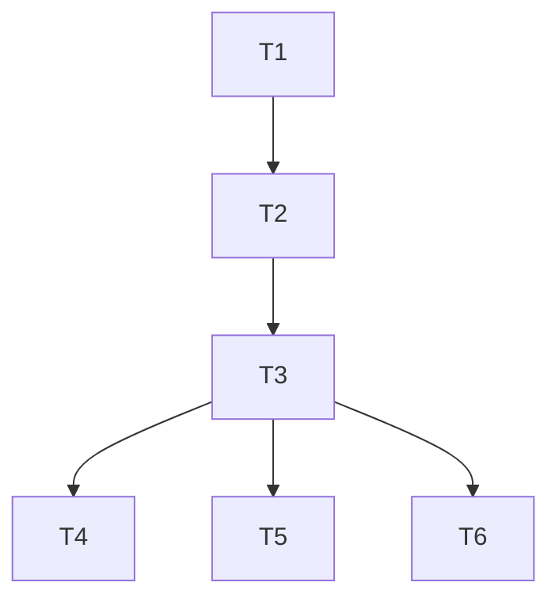

# Plan: G2 — Remove Global In-Flight Session Slot (Per-Session Routing)

> **For agentic workers:** REQUIRED SUB-SKILL: Use superpowers:subagent-driven-development (recommended) or superpowers:executing-plans to implement this plan task-by-task. Steps use checkbox (`- [ ]`) syntax for tracking.

**Goal:** Eliminate the single global in-flight session slot in `IpcServer` so concurrent `session/run` across different sessions no longer cross-contaminate `$/cancelRequest` routing and `permission/respond` ownership gating.

**Architecture:** Delete `IpcServer.session: Arc<Mutex<Option<String>>>` + `InflightSessionGuard`. Route `permission/respond` via a new read-only `PermissionModule::session_of(request_id)` peek (authoritative `request_id→session_id` map) followed by the existing `session_owner` gate. Route `$/cancelRequest` by a new additive `session_id` wire field on `CancelParams`, with a `pending_runs` single-inflight fallback for legacy clients. Add additive `session_id` to `$/permissionRequest` params for client-side session attribution. `pending_runs: HashSet<SessionId>` becomes the sole in-flight source of truth.

**Tech Stack:** Rust (workspace, 16 crates), tokio, serde/schemars (wire types + JSON Schema), tracing (warn log).

## Agent Worker Instructions

- Required sub-skills: `superpowers:subagent-driven-development` (preferred) or `superpowers:executing-plans`
- Execution mode: `subagent-driven-development` — T1→T2→T3 strictly sequential (compile-coupled); T4/T5/T6 independent (docs) — may run in parallel after T3.
- Required verification: `cargo test --workspace`, `cargo clippy --workspace --all-targets -- -D warnings`, `cargo fmt --all --check`, `cargo test -p agentj-protocol -- drift`, `cd bindings/ts && npm run generate && npm run build`
- Version bump: feature → minor (`0.5.1` → `0.6.0`). Protocol `protocol_version` stays `0.2.0` (additive wire only).

## Global Constraints

- Wire discipline: additive-only (只加不改). New fields MUST be `Option<T>` + `#[serde(skip_serializing_if = "Option::is_none")]` + `// @since 0.6.0` comment. Do NOT add `deny_unknown_fields`/`flatten`.
- Rust function/method ≤ 50 lines; lines ≤ 120 chars.
- Protocol wire fields snake_case.
- Error codes unchanged: `-32805 SessionBusy`, `-32806 NotAuthorized`, `-32800 RequestCancelled`, `-32600 InvalidRequest`.
- `PermissionRespondParams` unchanged. `protocol/methods.json` unchanged. `protocol_version 0.2.0` unchanged.
- Docs under `docs/` are tracked deliverables — commit them. Commit messages in English.
- `docs/superpowers/specs/` docs in Chinese; plan code/comments in English.
- TDD ordering: test_code first, verify it fails/does not compile, then impl_code.

---

## Tasks

### T1: Add additive `session_id` field to `CancelParams` and `PermissionRequestParams` [P0] [Sequential]

**Files:**
- Modify: `crates/agentj-protocol/src/streaming.rs` (struct + inline `mod tests`)
- Modify: `crates/agentj-protocol/src/permission.rs` (struct + inline `mod tests`)
- Modify: `crates/agentj-protocol/tests/contract.rs`
- Generated (commit): `schemas/CancelParams.json`, `schemas/PermissionRequestParams.json`, `bindings/ts/types.d.ts`

**Interfaces:**
- Consumes: `Id` (base.rs), `SessionId = String` (types.rs), existing `PermissionRequestParams`/`CancelParams`.
- Produces: `CancelParams { id: Id, session_id: Option<SessionId> }`, `PermissionRequestParams { request_id, tool, args, reason, origin_client: Option<String>, session_id: Option<SessionId> }`. All existing construction sites MUST add the field (mechanical): inline tests in both files, `contract.rs:175`, and `agentj-permission/src/module.rs:230` (fixed in T2).

```yaml
id: T1
title: "Add additive session_id field to CancelParams and PermissionRequestParams"
files:
  - crates/agentj-protocol/src/streaming.rs
  - crates/agentj-protocol/src/permission.rs
  - crates/agentj-protocol/tests/contract.rs
depends_on: []
breaking: false  # wire-additive (Option field); source-compile-coupled: constructors fixed in T2
ac:
  - given: "a CancelParams with session_id: Some(\"s-1\")"
    when: "serialized then deserialized"
    then: "session_id round-trips as Some(\"s-1\") and JSON contains \"session_id\":\"s-1\""
  - given: "a CancelParams with session_id: None and legacy wire payload {\"id\":5}"
    when: "serialized / deserialized"
    then: "serialized JSON omits session_id, and {\"id\":5} deserializes with session_id == None"
  - given: "a PermissionRequestParams with session_id: Some(\"s-1\")"
    when: "serialized"
    then: "JSON contains \"session_id\":\"s-1\""
  - given: "a PermissionRequestParams with session_id: None"
    when: "serialized"
    then: "JSON omits session_id"
  - given: "PermissionRespondParams (unchanged)"
    when: "serialized"
    then: "JSON contains only request_id and decision (no session_id field added)"
regression:
  - "streaming::tests::cancel_params_roundtrip"
  - "permission::tests::permission_request_params_serialize_snake_case"
  - "permission::tests::permission_request_params_with_origin_client / _without_origin_client_omits_field"
  - "contract::permission_request_notification_wire_shape_with_origin_client"
  - "cargo test -p agentj-protocol -- drift"
test_code: |
  // crates/agentj-protocol/src/streaming.rs (inline mod tests — replace cancel_params_roundtrip and add:)
  #[test]
  fn cancel_params_with_session_id_roundtrip() {
      let p = CancelParams { id: Id::Number(5), session_id: Some("s-1".into()) };
      let json = serde_json::to_value(&p).unwrap();
      assert_eq!(json["session_id"], "s-1");
      let back: CancelParams = serde_json::from_value(json).unwrap();
      assert_eq!(back.session_id.as_deref(), Some("s-1"));
  }

  #[test]
  fn cancel_params_without_session_id_omits_field_and_accepts_legacy_wire() {
      let p = CancelParams { id: Id::Number(5), session_id: None };
      let json = serde_json::to_value(&p).unwrap();
      assert!(json.get("session_id").is_none(), "None must not serialize");
      // Legacy client wire (pre-0.6.0) must still deserialize.
      let back: CancelParams = serde_json::from_str(r#"{"id":5}"#).unwrap();
      assert_eq!(back.id, Id::Number(5));
      assert!(back.session_id.is_none());
  }

  // crates/agentj-protocol/src/permission.rs (inline mod tests — update the 3 existing
  // PermissionRequestParams constructions to add `session_id: None`/`Some(...)`, and add:)
  #[test]
  fn permission_request_params_with_session_id() {
      let p = PermissionRequestParams {
          request_id: "req-1".into(),
          tool: "bash".into(),
          args: serde_json::json!({"command": "ls"}),
          reason: "tool default mode is ask".into(),
          origin_client: Some("conn-a".into()),
          session_id: Some("s-1".into()),
      };
      let json = serde_json::to_value(&p).unwrap();
      assert_eq!(json["session_id"], "s-1");
  }

  #[test]
  fn permission_request_params_without_session_id_omits_field() {
      let p = PermissionRequestParams {
          request_id: "req-1".into(),
          tool: "bash".into(),
          args: serde_json::json!({"command": "ls"}),
          reason: "tool default mode is ask".into(),
          origin_client: None,
          session_id: None,
      };
      let json = serde_json::to_value(&p).unwrap();
      assert!(json.get("session_id").is_none());
  }

  // crates/agentj-protocol/tests/contract.rs — update construction at L175 to add
  // `session_id: Some("s-1".into())` and extend the assertion:
  //   assert_eq!(json["params"]["session_id"], "s-1");
impl_code: |
  // crates/agentj-protocol/src/streaming.rs
  use crate::types::{ModuleState, SessionId, ToolCall}; // add SessionId to the existing import

  pub struct CancelParams {
      pub id: Id,
      /// Target session for the cancel (design G2). Additive: absent on legacy
      /// clients — the server falls back to a single-inflight session.
      #[serde(skip_serializing_if = "Option::is_none")]
      pub session_id: Option<SessionId>, // @since 0.6.0
  }

  // crates/agentj-protocol/src/permission.rs
  use crate::types::SessionId; // add to imports

  pub struct PermissionRequestParams {
      pub request_id: String,
      pub tool: String,
      pub args: serde_json::Value,
      pub reason: String,
      #[serde(skip_serializing_if = "Option::is_none")]
      pub origin_client: Option<String>,
      /// Session owning the approval (client-side UI attribution; additive).
      #[serde(skip_serializing_if = "Option::is_none")]
      pub session_id: Option<SessionId>, // @since 0.6.0
  }
verify:
  - "cargo run -p agentj-protocol --bin gen_schemas  # regenerates schemas/CancelParams.json + PermissionRequestParams.json"
  - "cargo test -p agentj-protocol  # includes drift + registry gates"
  - "cargo test -p agentj-protocol -- drift"
  - "git diff --exit-code protocol/methods.json  # methods.json unchanged (type names/directions intact)"
  - "cd bindings/ts && npm install && npm run generate && npm run build  # regenerates/commits types.d.ts"
  - "commit: feat(protocol): add session_id to CancelParams and PermissionRequestParams (G2)"
```

---

### T2: Add `PermissionModule::session_of` peek and carry `session_id` in `register_ask` [P0] [Sequential]

**Files:**
- Modify: `crates/agentj-permission/src/module.rs` (impl + inline `mod tests`)

**Interfaces:**
- Consumes: `PermissionRequestParams` from T1 (register_ask construction must add the new field — this task fixes the workspace compile), `PermissionContext.session_id`, `PermissionRequestId`, `ApprovalDecision`.
- Produces: `pub fn session_of(&self, request_id: &PermissionRequestId) -> Option<String>` (read-only peek, does not consume `pending`). `register_ask` now constructs `PermissionRequestParams { ..., session_id: Some(ctx.session_id.clone()) }` so the notifier receives it.

```yaml
id: T2
title: "Add PermissionModule::session_of peek and carry session_id in register_ask"
files:
  - crates/agentj-permission/src/module.rs
depends_on: [T1]
breaking: false
ac:
  - given: "a pending Ask approval for session \"s-1\" via module.check"
    when: "module.session_of(&request_id) is called"
    then: "returns Some(\"s-1\")"
  - given: "the same request after module.respond(&request_id, Allow)"
    when: "module.session_of(&request_id) is called"
    then: "returns None (entry consumed)"
  - given: "an unknown request_id"
    when: "module.session_of(&request_id) is called"
    then: "returns None"
  - given: "a module with a notifier installed and an Ask triggered for session \"s-9\""
    when: "the notifier fires"
    then: "received PermissionRequestParams.session_id is Some(\"s-9\")"
regression:
  - "existing respond / cancel_session / await_approval module tests"
  - "cargo test -p agentj-permission compiles (register_ask construction complete for T1 struct change)"
test_code: |
  // crates/agentj-permission/src/module.rs (inline mod tests — add:)
  #[test]
  fn session_of_peeks_pending_request_session() {
      let module = PermissionModule::new(HashMap::new(), Duration::from_secs(1));
      let ctx = PermissionContext {
          session_id: "s-1".into(),
          tool: "bash".into(),
          source: ToolSource::Builtin,
          args: serde_json::json!({"command": "ls"}),
          workspace_root: PathBuf::from("/ws"),
      };
      if let PermissionDecision::Ask { request_id } = module.check(&ctx) {
          assert_eq!(module.session_of(&request_id).as_deref(), Some("s-1"));
          assert!(module.respond(&request_id, ApprovalDecision::Allow));
          assert_eq!(module.session_of(&request_id), None, "respond consumes the entry");
      } else {
          panic!("expected Ask");
      }
  }

  #[test]
  fn session_of_unknown_request_is_none() {
      let module = PermissionModule::new(HashMap::new(), Duration::from_secs(1));
      assert_eq!(module.session_of(&PermissionRequestId("nope".into())), None);
  }

  #[test]
  fn register_ask_notifier_receives_session_id() {
      let module = PermissionModule::new(HashMap::new(), Duration::from_secs(1));
      let seen = Arc::new(Mutex::new(None::<String>));
      let seen2 = Arc::clone(&seen);
      module.set_notifier(Arc::new(move |p: &PermissionRequestParams, _sid: &str| {
          *seen2.lock().unwrap() = p.session_id.clone();
      }));
      let ctx = PermissionContext {
          session_id: "s-9".into(),
          tool: "bash".into(),
          source: ToolSource::Builtin,
          args: serde_json::json!({"command": "ls"}),
          workspace_root: PathBuf::from("/ws"),
      };
      module.check(&ctx);
      assert_eq!(seen.lock().unwrap().as_deref(), Some("s-9"));
  }
impl_code: |
  // crates/agentj-permission/src/module.rs
  /// Read-only peek of the session owning a pending approval. Does NOT consume
  /// the entry (consumption stays in `respond`). Used by the IPC layer to gate
  /// `permission/respond` by the resolved session's owner (G2 design D4).
  pub fn session_of(&self, request_id: &PermissionRequestId) -> Option<String> {
      self.pending
          .lock()
          .unwrap()
          .get(request_id)
          .map(|req| req.session_id.clone())
  }

  // And in `register_ask`, update the `PermissionRequestParams` construction to add:
  session_id: Some(ctx.session_id.clone()),
verify:
  - "cargo test -p agentj-permission"
  - "cargo test --workspace  # compile restored across the workspace after T1's struct change"
  - "commit: feat(permission): add session_of peek and carry session_id in register_ask (G2)"
```

---

### T3: Remove global session slot; route `permission/respond` and `$/cancelRequest` per-session; carry `session_id` on `$/permissionRequest` [P0] [Sequential]

**Files:**
- Modify: `crates/agentj-ipc/src/lib.rs` (struct, guards, 3 dispatch fns, notifier, inline `mod tests`)
- Modify: `crates/agentj-ipc/Cargo.toml` (add `tracing = "0.1"` dependency for the ambiguous-cancel warn)

**Interfaces:**
- Consumes: `PermissionModule::session_of` (T2), `CancelParams.session_id` (T1), `PermissionRequestParams.session_id` (T1).
- Produces: `IpcServer` without the `session` field; `dispatch_permission_respond` (route via `session_of` + `session_owner`); `dispatch_cancel_request` (route via `CancelParams.session_id`, `pending_runs` fallback); `attach_permission_notifier` wire params now include `session_id`. `pending_runs` is the sole in-flight source of truth.

```yaml
id: T3
title: "Remove global session slot; route permission/respond and cancelRequest per-session"
files:
  - crates/agentj-ipc/src/lib.rs
  - crates/agentj-ipc/Cargo.toml
depends_on: [T2]
breaking: true  # pub field IpcServer.session removed (source-breaking API); no production consumer; wire unchanged
ac:
  - given: "a pending approval for session \"s1\" owned by \"conn-a\" and a respond from \"conn-b\""
    when: "dispatched via handle_request_from(raw, \"conn-b\")"
    then: "response contains -32806 (NotAuthorized)"
  - given: "the same approval and a respond from the owner \"conn-a\""
    when: "dispatched"
    then: "response contains \"result\" and the approval resolves"
  - given: "an unknown request_id respond"
    when: "dispatched"
    then: "response contains -32600 (InvalidRequest) regardless of in-flight state"
  - given: "two sessions in-flight and $/cancelRequest {\"id\":5,\"session_id\":\"s2\"}"
    when: "dispatched"
    then: "only s2's pending approvals resolve to Deny(\"cancelled\"); s1's approvals stay pending"
  - given: "exactly one session in-flight and $/cancelRequest {\"id\":5} (no session_id)"
    when: "dispatched"
    then: "that session's pending approvals resolve to Deny(\"cancelled\") (legacy fallback)"
  - given: "zero sessions in-flight and $/cancelRequest {\"id\":5} (no session_id)"
    when: "dispatched"
    then: "response is null and no approval is resolved (no-op, legacy behavior)"
  - given: "two sessions in-flight and $/cancelRequest {\"id\":5} (no session_id)"
    when: "dispatched"
    then: "no approval is resolved (ambiguous -> no-op)"
  - given: "a run on session \"s1\" in-flight blocking on a permission Ask and a cancel with session_id of another in-flight run \"s2\""
    when: "the cancel is dispatched and s2's run task completes"
    then: "s2's run response contains -32800 and s1's run remains in-flight (pending_runs still contains \"s1\"), then completes after the owner allows its approval"
  - given: "a request whose session_of peek succeeds but the entry is consumed by a concurrent cancel/timeout before respond"
    when: "module.respond is called"
    then: "respond returns false and the dispatch returns -32600 (race fallback)"
regression:
  - "permission_respond_unknown_request_id_errors (still -32600)"
  - "id_less_notification_gets_no_response"
  - "session_new_returns_valid_id and all other existing ipc tests"
  - "cargo test --workspace -> e2e_cli / e2e_permission / e2e_serve keep passing"
test_code: |
  // crates/agentj-ipc/src/lib.rs (mod tests)

  // 1. ADAPT permission_respond_resolves_pending_approval: after `let (server, module) = permission_server();`
  //    add the owner record so the new per-session gate passes:
  //    server.registry.write().unwrap().set_session_owner("s1", "stdio");

  // 2. NEW — owner gate is per-session (cross-session contamination regression):
  #[tokio::test]
  async fn permission_respond_owner_gate_is_per_session() {
      let (server, module) = permission_server();
      server.registry.write().unwrap().set_session_owner("s1", "conn-a");
      server.registry.write().unwrap().set_session_owner("s2", "conn-b");
      let ctx1 = PermissionContext {
          session_id: "s1".into(),
          tool: "bash".into(),
          source: ToolSource::Builtin,
          args: serde_json::json!({"command": "curl x"}),
          workspace_root: PathBuf::from("/ws"),
      };
      let d1 = module.check(&ctx1);
      let PermissionDecision::Ask { request_id: rid1 } = d1 else { panic!("expected Ask") };
      let raw1 = format!(
          r#"{{"jsonrpc":"2.0","id":7,"method":"permission/respond","params":{{"request_id":"{}","decision":"allow"}}}}"#,
          rid1.0
      );
      // Non-owner of s1 must be rejected even though a different session is running.
      let resp = server.handle_request_from(&raw1, "conn-b").await.unwrap();
      assert!(resp.contains("-32806"), "non-owner must get NotAuthorized: {resp}");
      // Owner of s1 resolves it.
      let resp = server.handle_request_from(&raw1, "conn-a").await.unwrap();
      assert!(resp.contains("\"result\""), "owner must resolve: {resp}");
      // s2's approval remains independently resolvable by s2's owner.
      let ctx2 = PermissionContext {
          session_id: "s2".into(),
          tool: "bash".into(),
          source: ToolSource::Builtin,
          args: serde_json::json!({"command": "curl y"}),
          workspace_root: PathBuf::from("/ws"),
      };
      let d2 = module.check(&ctx2);
      let PermissionDecision::Ask { request_id: rid2 } = d2 else { panic!("expected Ask") };
      let raw2 = format!(
          r#"{{"jsonrpc":"2.0","id":8,"method":"permission/respond","params":{{"request_id":"{}","decision":"allow"}}}}"#,
          rid2.0
      );
      let resp = server.handle_request_from(&raw2, "conn-b").await.unwrap();
      assert!(resp.contains("\"result\""), "s2 owner must resolve: {resp}");
  }

  // 3. ADAPT cancel_request_resolves_pending_to_deny (L1282): drop the manual
  //    `*server.session.lock().await = Some("s1".into());` seeding and send the
  //    session explicitly:
  //    let raw = r#"{"jsonrpc":"2.0","method":"$/cancelRequest","params":{"id":5,"session_id":"s1"}}"#;

  // 4. REPLACE wait_for_inflight_session (L1337) with a pending_runs poller:
  async fn wait_for_pending_run(
      server: &Arc<IpcServer>,
      sid: &str,
  ) -> Result<(), tokio::time::error::Elapsed> {
      tokio::time::timeout(std::time::Duration::from_secs(5), async {
          loop {
              if server.registry.read().unwrap().pending_runs.contains(sid) {
                  return;
              }
              tokio::time::sleep(std::time::Duration::from_millis(2)).await;
          }
      })
      .await
  }

  // 5. ADAPT session_run_records_inflight_session_for_cancel (L1374): use
  //    `wait_for_pending_run(&server, &sid)`; cancel with the session_id:
  //    let cancel = format!(r#"{{"jsonrpc":"2.0","method":"$/cancelRequest","params":{{"id":5,"session_id":"{sid}"}}}}"#);
  //    and replace the final slot assertion with:
  //    assert!(!server.registry.read().unwrap().pending_runs.contains(&sid),
  //            "pending run cleared when the run finished");

  // 6. NEW — cancel with session_id routes precisely (two real concurrent runs):
  #[tokio::test]
  async fn cancel_request_with_session_id_routes_precisely() {
      let (server, module) = blocking_run_server();
      let server = Arc::new(server);
      // Capture each run's own approval request_id through the module notifier.
      let (tx, mut rx) = tokio::sync::mpsc::unbounded_channel::<(String, String)>();
      module.set_notifier(Arc::new(move |p: &PermissionRequestParams, sid: &str| {
          let _ = tx.send((sid.to_string(), p.request_id.clone()));
      }));
      let raw1 = r#"{"jsonrpc":"2.0","id":10,"method":"session/run","params":{"session_id":"s1","content":"run1"}}"#;
      let raw2 = r#"{"jsonrpc":"2.0","id":11,"method":"session/run","params":{"session_id":"s2","content":"run2"}}"#;
      let run1 = {
          let server = Arc::clone(&server);
          tokio::spawn(async move { server.handle_request_from(raw1, "conn-a").await.unwrap() })
      };
      let run2 = {
          let server = Arc::clone(&server);
          tokio::spawn(async move { server.handle_request_from(raw2, "conn-b").await.unwrap() })
      };
      // Barrier: both runs must reach the tool boundary (register_ask).
      let mut seen = std::collections::HashSet::new();
      let mut rid_s1 = None;
      let deadline = tokio::time::Instant::now() + std::time::Duration::from_secs(5);
      while seen.len() < 2 && tokio::time::Instant::now() < deadline {
          if let Ok((sid, rid)) = rx.try_recv() {
              if sid == "s1" {
                  rid_s1 = Some(rid);
              }
              seen.insert(sid);
          }
          tokio::time::sleep(std::time::Duration::from_millis(5)).await;
      }
      assert!(seen.contains("s1") && seen.contains("s2"), "both runs must block on Ask: {seen:?}");
      // Cancel s2 precisely; s1 must be untouched.
      let cancel = r#"{"jsonrpc":"2.0","method":"$/cancelRequest","params":{"id":5,"session_id":"s2"}}"#;
      let _ = server.handle_request_from(cancel, "conn-a").await.unwrap();
      let resp2 = tokio::time::timeout(std::time::Duration::from_secs(5), run2)
          .await
          .expect("cancelled run must finish")
          .unwrap();
      assert!(resp2.contains("-32800"), "cancelled run must get RequestCancelled: {resp2}");
      assert!(
          server.registry.read().unwrap().pending_runs.contains("s1"),
          "s1 must remain in-flight"
      );
      // Owner allows s1's approval -> s1 completes normally.
      let rid1 = rid_s1.expect("s1 request_id captured");
      let raw_ok = format!(
          r#"{{"jsonrpc":"2.0","id":12,"method":"permission/respond","params":{{"request_id":"{}","decision":"allow"}}}}"#,
          rid1
      );
      let _ = server.handle_request_from(&raw_ok, "conn-a").await.unwrap();
      let resp1 = tokio::time::timeout(std::time::Duration::from_secs(5), run1)
          .await
          .expect("non-cancelled run must finish")
          .unwrap();
      assert!(resp1.contains("\"result\""), "non-cancelled run must complete: {resp1}");
  }

  // 7. NEW — legacy fallback: single in-flight session, no session_id:
  #[tokio::test]
  async fn cancel_request_without_session_id_single_inflight_falls_back() {
      let (server, module) = blocking_run_server();
      assert!(server.registry.write().unwrap().try_acquire_run("s1"));
      let ctx = PermissionContext {
          session_id: "s1".into(),
          tool: "bash".into(),
          source: ToolSource::Builtin,
          args: serde_json::json!({"command": "curl x"}),
          workspace_root: PathBuf::from("/ws"),
      };
      if let PermissionDecision::Ask { request_id } = module.check(&ctx) {
          let module2 = module.clone();
          let rid = request_id.clone();
          let handle = tokio::spawn(async move { module2.await_approval(&rid).await });
          tokio::time::sleep(std::time::Duration::from_millis(10)).await;
          let raw = r#"{"jsonrpc":"2.0","method":"$/cancelRequest","params":{"id":5}}"#;
          let _ = server.handle_request(raw).await.unwrap();
          assert_eq!(
              handle.await.unwrap(),
              PermissionDecision::Deny { reason: "cancelled".into() }
          );
      } else {
          panic!("expected Ask");
      }
  }

  // 8. NEW — ambiguous: two in-flight sessions, no session_id -> no-op:
  #[tokio::test]
  async fn cancel_request_without_session_id_multiple_inflight_is_noop() {
      let (server, module) = blocking_run_server();
      assert!(server.registry.write().unwrap().try_acquire_run("s1"));
      assert!(server.registry.write().unwrap().try_acquire_run("s2"));
      let ctx = PermissionContext {
          session_id: "s1".into(),
          tool: "bash".into(),
          source: ToolSource::Builtin,
          args: serde_json::json!({"command": "curl x"}),
          workspace_root: PathBuf::from("/ws"),
      };
      let PermissionDecision::Ask { request_id } = module.check(&ctx) else {
          panic!("expected Ask")
      };
      let module2 = module.clone();
      let rid = request_id.clone();
      let handle = tokio::spawn(async move { module2.await_approval(&rid).await });
      tokio::time::sleep(std::time::Duration::from_millis(10)).await;
      let raw = r#"{"jsonrpc":"2.0","method":"$/cancelRequest","params":{"id":5}}"#;
      let _ = server.handle_request(raw).await.unwrap();
      let out = tokio::time::timeout(std::time::Duration::from_millis(200), handle).await;
      assert!(out.is_err(), "ambiguous cancel must NOT resolve approvals");
  }
impl_code: |
  // crates/agentj-ipc/src/lib.rs

  // 1. Delete the field + guard (L283-309) and construction (L338):
  //    - pub session: Arc<tokio::sync::Mutex<Option<String>>>,   // DELETE
  //    - struct InflightSessionGuard ... + impl ...              // DELETE
  //    - session: Arc::new(tokio::sync::Mutex::new(None)),       // DELETE from IpcServer::new
  // 2. In dispatch_session_run (L609-612) delete the record call + comment:
  //    - let _inflight = InflightSessionGuard::record(&self.session, sid).await;   // DELETE
  //    (RunGuard + pending_runs remain — they are the in-flight source of truth.)

  // 3. Rewrite dispatch_permission_respond — per-session owner gate via module peek:
  async fn dispatch_permission_respond(
      &self,
      req: &JsonRpcRequest,
      conn_id: &str,
  ) -> Result<Value, DispatchError> {
      let params = req
          .params
          .as_ref()
          .ok_or_else(|| DispatchError::invalid_request("missing params"))?;
      let params: PermissionRespondParams = serde_json::from_value(params.clone())
          .map_err(|e| DispatchError::invalid_request(e.to_string()))?;
      let module = self
          .permission_module
          .clone()
          .ok_or_else(|| DispatchError::invalid_request("no permission module"))?;
      let rid = agentj_core::permission::PermissionRequestId(params.request_id);
      // Per-session owner gate (决策 #5, G2): resolve the request's session from
      // the module's authoritative request_id→session map, then gate on its owner.
      let sid = module.session_of(&rid).ok_or_else(|| {
          DispatchError::invalid_request(format!("unknown permission request: {}", rid.0))
      })?;
      let is_owner = self
          .registry
          .read()
          .ok()
          .and_then(|r| r.session_owner(&sid).cloned())
          .map(|owner| owner == conn_id)
          .unwrap_or(false);
      if !is_owner {
          return Err(DispatchError {
              code: error_codes::NOT_AUTHORIZED,
              message: "NotAuthorized".into(),
          });
      }
      let decision = match params.decision {
          agentj_protocol::permission::PermissionDecision::Allow => ApprovalDecision::Allow,
          agentj_protocol::permission::PermissionDecision::Deny => ApprovalDecision::Deny,
          agentj_protocol::permission::PermissionDecision::AllowAlways => {
              ApprovalDecision::AllowAlways
          }
          agentj_protocol::permission::PermissionDecision::Unknown => {
              return Err(DispatchError::invalid_request("unknown decision"));
          }
      };
      if !module.respond(&rid, decision) {
          return Err(DispatchError::invalid_request(format!(
              "unknown permission request: {}",
              rid.0
          )));
      }
      Ok(serde_json::json!({}))
  }

  // 4. Rewrite dispatch_cancel_request — session_id routing + pending_runs fallback:
  async fn dispatch_cancel_request(&self, req: &JsonRpcRequest) -> Result<Value, DispatchError> {
      let params: CancelParams = serde_json::from_value(
          req.params.clone().unwrap_or(serde_json::json!({})),
      )
      .map_err(|e| DispatchError::invalid_request(e.to_string()))?;
      let session_id = match params.session_id {
          Some(sid) => Some(sid),
          None => {
              // Legacy fallback (pre-0.6.0 clients omit session_id): route only
              // when exactly one session is in-flight; ambiguous → no-op.
              let inflight: Vec<String> = self
                  .registry
                  .read()
                  .ok()
                  .map(|r| r.pending_runs.iter().cloned().collect())
                  .unwrap_or_default();
              match inflight.len() {
                  1 => Some(inflight[0].clone()),
                  n => {
                      if n > 1 {
                          tracing::warn!(
                              "$/cancelRequest without session_id is ambiguous \
                               ({} in-flight); ignoring",
                              n
                          );
                      }
                      None
                  }
              }
          }
      };
      if let Some(ref sid) = session_id {
          if let Some(module) = self.permission_module.as_ref() {
              let _ = module.cancel_session(sid, "cancelled");
          }
          let (tx, _rx) = tokio::sync::oneshot::channel();
          let _ = self.kernel.sender().send(KernelMessage::ServiceCall {
              service: "agent".into(),
              method: "cancel".into(),
              params: serde_json::json!({"session_id": sid}),
              reply: Arc::new(StdMutex::new(Some(tx))),
          });
      }
      Ok(serde_json::Value::Null)
  }

  // 5. attach_permission_notifier (L845-855): add session_id to the wire params:
  //    "params": {
  //        "request_id": p.request_id,
  //        "tool": p.tool,
  //        "args": p.args,
  //        "reason": p.reason,
  //        "origin_client": owner.clone(),
  //        "session_id": p.session_id,          // ADD — @since 0.6.0
  //    },

  // crates/agentj-ipc/Cargo.toml — add to [dependencies]:
  // tracing = "0.1"
verify:
  - "cargo test -p agentj-ipc  # all adapted + 5 new tests"
  - "cargo test --workspace  # e2e_cli / e2e_permission / e2e_serve regression"
  - "cargo clippy -p agentj-ipc -- -D warnings"
  - "commit: feat(ipc): per-session routing for cancel and permission respond (G2)"
```

---

### T4: Update protocol spec and gap archive [P1] [Parallel with T5, T6]

**Files:**
- Modify: `docs/specs/ipc-protocol.md` (§6 Cancel, §8.15 `$/permissionRequest`, §8.16 `$/cancelRequest`)
- Modify: `docs/superpowers/specs/2026-08-30-gap-analysis-vs-original-design.md` (G2 row status)

```yaml
id: T4
title: "Update protocol spec and gap archive for G2"
files:
  - docs/specs/ipc-protocol.md
  - docs/superpowers/specs/2026-08-30-gap-analysis-vs-original-design.md
depends_on: [T3]
breaking: false
ac:
  - given: "the committed spec"
    when: "sections §6, §8.15, §8.16 are updated"
    then: "session_id is documented as an optional field with @since 0.6.0 and the missing-field fallback behavior (single-inflight fallback; multi-inflight no-op) is stated"
  - given: "the gap archive"
    when: "the G2 row and G2-G8 hint block are updated"
    then: "G2 status reads ✅ 已实现 with a link to the design doc and plan"
regression:
  - "protocol_version 0.2.0 stays unchanged in methods.json and spec (additive-only)"
test_code: |
  <!-- docs/specs/ipc-protocol.md §6 (Cancel) + §8.16 ($/cancelRequest): add the optional field to the
       params table and a behavior note:
       `session_id` (string, optional, @since 0.6.0) — target session for the cancel.
       When omitted, the server cancels the single in-flight session if exactly one
       exists; if zero or multiple are in-flight the cancel is ignored (no-op).
       §8.15 ($/permissionRequest): add
       `session_id` (string, optional, @since 0.6.0) — session owning the approval.
  -->
  <!-- docs/superpowers/specs/2026-08-30-gap-analysis-vs-original-design.md:
       G2 row status → ✅ 已实现（design + plan + impl，v0.6.0）;
       G2-G8 hint block → point to design + plan docs. -->
impl_code: |
  <!-- Apply the edits described in test_code (docs are the deliverable). -->
verify:
  - "git diff review of both docs"
  - "commit: docs: update ipc-protocol spec and gap archive for G2 per-session routing"
```

---

### T5: Bump version 0.5.1 → 0.6.0 [P1] [Parallel with T4, T6]

**Files:**
- Modify: `Cargo.toml` (workspace root `version`)
- Generated (commit): `Cargo.lock`

```yaml
id: T5
title: "Bump workspace version 0.5.1 to 0.6.0"
files:
  - Cargo.toml
depends_on: [T3]
breaking: false
ac:
  - given: "the workspace root Cargo.toml"
    when: "version is set to 0.6.0"
    then: "cargo metadata reports all 16 crates at 0.6.0 (workspace-inherited) and Cargo.lock is updated"
regression:
  - "cargo test --workspace still compiles at 0.6.0"
test_code: |
  # Assert the pre-bump version first (fails until the file is edited):
  grep '^version = "0.5.1"' Cargo.toml && echo "bump needed"
impl_code: |
  # Cargo.toml (workspace root, line 6):
  version = "0.6.0"
verify:
  - "cargo build --workspace  # regenerates Cargo.lock"
  - "grep '^version = \"0.6.0\"' Cargo.toml"
  - "commit: chore: bump version to 0.6.0 (T5)"
```

---

### T6: Sync AGENTS.md, README.md, summary after G2 completion [P1] [Parallel with T4, T5]

**Files:**
- Modify: `AGENTS.md`
- Modify: `README.md`
- Modify: `.claude/summary/summary_and_next.md`

```yaml
id: T6
title: "Sync AGENTS.md, README.md and summary after G2 completion"
files:
  - AGENTS.md
  - README.md
  - .claude/summary/summary_and_next.md
depends_on: [T3]
breaking: false
ac:
  - given: "the feature merged into the codebase"
    when: "the three docs are updated"
    then: "each reflects v0.6.0, the removed global session slot, and the per-session routing behavior; the summary file contains only the G2 implementation phase content"
regression: []
test_code: |
  <!-- AGENTS.md: version line → v0.6.0 + "per-session in-flight routing"; architecture note for
       agentj-ipc: remove "session 单全局槽" wording → "per-session 路由（pending_runs 事实来源 +
       module.session_of 查表门控 + CancelParams.session_id）"。
       README.md: version tagline + Features checklist (per-session routing; $/cancelRequest
       session_id; $/permissionRequest session_id)。
       summary: replace with G2 implementation phase (progress, verification, next steps). -->
impl_code: |
  <!-- Apply the edits described in test_code (docs are the deliverable). -->
verify:
  - "git diff review of all three docs"
  - "commit: docs: auto-sync AGENTS.md, README.md, summary after G2 routing completion"
```

---

## Dependency Graph



## Parallel Execution Groups

- Group A (sequential, compile-coupled): T1 → T2 → T3 — each task changes a public struct the next constructs, so they must run in order.
- Group B (independent, after T3): T4, T5, T6 — docs/version/readme sync touch disjoint files; may run in parallel.

## Notes for the executor

- T1 verify is scoped to `-p agentj-protocol`; the workspace does NOT compile between T1 and T2 (register_ask construction is fixed in T2) — do not run full `--workspace` gates between them.
- The `permission_respond_resolves_pending_approval` adaptation (T3 test_code item 1) is mandatory: under the new per-session gate a respond for a session with no recorded owner is rejected with `-32806`, so the test must record the owner first.
- Error-code ordering changed (documented in design §错误处理): respond now checks request existence (`-32600`) before ownership (`-32806`). The `permission_respond_owner_gate_is_per_session` test locks this in.
- T3 is intentionally one task: the field deletion and the `$/cancelRequest` rewrite are compile-coupled (tests referencing the deleted `server.session` field cannot compile in an intermediate state), so splitting would break the "crate must compile after each task" invariant. It was explicitly reviewed and accepted as oversized-but-justified by the plan validation gate.
- `breaking` flags: T1 is wire-additive (`breaking: false`); T3 removes the `pub` field `IpcServer.session` (`breaking: true`) — no production consumer exists (grep-verified: only lib.rs itself + its tests reference it), so this is internal API churn under a minor version bump.