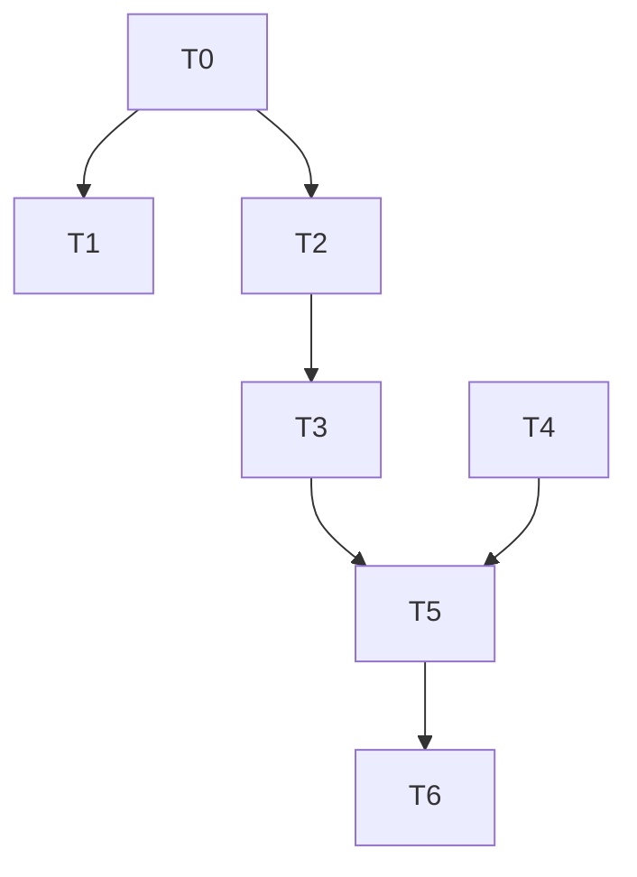

# G4: Session Persistence Production Wiring — Implementation Plan

> **For agentic workers:** REQUIRED SUB-SKILL: Use superpowers:subagent-driven-development (recommended) or superpowers:executing-plans to implement this plan task-by-task. Steps use checkbox (`- [ ]`) syntax for tracking.

**Goal:** Wire `FileBackedStore` (disk-persisted session store) into the CLI production path so sessions survive process restart, and fix two disk-write defects (fixed `.tmp` naming collision + missing directory fsync).

**Architecture:** Promote expiry (`scan_expired`/`spawn_expiry_loop`) from `InMemoryStore`-inherent to the `SessionStore` trait (default no-op for scan, shared loop wrapper); `FileBackedStore` implements a disk-based `scan_expired` using the `updated` timestamp ledger and a unique-tmp + directory-fsync `persist()`. Add an additive `[session] dir` config section. CLI resolves the session dir (XDG default + config override) and instantiates `FileBackedStore` once, shared across `run`/`serve`/`serve --port`/`dashboard`.

**Tech Stack:** Rust 1.96+ workspace; `agentj-core` (SessionStore trait), `agentj-session` (FileBackedStore/InMemoryStore), `agentj-config` (TOML config), `agentj-cli` (binary). No new external crates (XDG via `std::env`, dir fsync via `std::fs`).

## Global Constraints

- Protocol wire surface: **zero change** (no `session/run` retry/checkpoint/resume; `$/progress` streaming preserved).
- No new external dependencies (D1 XDG via `std::env`; D3 directory fsync via `std::fs::File::sync_all`).
- `FileBackedStore` storage model unchanged (one JSON file per session + full rewrite on mutation).
- Cross-process same-session concurrent writes: NOT locked (unique tmp name avoids tmp clobber; last-rename-wins accepted — abnormal scenario, D3 scoped to tmp+fsync only).
- Rust functions ≤50 lines; lines ≤120 chars (AGENTS.md).
- TDD: `test_code` written first, verified to fail, then `impl_code`.
- Every task keeps `cargo test --workspace` + `cargo clippy --workspace --all-targets -- -D warnings` green.
- Version bump: feature → minor. Current workspace version `0.6.0` → `0.7.0`.

---

## File Structure Map

| File | Responsibility | Tasks |
|------|----------------|-------|
| `crates/agentj-core/src/module.rs` | `SessionStore` trait — add `scan_expired` + `spawn_expiry_loop` defaults | T0 |
| `crates/agentj-session/src/lib.rs` | `InMemoryStore` — move inherent expiry into trait impl | T1 |
| `crates/agentj-session/src/file_store.rs` | `FileBackedStore` — disk `scan_expired` + unique-tmp/fsync `persist` | T2, T3 |
| `crates/agentj-config/src/lib.rs` | `[session] dir` config section | T4 |
| `crates/agentj-config/src/merge.rs` | merge `[session] dir` | T4 |
| `crates/agentj-cli/src/main.rs` | `resolve_session_dir` + switch to `FileBackedStore` | T5 |
| `Cargo.toml` + `Cargo.lock` + `AGENTS.md`/`README.md`/`.agents/summary/summary_and_next.md` | version bump + doc sync | T6 |

---

## Tasks

### T0: Add scan_expired + spawn_expiry_loop to SessionStore trait [P0] [Sequential]

**Files:**
- Modify: `crates/agentj-core/src/module.rs`
- Test: `crates/agentj-core/src/module.rs` (inline `#[cfg(test)]`)

**Interfaces:**
- Consumes: `crate::hooks::EventBus`, `crate::module::EventType`, `crate::types::now_epoch_secs`, `std::time::Duration`, `tokio`
- Produces:
  - `trait SessionStore::scan_expired(&self, ttl: Duration, now_epoch: u64, bus: &EventBus) -> Result<usize, ModuleError>` (default `Ok(0)`)
  - `trait SessionStore::spawn_expiry_loop(self: Arc<Self>, bus: Arc<EventBus>, ttl: Duration, interval: Duration) -> tokio::task::JoinHandle<()>` (default: `tokio::spawn` loop calling `self.scan_expired`)

```yaml
- id: T0
  title: "Add scan_expired + spawn_expiry_loop to SessionStore trait with defaults"
  files:
    - crates/agentj-core/src/module.rs
  depends_on: []
  breaking: true            # SessionStore trait gains methods (additive-default, not breaking for impls; marked for crate-boundary change)
  ac:
    - given: "the SessionStore trait is defined in module.rs"
      when: "a consumer calls scan_expired on a store that does not override it"
      then: "it returns Ok(0) without error"
    - given: "a store that overrides scan_expired is wrapped in Arc and spawn_expiry_loop is called"
      when: "the default spawn_expiry_loop runs one tick"
      then: "it invokes scan_expired and does not panic"
  regression:
    - "crates/agentj-core tests compile and pass after trait change"
  test_code: |
    // In crates/agentj-core/src/module.rs #[cfg(test)]:
    struct NoExpiryStore;
    impl SessionStore for NoExpiryStore {}

    #[test]
    fn scan_expired_default_is_noop() {
        let store = NoExpiryStore;
        let n = store.scan_expired(Duration::from_secs(60), 0, &crate::hooks::EventBus::new()).unwrap();
        assert_eq!(n, 0);
    }
  impl_code: |
    // Inside `pub trait SessionStore: Send + Sync { ... }` add (after load_all):
    /// Archive every Active session idle longer than `ttl`, publishing
    /// EventType::SessionExpired per archived session; returns archived count.
    /// Default: no-op for stores without expiry support.
    fn scan_expired(
        &self,
        _ttl: std::time::Duration,
        _now_epoch: u64,
        _bus: &crate::hooks::EventBus,
    ) -> Result<usize, ModuleError> {
        Ok(0)
    }

    /// Production expiry loop: every `interval`, scan with the current unix time.
    /// Default implementation drives `scan_expired` on a tokio interval.
    fn spawn_expiry_loop(
        self: std::sync::Arc<Self>,
        bus: std::sync::Arc<crate::hooks::EventBus>,
        ttl: std::time::Duration,
        interval: std::time::Duration,
    ) -> tokio::task::JoinHandle<()> {
        tokio::spawn(async move {
            let mut ticker = tokio::time::interval(interval);
            loop {
                ticker.tick().await;
                let _ = self.scan_expired(ttl, crate::types::now_epoch_secs(), &bus);
            }
        })
    }
  verify:
    - "cargo test -p agentj-core scan_expired_default_is_noop"
    - "cargo clippy --workspace --all-targets -- -D warnings"
```

### T1: Move InMemoryStore expiry into SessionStore trait impl [P0] [Parallel with T2]

**Files:**
- Modify: `crates/agentj-session/src/lib.rs`
- Test: `crates/agentj-session/src/lib.rs` (inline `#[cfg(test)]`)

**Interfaces:**
- Consumes: `SessionStore::scan_expired` / `SessionStore::spawn_expiry_loop` trait methods (T0)
- Produces: `InMemoryStore` satisfies the trait by overriding `scan_expired` (existing behavior); the inherent impls are moved into `impl SessionStore for InMemoryStore`. NOTE: `spawn_expiry_loop(self: Arc<Self>, ...)` is NOT object-safe (`Self: Sized` via `Arc<Self>`), so it is called on a concrete `Arc<Store>`, never via `Arc<dyn SessionStore>`.

```yaml
- id: T1
  title: "Move InMemoryStore scan_expired/spawn_expiry_loop to satisfy SessionStore trait"
  files:
    - crates/agentj-session/src/lib.rs
  depends_on: [T0]
  breaking: false
  ac:
    - given: "an InMemoryStore with a stale last_activity ledger"
      when: "scan_expired is called via the trait with a small ttl and explicit now"
      then: "the stale session is archived, SessionExpired is published, and the archived count is returned"
    - given: "an InMemoryStore with a fresh session"
      when: "scan_expired is called with a ttl larger than the idle time"
      then: "no session is archived and count is 0"
  regression:
    - "existing `scan_expired_archives_and_publishes` test still passes"
    - "existing `scan_keeps_fresh_sessions_active` test still passes"
  test_code: |
    // The two existing expiry tests already cover the behavior; they remain the
    // guard. Add one trait-dispatch test:
    use std::sync::Arc;
    #[test]
    fn expiry_reachable_through_trait_object() -> Result<(), ModuleError> {
        let store: Arc<dyn SessionStore> = Arc::new(InMemoryStore::with_clock(|| 90));
        let sid = store.create()?;
        store.append(&sid, ChatMessage::user("hello"))?;
        let n = store.scan_expired(Duration::from_secs(5), 100, &EventBus::new())?;
        assert_eq!(n, 1);
        assert_eq!(store.status(&sid)?, SessionStatus::Archived);
        Ok(())
    }
  impl_code: |
    // Move the inherent `scan_expired` and `spawn_expiry_loop` bodies from the
    // `impl InMemoryStore { ... }` block into `impl SessionStore for InMemoryStore { ... }`
    // (replacing the trait defaults). The bodies are unchanged; signatures now
    // match the trait. `spawn_expiry_loop(self: Arc<Self>, ...)` uses Arc<Self>
    // per the trait signature.
  verify:
    - "cargo test -p agentj-session expiry"
    - "cargo test -p agentj-session expiry_reachable_through_trait_object"
    - "cargo clippy --workspace --all-targets -- -D warnings"
```

### T2: FileBackedStore disk scan_expired [P0] [Parallel with T1]

**Files:**
- Modify: `crates/agentj-session/src/file_store.rs`
- Test: `crates/agentj-session/src/file_store.rs` (inline `#[cfg(test)]`)

**Interfaces:**
- Consumes: `SessionStore::scan_expired` trait method (T0); `FileBackedStore.updated: Mutex<HashMap<SessionId, u64>>` ledger; `SessionStatus::Active`
- Produces: `FileBackedStore::scan_expired(ttl, now_epoch, bus) -> Result<usize, ModuleError>` overriding the trait default — archives sessions whose `updated` timestamp is older than `ttl` and status is `Active`, publishing `EventType::SessionExpired`.

```yaml
- id: T2
  title: "Implement disk-based scan_expired on FileBackedStore using updated ledger"
  files:
    - crates/agentj-session/src/file_store.rs
  depends_on: [T0]
  breaking: false
  ac:
    - given: "a FileBackedStore with a session whose updated timestamp is stale"
      when: "scan_expired is called with a ttl smaller than the idle gap and an explicit now"
      then: "the session is archived on disk and the SessionExpired event is published"
    - given: "a FileBackedStore with a fresh Active session"
      when: "scan_expired is called with a ttl larger than the idle time"
      then: "no session is archived and count is 0"
    - given: "an Archived session in a FileBackedStore"
      when: "scan_expired runs"
      then: "the Archived session is not re-archived (skipped)"
  regression:
    - "existing `append_persists_and_restart_recovers` test still passes"
    - "existing `archive_and_delete_update_disk` test still passes"
  test_code: |
    use std::sync::Arc;
    #[test]
    fn file_store_scan_expired_archives_stale() -> Result<(), ModuleError> {
        let d = dir();
        let store = Arc::new(FileBackedStore::new(d.path())?);
        let sid = store.create()?; // updated = now (real clock)
        // Overwrite the updated ledger entry to a stale value to make it deterministic:
        {
            let mut u = store.updated.lock().unwrap_or_else(|p| p.into_inner());
            u.insert(sid.clone(), 90);
        }
        let bus = EventBus::new();
        let n = store.scan_expired(Duration::from_secs(5), 100, &bus)?;
        assert_eq!(n, 1);
        assert_eq!(store.status(&sid)?, SessionStatus::Archived);
        Ok(())
    }
    #[test]
    fn file_store_scan_expired_keeps_fresh() -> Result<(), ModuleError> {
        let d = dir();
        let store = FileBackedStore::new(d.path())?;
        let sid = store.create()?;
        let n = store.scan_expired(Duration::from_secs(60), 0, &EventBus::new())?;
        assert_eq!(n, 0);
        assert_eq!(store.status(&sid)?, SessionStatus::Active);
        Ok(())
    }
  impl_code: |
    // Inside `impl SessionStore for FileBackedStore { ... }` add:
    fn scan_expired(
        &self,
        ttl: std::time::Duration,
        now_epoch: u64,
        bus: &agentj_core::hooks::EventBus,
    ) -> Result<usize, ModuleError> {
        let ledger: Vec<(SessionId, u64)> = lock_guard(&self.updated)
            .iter()
            .map(|(sid, t)| (sid.clone(), *t))
            .collect();
        let mut expired = Vec::new();
        for (sid, last) in ledger {
            let active = matches!(
                lock_guard(&self.statuses).get(&sid),
                Some(SessionStatus::Active)
            );
            if now_epoch.saturating_sub(last) > ttl.as_secs() && active {
                expired.push(sid);
            }
        }
        for sid in &expired {
            self.archive(sid)?;
            bus.publish(&agentj_core::module::EventType::SessionExpired(sid.clone()));
        }
        Ok(expired.len())
    }
  verify:
    - "cargo test -p agentj-session file_store_scan_expired"
    - "cargo clippy --workspace --all-targets -- -D warnings"
```

### T3: FileBackedStore unique tmp naming + directory fsync [P1] [Sequential after T2]

**Files:**
- Modify: `crates/agentj-session/src/file_store.rs`
- Test: `crates/agentj-session/src/file_store.rs` (inline `#[cfg(test)]`)

**Interfaces:**
- Consumes: `FileBackedStore::persist`, `Self::path_for`, `uuid::Uuid`
- Produces: `persist()` writes to a unique tmp `sid.<uuid>.json.tmp`, fsyncs the file, renames to `sid.json`, then fsyncs the containing directory (durable rename).

```yaml
- id: T3
  title: "Make FileBackedStore persist use unique tmp name and fsync directory"
  files:
    - crates/agentj-session/src/file_store.rs
  depends_on: [T2]
  breaking: false
  ac:
    - given: "a FileBackedStore persisting a session"
      when: "persist completes"
      then: "no fixed-name `<sid>.json.tmp` remains and the final `<sid>.json` is readable"
    - given: "two FileBackedStore instances writing the same session concurrently"
      when: "both call append+persist"
      then: "they do not clobber each other's tmp file (unique tmp names) and both produce a valid `<sid>.json`"
  regression:
    - "existing `append_persists_and_restart_recovers` test still passes"
    - "existing `leftover_tmp_cleaned_on_construction` test still passes"
  test_code: |
    #[test]
    fn persist_uses_unique_tmp_and_leaves_no_fixed_tmp() -> Result<(), ModuleError> {
        let d = dir();
        let path = d.path().to_path_buf();
        let store = FileBackedStore::new(&path)?;
        let sid = store.create()?;
        store.append(&sid, ChatMessage::user("hi"))?;
        // No fixed-name tmp should remain after a successful persist.
        assert!(!path.join(format!("{sid}.json.tmp")).exists());
        assert!(path.join(format!("{sid}.json")).exists());
        Ok(())
    }

    #[test]
    fn concurrent_stores_do_not_clobber_tmp() -> Result<(), ModuleError> {
        let d = dir();
        let path = d.path().to_path_buf();
        let a = FileBackedStore::new(&path)?;
        let b = FileBackedStore::new(&path)?;
        let sid = a.create()?;
        a.append(&sid, ChatMessage::user("from-a"))?;
        b.append(&sid, ChatMessage::user("from-b"))?;
        let snap = a.load_all()?;
        assert_eq!(snap.len(), 1);
        // Both writes landed; the file is valid JSON.
        let reloaded = FileBackedStore::new(&path)?;
        assert_eq!(reloaded.load_all()?.len(), 1);
        Ok(())
    }
  impl_code: |
    // Replace the persist() tmp-write tail (currently `let tmp = self.path_for(sid).with_extension("json.tmp");`)
    // with a unique tmp name and a directory fsync after rename:
    let tmp = self.dir.join(format!("{sid}.{}.json.tmp", uuid::Uuid::new_v4()));
    let mut f = fs::File::create(&tmp).map_err(|e| persistence_err(e.to_string()))?;
    f.write_all(&raw)
        .and_then(|_| f.sync_all())
        .map_err(|e| persistence_err(e.to_string()))?;
    drop(f);
    fs::rename(&tmp, self.path_for(sid)).map_err(|e| persistence_err(e.to_string()))?;
    // Durably persist the rename: fsync the containing directory. A directory
    // fsync failure means the rename's durability is not guaranteed — propagate
    // PersistenceFailed (per design 错误处理).
    let dir_f = fs::File::open(&self.dir).map_err(|e| persistence_err(e.to_string()))?;
    dir_f.sync_all().map_err(|e| persistence_err(e.to_string()))?;
  verify:
    - "cargo test -p agentj-session persist_uses_unique_tmp_and_leaves_no_fixed_tmp"
    - "cargo test -p agentj-session concurrent_stores_do_not_clobber_tmp"
    - "cargo clippy --workspace --all-targets -- -D warnings"
```

### T4: Add [session] dir config section [P1] [Parallel with T0/T1/T2/T3]

**Files:**
- Modify: `crates/agentj-config/src/lib.rs`
- Modify: `crates/agentj-config/src/merge.rs`
- Test: `crates/agentj-config/src/lib.rs` (inline `#[cfg(test)]`)

**Interfaces:**
- Consumes: serde `Deserialize`, `PathBuf`
- Produces:
  - `struct SessionConfig { pub dir: Option<PathBuf> }`
  - `AgentJConfig::session: Option<SessionConfig>` (`#[serde(default)]`)
  - `merge_config` overlays `file.session` when present
  - `Config::inner().session` reachable by CLI

```yaml
- id: T4
  title: "Add additive [session] dir section to agentj-config"
  files:
    - crates/agentj-config/src/lib.rs
    - crates/agentj-config/src/merge.rs
  depends_on: []
  breaking: false
  ac:
    - given: "a config.toml with `[session] dir = \"/tmp/sess\"`"
      when: "Config::load parses it"
      then: "inner().session is Some and its dir is Some(\"/tmp/sess\")"
    - given: "a config.toml without a [session] section"
      when: "Config::load parses it"
      then: "inner().session is None"
    - given: "a file config providing [session] dir over an empty base"
      when: "merge_config runs"
      then: "the file session.dir wins"
  regression:
    - "existing `loads_default_config` test still passes"
    - "existing `permission_section_defaults_when_absent` test still passes"
  test_code: |
    #[test]
    fn session_dir_section_parses() {
        let cfg: AgentJConfig = toml::from_str("[session]\ndir = \"/tmp/sess\"\n").unwrap();
        assert_eq!(cfg.session.as_ref().unwrap().dir.as_deref(), Some("/tmp/sess"));
    }

    #[test]
    fn session_section_absent_is_none() {
        let cfg: AgentJConfig = toml::from_str("").unwrap();
        assert!(cfg.session.is_none());
    }

    #[test]
    fn session_dir_merges_from_file() {
        let base = AgentJConfig::default();
        let file = AgentJConfig {
            session: Some(SessionConfig { dir: Some("/tmp/x".into()) }),
            ..AgentJConfig::default()
        };
        let merged = crate::merge::merge_config(base, file);
        assert_eq!(merged.session.as_ref().unwrap().dir.as_deref(), Some("/tmp/x"));
    }
  impl_code: |
    // lib.rs — add near ModelSection:
    use std::path::PathBuf;

    #[derive(Debug, Clone, Deserialize)]
    pub struct SessionConfig {
        /// Persisted session directory; None → XDG default at CLI resolution time.
        #[serde(default)]
        pub dir: Option<PathBuf>,
    }

    // In AgentJConfig:
    #[derive(Debug, Clone, Deserialize)]
    pub struct AgentJConfig {
        #[serde(default)]
        pub model: ModelSection,
        #[serde(default)]
        pub permission: Option<agentj_permission::PermissionConfig>,
        #[serde(default)]
        pub session: Option<SessionConfig>,
    }

    // merge.rs — in merge_config, after the permission overlay:
    if file.session.is_some() {
        config.session = file.session;
    }

    // lib.rs — ConfigProvider::get_str: expose the session dir key (design 关键改动点#3):
    fn get_str(&self, key: &str) -> Option<String> {
        match key {
            "model.provider" => Some(self.inner.model.provider.clone()),
            "model.default_model" => Some(self.inner.model.default_model.clone()),
            "session.dir" => self
                .inner
                .session
                .as_ref()
                .and_then(|s| s.dir.clone())
                .map(|p| p.to_string_lossy().to_string()),
            _ => None,
        }
    }
  verify:
    - "cargo test -p agentj-config session_dir"
    - "cargo test -p agentj-config"
    - "cargo clippy --workspace --all-targets -- -D warnings"
```

### T5: CLI resolve_session_dir + switch to FileBackedStore [P0] [Sequential after T3, T4]

**Files:**
- Modify: `crates/agentj-cli/src/main.rs`
- Test: `crates/agentj-cli/src/main.rs` (inline `#[cfg(test)]`)

**Interfaces:**
- Consumes: `agentj_config::Config::inner().session.dir` (T4), `agentj_session::FileBackedStore::new(&Path)` + `SessionStore::spawn_expiry_loop` trait method (T0/T2/T3)
- Produces: `fn resolve_session_dir(cfg: &agentj_config::Config) -> PathBuf` — config `[session] dir` if set, else `$XDG_DATA_HOME/agentj/sessions`, else `$HOME/.local/share/agentj/sessions`. `main()` instantiates `Arc<FileBackedStore>` once, shared across all command modes, and calls `spawn_expiry_loop` on it.

```yaml
- id: T5
  title: "Wire FileBackedStore into CLI and add resolve_session_dir"
  files:
    - crates/agentj-cli/src/main.rs
  depends_on: [T3, T4]
  breaking: false
  ac:
    - given: "a config with [session] dir set"
      when: "resolve_session_dir is called"
      then: "it returns that dir"
    - given: "no [session] dir and XDG_DATA_HOME set"
      when: "resolve_session_dir is called"
      then: "it returns $XDG_DATA_HOME/agentj/sessions"
    - given: "no [session] dir and no XDG_DATA_HOME but HOME set"
      when: "resolve_session_dir is called"
      then: "it returns $HOME/.local/share/agentj/sessions"
    - given: "the CLI main path"
      when: "it starts"
      then: "it constructs a FileBackedStore at the resolved dir and registers it as the session store"
  regression:
    - "existing `permission_module_built_from_config` test still passes"
    - "cargo test --workspace e2e_* and cli tests still pass"
  test_code: |
    // Serialize env-var mutation: resolve_session_dir tests set/remove global
    // XDG_DATA_HOME / HOME, which races under parallel `cargo test`. Guard with a
    // static Mutex so only one such test runs at a time.
    use std::sync::OnceLock;
    static ENV_LOCK: OnceLock<std::sync::Mutex<()>> = OnceLock::new();
    fn env_lock() -> std::sync::MutexGuard<'static, ()> {
        ENV_LOCK.get_or_init(|| std::sync::Mutex::new(())).lock().unwrap_or_else(|p| p.into_inner())
    }

    #[test]
    fn resolve_session_dir_prefers_config() {
        let _g = env_lock();
        let dir = load_test_config("[session]\ndir = \"/cfg/sess\"\n");
        assert_eq!(resolve_session_dir(&dir).to_string_lossy(), "/cfg/sess");
    }

    #[test]
    fn resolve_session_dir_falls_back_to_xdg() {
        let _g = env_lock();
        unsafe { std::env::set_var("XDG_DATA_HOME", "/xdg"); }
        unsafe { std::env::set_var("HOME", "/home/u"); }
        let cfg = load_test_config("");
        let p = resolve_session_dir(&cfg);
        unsafe { std::env::remove_var("XDG_DATA_HOME"); unsafe { std::env::remove_var("HOME"); } }
        assert_eq!(p.to_string_lossy(), "/xdg/agentj/sessions");
    }

    #[test]
    fn resolve_session_dir_falls_back_to_home() {
        let _g = env_lock();
        unsafe { std::env::remove_var("XDG_DATA_HOME"); }
        unsafe { std::env::set_var("HOME", "/home/u"); }
        let cfg = load_test_config("");
        let p = resolve_session_dir(&cfg);
        unsafe { std::env::remove_var("HOME"); }
        assert_eq!(p.to_string_lossy(), "/home/u/.local/share/agentj/sessions");
    }
  impl_code: |
    // Add near permission_policies_from_config:
    fn resolve_session_dir(cfg: &agentj_config::Config) -> std::path::PathBuf {
        if let Some(dir) = cfg.inner().session.as_ref().and_then(|s| s.dir.clone()) {
            return dir;
        }
        if let Ok(xdg) = std::env::var("XDG_DATA_HOME") {
            if !xdg.is_empty() {
                return std::path::Path::new(&xdg).join("agentj").join("sessions");
            }
        }
        if let Ok(home) = std::env::var("HOME") {
            return std::path::Path::new(&home).join(".local").join("share").join("agentj").join("sessions");
        }
        std::path::PathBuf::from(".agentj").join("sessions")
    }

    // In main(), replace the store construction (currently:
    //   let session_store = Arc::new(InMemoryStore::new());
    // ):
    use agentj_session::FileBackedStore;
    let session_dir = resolve_session_dir(&config);
    let session_store = Arc::new(FileBackedStore::new(&session_dir)?);
    // Explicit unsize coercion: Arc<FileBackedStore> -> Arc<dyn SessionStore>.
    let session: Arc<dyn SessionStore> = session_store.clone() as Arc<dyn SessionStore>;
    // spawn_expiry_loop is a trait method with `self: Arc<Self>` (NOT object-safe),
    // so call it on the concrete Arc<FileBackedStore>, not on the dyn-typed one:
    session_store.spawn_expiry_loop(events, Duration::from_secs(3600), Duration::from_secs(60));
    // Remove the now-invalid `InMemoryStore` import (or keep if still referenced).
  verify:
    - "cargo test -p agentj-cli resolve_session_dir"
    - "cargo test -p agentj-cli"
    - "cargo test --workspace"
    - "cargo clippy --workspace --all-targets -- -D warnings"
```

### T6: Version bump + doc sync [P2] [Sequential after T5]

**Files:**
- Modify: `Cargo.toml`, `Cargo.lock`
- Modify: `AGENTS.md`, `README.md`, `.agents/summary/summary_and_next.md`

**Interfaces:**
- Consumes: all completed tasks
- Produces: workspace version `0.6.0` → `0.7.0`; docs synced to v0.7.0

```yaml
- id: T6
  title: "Bump workspace version to 0.7.0 and sync AGENTS/README/summary docs"
  files:
    - Cargo.toml
    - Cargo.lock
  depends_on: [T5]
  breaking: false
  ac:
    - given: "the workspace Cargo.toml"
      when: "the version is bumped"
      then: "it reads 0.7.0 and Cargo.lock is consistent"
    - given: "all feature work complete and tests green"
      when: "docs are synced"
      then: "AGENTS.md/README.md/summary reflect FileBackedStore production wiring and v0.7.0"
  regression:
    - "cargo test --workspace passes at v0.7.0"
  test_code: |
    # No test code — doc/version task. Verification is via cargo commands.
  impl_code: |
    # Cargo.toml: version = "0.6.0" -> "0.7.0"
    # Then: cargo build (updates Cargo.lock)
    #
    # AGENTS.md: update status line to v0.7.0, add G4 production wiring note
    #   (FileBackedStore as production session store, [session] dir config,
    #   trait-ified expiry, unique-tmp + dir-fsync).
    # README.md: update version tagline + Features/Usage for disk persistence.
    # .agents/summary/summary_and_next.md: rewrite for G4 (per AGENTS.md rules).
  verify:
    - "cargo test --workspace"
    - "cargo clippy --workspace --all-targets -- -D warnings"
    - "grep -n 'version = \"0.7.0\"' Cargo.toml"
```

---

## Dependency Graph



## Parallel Execution Groups

- Group A: T0, T4 (independent; trait + config)
- Group B: T1, T2 (both after T0; different files)
- Group C: T3 (after T2; same file as T2, so sequential)
- Group D: T5 (after T3 + T4)
- Group E: T6 (after T5)

## Summary

- **Total tasks:** 7 (T0–T6)
- **Parallelizable:** T0+T4 (Group A), T1+T2 (Group B) — 2 parallel groups
- **Sequential:** T3, T5, T6 (each depends on prior)
- **TDD cycles:** T0, T2, T3, T4, T5 each carry a test-first cycle (T1 reuses existing expiry tests + adds trait-dispatch test; T6 is version/docs)
- **Breaking changes:** T0 (SessionStore trait gains methods — additive with defaults, so non-breaking for implementers; marked `breaking: true` for the crate-boundary trait surface change)
