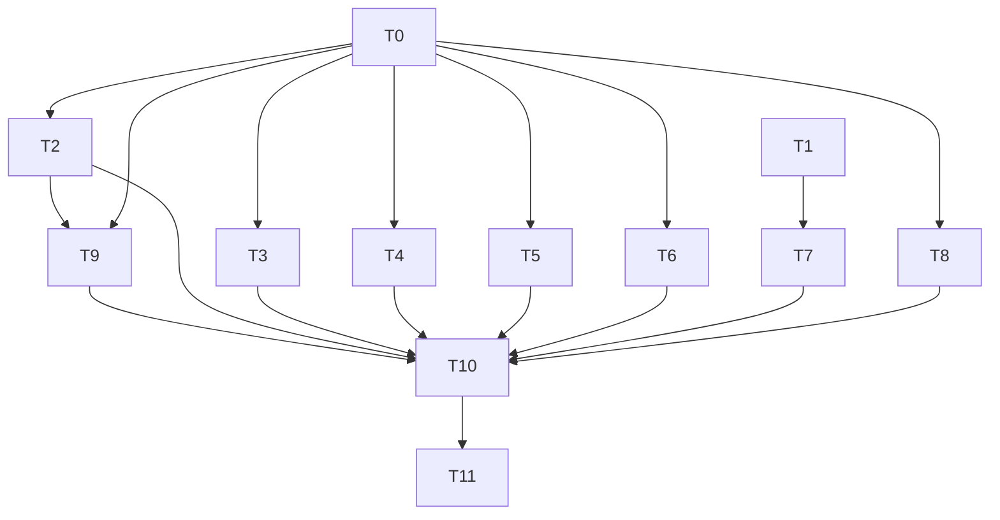

# G3: Token-Level Usage Statistics — Implementation Plan

> **For agentic workers:** REQUIRED SUB-SKILL: Use superpowers:subagent-driven-development (recommended) or superpowers:executing-plans to implement this plan task-by-task. Steps use checkbox (`- [ ]`) syntax for tracking.

**Goal:** Wire token usage end-to-end: providers parse streaming `usage` frames → `ModelEvent::Usage` → TurnRunner aggregation → `UsageCollector.record_token_usage` (dead code activated) + `SessionRunResult.usage` additive protocol field.

**Architecture:** Add `TokenUsage` + `ModelEvent::Usage` variant in `agentj-core` (types authority layer; dependency direction core ← model/stats). Four real providers parse usage in their streaming parsers; TurnRunner accumulates across tool-loop iterations and delivers via both `AgentEvent::Done{usage}` (→ IPC → `SessionRunResult.usage`) and `OnTurnComplete(&SessionId, Option<TokenUsage>)` (→ CLI → `record_token_usage`/`record_turn`). Protocol gains additive `UsageInfo` wire type. Zero new external crates.

**Tech Stack:** Rust 1.96+ workspace; `agentj-core` (TokenUsage/ModelEvent/TurnRunner), `agentj-model` (4 providers + shared `sse.rs`), `agentj-protocol` (UsageInfo wire type), `agentj-ipc` (dispatch mapping), `agentj-cli` (stats wiring), `agentj-stats` (record_token_usage activation), `bindings/ts` (type regen).

## Global Constraints

- Protocol wire surface: **additive only** — `SessionRunResult.usage` via `#[serde(skip_serializing_if = "Option::is_none")]`; no method additions; no `ProgressValue` kind additions (design D1 scope).
- **Design refinement D8 (deferred):** `ChatResponse.usage` field and non-stream `chat()` usage parsing are **OUT of G3 scope**. Rationale: `chat()` has zero production callers (verified: only wiremock unit tests invoke `.chat(`); adding the field would break 10 construction sites across 8 files (turn_runner/dispatcher/agent_loop_module/ipc + 5 provider files) — impossible within the ≤3-file task template. G3's core gap (gap doc G3 line) is **streaming** usage being dropped, which is the production path. Non-stream parsing + field addition deferred until `chat()` gains a production caller.
- **OpenAI usage-frame ordering:** OpenAI sends `finish_reason` chunk → `choices:[]`+`usage` chunk → `[DONE]`. Current parser emits `Done` at `finish_reason` (openai_compat.rs:173-174) which would drop the later usage frame → T3 must emit `Done` **only at `[DONE]`** (guarded).
- No new external dependencies.
- Rust functions ≤50 lines; lines ≤120 chars (AGENTS.md).
- TDD: `test_code` written first, verified to fail, then `impl_code`.
- Every task keeps `cargo test --workspace` + `cargo clippy --workspace --all-targets -- -D warnings` + `cargo fmt --all --check` green.
- Version bump: feature → minor. Current workspace version `0.7.0` → `0.8.0`.

---

## File Structure Map

| File | Responsibility | Tasks |
|------|----------------|-------|
| `crates/agentj-core/src/types.rs` | `TokenUsage` + `ModelEvent::Usage` + `AgentEvent::Done.usage` + `OnTurnComplete` signature | T0 |
| `crates/agentj-core/src/turn_runner.rs` | Usage aggregation across iterations; deliver via Done + on_done callback | T0 |
| `crates/agentj-cli/src/main.rs` | Minimal closure signature fix (T0); three-branch record helper (T8) | T0, T8 |
| `crates/agentj-protocol/src/session.rs` | `UsageInfo` wire type + `SessionRunResult.usage` | T1 |
| `crates/agentj-protocol/src/schema.rs` | Register `UsageInfo` schema | T1 |
| `crates/agentj-protocol/tests/contract.rs` | Roundtrip test for usage-present/absent | T1 |
| `crates/agentj-ipc/src/lib.rs` | `dispatch_session_run` maps `Done.usage` → result JSON | T2 |
| `crates/agentj-model/src/openai_compat.rs` | `stream_options.include_usage` + SSE usage parse + Done@[DONE] | T3 |
| `crates/agentj-model/src/responses.rs` | `response.completed` usage parse | T4 |
| `crates/agentj-model/src/anthropic.rs` | `message_delta` usage parse | T5 |
| `crates/agentj-model/src/ollama.rs` | `done:true` line eval counts + state machine extension | T6 |
| `bindings/ts/` | TS type regeneration (`types.d.ts` via `npm run generate`) | T7 |
| `crates/agentj-model/src/factory.rs` | Mock script gains `Usage` frame | T9 |
| `crates/agentj-cli/tests/e2e_serve.rs` | New e2e: session/run returns usage | T9 |
| `Cargo.toml` + `Cargo.lock` | Version bump `0.7.0` → `0.8.0` | T10 |
| `AGENTS.md` + `README.md` + `.claude/summary/summary_and_next.md` | Doc sync | T11 |

---

## Tasks

### T0: Add TokenUsage + ModelEvent::Usage + AgentEvent::Done.usage + OnTurnComplete signature; aggregate in TurnRunner [P0] [Sequential]

**Files:**
- Modify: `crates/agentj-core/src/types.rs`
- Modify: `crates/agentj-core/src/turn_runner.rs`
- Modify: `crates/agentj-cli/src/main.rs`

**Interfaces:**
- Consumes: `ModelEvent` enum (types.rs:78-83), `AgentEvent` (types.rs:92-105), `OnTurnComplete` (types.rs:107), TurnRunner turn loop (turn_runner.rs:172-226)
- Produces:
  - `TokenUsage { prompt_tokens: u64, completion_tokens: u64 }` (Copy, accumulate via saturating_add)
  - `ModelEvent::Usage(TokenUsage)` (new variant)
  - `AgentEvent::Done { final_response, tool_calls, usage: Option<TokenUsage> }`
  - `OnTurnComplete = Arc<dyn Fn(&SessionId, Option<TokenUsage>) + Send + Sync>`

```yaml
- id: T0
  title: "Add TokenUsage type, ModelEvent::Usage variant, Done.usage field, OnTurnComplete signature; aggregate usage in TurnRunner"
  files:
    - crates/agentj-core/src/types.rs
    - crates/agentj-core/src/turn_runner.rs
    - crates/agentj-cli/src/main.rs
  depends_on: []
  breaking: true            # OnTurnComplete signature + AgentEvent::Done field + ModelEvent variant (crate-boundary)
  ac:
    - given: "a ScriptedProvider whose script emits Delta, Usage(prompt=100,completion=20), Done"
      when: "a turn runs to completion"
      then: "AgentEvent::Done carries usage=Some(TokenUsage{prompt_tokens:100,completion_tokens:20}) and on_done receives the same TokenUsage"
    - given: "a ScriptedProvider whose script emits only Delta and Done (no Usage)"
      when: "a turn runs to completion"
      then: "AgentEvent::Done carries usage=None and on_done receives None"
    - given: "a multi-tool script: ToolCall(iter1, Usage(10,5)) then Delta+Done(iter2, Usage(90,15))"
      when: "the turn completes across two tool iterations"
      then: "Done.usage aggregates to Some(TokenUsage{prompt_tokens:100,completion_tokens:20})"
    - given: "an accumulated usage of (u64::MAX, 0) followed by Usage(1, 0)"
      when: "accumulate is called"
      then: "prompt_tokens saturates at u64::MAX (no overflow panic)"
  regression:
    - "existing `turn_streams_deltas_tool_boundary_and_done_via_bus` still passes (on_done closure updated to new arity)"
    - "existing `cancel_signals_turn_to_stop_with_cancelled_error` still passes (cancel does not call on_done)"
  test_code: |
    // In crates/agentj-core/src/types.rs #[cfg(test)]:
    #[test]
    fn token_usage_accumulate_sums_and_saturates() {
        let mut u = TokenUsage { prompt_tokens: 10, completion_tokens: 5 };
        u.accumulate(TokenUsage { prompt_tokens: 90, completion_tokens: 15 });
        assert_eq!(u, TokenUsage { prompt_tokens: 100, completion_tokens: 20 });
        u.prompt_tokens = u64::MAX;
        u.accumulate(TokenUsage { prompt_tokens: 1, completion_tokens: 0 });
        assert_eq!(u.prompt_tokens, u64::MAX);
    }

    // In crates/agentj-core/src/turn_runner.rs #[cfg(test)] — new test:
    #[tokio::test]
    async fn turn_aggregates_usage_across_iterations_and_forwards_to_done_and_callback() {
        let (kernel, sender) = spy_kernel_with(ToolSpy); // ToolCall on iter1 only
        let ctx = loop_test_ctx();
        let providers = ctx.providers.clone();
        providers.register("mock".into(), Arc::new(UsageScriptedProvider)); // see impl_code
        let mut runner = TurnRunner::new(ctx.clone(), Arc::new(MockPipeline), "sys".into(), sender, "tool_spy".into());
        let captured = Arc::new(Mutex::new(None));
        let cap = captured.clone();
        runner.set_on_turn_complete(Arc::new(move |_sid, usage| *cap.lock().unwrap() = usage));
        let sid = runner.create_session().unwrap();
        let (tx, mut rx) = tokio::sync::mpsc::channel(64);
        runner.spawn_turn(sid.clone(), "hi".into(), None, tx).unwrap();
        let mut done_usage = None;
        while let Some(ev) = rx.recv().await {
            if let AgentEvent::Done { usage, .. } = ev { done_usage = usage; break; }
        }
        assert_eq!(done_usage, Some(TokenUsage { prompt_tokens: 100, completion_tokens: 20 }));
        let deadline = std::time::Instant::now() + Duration::from_secs(1);
        while captured.lock().unwrap().is_none() && std::time::Instant::now() < deadline {
            tokio::time::sleep(Duration::from_millis(5)).await;
        }
        assert_eq!(*captured.lock().unwrap(), Some(TokenUsage { prompt_tokens: 100, completion_tokens: 20 }));
        kernel.sender().send(KernelMessage::Shutdown).unwrap();
    }
  impl_code: |
    // types.rs — add before `pub enum ModelEvent`:
    #[derive(Debug, Clone, Copy, Default, PartialEq, Eq)]
    pub struct TokenUsage { pub prompt_tokens: u64, pub completion_tokens: u64 }
    impl TokenUsage {
        pub fn accumulate(&mut self, other: TokenUsage) {
            self.prompt_tokens = self.prompt_tokens.saturating_add(other.prompt_tokens);
            self.completion_tokens = self.completion_tokens.saturating_add(other.completion_tokens);
        }
    }
    // ModelEvent gains: Usage(TokenUsage),
    // AgentEvent::Done gains: usage: Option<TokenUsage>,
    // OnTurnComplete becomes:
    pub type OnTurnComplete = Arc<dyn Fn(&SessionId, Option<TokenUsage>) + Send + Sync>;

    // turn_runner.rs — in run_turn before `'outer: for`:
    let mut usage: Option<TokenUsage> = None;
    // in the ModelEvent match (turn_runner.rs:187), add arm:
    ModelEvent::Usage(tu) => match &mut usage {
        Some(acc) => acc.accumulate(tu),
        None => usage = Some(tu),
    },
    // Done emission (turn_runner.rs:212-217): pass usage clone:
    AgentEvent::Done { final_response: content, tool_calls: all_tool_calls, usage: usage.clone() }
    // on_done call (turn_runner.rs:222-224):
    f(&session_id, usage);

    // cli/main.rs:254 — minimal arity fix (full three-branch logic lands in T8):
    runner.set_on_turn_complete(Arc::new(move |sid, _usage| usage.record_turn(sid.clone())));
    // turn_runner.rs test at :537 — update closure arity:
    runner.set_on_turn_complete(Arc::new(move |_sid, _usage| { h.fetch_add(1, Ordering::SeqCst); }));

    // Test helper: UsageScriptedProvider — chat_stream returns an iterator keyed
    // by call count: call#1 → [ToolCall, Usage(10,5), Done]; call#2 → [Delta("ok"), Usage(90,15), Done].
    // Implement as a struct holding Arc<AtomicUsize> call counter + the script arms above.
  verify:
    - "cargo test -p agentj-core token_usage_accumulate_sums_and_saturates"
    - "cargo test -p agentj-core turn_aggregates_usage_across_iterations_and_forwards_to_done_and_callback"
    - "cargo test -p agentj-core turn_"
    - "cargo clippy --workspace --all-targets -- -D warnings"
```

### T1: Add UsageInfo wire type + SessionRunResult.usage [P0] [Parallel with T0]

**Files:**
- Modify: `crates/agentj-protocol/src/session.rs`
- Modify: `crates/agentj-protocol/src/schema.rs`
- Modify: `crates/agentj-protocol/tests/contract.rs`

**Interfaces:**
- Consumes: `SessionRunResult` (session.rs:24-29), schema registry (schema.rs:14-17, 50)
- Produces:
  - `UsageInfo { prompt_tokens: u64, completion_tokens: u64 }` (Serialize/Deserialize/JsonSchema)
  - `SessionRunResult.usage: Option<UsageInfo>` with `#[serde(skip_serializing_if = "Option::is_none")]`
  - Regenerated `schemas/*.json` incl. new `UsageInfo.json` + updated `SessionRunResult.json`

```yaml
- id: T1
  title: "Add UsageInfo wire type and additive SessionRunResult.usage field; regenerate schemas"
  files:
    - crates/agentj-protocol/src/session.rs
    - crates/agentj-protocol/src/schema.rs
    - crates/agentj-protocol/tests/contract.rs
  depends_on: []
  breaking: false            # additive Option field, skip_serializing_if (additive discipline)
  ac:
    - given: "a SessionRunResult with usage=Some(UsageInfo{prompt_tokens:100,completion_tokens:20})"
      when: "it is serialized to JSON"
      then: "the JSON contains a usage object with prompt_tokens=100 and completion_tokens=20"
    - given: "a SessionRunResult with usage=None"
      when: "it is serialized to JSON"
      then: "the JSON does not contain a usage key (absent, not null)"
    - given: "the schema generator runs"
      when: "gen_schemas regenerates schemas/*.json"
      then: "a UsageInfo.json exists and SessionRunResult.json includes an optional usage property"
  regression:
    - "existing `session_run_result_roundtrip` (contract.rs:139-148) still passes"
    - "existing `cargo test -p agentj-protocol -- drift` passes (schemas match committed files)"
  test_code: |
    // In crates/agentj-protocol/tests/contract.rs:
    #[test]
    fn session_run_result_usage_serializes_when_present() {
        let r = SessionRunResult {
            content: "done".into(),
            tool_calls: None,
            usage: Some(UsageInfo { prompt_tokens: 100, completion_tokens: 20 }),
        };
        let json = serde_json::to_value(&r).unwrap();
        assert_eq!(json["usage"]["prompt_tokens"], 100);
        assert_eq!(json["usage"]["completion_tokens"], 20);
    }
    #[test]
    fn session_run_result_usage_absent_when_none() {
        let r = SessionRunResult { content: "done".into(), tool_calls: None, usage: None };
        let json = serde_json::to_value(&r).unwrap();
        assert!(json.get("usage").is_none());
    }
  impl_code: |
    // session.rs — add UsageInfo + field on SessionRunResult:
    #[derive(Debug, Clone, Copy, Serialize, Deserialize, JsonSchema)]
    pub struct UsageInfo {
        pub prompt_tokens: u64,
        pub completion_tokens: u64,
    }
    pub struct SessionRunResult {
        pub content: String,
        #[serde(skip_serializing_if = "Option::is_none")]
        pub tool_calls: Option<Vec<ToolCall>>,
        #[serde(skip_serializing_if = "Option::is_none")]
        pub usage: Option<UsageInfo>,
    }
    // schema.rs — import UsageInfo and register:
    //   use crate::session::{..., UsageInfo};
    //   m.insert("UsageInfo".into(), schema_for!(UsageInfo));
    // Regenerate schemas + update contract.rs import of UsageInfo.
  verify:
    - "cargo test -p agentj-protocol session_run_result_usage"
    - "cargo run -p agentj-protocol --bin gen_schemas"
    - "cargo test -p agentj-protocol -- drift"
    - "cargo clippy --workspace --all-targets -- -D warnings"
```

### T2: Map Done.usage to SessionRunResult.usage in dispatch_session_run [P1] [Parallel group B]

**Files:**
- Modify: `crates/agentj-ipc/src/lib.rs`

**Interfaces:**
- Consumes: `AgentEvent::Done { usage: Option<TokenUsage> }` (T0), `dispatch_session_run` result builder (lib.rs:635)
- Produces: `session/run` JSON result with conditional `usage` object `{prompt_tokens, completion_tokens}` matching `UsageInfo` wire shape

```yaml
- id: T2
  title: "Extract usage from AgentEvent::Done and include it in the session/run result JSON"
  files:
    - crates/agentj-ipc/src/lib.rs
  depends_on: [T0]
  breaking: false
  ac:
    - given: "a stub bus server whose mock script emits Delta, Usage(100,20), Done"
      when: "session/run is dispatched"
      then: "the result JSON contains usage:{prompt_tokens:100, completion_tokens:20}"
    - given: "a stub bus server whose mock script emits only Delta and Done"
      when: "session/run is dispatched"
      then: "the result JSON has no usage key (absent)"
  regression:
    - "existing `session_run_streams_delta` (lib.rs:1734-1746) still passes (no usage → absent)"
  test_code: |
    // In crates/agentj-ipc/src/lib.rs tests — new test:
    #[tokio::test]
    async fn session_run_result_includes_usage_when_reported() {
        let server = stub_bus_server_with_usage(); // like stub_bus_server but script adds
        //   Ok(ModelEvent::Usage(TokenUsage { prompt_tokens: 100, completion_tokens: 20 }))
        //   between Delta("hello") and Done.
        let raw = r#"{"jsonrpc":"2.0","id":2,"method":"session/run","params":{"session_id":"s1","content":"hi"}}"#;
        let resp = server.handle_request(raw).await.unwrap();
        let v: serde_json::Value = serde_json::from_str(&resp).unwrap();
        assert_eq!(v["result"]["content"], "hello");
        assert_eq!(v["result"]["usage"]["prompt_tokens"], 100);
        assert_eq!(v["result"]["usage"]["completion_tokens"], 20);
    }
  impl_code: |
    // In dispatch_session_run (lib.rs:599-635):
    //   track `let mut usage_value: Option<serde_json::Value> = None;` (a variable `usage_opt`)
    //   in the Done arm: `usage_opt = usage.map(|u| serde_json::json!({"prompt_tokens": u.prompt_tokens, "completion_tokens": u.completion_tokens}));`
    //   final result (replace lib.rs:635):
    let mut result = serde_json::json!({ "content": text, "tool_calls": tc_list });
    if let Some(u) = usage_opt { result["usage"] = u; }
    Ok(result)
    // Test helper: stub_bus_server_with_usage() mirrors stub_bus_server (lib.rs:1056-1095)
    // with Usage(100,20) inserted in the mock script.
  verify:
    - "cargo test -p agentj-ipc session_run_result_includes_usage_when_reported"
    - "cargo test -p agentj-ipc session_run_streams_delta"
    - "cargo clippy --workspace --all-targets -- -D warnings"
```

### T3: openai_compat streaming usage parse + include_usage request + Done@[DONE] [P1] [Parallel group B]

**Files:**
- Modify: `crates/agentj-model/src/openai_compat.rs`

**Interfaces:**
- Consumes: `request_body` (openai_compat.rs:29-50), `OpenAiChunkParser::push_line` (110-193), wiremock test fixtures (278-388)
- Produces: `request_body` gains `stream_options.include_usage=true`; parser emits `ModelEvent::Usage` from the `choices:[]`+`usage` final frame; `Done` emitted only at `[DONE]`

```yaml
- id: T3
  title: "Parse OpenAI streaming usage frame, request include_usage, move Done emission to [DONE]"
  files:
    - crates/agentj-model/src/openai_compat.rs
  depends_on: [T0]
  breaking: false
  ac:
    - given: "an SSE body ending with finish_reason=stop, then a choices:[]+usage:{prompt_tokens:9,completion_tokens:7} frame, then [DONE]"
      when: "chat_stream is consumed"
      then: "a ModelEvent::Usage(TokenUsage{prompt_tokens:9,completion_tokens:7}) is emitted before the final Done"
    - given: "a request_body for a streamed chat"
      when: "the body JSON is inspected"
      then: "it contains stream_options.include_usage=true"
    - given: "an SSE body with finish_reason=stop but no [DONE] (truncated)"
      when: "chat_stream is consumed"
      then: "Done is NOT emitted at finish_reason (stream end yields None via sse stream termination)"
  regression:
    - "existing `openai_compat_streams_deltas` (openai_compat.rs:277-318) still passes — its SSE body has NO finish_reason and already ends with `data: [DONE]`, so Done@[DONE] preserves its behavior exactly"
    - "existing `openai_compat_assembles_tool_calls_from_deltas` (336-388) still passes — finish_reason=tool_calls only sets saw_tool_finish (kept); its body already ends with `data: [DONE]`, so Done emission is unchanged"
  test_code: |
    // In crates/agentj-model/src/openai_compat.rs tests:
    #[tokio::test]
    async fn openai_compat_parses_streaming_usage_frame() {
        let server = MockServer::start().await;
        let sse_body = concat!(
            "data: {\"id\":\"1\",\"object\":\"chat.completion.chunk\",\"choices\":[{\"delta\":{\"content\":\"Hello\"},\"index\":0}]}\n\n",
            "data: {\"id\":\"2\",\"object\":\"chat.completion.chunk\",\"choices\":[{\"delta\":{},\"finish_reason\":\"stop\"}]}\n\n",
            "data: {\"id\":\"3\",\"object\":\"chat.completion.chunk\",\"choices\":[],\"usage\":{\"prompt_tokens\":9,\"completion_tokens\":7,\"total_tokens\":16}}\n\n",
            "data: [DONE]\n\n"
        );
        Mock::given(method("POST")).and(path("/v1/chat/completions"))
            .respond_with(ResponseTemplate::new(200).set_body_string(sse_body)
                .insert_header("content-type", "text/event-stream"))
            .mount(&server).await;
        let provider = OpenAICompatibleProvider::new(server.uri(), "sk-test".into(), "test-model".into());
        let mut stream = provider.chat_stream(vec![ChatMessage::user("hi")], vec![],
            ModelOptions { model: "test-model".into(), ..Default::default() }).await.unwrap();
        let mut events: Vec<ModelEvent> = vec![];
        while let Some(result) = stream.next().await { events.push(result.unwrap()); }
        assert!(events.iter().any(|e| matches!(e, ModelEvent::Usage(u) if u.prompt_tokens == 9 && u.completion_tokens == 7)));
        let done_idx = events.iter().position(|e| matches!(e, ModelEvent::Done)).unwrap();
        let usage_idx = events.iter().position(|e| matches!(e, ModelEvent::Usage(_))).unwrap();
        assert!(usage_idx < done_idx, "usage must be emitted before Done");
    }

    #[tokio::test]
    async fn openai_request_includes_stream_options_include_usage() {
        let provider = OpenAICompatibleProvider::new("http://x".into(), "k".into(), "m".into());
        let body = provider.request_body(&[ChatMessage::user("hi")], &[],
            &ModelOptions { model: "m".into(), ..Default::default() });
        assert_eq!(body["stream_options"]["include_usage"], true);
    }
  impl_code: |
    // request_body (openai_compat.rs:40-49): add after "stream": true:
    "stream_options": { "include_usage": true },
    // push_line: add done_emitted guard + usage parse + move Done to [DONE]-only.
    // struct gains: done_emitted: bool  (new() sets false)
    // At the [DONE] branch (line 116-119):
    if data == "[DONE]" {
        if !self.done_emitted { out.push(Ok(ModelEvent::Done)); self.done_emitted = true; }
        return;
    }
    // Before the choices loop (after json parse, line 129), add:
    if let Some(u) = json.get("usage").and_then(|u| u.as_object())
        && let (Some(p), Some(c)) = (u.get("prompt_tokens").and_then(|v| v.as_u64()),
                                     u.get("completion_tokens").and_then(|v| v.as_u64()))
    {
        out.push(Ok(ModelEvent::Usage(TokenUsage { prompt_tokens: p, completion_tokens: c })));
    }
    // Remove the finish_reason stop/length → Done emission (lines 173-174); keep
    // finish_reason == "tool_calls" setting saw_tool_finish (line 171-172).
  verify:
    - "cargo test -p agentj-model openai_compat_parses_streaming_usage_frame"
    - "cargo test -p agentj-model openai_request_includes_stream_options_include_usage"
    - "cargo test -p agentj-model openai_compat"
    - "cargo clippy --workspace --all-targets -- -D warnings"
```

### T4: responses.rs streaming usage parse [P1] [Parallel group B]

**Files:**
- Modify: `crates/agentj-model/src/responses.rs`

**Interfaces:**
- Consumes: `ResponsesChunkParser::push_line` (responses.rs:114-191), `response.completed` arm (185-188)
- Produces: `response.completed` arm parses `json["response"]["usage"]{input_tokens,output_tokens}` (fallback `json["usage"]`) → emits `ModelEvent::Usage` **before** `Done`

```yaml
- id: T4
  title: "Parse Responses API usage from response.completed before emitting Done"
  files:
    - crates/agentj-model/src/responses.rs
  depends_on: [T0]
  breaking: false
  ac:
    - given: "an SSE body ending with response.completed carrying usage:{input_tokens:12,output_tokens:8}"
      when: "chat_stream is consumed"
      then: "a ModelEvent::Usage(TokenUsage{prompt_tokens:12,completion_tokens:8}) is emitted before Done"
  regression:
    - "existing `responses_provider_streams_deltas` test still passes"
  test_code: |
    // In crates/agentj-model/src/responses.rs tests — mirror anthropic test fixture style:
    #[tokio::test]
    async fn responses_parses_usage_from_completed_event() {
        let server = MockServer::start().await;
        let sse_body = concat!(
            "data: {\"type\":\"response.output_text.delta\",\"delta\":{\"text\":\"Hello\"}}\n\n",
            "data: {\"type\":\"response.completed\",\"response\":{\"id\":\"r1\",\"usage\":{\"input_tokens\":12,\"output_tokens\":8}}}\n\n",
            "data: [DONE]\n\n"
        );
        Mock::given(method("POST")).and(path("/v1/responses"))
            .respond_with(ResponseTemplate::new(200).set_body_string(sse_body)
                .insert_header("content-type", "text/event-stream"))
            .mount(&server).await;
        let provider = ResponsesProvider::new(server.uri(), "sk-test".into());
        let mut stream = provider.chat_stream(vec![ChatMessage::user("hi")], vec![],
            ModelOptions { model: "m".into(), ..Default::default() }).await.unwrap();
        let mut events: Vec<ModelEvent> = vec![];
        while let Some(result) = stream.next().await { events.push(result.unwrap()); }
        let usage = events.iter().find_map(|e| match e {
            ModelEvent::Usage(u) => Some(*u), _ => None }).unwrap();
        assert_eq!(usage, TokenUsage { prompt_tokens: 12, completion_tokens: 8 });
        let usage_idx = events.iter().position(|e| matches!(e, ModelEvent::Usage(_))).unwrap();
        let done_idx = events.iter().position(|e| matches!(e, ModelEvent::Done)).unwrap();
        assert!(usage_idx < done_idx);
    }
  impl_code: |
    // In push_line "response.completed" arm (responses.rs:185-188), before Done:
    "response.completed" if !self.done_emitted => {
        if let Some(u) = json.get("response").and_then(|r| r.get("usage")).or_else(|| json.get("usage"))
            .and_then(|u| u.as_object())
            && let (Some(i), Some(o)) = (u.get("input_tokens").and_then(|v| v.as_u64()),
                                         u.get("output_tokens").and_then(|v| v.as_u64()))
        {
            out.push(Ok(ModelEvent::Usage(TokenUsage { prompt_tokens: i, completion_tokens: o })));
        }
        out.push(Ok(ModelEvent::Done));
        self.done_emitted = true;
    }
  verify:
    - "cargo test -p agentj-model responses_parses_usage_from_completed_event"
    - "cargo test -p agentj-model responses"
    - "cargo clippy --workspace --all-targets -- -D warnings"
```

### T5: anthropic.rs streaming usage parse [P1] [Parallel group B]

**Files:**
- Modify: `crates/agentj-model/src/anthropic.rs`

**Interfaces:**
- Consumes: `AnthropicChunkParser::push_line` (anthropic.rs:104-188), `message_delta` event (currently falls to `_ => {}` at 186)
- Produces: `message_delta` arm parses `json["usage"]{input_tokens,output_tokens}` → emits `ModelEvent::Usage` (arrives before `message_stop`, so ordering is natural)

```yaml
- id: T5
  title: "Parse Anthropic usage from message_delta events"
  files:
    - crates/agentj-model/src/anthropic.rs
  depends_on: [T0]
  breaking: false
  ac:
    - given: "an SSE body with message_delta carrying usage:{input_tokens:30,output_tokens:4} followed by message_stop"
      when: "chat_stream is consumed"
      then: "a ModelEvent::Usage(TokenUsage{prompt_tokens:30,completion_tokens:4}) is emitted before Done"
  regression:
    - "existing `anthropic_provider_streams_deltas` test still passes"
    - "existing `anthropic_provider_assembles_tool_use` test still passes"
  test_code: |
    // In crates/agentj-model/src/anthropic.rs tests:
    #[tokio::test]
    async fn anthropic_parses_usage_from_message_delta() {
        let server = MockServer::start().await;
        let sse_body = concat!(
            "data: {\"type\":\"content_block_delta\",\"index\":0,\"delta\":{\"type\":\"text_delta\",\"text\":\"Hello\"}}\n\n",
            "data: {\"type\":\"message_delta\",\"delta\":{\"stop_reason\":\"end_turn\"},\"usage\":{\"input_tokens\":30,\"output_tokens\":4}}\n\n",
            "data: {\"type\":\"message_stop\"}\n\n",
            "data: [DONE]\n\n"
        );
        Mock::given(method("POST")).and(path("/v1/messages"))
            .respond_with(ResponseTemplate::new(200).set_body_string(sse_body)
                .insert_header("content-type", "text/event-stream"))
            .mount(&server).await;
        let provider = AnthropicProvider::new(server.uri(), "sk-test".into());
        let mut stream = provider.chat_stream(vec![ChatMessage::user("hi")], vec![],
            ModelOptions { model: "m".into(), ..Default::default() }).await.unwrap();
        let mut events: Vec<ModelEvent> = vec![];
        while let Some(result) = stream.next().await { events.push(result.unwrap()); }
        let usage = events.iter().find_map(|e| match e {
            ModelEvent::Usage(u) => Some(*u), _ => None }).unwrap();
        assert_eq!(usage, TokenUsage { prompt_tokens: 30, completion_tokens: 4 });
    }
  impl_code: |
    // In push_line match (anthropic.rs:127-187), add arm before "message_stop":
    "message_delta" => {
        if let Some(u) = json.get("usage").and_then(|u| u.as_object())
            && let (Some(i), Some(o)) = (u.get("input_tokens").and_then(|v| v.as_u64()),
                                         u.get("output_tokens").and_then(|v| v.as_u64()))
        {
            out.push(Ok(ModelEvent::Usage(TokenUsage { prompt_tokens: i, completion_tokens: o })));
        }
    }
  verify:
    - "cargo test -p agentj-model anthropic_parses_usage_from_message_delta"
    - "cargo test -p agentj-model anthropic"
    - "cargo clippy --workspace --all-targets -- -D warnings"
```

### T6: ollama.rs done:true line eval counts + state machine extension [P1] [Parallel group B]

**Files:**
- Modify: `crates/agentj-model/src/ollama.rs`

**Interfaces:**
- Consumes: ollama NDJSON state machine `(reader, done_seen, pending_done, terminated)` (ollama.rs:65-133)
- Produces: done:true line parses `prompt_eval_count`/`eval_count` → emits `ModelEvent::Usage` before `Done`; state tuple extended to carry pending usage

```yaml
- id: T6
  title: "Parse Ollama eval counts from done:true lines and emit Usage before Done"
  files:
    - crates/agentj-model/src/ollama.rs
  depends_on: [T0]
  breaking: false
  ac:
    - given: "an NDJSON body ending with done:true carrying prompt_eval_count:50 and eval_count:11"
      when: "chat_stream is consumed"
      then: "a ModelEvent::Usage(TokenUsage{prompt_tokens:50,completion_tokens:11}) is emitted before Done"
    - given: "a done:true line that also carries content"
      when: "chat_stream is consumed"
      then: "the Delta(content) is emitted, then Usage, then Done (BUG-010 ordering preserved)"
  regression:
    - "existing `ollama_provider_streams_sse` test still passes"
    - "existing `done_line_with_content_emits_delta_before_done` test still passes"
    - "existing `truncated_stream_without_done_emits_error` test still passes"
  test_code: |
    // In crates/agentj-model/src/ollama.rs tests:
    #[tokio::test]
    async fn ollama_parses_usage_from_done_line() {
        let server = MockServer::start().await;
        let body = concat!(
            "{\"model\":\"llama3\",\"message\":{\"role\":\"assistant\",\"content\":\"Hello\"},\"done\":false}\n",
            "{\"model\":\"llama3\",\"message\":{\"role\":\"assistant\",\"content\":\" world\"},\"done\":true,\"prompt_eval_count\":50,\"eval_count\":11}\n"
        );
        Mock::given(method("POST")).and(path("/api/chat"))
            .respond_with(ResponseTemplate::new(200).set_body_string(body)
                .insert_header("content-type", "application/x-ndjson"))
            .mount(&server).await;
        let provider = OllamaProvider::new(server.uri(), "llama3".into());
        let mut stream = provider.chat_stream(vec![ChatMessage::user("hi")], vec![],
            ModelOptions { model: "llama3".into(), ..Default::default() }).await.unwrap();
        let mut events: Vec<ModelEvent> = vec![];
        while let Some(result) = stream.next().await { events.push(result.unwrap()); }
        let usage = events.iter().find_map(|e| match e {
            ModelEvent::Usage(u) => Some(*u), _ => None }).unwrap();
        assert_eq!(usage, TokenUsage { prompt_tokens: 50, completion_tokens: 11 });
        let usage_idx = events.iter().position(|e| matches!(e, ModelEvent::Usage(_))).unwrap();
        let done_idx = events.iter().position(|e| matches!(e, ModelEvent::Done)).unwrap();
        assert!(usage_idx < done_idx);
    }
  impl_code: |
    // State tuple becomes (reader, done_seen, pending_usage: Option<TokenUsage>, pending_done: bool, terminated).
    // On a done:true line (ollama.rs:114-123): parse counts first:
    let usage = (json.get("prompt_eval_count").and_then(|v| v.as_u64()),
                 json.get("eval_count").and_then(|v| v.as_u64()));
    // Order of emissions:
    //   if content non-empty → return Some((Ok(Delta(content)), (reader, done_seen, usage_opt, false, false)))
    //   where usage_opt = usage pair → TokenUsage (or None if both counts missing)
    //   next step (pending_usage Some) → emit Usage, state → (..., None, true, false)
    //   next step (pending_done) → emit Done (existing pending_done branch, ollama.rs:71-73)
    //   if no content → return Some((Ok(Usage|Done), ...)) directly preserving order.
    // Keep truncated-stream error paths (ollama.rs:77-101) unchanged.
  verify:
    - "cargo test -p agentj-model ollama_parses_usage_from_done_line"
    - "cargo test -p agentj-model ollama"
    - "cargo clippy --workspace --all-targets -- -D warnings"
```

### T7: Regenerate TypeScript bindings [P1] [Parallel group B]

**Files:**
- Modify: `bindings/ts/` (generated `types.d.ts` via `npm run generate`)

**Interfaces:**
- Consumes: regenerated `schemas/*.json` (T1)
- Produces: TS type for `UsageInfo` + `SessionRunResult.usage`

```yaml
- id: T7
  title: "Regenerate TypeScript bindings from updated schemas"
  files:
    - bindings/ts/types.d.ts
  depends_on: [T1]
  breaking: false
  ac:
    - given: "the schemas have been regenerated with UsageInfo"
      when: "npm run generate runs"
      then: "bindings/ts/types.d.ts contains a UsageInfo interface and SessionRunResult includes usage?: UsageInfo"
  regression:
    - "existing `npm run build` (tsc) still passes"
  test_code: |
    # Verification-only task (generated output); the assertion is the generated diff:
    #   grep -n "UsageInfo" bindings/ts/types.d.ts  → present after regen
  impl_code: |
    # Run: cd bindings/ts && npm install && npm run generate
    # Inspect git diff for bindings/ts/types.d.ts: UsageInfo interface added,
    # SessionRunResult gains `usage?: UsageInfo`.
  verify:
    - "cd bindings/ts && npm run generate && npm run build"
```

### T8: CLI three-branch record helper (record_token_usage activation) [P1] [Parallel group B]

**Files:**
- Modify: `crates/agentj-cli/src/main.rs`

**Interfaces:**
- Consumes: `OnTurnComplete` new arity (T0), `UsageCollector::record_token_usage` / `record_turn` (stats lib.rs:32-47, 73-78)
- Produces: `record_completed_turn(collector, sid, Option<TokenUsage>)` helper — Some(non-zero) → `record_token_usage`; Some(zero)/None → `record_turn`; wired at main.rs:254

```yaml
- id: T8
  title: "Wire three-branch turn completion helper: record_token_usage or record_turn"
  files:
    - crates/agentj-cli/src/main.rs
  depends_on: [T0]
  breaking: false
  ac:
    - given: "an on_turn_complete invocation with Some(TokenUsage{prompt_tokens:100,completion_tokens:20})"
      when: "record_completed_turn runs"
      then: "record_token_usage is called (session totals gain 100/20 and turns +1)"
    - given: "an invocation with Some(TokenUsage{prompt_tokens:0,completion_tokens:0})"
      when: "record_completed_turn runs"
      then: "record_turn is called (turns +1, tokens stay 0 — zero-value guard preserved)"
    - given: "an invocation with None"
      when: "record_completed_turn runs"
      then: "record_turn is called (turns +1 — mock/no-usage path never loses turn count)"
  regression:
    - "existing `permission_module_built_from_config` and other main.rs unit tests still pass"
    - "existing resolve_session_dir tests still pass"
  test_code: |
    // In crates/agentj-cli/src/main.rs #[cfg(test)]:
    #[test]
    fn record_completed_turn_with_usage_records_tokens() {
        let c = agentj_stats::UsageCollector::new();
        record_completed_turn(&c, "s1".into(), Some(TokenUsage { prompt_tokens: 100, completion_tokens: 20 }));
        let t = c.get_session_totals("s1").unwrap();
        assert_eq!((t.prompt_tokens, t.completion_tokens, t.turns), (100, 20, 1));
    }
    #[test]
    fn record_completed_turn_with_zero_usage_falls_back_to_turn() {
        let c = agentj_stats::UsageCollector::new();
        record_completed_turn(&c, "s1".into(), Some(TokenUsage::default()));
        let t = c.get_session_totals("s1").unwrap();
        assert_eq!((t.prompt_tokens, t.completion_tokens, t.turns), (0, 0, 1));
    }
    #[test]
    fn record_completed_turn_with_none_falls_back_to_turn() {
        let c = agentj_stats::UsageCollector::new();
        record_completed_turn(&c, "s1".into(), None);
        let t = c.get_session_totals("s1").unwrap();
        assert_eq!((t.prompt_tokens, t.completion_tokens, t.turns), (0, 0, 1));
    }
  impl_code: |
    // main.rs — helper (import agentj_core::types::TokenUsage):
    fn record_completed_turn(collector: &agentj_stats::UsageCollector, sid: String, usage: Option<TokenUsage>) {
        match usage {
            Some(u) if u.prompt_tokens != 0 || u.completion_tokens != 0 =>
                collector.record_token_usage(sid, u.prompt_tokens, u.completion_tokens),
            _ => collector.record_turn(sid),
        }
    }
    // main.rs:254 — replace the minimal T0 closure:
    runner.set_on_turn_complete(Arc::new(move |sid, usage| record_completed_turn(&usage, sid.clone(), usage)));
    // (rename local Arc to avoid shadowing; the closure moves a clone of the collector)
  verify:
    - "cargo test -p agentj-cli record_completed_turn"
    - "cargo clippy --workspace --all-targets -- -D warnings"
```

### T9: Mock factory script gains Usage frame + e2e serve usage test [P2] [Parallel group C]

**Files:**
- Modify: `crates/agentj-model/src/factory.rs`
- Modify: `crates/agentj-cli/tests/e2e_serve.rs`

**Interfaces:**
- Consumes: factory mock script (factory.rs:37-45), e2e_serve test harness (spawn serve + JSON-RPC over stdio)
- Produces: factory mock emits `Usage(100,20)` before `Done`; new e2e test asserts `session/run` result carries `usage`

```yaml
- id: T9
  title: "Add Usage frame to mock provider factory script and e2e-verify session/run usage"
  files:
    - crates/agentj-model/src/factory.rs
    - crates/agentj-cli/tests/e2e_serve.rs
  depends_on: [T0, T2]
  breaking: false
  ac:
    - given: "a mock provider built from factory with the default script"
      when: "a session/run completes over the real binary (serve mode)"
      then: "the JSON-RPC result contains usage:{prompt_tokens:100, completion_tokens:20}"
  regression:
    - "existing `e2e_serve_responds_to_jsonrpc_session_new` still passes"
    - "existing `e2e_serve_exits_gracefully_on_sigterm` still passes"
    - "existing e2e_permission tests still pass (script gains a frame before Done)"
  test_code: |
    // In crates/agentj-cli/tests/e2e_serve.rs — new test mirroring the session/new test:
    #[test]
    fn e2e_serve_run_result_includes_usage() {
        let dir = std::env::temp_dir().join(format!("agentj-e2e-usage-{}", std::process::id()));
        std::fs::create_dir_all(&dir).unwrap();
        let cfg = dir.join("mock_config.toml");
        std::fs::write(&cfg, "[model]\nprovider = \"mock\"\n").unwrap();
        let mut child = Command::new(env!("CARGO_BIN_EXE_agentj"))
            .args(["--config", cfg.to_str().unwrap(), "serve"])
            .stdin(Stdio::piped()).stdout(Stdio::piped()).stderr(Stdio::null())
            .spawn().unwrap();
        {
            let mut stdin = child.stdin.take().unwrap();
            writeln!(stdin, r#"{{"jsonrpc":"2.0","id":1,"method":"session/new"}}"#).unwrap();
            writeln!(stdin, r#"{{"jsonrpc":"2.0","id":2,"method":"session/run","params":{{"session_id":"s1","content":"hi"}}}}"#).unwrap();
        }
        let output = child.wait_with_output().unwrap();
        assert!(output.status.success());
        let stdout = String::from_utf8_lossy(&output.stdout);
        assert!(stdout.contains(r#""usage""#), "expected usage in run result, got: {stdout}");
        assert!(stdout.contains(r#""prompt_tokens":100"#), "expected prompt_tokens 100, got: {stdout}");
    }
  impl_code: |
    // factory.rs:37-45 — insert Usage frame before Done:
    "mock" => Arc::new(MockModelProvider::new(vec![
        Ok(ModelEvent::ToolCall(ToolCall {
            id: "call_1".into(), name: "bash".into(),
            arguments: serde_json::json!({"command": "curl http://example.com"}),
        })),
        Ok(ModelEvent::Delta("done".into())),
        Ok(ModelEvent::Usage(TokenUsage { prompt_tokens: 100, completion_tokens: 20 })),
        Ok(ModelEvent::Done),
    ])),
  verify:
    - "cargo test -p agentj-model factory"
    - "cargo test --release --test e2e_serve --test e2e_cli"
    - "cargo clippy --workspace --all-targets -- -D warnings"
```

### T10: Version bump 0.7.0 → 0.8.0 [P2] [Sequential tail]

**Files:**
- Modify: `Cargo.toml`
- Modify: `Cargo.lock` (via `cargo build`)

**Interfaces:**
- Consumes: workspace manifest version field
- Produces: `version = "0.8.0"` in `[workspace.package]`

```yaml
- id: T10
  title: "Bump workspace version from 0.7.0 to 0.8.0"
  files:
    - Cargo.toml
    - Cargo.lock
  depends_on: [T2, T3, T4, T5, T6, T7, T8, T9]
  breaking: false
  ac:
    - given: "the workspace Cargo.toml version is 0.7.0"
      when: "the version is bumped to 0.8.0 and cargo build runs"
      then: "Cargo.lock is consistent and all crates report 0.8.0"
  regression:
    - "cargo test --workspace passes after version bump"
  test_code: |
    # Verification-only: grep '^version = "0.8.0"' Cargo.toml (workspace.package section)
  impl_code: |
    # Cargo.toml [workspace.package]: version = "0.7.0" → "0.8.0"
    # Then: cargo build (updates Cargo.lock member versions)
  verify:
    - "grep -c '0.8.0' Cargo.lock > 0"
    - "cargo test --workspace"
```

### T11: Doc sync AGENTS.md / README.md / summary [P2] [Sequential tail]

**Files:**
- Modify: `AGENTS.md`
- Modify: `README.md`
- Modify: `.claude/summary/summary_and_next.md`

**Interfaces:**
- Consumes: G3 changes (this plan), gap doc status update requirement (gap doc G3 row → ✅ 已实现)
- Produces: synced docs reflecting v0.8.0 + token usage feature

```yaml
- id: T11
  title: "Sync AGENTS.md, README.md, and summary_and_next.md for v0.8.0"
  files:
    - AGENTS.md
    - README.md
    - .claude/summary/summary_and_next.md
  depends_on: [T10]
  breaking: false
  ac:
    - given: "G3 implementation is complete and tested"
      when: "AGENTS.md / README.md / summary_and_next.md are updated"
      then: "all three documents reflect version 0.8.0 and the token usage statistics feature"
  regression:
    - "cargo test --workspace still passes (docs-only change)"
  test_code: |
    # Documentation task — no test code; verification is content review of the three files.
  impl_code: |
    # AGENTS.md: bump header to v0.8.0, add G3 token usage to architecture notes
    #   (ModelEvent::Usage, OnTurnComplete Option<TokenUsage>, SessionRunResult.usage, record_token_usage production).
    # README.md: bump version tagline + Features checklist (token usage statistics) + usage section.
    # summary_and_next.md: replace with "## G3: token 级用量统计 ✅ (本次完成)" —
    #   progress, verification results, remaining issues (ChatResponse.usage deferred), next steps.
    # Commit as: docs: auto-sync AGENTS.md, README.md, summary after G3 completion
  verify:
    - "grep -q '0.8.0' AGENTS.md && grep -q '0.8.0' README.md"
```

---

## Dependency Graph



## Parallel Execution Groups

- **Group A (Level 0):** T0 (core types+aggregation), T1 (protocol wire type) — independent, run in parallel.
- **Group B (Level 1):** T2 (ipc mapping), T3 (openai), T4 (responses), T5 (anthropic), T6 (ollama), T7 (TS bindings), T8 (CLI helper) — all depend only on T0/T1, mutually independent, 7-way parallel.
- **Group C (Level 2):** T9 (factory mock + e2e) — after T0+T2.
- **Group D (Level 3):** T10 (version bump) — after all code tasks.
- **Group E (Level 4):** T11 (doc sync) — last.

## Design Notes & Deviations

1. **D8 — ChatResponse.usage deferred** (see Global Constraints; **formally signed off in the design spec** — `docs/superpowers/specs/2026-09-02-g3-token-usage-design.md` 非目标 bullet + 决策表 D8 + 类型设计 + Provider 表非流式列均已标注「延后」): the design doc's `ChatResponse` field addition is dropped from G3. Non-stream `chat()` has no production callers; the field would force an 10-file breaking change. Streaming usage (the production path) fully covers the gap-doc G3 complaint. `ChatResponse` construction sites are **not** touched by any task.
2. **OpenAI Done@[DONE]**: the design's "解析 SSE 末帧 usage" requires reordering Done emission for openai_compat (T3) — a behavioral detail the design implied but did not state explicitly; now documented in the design spec Provider table (openai row). Both existing openai SSE fixtures already end with `data: [DONE]` and never rely on `finish_reason=stop` for Done — no fixture edits required.
3. `record_token_usage`'s zero-value guard (stats lib.rs:38-40) is preserved; the CLI helper (T8) routes zero/None to `record_turn` so turn counts never drop.