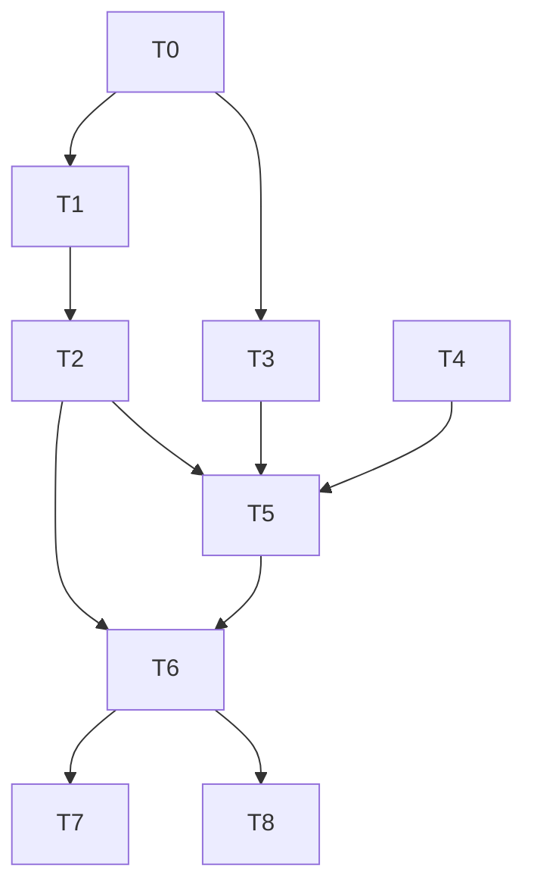

# G5 License Gating + G6 MCP Wiring Implementation Plan

> **For agentic workers:** REQUIRED SUB-SKILL: Use `superpowers:subagent-driven-development` (recommended) or `superpowers:executing-plans` to implement this plan task-by-task. Steps use checkbox (`- [ ]`) syntax for tracking.

**Goal:** Activate two dormant production capabilities — (G5) wire the `agentj-license` Ed25519 validator into the CLI as a per-command entitlement gate, and (G6) wire `[[mcp.servers]]` config discovery into `McpConnectionManager` startup connects with a structured `McpServerSpec`.

**Architecture:** G5 adds a `[license]` config section + `--license-key` flag + `AGENTJ_LICENSE_KEY` env (flag > env > config), resolves the Ed25519 verifying key from an embedded const with an `AGENTJ_LICENSE_PUBKEY` env override (tests/key rotation), and fails fast at the CLI command boundary (`run`→"run", `serve`→"serve", `dashboard`→"dashboard"; no key = free mode). G6 adds `[[mcp.servers]]` (name/command/args/env) to config, replaces `McpConnectionManager::connect(server_id, command: String)` with `connect(server_id, McpServerSpec)` (spawn via `Command::new(cmd).args(args).envs(env)`, killing the `sh -c` injection surface), adds `close_all()`, and connects all configured servers at CLI startup with warn-and-continue on failure.

**Tech Stack:** Rust workspace (crates/), `ed25519-dalek` v2 (same as agentj-license), `base64` 0.22, `tokio::process::Command`, clap derive, `HashMap<String,String>` env maps.

## Agent Worker Instructions

- **Required sub-skills:** `superpowers:subagent-driven-development` (preferred) or `superpowers:executing-plans`.
- **Execution mode:** subagent-driven-development — fresh subagent per task, review between tasks.
- **Required verification (final gate, run at task completion AND at plan end):**
  - `cargo test --workspace`
  - `cargo clippy --workspace --all-targets -- -D warnings`
  - `cargo fmt --all --check`
  - `cargo test -p agentj-protocol -- drift` (protocol is untouched — must stay green)
- **Version bump:** feature → minor: `0.8.0` → `0.9.0` (T6).
- **Commits:** English messages; one logical change per commit; commit after each task's verification passes.

## Global Constraints

- Rust 1.96+ (workspace `rust-version`); edition 2024.
- Every Rust function ≤50 lines; every line ≤120 chars.
- TDD-first: test code written and verified FAILING before implementation; no exceptions.
- No type-error suppression (`as any`/`#[allow]` for errors) in new code.
- Protocol wire format (agentj-protocol schemas) is UNTOUCHED — this feature lives entirely in CLI/config/mcp crates.
- Match existing patterns: `Option<Section>` config fields, `merge::merge_config` overlay branches, `env_lock()` serialization for env-mutating tests, `e2e_serve` `--port 0` + `AutoReap` harness style.
- No placeholders: every task below is self-contained with concrete code.

---

## Tasks

### T0: agentj-config — Add `[license]` section

**Files:**
- Modify: `crates/agentj-config/src/lib.rs`
- Modify: `crates/agentj-config/src/merge.rs`

**Interfaces:**
- Consumes: existing `AgentJConfig` / `merge_config` / `apply_env` patterns (`session`/`permission` sections).
- Produces: `LicenseConfig { key: Option<String> }`; `AgentJConfig.license: Option<LicenseConfig>`; merge branch; `AGENTJ_LICENSE_KEY` env override; `ConfigProvider::get_str("license.key")`. T1 consumes `cfg.inner().license`.

**Acceptance Criteria (GIVEN/WHEN/THEN):**
- GIVEN a config.toml with `[license] key = "abc.def"` WHEN `Config::load` THEN `inner().license.as_ref().unwrap().key == Some("abc.def")`.
- GIVEN `AGENTJ_LICENSE_KEY=xyz` in env WHEN `Config::load` THEN `inner().license.key == Some("xyz")` even with no `[license]` section.
- GIVEN no `[license]` section and no env WHEN `Config::load` THEN `inner().license.is_none()`.

**Regression Guard:** `permission_section_parses`, `session_dir_section_parses`, `merge_precedence` in agentj-config must keep passing.

- [ ] **Step 1: Write the failing tests** (append to `lib.rs` `mod tests` and `merge.rs` `mod tests`):

```rust
// lib.rs mod tests
#[test]
fn license_section_parses() {
    let cfg: AgentJConfig = toml::from_str("[license]\nkey = \"abc.def\"\n").unwrap();
    assert_eq!(cfg.license.as_ref().unwrap().key.as_deref(), Some("abc.def"));
}

#[test]
fn license_section_absent_is_none() {
    let cfg: AgentJConfig = toml::from_str("").unwrap();
    assert!(cfg.license.is_none());
}

#[test]
fn license_key_env_overrides() {
    static ENV_LOCK: std::sync::OnceLock<std::sync::Mutex<()>> = std::sync::OnceLock::new();
    let _g = ENV_LOCK
        .get_or_init(|| std::sync::Mutex::new(()))
        .lock()
        .unwrap_or_else(|p| p.into_inner());
    let dir = tempfile::TempDir::new().unwrap();
    let p = dir.path().join("c.toml");
    std::fs::write(&p, "[license]\nkey = \"abc.def\"\n").unwrap();
    unsafe { std::env::set_var("AGENTJ_LICENSE_KEY", "xyz") };
    let config = Config::load(Some(p)).unwrap();
    unsafe { std::env::remove_var("AGENTJ_LICENSE_KEY") };
    assert_eq!(config.inner().license.as_ref().unwrap().key.as_deref(), Some("xyz"));
}
```

- [ ] **Step 2: Run tests to verify they fail**

Run: `cargo test -p agentj-config`
Expected: FAIL — `license` field does not exist on `AgentJConfig`.

- [ ] **Step 3: Write minimal implementation**

```rust
// lib.rs — near SessionConfig
#[derive(Debug, Clone, Deserialize, Default)]
pub struct LicenseConfig {
    #[serde(default)]
    pub key: Option<String>,
}

// AgentJConfig: add field after `session`
#[serde(default)]
pub license: Option<LicenseConfig>,

// AgentJConfig::default(): add `license: None,`

// ConfigProvider::get_str: add match arm
"license.key" => self.inner.license.as_ref().and_then(|l| l.key.clone()),
```

```rust
// merge.rs — merge_config: add after the session branch
if file.license.is_some() {
    config.license = file.license;
}

// merge.rs — apply_env: add
if let Ok(val) = std::env::var("AGENTJ_LICENSE_KEY") {
    config.license.get_or_insert_with(crate::LicenseConfig::default).key = Some(val);
}
```

- [ ] **Step 4: Run tests to verify they pass**

Run: `cargo test -p agentj-config`
Expected: PASS (new + regression).

- [ ] **Step 5: Commit**

```bash
git add crates/agentj-config/src/lib.rs crates/agentj-config/src/merge.rs
git commit -m "feat(config): add [license] section with AGENTJ_LICENSE_KEY override"
```

---

### T1: agentj-cli — Add license gate helper (`resolve_validator` + `check_license_gate`)

**Files:**
- Modify: `crates/agentj-cli/Cargo.toml`
- Create: `crates/agentj-cli/src/license.rs` (with inline `#[cfg(test)] mod tests`)
- Modify: `crates/agentj-cli/src/main.rs` (add `mod license;` declaration)

**Interfaces:**
- Consumes: T0 `cfg.inner().license`; `agentj_license::{License, LicenseValidator, LicenseError}`.
- Produces: `resolve_validator() -> Result<LicenseValidator, anyhow::Error>` (embedded const pubkey + `AGENTJ_LICENSE_PUBKEY` b64 override); `check_license_gate(cfg: &Config, cli_key: Option<&str>, entitlement: &str, command_name: &str) -> Result<(), anyhow::Error>`. T2 calls `check_license_gate`.

**Acceptance Criteria:**
- GIVEN no key (config/env/flag all absent) WHEN `check_license_gate("run")` THEN Ok (free mode, D1).
- GIVEN an invalid key string WHEN `check_license_gate` THEN Err whose message contains "license".
- GIVEN a valid key signed for `["dashboard"]` WHEN `check_license_gate("run")` THEN Err whose message contains "entitlement".
- GIVEN a valid key signed for `["run"]` WHEN `check_license_gate("run")` THEN Ok.

**Regression Guard:** `resolve_session_dir_*` and `record_completed_turn_*` tests in agentj-cli must keep passing.

- [ ] **Step 1: Write the failing tests** (create `license.rs` with tests first):

```rust
//! License gate: resolve the key (flag > env > config), validate the Ed25519
//! signature, and check the per-command entitlement (design D1/D2/D5/D6).

use agentj_license::LicenseValidator;
use ed25519_dalek::VerifyingKey;
use base64::Engine as _;

/// Production verifying key, embedded at build time. The placeholder value is
/// replaced when the commercial key ships; AGENTJ_LICENSE_PUBKEY overrides it
/// for tests and operator-driven rotation (D5).
const AGENTJ_LICENSE_PUBKEY: [u8; 32] = [0u8; 32];

pub fn resolve_validator() -> Result<LicenseValidator, anyhow::Error> {
    let key_bytes: [u8; 32] = match std::env::var("AGENTJ_LICENSE_PUBKEY") {
        Ok(b64) if !b64.is_empty() => {
            let raw = base64::engine::general_purpose::STANDARD
                .decode(&b64)
                .map_err(|e| anyhow::anyhow!("license pubkey override invalid base64: {e}"))?;
            raw.as_slice()
                .try_into()
                .map_err(|_| anyhow::anyhow!("license pubkey override must be 32 bytes"))?
        }
        _ => AGENTJ_LICENSE_PUBKEY,
    };
    let vk = VerifyingKey::from_bytes(&key_bytes)
        .map_err(|e| anyhow::anyhow!("license pubkey invalid: {e}"))?;
    Ok(LicenseValidator::new(vk))
}

pub fn check_license_gate(
    cfg: &agentj_config::Config,
    cli_key: Option<&str>,
    entitlement: &str,
    command_name: &str,
) -> Result<(), anyhow::Error> {
    // D6: flag > env (already folded into config by apply_env) > [license] key.
    let key = cli_key.or_else(|| cfg.inner().license.as_ref().and_then(|l| l.key.as_deref()));
    let Some(key) = key else { return Ok(()); }; // D1: no key = free mode
    let validator = resolve_validator()?;
    let license = validator
        .validate(key)
        .map_err(|e| anyhow::anyhow!("license: {e}"))?;
    if !validator.check_entitlement(&license, entitlement) {
        anyhow::bail!("license missing entitlement: {command_name}");
    }
    Ok(())
}

#[cfg(test)]
mod tests {
    use super::*;
    use ed25519_dalek::{Signer, SigningKey};
    use std::sync::OnceLock;

    static ENV_LOCK: OnceLock<std::sync::Mutex<()>> = OnceLock::new();
    fn env_lock() -> std::sync::MutexGuard<'static, ()> {
        ENV_LOCK
            .get_or_init(|| std::sync::Mutex::new(()))
            .lock()
            .unwrap_or_else(|p| p.into_inner())
    }

    fn signing_key() -> SigningKey {
        SigningKey::from_bytes(&[7u8; 32])
    }

    fn signed_key(entitlements: &[&str]) -> String {
        let signing = signing_key();
        let payload =
            serde_json::json!({"entitlements": entitlements, "expires_at": 0}).to_string();
        let sig = signing.sign(payload.as_bytes());
        format!(
            "{}.{}",
            base64::engine::general_purpose::STANDARD.encode(payload.as_bytes()),
            base64::engine::general_purpose::STANDARD.encode(sig.to_bytes())
        )
    }

    fn cfg_with(toml: &str) -> agentj_config::Config {
        let dir = std::env::temp_dir().join(format!(
            "agentj-cli-lic-{:?}-{}",
            std::thread::current().id(),
            std::process::id()
        ));
        std::fs::create_dir_all(&dir).unwrap();
        let path = dir.join("test.toml");
        std::fs::write(&path, toml).unwrap();
        agentj_config::Config::load(Some(path)).unwrap()
    }

    fn set_test_pubkey() {
        unsafe {
            std::env::set_var(
                "AGENTJ_LICENSE_PUBKEY",
                base64::engine::general_purpose::STANDARD
                    .encode(signing_key().verifying_key().to_bytes()),
            );
        }
    }

    #[test]
    fn free_mode_without_key_is_ok() {
        let cfg = cfg_with("");
        assert!(check_license_gate(&cfg, None, "run", "run").is_ok());
    }

    #[test]
    fn invalid_key_rejected() {
        let _g = env_lock();
        set_test_pubkey();
        let cfg = cfg_with("");
        let err = check_license_gate(&cfg, Some("not-a-key"), "run", "run").unwrap_err();
        unsafe { std::env::remove_var("AGENTJ_LICENSE_PUBKEY") };
        assert!(err.to_string().contains("license"));
    }

    #[test]
    fn missing_entitlement_rejected() {
        let _g = env_lock();
        set_test_pubkey();
        let key = signed_key(&["dashboard"]);
        let cfg = cfg_with("");
        let err = check_license_gate(&cfg, Some(&key), "run", "run").unwrap_err();
        unsafe { std::env::remove_var("AGENTJ_LICENSE_PUBKEY") };
        assert!(err.to_string().contains("entitlement"));
    }

    #[test]
    fn valid_entitlement_allowed() {
        let _g = env_lock();
        set_test_pubkey();
        let key = signed_key(&["run"]);
        let cfg = cfg_with("");
        let res = check_license_gate(&cfg, Some(&key), "run", "run");
        unsafe { std::env::remove_var("AGENTJ_LICENSE_PUBKEY") };
        assert!(res.is_ok());
    }
}
```

- [ ] **Step 2: Run tests to verify they fail**

Run: `cargo test -p agentj-cli license::`
Expected: FAIL — `license` module not found (file not yet created) or compile error (missing deps).

- [ ] **Step 3: Write minimal implementation** (Cargo.toml + module)

```toml
# crates/agentj-cli/Cargo.toml [dependencies] — add
agentj-license = { path = "../agentj-license" }
base64 = "0.22"
ed25519-dalek = { version = "2", features = ["rand_core"] }
```

```rust
// main.rs — add module declaration near the other `use` lines
mod license;
```

Keep `license.rs` exactly as written in Step 1 (tests + impl together; impl is already minimal).

- [ ] **Step 4: Run tests to verify they pass**

Run: `cargo test -p agentj-cli license::`
Expected: PASS (4 new tests) + regression tests still pass.

- [ ] **Step 5: Commit**

```bash
git add crates/agentj-cli/Cargo.toml crates/agentj-cli/src/license.rs crates/agentj-cli/src/main.rs
git commit -m "feat(cli): add license gate helper with Ed25519 validation"
```

---

### T2: agentj-cli — Wire license gate into command dispatch + e2e

**Files:**
- Modify: `crates/agentj-cli/src/main.rs`
- Create: `crates/agentj-cli/tests/e2e_license.rs`
- Create: `crates/agentj-cli/tests/fixtures/license_run.toml`

**Interfaces:**
- Consumes: T1 `license::check_license_gate`; existing `Cli`/`Commands` clap structs (`main.rs:28-61`).
- Produces: `Cli.license_key: Option<String>`; gate dispatch in `main()` before kernel construction (after `Config::load`, `main.rs:209`).

**Acceptance Criteria:**
- GIVEN `agentj run "hi"` with mock config and no key WHEN spawned THEN exit 0 and stdout contains the mock final response.
- GIVEN `agentj --license-key invalid run "hi"` WHEN spawned THEN non-zero exit and stderr contains "license".
- GIVEN a valid key signed `["dashboard"]` + `AGENTJ_LICENSE_PUBKEY` env WHEN `run "hi"` THEN non-zero exit and stderr contains "entitlement".
- GIVEN a valid key signed `["run"]` + `AGENTJ_LICENSE_PUBKEY` env WHEN `run "hi"` THEN exit 0.

**Regression Guard:** `e2e_cli.rs`, `e2e_permission.rs`, `e2e_serve.rs` must keep passing (all run without keys → free mode unchanged).

- [ ] **Step 1: Write the failing tests** (create `e2e_license.rs` + fixture first):

```toml
# tests/fixtures/license_run.toml
[model]
provider = "mock"
[[model.providers]]
name = "mock"
kind = "mock"
base_url = "mock://local"
api_key_env = ""
[permission.tools.bash]
mode = "allow"
```

```rust
// tests/e2e_license.rs
use std::process::{Command, Stdio};

use base64::Engine as _;
use ed25519_dalek::{Signer, SigningKey};

fn signed_key(entitlements: &[&str]) -> String {
    let signing = SigningKey::from_bytes(&[7u8; 32]);
    let payload = serde_json::json!({"entitlements": entitlements, "expires_at": 0}).to_string();
    let sig = signing.sign(payload.as_bytes());
    format!(
        "{}.{}",
        base64::engine::general_purpose::STANDARD.encode(payload.as_bytes()),
        base64::engine::general_purpose::STANDARD.encode(sig.to_bytes())
    )
}

fn pubkey_b64() -> String {
    base64::engine::general_purpose::STANDARD
        .encode(SigningKey::from_bytes(&[7u8; 32]).verifying_key().to_bytes())
}

fn run_agentj(args: &[&str]) -> std::process::Output {
    Command::new(env!("CARGO_BIN_EXE_agentj"))
        .args(args)
        .stdin(Stdio::null())
        .stdout(Stdio::piped())
        .stderr(Stdio::piped())
        .output()
        .unwrap()
}

#[test]
fn free_mode_run_succeeds_without_key() {
    let out = run_agentj(&[
        "--config",
        concat!(env!("CARGO_MANIFEST_DIR"), "/tests/fixtures/license_run.toml"),
        "run",
        "hi",
    ]);
    assert!(
        out.status.success(),
        "stderr: {}",
        String::from_utf8_lossy(&out.stderr)
    );
    assert!(String::from_utf8_lossy(&out.stdout).contains("done"));
}

#[test]
fn invalid_key_exits_nonzero_with_license_error() {
    let out = run_agentj(&[
        "--config",
        concat!(env!("CARGO_MANIFEST_DIR"), "/tests/fixtures/license_run.toml"),
        "--license-key",
        "not-a-key",
        "run",
        "hi",
    ]);
    assert!(!out.status.success());
    assert!(String::from_utf8_lossy(&out.stderr).contains("license"));
}

#[test]
fn key_without_entitlement_exits_nonzero() {
    let out = Command::new(env!("CARGO_BIN_EXE_agentj"))
        .env("AGENTJ_LICENSE_PUBKEY", pubkey_b64())
        .args([
            "--config",
            concat!(env!("CARGO_MANIFEST_DIR"), "/tests/fixtures/license_run.toml"),
            "--license-key",
            &signed_key(&["dashboard"]),
            "run",
            "hi",
        ])
        .stdin(Stdio::null())
        .stdout(Stdio::piped())
        .stderr(Stdio::piped())
        .output()
        .unwrap();
    assert!(!out.status.success());
    assert!(String::from_utf8_lossy(&out.stderr).contains("entitlement"));
}

#[test]
fn key_with_entitlement_run_succeeds() {
    let out = Command::new(env!("CARGO_BIN_EXE_agentj"))
        .env("AGENTJ_LICENSE_PUBKEY", pubkey_b64())
        .args([
            "--config",
            concat!(env!("CARGO_MANIFEST_DIR"), "/tests/fixtures/license_run.toml"),
            "--license-key",
            &signed_key(&["run"]),
            "run",
            "hi",
        ])
        .stdin(Stdio::null())
        .stdout(Stdio::piped())
        .stderr(Stdio::piped())
        .output()
        .unwrap();
    assert!(
        out.status.success(),
        "stderr: {}",
        String::from_utf8_lossy(&out.stderr)
    );
}
```

- [ ] **Step 2: Run tests to verify they fail**

Run: `cargo test -p agentj-cli --test e2e_license`
Expected: FAIL — `--license-key` flag unknown (clap error); scenarios 2-4 cannot pass.

- [ ] **Step 3: Write minimal implementation** (main.rs)

```rust
// Cli struct — add after `config` field
#[arg(long)]
license_key: Option<String>,

// main(), immediately after Config::load (before ToolRegistry construction):
// G5 license gate (D7): fail-fast at the command boundary before any kernel work.
let gate: Option<(&str, &str)> = match &cli.command {
    Some(Commands::Run { attach: None, .. }) => Some(("run", "run")),
    Some(Commands::Run { attach: Some(_), .. }) => None, // thin client — daemon gates
    Some(Commands::Serve { .. }) => Some(("serve", "serve")),
    Some(Commands::Dashboard { .. }) => Some(("dashboard", "dashboard")),
    None => None,
};
if let Some((entitlement, command_name)) = gate {
    license::check_license_gate(&config, cli.license_key.as_deref(), entitlement, command_name)?;
}
```

- [ ] **Step 4: Run tests to verify they pass**

Run: `cargo test -p agentj-cli --test e2e_license && cargo test -p agentj-cli --test e2e_cli --test e2e_permission --test e2e_serve`
Expected: PASS (4 new + 5 regression e2e).

- [ ] **Step 5: Commit**

```bash
git add crates/agentj-cli/src/main.rs crates/agentj-cli/tests/e2e_license.rs crates/agentj-cli/tests/fixtures/license_run.toml
git commit -m "feat(cli): gate run/serve/dashboard by license entitlement (G5)"
```

---

### T3: agentj-config — Add `[mcp]` section

**Files:**
- Modify: `crates/agentj-config/src/lib.rs`
- Modify: `crates/agentj-config/src/merge.rs`

**Interfaces:**
- Consumes: existing section patterns; `std::collections::HashMap`.
- Produces: `McpServerConfig { name, command, args: Vec<String>, env: HashMap<String,String> }`; `McpConfig { servers: Vec<McpServerConfig> }`; `AgentJConfig.mcp: Option<McpConfig>`; merge branch. T5 consumes `config.inner().mcp`.

**Acceptance Criteria:**
- GIVEN TOML `[[mcp.servers]] name="fs" command="npx" args=["-y","srv"] env={FOO="bar"}` WHEN parsed THEN all four fields match.
- GIVEN a server with only `name`+`command` WHEN parsed THEN `args` empty and `env` empty (serde defaults).
- GIVEN no `[mcp]` section WHEN parsed THEN `mcp.is_none()`.

**Regression Guard:** `license_section_parses`, `session_dir_section_parses` keep passing.

- [ ] **Step 1: Write the failing tests**

```rust
// lib.rs mod tests
#[test]
fn mcp_section_parses() {
    let cfg: AgentJConfig = toml::from_str(
        r#"
        [[mcp.servers]]
        name = "fs"
        command = "npx"
        args = ["-y", "@modelcontextprotocol/server-filesystem"]
        env = { FOO = "bar" }
        "#,
    )
    .unwrap();
    let mcp = cfg.mcp.unwrap();
    assert_eq!(mcp.servers.len(), 1);
    let s = &mcp.servers[0];
    assert_eq!(s.name, "fs");
    assert_eq!(s.command, "npx");
    assert_eq!(s.args, vec!["-y", "@modelcontextprotocol/server-filesystem"]);
    assert_eq!(s.env.get("FOO").map(String::as_str), Some("bar"));
}

#[test]
fn mcp_server_defaults_args_and_env() {
    let cfg: AgentJConfig = toml::from_str(
        r#"
        [[mcp.servers]]
        name = "fs"
        command = "npx"
        "#,
    )
    .unwrap();
    let s = &cfg.mcp.unwrap().servers[0];
    assert!(s.args.is_empty());
    assert!(s.env.is_empty());
}

#[test]
fn mcp_section_absent_is_none() {
    let cfg: AgentJConfig = toml::from_str("").unwrap();
    assert!(cfg.mcp.is_none());
}
```

- [ ] **Step 2: Run tests to verify they fail**

Run: `cargo test -p agentj-config mcp`
Expected: FAIL — `mcp` field does not exist.

- [ ] **Step 3: Write minimal implementation**

```rust
// lib.rs — add `use std::collections::HashMap;` near the top
// near SessionConfig:
#[derive(Debug, Clone, Deserialize)]
pub struct McpServerConfig {
    pub name: String,
    pub command: String,
    #[serde(default)]
    pub args: Vec<String>,
    #[serde(default)]
    pub env: HashMap<String, String>,
}

#[derive(Debug, Clone, Deserialize, Default)]
pub struct McpConfig {
    #[serde(default)]
    pub servers: Vec<McpServerConfig>,
}

// AgentJConfig: add field
#[serde(default)]
pub mcp: Option<McpConfig>,

// AgentJConfig::default(): add `mcp: None,`
```

```rust
// merge.rs — merge_config: add
if file.mcp.is_some() {
    config.mcp = file.mcp;
}
```

- [ ] **Step 4: Run tests to verify they pass**

Run: `cargo test -p agentj-config`
Expected: PASS.

- [ ] **Step 5: Commit**

```bash
git add crates/agentj-config/src/lib.rs crates/agentj-config/src/merge.rs
git commit -m "feat(config): add [mcp] servers section with command/args/env"
```

---

### T4: agentj-mcp — `McpServerSpec` + `connect` signature + `close_all` (BREAKING)

**Files:**
- Modify: `crates/agentj-mcp/src/connection_manager.rs`
- Create: `crates/agentj-mcp/tests/fixtures/mcp_echo_args.sh`

**Interfaces:**
- Consumes: existing `McpConnectionManager` internals (`connect` L354, `handshake` L387, `spawn_and_init` L214, `TransportOp::Connect` L51, `reconnect` L556, `close` L594, `McpConnection.command` L41).
- Produces: `pub struct McpServerSpec { command: String, args: Vec<String>, env: HashMap<String,String> }`; `connect(self: &Arc<Self>, server_id: String, spec: McpServerSpec)`; `pub async fn close_all(&self)`. T5 consumes `McpServerSpec` + `connect` + `close_all`.

**Acceptance Criteria:**
- GIVEN `McpServerSpec { command: "sh", args: [script, "ARG123"], env: {MCP_TEST_ENV: "ENV456"} }` WHEN `connect` THEN `state()==Ready`, tool registered, and tool description contains "ARG123" and "ENV456" (args/env reached the subprocess).
- GIVEN two connected servers WHEN `close_all()` THEN both `state()==Closed` and registry has no Mcp tools.
- GIVEN the pre-existing 6 connection_manager tests WHEN run THEN all pass with migrated spec-based calls.
- GIVEN `/nonexistent` script via spec WHEN `connect` THEN `state()==Failed` (unchanged behavior).

**Regression Guard:** all 6 existing tests in `connection_manager.rs` `mod tests` (migrated), plus `agentj-mcp` lib tests.

- [ ] **Step 1: Write the failing tests + fixture**

```bash
#!/bin/bash
# Echo MCP server that reflects its first CLI arg ($1) and MCP_TEST_ENV env var
# into the tools/list tool description — verifies Command::args/envs plumbing.
read line
echo '{"jsonrpc":"2.0","id":0,"result":{"protocolVersion":"2024-11-05","serverInfo":{"name":"args","version":"1.0"},"capabilities":{}}}'
read line
echo "{\"jsonrpc\":\"2.0\",\"id\":1,\"result\":{\"tools\":[{\"name\":\"echo\",\"description\":\"arg=$1 env=$MCP_TEST_ENV\",\"inputSchema\":{\"type\":\"object\",\"properties\":{}}}]}}"
read line
echo '{"jsonrpc":"2.0","id":2,"result":{"content":[{"type":"text","text":"echo: hello"}]}}'
```

```rust
// connection_manager.rs mod tests — add helper + new tests
fn echo_spec() -> McpServerSpec {
    McpServerSpec {
        command: "sh".into(),
        args: vec![echo_script()],
        env: HashMap::new(),
    }
}

#[tokio::test]
async fn connect_passes_args_and_env_to_subprocess() {
    let registry = Arc::new(ToolRegistry::new());
    let mgr = manager(registry.clone(), Duration::from_secs(60));
    let spec = McpServerSpec {
        command: "sh".into(),
        args: vec![
            format!("{}/tests/fixtures/mcp_echo_args.sh", env!("CARGO_MANIFEST_DIR")),
            "ARG123".into(),
        ],
        env: HashMap::from([("MCP_TEST_ENV".into(), "ENV456".into())]),
    };
    mgr.connect("srv1".into(), spec).await.unwrap();
    assert_eq!(mgr.state("srv1"), Some(ConnectionState::Ready));
    let tools = registry.tools();
    assert_eq!(tools.len(), 1);
    let desc = &tools[0].description;
    assert!(desc.contains("ARG123"), "args not passed: {desc}");
    assert!(desc.contains("ENV456"), "env not passed: {desc}");
}

#[tokio::test]
async fn close_all_closes_every_connection() {
    let registry = Arc::new(ToolRegistry::new());
    let mgr = manager(registry.clone(), Duration::from_secs(60));
    mgr.connect("srv1".into(), echo_spec()).await.unwrap();
    mgr.connect("srv2".into(), echo_spec()).await.unwrap();
    assert_eq!(registry.tools().len(), 2);
    mgr.close_all().await;
    assert_eq!(mgr.state("srv1"), Some(ConnectionState::Closed));
    assert_eq!(mgr.state("srv2"), Some(ConnectionState::Closed));
    assert!(registry.tools().is_empty(), "ghost tools must be unregistered");
}
```

- [ ] **Step 2: Run tests to verify they fail**

Run: `cargo test -p agentj-mcp`
Expected: FAIL — `McpServerSpec` undefined; existing tests fail to compile against new signature.

- [ ] **Step 3: Write minimal implementation**

```rust
// connection_manager.rs — add near McpConnection
#[derive(Debug, Clone)]
pub struct McpServerSpec {
    pub command: String,
    pub args: Vec<String>,
    pub env: HashMap<String, String>,
}

// TransportOp::Connect: `command: String` → `spec: McpServerSpec`
// TransportHandle::connect(&self, spec: McpServerSpec)
// handle_connect(rt, transport, spec: McpServerSpec, reply) → rt.block_on(spawn_and_init(&spec))
// transport_loop Connect arm → handle_connect(&rt, &mut transport, spec, reply)

// spawn_and_init(command: &str) → spawn_and_init(spec: &McpServerSpec)
async fn spawn_and_init(spec: &McpServerSpec) -> Result<McpTransport, String> {
    let mut child = Command::new(&spec.command)
        .args(&spec.args)
        .envs(&spec.env)
        .stdin(std::process::Stdio::piped())
        .stdout(std::process::Stdio::piped())
        .stderr(std::process::Stdio::inherit())
        .kill_on_drop(true)
        .spawn()
        .map_err(|e| e.to_string())?;
    let stdin = child.stdin.take().ok_or_else(|| "no stdin".to_string())?;
    let stdout = child.stdout.take().ok_or_else(|| "no stdout".to_string())?;
    let mut transport = McpTransport::new(stdin, stdout, child);
    transport
        .request(
            "initialize",
            serde_json::json!({
                "protocolVersion": "2024-11-05",
                "capabilities": {},
                "clientInfo": { "name": "agentj", "version": "0.2" },
            }),
        )
        .await
        .map_err(|e| e.to_string())?;
    Ok(transport)
}

// McpConnection: `command: String` → `spec: McpServerSpec`
// connect: signature `(server_id: String, spec: McpServerSpec)`; handshake(&server_id, &spec); register_tools(&server_id, &spec)
// handshake(&self, server_id, spec: &McpServerSpec): `let cmd = spec.clone();` → connect_handle.connect(cmd); `McpConnection { spec: spec.clone(), ... }`
// register_tools(server_id, _spec: &McpServerSpec)
// execute L552: handle_execute_error(server_id, &conn.spec, e)
// reconnect(server_id, spec: &McpServerSpec): handshake(server_id, spec); register_tools(server_id, spec)

// New public method — after reap_idle:
pub async fn close_all(&self) {
    let ids: Vec<String> = self
        .connections
        .read()
        .ok()
        .map(|g| g.keys().cloned().collect())
        .unwrap_or_default();
    for id in ids {
        self.close(&id).await;
    }
}
```

```rust
// Migrate the 6 existing tests: replace every `mgr.connect("srv1".into(), <string>)`
// with `mgr.connect("srv1".into(), echo_spec())` for echo_script, and inline
// `McpServerSpec { command: "sh".into(), args: vec![<script>], env: HashMap::new() }`
// for the error/empty/crash/nonexistent scripts.
```

- [ ] **Step 4: Run tests to verify they pass**

Run: `cargo test -p agentj-mcp`
Expected: PASS (2 new + 6 migrated + lib).

- [ ] **Step 5: Commit**

```bash
git add crates/agentj-mcp/src/connection_manager.rs crates/agentj-mcp/tests/fixtures/mcp_echo_args.sh
git commit -m "feat(mcp): connect via McpServerSpec (args/env) + close_all (G6)"
```

---

### T5: agentj-cli — Wire `[[mcp.servers]]` connects + `close_all` + e2e

**Files:**
- Modify: `crates/agentj-cli/src/main.rs`
- Create: `crates/agentj-cli/tests/e2e_mcp.rs`
- Create: `crates/agentj-cli/tests/fixtures/mcp_cli_echo.sh`

**Interfaces:**
- Consumes: T3 `config.inner().mcp`; T4 `McpServerSpec`/`connect`/`close_all`; existing `serve_tcp` (`main.rs:133`).
- Produces: startup connect loop in `main()` (after `mcp_manager` creation, `main.rs:305`); `close_all()` calls at command completion.

**Acceptance Criteria:**
- GIVEN a config with `[[mcp.servers]]` pointing at a fixture that touches `$MARKER` on initialize WHEN `agentj serve` starts THEN the marker file appears within 15s (config→connect chain proven).
- GIVEN a config with `command = "nonexistent-binary-xyz"` WHEN `serve --port 0` starts THEN "listening on" is still printed (warn-and-continue, D4).
- GIVEN the serve_tcp callers WHEN serve ends THEN `close_all()` runs (no hang).

**Regression Guard:** `e2e_serve.rs` (serve_tcp path), `e2e_cli.rs`.

- [ ] **Step 1: Write the failing tests + fixture**

```bash
#!/bin/bash
# Minimal MCP server for the CLI e2e: touches $MARKER on initialize (proving the
# config → connect chain), then answers tools/list and tools/call.
read line
if [ -n "$MARKER" ]; then touch "$MARKER"; fi
echo '{"jsonrpc":"2.0","id":0,"result":{"protocolVersion":"2024-11-05","serverInfo":{"name":"cli-echo","version":"1.0"},"capabilities":{}}}'
read line
echo '{"jsonrpc":"2.0","id":1,"result":{"tools":[{"name":"echo","description":"Echo input","inputSchema":{"type":"object","properties":{"text":{"type":"string"}}}}]}}'
read line
echo '{"jsonrpc":"2.0","id":2,"result":{"content":[{"type":"text","text":"echo: hello"}]}}'
```

```rust
// tests/e2e_mcp.rs
use std::io::BufRead;
use std::process::{Command, Stdio};
use std::time::{Duration, Instant};

fn fixture() -> &'static str {
    concat!(env!("CARGO_MANIFEST_DIR"), "/tests/fixtures/mcp_cli_echo.sh")
}

fn write_cfg(dir: &std::path::Path, name: &str, toml: &str) -> std::path::PathBuf {
    std::fs::create_dir_all(dir).unwrap();
    let p = dir.join(name);
    std::fs::write(&p, toml).unwrap();
    p
}

#[test]
fn configured_mcp_server_connects_at_startup() {
    let dir = std::env::temp_dir().join(format!("agentj-e2e-mcp-{}", std::process::id()));
    let marker = dir.join("mcp_connected");
    let cfg = write_cfg(
        &dir,
        "mcp.toml",
        &format!(
            r#"
[model]
provider = "mock"
[[model.providers]]
name = "mock"
kind = "mock"
base_url = "mock://local"
api_key_env = ""
[session]
dir = "{}"
[[mcp.servers]]
name = "fs"
command = "sh"
args = ["{}"]
env = {{ MARKER = "{}" }}
"#,
            dir.join("sessions").display(),
            fixture(),
            marker.display(),
        ),
    );
    let mut child = Command::new(env!("CARGO_BIN_EXE_agentj"))
        .args(["--config", cfg.to_str().unwrap(), "serve"])
        .stdin(Stdio::piped())
        .stdout(Stdio::piped())
        .stderr(Stdio::null())
        .spawn()
        .unwrap();
    let deadline = Instant::now() + Duration::from_secs(15);
    while !marker.exists() {
        assert!(
            Instant::now() < deadline,
            "mcp server did not connect at startup"
        );
        std::thread::sleep(Duration::from_millis(100));
    }
    drop(child.stdin.take()); // EOF → graceful shutdown
    let out = child.wait_with_output().unwrap();
    assert!(
        out.status.success(),
        "stderr: {}",
        String::from_utf8_lossy(&out.stderr)
    );
}

#[test]
fn bad_server_does_not_abort_startup() {
    let dir = std::env::temp_dir().join(format!("agentj-e2e-mcp-bad-{}", std::process::id()));
    let cfg = write_cfg(
        &dir,
        "bad.toml",
        &format!(
            r#"
[model]
provider = "mock"
[[model.providers]]
name = "mock"
kind = "mock"
base_url = "mock://local"
api_key_env = ""
[session]
dir = "{}"
[[mcp.servers]]
name = "broken"
command = "nonexistent-binary-xyz"
"#,
            dir.join("sessions").display(),
        ),
    );
    let mut child = Command::new(env!("CARGO_BIN_EXE_agentj"))
        .args(["--config", cfg.to_str().unwrap(), "serve", "--port", "0"])
        .stdin(Stdio::null())
        .stdout(Stdio::piped())
        .stderr(Stdio::null())
        .spawn()
        .unwrap();
    let stdout = child.stdout.take().unwrap();
    let mut reader = std::io::BufReader::new(stdout);
    let deadline = Instant::now() + Duration::from_secs(15);
    let mut addr = String::new();
    while Instant::now() < deadline {
        let mut line = String::new();
        if reader.read_line(&mut line).unwrap() == 0 {
            break;
        }
        if let Some(rest) = line.trim().strip_prefix("listening on ") {
            addr = rest.trim().to_string();
            break;
        }
    }
    assert!(
        !addr.is_empty(),
        "server must start despite bad mcp server (D4)"
    );
    let _ = child.kill();
    let _ = child.wait();
}
```

- [ ] **Step 2: Run tests to verify they fail**

Run: `cargo test -p agentj-cli --test e2e_mcp`
Expected: FAIL — first test times out (no connect loop → marker never created).

- [ ] **Step 3: Write minimal implementation** (main.rs)

```rust
// (1) Near the permission_cfg extraction (main.rs:234-238) — BEFORE config is
//     moved into KernelContext at main.rs:244 (concrete type is erased behind
//     Arc<dyn ConfigProvider> after that point):
let mcp_servers = config.inner().mcp.clone();

// (2) After the reap_idle spawn (main.rs:312-320), before session_store.spawn_expiry_loop:
if let Some(mcp_cfg) = mcp_servers.as_ref() {
    for srv in &mcp_cfg.servers {
        let spec = agentj_mcp::McpServerSpec {
            command: srv.command.clone(),
            args: srv.args.clone(),
            env: srv.env.clone(),
        };
        let m = Arc::clone(&mcp_manager);
        if let Err(e) = m.connect(srv.name.clone(), spec).await {
            tracing::warn!("mcp server {} connect failed: {e}", srv.name); // D4
        }
    }
}

// (3) serve_tcp — add param `mcp_manager: Arc<McpConnectionManager>` after max_connections;
//     after `tcp.run().await?` and `signal_task.abort()`:
mcp_manager.close_all().await;

// (4) Callers of serve_tcp (Serve{port:Some} + Dashboard branches): pass mcp_manager.clone().

// (5) Run branch: after `drop(signal_task);` (main.rs:359):
mcp_manager.close_all().await;

// (6) Serve stdio branch: after `signal_task.abort();` (main.rs:366):
mcp_manager.close_all().await;
```

- [ ] **Step 4: Run tests to verify they pass**

Run: `cargo test -p agentj-cli --test e2e_mcp && cargo test -p agentj-cli --test e2e_serve`
Expected: PASS (2 new + serve regression).

- [ ] **Step 5: Commit**

```bash
git add crates/agentj-cli/src/main.rs crates/agentj-cli/tests/e2e_mcp.rs crates/agentj-cli/tests/fixtures/mcp_cli_echo.sh
git commit -m "feat(cli): connect configured mcp servers at startup + close_all (G6)"
```

---

### T6: Bump workspace version to 0.9.0

**Files:**
- Modify: `Cargo.toml` (workspace root)
- Modify: `Cargo.lock` (via `cargo build`)

**Interfaces:**
- Consumes: none. Produces: version `0.9.0` for all crates (`version.workspace = true`).

**Acceptance Criteria:**
- GIVEN the workspace root Cargo.toml WHEN edited THEN `[workspace.package] version = "0.9.0"`.
- GIVEN `cargo build --workspace` THEN Cargo.lock reflects `0.9.0` and exits 0.

**Regression Guard:** all previous tasks' tests.

- [ ] **Step 1: Edit version**

```toml
# Cargo.toml (workspace root)
[workspace.package]
version = "0.9.0"
```

- [ ] **Step 2: Refresh lockfile**

Run: `cargo build --workspace`
Expected: exit 0; `Cargo.lock` contains `version = "0.9.0"` for workspace members.

- [ ] **Step 3: Commit**

```bash
git add Cargo.toml Cargo.lock
git commit -m "chore: bump workspace version to 0.9.0"
```

---

### T7: Sync AGENTS.md / README.md / summary (parallel with T8)

**Files:**
- Modify: `AGENTS.md`
- Modify: `README.md`
- Modify: `.agents/summary/summary_and_next.md`

**Interfaces:**
- Consumes: G5/G6 completed state. Produces: docs describing v0.9.0.

**Acceptance Criteria:**
- GIVEN the completed phase WHEN docs updated THEN AGENTS.md version line = v0.9.0 with G5/G6 notes, README.md tagline + Features checklist updated, summary rewritten for the G5/G6 phase.

**Regression Guard:** `cargo test -p agentj-protocol -- drift` (docs don't touch schemas).

- [ ] **Step 1: Update AGENTS.md**
  - Version tagline → v0.9.0; add G5 (license gate: `[license]` key + `--license-key` + `AGENTJ_LICENSE_PUBKEY` override + per-command entitlements run/serve/dashboard + free mode) and G6 (`[[mcp.servers]]` name/command/args/env + `McpServerSpec` connect + `close_all` + startup wiring) to the status paragraph and crate notes (agentj-config / agentj-cli / agentj-mcp / agentj-license).
- [ ] **Step 2: Update README.md**
  - Version tagline → v0.9.0; Features checklist: add License gating + MCP config wiring items; config example: add `[license]` + `[[mcp.servers]]`; project structure notes.
- [ ] **Step 3: Rewrite summary**
  - `.agents/summary/summary_and_next.md`: replace G3 content with the G5/G6 phase — progress, decisions D1-D7, verification results, remaining issues, next steps (G7/G8 remain).
- [ ] **Step 4: Verify**

Run: `cargo test -p agentj-protocol -- drift && cargo test --workspace && cargo clippy --workspace --all-targets -- -D warnings && cargo fmt --all --check`
Expected: all green.

- [ ] **Step 5: Commit**

```bash
git add AGENTS.md README.md .agents/summary/summary_and_next.md
git commit -m "docs: auto-sync AGENTS.md, README.md, summary after G5/G6 completion"
```

---

### T8: Update gap-analysis status rows (parallel with T7)

**Files:**
- Modify: `docs/superpowers/specs/2026-08-30-gap-analysis-vs-original-design.md`

**Interfaces:**
- Consumes: completed G5/G6. Produces: G5/G6 rows marked ✅.

**Acceptance Criteria:**
- GIVEN the completed phase WHEN the gap table updated THEN G5 and G6 rows read "✅ 已实现（v0.9.0）" with links to the design + plan, and the "G2-G8 待设计提示" sections G5/G6 entries point to the new design doc.

**Regression Guard:** none (doc only).

- [ ] **Step 1: Update the gap table**
  - Row G5 (L21): status → `✅ 已实现（v0.9.0，见 [2026-09-03-g5-g6-license-mcp-wiring-design.md](../specs/2026-09-03-g5-g6-license-mcp-wiring-design.md)）`.
  - Row G6 (L22): status → same pattern.
- [ ] **Step 2: Update the "G2-G8 待设计提示" section (L39-40)**
  - G5/G6 entries: replace the remediation direction text with a link to the new design doc + note the key decisions (D1 free mode, D3 McpServerSpec).
- [ ] **Step 3: Commit**

```bash
git add docs/superpowers/specs/2026-08-30-gap-analysis-vs-original-design.md
git commit -m "docs: mark G5/G6 gaps as implemented in gap analysis"
```

---

## Dependency Graph



## Parallel Execution Groups

- **Group A (parallel, level 0):** T0 (config license), T4 (mcp spec) — different crates (agentj-config vs agentj-mcp).
- **Group B (after T0):** T3 (config mcp) — **serialized after T0**: both edit `crates/agentj-config/src/lib.rs` + `merge.rs` (file collision, Momus REVISE-1). T1 (needs T0) also starts here (agentj-cli, no file overlap with T3).
- **Group C:** T2 (needs T1). T5 is blocked on T2 (both edit `main.rs`), T3, T4.
- **Group D:** T5 (needs T2 + T3 + T4).
- **Group E:** T6 (needs T2 + T5).
- **Group F (parallel):** T7, T8 (both need T6; docs only).