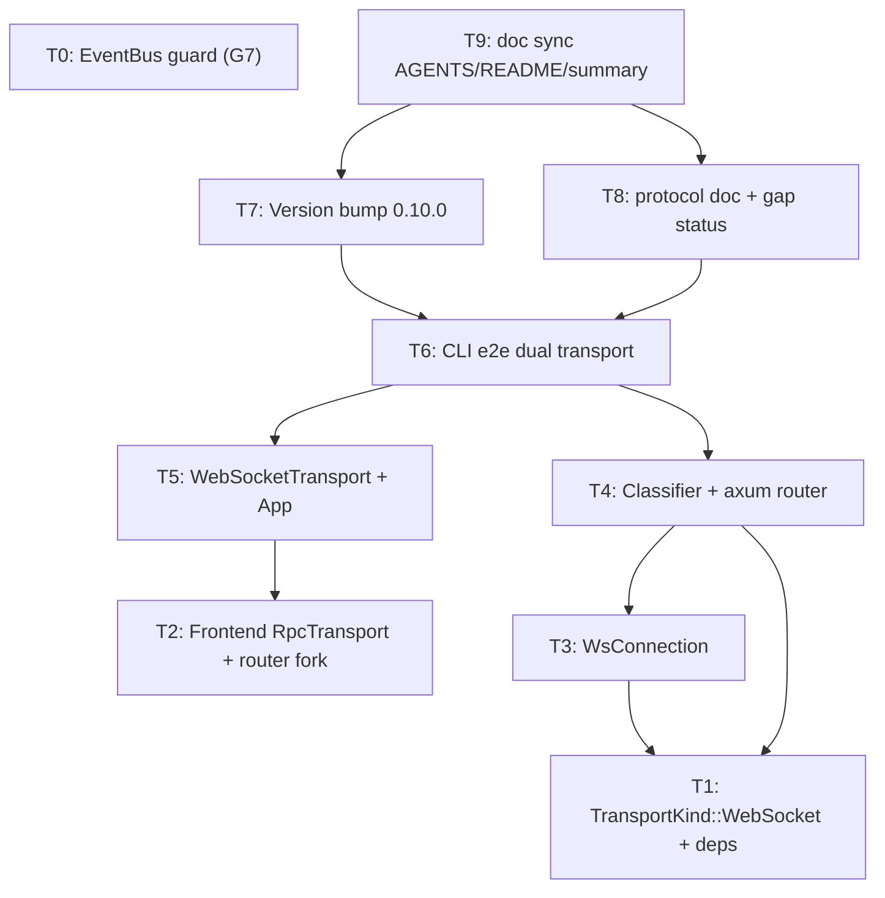

# Plan: G7 EventBus Reentrancy Guard + G8 WebSocket Gateway (v0.10.0)

> **For agentic workers:** REQUIRED SUB-SKILL: Use `superpowers:subagent-driven-development` (recommended) or `superpowers:executing-plans` to implement this plan task-by-task. Steps use checkbox (`- [ ]`) syntax for tracking.

**Goal:** Close the final two gap-archive items — guard `EventBus::publish` against reentrant recursion (G7) and add a same-port WebSocket gateway (G8) so the browser Dashboard can connect directly while raw TCP stays untouched.

**Architecture:** G7 adds a thread-local depth + same-stack cycle guard at the `EventBus::publish` entry (single choke point, zero call-site changes). G8 turns `TcpIpcServer`'s accept loop into a connection classifier (peek first bytes): HTTP request lines go to an axum Router served via `hyper_util` `serve_connection_with_upgrades`, everything else stays on the existing raw-TCP NDJSON path. A new `WsConnection` implements the existing `Connection` trait (native WS frames, mpsc bridge for the sync `send` contract) and reuses `IpcServer::serve_connection` unchanged. The frontend replaces `node:net` with a `WebSocketTransport` and forks notifications in `ResponseRouter` (fixes BUG-005).

**Tech Stack:** Rust (tokio, axum 0.8 ws, hyper-util, tokio-tungstenite dev-dep), TypeScript (Vite 8 + React 19, native WebSocket, vitest).

## Global Constraints

- Workspace: Rust 1.96+, edition 2024, resolver 2. `cargo clippy --workspace --all-targets -- -D warnings` must be zero-warning.
- AGENTS.md code rules: Rust functions ≤ 50 lines, each line ≤ 120 chars.
- Protocol discipline: WS is a transport layer — JSON-RPC 2.0 envelope, wire types, and `schemas/*.json` MUST NOT change (`cargo test -p agentj-protocol -- drift` stays green).
- Design doc (Chinese): `docs/superpowers/specs/2026-09-04-g7-eventbus-reentrancy-g8-websocket-gateway-design.md`. Decisions D1-D8 are binding.
- Version bump: feature → minor, `0.9.1 → 0.10.0` (Task T7).
- Doc sync: `AGENTS.md` / `README.md` / `.agents/summary/summary_and_next.md` committed together after phase completion (Task T9).
- All design/plan/spec doc edits are in Chinese prose; plan tasks and code in English.

---

## Tasks

### T0: G7 — EventBus reentrancy guard (thread_local depth + cycle detection) [P0] [Sequential]

**Files:**
- Modify: `crates/agentj-core/src/hooks.rs` (publish entry + guard; tests in same file's `mod tests`)

**Interfaces:**
- Consumes: `EventType` (derives `Debug, Clone, PartialEq, Eq, Hash`), `EventHandler`, `KernelContext` — all unchanged.
- Produces: `const MAX_EVENT_DEPTH: u8 = 16`; `EventGuard` RAII guard; modified `EventBus::publish(&EventType)` behavior: drops reentrant publishes (depth ≥ 16 or same event on stack) with `tracing::warn!`, keeps snapshot + `catch_unwind` semantics.

- [ ] **Step 1: Write the failing tests**

```rust
// crates/agentj-core/src/hooks.rs — add to #[cfg(test)] mod tests (imports: AtomicUsize, AtomicBool, Ordering)
    /// Handler that re-publishes the SAME event it received (self-trigger).
    /// G7: without the cycle guard this recurses infinitely (stack overflow).
    struct SelfTriggerHandler {
        bus: Arc<EventBus>,
        calls: Arc<AtomicUsize>,
    }
    impl EventHandler for SelfTriggerHandler {
        fn on_event(&self, event: &EventType, _ctx: &KernelContext) {
            self.calls.fetch_add(1, Ordering::SeqCst);
            self.bus.publish(event); // same event → cycle
        }
    }

    #[test]
    fn publish_drops_same_event_self_trigger_cycle() {
        let bus = Arc::new(EventBus::with_ctx(Arc::new(dummy_context())));
        let calls = Arc::new(AtomicUsize::new(0));
        bus.register(
            EventType::ModuleLoaded("m".into()),
            Arc::new(SelfTriggerHandler {
                bus: bus.clone(),
                calls: calls.clone(),
            }),
        );
        bus.publish(&EventType::ModuleLoaded("m".into()));
        // Cycle detected at depth 1: the handler runs exactly once, no recursion.
        assert_eq!(calls.load(Ordering::SeqCst), 1);
    }

    /// Chain m0 → m1 → m2 → …: distinct events, bounded by MAX_EVENT_DEPTH.
    struct ChainHandler {
        bus: Arc<EventBus>,
        next: EventType,
        calls: Arc<AtomicUsize>,
    }
    impl EventHandler for ChainHandler {
        fn on_event(&self, _event: &EventType, _ctx: &KernelContext) {
            self.calls.fetch_add(1, Ordering::SeqCst);
            self.bus.publish(&self.next);
        }
    }

    #[test]
    fn publish_bounds_cross_type_cycle_by_depth() {
        let bus = Arc::new(EventBus::with_ctx(Arc::new(dummy_context())));
        let calls = Arc::new(AtomicUsize::new(0));
        for i in 0..(MAX_EVENT_DEPTH as usize + 2) {
            bus.register(
                EventType::ModuleLoaded(format!("m{i}").into()),
                Arc::new(ChainHandler {
                    bus: bus.clone(),
                    next: EventType::ModuleLoaded(format!("m{}", i + 1).into()),
                    calls: calls.clone(),
                }),
            );
        }
        bus.publish(&EventType::ModuleLoaded("m0".into()));
        assert!(
            calls.load(Ordering::SeqCst) <= MAX_EVENT_DEPTH as usize,
            "cross-type cycle must be depth-bounded, got {}",
            calls.load(Ordering::SeqCst)
        );
    }

    /// A panic inside a nested publish must still roll back the thread-local
    /// guard, so the same event can be published again afterwards.
    struct DepthPanicHandler {
        panicked: Arc<AtomicBool>,
    }
    impl EventHandler for DepthPanicHandler {
        fn on_event(&self, _event: &EventType, _ctx: &KernelContext) {
            self.panicked.store(true, Ordering::SeqCst);
            panic!("handler boom inside nested publish");
        }
    }
    struct NestedPublisher {
        bus: Arc<EventBus>,
    }
    impl EventHandler for NestedPublisher {
        fn on_event(&self, _event: &EventType, _ctx: &KernelContext) {
            self.bus.publish(&EventType::ModuleFailed("m".into()));
        }
    }

    #[test]
    fn publish_recovers_guard_after_nested_panic() {
        let bus = Arc::new(EventBus::with_ctx(Arc::new(dummy_context())));
        let panicked = Arc::new(AtomicBool::new(false));
        bus.register(
            EventType::ModuleFailed("m".into()),
            Arc::new(DepthPanicHandler {
                panicked: panicked.clone(),
            }),
        );
        bus.register(
            EventType::ModuleLoaded("m".into()),
            Arc::new(NestedPublisher { bus: bus.clone() }),
        );
        bus.publish(&EventType::ModuleLoaded("m".into()));
        assert!(panicked.load(Ordering::SeqCst));
        // Guard must have rolled back during unwind: ModuleLoaded("m") is no
        // longer on the stack, so a fresh publish delivers (not cycle-dropped).
        let spy = Arc::new(SpyHandler {
            events: Arc::new(Mutex::new(vec![])),
        });
        bus.register(EventType::ModuleLoaded("m".into()), spy.clone());
        bus.publish(&EventType::ModuleLoaded("m".into()));
        assert_eq!(spy.events.lock().unwrap().len(), 1);
    }
```

- [ ] **Step 2: Run tests to verify they fail**

Run: `cargo test -p agentj-core hooks`
Expected: FAIL — `MAX_EVENT_DEPTH` unresolved (does not compile); after adding the const only, the self-trigger test overflows the stack (test process aborts) until the guard exists.

- [ ] **Step 3: Write the minimal implementation**

```rust
// crates/agentj-core/src/hooks.rs — module-level additions
/// G7: maximum publish recursion depth per thread. A longer chain is a bug
/// (cross-type cycle); the deepest frame is dropped with a warning.
const MAX_EVENT_DEPTH: u8 = 16;

thread_local! {
    /// Current publish recursion depth on this thread (G7 guard).
    static EVENT_DEPTH: std::cell::Cell<u8> = const { std::cell::Cell::new(0) };
    /// Events currently on the publish stack on this thread (G7 cycle guard).
    static EVENT_STACK: std::cell::RefCell<Vec<EventType>> =
        const { std::cell::RefCell::new(Vec::new()) };
}

/// RAII reentrancy guard: increments depth and pushes the event on entry;
/// rolls both back on drop — including during unwind from a panicked handler.
struct EventGuard;

impl EventGuard {
    fn enter(event: &EventType) -> Option<Self> {
        let admitted = EVENT_DEPTH.with(|depth| {
            if depth.get() >= MAX_EVENT_DEPTH {
                return false;
            }
            let cycle = EVENT_STACK.with(|stack| stack.borrow().contains(event));
            if cycle {
                return false;
            }
            depth.set(depth.get() + 1);
            EVENT_STACK.with(|stack| stack.borrow_mut().push(event.clone()));
            true
        });
        admitted.then_some(Self)
    }
}

impl Drop for EventGuard {
    fn drop(&mut self) {
        EVENT_DEPTH.with(|depth| depth.set(depth.get() - 1));
        EVENT_STACK.with(|stack| {
            let _ = stack.borrow_mut().pop();
        });
    }
}
```

```rust
// crates/agentj-core/src/hooks.rs — publish entry change (rest of body unchanged)
    pub fn publish(&self, event: &EventType) {
        let Some(_guard) = EventGuard::enter(event) else {
            tracing::warn!(?event, "dropping reentrant event publish (depth cap or cycle)");
            return;
        };
        let ctx = match self.ctx.read() {
            Ok(guard) => guard.clone(),
            Err(_) => return,
        };
        let Some(ctx) = ctx else { return };
        let snapshot = {
            let Ok(handlers) = self.handlers.lock() else {
                return;
            };
            handlers
                .iter()
                .filter(|(sub, _)| sub == event)
                .cloned()
                .collect::<Vec<HandlerEntry>>()
        };
        for (_, handler) in snapshot {
            let _ = std::panic::catch_unwind(std::panic::AssertUnwindSafe(|| {
                handler.on_event(event, &ctx);
            }));
        }
    }
```

- [ ] **Step 4: Run tests to verify they pass**

Run: `cargo test -p agentj-core`
Expected: PASS — 3 new tests green, all existing hooks tests (event_bus_publishes_to_matching_handlers, publish_snapshots_handlers_so_handler_can_reenter_bus, publish_isolates_handler_panic_and_keeps_bus_functional, kernel_publishes_lifecycle_events, etc.) still pass.

- [ ] **Step 5: Verify + commit**

Run: `cargo test -p agentj-core && cargo clippy -p agentj-core -- -D warnings && cargo fmt --all --check`
Commit: `fix(core): guard EventBus::publish against reentrant recursion (G7)`

**Acceptance Criteria / Regression Guards / Verify:**

```yaml
- id: T0
  title: "Add EventBus reentrancy guard (thread_local depth + cycle detection)"
  files:
    - crates/agentj-core/src/hooks.rs
  depends_on: []
  breaking: false
  ac:
    - given: "a handler re-publishes the SAME event type it received"
      when: "the bus publishes that event once"
      then: "the handler runs exactly once and no recursion/stack overflow occurs"
    - given: "a chain of distinct events m0→m1→…→m17 where each handler publishes the next"
      when: "publish(m0) is called"
      then: "execution is bounded to <= MAX_EVENT_DEPTH (16) handler invocations"
    - given: "a handler publishes a different event whose handler panics"
      when: "the outer publish returns (panic isolated by catch_unwind)"
      then: "the same original event can be published again and delivers normally"
  regression:
    - "publish_snapshots_handlers_so_handler_can_reenter_bus (BUG-001 deadlock guard)"
    - "publish_isolates_handler_panic_and_keeps_bus_functional (BUG-002 panic isolation)"
    - "event_bus_publishes_to_matching_handlers"
    - "kernel_publishes_lifecycle_events"
  test_code: |
    (three tests above: publish_drops_same_event_self_trigger_cycle,
     publish_bounds_cross_type_cycle_by_depth, publish_recovers_guard_after_nested_panic)
  impl_code: |
    (EventGuard + thread_local EVENT_DEPTH/EVENT_STACK + MAX_EVENT_DEPTH=16 + publish entry guard)
  verify:
    - "cargo test -p agentj-core"
    - "cargo clippy -p agentj-core -- -D warnings"
    - "cargo fmt --all --check"
```

---

### T1: G8 — Add `TransportKind::WebSocket` + axum/hyper-util deps [P0] [Parallel with T0, T2]

**Files:**
- Modify: `crates/agentj-ipc/Cargo.toml`
- Modify: `crates/agentj-ipc/src/lib.rs`

**Interfaces:**
- Consumes: existing `TransportKind { Stdio, Tcp, UnixSocket }` enum, existing `Connection` trait.
- Produces: `TransportKind::WebSocket` variant; `agentj-ipc` gains direct deps `axum 0.8 (ws)`, `hyper 1`, `hyper-util 0.1 (server-auto/service/tokio)`, `futures 0.3`, `tower 0.5 (util)`; dev-dep `tokio-tungstenite`.

- [ ] **Step 1: Write the failing test**

```rust
// crates/agentj-ipc/src/lib.rs — add to a #[cfg(test)] mod tests block
    #[test]
    fn transport_kind_has_websocket_variant() {
        let ws = TransportKind::WebSocket;
        assert_ne!(ws, TransportKind::Tcp);
        assert_ne!(ws, TransportKind::Stdio);
        assert_ne!(ws, TransportKind::UnixSocket);
    }
```

- [ ] **Step 2: Run test to verify it fails**

Run: `cargo test -p agentj-ipc transport_kind_has_websocket_variant`
Expected: FAIL — `TransportKind::WebSocket` does not exist (compile error).

- [ ] **Step 3: Write the minimal implementation**

```toml
# crates/agentj-ipc/Cargo.toml — [dependencies] additions
axum = { version = "0.8", features = ["ws"] }
futures = "0.3"
hyper = { version = "1", features = ["server", "http1"] }
hyper-util = { version = "0.1", features = ["server-auto", "service", "tokio"] }
tower = { version = "0.5", features = ["util"] }
```
```toml
# crates/agentj-ipc/Cargo.toml — [dev-dependencies] addition
tokio-tungstenite = "0.26"
```
```rust
// crates/agentj-ipc/src/lib.rs — enum change
pub enum TransportKind {
    Stdio,
    Tcp,
    UnixSocket,
    WebSocket,
}
```

- [ ] **Step 4: Run tests to verify they pass**

Run: `cargo test -p agentj-ipc`
Expected: PASS — new test green; note: if `tokio-tungstenite` dev-dep version conflicts with axum's transitive ws version, bump dev-dep to match (client side is protocol-independent; two versions can coexist).

- [ ] **Step 5: Verify + commit**

Run: `cargo test -p agentj-ipc && cargo clippy -p agentj-ipc -- -D warnings`
Commit: `feat(ipc): add TransportKind::WebSocket and axum/hyper-util deps (G8)`

**Acceptance Criteria / Regression Guards / Verify:**

```yaml
- id: T1
  title: "Add TransportKind::WebSocket variant and WebSocket dependency stack"
  files:
    - crates/agentj-ipc/Cargo.toml
    - crates/agentj-ipc/src/lib.rs
  depends_on: []
  breaking: true
  ac:
    - given: "the TransportKind enum"
      when: "a WebSocket variant is referenced"
      then: "it compiles and is distinct from Stdio/Tcp/UnixSocket"
    - given: "agentj-ipc Cargo.toml"
      when: "cargo builds the crate"
      then: "axum(ws), hyper, hyper-util, futures, tower resolve and build"
  regression:
    - "existing agentj-ipc tests (stdio/tcp framing, registry, serve loop)"
  test_code: |
    transport_kind_has_websocket_variant test (above)
  impl_code: |
    Cargo.toml deps + TransportKind::WebSocket variant
  verify:
    - "cargo test -p agentj-ipc"
    - "cargo clippy -p agentj-ipc -- -D warnings"
```

---

### T2: G8 — Frontend `RpcTransport` extension + `ResponseRouter` notification fork [P0] [Parallel with T0, T1]

**Files:**
- Modify: `web-dashboard/src/jsonrpc.ts`
- Modify: `web-dashboard/src/jsonrpc.test.ts`

**Interfaces:**
- Consumes: current `RpcTransport { send }`, `ResponseRouter` (feed/register/requestId/rejectAll), `RpcClient(transport)`.
- Produces: `RpcTransport` gains optional `close?: () => void`; `ResponseRouter` gains `setNotificationHandler(handler)` and forks `id==null` messages to it (BUG-005 fix); `RpcClient` constructor becomes `(transport, router?: ResponseRouter)` (optional — existing call sites keep compiling) and gains `setNotificationHandler(handler)`.

- [ ] **Step 1: Write the failing test**

```ts
// web-dashboard/src/jsonrpc.test.ts — add
  test('feeds notifications to the registered handler instead of dropping them', () => {
    const router = new ResponseRouter();
    const seen: Array<[string, unknown]> = [];
    router.setNotificationHandler((method, params) => seen.push([method, params]));
    router.feed(JSON.stringify({ jsonrpc: '2.0', method: '$/progress', params: { p: 1 } }));
    expect(seen).toEqual([['$/progress', { p: 1 }]]);
  });
```

- [ ] **Step 2: Run test to verify it fails**

Run: `cd web-dashboard && npm test -- jsonrpc`
Expected: FAIL — `setNotificationHandler` does not exist; `feed` drops `id==null` messages.

- [ ] **Step 3: Write the minimal implementation**

```ts
// web-dashboard/src/jsonrpc.ts
export type NotificationHandler = (method: string, params: unknown) => void;

export interface RpcTransport {
  send: (line: string) => Promise<string>;
  /** Optional release hook (e.g. WebSocket.close). */
  close?: () => void;
}

export class ResponseRouter {
  // …existing fields…
  private notificationHandler?: NotificationHandler;

  setNotificationHandler(handler: NotificationHandler): void {
    this.notificationHandler = handler;
  }

  feed(chunk: string): void {
    for (const line of chunk.split('\n')) {
      const trimmed = line.trim();
      if (!trimmed) continue;
      let msg: { id?: number | null; method?: string; params?: unknown; result?: unknown; error?: unknown };
      try {
        msg = JSON.parse(trimmed);
      } catch {
        continue;
      }
      if (msg.id === undefined || msg.id === null) {
        // Notification (BUG-005 fix): dispatch, never drop.
        if (msg.method && this.notificationHandler) {
          this.notificationHandler(msg.method, msg.params);
        }
        continue;
      }
      // …existing id-based response routing unchanged…
    }
  }
}
```
```ts
// web-dashboard/src/jsonrpc.ts — RpcClient. The router is OPTIONAL so existing
// `new RpcClient(transport)` call sites (incl. App.tsx via static connect and
// jsonrpc.test.ts fake transports) keep compiling — T2 stays non-breaking and
// the build stays green after this task alone. App.tsx passes a shared router
// in T5; until then notifications simply have no subscriber.
export class RpcClient {
  private readonly router: ResponseRouter;

  constructor(
    private readonly transport: RpcTransport,
    router?: ResponseRouter,
  ) {
    this.router = router ?? new ResponseRouter();
  }

  setNotificationHandler(handler: NotificationHandler): void {
    this.router.setNotificationHandler(handler);
  }
  // request/initialize unchanged — they keep using this.transport.send(line).
}
```
```ts
// web-dashboard/src/jsonrpc.test.ts — no constructor changes needed
// (router is optional: existing `new RpcClient(fakeTransport)` still compiles)
```

- [ ] **Step 4: Run tests to verify they pass**

Run: `cd web-dashboard && npm test`
Expected: PASS — new notification test green; all existing jsonrpc tests pass after constructor updates.

- [ ] **Step 5: Verify + commit**

Run: `cd web-dashboard && npm test && npm run build`
Commit: `feat(web-dashboard): fork notifications in ResponseRouter, extend RpcTransport (G8)`

**Acceptance Criteria / Regression Guards / Verify:**

```yaml
- id: T2
  title: "Extend RpcTransport and fork notifications in ResponseRouter"
  files:
    - web-dashboard/src/jsonrpc.ts
    - web-dashboard/src/jsonrpc.test.ts
  depends_on: []
  breaking: false
  ac:
    - given: "a ResponseRouter with a registered notification handler"
      when: "feed() receives a JSON-RPC message with null/undefined id"
      then: "the handler is invoked with (method, params) instead of dropping the message"
    - given: "a new RpcClient(transport) without an explicit router"
      when: "setNotificationHandler is called"
      then: "subsequent notifications are routed to that handler (internal router fallback)"
  regression:
    - "existing RpcClient request/response routing tests (id-based resolve/reject)"
    - "ResponseRouter NDJSON multi-line feed handling"
    - "App.tsx static connect() path (unchanged, router optional)"
  test_code: |
    notification fork test (above); existing jsonrpc.test.ts constructor usages unchanged
  impl_code: |
    RpcTransport.close? + ResponseRouter.setNotificationHandler + feed fork + RpcClient(transport, router?)
  verify:
    - "cd web-dashboard && npm test"
    - "cd web-dashboard && npm run build"
```

---

### T3: G8 — `WsConnection` (Connection impl, native frames, mpsc writer bridge) [P1] [Sequential, after T1]

**Files:**
- Create: `crates/agentj-ipc/src/ws.rs` (impl + `#[cfg(test)] mod tests`)

**Interfaces:**
- Consumes: `Connection` trait, `ConnectionWriter::new(id, kind, peer, ConnSend)`, `TransportKind::WebSocket`, `IpcError{Json, Io, InvalidRequest}`, `axum::extract::ws::{Message, WebSocket}`.
- Produces: `WsConnection::new(socket: WebSocket, peer: String) -> Self` implementing `Connection` — `send` enqueues to an unbounded mpsc drained by a spawned sink task; `recv` returns `Text` message bodies, `Close`/EOF → `None`, ping/pong/binary skipped; `writer()` clones the sender into a `ConnectionWriter`.

- [ ] **Step 1: Write the failing test**

```rust
// crates/agentj-ipc/src/ws.rs — #[cfg(test)] mod tests
#[cfg(test)]
mod tests {
    use super::*;
    use axum::extract::ws::{Message, WebSocket, WebSocketUpgrade};
    use axum::routing::get;
    use axum::Router;
    use futures::StreamExt;
    use tokio_tungstenite::connect_async;

    /// Minimal in-process axum upgrade server that serves a WsConnection and
    /// echoes every received line back through the connection's writer (the
    /// BUG-006 idle-subscriber path).
    async fn echo_handler(ws: WebSocketUpgrade) -> axum::response::Response {
        ws.on_upgrade(|socket: WebSocket| async move {
            let conn = WsConnection::new(socket, "test-peer".into());
            let mut writer = conn.writer();
            while let Some(Ok(line)) = conn.recv().await {
                let _ = writer.send(&format!("echo:{line}"));
            }
        })
    }

    #[tokio::test]
    async fn ws_connection_roundtrips_text_frames_via_writer() {
        let listener = tokio::net::TcpListener::bind("127.0.0.1:0").await.unwrap();
        let addr = listener.local_addr().unwrap();
        let app = Router::new().route("/ws", get(echo_handler));
        let server = tokio::spawn(async move {
            let _ = axum::serve(listener, app).await;
        });

        let (mut socket, _) = connect_async(format!("ws://{addr}/ws")).await.unwrap();
        socket
            .send(Message::Text("hello".into()))
            .await
            .unwrap();
        let reply = socket.next().await.unwrap().unwrap();
        assert_eq!(reply.to_text().unwrap(), "echo:hello");
        socket.close(None).await.unwrap();
        server.abort();
    }

    #[tokio::test]
    async fn ws_connection_close_frame_yields_eof() {
        let listener = tokio::net::TcpListener::bind("127.0.0.1:0").await.unwrap();
        let addr = listener.local_addr().unwrap();
        let app = Router::new().route("/ws", get(close_probe_handler));
        let server = tokio::spawn(async move {
            let _ = axum::serve(listener, app).await;
        });

        let (mut socket, _) = connect_async(format!("ws://{addr}/ws")).await.unwrap();
        socket.close(None).await.unwrap();
        let _ = socket.next().await;
        server.abort();
    }

    async fn close_probe_handler(ws: WebSocketUpgrade) -> axum::response::Response {
        ws.on_upgrade(|socket: WebSocket| async move {
            let mut conn = WsConnection::new(socket, "test-peer".into());
            assert!(conn.recv().await.is_none(), "close frame must yield EOF");
        })
    }
}
```

- [ ] **Step 2: Run test to verify it fails**

Run: `cargo test -p agentj-ipc ws_connection`
Expected: FAIL — `ws` module does not exist (compile error).

- [ ] **Step 3: Write the minimal implementation**

```rust
// crates/agentj-ipc/src/ws.rs (new file)
//! WebSocket transport (G8): a WS Text message is exactly one JSON-RPC
//! message (native framing, no `\n`). `Connection::send` is synchronous, so
//! outbound lines are queued to an unbounded channel drained by a writer task
//! owning the sink half — mirroring `TcpConnection`'s split-writer pattern so
//! an idle subscriber stays reachable for broadcasts (BUG-006).

use crate::{Connection, ConnectionWriter, IpcError, TransportKind};
use axum::extract::ws::{Message, WebSocket};
use futures::stream::SplitStream;
use futures::StreamExt;
use std::sync::Arc;
use tokio::sync::mpsc;

pub struct WsConnection {
    id: String,
    peer: String,
    stream: SplitStream<WebSocket>,
    tx: mpsc::UnboundedSender<String>,
}

impl WsConnection {
    pub fn new(socket: WebSocket, peer: String) -> Self {
        // `sink` must be mut: the writer task owns it and calls sink.send().
        let (mut sink, stream) = socket.split();
        let (tx, mut rx) = mpsc::unbounded_channel::<String>();
        tokio::spawn(async move {
            while let Some(line) = rx.recv().await {
                if sink.send(Message::Text(line.into())).await.is_err() {
                    break;
                }
            }
        });
        Self {
            id: format!("ws-{peer}"),
            peer,
            stream,
            tx,
        }
    }
}

#[async_trait]
impl Connection for WsConnection {
    fn id(&self) -> String {
        self.id.clone()
    }
    fn kind(&self) -> TransportKind {
        TransportKind::WebSocket
    }
    fn send(&self, msg: &str) -> Result<(), IpcError> {
        self.tx
            .send(msg.to_string())
            .map_err(|_| IpcError::InvalidRequest("ws send channel closed".into()))
    }
    async fn recv(&mut self) -> Option<Result<String, IpcError>> {
        loop {
            match self.stream.next().await {
                Some(Ok(Message::Text(text))) => return Some(Ok(text.to_string())),
                Some(Ok(Message::Close(_))) | None => return None,
                Some(Ok(_)) => continue, // ping/pong/binary ignored
                Some(Err(e)) => {
                    return Some(Err(IpcError::InvalidRequest(e.to_string())));
                }
            }
        }
    }
    fn peer_desc(&self) -> String {
        format!("ws:{}", self.peer)
    }
    fn writer(&self) -> ConnectionWriter {
        let tx = self.tx.clone();
        ConnectionWriter::new(
            self.id.clone(),
            self.kind(),
            self.peer.clone(),
            Arc::new(move |msg: &str| {
                tx.send(msg.to_string())
                    .map_err(|_| IpcError::InvalidRequest("ws send channel closed".into()))
            }),
        )
    }
}
```
```rust
// crates/agentj-ipc/src/lib.rs — add `pub mod ws;` to the module list
pub mod ws;
```

- [ ] **Step 4: Run tests to verify they pass**

Run: `cargo test -p agentj-ipc`
Expected: PASS — roundtrip + close-EOF tests green; all existing ipc tests pass.

- [ ] **Step 5: Verify + commit**

Run: `cargo test -p agentj-ipc && cargo clippy -p agentj-ipc -- -D warnings`
Commit: `feat(ipc): add WsConnection implementing Connection over native WS frames (G8)`

**Acceptance Criteria / Regression Guards / Verify:**

```yaml
- id: T3
  title: "Add WsConnection (Connection impl with mpsc writer bridge)"
  files:
    - crates/agentj-ipc/src/ws.rs
    - crates/agentj-ipc/src/lib.rs
  depends_on: [T1]
  breaking: false
  ac:
    - given: "a WsConnection behind a real axum upgrade"
      when: "a client sends a Text frame 'hello'"
      then: "recv() yields 'hello' and writer().send('echo:hello') reaches the client as one Text frame"
    - given: "a client sends a Close frame"
      when: "recv() is awaited"
      then: "it returns None (EOF) and the connection unwinds cleanly"
    - given: "WsConnection::send or its writer"
      when: "invoked after the socket dropped"
      then: "it returns an IpcError instead of panicking"
  regression:
    - "existing stdio/tcp Connection impl tests (trait contract shape)"
  test_code: |
    ws_connection_roundtrips_text_frames_via_writer + ws_connection_close_frame_yields_eof (above)
  impl_code: |
    ws.rs WsConnection + lib.rs `pub mod ws;`
  verify:
    - "cargo test -p agentj-ipc"
    - "cargo clippy -p agentj-ipc -- -D warnings"
```

---

### T4: G8 — Connection classifier + axum Router in `TcpIpcServer` (same-port TCP+WS) [P2] [Sequential, after T1+T3]

**Files:**
- Modify: `crates/agentj-ipc/src/tcp.rs` (accept loop + `looks_like_http` + ws state)
- Modify: `crates/agentj-ipc/src/ws.rs` (WsServerState, ws_router, ws_upgrade, serve_http)
- Create: `crates/agentj-ipc/tests/ws_classifier.rs` (integration)

**Interfaces:**
- Consumes: `TcpIpcServer::bind(addr, kernel, session, permission_module, token, max_connections)` (signature unchanged), `IpcServer::serve_connection(Box<dyn Connection>, Option<&str>)`, `IpcServer::signal_shutdown/shutdown_requested`, `InMemoryStore` (agentj-session), `Kernel::new()`.
- Produces: `TcpIpcServer::run()` classifies each connection — HTTP request line (uppercase first byte) → `ws::serve_http(stream, router)`, else existing raw-TCP path. WS connections use their own `active_ws` counter for `max_connections` and are excluded from the last-disconnect shutdown (D7). `?token=` checked at upgrade (403), `initialize.token` rechecked by `auth_gate` (-32806).

- [ ] **Step 1: Write the failing tests**

```rust
// crates/agentj-ipc/tests/ws_classifier.rs (new file) — integration tests
use agentj_core::kernel::Kernel;
use agentj_core::module::SessionStore;
use agentj_ipc::tcp::TcpIpcServer;
use agentj_session::InMemoryStore;
use futures::StreamExt;
use std::sync::Arc;
use tokio::io::{AsyncReadExt, AsyncWriteExt};
use tokio_tungstenite::tungstenite::Message;

fn initialize_line(id: u64) -> String {
    format!(
        r#"{{"jsonrpc":"2.0","id":{id},"method":"initialize","params":{{"protocol_version":"0.4.0","client_info":{{"name":"test","version":"1"}}}}}}"#
    )
}

async fn bind_server(
    token: Option<String>,
    max_connections: usize,
) -> (std::net::SocketAddr, tokio::task::JoinHandle<()>) {
    let kernel = Kernel::new();
    let session: Arc<dyn SessionStore> = Arc::new(InMemoryStore::new());
    let mut server = TcpIpcServer::bind(
        "127.0.0.1:0",
        kernel,
        session,
        None,
        token,
        max_connections,
    )
    .await
    .unwrap();
    let addr = server.local_addr().unwrap();
    let handle = tokio::spawn(async move {
        let _ = server.run().await;
    });
    (addr, handle)
}

#[tokio::test]
async fn same_port_serves_ws_and_raw_tcp() {
    let (addr, handle) = bind_server(None, 16).await;

    // WS client: upgrade + initialize round-trip.
    let (mut ws, _) = tokio_tungstenite::connect_async(format!("ws://{addr}/ws"))
        .await
        .unwrap();
    ws.send(Message::Text(initialize_line(1).into())).await.unwrap();
    let reply = ws.next().await.unwrap().unwrap();
    let text = reply.to_text().unwrap();
    assert!(text.contains("connection_id"), "ws initialize: {text}");
    ws.close(None).await.unwrap();

    // Raw TCP client: NDJSON initialize round-trip still works (regression).
    let mut tcp = tokio::net::TcpStream::connect(addr).await.unwrap();
    tcp.write_all(initialize_line(2).as_bytes()).await.unwrap();
    tcp.write_all(b"\n").await.unwrap();
    let mut line = String::new();
    let mut reader = tokio::io::BufReader::new(&mut tcp);
    reader.read_line(&mut line).await.unwrap();
    assert!(line.contains("connection_id"), "tcp initialize: {line}");

    handle.abort();
}

#[tokio::test]
async fn ws_bad_query_token_is_refused_at_upgrade() {
    let (addr, handle) = bind_server(Some("secret".into()), 16).await;
    let res = tokio_tungstenite::connect_async(format!("ws://{addr}/ws?token=wrong")).await;
    assert!(res.is_err(), "bad ?token= must refuse the WS upgrade");
    handle.abort();
}

#[tokio::test]
async fn ws_initialize_without_token_fails_with_not_authorized() {
    let (addr, handle) = bind_server(Some("secret".into()), 16).await;
    let (mut ws, _) = tokio_tungstenite::connect_async(format!("ws://{addr}/ws?token=secret"))
        .await
        .unwrap();
    ws.send(Message::Text(initialize_line(1).into())).await.unwrap();
    let reply = ws.next().await.unwrap().unwrap();
    let text = reply.to_text().unwrap();
    assert!(text.contains("-32806"), "missing initialize.token: {text}");
    ws.close(None).await.unwrap();
    handle.abort();
}

#[tokio::test]
async fn ws_max_connections_rejects_excess() {
    let (addr, handle) = bind_server(None, 1).await;
    let (mut ws1, _) = tokio_tungstenite::connect_async(format!("ws://{addr}/ws"))
        .await
        .unwrap();
    let res = tokio_tungstenite::connect_async(format!("ws://{addr}/ws")).await;
    assert!(res.is_err(), "second WS connection must be refused at max_connections=1");
    ws1.close(None).await.unwrap();
    handle.abort();
}
```

- [ ] **Step 2: Run tests to verify they fail**

Run: `cargo test -p agentj-ipc --test ws_classifier`
Expected: FAIL — `looks_like_http`/ws router not wired; `ws://` connects get a raw-TCP framing error (or hang) until the classifier exists.

- [ ] **Step 3: Write the minimal implementation**

```rust
// crates/agentj-ipc/src/tcp.rs — module-level helper
/// Connection classifier (G8): HTTP request lines start with an uppercase
/// method token; JSON-RPC NDJSON always starts with '{'.
fn looks_like_http(peeked: &[u8]) -> bool {
    matches!(peeked.first(), Some(b) if b.is_ascii_uppercase())
}
```
```rust
// crates/agentj-ipc/src/tcp.rs — struct + bind changes
pub struct TcpIpcServer {
    listener: TcpListener,
    shared: Arc<IpcServer>,
    token: Option<String>,
    max_connections: usize,
    active: Arc<AtomicUsize>,
    ws_state: Arc<crate::ws::WsServerState>,
}
// bind(): build the shared Arc ONCE, then clone it into both paths
        let shared = Arc::new(server);
        Ok(Self {
            listener,
            shared: shared.clone(),
            token,
            max_connections,
            active: Arc::new(AtomicUsize::new(0)),
            ws_state: Arc::new(crate::ws::WsServerState {
                shared,
                token: token.clone(),
                max_connections,
                active_ws: AtomicUsize::new(0),
            }),
        })
```
```rust
// crates/agentj-ipc/src/tcp.rs — run() accept loop change.
// KEEP the existing accept-entry gate UNCHANGED: `active.fetch_add(1)` runs
// BEFORE the spawn (every accepted connection gets +1), so the `fetch_sub(1)`
// in BOTH branches below balances it — no underflow. `stream.peek()` uses
// MSG_PEEK (tokio), which does NOT consume bytes, so the TCP branch's
// `TcpConnection::new(stream)` still reads the full NDJSON line afterwards.
                    tokio::spawn(async move {
                        let mut buf = [0u8; 16];
                        let peeked = stream.peek(&mut buf).await.unwrap_or(0);
                        if looks_like_http(&buf[..peeked]) {
                            // HTTP/WS upgrade attempt → axum path. Not counted in
                            // `active`: WS uses its own counter and is excluded
                            // from the last-disconnect shutdown (设计 D7).
                            active.fetch_sub(1, Ordering::SeqCst);
                            let router = crate::ws::ws_router(ws_state, peer);
                            crate::ws::serve_http(stream, router).await;
                        } else {
                            if let Ok(conn) = TcpConnection::new(stream) {
                                let _ = shared
                                    .serve_connection(Box::new(conn), token.as_deref())
                                    .await;
                            }
                            active.fetch_sub(1, Ordering::SeqCst);
                            if active.load(Ordering::SeqCst) == 0 {
                                let _ = shared.signal_shutdown();
                            }
                        }
                    });
```
> NOTE: capture `peer` from `self.listener.accept()` (change `let (stream, _) = …` to `let (stream, peer) = …`) and pass `ws_state` clone into the task. Build the shared `Arc<IpcServer>` ONCE in `bind` and clone it into both `shared` and `ws_state.shared`.

```rust
// crates/agentj-ipc/src/ws.rs — additions
use axum::extract::ws::{Message, WebSocket, WebSocketUpgrade};
use axum::extract::Query;
use axum::http::StatusCode;
use axum::response::{IntoResponse, Response};
use axum::routing::get;
use axum::Router;
use hyper::body::Incoming;
use hyper::service::service_fn;
use hyper_util::rt::{TokioExecutor, TokioIo};
use std::convert::Infallible;
use std::net::SocketAddr;
use std::sync::atomic::{AtomicUsize, Ordering};
use std::sync::Arc;
use tower::ServiceExt;

/// Shared state for the WS server (G8). Holds the same Arc<IpcServer> the TCP
/// path uses so WS connections flow through the identical serve loop.
pub struct WsServerState {
    pub shared: Arc<crate::IpcServer>,
    pub token: Option<String>,
    pub max_connections: usize,
    pub active_ws: AtomicUsize,
}

#[derive(serde::Deserialize)]
pub struct WsQuery {
    pub token: Option<String>,
}

/// Build a per-connection axum Router for the WS upgrade endpoint. `peer` is
/// captured so the WsConnection gets a stable id/peer_desc.
pub fn ws_router(state: Arc<WsServerState>, peer: SocketAddr) -> Router {
    Router::new().route(
        "/ws",
        get(move |Query(query): Query<WsQuery>, ws: WebSocketUpgrade| {
            let state = state.clone();
            async move { ws_upgrade(state, query, peer, ws).await }
        }),
    )
}

async fn ws_upgrade(
    state: Arc<WsServerState>,
    query: WsQuery,
    peer: SocketAddr,
    ws: WebSocketUpgrade,
) -> Response {
    // 设计 D6 双通道 ①：upgrade 阶段 ?token= 校验。
    if state.token.is_some() && state.token.as_deref() != query.token.as_deref() {
        return (StatusCode::FORBIDDEN, "missing or invalid token").into_response();
    }
    if state.active_ws.load(Ordering::SeqCst) >= state.max_connections {
        return (StatusCode::SERVICE_UNAVAILABLE, "too many connections").into_response();
    }
    state.active_ws.fetch_add(1, Ordering::SeqCst);
    let state = state.clone(); // clone the Arc for the upgraded task
    ws.on_upgrade(move |socket| async move {
        let conn = WsConnection::new(socket, peer.to_string());
        // 设计 D7: WS 连接走既有 serve_connection（注册表/订阅/鉴权零改动）。
        let _ = state
            .shared
            .serve_connection(Box::new(conn), state.token.as_deref())
            .await;
        state.active_ws.fetch_sub(1, Ordering::SeqCst);
    })
}

/// Serve one accepted HTTP/WS connection through hyper + the axum Router
/// (设计 D5, axum 官方 serve-with-hyper 模式; upgrades required for WS).
pub async fn serve_http(stream: tokio::net::TcpStream, router: Router) {
    let io = TokioIo::new(stream);
    let svc = service_fn(move |req: hyper::Request<Incoming>| {
        let router = router.clone();
        async move {
            let req = req.map(axum::body::Body::new);
            Ok::<_, Infallible>(router.oneshot(req).await.unwrap_or_else(|e| match e {}))
        }
    });
    let _ = hyper_util::server::conn::auto::Builder::new(TokioExecutor::new())
        .serve_connection_with_upgrades(io, svc)
        .await;
}
```

- [ ] **Step 4: Run tests to verify they pass**

Run: `cargo test -p agentj-ipc`
Expected: PASS — 4 integration tests green (classifier, token 403, -32806, max_connections); all existing tcp/stdio tests pass.

- [ ] **Step 5: Verify + commit**

Run: `cargo test -p agentj-ipc && cargo clippy -p agentj-ipc -- -D warnings && cargo fmt --all --check`
Commit: `feat(ipc): same-port connection classifier + axum WS gateway in TcpIpcServer (G8)`

**Acceptance Criteria / Regression Guards / Verify:**

```yaml
- id: T4
  title: "Add same-port connection classifier and axum WS gateway"
  files:
    - crates/agentj-ipc/src/tcp.rs
    - crates/agentj-ipc/src/ws.rs
    - crates/agentj-ipc/tests/ws_classifier.rs
  depends_on: [T1, T3]
  breaking: false
  ac:
    - given: "a TcpIpcServer bound on one port"
      when: "a WS client connects to ws://addr/ws and a raw TCP client sends NDJSON to the same addr"
      then: "both complete an initialize round-trip with connection_id (same-port coexistence)"
    - given: "a server bound with token Some(\"secret\")"
      when: "a WS client connects with ?token=wrong"
      then: "the upgrade is refused (HTTP 403)"
    - given: "a server bound with token Some(\"secret\") and a WS client upgraded with ?token=secret"
      when: "the client sends initialize WITHOUT params.token"
      then: "the response contains -32806 NotAuthorized"
    - given: "a server bound with max_connections=1"
      when: "a second WS client connects while the first is open"
      then: "the second upgrade is refused (503)"
    - given: "only WS connections remain connected"
      when: "the last WS client disconnects"
      then: "the daemon does NOT trigger global shutdown (D7; TCP last-disconnect semantics preserved)"
  regression:
    - "existing TcpIpcServer tests (TCP accept, max_connections, last-disconnect shutdown)"
    - "existing raw-TCP e2e behavior (attach/NDJSON framing)"
  test_code: |
    4 integration tests in tests/ws_classifier.rs (above)
  impl_code: |
    looks_like_http + run() classifier + ws.rs WsServerState/ws_router/ws_upgrade/serve_http
  verify:
    - "cargo test -p agentj-ipc"
    - "cargo clippy -p agentj-ipc -- -D warnings"
    - "cargo fmt --all --check"
```

---

### T5: G8 — Frontend `WebSocketTransport` + App wiring [P2] [Parallel with T3, after T2]

**Files:**
- Create: `web-dashboard/src/transport/websocket.ts`
- Modify: `web-dashboard/src/App.tsx`
- Modify: `web-dashboard/src/jsonrpc.test.ts` (add transport tests)

**Interfaces:**
- Consumes: `RpcTransport` (with `close?`), `ResponseRouter` (feed/register/requestId/rejectAll/setNotificationHandler), `RpcClient(transport, router?)` from T2.
- Produces: `WebSocketTransport` class — constructor `(url: string, router: ResponseRouter, wsFactory?: (url: string) => WebSocket)`, `send(line)` registers pending + `ws.send`, `onmessage → router.feed`, `onopen → onStatusChange('open')`, `onerror/onclose → router.rejectAll + onStatusChange('closed')`, `close()`; optional `onStatusChange?: (s: 'connecting'|'open'|'closed') => void` hook for the App to surface connection state.

- [ ] **Step 1: Write the failing test**

```ts
// web-dashboard/src/jsonrpc.test.ts — add (import WebSocketTransport from './transport/websocket')
class MockWebSocket {
  static last: MockWebSocket | null = null;
  sent: string[] = [];
  onmessage: ((ev: { data: string }) => void) | null = null;
  onerror: (() => void) | null = null;
  onclose: (() => void) | null = null;
  onopen: (() => void) | null = null;
  close = () => {};
  send = (data: string) => {
    this.sent.push(data);
  };
  constructor(public url: string) {
    MockWebSocket.last = this;
  }
  emit(data: string) {
    this.onmessage?.({ data });
  }
  emitError() {
    this.onerror?.();
  }
  emitClose() {
    this.onclose?.();
  }
  emitOpen() {
    this.onopen?.();
  }
}

test('WebSocketTransport sends NDJSON and routes responses through the router', async () => {
  const router = new ResponseRouter();
  const transport = new WebSocketTransport(
    'ws://127.0.0.1:4096/ws',
    router,
    (url) => new MockWebSocket(url) as unknown as WebSocket,
  );
  const promise = transport.send('{"jsonrpc":"2.0","id":1,"method":"kernel/status"}');
  expect(MockWebSocket.last!.sent).toEqual([
    '{"jsonrpc":"2.0","id":1,"method":"kernel/status"}',
  ]);
  MockWebSocket.last!.emit('{"jsonrpc":"2.0","id":1,"result":{"modules":[]}}');
  await expect(promise).resolves.toEqual('{"jsonrpc":"2.0","id":1,"result":{"modules":[]}}');
  transport.close();
});

test('WebSocketTransport feeds notifications into the router handler', () => {
  const router = new ResponseRouter();
  const seen: Array<[string, unknown]> = [];
  router.setNotificationHandler((method, params) => seen.push([method, params]));
  const transport = new WebSocketTransport(
    'ws://127.0.0.1:4096/ws',
    router,
    (url) => new MockWebSocket(url) as unknown as WebSocket,
  );
  MockWebSocket.last!.emit('{"jsonrpc":"2.0","method":"$/progress","params":{"p":1}}');
  expect(seen).toEqual([['$/progress', { p: 1 }]]);
  transport.close();
});

test('WebSocketTransport rejects pending on error/close and reports status', async () => {
  const router = new ResponseRouter();
  const statuses: string[] = [];
  const transport = new WebSocketTransport(
    'ws://127.0.0.1:4096/ws',
    router,
    (url) => new MockWebSocket(url) as unknown as WebSocket,
  );
  transport.onStatusChange = (s) => statuses.push(s);
  MockWebSocket.last!.emitOpen();
  const promise = transport.send('{"jsonrpc":"2.0","id":1,"method":"kernel/status"}');
  MockWebSocket.last!.emitClose();
  await expect(promise).rejects.toThrow('websocket closed');
  expect(statuses).toContain('open');
  expect(statuses).toContain('closed');
  transport.close();
});
```

- [ ] **Step 2: Run test to verify it fails**

Run: `cd web-dashboard && npm test -- jsonrpc`
Expected: FAIL — `./transport/websocket` module does not exist.

- [ ] **Step 3: Write the minimal implementation**

```ts
// web-dashboard/src/transport/websocket.ts (new file)
import type { ResponseRouter, RpcTransport } from '../jsonrpc';

/** Connection lifecycle callback: the App can surface connect state. */
export type TransportStatus = 'connecting' | 'open' | 'closed';

/** Browser-native WebSocket transport (G8). One WS Text message = one JSON-RPC
 *  message; feed() is invoked per message (no \n splitting needed). */
export class WebSocketTransport implements RpcTransport {
  private readonly ws: WebSocket;
  onStatusChange?: (s: TransportStatus) => void;

  constructor(
    url: string,
    private readonly router: ResponseRouter,
    wsFactory: (url: string) => WebSocket = (u) => new WebSocket(u),
  ) {
    this.ws = wsFactory(url);
    this.ws.onopen = () => this.onStatusChange?.('open');
    this.ws.onmessage = (event) => {
      const data = typeof event.data === 'string' ? event.data : '';
      if (data) this.router.feed(data);
    };
    this.ws.onerror = () => this.router.rejectAll(new Error('websocket error'));
    this.ws.onclose = () => {
      this.router.rejectAll(new Error('websocket closed'));
      this.onStatusChange?.('closed');
    };
  }

  send(line: string): Promise<string> {
    return new Promise((resolve, reject) => {
      this.router.register(this.router.requestId(line), { resolve, reject });
      this.ws.send(line);
    });
  }

  close(): void {
    this.ws.close();
  }
}
```
```tsx
// web-dashboard/src/App.tsx — replace RpcClient.connect with WS transport
import { RpcClient, ResponseRouter } from './jsonrpc';
import { WebSocketTransport } from './transport/websocket';

// G8: browser connects over WebSocket; URL configurable via VITE env.
const wsUrl = import.meta.env.VITE_AGENTJ_WS_URL ?? 'ws://127.0.0.1:4096/ws';

// in useEffect([]):
    const router = new ResponseRouter();
    const transport = new WebSocketTransport(wsUrl, router);
    transport.onStatusChange = (s) => setStatus(`kernel ${s} on ${wsUrl}`);
    const client = new RpcClient(transport, router);
    client.setNotificationHandler((method, params) => {
      if (method === '$/progress') {
        // optionally surface progress; notifications no longer dropped (BUG-005)
        console.debug('[agentj]', method, params);
      }
    });
    client.request('kernel/status').then(...);
```
> Also delete the now-unused `static connect(port, host)` TCP branch and the `import net from 'node:net'` line from `jsonrpc.ts` (vite no longer bundles node internals → browser TypeError gone).

- [ ] **Step 4: Run tests to verify they pass**

Run: `cd web-dashboard && npm test && npm run build`
Expected: PASS — 2 new transport tests green; build succeeds; `dist/assets/*.js` contains no `node:net` (grep).

- [ ] **Step 5: Verify + commit**

Run: `cd web-dashboard && npm test && npm run build && grep -r "node:net\|createConnection" dist/assets/ || true`
Commit: `feat(web-dashboard): WebSocketTransport replacing node:net, configurable ws URL (G8)`

**Acceptance Criteria / Regression Guards / Verify:**

```yaml
- id: T5
  title: "Add WebSocketTransport and wire App.tsx to the WS endpoint"
  files:
    - web-dashboard/src/transport/websocket.ts
    - web-dashboard/src/App.tsx
    - web-dashboard/src/jsonrpc.test.ts
  depends_on: [T2]
  breaking: false
  ac:
    - given: "a WebSocketTransport with a mock WebSocket"
      when: "send(line) is called and the socket emits a matching id response"
      then: "the pending promise resolves with the raw response string"
    - given: "a WebSocketTransport fed a notification message"
      when: "onmessage fires with id==null payload"
      then: "the router's notification handler receives (method, params)"
    - given: "a WebSocketTransport with pending requests"
      when: "the socket emits error or close"
      then: "all pending promises reject and onStatusChange reports 'closed' (status 'open' reported on onopen)"
    - given: "the built dashboard bundle"
      when: "grep for node:net/createConnection in dist/assets"
      then: "no matches (browser TypeError eliminated)"
  regression:
    - "existing RpcClient/ResponseRouter tests in jsonrpc.test.ts"
  test_code: |
    3 transport tests with MockWebSocket (send/response, notification feed, error/close reject+status)
  impl_code: |
    transport/websocket.ts (with onStatusChange) + App.tsx wsUrl wiring + remove node:net from jsonrpc.ts
  verify:
    - "cd web-dashboard && npm test"
    - "cd web-dashboard && npm run build"
    - "grep -r 'node:net' web-dashboard/dist/assets/ || true"
```

---

### T6: G8 — CLI e2e: `serve --port` dual transport + WS print [P3] [Sequential, after T4+T5]

**Files:**
- Create: `crates/agentj-cli/tests/e2e_ws.rs`
- Modify: `crates/agentj-cli/src/main.rs` (serve_tcp prints ws URL)

**Interfaces:**
- Consumes: `agentj serve --port` binary (free mode, no license key), `TcpIpcServer` classifier from T4.
- Produces: e2e proof that a spawned `agentj serve` accepts WS clients on `/ws` while raw TCP attach still works, and that WS-only disconnect does NOT kill the daemon.

- [ ] **Step 1: Write the failing test**

```rust
// crates/agentj-cli/tests/e2e_ws.rs (new file) — model helpers on existing e2e_cli.rs
use futures::StreamExt;
use std::process::{Command, Stdio};
use tokio::io::{AsyncReadExt, AsyncWriteExt};
use tokio_tungstenite::tungstenite::Message;

fn initialize_line(id: u64) -> String {
    format!(
        r#"{{"jsonrpc":"2.0","id":{id},"method":"initialize","params":{{"protocol_version":"0.4.0","client_info":{{"name":"e2e","version":"1"}}}}}}"#
    )
}

fn free_port() -> u16 {
    std::net::TcpListener::bind("127.0.0.1:0")
        .unwrap()
        .local_addr()
        .unwrap()
        .port()
}

async fn wait_for_listen(port: u16) {
    for _ in 0..100 {
        if tokio::net::TcpStream::connect(("127.0.0.1", port)).await.is_ok() {
            return;
        }
        tokio::time::sleep(std::time::Duration::from_millis(50)).await;
    }
    panic!("server did not start listening on {port}");
}

#[tokio::test]
async fn serve_port_accepts_ws_clients_and_keeps_tcp_attach() {
    let port = free_port();
    let mut child = Command::new(env!("CARGO_BIN_EXE_agentj"))
        .args(["serve", "--port", &port.to_string()])
        .stdout(Stdio::null())
        .stderr(Stdio::null())
        .spawn()
        .expect("spawn agentj serve");
    wait_for_listen(port).await;

    // WS client (browser-equivalent): initialize over ws://.
    let (mut ws, _) = tokio_tungstenite::connect_async(format!("ws://127.0.0.1:{port}/ws"))
        .await
        .unwrap();
    ws.send(Message::Text(initialize_line(1).into())).await.unwrap();
    let reply = ws.next().await.unwrap().unwrap();
    assert!(reply.to_text().unwrap().contains("connection_id"));
    ws.close(None).await.unwrap();

    // TCP attach still works (regression): raw NDJSON initialize.
    let mut tcp = tokio::net::TcpStream::connect(("127.0.0.1", port)).await.unwrap();
    tcp.write_all(initialize_line(2).as_bytes()).await.unwrap();
    tcp.write_all(b"\n").await.unwrap();
    let mut line = String::new();
    tokio::io::BufReader::new(&mut tcp)
        .read_line(&mut line)
        .await
        .unwrap();
    assert!(line.contains("connection_id"), "tcp attach: {line}");

    // D7: daemon stays alive after WS-only traffic (no last-disconnect shutdown).
    let mut tcp2 = tokio::net::TcpStream::connect(("127.0.0.1", port)).await.unwrap();
    tcp2.write_all(initialize_line(3).as_bytes()).await.unwrap();
    tcp2.write_all(b"\n").await.unwrap();
    let mut line2 = String::new();
    tokio::io::BufReader::new(&mut tcp2)
        .read_line(&mut line2)
        .await
        .unwrap();
    assert!(line2.contains("connection_id"), "daemon alive after ws-only: {line2}");

    child.kill().await.expect("kill agentj");
}
```

- [ ] **Step 2: Run test to verify it fails**

Run: `cargo test -p agentj-cli --test e2e_ws`
Expected: FAIL — WS connect fails (classifier not yet present at this point only if T4 skipped; after T4 this step should pass — run the full sequence in order).

- [ ] **Step 3: Write the minimal implementation**

```rust
// crates/agentj-cli/src/main.rs — in serve_tcp(), after the existing print
    println!("listening on {}", tcp.local_addr()?);
    println!("websocket on ws://127.0.0.1:{port}/ws"); // G8: same port, /ws route
```

- [ ] **Step 4: Run tests to verify they pass**

Run: `cargo test -p agentj-cli --test e2e_ws && cargo test -p agentj-cli --test e2e_cli`
Expected: PASS — new e2e green; existing e2e_cli/e2e_serve regression green.

- [ ] **Step 5: Verify + commit**

Run: `cargo test -p agentj-cli && cargo clippy -p agentj-cli -- -D warnings`
Commit: `test(cli): e2e dual-transport serve --port (WS + TCP attach) (G8)`

**Acceptance Criteria / Regression Guards / Verify:**

```yaml
- id: T6
  title: "E2E: serve --port serves WS and raw TCP on one port"
  files:
    - crates/agentj-cli/tests/e2e_ws.rs
    - crates/agentj-cli/src/main.rs
  depends_on: [T4, T5]
  breaking: false
  ac:
    - given: "a spawned `agentj serve --port <p>`"
      when: "a WS client initializes over ws://127.0.0.1:<p>/ws"
      then: "the response contains connection_id"
    - given: "the same running daemon"
      when: "a raw TCP client sends an NDJSON initialize"
      then: "the response contains connection_id (attach regression)"
    - given: "the daemon after WS-only disconnect"
      when: "a fresh TCP client connects"
      then: "the daemon still serves requests (D7: no last-disconnect shutdown from WS)"
  regression:
    - "e2e_cli / e2e_serve (existing TCP + stdio CLI tests)"
  test_code: |
    e2e_ws.rs serve_port_accepts_ws_clients_and_keeps_tcp_attach (above)
  impl_code: |
    main.rs serve_tcp ws URL print (classifier already in T4)
  verify:
    - "cargo test -p agentj-cli --test e2e_ws"
    - "cargo test -p agentj-cli --test e2e_cli"
    - "cargo clippy -p agentj-cli -- -D warnings"
```

---

### T7: Workspace version bump `0.9.1 → 0.10.0` [P4] [Sequential, after T6]

**Files:**
- Modify: `Cargo.toml` (workspace root `version`)
- Modify: `Cargo.lock` (via `cargo build`)

**Interfaces:**
- Consumes: full workspace green from T0-T6.
- Produces: `0.10.0` in all workspace members; lockfile regenerated.

- [ ] **Step 1: Change version**

```toml
# Cargo.toml (workspace root) — version = "0.9.1" → "0.10.0"
[workspace.package]
version = "0.10.0"
```

- [ ] **Step 2: Regenerate lockfile + verify**

Run: `cargo build --workspace` (updates Cargo.lock), then `grep -c '0.10.0' Cargo.lock`
Expected: lockfile contains the new version.

- [ ] **Step 3: Verify protocol drift gate**

Run: `cargo test -p agentj-protocol -- drift`
Expected: PASS — 33 schemas unchanged (WS is transport, no wire change).

- [ ] **Step 4: Full suite + commit**

Run: `cargo test --workspace && cargo clippy --workspace --all-targets -- -D warnings`
Commit: `chore: bump workspace version to 0.10.0`

**Acceptance Criteria / Regression Guards / Verify:**

```yaml
- id: T7
  title: "Bump workspace version to 0.10.0"
  files:
    - Cargo.toml
    - Cargo.lock
  depends_on: [T6]
  breaking: false
  ac:
    - given: "the workspace root Cargo.toml"
      when: "version is set to 0.10.0 and the workspace is rebuilt"
      then: "Cargo.lock reflects 0.10.0 and the full workspace test suite passes"
    - given: "the protocol schemas"
      when: "the drift gate runs"
      then: "schemas are unchanged (33 schemas, WS is transport-only)"
  regression:
    - "cargo test -p agentj-protocol -- drift"
    - "cargo test --workspace"
  test_code: |
    drift gate + full workspace suite (commands above)
  impl_code: |
    workspace version bump + lockfile regen
  verify:
    - "cargo test --workspace"
    - "cargo test -p agentj-protocol -- drift"
    - "cargo clippy --workspace --all-targets -- -D warnings"
```

---

### T8: Docs — protocol spec WS section + gap archive status [P4] [Parallel with T7]

**Files:**
- Modify: `docs/specs/ipc-protocol.md`
- Modify: `docs/superpowers/specs/2026-08-30-gap-analysis-vs-original-design.md`

**Interfaces:**
- Consumes: T4/T6 behavior (ws:// endpoint, native frames, dual-channel auth, same-port classifier).
- Produces: human-readable WS transport section; gap G7/G8 rows flipped to「✅ 已实现」with design + plan links.

- [ ] **Step 1: Write the doc changes**

```markdown
# docs/specs/ipc-protocol.md — add a WebSocket transport section (Chinese, following the doc's existing style)
## 传输：WebSocket（v0.10.0）

- 入口：`ws://127.0.0.1:<port>/ws`（与 raw TCP 同端口共存，连接分类器按首字节区分 HTTP 与 NDJSON）。
- 帧语义：每条 WebSocket Text 消息 = 一条 JSON-RPC 消息（原生帧，无 `\n` 分隔）。
- 鉴权双通道：upgrade 阶段 `?token=` 校验（不匹配 → HTTP 403）；连接后 `initialize.token` 经 `auth_gate` 复验（-32806）。
- 生命周期：WS 连接不参与「最后连接断开 → 全局关闭」（浏览器会话短，不决定内核存亡）；`max_connections` 对 WS 独立计数。
```
```markdown
# docs/superpowers/specs/2026-08-30-gap-analysis-vs-original-design.md — flip G7/G8 rows
# 状态列：✅ 已实现（design + plan：2026-09-04-g7-eventbus-reentrancy-g8-websocket-gateway-*）
# G7 行 →「✅ 已实现（v0.10.0，EventGuard depth<16 + 同栈循环检测）」
# G8 行 →「✅ 已实现（v0.10.0，同端口分类器 + axum /ws + WebSocketTransport）」
```

- [ ] **Step 2: Verify + commit**

Run: `git diff --stat docs/` (review), `cargo test -p agentj-protocol -- drift` (unchanged)
Commit: `docs: WebSocket transport section + gap archive G7/G8 status (v0.10.0)`

**Acceptance Criteria / Regression Guards / Verify:**

```yaml
- id: T8
  title: "Document WebSocket transport and update gap archive status"
  files:
    - docs/specs/ipc-protocol.md
    - docs/superpowers/specs/2026-08-30-gap-analysis-vs-original-design.md
  depends_on: [T6]
  breaking: false
  ac:
    - given: "docs/specs/ipc-protocol.md"
      when: "the WS section is added"
      then: "it documents ws:// entry, native frame semantics, dual-channel auth, and WS lifecycle exclusion"
    - given: "the gap archive G7/G8 rows"
      when: "the phase completes"
      then: "status flips to ✅ 已实现 with design + plan links"
  regression:
    - "cargo test -p agentj-protocol -- drift (no wire/schema change)"
  test_code: |
    drift gate (commands above) + doc content review
  impl_code: |
    ipc-protocol.md WS section + gap archive status rows
  verify:
    - "cargo test -p agentj-protocol -- drift"
```

---

### T9: Doc sync — AGENTS.md + README.md + summary [P5] [Sequential, after T7+T8]

**Files:**
- Modify: `AGENTS.md`
- Modify: `README.md`
- Modify: `.agents/summary/summary_and_next.md`

**Interfaces:**
- Consumes: all completed work (G7 guard, G8 gateway, version 0.10.0).
- Produces: three files committed together as the mandatory post-phase doc sync.

- [ ] **Step 1: Write the doc sync**

```markdown
# AGENTS.md — update (Chinese, follow existing structure):
#  - 顶部状态段：v0.10.0 released；追加 G7 EventBus 重入防护 + G8 WebSocket 网关摘要
#  - agentj-core crate 描述：EventBus 重入 guard（depth 16 + 同栈循环检测）
#  - agentj-ipc crate 描述：ws.rs（WsConnection）+ TcpIpcServer 同端口连接分类器 + axum /ws
#  - agentj-cli 描述：serve --port 打印 websocket on ws://…/ws
#  - web-dashboard 描述：WebSocketTransport（原生 WebSocket，VITE_AGENTJ_WS_URL）
# README.md — update:
#  - 版本 tagline v0.10.0；Features 勾选「WebSocket 网关」「EventBus 重入防护」
#  - Project Structure：agentj-ipc/agentj-cli/web-dashboard 行补 WS 描述
# summary_and_next.md — 整体替换为 G7+G8 阶段内容：
#  - 「## Phase: G7 EventBus 重入防护 + G8 WebSocket 网关 (v0.10.0) ✅ (本次完成)」
#  - 进度与摘要 / 验证结果 / 遗留问题 / 下一步（gap 档案 G1-G8 全闭环，下一步按产品规划）
```

- [ ] **Step 2: Verify + commit**

Run: `cargo test --workspace && cargo clippy --workspace -- -D warnings` (final gate), `cargo fmt --all --check`
Commit: `docs: auto-sync AGENTS.md, README.md, summary after G7+G8 completion`

**Acceptance Criteria / Regression Guards / Verify:**

```yaml
- id: T9
  title: "Sync AGENTS.md, README.md and summary for v0.10.0"
  files:
    - AGENTS.md
    - README.md
    - .agents/summary/summary_and_next.md
  depends_on: [T7, T8]
  breaking: false
  ac:
    - given: "the completed G7+G8 phase"
      when: "AGENTS.md/README.md/summary are updated"
      then: "version 0.10.0, WS gateway, EventBus guard, and crate boundaries are all reflected"
  regression:
    - "cargo test --workspace"
    - "cargo clippy --workspace -- -D warnings"
  test_code: |
    final full gate (commands above)
  impl_code: |
    AGENTS.md / README.md / summary_and_next.md content sync
  verify:
    - "cargo test --workspace"
    - "cargo clippy --workspace --all-targets -- -D warnings"
    - "cargo fmt --all --check"
```

---

## Dependency Graph



## Parallel Execution Groups

- **Group A (Level 0):** T0 (G7), T1 (deps+enum), T2 (frontend router) — fully independent.
- **Group B (Level 1):** T3 (needs T1), T5 (needs T2) — parallel.
- **Group C (Level 2):** T4 (needs T1 + T3).
- **Group D (Level 3):** T6 (needs T4 + T5).
- **Group E (Level 4):** T7, T8 — parallel after T6.
- **Group F (Level 5):** T9 — after T7 + T8.

## Execution Notes

- Run T0-T6 with the rust-analyzer / `cargo` gates green at each task boundary; never start a task whose `depends_on` task is unverified.
- The workspace must stay green at every commit: `cargo test --workspace` and `cargo clippy --workspace --all-targets -- -D warnings` are the phase gates; frontend gates are `cd web-dashboard && npm test && npm run build`.
- Version bump reminder: this is a feature phase → minor bump (0.9.1 → 0.10.0), NOT a patch.