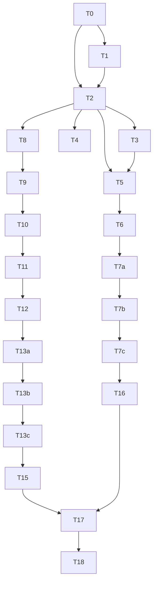

# Plan: agentj-ui Unified Frontend (Web / TUI / Desktop) (v0.11.0)

> **For agentic workers:** REQUIRED SUB-SKILL: Use `superpowers:subagent-driven-development` (recommended) or `superpowers:executing-plans` to implement this plan task-by-task. Steps use checkbox (`- [ ]`) syntax for tracking.

**Goal:** Rename `web-dashboard/` to `agentj-ui/` monorepo and ship three frontends (aligned Web, full-feature OpenTUI TUI, Tauri desktop shell) on one shared TypeScript SDK, with zero backend changes.

**Architecture:** `agentj-ui/` npm workspaces root with `packages/protocol` (moved `bindings/ts` generator), `packages/sdk` (extracted `jsonrpc.ts` + transports + config factory), `apps/web` (moved dashboard, aligned), `apps/tui` (new, `@opentui/react` + Bun), `apps/desktop` (new, Tauri shell over web dist). All three consume the resident kernel over JSON-RPC WS `/ws`.

**Tech Stack:** TypeScript (React 19, Vite 8, vitest 4, Bun ≥1.2, `@opentui/react` + `@opentui/core`), Tauri CLI v2, npm workspaces.

## Global Constraints

- Rust workspace stays untouched except the version bump (T17): Rust 1.96+, edition 2024. `cargo clippy --workspace --all-targets -- -D warnings` zero-warning.
- Protocol discipline: `protocol/methods.json` + `schemas/*.json` are read-only inputs. `cargo test -p agentj-protocol -- drift` stays green.
- Design doc (Chinese, binding): `docs/superpowers/specs/2026-09-05-agentj-ui-design.md`. Decisions D1-D8 are binding.
- Version bump: feature → minor, `0.10.0 → 0.11.0` (T17).
- Doc sync: `README.md` / `AGENTS.md` / `.agents/summary/summary_and_next.md` committed together (T18).
- Plan tasks, ACs, and code in English; prose context may be Chinese.

## Known Temporary Inconsistencies (accepted, resolved by T18)

- **README/AGENTS `bindings/ts` references go stale at T1**: T1 moves `bindings/ts` →
  `agentj-ui/packages/protocol`, so the root `README.md` Development section's
  `cd bindings/ts && npm install ...` command and AGENTS.md's `bindings/ts/` bullets point at a
  non-existent path until T18 rewrites them. This is a deliberate ordering (docs are synced once at
  the end, per AGENTS.md doc-sync rule); no other tooling depends on those paths mid-plan.

---

## Tasks

### T0: Relocate web-dashboard to agentj-ui/apps/web with workspaces root [P0] [Sequential]

```yaml
- id: T0
  title: "Relocate web-dashboard to agentj-ui/apps/web with workspaces root"
  files:
    - agentj-ui/package.json
    - agentj-ui/apps/web/package.json
    - agentj-ui/apps/web/src/App.tsx
    - agentj-ui/apps/web/src/jsonrpc.test.ts
  depends_on: []
  breaking: true
  ac:
    - given: "a clean checkout at v0.10.0"
      when: "running the relocate check script"
      then: "`agentj-ui/apps/web/src/jsonrpc.test.ts` exists and `agentj-ui/package.json` declares workspaces `apps/*` and `packages/*`"
    - given: "the relocated tree"
      when: "running `npm test` inside `agentj-ui/apps/web`"
      then: "all 8 existing vitest cases pass unmodified"
  regression:
    - "agentj-ui/apps/web vitest suite (8 cases: BUG-002/005 guards)"
  test_code: |
    // scripts/check-relocate.mjs — RED before the move (paths missing), GREEN after.
    import { existsSync, readFileSync } from "node:fs";
    const pkg = JSON.parse(readFileSync("agentj-ui/package.json", "utf8"));
    if (!pkg.workspaces?.includes("apps/*")) throw new Error("workspaces missing apps/*");
    if (!pkg.workspaces?.includes("packages/*")) throw new Error("workspaces missing packages/*");
    for (const f of ["agentj-ui/apps/web/src/App.tsx", "agentj-ui/apps/web/src/jsonrpc.test.ts"]) {
      if (!existsSync(f)) throw new Error(`missing ${f}`);
    }
    console.log("relocate-ok");
  impl_code: |
    # Minimal commands to make the check pass:
    # git mv web-dashboard agentj-ui-tmp && mkdir -p agentj-ui/apps agentj-ui/packages \
    #   && git mv agentj-ui-tmp agentj-ui/apps/web
    # NOTE: `agentj-ui/packages/` MUST be created here — T1's `git mv bindings/ts
    # agentj-ui/packages/protocol` depends on the target directory already existing.
    # Create agentj-ui/package.json:
    # { "private": true, "workspaces": ["apps/*", "packages/*"] }
    # Edit agentj-ui/apps/web/package.json: "name": "web-dashboard" -> "@agentj/web"
    # Edit agentj-ui/apps/web/index.html: <title>web-dashboard</title> -> <title>AgentJ UI</title>
  verify:
    - "node scripts/check-relocate.mjs"
    - "npm test --workspace=@agentj/web"
```

### T1: Create packages/protocol from bindings/ts [P0] [Sequential]

```yaml
- id: T1
  title: "Create packages/protocol from bindings/ts"
  files:
    - agentj-ui/packages/protocol/package.json
    - agentj-ui/packages/protocol/generate.mjs
    - agentj-ui/packages/protocol/types.test.ts
  depends_on: [T0]
  breaking: false
  ac:
    - given: "schemas/*.json unchanged from main"
      when: "running `npm run generate --workspace=@agentj/protocol`"
      then: "`agentj-ui/packages/protocol/types.d.ts` is produced and `tsc --noEmit` passes"
    - given: "the generated types"
      when: "compiling the probe test"
      then: "`InitializeParams`, `SessionRunParams`, `SessionRunResult`, `UsageInfo` are importable types"
  regression:
    - "cargo test -p agentj-protocol -- drift"
  test_code: |
    // agentj-ui/packages/protocol/types.test.ts — RED until generate.mjs outputs types.d.ts.
    import type { InitializeParams, SessionRunParams, SessionRunResult, UsageInfo } from "./types.js";
    import { expectTypeOf, test } from "vitest";
    test("protocol types are importable", () => {
      expectTypeOf<InitializeParams>().toHaveProperty("protocol_version");
      expectTypeOf<SessionRunParams>().toHaveProperty("session_id");
      expectTypeOf<SessionRunResult>().toHaveProperty("status");
      expectTypeOf<UsageInfo>().toHaveProperty("input_tokens");
    });
  impl_code: |
    // 1) git mv bindings/ts agentj-ui/packages/protocol (keep generate.mjs logic, repoint
    //    schemasDir to ../../../schemas and outFile to ./types.d.ts).
    // 2) agentj-ui/packages/protocol/package.json:
    //    { "name": "@agentj/protocol", "scripts": { "generate": "node generate.mjs", "build": "tsc --noEmit" } }
    // 3) Keep the dedupe() logic verbatim so tsc passes on 33 aggregated schemas.
  verify:
    - "npm run generate --workspace=@agentj/protocol"
    - "npm run build --workspace=@agentj/protocol"
    - "cargo test -p agentj-protocol -- drift"
```

### T2: Extract packages/sdk client and router with migrated tests [P0] [Sequential]

```yaml
- id: T2
  title: "Extract packages/sdk client and router with migrated tests"
  files:
    - agentj-ui/packages/sdk/src/client.ts
    - agentj-ui/packages/sdk/src/router.ts
    - agentj-ui/packages/sdk/src/__tests__/sdk.test.ts
  depends_on: [T0, T1]
  breaking: false
  ac:
    - given: "a MockWebSocket peer"
      when: "sending `request('kernel/status')` through the extracted `RpcClient`"
      then: "the promise resolves with `result` and `id` correlation survives out-of-order replies"
    - given: "an inbound frame with `id: null`"
      when: "feeding it to `ResponseRouter`"
      then: "it forks to the notification handler (BUG-005) instead of resolving a pending request"
  regression:
    - "all 8 migrated web-dashboard jsonrpc cases (BUG-002 queue, BUG-005 fork, rejectAll)"
  test_code: |
    // agentj-ui/packages/sdk/src/__tests__/sdk.test.ts — moved verbatim from
    // apps/web jsonrpc.test.ts, imports rewritten to ../client.js and ../router.js. RED until
    // client.ts/router.ts exist. Representative new assertion kept from the original suite:
    import { RpcClient } from "../client.js";
    import { ResponseRouter } from "../router.js";
    test("notification with null id forks to handler, not to pending", async () => {
      const router = new ResponseRouter();
      const seen: string[] = [];
      router.setNotificationHandler((m) => void seen.push(m));
      router.feed('{"jsonrpc":"2.0","method":"$/progress","params":{}}\n');
      expect(seen).toEqual(["$/progress"]);
      expect(router.pendingCount()).toBe(0);
    });
  impl_code: |
    // Move apps/web src/jsonrpc.ts -> packages/sdk/src/client.ts (RpcClient) +
    // packages/sdk/src/router.ts (ResponseRouter, RpcTransport interface) with zero logic
    // changes; keep `new RpcClient(transport, router?)` optional-router signature.
    // packages/sdk/package.json:
    // { "name": "@agentj/sdk", "type": "module", "exports": { ".": { "types": "./src/index.ts",
    //   "default": "./src/index.ts" } }, "dependencies": { "@agentj/protocol": "*" } }
    // PACKAGE EXPORTS (workspaces prerequisite): apps/* consume @agentj/sdk as SOURCE (TypeScript)
    // — vite/vitest/bun must resolve the TS entry directly (no build artifact). The `exports` map
    // above must point at the .ts source (types + default) so `Cannot find module '@agentj/sdk'`
    // cannot occur. Add src/index.ts re-exporting RpcClient/ResponseRouter/RpcTransport/
    // WebSocketTransport/TcpTransport/resolveWsUrl/PROTOCOL_VERSION/METHODS.
  verify:
    - "npm test --workspace=@agentj/sdk"
```

### T3: Add SDK config factory and generated method constants [P0] [Parallel with T4]

```yaml
- id: T3
  title: "Add SDK config factory and generated method constants"
  files:
    - agentj-ui/packages/sdk/src/config.ts
    - agentj-ui/packages/sdk/src/methods.ts
    - agentj-ui/packages/sdk/src/__tests__/config.test.ts
  depends_on: [T2]
  breaking: false
  ac:
    - given: "`{ port: 5000, token: 's3cret' }`"
      when: "calling `resolveWsUrl`"
      then: "returns `ws://127.0.0.1:5000/ws?token=s3cret`"
    - given: "`protocol/methods.json` on main"
      when: "importing `METHODS`"
      then: "`METHODS.kernelStatus === 'kernel/status'` and all 16 method names are present"
  regression:
    - "@agentj/sdk vitest suite from T2"
  test_code: |
    // agentj-ui/packages/sdk/src/__tests__/config.test.ts — RED until config.ts/methods.ts exist.
    import { resolveWsUrl, PROTOCOL_VERSION } from "../config.js";
    import { METHODS } from "../methods.js";
    test("resolveWsUrl appends token query", () => {
      expect(resolveWsUrl({ port: 5000, token: "s3cret" })).toBe("ws://127.0.0.1:5000/ws?token=s3cret");
    });
    test("resolveWsUrl honors explicit env URL", () => {
      expect(resolveWsUrl({ envUrl: "ws://host:1/ws" })).toBe("ws://host:1/ws");
    });
    test("methods cover the 16-method registry", () => {
      expect(METHODS.kernelStatus).toBe("kernel/status");
      expect(Object.keys(METHODS)).toHaveLength(16);
    });
  impl_code: |
    // config.ts: export const PROTOCOL_VERSION = "0.10.0" (single source of the SOFTWARE/workspace
    // version, per binding D5 — see note below; T17 bumps it to 0.11.0); export function
    // resolveWsUrl({envUrl, host="127.0.0.1", port=4096, token?}): string.
    // methods.ts: GENERATED map — binding D2 mandates "生成而非手写". Add a small codegen step
    // (e.g. a node script reading protocol/methods.json, checked into packages/protocol or run in
    // the workspace root) that emits the METHODS literal. The `npm run generate` script MUST
    // regenerate this file; verify by diffing Object.values against the registry in the test setup.
  note: |
    PROTOCOL_VERSION vs methods.json protocol_version: `protocol/methods.json` carries a
    `protocol_version: "0.2.0"` registry field that is NEVER used in the initialize handshake. The
    server (agentj-ipc/src/lib.rs:500) echoes `env!("CARGO_PKG_VERSION")` — the SOFTWARE version —
    as the wire `protocol_version` and does NOT validate the client-sent value. Binding D5 therefore
    defines PROTOCOL_VERSION as the SOFTWARE/workspace version (0.11.0 after T17), used for the
    expected-vs-got banner (T6). Do NOT conflate it with methods.json's stale registry version.
  verify:
    - "npm test --workspace=@agentj/sdk"
```

### T4: Add SDK Node TCP transport [P0] [Parallel with T3]

```yaml
- id: T4
  title: "Add SDK Node TCP transport"
  files:
    - agentj-ui/packages/sdk/src/transports/tcp.ts
    - agentj-ui/packages/sdk/src/transports/websocket.ts
    - agentj-ui/packages/sdk/src/__tests__/tcp.test.ts
  depends_on: [T2]
  breaking: false
  ac:
    - given: "a local TCP server speaking NDJSON JSON-RPC"
      when: "sending a request via `TcpTransport`"
      then: "the promise resolves with the matched `result`"
    - given: "the moved `websocket.ts`"
      when: "running the SDK suite in Node"
      then: "existing WebSocketTransport cases still pass (browseromorhic mock)"
  regression:
    - "@agentj/sdk vitest suite from T2"
  test_code: |
    // agentj-ui/packages/sdk/src/__tests__/tcp.test.ts — RED until tcp.ts exists.
    import { createServer } from "node:net";
    import { TcpTransport } from "../transports/tcp.js";
    test("tcp transport resolves by id over NDJSON", async () => {
      const server = createServer((s) => s.on("data", (b) => {
        const req = JSON.parse(b.toString().split("\n")[0]);
        s.write(JSON.stringify({ jsonrpc: "2.0", id: req.id, result: { ok: true } }) + "\n");
      }));
      await new Promise<void>((r) => server.listen(0, r));
      const port = (server.address() as { port: number }).port;
      const t = await TcpTransport.connect("127.0.0.1", port);
      const res = await t.send(JSON.stringify({ jsonrpc: "2.0", id: 7, method: "kernel/status" }));
      expect(JSON.parse(res).result).toEqual({ ok: true });
      t.close(); server.close();
    });
  impl_code: |
    // transports/tcp.ts: class TcpTransport implements RpcTransport using node:net Socket;
    // newline-delimited framing; per-id pending map; close() destroys socket + rejects pending.
    // transports/websocket.ts: git mv from apps/web src/transport/websocket.ts, imports of
    // RpcTransport/ResponseRouter repointed to ../client.js and ../router.js.
  verify:
    - "npm test --workspace=@agentj/sdk"
```

### T5: Rewire web app onto packages/sdk [P0] [Sequential]

```yaml
- id: T5
  title: "Rewire web app onto packages/sdk"
  files:
    - agentj-ui/apps/web/src/App.tsx
    - agentj-ui/apps/web/src/App.test.tsx
    - agentj-ui/apps/web/src/jsonrpc.ts
  depends_on: [T2, T3]
  breaking: true
  ac:
    - given: "a mocked `@agentj/sdk` transport"
      when: "rendering `App`"
      then: "`kernel/status` is requested through the SDK client and module list renders"
    - given: "the rewired tree"
      when: "listing `apps/web/src`"
      then: "`jsonrpc.ts` and `transport/websocket.ts` no longer exist (deleted, SDK is the only copy)"
  regression:
    - "@agentj/sdk vitest suite (consumer contract unchanged)"
  test_code: |
    // agentj-ui/apps/web/src/App.test.tsx — RED until App imports @agentj/sdk.
    import { render, screen, waitFor } from "@testing-library/react";
    import App from "./App.js";
    test("App renders modules via SDK client", async () => {
      render(<App />);
      await waitFor(() => expect(screen.getByText(/agent-core/)).toBeInTheDocument());
    });
  impl_code: |
    // App.tsx: replace local ./jsonrpc + ./transport/websocket imports with
    // `@agentj/sdk` (RpcClient, ResponseRouter, WebSocketTransport, resolveWsUrl, METHODS);
    // keep useEffect lifecycle and onStatusChange behavior identical.
    // Delete apps/web/src/jsonrpc.ts and apps/web/src/transport/websocket.ts.
    // apps/web/package.json gains dependency "@agentj/sdk": "*".
    // NOTE: @testing-library/react must be added as a devDependency for App.test.tsx.
  verify:
    - "npm test --workspace=@agentj/web"
    - "npm run build --workspace=@agentj/web"
```

### T6: Align web protocol version and token passthrough [P1] [Sequential]

```yaml
- id: T6
  title: "Align web protocol version and token passthrough"
  files:
    - agentj-ui/apps/web/src/App.tsx
    - agentj-ui/apps/web/src/ConnectionBar.tsx
    - agentj-ui/apps/web/src/App.test.tsx
  depends_on: [T5]
  breaking: false
  ac:
    - given: "`VITE_AGENTJ_WS_URL` unset and port 5000 configured"
      when: "resolving the connection"
      then: "the client connects to `ws://127.0.0.1:5000/ws` — no hardcoded 4096 in the App/ConnectionBar component (the SDK `resolveWsUrl` keeps 4096 as its own default; the App passes its configured port through explicitly)"
    - given: "a token `abc` in the connection bar"
      when: "connecting"
      then: "the URL becomes `ws://…/ws?token=abc` and `initialize` carries no stale default version"
    - given: "an `initialize` result with version `0.9.0` while the app expects `0.11.0`"
      when: "the handshake completes"
      then: "a banner shows `expected 0.11.0, got 0.9.0` and the app stays connected in degraded mode"
    - given: "no reachable kernel"
      when: "rendering the connection bar"
      then: "a hint shows the start command `agentj dashboard --port 4096` (Tauri backend-unreachable guide)"
  note: |
    The version-mismatch banner compares the client's PROTOCOL_VERSION (software version, T3/D5)
    against the version the server echoes back as `protocol_version` (its CARGO_PKG_VERSION). This is
    a software-version compatibility check, NOT a semantic handshake negotiation — the server never
    rejects a mismatched client, it only reports its own version.
  regression:
    - "@agentj/web vitest suite from T5"
  test_code: |
    // Extend App.test.tsx — RED until ConnectionBar wires resolveWsUrl + token.
    test("connection bar applies token to WS url", async () => {
      render(<App />);
      fireEvent.change(screen.getByLabelText(/token/i), { target: { value: "abc" } });
      fireEvent.click(screen.getByRole("button", { name: /connect/i }));
      await waitFor(() => expect(mockWsUrl()).toContain("?token=abc"));
    });
    test("version mismatch shows expected-vs-actual banner", async () => {
      render(<App initializeVersion="0.9.0" />);
      expect(await screen.findByText(/expected 0.11.0, got 0.9.0/)).toBeInTheDocument();
    });
    test("unreachable state hints the dashboard start command", async () => {
      render(<App />);
      expect(await screen.findByText(/agentj dashboard --port/)).toBeInTheDocument();
    });
  impl_code: |
    // New ConnectionBar.tsx: host/port/token inputs + Connect button, driving
    // resolveWsUrl({envUrl: import.meta.env.VITE_AGENTJ_WS_URL, ...}); App.tsx renders it and
    // passes the resolved URL to WebSocketTransport; replace 'kernel/status' literal with
    // METHODS.kernelStatus; drop the '0.4.0' default by importing PROTOCOL_VERSION.
  verify:
    - "npm test --workspace=@agentj/web"
```

### T7a: Implement web session panel [P1] [Sequential]

```yaml
- id: T7a
  title: "Implement web session panel"
  files:
    - agentj-ui/apps/web/src/SessionPanel.tsx
    - agentj-ui/apps/web/src/App.tsx
    - agentj-ui/apps/web/src/App.test.tsx
  depends_on: [T6]
  breaking: false
  ac:
    - given: "a connected kernel"
      when: "clicking New session"
      then: "`session/new` is called and the new id becomes active and is saved to localStorage favorites"
    - given: "a pasted session id `abc123`"
      when: "clicking Continue"
      then: "`session/status` + `session/subscribe` run and the run panel targets `abc123`"
    - given: "a favorited id whose session was archived"
      when: "continuing it"
      then: "an error shows with a New button and the favorite is marked stale"
  regression:
    - "@agentj/web vitest suite from T6"
  test_code: |
    // Extend App.test.tsx — RED until SessionPanel exists.
    test("new session becomes active and favorited", async () => {
      render(<App connected sessionNew={() => "s9"} />);
      fireEvent.click(screen.getByRole("button", { name: /new session/i }));
      expect(await screen.findByText("s9")).toBeInTheDocument();
      expect(JSON.parse(localStorage.getItem("agentj.favorites") ?? "[]")).toContain("s9");
    });
    test("stale favorite shows error with New button", async () => {
      render(<App connected continueSession={() => { throw new Error("archived"); }} />);
      fireEvent.click(screen.getByRole("button", { name: /continue/i }));
      expect(await screen.findByText(/archived/)).toBeInTheDocument();
    });
  impl_code: |
    // New SessionPanel.tsx: New button, session_id input + Continue, favorites list from
    // localStorage `agentj.favorites` with stale marking; App.tsx mounts it in the left
    // column and lifts activeSessionId state (layout §Web: SESS -> RUN wiring).
  verify:
    - "npm test --workspace=@agentj/web"
```

### T7b: Implement web run panel with composer and streaming feed [P1] [Sequential]

```yaml
- id: T7b
  title: "Implement web run panel with composer and streaming feed"
  files:
    - agentj-ui/apps/web/src/RunPanel.tsx
    - agentj-ui/apps/web/src/App.tsx
    - agentj-ui/apps/web/src/App.test.tsx
  depends_on: [T7a]
  breaking: false
  ac:
    - given: "an active session and typed prompt `hi`"
      when: "submitting the composer"
      then: "`session/run` is called with `{session_id, content: 'hi'}` and the composer clears"
    - given: "an in-flight run emitting `$/progress` text frames"
      when: "frames arrive"
      then: "rows append in order with auto-scroll pinned to bottom"
    - given: "a finished run with `usage {input_tokens: 10, output_tokens: 5}`"
      when: "the result returns"
      then: "a settlement line shows `in=10 out=5` and the composer re-enables"
  regression:
    - "T7a session panel favorites behavior"
  test_code: |
    // Extend App.test.tsx — RED until RunPanel exists.
    test("composer submits and streams progress rows", async () => {
      render(<App connected sessionId="s1" />);
      fireEvent.change(screen.getByLabelText(/prompt/i), { target: { value: "hi" } });
      fireEvent.click(screen.getByRole("button", { name: /send/i }));
      act(() => feedNotification("$/progress", { token: "t", value: { kind: "text", text: "hello" } }));
      expect(await screen.findByText("hello")).toBeInTheDocument();
      expect(await screen.findByText("in=10 out=5")).toBeInTheDocument();
    });
  impl_code: |
    // New RunPanel.tsx (single run-interaction unit): multiline composer + Send (disabled
    // while running), ProgressFeed list fed from client.setNotificationHandler filtering
    // METHODS.progress, usage settlement line from SessionRunResult; App.tsx mounts it in
    // the center column wired to activeSessionId (layout §Web: five-state machine).
  verify:
    - "npm test --workspace=@agentj/web"
    - "npm run build --workspace=@agentj/web"
```

### T7c: Implement web approval dialog [P1] [Sequential]

```yaml
- id: T7c
  title: "Implement web approval dialog"
  files:
    - agentj-ui/apps/web/src/ApprovalDialog.tsx
    - agentj-ui/apps/web/src/App.tsx
    - agentj-ui/apps/web/src/App.test.tsx
  depends_on: [T7b]
  breaking: false
  ac:
    - given: "an inbound `$/permissionRequest` for tool `bash` on the active session"
      when: "it arrives"
      then: "a modal shows tool + args + session_id with Allow/Deny/AllowAll buttons"
    - given: "the dialog confirmed with AllowAll"
      when: "responding"
      then: "`permission/respond` is sent with `{request_id, decision: 'allow', allow_always: true}` and the modal closes"
    - given: "a respond rejected by the kernel (stale request)"
      when: "the error returns"
      then: "an inline error shows in the dialog with a Close button; the run view is unaffected"
  regression:
    - "T7b composer/streaming/usage behavior"
  test_code: |
    // Extend App.test.tsx — RED until ApprovalDialog exists.
    test("approval dialog responds allow-all", async () => {
      render(<App connected sessionId="s1" />);
      act(() => feedNotification("$/permissionRequest", { request_id: "r1", tool: "bash", args: "ls" }));
      fireEvent.click(await screen.findByRole("button", { name: /allow all/i }));
      await waitFor(() => expect(sentRespond()).toEqual({ request_id: "r1", decision: "allow", allow_always: true }));
    });
    test("rejected respond shows inline error without touching run view", async () => {
      render(<App connected sessionId="s1" respondFails="stale" />);
      act(() => feedNotification("$/permissionRequest", { request_id: "r1", tool: "bash", args: "ls" }));
      fireEvent.click(await screen.findByRole("button", { name: /allow/i }));
      expect(await screen.findByText(/stale/)).toBeInTheDocument();
    });
  impl_code: |
    // New ApprovalDialog.tsx: modal bound to the active session only (who-runs-who-approves,
    // D5); App.tsx opens it from the notification handler and sends
    // RpcClient.request(METHODS.permissionRespond, {...}) on confirm.
  verify:
    - "npm test --workspace=@agentj/web"
    - "npm run build --workspace=@agentj/web"
```

### T8: Scaffold TUI app with OpenTUI and connection screen [P2] [Parallel with P1]

```yaml
- id: T8
  title: "Scaffold TUI app with OpenTUI and connection screen"
  files:
    - agentj-ui/apps/tui/package.json
    - agentj-ui/apps/tui/src/app.tsx
    - agentj-ui/apps/tui/src/app.test.tsx
  depends_on: [T2]
  breaking: false
  ac:
    - given: "Bun ≥1.2 with `@opentui/react` installed"
      when: "running the TUI against an unreachable kernel"
      then: "a connection screen shows `kernel unreachable` plus retry, and exits 0 on Ctrl-C"
    - given: "a `403` on WS upgrade (bad token)"
      when: "connecting"
      then: "the screen shows an auth error and stops reconnecting until the user edits the token"
    - given: "the scaffold"
      when: "running `testRender(<App />)`"
      then: "snapshot contains the connection status line"
  regression:
    - "@agentj/sdk vitest suite (TUI consumes SDK, does not fork it)"
  test_code: |
    // agentj-ui/apps/tui/src/app.test.tsx — RED until app.tsx exists.
    import { testRender } from "@opentui/react/test";
    import { App } from "./app.js";
    test("connection screen shows unreachable state", async () => {
      const { screen } = await testRender(<App wsUrl="ws://127.0.0.1:9/ws" />);
      expect(screen.getByText(/kernel unreachable/)).toBeDefined();
    });
    test("403 stops reconnect with auth error", async () => {
      const { screen } = await testRender(<App wsUrl="ws://127.0.0.1:9/ws?token=bad" wsStatus={403} />);
      expect(screen.getByText(/auth error/)).toBeDefined();
    });
  impl_code: |
    // Scaffold via `bun create tui --template react` equivalents kept minimal by hand:
    // package.json { name: "@agentj/tui", dependencies: { "@agentj/sdk": "*", "@opentui/react": "*",
    // "@opentui/core": "*" } }; app.tsx: createCliRenderer + createRoot(renderer).render(<App/>);
    // App holds connection state machine (connecting/open/closed via onStatusChange) with
    // exponential-backoff reconnect capped at 30s (D3); Ctrl-C restores terminal and exits 0.
    // FEASIBILITY GATE (de-risk @opentui pre-1.0 dependency): the FIRST sub-step of T8 must be a
    // spike probe asserting the exact OpenTUI test APIs used by the plan — testRender, screen.*,
    // input.press()/type() — behave as assumed (per the app.test.tsx test_code above). If any API
    // differs from the plan's assumptions, STOP and update this plan (or fall back per binding D8)
    // BEFORE building T9-T15 on top; do not carry an unverified test harness forward.
  verify:
    - "bun test agentj-ui/apps/tui"
```

### T9: Implement TUI session management [P2] [Sequential]

```yaml
- id: T9
  title: "Implement TUI session management"
  files:
    - agentj-ui/apps/tui/src/app.tsx
    - agentj-ui/apps/tui/src/session.tsx
    - agentj-ui/apps/tui/src/session.test.tsx
  depends_on: [T8]
  breaking: false
  ac:
    - given: "a connected client with a local session history `['s1', 's2']`"
      when: "opening the session list and choosing s2"
      then: "`session/status` for s2 renders and subsequent run targets s2"
    - given: "no sessions"
      when: "choosing New"
      then: "`session/new` is called and the view switches to the new session"
  regression:
    - "TUI app.test.tsx connection snapshot"
  test_code: |
    // agentj-ui/apps/tui/src/session.test.tsx — RED until session.tsx exists.
    import { testRender } from "@opentui/react/test";
    import { SessionList } from "./session.js";
    // NOTE: the protocol has NO session/list method; the TUI renders its local session
    // history (active id + ids written to a local history file on new/continue), mirroring
    // T7a's localStorage approach for Web. The list below is injected history, not a server
    // enumeration.
    test("session list selects and switches", async () => {
      const onSelect = mock(() => {});
      const { screen, input } = await testRender(<SessionList history={["s1", "s2"]} onSelect={onSelect} />);
      input.press("down"); input.press("enter");
      expect(onSelect).toHaveBeenCalledWith("s2");
    });
  impl_code: |
    // session.tsx: SessionList (keyboard navigable) rendered from LOCAL history —
    // a session-history.json written under the TUI config dir on session/new and
    // session/continue (activeSessionId first); NO server enumeration (protocol lacks
    // session/list). useSession hook wraps METHODS.sessionNew/sessionStatus/sessionArchive
    // via RpcClient; app.tsx routes connection-ok -> SessionList -> active session view.
    // Continue = session/status + re-subscribe (session/subscribe) per G8 semantics.
  verify:
    - "bun test agentj-ui/apps/tui"
```

### T10: Implement TUI composer and streaming run view [P2] [Sequential]

```yaml
- id: T10
  title: "Implement TUI composer and streaming run view"
  files:
    - agentj-ui/apps/tui/src/composer.tsx
    - agentj-ui/apps/tui/src/runview.tsx
    - agentj-ui/apps/tui/src/tui-flow.test.tsx
  depends_on: [T9]
  breaking: false
  ac:
    - given: "an active session and typed prompt `hi`"
      when: "submitting the composer"
      then: "`session/run` is called with `{session_id, prompt: 'hi'}`"
    - given: "an in-flight run emitting `$/progress` text frames"
      when: "frames arrive"
      then: "runview appends them in order without dropping prior rows"
  regression:
    - "TUI session.test.tsx selection behavior"
  test_code: |
    // agentj-ui/apps/tui/src/tui-flow.test.tsx — RED until composer/runview exist.
    import { testRender } from "@opentui/react/test";
    import { Composer } from "./composer.js";
    import { RunView } from "./runview.js";
    test("composer submits prompt text", async () => {
      const onSubmit = mock(() => {});
      const { screen, input } = await testRender(<Composer onSubmit={onSubmit} />);
      input.type("hi"); input.press("enter");
      expect(onSubmit).toHaveBeenCalledWith("hi");
    });
    test("runview appends progress frames in order", async () => {
      const { screen, rerender } = await testRender(<RunView frames={["a"]} />);
      rerender(<RunView frames={["a", "b"]} />);
      expect(screen.getText()).toContain("a");
      expect(screen.getText()).toContain("b");
    });
  impl_code: |
    // composer.tsx: multiline textarea (OpenTUI TextareaRenderable), history (up/down),
    // Enter submits / Esc clears. runview.tsx: append-only frame list fed from the SDK
    // notification handler filtering method === METHODS.progress; auto-scroll pinned to bottom.
  verify:
    - "bun test agentj-ui/apps/tui"
```

### T11: Implement TUI permission approval dialog [P2] [Sequential]

```yaml
- id: T11
  title: "Implement TUI permission approval dialog"
  files:
    - agentj-ui/apps/tui/src/permission.tsx
    - agentj-ui/apps/tui/src/permission.test.tsx
    - agentj-ui/apps/tui/src/app.tsx
  depends_on: [T10]
  breaking: false
  ac:
    - given: "an inbound `$/permissionRequest` for tool `bash`"
      when: "it arrives during a run"
      then: "a modal dialog shows tool + args + session_id with Allow/Deny/AllowAll focusable options"
    - given: "the dialog focused on AllowAll"
      when: "confirming"
      then: "`permission/respond` is sent with `{request_id, decision: 'allow', allow_always: true}`"
  regression:
    - "TUI tui-flow.test.tsx composer/runview behavior"
  test_code: |
    // agentj-ui/apps/tui/src/permission.test.tsx — RED until permission.tsx exists.
    import { testRender } from "@opentui/react/test";
    import { PermissionDialog } from "./permission.js";
    test("allow-all responds with allow_always", async () => {
      const onRespond = mock(() => {});
      const { input } = await testRender(
        <PermissionDialog tool="bash" args="rm -rf /tmp/x" onRespond={onRespond} />,
      );
      input.press("tab"); input.press("tab"); input.press("enter");
      expect(onRespond).toHaveBeenCalledWith({ decision: "allow", allow_always: true });
    });
  impl_code: |
    // permission.tsx: modal intercepting input; options Allow/Deny/AllowAll (+ informative
    // session_id line per D4); app.tsx wires notification METHOD permissionRequest -> dialog ->
    // RpcClient.request(METHODS.permissionRespond, {request_id, decision, allow_always}).
  verify:
    - "bun test agentj-ui/apps/tui"
```

### T12: Implement TUI command palette and model selector [P2] [Sequential]

```yaml
- id: T12
  title: "Implement TUI command palette and model selector"
  files:
    - agentj-ui/apps/tui/src/palette.tsx
    - agentj-ui/apps/tui/src/models.tsx
    - agentj-ui/apps/tui/src/palette.test.tsx
  depends_on: [T11]
  breaking: false
  ac:
    - given: "composer input starting with `/`"
      when: "typing `/mod`"
      then: "the palette filters to the models command and Enter opens the model selector"
    - given: "the model selector open (read-only, per binding D4)"
      when: "browsing the provider/model list"
      then: "the currently configured `default_model` is preselected and the list is read-only — NO `model` param is injected into `session/run` (SessionRunParams has no `model` field; see note)"
  note: |
    `SessionRunParams` (schemas/SessionRunParams.json) has NO `model` field — the active model is
    a server-side `[model] default_model` config resolved by AgentLoopModule from ConfigProvider.
    Binding D4 scopes the selector as read-only display (`default_model` + providers). Sending a
    `model` param would violate the plan's "zero backend + protocol read-only" constraints, so the
    selector must NOT touch the run wire params. An INTERACTIVE selector (additive
    `session/run.model` wire field) is recorded as a NEXT-VERSION goal in T18's known limitations —
    not attempted this phase.
  regression:
    - "TUI permission.test.tsx dialog behavior"
  test_code: |
    // agentj-ui/apps/tui/src/palette.test.tsx — RED until palette.tsx/models.tsx exist.
    import { filterCommands } from "./palette.js";
    test("palette filters by prefix", () => {
      expect(filterCommands("/mod", ["models", "sessions", "themes"])).toEqual(["models"]);
    });
    // models.tsx read-only list — RED until models.tsx exists.
    import { renderModelList } from "./models.js";
    test("model selector is read-only and preselects default_model", () => {
      const out = renderModelList({ default_model: "deepseek-chat", providers: ["deepseek-chat", "opencode-go/kimi-k3"] });
      expect(out).toContain("▶ deepseek-chat");   // preselected marker
      expect(out).not.toContain("model=");        // no wire param anywhere
      expect(out).toMatch(/config\.toml/);        // anti-dead-affordance hint (see impl_code)
    });
  impl_code: |
    // palette.tsx: exported pure filterCommands + Palette overlay component; commands:
    // models/sessions/themes/help/exit. models.tsx: exported pure renderModelList({default_model,
    // providers}): string rendering a READ-ONLY list (default_model preselected, arrow marker);
    // the selector is display-only per binding D4 — it does NOT thread a model into session/run
    // params (SessionRunParams has no model field).
    // ANTI-DEAD-AFFORDANCE: the list renders disabled (no focus / keyboard nav) and MUST include
    // the hint line "model is set server-side in config.toml [model] default_model (restart kernel
    // to change)" so the read-only semantics are self-explanatory instead of a broken-looking
    // selector. app.tsx mounts palette on `/` prefix.
  verify:
    - "bun test agentj-ui/apps/tui"
```

### T13a: Implement TUI file completion [P2] [Sequential]

```yaml
- id: T13a
  title: "Implement TUI file completion"
  files:
    - agentj-ui/apps/tui/src/completion.tsx
    - agentj-ui/apps/tui/src/composer.tsx
    - agentj-ui/apps/tui/src/completion.test.tsx
  depends_on: [T12]
  breaking: false
  ac:
    - given: "composer input `@src/ma`"
      when: "requesting completion"
      then: "at least `src/main.rs` is suggested (prefix match over workspace files)"
  regression:
    - "TUI palette.test.tsx filtering"
  test_code: |
    // agentj-ui/apps/tui/src/completion.test.tsx — RED until completion.tsx exists.
    import { completePath } from "./completion.js";
    test("completion matches workspace file prefix", () => {
      expect(completePath("@src/ma", ["src/main.rs", "src/lib.rs"])).toContain("src/main.rs");
    });
    test("completion returns empty on no match", () => {
      expect(completePath("@zzz", ["src/main.rs"])).toEqual([]);
    });
  impl_code: |
    // completion.tsx: exported pure completePath(prefix, files): string[] + @-trigger
    // overlay; composer.tsx mounts the overlay and inserts the chosen path at the cursor.
  verify:
    - "bun test agentj-ui/apps/tui"
```

### T13b: Implement TUI themes [P2] [Sequential]

```yaml
- id: T13b
  title: "Implement TUI themes"
  files:
    - agentj-ui/apps/tui/src/theme.tsx
    - agentj-ui/apps/tui/src/app.tsx
    - agentj-ui/apps/tui/src/theme.test.tsx
  depends_on: [T13a]
  breaking: false
  ac:
    - given: "the theme toggle"
      when: "switching"
      then: "renderer palette switches dark/light and persists the choice across restarts"
  regression:
    - "TUI completion.test.tsx prefix matching"
  test_code: |
    // agentj-ui/apps/tui/src/theme.test.tsx — RED until theme.tsx exists.
    import { nextTheme } from "./theme.js";
    test("theme toggles dark to light", () => {
      expect(nextTheme("dark")).toBe("light");
      expect(nextTheme("light")).toBe("dark");
    });
  impl_code: |
    // theme.tsx: ThemeProvider with dark/light palettes + exported pure nextTheme(mode);
    // choice persisted to a local kv file; app.tsx wraps the tree and exposes the toggle
    // to the `/themes` palette command.
  verify:
    - "bun test agentj-ui/apps/tui"
```

### T13c: Implement TUI usage footer [P2] [Sequential]

```yaml
- id: T13c
  title: "Implement TUI usage footer"
  files:
    - agentj-ui/apps/tui/src/runview.tsx
    - agentj-ui/apps/tui/src/footer.test.tsx
  depends_on: [T13b]
  breaking: false
  ac:
    - given: "a finished run with `usage {input_tokens: 10, output_tokens: 5}`"
      when: "the run completes"
      then: "the footer shows `in=10 out=5`"
  regression:
    - "TUI theme.test.tsx toggling"
  test_code: |
    // agentj-ui/apps/tui/src/footer.test.tsx — RED until formatUsage exists.
    import { formatUsage } from "./runview.js";
    test("usage footer formats token counts", () => {
      expect(formatUsage({ input_tokens: 10, output_tokens: 5 })).toBe("in=10 out=5");
    });
    test("usage footer handles missing usage", () => {
      expect(formatUsage(undefined)).toBe("usage: n/a");
    });
  impl_code: |
    // runview.tsx: exported formatUsage(usage?: UsageInfo): string rendered as the footer
    // line on run completion; `undefined` (non-token backends) shows `usage: n/a`.
  verify:
    - "bun test agentj-ui/apps/tui"
```

### T15: Implement TUI reconnect, shutdown, panic restore, and mock-server e2e [P2] [Sequential]

<!-- Note: there is no T14 — the original numbering skipped from T13c to T15 (T14 was never
     allocated). Task IDs in the dependency graph below intentionally reflect this. -->

```yaml
- id: T15
  title: "Implement TUI reconnect, shutdown, panic restore, and mock-server e2e"
  files:
    - agentj-ui/apps/tui/src/connection.ts
    - agentj-ui/apps/tui/src/connection.test.ts
    - agentj-ui/apps/tui/src/e2e/mock-server.test.ts
  depends_on: [T13c]
  breaking: false
  ac:
    - given: "a dropped WS mid-run"
      when: "reconnect succeeds"
      then: "`session/subscribe` re-registers and the status line returns to open"
    - given: "a SIGINT during a run"
      when: "the handler fires"
      then: "terminal state is restored via `restoreTerminal()` and the process exits 0"
    - given: "a Mock WS kernel (new/run/progress/done + permission round-trip)"
      when: "driving the full TUI flow headlessly"
      then: "`session/run → progress frames → permission respond → done with usage` completes"
  regression:
    - "full TUI bun suite from T8-T13c"
  test_code: |
    // agentj-ui/apps/tui/src/connection.test.ts — RED until restoreTerminal exists.
    import { restoreTerminal } from "./connection.js";
    test("restoreTerminal leaves a clean terminal state", () => {
      expect(() => restoreTerminal()).not.toThrow();
      expect(process.exitCode ?? 0).toBe(0);
    });
    // agentj-ui/apps/tui/src/e2e/mock-server.test.ts — RED until connection.ts resubscribes.
    import { startMockKernel } from "./mock-kernel.js";
    test("full run flow against mock kernel", async () => {
      const k = await startMockKernel();
      const events = await driveRun(k.url, "hi", { approve: "allow" });
      expect(events).toEqual(["run", "progress", "permission", "respond", "done"]);
      await k.close();
    }, 15000);
  impl_code: |
    // connection.ts: ConnectionManager (backoff capped 30s, onStatusChange, resubscribe via
    // session/subscribe on open). IMPORTANT: the activeSessionId must be kept in the ConnectionManager's
    // in-memory state across the disconnect, so that on reconnect the resubscribe knows WHICH session id
    // to re-register (session/subscribe is per-session; the protocol has no session/list). If no
    // activeSessionId survived (fresh start), the TUI returns to the SessionList (T9 local history)
    // rather than blindly resubscribing. e2e/mock-kernel.ts (test helper, not counted in files):
    // minimal WS server replaying new/run/progress/permission/done with usage.
    // Graceful shutdown: SIGINT handler restoring terminal state, exit 0 (D4).
  verify:
    - "bun test agentj-ui/apps/tui"
```

### T16: Add Tauri shell and artifact check [P3] [Sequential]

```yaml
- id: T16
  title: "Add Tauri shell and artifact check"
  files:
    - agentj-ui/apps/desktop/src-tauri/tauri.conf.json
    - agentj-ui/apps/desktop/package.json
    - agentj-ui/apps/desktop/check-artifacts.sh
  depends_on: [T7c]
  breaking: false
  ac:
    - given: "a built `apps/web` dist"
      when: "running `tauri build`"
      then: "bundles land under `target/release/bundle/` (deb + AppImage on linux CI)"
    - given: "the bundle directory and a platform arg"
      when: "running `check-artifacts.sh linux|macos|windows`"
      then: "it exits 0 only if the platform-expected installers exist (linux: deb+AppImage; macos: dmg; windows: msi); dmg/msi are verified by manual Tauri builds and documented as such"
  regression:
    - "@agentj/web build still passes (frontendDist source unchanged)"
  test_code: |
    # agentj-ui/apps/desktop/check-artifacts.sh — RED (exit 1) until bundles exist.
    #!/bin/sh
    set -eu
    case "${1:-linux}" in
      linux) ls target/release/bundle/deb/*.deb >/dev/null || exit 1
             ls target/release/bundle/appimage/*.AppImage >/dev/null || exit 1 ;;
      macos) ls target/release/bundle/dmg/*.dmg >/dev/null || exit 1 ;;
      windows) ls target/release/bundle/msi/*.msi >/dev/null || exit 1 ;;
      *) echo "unknown platform $1"; exit 1 ;;
    esac
    echo "artifacts-ok $1"
  impl_code: |
    # Scaffold: `npm create tauri-app` (vanilla, TS) into apps/desktop, then set
    # tauri.conf.json: productName "AgentJ UI", version synced from workspace 0.11.0 (T17 order:
    # version string updated again in T17), frontendDist "../../web/dist", devUrl for `tauri dev`.
    # PATH FIX: frontendDist is resolved relative to `apps/desktop/src-tauri/` (where tauri.conf.json
    # lives). "web/dist" (i.e. "../web/dist") would resolve to `apps/desktop/web/dist` (nonexistent).
    # The correct value is "../../web/dist" (= apps/desktop/src-tauri/../../web/dist = apps/web/dist).
    # src-tauri/src/main.rs + build.rs keep scaffolder defaults (generated, unmodified).
    # apps/desktop/package.json scripts: dev/build/check(./check-artifacts.sh linux).
  verify:
    - "npm run build --workspace=@agentj/desktop"
    - "./agentj-ui/apps/desktop/check-artifacts.sh linux"
```

### T17: Bump workspace version 0.10.0 to 0.11.0 [P3] [Sequential]

```yaml
- id: T17
  title: "Bump workspace version 0.10.0 to 0.11.0"
  files:
    - Cargo.toml
    - Cargo.lock
    - scripts/check-version.sh
    - agentj-ui/packages/sdk/src/config.ts
  depends_on: [T15, T16]
  breaking: false
  ac:
    - given: "the completed feature tree"
      when: "running `check-version.sh`"
      then: "workspace version is `0.11.0`, `PROTOCOL_VERSION` in `sdk/src/config.ts` is `0.11.0`, and no `0.10.0` remains in `Cargo.toml`/`tauri.conf.json`/`package.json` files"
  regression:
    - "cargo test -p agentj-protocol -- drift"
  test_code: |
    # scripts/check-version.sh — RED while version is still 0.10.0.
    #!/bin/sh
    set -eu
    grep -q 'version = "0.11.0"' Cargo.toml || exit 1
    grep -q 'PROTOCOL_VERSION = "0.11.0"' agentj-ui/packages/sdk/src/config.ts || exit 1
    ! grep -rq '"version": "0.10.0"' agentj-ui/apps/desktop/src-tauri/tauri.conf.json \
      agentj-ui/apps/desktop/package.json || exit 1
    echo "version-ok"
  impl_code: |
    # Edit [workspace.package] version 0.10.0 -> 0.11.0 in Cargo.toml; run
    # `cargo check --workspace` to refresh Cargo.lock; sync the same version string into
    # apps/desktop/src-tauri/tauri.conf.json, apps/desktop/package.json, AND
    # agentj-ui/packages/sdk/src/config.ts `PROTOCOL_VERSION` (D5 single source: the TS side
    # is bumped by hand here; a true single source is out of scope for this plan).
  verify:
    - "./scripts/check-version.sh"
    - "cargo test --workspace"
```

### T18: Sync docs README AGENTS summary [P3] [Sequential]

```yaml
- id: T18
  title: "Sync docs README AGENTS summary"
  files:
    - README.md
    - AGENTS.md
    - .agents/summary/summary_and_next.md
  depends_on: [T17]
  breaking: false
  ac:
    - given: "the finished agentj-ui tree"
      when: "reading README and AGENTS.md"
      then: "both describe `agentj-ui/` (not `web-dashboard/`), list Web/TUI/Desktop + SDK, and state v0.11.0"
    - given: "the summary file"
      when: "reading it"
      then: "it holds ONLY the agentj-ui phase content (replaced, not appended) with progress, verification, and next steps"
  regression:
    - "scripts/check-version.sh from T17"
  test_code: |
    # Verified by grep assertions (run before editing = RED, after = GREEN):
    # ! grep -q 'web-dashboard/' README.md AGENTS.md
    # grep -q 'agentj-ui' README.md AGENTS.md
    # grep -q '0.11.0' README.md AGENTS.md
  impl_code: |
    # README.md: Project Structure tree (agentj-ui apps/packages), Usage (TUI + desktop install),
    # version tagline v0.11.0. AGENTS.md: version line, web-dashboard bullet -> agentj-ui section,
    # crate boundaries note (frontend stays in-repo). summary_and_next.md: REPLACE with the
    # agentj-ui phase (progress per P0-P3, verification results, remaining issues, next steps).
    # KNOWN LIMITATION + NEXT-VERSION GOAL: the model selector (T12) is read-only this phase
    # (SessionRunParams has no model field; per D4). Record the INTERACTIVE model selection — an
    # additive `session/run.model` wire field (protocol change) + re-enabling the selector across
    # Web/TUI — as the NEXT-VERSION goal in README/summary, so the follow-up feature has a written
    # entry point (carried in the "待实施" table of summary_and_next.md).
  verify:
    - "./scripts/check-version.sh"
```

## Dependency Graph



## Parallel Execution Groups

- Group A: T3, T4 (independent, after T2; isolated files)
- Group B: T8 may run in parallel with the P1 chain (T5, T6, T7a, T7b, T7c) — T8 depends only on T2 and touches only `apps/tui`
- All other tasks sequential per the graph (T11/T12 share `app.tsx` wiring; T7a/T7b/T7c share `App.tsx`/`App.test.tsx` and must stay ordered)
