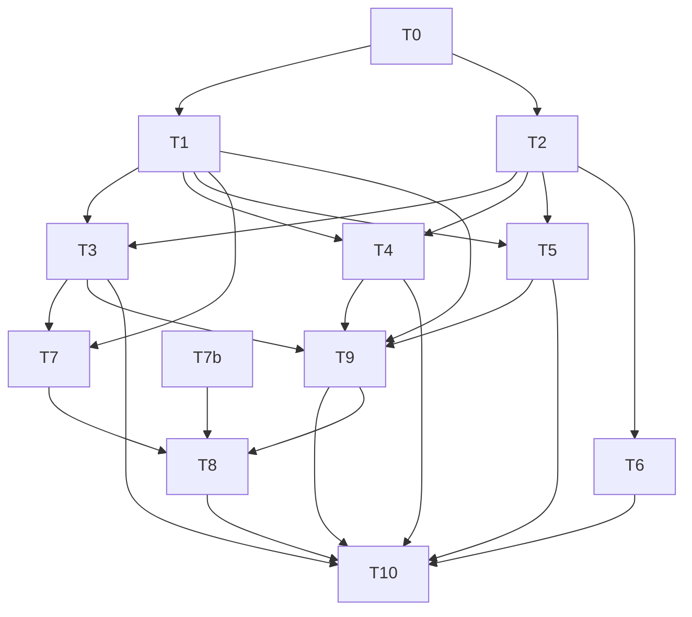

# Plan: agentj-ui 对标 Opencode 桌面端全量重设计（Visual 2.2, 0.13.0）

## Agent Worker Instructions

- Required sub-skills: `superpowers:subagent-driven-development` (preferred) or `superpowers:executing-plans`
- Execution mode: `subagent-driven-development` — fresh subagent per task, review between tasks
- Required verification (every task):
  - `cargo test --workspace -- --skip permission_request_notified` — Rust workspace tests
  - `cargo clippy --workspace --all-targets -- -D warnings` — lint gate
  - `cargo test -p agentj-protocol -- drift` — schema drift gate
  - `npm --prefix agentj-ui test --workspace=@agentj/sdk` — SDK tests
  - `npm --prefix agentj-ui test --workspace=@agentj/web` — Web vitest
  - `npm --prefix agentj-ui run build --workspace=@agentj/web` — Web build
  - `bun --cwd agentj-ui/apps/tui test` — TUI tests
  - `./scripts/check-version.sh` — version consistency (Cargo + sdk/config + desktop)
- Version bump: feature → minor `0.12.3 → 0.13.0`, `PROTOCOL_VERSION` stays `0.12.1`
- Global Constraints:
  - Backend zero改造 — no Rust crate changes, no protocol/methods.json/schema changes
  - No Tailwind/shadcn/antd — pure CSS `components/*.css` modular, `lucide-react` only
  - Tokens single source `packages/tokens/src/palette.ts` SEMANTIC_KEYS stays 19, no new semantic keys
  - `lucide-react 0.462.0` already present, no new deps
  - `PROTOCOL_VERSION 0.12.1` frozen, METHODS constant usage only

**Goal:** 重构 Web 统一侧栏 256px（Threads + Project 文件夹 + 底栏）与 composer 增强，完成三端 Opencode 桌面对齐的 Visual 2.2。

**Architecture:** `index.css` 密度/阴影增量 → `UnifiedSidebar 256px` 新组件 + `projectStore` 本地 Project 模型 → `App Shell` 瘦身与 `composer` 增强 → `conversation/trajectory` 密度收紧 → `TUI` 文本版侧栏 → `Desktop` 版本同步 → 全量门禁与文档。

**Tech Stack:** Vite + React 19 + `@agentj/sdk` + `@agentj/tokens` + `lucide-react` + Bun + @opentui/react + Tauri v2

## Global Constraints

- Node 24+, Bun ≥1.2, Rust 1.96+
- `agentj-ui/apps/web` 中所有颜色必须经 `var(--aj-*)`，禁止裸 hex
- `IMPORT ORDER` 约束：`tokens.css` → `index.css` → `App.css` → `components/*.css`

---

### T0: Add density/shadow/sidebar-width CSS variables [P1] [Sequential]

```yaml
- id: T0
  title: "Add sidebar-width and density CSS variables"
  files:
    - agentj-ui/apps/web/src/index.css
    - agentj-ui/apps/web/src/theme.test.ts
    - agentj-ui/apps/web/src/components/scaffold.test.ts
  depends_on: []
  breaking: false
  ac:
    - given: "index.css defines --aj-sidebar-width and density vars"
      when: "theme.test reads index.css"
      then: "assert --aj-sidebar-width is 256px and --aj-gap is 12px"
    - given: "new vars present"
      when: "scaffold.test checks CSS variable presence"
      then: "--aj-shadow-soft-sm equals 0 4px 16px rgba(0,0,0,.06) and --aj-sidebar-bg-diff color-mix present"
    - given: "tokens palette unchanged"
      when: "palette.test checks SEMANTIC_KEYS"
      then: "still 19 keys and no raw hex in components, hairline uses 0.5px box-shadow" 
  regression:
    - "npm --prefix agentj-ui test --workspace=@agentj/web (existing 71 tests)"
    - "cargo test -p agentj-protocol -- drift"
  test_code: |
    // theme.test.ts — add assertions for new vars + palette gate
    import { readFileSync } from "node:fs";
    test("sidebar width and density vars", () => {
      const css = readFileSync("agentj-ui/apps/web/src/index.css", "utf8");
      expect(css).toMatch(/--aj-sidebar-width:\s*256px/);
      expect(css).toMatch(/--aj-gap:\s*12px/);
      expect(css).toMatch(/--aj-shadow-soft-sm:\s*0 4px 16px rgba\(0,0,0,\.06\)/);
      expect(css).toMatch(/--aj-sidebar-bg-diff:\s*color-mix/);
    });
    // scaffold.test.ts — vars presence, no layout consumption yet (T1 does it)
    test("density vars present", () => {
      const css = readFileSync("agentj-ui/apps/web/src/index.css", "utf8");
      expect(css).toMatch(/--aj-gap/);
      expect(css).toMatch(/--aj-shadow-soft-sm/);
    });
    // palette gate — SEMANTIC_KEYS 19 and hairline 0.5px
    test("palette unchanged and hairline", () => {
      const palette = readFileSync("agentj-ui/packages/tokens/src/palette.ts","utf8");
      expect(palette).toMatch(/SEMANTIC_KEYS.*19/);
      const sidebarCss = readFileSync("agentj-ui/apps/web/src/components/sidebar.css","utf8");
      expect(sidebarCss).toMatch(/0\.5px/);
    });
  impl_code: |
    // agentj-ui/apps/web/src/index.css — add vars under :root block only
    // :root {
    //   --aj-sidebar-width: 256px;
    //   --aj-gap: 12px;
    //   --aj-shadow-soft-sm: 0 4px 16px rgba(0,0,0,.06);
    //   --aj-sidebar-bg-diff: color-mix(in srgb, var(--aj-sidebar) 98%, transparent);
    // }
    // NOTE: layout.css consumption moved to T1/T3
  verify:
    - "npm --prefix agentj-ui test --workspace=@agentj/web"
    - "npm --prefix agentj-ui run build --workspace=@agentj/web"
```

### T1: Create UnifiedSidebar shell with Threads header and footer [P0] [Sequential after T0]

```yaml
- id: T1
  title: "Create UnifiedSidebar shell with Threads header and footer"
  files:
    - agentj-ui/apps/web/src/components/UnifiedSidebar.tsx
    - agentj-ui/apps/web/src/components/sidebar.css
    - agentj-ui/apps/web/src/components/UnifiedSidebar.test.tsx
  depends_on: [T0]
  breaking: false
  ac:
    - given: "UnifiedSidebar rendered with no projects"
      when: "component mounts"
      then: "shows Threads header (h2 Threads), search input aria-label Search sessions, and footer Settings/Help buttons"
    - given: "sidebar rendered"
      when: "inspect computed style"
      then: "sidebar width is 256px and uses var(--aj-sidebar-width) with hairline 0.5px border and gap 8/12" 
  regression:
    - "npm --prefix agentj-ui test --workspace=@agentj/web SessionPanel.test.tsx still passes"
  test_code: |
    import { render, screen } from "@testing-library/react";
    import UnifiedSidebar from "./UnifiedSidebar";
    test("renders Threads header and footer", () => {
      render(<UnifiedSidebar wsUrl="ws://127.0.0.1:4096/ws" client={null} activeSessionId={null} onActiveChange={()=>{}} />);
      expect(screen.getByRole("heading", { name: /Threads/i })).toBeInTheDocument();
      expect(screen.getByLabelText(/Search sessions/i)).toBeInTheDocument();
      expect(screen.getByRole("button", { name: /Add Project/i })).toBeInTheDocument();
      expect(screen.getByRole("button", { name: /Settings/i })).toBeInTheDocument();
      expect(screen.getByRole("button", { name: /Help/i })).toBeInTheDocument();
    });
    test("sidebar width is 256px via CSS var", async () => {
      const css = await import("node:fs").then(m => m.readFileSync("agentj-ui/apps/web/src/components/sidebar.css", "utf8"));
      expect(css).toMatch(/width:\s*var\(--aj-sidebar-width\)/);
    });
  impl_code: |
    // UnifiedSidebar.tsx — shell only (no project grouping yet), delegates list rendering to placeholder
    // export default function UnifiedSidebar({ wsUrl, client, activeSessionId, onActiveChange }: Props) {
    //   return (
    //     <section aria-label="sidebar" className="aj-sidebar">
    //       <header className="aj-sidebar__threads"><h2>Threads</h2><div className="aj-sidebar__toolbar">
    //         <button aria-label="Filter"><Filter size={16}/></button>
    //         <button aria-label="Sort"><ArrowUpDown size={16}/></button>
    //         <button aria-label="View"><LayoutGrid size={16}/></button>
    //         <button onClick={onAddProject}> <Plus size={16}/> Add Project</button>
    //       </div>
    //       <div className="aj-sidebar__search"><Search size={16}/><input aria-label="Search sessions" placeholder="Search sessions"/></div>
    //       </header>
    //       <div className="aj-sidebar__body">placeholder for project groups (T2 fills)</div>
    //       <footer className="aj-sidebar__footer"><button><Settings size={16}/> Settings</button><button><HelpCircle size={16}/> Help</button></footer>
    //     </section>
    //   );
    // }
    // sidebar.css — .aj-sidebar { width: var(--aj-sidebar-width); min-width: var(--aj-sidebar-width); ... } + header/body/footer + hairline 0.5px + gap 8/12
  verify:
    - "npm --prefix agentj-ui test --workspace=@agentj/web"
    - "npm --prefix agentj-ui run build --workspace=@agentj/web"
```

### T2: Implement local Project model with localStorage persistence [P0] [Sequential after T0]

```yaml
- id: T2
  title: "Implement local Project model with localStorage persistence"
  files:
    - agentj-ui/apps/web/src/projectStore.ts
    - agentj-ui/apps/web/src/projectStore.test.ts
  depends_on: [T0]
  breaking: false
  ac:
    - given: "no projects in localStorage"
      when: "loadProjects() called"
      then: "returns default project {id:'default', name:'Inbox'}"
    - given: "user creates project named Foo"
      when: "createProject('Foo') then loadProjects()"
      then: "projects contains Foo and localStorage agentj.projects updated"
    - given: "user creates duplicate name Foo"
      when: "createProject('Foo') again"
      then: "second project named 'Foo (2)' with distinct id"
    - given: "localStorage agentj.projects contains corrupted JSON"
      when: "loadProjects() called"
      then: "returns default Inbox without throwing"
    - given: "session abc created under project Foo"
      when: "assignSession('abc','foo') then getProjectForSession('abc')"
      then: "returns foo and map persisted to agentj.projectMap"
    - given: "projectMap contains stale id"
      when: "getProjectForSession('unknown')"
      then: "returns default without crash"
    - given: "rename project Foo to Bar"
      when: "renameProject(fooId,'Bar') then loadProjects()"
      then: "project name updated to Bar, empty name throws, duplicate suffix applied"
    - given: "default Inbox has sessions with varying updatedAt"
      when: "groupSessionsByProject(sessions) called"
      then: "default group sub-grouped into Today / Previous 7 days / Older via formatRelative"
    - given: "collapsed and currentProject persisted"
      when: "setCollapsed({foo:true}) and setCurrentProject('foo') then reload"
      then: "loadCollapsed() returns {foo:true} and loadCurrentProject() returns foo, stale currentProject falls back to default" 
  regression:
    - "npm --prefix agentj-ui test --workspace=@agentj/web SessionPanel.test.tsx favorites/stale still works"
  test_code: |
    import { loadProjects, createProject, assignSession, getProjectForSession, renameProject, groupSessionsByProject } from "./projectStore";
    beforeEach(()=> localStorage.clear());
    test("defaults to Inbox", () => {
      expect(loadProjects()).toEqual([{id:"default", name:"Inbox", createdAt: expect.any(Number)}]);
    });
    test("corrupted JSON fallback", () => {
      localStorage.setItem("agentj.projects", "not-json");
      expect(loadProjects()).toEqual(expect.arrayContaining([expect.objectContaining({id:"default"})]));
    });
    test("create and assign with dedup", () => {
      const p = createProject("Foo");
      expect(loadProjects().some(x=>x.name==="Foo")).toBe(true);
      const p2 = createProject("Foo");
      expect(p2.name).toBe("Foo (2)");
      assignSession("abc", p.id);
      expect(getProjectForSession("abc")).toBe(p.id);
      expect(getProjectForSession("unknown")).toBe("default");
    });
    test("rename and empty rejected", () => {
      const p = createProject("Foo");
      renameProject(p.id, "Bar");
      expect(loadProjects().find(x=>x.id===p.id)?.name).toBe("Bar");
      expect(()=>createProject("")).toThrow();
      expect(()=>renameProject(p.id, "")).toThrow();
    });
    test("time grouping fallback", () => {
      const now = Date.now();
      const sessions = [
        {id:"a", updatedAt: now},
        {id:"b", updatedAt: now - 2*24*3600*1000},
        {id:"c", updatedAt: now - 10*24*3600*1000},
      ];
      const groups = groupSessionsByProject(sessions as any);
      expect(groups["default"].subgroups["Today"].length).toBe(1);
    });
  impl_code: |
    // projectStore.ts — keys: agentj.projects, agentj.projectMap, agentj.projectCollapsed, agentj.currentProject
    // export type Project = {id:string, name:string, createdAt:number};
    // slug = name.toLowerCase().replace(/\W+/g,"-") + "-" + Date.now()
    // loadProjects(): try JSON.parse fallback [default] on SyntaxError; createProject(name): validate non-empty, dedup suffix " (2)" loop, push, persist; renameProject(id,newName): validate non-empty, dedup, update, persist; assignSession, getProjectForSession, loadCollapsed, setCollapsed, loadCurrentProject, setCurrentProject, groupSessionsByProject(sessions): map via getProjectForSession, default subgroup Today/Previous 7 days/Older using formatRelative thresholds
  verify:
    - "npm --prefix agentj-ui test --workspace=@agentj/web"
```

### T3: Slim App Shell and wire UnifiedSidebar into App.tsx [P1] [After T1,T2]

```yaml
- id: T3
  title: "Slim App Shell and wire UnifiedSidebar into App"
  files:
    - agentj-ui/apps/web/src/App.tsx
    - agentj-ui/apps/web/src/components/layout.css
    - agentj-ui/apps/web/src/App.test.tsx
  depends_on: [T1, T2]
  breaking: false
  ac:
    - given: "App renders with UnifiedSidebar"
      when: "inspect App layout"
      then: "sidebar class aj-sidebar present with width 256px, gap 12px, and topbar contains status popover trigger (MoreHorizontal) instead of modules popover"
    - given: "user clicks project folder chevron"
      when: "chevron button clicked"
      then: "aria-expanded toggles and collapsed persisted to localStorage"
    - given: "New session clicked under project Foo"
      when: "session/new succeeds"
      then: "session_id assigned to Foo via projectMap"
    - given: "favorites exist"
      when: "sidebar renders with projects and favorites"
      then: "Star header top group renders parallel to Project groups"
    - given: "session/list fails"
      when: "UnifiedSidebar fetches list"
      then: "shows No sessions yet plus New session button without crash"
    - given: "currentProjectId is stale (deleted project)"
      when: "App mounts"
      then: "auto-falls back to default and cleans agentj.currentProject" 
  regression:
    - "npm --prefix agentj-ui test --workspace=@agentj/web App.test.tsx still passes (hero, drawer, status)"
  test_code: |
    import { render, screen, fireEvent } from "@testing-library/react";
    import App from "./App";
    test("App uses UnifiedSidebar and slim topbar", async () => {
      render(<App />);
      expect(document.querySelector(".aj-sidebar")).toBeInTheDocument();
      expect(screen.getByRole("heading", { name: /Threads/i })).toBeInTheDocument();
      // status popover trigger replaces modules popover
      expect(screen.getByLabelText(/status|more/i)).toBeInTheDocument();
      const sidebar = document.querySelector(".aj-sidebar") as HTMLElement;
      expect(getComputedStyle(sidebar).width).toBe("256px"); // via CSS var
    });
    test("project folder toggles", () => {
      // render UnifiedSidebar with projects, click chevron
      const { container } = render(<UnifiedSidebar ... />);
      const btn = container.querySelector(".aj-project-row [aria-expanded]")!;
      expect(btn.getAttribute("aria-expanded")).toBe("false");
      fireEvent.click(btn);
      expect(btn.getAttribute("aria-expanded")).toBe("true");
    });
  impl_code: |
    // App.tsx — replace SessionPanel + ConnectionBar rail with UnifiedSidebar 256px; Topbar: remove modules popover, add status popover trigger (MoreHorizontal) that shows modules + connectionLight; wire currentProjectId via projectStore; pass onActiveChange through UnifiedSidebar; keep ConnectionBar collapsed into sidebar footer or sidebar body? Move ConnectionBar into sidebar body above project list (optional) — keep onConnect logic
    // layout.css — .aj-layout { gap: var(--aj-gap); } .aj-sidebar { width: var(--aj-sidebar-width); } .aj-main { max-width: var(--aj-content-max); } ensure drawer <1024 still works
  verify:
    - "npm --prefix agentj-ui test --workspace=@agentj/web"
    - "npm --prefix agentj-ui run build --workspace=@agentj/web"
```

### T4: Enhance Composer with Project picker and status popover [P1] [After T1,T2]

```yaml
- id: T4
  title: "Enhance Composer with Project picker and status popover"
  files:
    - agentj-ui/apps/web/src/RunPanel.tsx
    - agentj-ui/apps/web/src/components/composer.css
    - agentj-ui/apps/web/src/RunPanel.test.tsx
  depends_on: [T1, T2]
  breaking: false
  ac:
    - given: "composer rendered with current project Inbox"
      when: "inspect composer header"
      then: "shows Project picker button with Folder icon and Inbox text and ChevronDown"
    - given: "user clicks Project picker"
      when: "picker opened"
      then: "dropdown shows project list plus New Project entry, keyboard navigable"
    - given: "modelName is deepseek-chat"
      when: "composer header rendered"
      then: "shows model chip with deepseek-chat text"
    - given: "composer toolbar rendered"
      when: "inspect status popover trigger"
      then: "shows MoreHorizontal button that opens popover with modules list and connection status"
    - given: "user types @ in composer"
      when: "@ completion triggered"
      then: "shows local file completion dropdown (frontend-only, no backend)"
  regression:
    - "npm --prefix agentj-ui test --workspace=@agentj/web RunPanel.test.tsx still passes (reduceRunFeed, ToolCard)"
  test_code: |
    import { render, screen, fireEvent } from "@testing-library/react";
    import RunPanel from "./RunPanel";
    test("composer shows project picker and model chip", () => {
      render(<RunPanel client={null} activeSessionId="abc" model="deepseek-chat" />);
      expect(screen.getByLabelText(/project picker/i)).toBeInTheDocument();
      expect(screen.getByText(/Inbox/)).toBeInTheDocument();
      expect(screen.getByText(/deepseek-chat/)).toBeInTheDocument();
    });
    test("picker dropdown opens", () => {
      render(<RunPanel client={null} activeSessionId="abc" />);
      fireEvent.click(screen.getByLabelText(/project picker/i));
      expect(screen.getByRole("listbox")).toBeInTheDocument();
    });
    test("status popover trigger present", () => {
      render(<RunPanel client={null} activeSessionId="abc" />);
      expect(screen.getByLabelText(/status/i)).toBeInTheDocument();
    });
  impl_code: |
    // RunPanel.tsx — add composer header: <div className="aj-composer__header"><button aria-label="project picker"><Folder size={16}/> {currentProjectName} <ChevronDown size={16}/></button><span className="aj-chip aj-chip--model">{model}</span><button aria-label="status"><MoreHorizontal size={16}/></button></div>
    // currentProjectName from projectStore.loadCurrentProject() -> projects find
    // dropdown: map projects + New Project, onSelect setCurrentProject, onNew createProject
    // status popover: reuse aj-popover simplified single-state showing modules + connectionLight
    // @ completion: simple getAtPrefix + file list dropdown (frontend-only mock), / palette trigger
    // composer.css — .aj-composer__header { display:flex; gap:8px; align-items:center; justify-content:space-between; padding-bottom:8px; border-bottom:0.5px solid var(--aj-border); }
  verify:
    - "npm --prefix agentj-ui test --workspace=@agentj/web"
    - "npm --prefix agentj-ui run build --workspace=@agentj/web"
```

### T5: Tighten Conversation and Trajectory density with Project filter [P2] [After T1,T2]

```yaml
- id: T5
  title: "Tighten Conversation and Trajectory density with Project filter"
  files:
    - agentj-ui/apps/web/src/components/conversation.css
    - agentj-ui/apps/web/src/Trajectory.tsx
    - agentj-ui/apps/web/src/Trajectory.test.tsx
  depends_on: [T1, T2]
  breaking: false
  ac:
    - given: "conversation rendered"
      when: "measure aj-conv gap"
      then: "gap is 8px (density tightened from 10px) and ToolCard padding is 6px"
    - given: "trajectory has sessions across projects Foo and Bar"
      when: "user selects Project Foo filter chip"
      then: "only Foo sessions visible"
  regression:
    - "npm --prefix agentj-ui test --workspace=@agentj/web Trajectory.test.tsx still passes (timeline, filter chips, replay)"
  test_code: |
    import fs from "node:fs";
    test("density tightened", () => {
      const css = fs.readFileSync("agentj-ui/apps/web/src/components/conversation.css","utf8");
      expect(css).toMatch(/gap:\s*8px/);
      expect(css).toMatch(/padding:\s*6px/);
    });
    import { render, screen, fireEvent } from "@testing-library/react";
    import { Trajectory } from "./Trajectory";
    test("project filter chips", () => {
      const events = [{session_id:"a", seq:1, ts:Date.now(), value:{kind:"user", content:"hi"}}];
      render(<Trajectory events={events as any} />);
      // chip for project filter appears
      expect(screen.getByText(/Foo|Project/i)).toBeInTheDocument();
    });
  impl_code: |
    // conversation.css — .aj-conv { gap: 8px; } .aj-tool-card { padding: 6px 10px; }
    // Trajectory.tsx — add project filter chips: const projects = uniq(events.map(e=> getProjectForSession(e.session_id))); chip list includes project names + existing NODE_KINDS; filterNodes also filters by projectMap
  verify:
    - "npm --prefix agentj-ui test --workspace=@agentj/web"
```

### T6: Create TUI text-mode UnifiedSidebar with project grouping [P2] [After T2]

```yaml
- id: T6
  title: "Create TUI text-mode UnifiedSidebar with project grouping"
  files:
    - agentj-ui/apps/tui/src/sidebar.tsx
    - agentj-ui/apps/tui/src/sidebar.test.tsx
    - agentj-ui/apps/tui/src/app.tsx
  depends_on: [T2]
  breaking: false
  ac:
    - given: "TUI sidebar rendered with projects Foo and Bar"
      when: "inspect sidebar output"
      then: "shows Threads header, project rows with ▶/▼ and folder name plus count, and footer Settings/Help"
    - given: "user presses h/l on project row"
      when: "key handler invoked"
      then: "collapsed state toggles and persists to ~/.config/agentj/projects.json"
    - given: "session list has 3 sessions"
      when: "sidebar width measured"
      then: "width is 32 chars (≈256px/8)"
  regression:
    - "bun --cwd agentj-ui/apps/tui test"
  test_code: |
    import { testRender } from "@opentui/react/test-utils";
    import Sidebar from "./sidebar";
    test("renders Threads and projects", async () => {
      const { screen } = await testRender(<Sidebar projects={[{id:"foo", name:"Foo"}]} sessions={[{id:"a", preview:"hi"}]} />);
      expect(screen.getByText(/Threads/)).toBeTruthy();
      expect(screen.getByText(/Foo/)).toBeTruthy();
      expect(screen.getByText(/Settings/)).toBeTruthy();
      expect(screen.getByText(/Help/)).toBeTruthy();
    });
    test("sidebar width constant is 32 chars", async () => {
      const mod = await import("./sidebar");
      expect(mod.SIDEBAR_WIDTH).toBe(32);
      // render width via box width prop
      const { screen } = await testRender(<Sidebar projects={[]} sessions={[]} width={32} />);
      expect(screen.containerWidth).toBe(32);
    });
  impl_code: |
    // sidebar.tsx — export const SIDEBAR_WIDTH = 32; props: {projects: Project[], sessions: ListRow[], activeId, onSelect, collapsed, onToggle, query, width?:number}
    // width 32, box borderStyle single, header Threads + search, body: projects.map -> button row with ▶/▼ + Folder + name + count, nested sessions indented 2 chars with ● active
    // footer: Settings/Help
    // persistence: read/write ~/.config/agentj/projects.json via getConfigDir()
    // app.tsx — import Sidebar, place left of RunTranscript with flex row, wire keyboard j/k/h/l/enter/n
  verify:
    - "bun --cwd agentj-ui/apps/tui test"
```

### T7: Sync Desktop version and shell artifacts to 0.13.0 [P2] [After T1,T3]

```yaml
- id: T7
  title: "Sync Desktop version and shell artifacts to 0.13.0"
  files:
    - Cargo.toml
    - agentj-ui/packages/sdk/src/config.ts
  depends_on: [T1, T3]
  breaking: false
  ac:
    - given: "sdk config VERSION is 0.13.0"
      when: "cargo test reads config"
      then: "VERSION is 0.13.0 and PROTOCOL_VERSION still 0.12.1"
    - given: "root Cargo version bumped"
      when: "read Cargo.toml"
      then: "contains version = \"0.13.0\""
  regression:
    - "cargo test -p agentj-protocol -- drift"
  test_code: |
    import { VERSION, PROTOCOL_VERSION } from "./config";
    test("version bump", () => {
      expect(VERSION).toBe("0.13.0");
      expect(PROTOCOL_VERSION).toBe("0.12.1");
    });
    test("cargo version", async () => {
      const cargo = await import("node:fs").then(m=>m.readFileSync("Cargo.toml","utf8"));
      expect(cargo).toMatch(/version = "0\.13\.0"/);
    });
  impl_code: |
    // sdk/src/config.ts — VERSION="0.13.0", PROTOCOL_VERSION="0.12.1"
    // Cargo.toml (workspace root) — version = "0.13.0"
  verify:
    - "cargo test -p agentj-protocol -- drift"
```

### T8: Sync Desktop shell version and artifacts [P2] [After T7]

```yaml
- id: T8
  title: "Sync Desktop shell version and artifacts"
  files:
    - agentj-ui/apps/desktop/src-tauri/tauri.conf.json
    - agentj-ui/apps/desktop/package.json
    - agentj-ui/apps/desktop/src-tauri/Cargo.toml
  depends_on: [T7]
  breaking: false
  ac:
    - given: "tauri.conf version is 0.13.0"
      when: "check-version.sh runs"
      then: "reports version-ok for desktop 0.13.0"
    - given: "tauri window config"
      when: "check-desktop-ui.mjs runs"
      then: "passes minWidth 900 minHeight 600 width 1100 height 760"
  regression:
    - "./scripts/check-version.sh"
    - "node agentj-ui/apps/desktop/check-desktop-ui.mjs"
  test_code: |
    test("tauri conf version", async () => {
      const conf = JSON.parse(await import("node:fs").then(m=>m.readFileSync("agentj-ui/apps/desktop/src-tauri/tauri.conf.json","utf8")));
      expect(conf.version).toBe("0.13.0");
      const pkg = JSON.parse(await import("node:fs").then(m=>m.readFileSync("agentj-ui/apps/desktop/package.json","utf8")));
      expect(pkg.version).toBe("0.13.0");
    });
  impl_code: |
    // tauri.conf.json — version:"0.13.0"
    // package.json — version:"0.13.0"
    // src-tauri/Cargo.toml — version = "0.13.0"
  verify:
    - "./scripts/check-version.sh"
    - "node agentj-ui/apps/desktop/check-desktop-ui.mjs"
```

### T9: Verify a11y and perf gates (keyboard, reduced-motion, CLS, virtualize) [P2] [After T1,T3,T4,T5]

```yaml
- id: T9
  title: "Verify a11y and perf gates for sidebar and composer"
  files:
    - agentj-ui/apps/web/src/components/sidebar.css
    - agentj-ui/apps/web/src/components/UnifiedSidebar.test.tsx
    - agentj-ui/apps/web/src/components/a11y.test.ts
  depends_on: [T1, T3, T4, T5]
  breaking: false
  ac:
    - given: "sidebar rendered with project folders"
      when: "user tabs through chevron and session rows"
      then: "tab order matches visual order, chevron has aria-expanded and aria-controls, session rows have aria-selected"
    - given: "prefers-reduced-motion enabled"
      when: "sidebar drawer and composer transitions evaluated"
      then: "transform/transition disabled via @media (prefers-reduced-motion: reduce)"
    - given: "composer rendered"
      when: "measure CLS with composer height reserved"
      then: "composer container has min-height reserve preventing layout shift (CLS <0.1)"
    - given: "session list exceeds 50 items"
      when: "render with virtualization check"
      then: "list uses windowing or pagination, not rendering all 50+ at once"
    - given: "connection unreachable (403)"
      when: "sidebar renders with unreachable state"
      then: "sidebar greys, status popover red, cached list still browseable" 
  regression:
    - "npm --prefix agentj-ui test --workspace=@agentj/web"
  test_code: |
    import { render, screen } from "@testing-library/react";
    import UnifiedSidebar from "./UnifiedSidebar";
    test("keyboard a11y", () => {
      render(<UnifiedSidebar wsUrl="ws://x" client={null} activeSessionId={null} onActiveChange={()=>{}} />);
      const chevrons = screen.getAllByRole("button", { expanded: expect.any(Boolean) });
      expect(chevrons.length).toBeGreaterThan(0);
      // tab order check via sequential focus
      chevrons[0].focus();
      expect(document.activeElement).toBe(chevrons[0]);
    });
    test("reduced-motion disables transitions", async () => {
      const css = await import("node:fs").then(m=>m.readFileSync("agentj-ui/apps/web/src/components/sidebar.css","utf8"));
      expect(css).toMatch(/prefers-reduced-motion/);
    });
  impl_code: |
    // sidebar.css — @media (prefers-reduced-motion: reduce) { *, *::before, *::after { transition:none !important; } }
    // UnifiedSidebar.tsx — ensure chevron aria-expanded + aria-controls, session rows aria-selected, tabIndex 0, keyboard Enter/Space handlers
    // composer.css — reserve min-height for composer to avoid CLS
    // list virtualization: if filteredRows.length > 50, slice or use simple windowing (not full virtualizer, but pagination)
  verify:
    - "npm --prefix agentj-ui test --workspace=@agentj/web"
```

### T10: Run full gates and sync docs (AGENTS, README, summary) [P2] [After T3,T4,T5,T6,T7,T8,T9]

```yaml
- id: T10
  title: "Run full gates and sync docs"
  files:
    - AGENTS.md
    - README.md
    - .claude/summary/summary_and_next.md
  depends_on: [T3, T4, T5, T6, T8, T9]
  breaking: false
  ac:
    - given: "all features implemented"
      when: "run cargo test + clippy + drift + sdk/web/tui tests + version check"
      then: "all gates pass with zero warnings"
    - given: "docs updated"
      when: "inspect AGENTS.md and README.md"
      then: "version is 0.13.0 and architecture section mentions UnifiedSidebar 256px"
    - given: "summary updated"
      when: "read .claude/summary/summary_and_next.md"
      then: "current feature is Visual 2.2 0.13.0 with TODO checklist all checked"
  regression:
    - "cargo test --workspace -- --skip permission_request_notified"
    - "npm --prefix agentj-ui test --workspace=@agentj/web"
  test_code: |
    import fs from "node:fs";
    test("docs synced", () => {
      const agents = fs.readFileSync("AGENTS.md","utf8");
      expect(agents).toMatch(/0\.13\.0/);
      expect(agents).toMatch(/UnifiedSidebar|256px/);
      const readme = fs.readFileSync("README.md","utf8");
      expect(readme).toMatch(/0\.13\.0/);
    });
  impl_code: |
    // AGENTS.md — update Project Status to v0.13.0 Visual 2.2 UnifiedSidebar 256px + local Project + composer enhance
    // README.md — bump version badge and Features list add Visual 2.2
    // .claude/summary/summary_and_next.md — replace current feature with Visual 2.2 progress table, mark T0-T8 completed, set next to v0.13.0 tag & PR
    // Run gates: cargo test --workspace, cargo clippy --workspace --all-targets -- -D warnings, cargo test -p agentj-protocol -- drift, npm --prefix agentj-ui test --workspace=@agentj/sdk, npm --prefix agentj-ui test --workspace=@agentj/web, bun --cwd agentj-ui/apps/tui test, ./scripts/check-version.sh, ./agentj-ui/apps/desktop/check-desktop-ui.mjs
  verify:
    - "cargo test --workspace -- --skip permission_request_notified"
    - "cargo clippy --workspace --all-targets -- -D warnings"
    - "npm --prefix agentj-ui test --workspace=@agentj/web"
    - "bun --cwd agentj-ui/apps/tui test"
    - "./scripts/check-version.sh"
```

## Dependency Graph



## Parallel Execution Groups

- Group 0: T0 (sequential, foundation)
- Group 1: T1 → T2 sequential after T0 — T1 creates shell, T2 adds store without touching UnifiedSidebar.tsx (no file collision)
- Group 2: T3, T4, T5, T6 (parallel after Group 1 — T3 App shell slim vs T4 Composer enhance vs T5 density vs T6 TUI; files disjoint; T5 now depends on T2)
- Group 3: T7 → T8 sequential (Rust/SDK version → Desktop shell version)
- Group 4: T9 (after T1,T3,T4,T5 — a11y/perf gate, parallel with T6/T7/T8)
- Group 5: T10 (after T3-T8,T9 — docs & gates)

Preferred order: T0 → T1 → T2 → (T3,T4,T5,T6 parallel) → T7 → T8 & T9 parallel → T10.

