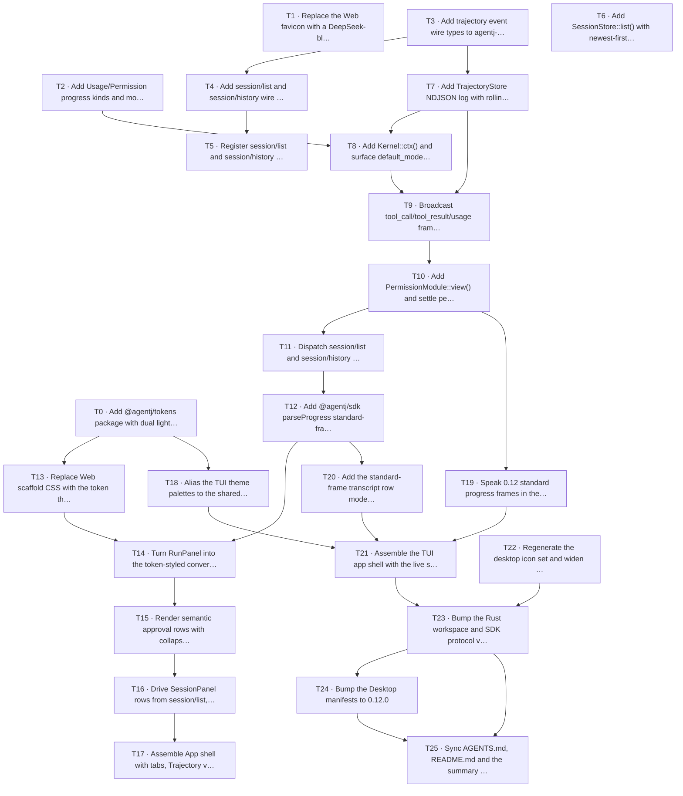

# Plan: agentj 三端统一 UI 视觉设计落地（UI Visual 2.0 / DeepSeek-blue + tokens + trajectory) (v0.12.0)

> **For agentic workers:** REQUIRED SUB-SKILL: Use `superpowers:subagent-driven-development` (recommended) or `superpowers:executing-plans` to implement this plan task-by-task. Steps use checkbox (`- [ ]`) syntax for tracking.

**Goal:** Ship the approved visual/UX overhaul of agentj's three frontends — a shared `@agentj/tokens` design-token package with a DeepSeek-blue rebrand, a fully redesigned Web app (two-column session rail + conversation/trajectory tabs, bubbles, tool cards, semantic approval modal), an assembled and OpenCode-aligned TUI that consumes standard progress frames and a real semantic theme, desktop shell polish — plus the additive backend data surface those UIs consume (tool/usage/permission progress frames, `kernel/status` model fields, `session/list`, per-session trajectory logs with `session/history`).

**Architecture:** One token source (`agentj-ui/packages/tokens`, typed palette → CSS vars + JSON + docs) feeds Web CSS and the TUI `ThemePalette`. The Rust side stays additive: the `serve` channel starts broadcasting existing-but-swallowed `tool_call`/`tool_result` frames plus new `usage`/`permission` frame kinds; `kernel/status` gains `default_model`/`providers`; new `session/list` enumerates known sessions; a per-session append-only trajectory log (rolling trim) powers new `session/history` pagination and trajectory replay. Web and TUI consume these via the shared SDK with unknown-kind tolerance preserved.

**Tech Stack:** Rust (agentj-protocol / agentj-session / agentj-ipc / agentj-core, schemars + drift gate), TypeScript (React 19, Vite 8, vitest 4, `react-markdown` + `remark-gfm`), Bun ≥1.2 + `@opentui/react` (TUI), Tauri v2 (desktop), npm workspaces.

## Agent Worker Instructions

- Required sub-skills: `superpowers:subagent-driven-development` (recommended) or `superpowers:executing-plans`.
- Execution mode: subagent-driven-development (fresh subagent per task, review between tasks).
- Per-task flow: read the task YAML → write `test_code` first → run it and confirm RED → implement `impl_code` → run `verify` and confirm GREEN → commit (English message, `Co-Authored-By: Claude Code <noreply@anthropic.com>`, conventional prefix per change, e.g. `feat(visual): ...` / `feat(protocol): ...`). Do not commit unrelated working-tree files (`AGENTS.md`/`README.md`/`docs/...` mods outside the task's file list).
- Global verification commands (run after every Rust-touching phase):
  - `cargo test --workspace` (may skip nothing by default; the permission e2e single flaky case may be skipped with `-- --skip permission_request_notified` if it hangs)
  - `cargo clippy --workspace --all-targets -- -D warnings` (zero warnings)
  - `cargo fmt --all --check`
  - `cargo test -p agentj-protocol -- drift` (schema drift gate — must stay green after every schema/methods.json touch)
  - `cargo run -p agentj-protocol --bin gen_schemas` (regenerate `schemas/*.json` BEFORE the drift test when wire types change)
  - `npm --prefix agentj-ui run generate --workspace=@agentj/protocol` + `npm --prefix agentj-ui run build --workspace=@agentj/protocol`
  - `npm --prefix agentj-ui test --workspace=@agentj/sdk` / `--workspace=@agentj/web` / `--workspace=@agentj/tokens`
  - `bun --cwd agentj-ui/apps/tui test`
  - `./scripts/check-version.sh` (version-ok at 0.12.0 after the version task)
- Version bump reminder: feature → minor → **0.11.1 → 0.12.0** (two adjacent tasks near the end — T23 bumps the crate/config core (`Cargo.toml`, SDK `PROTOCOL_VERSION`, `check-version.sh`), T24 syncs the desktop app files (`src-tauri/Cargo.toml`, `tauri.conf.json`, `package.json`); do NOT bump piecemeal).
- After the final task, run the acceptance sweep: full Rust + TS + Bun suites, `npm --prefix agentj-ui run build --workspace=@agentj/web`, desktop artifact check if on a supported platform (`./agentj-ui/apps/desktop/check-artifacts.sh linux` may exit 1 without bundles — expected on dev boxes).
- Doc sync at the end (AGENTS.md rule): update `AGENTS.md`/`README.md`/`.claude/summary/summary_and_next.md` and the design-spec TODO list, commit `docs: auto-sync AGENTS.md, README.md, summary after agentj-ui-visual v0.12.0`.

## Global Constraints

- Design doc (Chinese, binding): `docs/superpowers/specs/2026-09-06-agentj-ui-visual-design.md`. Decisions D1–D9 binding; non-goal list (right-side file panel, interactive model submit, WSS/TLS/cargo-dist/mobile, Electron, breaking protocol changes, Tailwind/UI libs) is out of scope — no task may implement any of them.
- Protocol discipline (additive only): 16-method surface frozen; new methods and optional result fields and new progress `kind`s are allowed; `protocol/methods.json` + `schemas/*.json` are regenerated and committed; `cargo test -p agentj-protocol -- drift` stays green. Enum extension uses `#[serde(other)]`/`#[schemars(skip)]` Unknown variants; optional result fields use `skip_serializing_if`; wire fields snake_case.
- Tolerance contract: TS/SDK and both UIs must ignore unknown progress kinds and unknown result fields (never crash) — existing BUG-005 fork semantics preserved.
- Web test contract is a RED LINE: existing role/aria-label/label text, `aj-*` id prefixes, button texts (`/^allow$/i`, `/^deny$/i`, allow-all substring), text aggregation (`"test-mod: running"`, `in=10 out=5`, `id (stale)`, banner port hint NOT hardcoding 4096), and localStorage keys (`agentj.favorites` + stale semantics) must keep passing unchanged; visuals may change freely.
- TUI test contract is a RED LINE: usage strings (`in=10 out=5`, `usage: n/a`), `▶` marker formats, session text patterns, and mock-WS e2e must keep passing; rendering wrappers/colors may change.
- Rust conventions: functions ≤50 lines, ≤120 chars/line, `cargo clippy --all-targets -- -D warnings` zero-warning.
- Version: feature → minor, `0.11.1 → 0.12.0` in `Cargo.toml` (`[workspace.package]`), `agentj-ui/packages/sdk/src/config.ts` `PROTOCOL_VERSION`, desktop `tauri.conf.json` + `package.json`, protocol/sdk package.json version fields — `./scripts/check-version.sh` asserts them.
- Plan tasks/ACs/code in English; task prose may reference the Chinese design doc.
- Probe/gate convention (T22–T25): the desktop app tree has no unit-test runner and the version/docs tasks change no code under test, so their red-first "test" is a **committed gate script** (T22 `check-desktop-ui.mjs`, T23 `scripts/check-version.sh` full rewrite) or an **explicit red-first probe saved to `/tmp`** (T24 `/tmp/desktop-probe.sh`, T25 `/tmp/docs-sync-probe.sh`). Every probe re-runs the committed gates where one exists (T24 re-runs the T22 gate + `check-version.sh`; T25 re-runs `check-version.sh` + the full suites).
- Committed generated outputs (T0 `tokens.css`/`tokens.json`, T2/T4 `schemas/*.json`, T12 `types.d.ts`/`methods.ts`, T22 `src-tauri/icons/*` + `assets/app-icon.png`) are produced by a task's own command and are **outputs, not hand-edited files** — they are disclosed in each task's prose/commit note and do not count toward the ≤3-file budget (which limits files the engineer edits by hand). Probe scripts under `/tmp` are scratch harnesses and are never committed.
- Path portability: probe scripts never hardcode the repo path — run them from the repo root (`cd "$(dirname "$0")/.."` inside committed scripts; a repo-root guard in `/tmp` probes), so any checkout works.

## Design Concretizations (plan-level decisions; binding for implementers)

Where the design doc leaves wire/storage detail to the plan (spec lines: "分页/排序实现细节归 plan 阶段", "默认值实现期复核", approval payload "decision 型 payload"), these concretizations bind. Deviations from the doc are called out inline; all are additive-only.

1. **methods.json dialect**: `protocol/methods.json` `protocol_version` is the registry dialect, independent of the app version. Adding `session/list` + `session/history` bumps it `0.2.0 → 0.3.0`; `crates/agentj-protocol/tests/registry.rs` expected-count test updates 16 → 18. App version stays `0.11.1` until the version task (T23).
2. **`session/list` semantics**: result `{ "sessions": [SessionSummary…] }` where `SessionSummary { session_id, updated_at (u64 epoch secs), state ("active"|"archived"|"deleted", lowercase Debug-name like `kernel/status` modules do), preview (optional) }`. `preview` = content of the most recent message, truncated to 120 chars. Implementation: new `SessionStore::list()` trait method, default body = `self.load_all()` mapped to entries sorted newest-first by `updated_at` (additive — existing impls unchanged, no per-store override needed: `FileBackedStore::new(dir)` preloads every `<sid>.json` at construction so `load_all()` already covers sessions surviving a daemon restart, and `InMemoryStore` intentionally keeps its documented "empty for non-persistent stores" contract — its `load_all` inherits the trait default).
3. **Trajectory storage layout**: per-session append-only NDJSON at `<session-dir>/<sid>.trajectory`, one `TrajectoryEvent` JSON line per event (canonical serde types live in `agentj-protocol::trajectory`, shared with the wire so file + `session/history` payloads are byte-identical). Rolling trim on append when line count > cap or file bytes > cap: rewrite keeping the newest tail (event counts are cheap to compute on the rewrite pass; below thresholds append is O(1) `OpenOptions::append` + flush). Caps default **10k events / 5 MB**; config `[session] trajectory_max_events` / `trajectory_max_bytes` optional overrides (design line 319 "config [session] 可配").
4. **Trajectory recording points** (design "run 分发 + permission respond + done 结算"): recorded in `IpcServer` only — `user` at run start; `thinking` accumulated deltas flushed as ONE node at the next non-Delta boundary (tool_call/tool_result/error/done) — matches design "增量文本合并" and keeps a 5 MB cap meaningful; `tool_call`/`tool_result` full payload; `usage` at Done; `error` for non-cancelled run errors (a `cancelled` run leaves just its `user` node — its live broadcast already ended via -32800). Permission decisions are recorded on the **explicit respond path only** (timeout auto-denies resolve inside the module and are not recorded — matches "permission respond 路径"). `PermissionRespondParams` already carries the protocol `PermissionDecision`; dispatch only lacks the request's `tool`, so one new read-only peek `PermissionModule::view(request_id) -> Option<PendingView { tool: String, session_id: String }>` is added (clones the stored request; the entry stays until `respond()` consumes it — `session_of()` stays as-is for the owner gate). Record failures degrade to `tracing::warn!` + live-only (design line 323-324).
5. **New `$/progress` kinds**: `ProgressValue::Usage { usage: UsageInfo }` (payload = existing `UsageInfo` shape `{prompt_tokens, completion_tokens}`, broadcast once when `Done` carries usage) and `ProgressValue::Permission { request_id: String, tool: String, session_id: Option<SessionId> (skip-if-none), decision: PermissionDecision }` — `decision` typed as the protocol `PermissionDecision` enum (serde(other) `Unknown` forward-tolerated; known values serialize `allow`|`deny`|`allow_always`), `session_id` present when known so Web approval cards filter per session, and tool included so approve-in-flight cards/trajectory nodes can settle without extra state. Serialized snake_case via the existing `#[serde(tag="kind", rename_all="snake_case")]`; unknown kinds stay ignorable (BUG-005 fork semantics).
6. **`kernel/status` extension**: `default_model: Option<String>` from `ConfigProvider::get_str("model.default_model")`, `providers: Option<Vec<ProviderInfo { id, models: [] }>>` from `ConfigProvider::providers()` names (verified signature `providers(&self) -> Vec<(String, String)>` = (name, base_url); `models` is reserved and stays empty — the server has no model enumeration today, and NEXT-VERSION run.model takes free-form model strings, so `models` is not load-bearing). Both `#[serde(skip_serializing_if = "Option::is_none")]`. Data source: new `Kernel::ctx() -> Option<KernelContext>` accessor (verified `ctx: Arc<RwLock<Option<KernelContext>>>` retained at first `register_module`, set by boot time) → `ctx.config()`. Consumers keep static `MODEL_CONFIG` fallback when fields are absent.
7. **Web manual theme**: tokens.css declares `:root` (light defaults) + `@media (prefers-color-scheme: dark)` overrides + `[data-theme="dark"]` / `[data-theme="light"]` attribute overrides (attribute later in cascade wins); toggle persists `agentj.theme-mode` ∈ light|dark|system, applies `data-theme` on `<html>` (system = remove attribute). TUI theme.json mechanism unchanged (`{"mode": …}`, legacy raw string accepted) — palettes widen in code, serialization shape does not.
8. **Desktop shell**: `tauri.conf.json` window gains `minWidth: 900`, `minHeight: 600`; no titlebar/theme native keys (design: system default + web `color-scheme`). Icons: committed blue master generated programmatically (pure Node, zlib/PNG writer — no PIL dependency) then `npm exec tauri icon` (cli is a devDep) regenerates all 6 `src-tauri/icons/*` files; task verifies outputs are real multi-byte images, not the current 1×1 white placeholders.
9. **ToolCard ✗ semantics**: the server emits no ok/err bit in `tool_result` content (verified: result is a content string). Client classification is event-order based: `│` from `tool_call` until `tool_result`; `✓` on any `tool_result`; `✗` only when a run ends in `error` while a tool was still `│`; `△` while a `$/permissionRequest` for that session is pending. Unit tests drive synthetic standard-kind feeds.
10. **Tool→approval-modal field map** (D5 "write→文件/内容、bash→命令/超时…"): client-side map `bash → [command, timeout, cwd?]`, `write → [path, content]`, `read → [path]`, `edit → [path, content]`; any other key (or whole-unknown tool) renders a raw JSON row. Values longer than 200 chars render a collapsed preview line (first 200 chars + "…") with a visible "show full content" toggle that expands the FULL value (fixes the 200-char truncation — the old cut made full review impossible); English labels (existing test copy is English). The `Allow all` button (Web contract, test 10/12) stays as a third immediate-action button; D5's bottom checkbox additionally lets a normal `Allow` carry `allow_always: true`.
11. **TUI legacy-frame compat**: `useProgressFeed`/`extractText` and the flat `{session_id, text}` mock frames are a test contract (tui-flow tests + e2e). Standard-kind parsing is added as a superset: a NEW SDK parser `parseProgress` (created in T12; there is no existing progress parser anywhere in the SDK today) treats `{kind:"text", delta}` AND flat-string/`text` params as text; other standard kinds parse to their typed frames; anything else → `unknown` frame, never throw. The mock kernel upgrades to standard frames in T19 with e2e behavior (event order, done detection) preserved.

## Tasks

### T0: Add the shared @agentj/tokens design-token package [P0] [Sequential]

Single source for the deepsuite palette (spec color table + D2/D8 P2 semantics): semantic typed tokens for light/dark, a CSS artifact with system/manual theme layering (concretization 7), a JSON artifact for the TUI, and human docs. Pure data + stdlib only.

```yaml
- id: T0
  title: "Add @agentj/tokens package with dual light/dark palettes and generated css/json artifacts"
  files:
    - agentj-ui/packages/tokens/package.json
    - agentj-ui/packages/tokens/src/palette.ts
    - agentj-ui/packages/tokens/src/palette.test.ts
  depends_on: []
  breaking: false
  ac:
    - given: "the @agentj/tokens package is installed via npm workspaces"
      when: "palette.test.ts runs"
      then: "light and dark palettes expose exactly the semantic keys {bg, sidebar, panel, raised, text, textMuted, accent, accentOnAccent, userBubble, border, codeBg, inlineCodeBg, success, error, warning} and values match the spec table (light accent #4176E6, dark accent #679EFE, light bg #FFFFFF, dark bg #151517, light userBubble #EAF1FE, dark userBubble #2C2C2E, error light #EC1313 dark #F25A5A)"
    - given: "generate ran and wrote tokens.css"
      when: "the css text is read"
      then: "it declares the same hex values under the same custom property names as palette.ts (--aj-bg, --aj-sidebar, …), dark values exist both under @media (prefers-color-scheme: dark) and under [data-theme=\"dark\"], and light values are forced by [data-theme=\"light\"]"
    - given: "generate ran and wrote tokens.json"
      when: "the json text is read"
      then: "it contains mode: \"dark\" and mode: \"light\" objects with key sets identical to palette.ts and to the css custom-property set"
    - given: "package.json exports"
      when: "resolving \"@agentj/tokens\" and \"@agentj/tokens/tokens.css\""
      then: "both resolve to real files (src/palette.ts and tokens.css)"
  regression:
    - "agentj-ui workspace root `npm ls --workspaces` still resolves with the new workspace package"
  test_code: |
    // agentj-ui/packages/tokens/src/palette.test.ts (vitest)
    import { describe, expect, it } from "vitest";
    import { readFileSync } from "node:fs";
    import { join, dirname } from "node:path";
    import { fileURLToPath } from "node:url";
    import { palettes, SEMANTIC_KEYS, cssForMode, type ThemeName } from "./palette.ts";

    const root = join(dirname(fileURLToPath(import.meta.url)), "..");
    const css = readFileSync(join(root, "tokens.css"), "utf8");
    const json = readFileSync(join(root, "tokens.json"), "utf8");

    describe("@agentj/tokens palette", () => {
      it("exposes exactly the bound semantic keys in both modes", () => {
        const expected = [
          "bg","sidebar","panel","raised","text","textMuted","accent","accentOnAccent",
          "userBubble","border","codeBg","inlineCodeBg","success","error","warning",
        ];
        expect(SEMANTIC_KEYS).toEqual(expected);
        for (const mode of ["light", "dark"] as ThemeName[]) {
          expect(Object.keys(palettes[mode]).sort()).toEqual([...expected].sort());
        }
      });
      it("holds the spec-bound hex values (D2/D8 table)", () => {
        expect(palettes.light.accent).toBe("#4176E6");
        expect(palettes.dark.accent).toBe("#679EFE");
        expect(palettes.light.bg).toBe("#FFFFFF");
        expect(palettes.dark.bg).toBe("#151517");
        expect(palettes.light.userBubble).toBe("#EAF1FE");
        expect(palettes.dark.userBubble).toBe("#2C2C2E");
        expect(palettes.light.error).toBe("#EC1313");
        expect(palettes.dark.error).toBe("#F25A5A");
        expect(palettes.light.border).toBe("#E4E7EA");
        expect(palettes.dark.border).toBe("#2E2E31");
      });
      it("agrees with tokens.css custom properties", () => {
        for (const mode of ["light", "dark"] as ThemeName[]) {
          for (const key of SEMANTIC_KEYS) {
            expect(css).toContain(`--aj-${mode === "light" ? key : key}:${palettes[mode][key]}`);
          }
        }
      });
      it("layers dark over media and manual attribute overrides", () => {
        expect(css).toContain("@media (prefers-color-scheme: dark)");
        expect(css).toContain('[data-theme="dark"]');
        expect(css).toContain('[data-theme="light"]');
        expect(css.indexOf('[data-theme="light"]')).toBeGreaterThan(css.indexOf("@media"));
      });
      it("agrees with tokens.json", () => {
        const parsed = JSON.parse(json);
        for (const mode of ["light", "dark"] as ThemeName[]) {
          const jm = parsed[mode];
          for (const key of SEMANTIC_KEYS) {
            expect(jm[key]).toBe(palettes[mode][key]);
          }
        }
      });
      it("cssForMode emits one custom property per key", () => {
        const out = cssForMode("dark", palettes.dark);
        expect(out.split(";").length).toBe(SEMANTIC_KEYS.length + 1); // trailing newline
      });
    });
  impl_code: |
    // agentj-ui/packages/tokens/package.json (create; name/scripts/devDeps as below)
    // { "name": "@agentj/tokens", "version": "0.1.0", "private": true,
    //   "type": "module", "files": ["src", "tokens.css", "tokens.json"],
    //   "exports": { ".": "./src/palette.ts", "./tokens.css": "./tokens.css",
    //                "./tokens.json": "./tokens.json" },
    //   "scripts": { "generate": "node --input-type=module -e \"import { writeArtifacts } from './src/palette.ts'; writeArtifacts();\"",
    //                "test": "vitest run" },
    //   "devDependencies": { "typescript": "~5.5.0", "vitest": "^4.1.11",
    //                         "@types/node": "^24.13.3" } }

    // agentj-ui/packages/tokens/src/palette.ts (create)
    import { mkdirSync, writeFileSync } from "node:fs";
    import { dirname, join } from "node:path";
    import { fileURLToPath } from "node:url";

    export const SEMANTIC_KEYS = [
      "bg","sidebar","panel","raised","text","textMuted","accent","accentOnAccent",
      "userBubble","border","codeBg","inlineCodeBg","success","error","warning",
    ] as const;
    export type SemanticKey = (typeof SEMANTIC_KEYS)[number];
    export type ThemeName = "light" | "dark";
    export type Palette = Record<SemanticKey, string>;

    const deepsuite = {
      light: {
        bg: "#FFFFFF", sidebar: "#F9FAFB", panel: "#FFFFFF", raised: "#F9FAFB",
        text: "#0F1115", textMuted: "#61666B", accent: "#4176E6",
        accentOnAccent: "#FFFFFF", userBubble: "#EAF1FE", border: "#E4E7EA",
        codeBg: "#F9FAFB", inlineCodeBg: "#FAFAFA", success: "#22C55E",
        error: "#EC1313", warning: "#F59E0B",
      },
      dark: {
        bg: "#151517", sidebar: "#1B1B1C", panel: "#232324", raised: "#2C2C2E",
        text: "#F9FAFB", textMuted: "#CFD3D6", accent: "#679EFE",
        accentOnAccent: "#0A0C12", userBubble: "#2C2C2E", border: "#2E2E31",
        codeBg: "#1B1B1C", inlineCodeBg: "#292929", success: "#22C55E",
        error: "#F25A5A", warning: "#F59E0B",
      },
    } satisfies Record<ThemeName, Record<SemanticKey, string>>;

    export const palettes: Record<ThemeName, Palette> = deepsuite;

    const varName = (key: SemanticKey) => `--aj-${key}`;
    export const cssForMode = (mode: ThemeName, p: Palette): string =>
      SEMANTIC_KEYS.map((k) => `${varName(k)}:${p[k]}`).join(";") + ";";

    export function tokensCss(): string {
      const lightVars = cssForMode("light", palettes.light);
      const darkVars = cssForMode("dark", palettes.dark);
      const darkBlock = `@media (prefers-color-scheme: dark) { :root { ${darkVars} } }\n` +
        `:root[data-theme="dark"] { ${darkVars} }\n` +
        `:root[data-theme="light"] { ${lightVars} }\n`;
      return `:root { ${lightVars} }\n${darkBlock}`;
    }

    export function tokensJson(): string {
      return JSON.stringify(palettes, null, 2) + "\n";
    }

    export function tokensMarkdown(): string {
      const rows = SEMANTIC_KEYS.map(
        (k) => `| ${k} | ${palettes.light[k]} | ${palettes.dark[k]} |`,
      ).join("\n");
      return `# agentj UI tokens\n\nSingle source: \`agentj-ui/packages/tokens/src/palette.ts\`. CSS: \`tokens.css\` (Web). JSON: \`tokens.json\` (TUI).\n\n| token | light | dark |\n|---|---|---|\n${rows}\n`;
    }

    export function writeArtifacts(): void {
      const here = dirname(fileURLToPath(import.meta.url));
      const root = join(here, "..");
      writeFileSync(join(root, "tokens.css"), tokensCss());
      writeFileSync(join(root, "tokens.json"), tokensJson());
      mkdirSync(join(root, "docs"), { recursive: true });
      writeFileSync(join(root, "docs", "ui-tokens.md"), tokensMarkdown());
    }
  verify:
    - "cd agentj-ui && npm install --workspace=@agentj/tokens && npm run generate --workspace=@agentj/tokens && npm test --workspace=@agentj/tokens"
    - "node --input-type=module -e \"const p = await import('./agentj-ui/packages/tokens/tokens.css') \" >/dev/null 2>&1 || true; test -s agentj-ui/packages/tokens/tokens.css && test -s agentj-ui/packages/tokens/tokens.json"
```

Commit: `feat(tokens): add @agentj/tokens dual palette package with generated css/json artifacts` — include the generated `tokens.css`, `tokens.json`, `docs/ui-tokens.md` in the commit. Note: `npm install --workspace=@agentj/tokens` updates the root lockfile (agentj-ui/package-lock.json) — commit it too.

### T1: Swap the Web favicon to the DeepSeek-blue brand mark [P0] [Sequential]

Replace the purple `#863bff` bolt favicon with a blue `#4176E6`-family mark (spec D2 "favicon/图标 蓝系，清除品牌紫残留"); `index.html` link and href stay unchanged. The purple purge extends to the whole `public/` dir: the sibling `public/icons.svg` sprite — an UNREFERENCED leftover (verified: no tsx/css/html in the app loads it; its five fills are the old brand purple `#aa3bff`) — is deleted in this task, and the probe scans every remaining `public/` file. `src/assets/vite.svg` is the unreferenced Vite template logo (`#9135ff`, NOT an old brand-purple value) and is out of D2 scope; nothing in the app renders it.

```yaml
- id: T1
  title: "Replace the Web favicon with a DeepSeek-blue mark"
  files:
    - agentj-ui/apps/web/public/favicon.svg
    - agentj-ui/apps/web/src/ui-tokens.test.ts
    - agentj-ui/apps/web/public/icons.svg  # DELETED — unreferenced sprite carrying 5× old-brand #aa3bff fills
  depends_on: []
  breaking: false
  ac:
    - given: "the new favicon.svg file"
      when: "its text is read by ui-tokens.test.ts"
      then: "it contains one of #4176E6 / #679EFE and none of the old brand purple values #863bff, #7e14ff, #aa3bff, #47bfff"
    - given: "the web public/ directory after the favicon swap"
      when: "the purge probe lists it and scans every remaining file for the old purple literals"
      then: "icons.svg no longer exists and none of #863bff / #7e14ff / #aa3bff / #47bfff appears in any remaining public/ file (favicon.svg is the only asset left)"
    - given: "the web app is served"
      when: "index.html loads /favicon.svg"
      then: "the link tag and href are unchanged and the file parses as a valid svg element (root <svg …> … </svg>)"
  regression:
    - "agentj-ui/apps/web: `npm test --workspace=@agentj/web` — App.test.tsx (13) + b007.repro.test.tsx (1) stay green"
  test_code: |
    // agentj-ui/apps/web/src/ui-tokens.test.ts (create)
    import { describe, expect, it } from "vitest";
    import { existsSync, readdirSync, readFileSync } from "node:fs";
    import { join } from "node:path";
    const favicon = readFileSync(join(process.cwd(), "public", "favicon.svg"), "utf8");
    const PUBLIC = join(process.cwd(), "public");

    describe("brand favicon", () => {
      it("is a DeepSeek-blue mark with no brand-purple residue", () => {
        expect(/fill="(?:#4176E6|#679EFE)"/.test(favicon)).toBe(true);
        for (const old of ["#863bff", "#7e14ff", "#aa3bff", "#47bfff"]) {
          expect(favicon.toLowerCase()).not.toContain(old.toLowerCase());
        }
      });
      it("is a well-formed single svg root", () => {
        expect(favicon.trim().startsWith("<svg")).toBe(true);
        expect(favicon.trim().endsWith("</svg>")).toBe(true);
        expect((favicon.match(/<svg/g) ?? []).length).toBe(1);
      });
      it("purges the unreferenced brand-purple sprite from public/", () => {
        // icons.svg (5× #aa3bff fills) was dead weight — no tsx/css/html loads it.
        expect(existsSync(join(PUBLIC, "icons.svg"))).toBe(false);
        for (const name of readdirSync(PUBLIC)) {
          const text = readFileSync(join(PUBLIC, name), "utf8").toLowerCase();
          for (const old of ["#863bff", "#7e14ff", "#aa3bff", "#47bfff"]) {
            expect(text).not.toContain(old);
          }
        }
      });
    });
  impl_code: |
    <!-- 1) DELETE agentj-ui/apps/web/public/icons.svg first (`git rm` it): the
         unreferenced third-party social-glyph sprite whose 5 fills are the old
         brand purple #aa3bff (public/ is then favicon.svg-only). -->
    <!-- 2) agentj-ui/apps/web/public/favicon.svg — replace file body (keep 48x46-ish viewBox) -->
    <!-- Simple recognizable mark: rounded-square blue tile + white bolt, DeepSeek-blue family -->
    <svg xmlns="http://www.w3.org/2000/svg" viewBox="0 0 48 46">
      <rect x="2" y="1" width="44" height="44" rx="11" fill="#4176E6"/>
      <path d="M28.5 6 L14.5 25.5 H23 L19.5 40 L33.5 20.5 H25 Z" fill="#fff"/>
    </svg>
  verify:
    - "npm test --workspace=@agentj/web"
```

(Optional polish of the bolt path shape is allowed; the fill/test constraints are binding.)

### T2: Extend `$/progress` kinds and `kernel/status` result wire types [P1] [Parallel with T3]

Additive wire-surface only (no dispatch): `ProgressValue::Usage` + `ProgressValue::Permission` variants (concretization 5), and `ProviderInfo` + optional `default_model`/`providers` on `KernelStatusResult` (concretization 6). Existing registry test (`16 methods`) is unaffected because `methods.json` is untouched here. Tests are colocated in the module per crate convention; committed schema JSONs regenerate via `gen_schemas` so the drift gate stays green.

```yaml
- id: T2
  title: "Add Usage/Permission progress kinds and model fields to kernel/status wire types"
  files:
    - crates/agentj-protocol/src/streaming.rs
  depends_on: []
  breaking: false
  ac:
    - given: "a ProgressValue::Usage holding UsageInfo {prompt_tokens: 10, completion_tokens: 5}"
      when: "it is serialized to json"
      then: "the json has kind \"usage\" and usage.prompt_tokens 10, usage.completion_tokens 5, and the value deserializes back to the same variant"
    - given: "a ProgressValue::Permission with decision AllowAlways and session_id Some(\"s-1\")"
      when: "it is serialized to json"
      then: "the json has kind \"permission\", request_id, tool, decision \"allow_always\" and session_id \"s-1\""
    - given: "a ProgressValue::Permission with session_id None"
      when: "it is serialized"
      then: "the session_id key is absent from the json"
    - given: "KernelStatusResult with default_model and providers populated"
      when: "serialized"
      then: "json contains default_model \"deepseek-chat\" and providers [{id:\"deepseek-chat\",models:[]}]"
    - given: "KernelStatusResult with both fields None"
      when: "serialized, and legacy wire json {\"version\":\"0.11.1\",\"modules\":[]} is deserialized"
      then: "both keys are absent from the serialized json and the legacy payload parses to None fields (additive, skip-if-none)"
  regression:
    - "existing streaming.rs tests progress_value_text_kind / tool_call_kind / tool_result_kind / kernel_status_result_serialize keep passing"
    - "cargo test -p agentj-protocol --test registry passes (16 methods — methods.json untouched in this task)"
  test_code: |
    // Appended inside crates/agentj-protocol/src/streaming.rs `mod tests` (crate convention: colocated).
    use crate::permission::PermissionDecision;
    use crate::session::UsageInfo;

    #[test]
    fn progress_value_usage_kind() {
        let v = ProgressValue::Usage {
            usage: UsageInfo { prompt_tokens: 10, completion_tokens: 5 },
        };
        let json = serde_json::to_value(&v).unwrap();
        assert_eq!(json["kind"], "usage");
        assert_eq!(json["usage"]["prompt_tokens"], 10);
        assert_eq!(json["usage"]["completion_tokens"], 5);
        let back: ProgressValue = serde_json::from_value(json).unwrap();
        assert!(matches!(back, ProgressValue::Usage { usage } if usage.prompt_tokens == 10));
    }

    #[test]
    fn progress_value_permission_kind_with_session() {
        let v = ProgressValue::Permission {
            request_id: "r1".into(),
            tool: "bash".into(),
            decision: PermissionDecision::AllowAlways,
            session_id: Some("s-1".into()),
        };
        let json = serde_json::to_value(&v).unwrap();
        assert_eq!(json["kind"], "permission");
        assert_eq!(json["request_id"], "r1");
        assert_eq!(json["tool"], "bash");
        assert_eq!(json["decision"], "allow_always");
        assert_eq!(json["session_id"], "s-1");
    }

    #[test]
    fn progress_value_permission_kind_omits_session_when_none() {
        let v = ProgressValue::Permission {
            request_id: "r1".into(),
            tool: "bash".into(),
            decision: PermissionDecision::Deny,
            session_id: None,
        };
        let json = serde_json::to_value(&v).unwrap();
        assert!(json.get("session_id").is_none());
    }

    #[test]
    fn progress_value_permission_unknown_decision_tolerated() {
        // Forward-compat: a future decision string must not break parsing.
        let json = serde_json::json!({"kind": "permission", "request_id": "r1", "tool": "bash",
                                      "decision": "maybe_later"});
        let v: ProgressValue = serde_json::from_value(json).unwrap();
        match v {
            ProgressValue::Permission { decision: PermissionDecision::Unknown, .. } => {}
            other => panic!("expected Unknown decision, got {other:?}"),
        }
    }

    #[test]
    fn kernel_status_result_optional_model_fields() {
        let with = KernelStatusResult {
            version: "0.11.1".into(),
            modules: vec![],
            default_model: Some("deepseek-chat".into()),
            providers: Some(vec![ProviderInfo { id: "deepseek-chat".into(), models: vec![] }]),
        };
        let json = serde_json::to_value(&with).unwrap();
        assert_eq!(json["default_model"], "deepseek-chat");
        assert_eq!(json["providers"][0]["id"], "deepseek-chat");
        assert_eq!(json["providers"][0]["models"].as_array().unwrap().len(), 0);

        let without = KernelStatusResult { version: "0.11.1".into(), modules: vec![], default_model: None, providers: None };
        let json = serde_json::to_value(&without).unwrap();
        assert!(json.get("default_model").is_none());
        assert!(json.get("providers").is_none());
        // Legacy wire payload (no new keys) parses with None.
        let legacy: KernelStatusResult =
            serde_json::from_str(r#"{"version":"0.11.1","modules":[]}"#).unwrap();
        assert!(legacy.default_model.is_none() && legacy.providers.is_none());
    }
  impl_code: |
    // crates/agentj-protocol/src/streaming.rs — extend imports and add members.
    // Imports gain:
    use crate::permission::PermissionDecision;
    use crate::session::UsageInfo;
    use crate::types::SessionId; // alongside the existing `use crate::types::{ModuleState, ToolCall};`

    // ProgressValue enum gains two variants after ToolResult (comment style per crate):
    #[derive(Debug, Clone, Serialize, Deserialize, JsonSchema)]
    #[serde(tag = "kind", rename_all = "snake_case")]
    pub enum ProgressValue {
        Text { delta: String },
        ToolCall { tool_call: ToolCall },
        ToolResult { tool_call_id: String, content: String },
        /// Token-usage settlement emitted once per run at Done (design D1 结算行). @since 0.12.0
        Usage { usage: UsageInfo },
        /// Decision settlement for a pending $/permissionRequest (design D1 轨迹/卡片结算).
        /// session_id is optional-additive so multi-session clients route the settle.
        Permission {
            request_id: String,
            tool: String,
            decision: PermissionDecision,
            #[serde(skip_serializing_if = "Option::is_none")]
            session_id: Option<SessionId>, // @since 0.12.0
        },
    }

    // KernelStatusResult + new ProviderInfo (doc: models reserved for future run.model
    // listing — server cannot enumerate today, always serialized as []):
    #[derive(Debug, Clone, Serialize, Deserialize, JsonSchema)]
    pub struct ProviderInfo {
        pub id: String,
        pub models: Vec<String>,
    }

    #[derive(Debug, Clone, Serialize, Deserialize, JsonSchema)]
    pub struct KernelStatusResult {
        pub version: String,
        pub modules: Vec<ModuleInfo>,
        /// Config model.default_model, e.g. "deepseek-chat". Absent when no config. @since 0.12.0
        #[serde(skip_serializing_if = "Option::is_none")]
        pub default_model: Option<String>,
        /// Provider list from config (name → base_url); models reserved, empty. @since 0.12.0
        #[serde(skip_serializing_if = "Option::is_none")]
        pub providers: Option<Vec<ProviderInfo>>,
    }
    // Existing struct-literal constructions of KernelStatusResult in other crates
    // (ipc dispatch_kernel_status, tests) must add `default_model: None, providers: None`
    // — compile error guides each site; do not add values yet (T8 wires real data).
  verify:
    - "cargo run -p agentj-protocol --bin gen_schemas"
    - "cargo test -p agentj-protocol -- drift"
    - "cargo test -p agentj-protocol"
    - "cargo check -p agentj-ipc -p agentj-session -p agentj-cli -p agentj-permission -p agentj-core 2>&1 | head -40"
```

(Commit: `feat(protocol): add usage/permission progress kinds and optional kernel/status model fields` — commit regenerated `schemas/ProgressValue.json`, `schemas/KernelStatusResult.json` too. The last check is expected to reveal KernelStatusResult construction sites that need the two `None` fields; every such site is a one-line additive fix in THIS task's commit.)

### T3: Add trajectory wire types (session/history event log) [P1] [Parallel with T2]

New leaf module `agentj-protocol::trajectory` (spec §后端 4, event model `TrajectoryEvent { session_id, seq, ts, kind }`): typed `TrajectoryEvent`/`TrajectoryValue` shared by the NDJSON store file and the `session/history` wire payload so both stay byte-identical (concretization 3). Payload nesting mirrors the existing `ProgressParams {token, value}` precedent: common envelope fields sit on the struct, the kind-tagged payload nests under `value` — schema-safe under the crate's schemars version and consistent with `$/progress` framing. No store or dispatch yet.

```yaml
- id: T3
  title: "Add trajectory event wire types to agentj-protocol"
  files:
    - crates/agentj-protocol/src/trajectory.rs
    - crates/agentj-protocol/src/lib.rs
  depends_on: []
  breaking: false
  ac:
    - given: "a full event set (user, thinking, tool_call, tool_result, permission, usage, error), each built with session_id, seq and ts"
      when: "each is serialized to json and parsed back"
      then: "every event json carries top-level session_id, seq, ts plus the kind tag (user|thinking|tool_call|tool_result|permission|usage|error) under value, with round-trip preserving all three envelope fields and the variant"
    - given: "a permission event with decision AllowAlways"
      when: "serialized"
      then: "value.decision serializes \"allow_always\" and an unknown future decision string deserializes to PermissionDecision::Unknown"
    - given: "lib.rs declares pub mod trajectory"
      when: "other protocol modules compile"
      then: "crate::trajectory::{TrajectoryEvent, TrajectoryValue} are usable (T4 imports TrajectoryEvent)"
    - given: "schemars schema generation for TrajectoryValue"
      when: "the json schema is generated inline in tests"
      then: "kind is an enum listing exactly the 7 known strings (Unknown values are not schema-listed)"
  regression:
    - "cargo test -p agentj-protocol -- drift passes (no new registered top-level schema type in this task — registry refs land in T4/T5)"
  test_code: |
    // crates/agentj-protocol/src/trajectory.rs — colocated `mod tests` (crate convention).
    use super::*;
    use crate::permission::PermissionDecision;
    use crate::session::UsageInfo;
    use crate::types::ToolCall;

    fn event(seq: u64, kind: &str) -> serde_json::Value {
        let value = match kind {
            "user" => TrajectoryValue::User { content: "hi".into() },
            "thinking" => TrajectoryValue::Thinking { content: "plan".into() },
            "tool_call" => TrajectoryValue::ToolCall {
                tool_call: ToolCall { id: "c1".into(), name: "bash".into(), arguments: serde_json::json!({}) },
            },
            "tool_result" => TrajectoryValue::ToolResult { tool_call_id: "c1".into(), content: "ok".into() },
            "permission" => TrajectoryValue::Permission {
                request_id: "r1".into(), tool: "bash".into(), decision: PermissionDecision::Allow,
            },
            "usage" => TrajectoryValue::Usage { usage: UsageInfo { prompt_tokens: 1, completion_tokens: 2 } },
            "error" => TrajectoryValue::Error { message: "boom".into() },
            other => panic!("bad kind {other}"),
        };
        serde_json::to_value(TrajectoryEvent {
            session_id: "s-1".into(), seq, ts: 1_700_000_000_000, value,
        }).unwrap()
    }

    #[test]
    fn every_kind_serializes_with_envelope_and_tag() {
        for kind in ["user", "thinking", "tool_call", "tool_result", "permission", "usage", "error"] {
            let json = event(7, kind);
            assert_eq!(json["session_id"], "s-1");
            assert_eq!(json["seq"], 7);
            assert_eq!(json["ts"], 1_700_000_000_000);
            assert_eq!(json["value"]["kind"], kind, "kind tag for {kind}");
        }
    }

    #[test]
    fn tool_call_event_roundtrips_toolcall() {
        let json = event(1, "tool_call");
        assert_eq!(json["value"]["tool_call"]["name"], "bash");
        let back: TrajectoryEvent = serde_json::from_value(json).unwrap();
        assert_eq!(back.session_id, "s-1");
        match back.value {
            TrajectoryValue::ToolCall { tool_call } => assert_eq!(tool_call.id, "c1"),
            other => panic!("expected tool_call, got {other:?}"),
        }
    }

    #[test]
    fn permission_event_decision_roundtrips_and_tolerates_unknown() {
        let json = serde_json::to_value(TrajectoryEvent {
            session_id: "s-1".into(), seq: 2, ts: 1, value: TrajectoryValue::Permission {
                request_id: "r1".into(), tool: "bash".into(),
                decision: PermissionDecision::AllowAlways,
            },
        }).unwrap();
        assert_eq!(json["value"]["decision"], "allow_always");
        // Forward-compat: unknown future decision strings parse, never fail.
        let unknown = serde_json::json!({"session_id": "s-1", "seq": 2, "ts": 1,
            "value": {"kind": "permission", "request_id": "r1", "tool": "bash",
                      "decision": "future_thing"}});
        let ev: TrajectoryEvent = serde_json::from_value(unknown).unwrap();
        match ev.value {
            TrajectoryValue::Permission { decision: PermissionDecision::Unknown, .. } => {}
            other => panic!("expected Unknown, got {other:?}"),
        }
    }

    #[test]
    fn trajectory_schema_lists_seven_kinds() {
        let s = schemars::schema_for!(TrajectoryValue);
        let text = serde_json::to_string(&s).unwrap();
        for kind in ["user", "thinking", "tool_call", "tool_result", "permission", "usage", "error"] {
            assert!(text.contains(&format!("\"{kind}\"")), "schema must list kind {kind}");
        }
    }
  impl_code: |
    // crates/agentj-protocol/src/trajectory.rs (create)
    //! Trajectory wire types: append-only per-session event log (design D1 轨迹/时间线,
    //! spec §后端 4). One `TrajectoryEvent` JSON object per log line / history-page item;
    //! the store file and the `session/history` payload share these types byte-for-byte
    //! (concretization 3). Envelope-then-tagged-value nesting mirrors `ProgressParams`
    //! {token, value} so schemars/TS consumers model it exactly like `$/progress`.

    use schemars::JsonSchema;
    use serde::{Deserialize, Serialize};

    use crate::permission::PermissionDecision;
    use crate::session::UsageInfo;
    use crate::types::{SessionId, ToolCall};

    #[derive(Debug, Clone, Serialize, Deserialize, JsonSchema)]
    pub struct TrajectoryEvent {
        pub session_id: SessionId,
        /// Monotonic per-session sequence number; page cursor = last seen seq + 1.
        pub seq: u64,
        /// Unix epoch **milliseconds**.
        pub ts: u64,
        pub value: TrajectoryValue,
    }

    /// Kind payload of a trajectory event, discriminated by `value.kind`.
    /// Forward-compat by the standard rule: consumers ignore unknown kinds, and the
    /// store replay skips unparseable lines defensively (see T7) — no serde(other)
    /// needed on a tagged enum with payloads, matching ProgressValue's policy.
    #[derive(Debug, Clone, Serialize, Deserialize, JsonSchema)]
    #[serde(tag = "kind", rename_all = "snake_case")]
    pub enum TrajectoryValue {
        User { content: String },
        /// Merged streamed deltas of one assistant thought span — a single node (concretization 4).
        Thinking { content: String },
        ToolCall { tool_call: ToolCall },
        ToolResult { tool_call_id: String, content: String },
        /// Recorded on the explicit permission respond path only (concretization 4).
        Permission {
            request_id: String,
            tool: String,
            decision: PermissionDecision,
        },
        Usage { usage: UsageInfo },
        Error { message: String },
    }

    // Re-export from the crate root — the wire module is a peer of `streaming`.
    // In crates/agentj-protocol/src/lib.rs add (alphabetical placement, no other change):
    //     pub mod trajectory;
  verify:
    - "cargo test -p agentj-protocol"
    - "cargo check -p agentj-protocol"
```

### T4: Add session/list and session/history wire types [P1] [Sequential after T3]

`session.rs` gains the request/result types of both new methods (design spec 接口 #3/#4): `SessionSummary` (state = existing lowercase `SessionStatus`), empty `SessionListParams`, `SessionHistoryParams { session_id, cursor?, limit? }`, `SessionHistoryResult { events, next_cursor? }`. `schema.rs` registers the four new top-level types; `gen_schemas` writes four new committed JSON files (registry-schema-refs test depends on them).

```yaml
- id: T4
  title: "Add session/list and session/history wire types and register their schemas"
  files:
    - crates/agentj-protocol/src/session.rs
    - crates/agentj-protocol/src/schema.rs
  depends_on: [T3]
  breaking: false
  ac:
    - given: "SessionListResult with two summaries (one preview None, one Some \"hi\")"
      when: "serialized"
      then: "sessions array items carry session_id, updated_at, state \"active\", and preview is absent for None and passed through verbatim for Some (truncation to 120 chars is the store's contract — asserted in T6, not here)"
    - given: "SessionHistoryParams serialized with cursor/limit None"
      when: "serialized"
      then: "only session_id appears; and legacy/omitted cursor+limit deserialize to None"
    - given: "SessionHistoryResult with events and next_cursor None"
      when: "serialized"
      then: "next_cursor is absent when None and present when Some(9); events items are TrajectoryEvent values"
    - given: "gen_schemas ran after the schema.rs registration"
      when: "cargo test -p agentj-protocol -- drift and --test registry run"
      then: "drift passes AND registry_schema_refs_resolve_to_committed_files passes (SessionListParams.json, SessionListResult.json, SessionHistoryParams.json, SessionHistoryResult.json committed under schemas/)"
  regression:
    - "existing session.rs tests (session_new_result_roundtrip, session_run_params_serialize, session_subscribe_params_*, session_status_result_serialize) keep passing"
    - "cargo test -p agentj-protocol --test registry still passes its 16-method name list (methods.json changes only in T5)"
  test_code: |
    // Appended inside crates/agentj-protocol/src/session.rs `mod tests` (crate convention).
    use crate::trajectory::{TrajectoryEvent, TrajectoryValue};
    use crate::types::SessionStatus;

    fn summary(sid: &str, preview: Option<String>) -> SessionSummary {
        SessionSummary {
            session_id: sid.into(),
            updated_at: 1_700_000_000,
            state: SessionStatus::Active,
            preview,
        }
    }

    #[test]
    fn session_list_result_shape() {
        let r = SessionListResult {
            sessions: vec![summary("s1", None), summary("s2", Some("hi".into()))],
        };
        let json = serde_json::to_value(&r).unwrap();
        let s0 = &json["sessions"][0];
        assert_eq!(s0["session_id"], "s1");
        assert_eq!(s0["state"], "active");
        assert_eq!(s0["updated_at"], 1_700_000_000);
        assert!(s0.get("preview").is_none(), "None preview must be omitted");
        assert_eq!(json["sessions"][1]["preview"], "hi");
        // Round-trip keeps variants intact.
        let back: SessionListResult = serde_json::from_value(json).unwrap();
        assert_eq!(back.sessions.len(), 2);
    }

    #[test]
    fn session_history_params_optional_cursor_limit() {
        let p = SessionHistoryParams { session_id: "s1".into(), cursor: None, limit: None };
        let json = serde_json::to_value(&p).unwrap();
        assert!(json.get("cursor").is_none() && json.get("limit").is_none());
        let back: SessionHistoryParams = serde_json::from_str(r#"{"session_id":"s1"}"#).unwrap();
        assert!(back.cursor.is_none() && back.limit.is_none());
        let with = SessionHistoryParams { session_id: "s1".into(), cursor: Some(4), limit: Some(50) };
        let json = serde_json::to_value(&with).unwrap();
        assert_eq!(json["cursor"], 4);
        assert_eq!(json["limit"], 50);
    }

    #[test]
    fn session_history_result_events_and_next_cursor() {
        let ev = TrajectoryEvent {
            session_id: "s1".into(), seq: 0, ts: 1, value: TrajectoryValue::User { content: "hi".into() },
        };
        let done = SessionHistoryResult { events: vec![ev], next_cursor: None };
        let json = serde_json::to_value(&done).unwrap();
        assert_eq!(json["events"][0]["session_id"], "s1");
        assert_eq!(json["events"][0]["kind"], "user");
        assert_eq!(json["events"][0]["seq"], 0);
        assert!(json.get("next_cursor").is_none());
        let more = SessionHistoryResult { events: vec![], next_cursor: Some(9) };
        let json = serde_json::to_value(&more).unwrap();
        assert_eq!(json["next_cursor"], 9);
    }
  impl_code: |
    // crates/agentj-protocol/src/session.rs — add below SessionSubscribeParams, and extend
    // the module's existing `use crate::types::{...}` import line with SessionStatus; add:
    //     use crate::trajectory::TrajectoryEvent;

    /// One row of `session/list`. state reuses SessionStatus (lowercase serde). @since 0.12.0
    #[derive(Debug, Clone, Serialize, Deserialize, JsonSchema)]
    pub struct SessionSummary {
        pub session_id: SessionId,
        /// Unix epoch seconds of the last activity (create/append), mirroring now_epoch_secs.
        pub updated_at: u64,
        pub state: SessionStatus,
        /// Content of the most recent message, truncated to 120 chars. @since 0.12.0
        #[serde(skip_serializing_if = "Option::is_none")]
        pub preview: Option<String>,
    }

    #[derive(Debug, Clone, Serialize, Deserialize, JsonSchema)]
    pub struct SessionListParams {} // @since 0.12.0 — empty: list every session the store sees

    #[derive(Debug, Clone, Serialize, Deserialize, JsonSchema)]
    pub struct SessionListResult {
        pub sessions: Vec<SessionSummary>, // @since 0.12.0
    }

    /// Page of a session trajectory. cursor = seq to start at (inclusive, default 0);
    /// limit caps events returned (server default 100, clamps to 500). @since 0.12.0
    #[derive(Debug, Clone, Serialize, Deserialize, JsonSchema)]
    pub struct SessionHistoryParams {
        pub session_id: SessionId,
        #[serde(skip_serializing_if = "Option::is_none")]
        pub cursor: Option<u64>,
        #[serde(skip_serializing_if = "Option::is_none")]
        pub limit: Option<u64>,
    }

    #[derive(Debug, Clone, Serialize, Deserialize, JsonSchema)]
    pub struct SessionHistoryResult {
        pub events: Vec<TrajectoryEvent>,
        /// Present iff more events follow this page; client resumes with cursor = next_cursor.
        #[serde(skip_serializing_if = "Option::is_none")]
        pub next_cursor: Option<u64>, // @since 0.12.0
    }

    // crates/agentj-protocol/src/schema.rs — add to the use list and to generate_schemas():
    //   use crate::session::{..., SessionHistoryParams, SessionHistoryResult,
    //                        SessionListParams, SessionListResult, SessionSummary};
    //   m.insert("SessionListParams".into(), schema_for!(SessionListParams));
    //   m.insert("SessionListResult".into(), schema_for!(SessionListResult));
    //   m.insert("SessionSummary".into(), schema_for!(SessionSummary));
    //   m.insert("SessionHistoryParams".into(), schema_for!(SessionHistoryParams));
    //   m.insert("SessionHistoryResult".into(), schema_for!(SessionHistoryResult));
  verify:
    - "cargo run -p agentj-protocol --bin gen_schemas"
    - "cargo test -p agentj-protocol"
    - "cargo test -p agentj-protocol -- drift"
    - "cargo test -p agentj-protocol --test registry"
```

(Commit: `feat(protocol): add session/list + session/history wire types and schemas` — includes the four new `schemas/*.json` files. `SessionListParams` is registered so the TS generator and the registry refs test have a params schema; keep the struct a unit struct so it serializes `{}`.)

### T5: Register the two new methods and bump the registry dialect [P1] [Sequential after T4]

The frozen method-surface declaration (concretization 1): `protocol/methods.json` gains `session/list` + `session/history`, `protocol_version` `0.2.0 → 0.3.0`, and the registry test's expected list/count goes 16 → 18. The schema files the refs test needs already exist (T4).

```yaml
- id: T5
  title: "Register session/list and session/history in methods.json and bump registry dialect"
  files:
    - protocol/methods.json
    - crates/agentj-protocol/tests/registry.rs
  depends_on: [T4]
  breaking: true
  ac:
    - given: "methods.json declares protocol_version 0.3.0 with both new entries"
      when: "registry.rs runs"
      then: "it lists 18 methods, includes session/list (params SessionListParams, result SessionListResult) and session/history (params SessionHistoryParams, result SessionHistoryResult), and every params/result schema ref resolves to a committed file under schemas/"
  regression:
    - "the existing 16-name assertion set is preserved (all previous names still asserted)"
    - "registry_directions_are_valid passes for the two new entries (client_to_server)"
  test_code: |
    // crates/agentj-protocol/tests/registry.rs — test_code is the assertions this task turns on:
    // 1) in the `for expected in [...]` array append the two names (keep the other 16):
    //        "session/list",
    //        "session/history",
    // 2) change the count assertion:
    assert_eq!(methods.len(), 18, "unexpected method count");
  impl_code: |
    // protocol/methods.json — first line becomes
    { "protocol_version": "0.3.0",
    // ...the 16 existing entries are untouched...
    // and two entries are appended after session/unsubscribe (alphabetical tail):
    { "method": "session/list", "kind": "request", "direction": "client_to_server",
      "params": "SessionListParams", "result": "SessionListResult" },
    { "method": "session/history", "kind": "request", "direction": "client_to_server",
      "params": "SessionHistoryParams", "result": "SessionHistoryResult" }
    // (keep valid JSON: commas between all entries, no trailing comma)
  verify:
    - "cargo test -p agentj-protocol --test registry"
    - "cargo test -p agentj-protocol -- drift"
```

(Commit: `feat(protocol): register session/list and session/history methods (dialect 0.3.0)`.)

---

### T6: Add SessionStore::list() (session/list store contract) [P1] [Sequential]

Store-layer enumeration contract for `session/list` (concretization 2): a new additive `SessionStore::list()` default method (maps `load_all()`, newest-first, 120-char preview of the last message) plus the internal entry type. No dispatch yet — the IPC wire mapping lands in T11.

```yaml
- id: T6
  title: "Add SessionStore::list() with newest-first entries and 120-char previews"
  files:
    - crates/agentj-core/src/types.rs
    - crates/agentj-core/src/module.rs
    - crates/agentj-session/src/file_store.rs
  depends_on: []
  breaking: false
  ac:
    - given: "a FileBackedStore over a temp dir with a created session whose last message is 150 chars"
      when: "list() is called"
      then: "it returns one entry with session_id set, status Active, updated_at equal to the snapshot's, and preview = the first 120 chars of the last message (no more, no less)"
    - given: "a second session archived via archive()"
      when: "list() is called"
      then: "the archived session's entry carries status Archived and its own preview"
    - given: "a FileBackedStore is dropped and recreated on the same dir (daemon restart)"
      when: "list() is called on the new instance"
      then: "previously persisted sessions still appear (FileBackedStore::new preloads every <sid>.json)"
    - given: "a fresh dir store and an InMemoryStore"
      when: "list() is called"
      then: "the fresh dir store returns an empty vec, and InMemoryStore also returns an empty vec (its documented non-persistent contract; load_all_default_is_empty_for_inmemory stays green)"
    - given: "list() exists as a trait method with a default body"
      when: "existing stores compile unchanged"
      then: "no per-store override is required anywhere (trait default covers all impls)"
  regression:
    - "cargo test -p agentj-session -- inmemory empty-contract test (load_all_default_is_empty_for_inmemory) still passes"
  test_code: |
    // crates/agentj-session/src/file_store.rs — appended to its `#[cfg(test)] mod tests`
    // (crate convention: tests colocated). New tests drive BOTH impls through the trait.
    use super::*;
    use crate::{FileBackedStore, InMemoryStore};
    use agentj_core::module::SessionStore;
    use agentj_core::types::{ChatMessage, Role};

    fn msg(content: &str) -> ChatMessage {
        ChatMessage { role: Role::User, content: content.into(), tool_call_id: None, tool_calls: vec![] }
    }

    /// Unique throwaway dir per test (no tempfile dep assumption).
    fn temp_dir(tag: &str) -> std::path::PathBuf {
        let dir = std::env::temp_dir().join(format!(
            "agentj-list-{tag}-{}-{}", std::process::id(), std::time::SystemTime::now()
                .duration_since(std::time::UNIX_EPOCH).unwrap().as_nanos()));
        std::fs::create_dir_all(&dir).unwrap();
        dir
    }

    #[test]
    fn file_backed_list_preview_truncates_last_message_to_120() {
        let dir = temp_dir("preview");
        let store = FileBackedStore::new(dir.clone());
        let sid = store.create().unwrap();
        store.append(&sid, msg("first")).unwrap();
        let long = "x".repeat(150);
        store.append(&sid, msg(&long)).unwrap();
        let list = store.list().unwrap();
        assert_eq!(list.len(), 1);
        assert_eq!(list[0].session_id, sid);
        assert_eq!(list[0].status, SessionStatus::Active);
        let preview = list[0].preview.as_deref().expect("preview present");
        assert_eq!(preview.len(), 120, "preview is capped at 120 chars");
        assert!(preview.starts_with("xxxxx"));
        drop(store);
        let _ = std::fs::remove_dir_all(dir);
    }

    #[test]
    fn file_backed_list_reflects_archived_status_and_preview() {
        let dir = temp_dir("archived");
        let store = FileBackedStore::new(dir.clone());
        let sid = store.create().unwrap();
        store.append(&sid, msg("hello world")).unwrap();
        store.archive(&sid).unwrap();
        let list = store.list().unwrap();
        assert_eq!(list.len(), 1);
        assert_eq!(list[0].status, SessionStatus::Archived);
        assert_eq!(list[0].preview.as_deref(), Some("hello world"));
        drop(store);
        let _ = std::fs::remove_dir_all(dir);
    }

    #[test]
    fn file_backed_list_survives_store_restart() {
        let dir = temp_dir("restart");
        {
            let store = FileBackedStore::new(dir.clone());
            let sid = store.create().unwrap();
            store.append(&sid, msg("persisted")).unwrap();
        } // store dropped — "daemon restart"
        let store2 = FileBackedStore::new(dir.clone());
        let list = store2.list().unwrap();
        assert_eq!(list.len(), 1, "preload at construction keeps sessions listable");
        assert_eq!(list[0].preview.as_deref(), Some("persisted"));
        let _ = std::fs::remove_dir_all(dir);
    }

    #[test]
    fn list_is_empty_on_fresh_dir_and_on_inmemory() {
        let dir = temp_dir("empty");
        let store = FileBackedStore::new(dir.clone());
        assert!(store.list().unwrap().is_empty());
        let mem = InMemoryStore::new();
        assert!(mem.list().unwrap().is_empty(), "InMemory: non-persistent contract");
        let _ = std::fs::remove_dir_all(dir);
    }
  impl_code: |
    // crates/agentj-core/src/types.rs — append (near SessionSnapshot, ~line 162):
    /// One row of `session/list` — the store-layer entry (preview contract lives
    /// here at 120 chars; the wire mapping in ipc adds nothing). Not serialized.
    #[derive(Debug, Clone)]
    pub struct SessionListEntry {
        pub session_id: SessionId,
        pub updated_at: u64,
        pub status: crate::module::SessionStatus,
        pub preview: Option<String>,
    }

    /// `session/list` preview cap — shared by the trait default below.
    pub const PREVIEW_MAX_CHARS: usize = 120;

    /// Last-message preview, truncated on a char boundary to `PREVIEW_MAX_CHARS`.
    pub fn preview_of(snapshot: &SessionSnapshot) -> Option<String> {
        let last = snapshot.messages.last()?.content.clone();
        Some(last.chars().take(PREVIEW_MAX_CHARS).collect())
    }

    // crates/agentj-core/src/module.rs — new default method at the end of the
    // `SessionStore` trait body (after load_all, ~line 500):
    /// Enumerate known sessions, newest-first by updated_at. Default body maps
    /// `load_all()` — FileBackedStore::new preloads the dir so restarted daemons
    /// are covered; InMemoryStore keeps its documented empty contract.
    fn list(&self) -> Result<Vec<crate::types::SessionListEntry>, ModuleError> {
        let mut entries: Vec<crate::types::SessionListEntry> = self
            .load_all()?
            .into_iter()
            .map(|snap| crate::types::SessionListEntry {
                session_id: snap.session_id,
                updated_at: snap.updated_at,
                status: snap.status,
                preview: crate::types::preview_of(&snap),
            })
            .collect();
        entries.sort_by(|a, b| b.updated_at.cmp(&a.updated_at));
        Ok(entries)
    }

    // file_store.rs needs no impl change — the trait default is inherited.
    // (Ensure `use crate::module::SessionStatus;` if the new tests require it.)
  verify:
    - "cargo test -p agentj-session"
    - "cargo test -p agentj-core"
    - "cargo clippy -p agentj-session -p agentj-core --all-targets -- -D warnings"
    - "commit message: feat(session): add SessionStore::list() with preview contract"
```

### T7: Add TrajectoryStore (append-only NDJSON log with rolling caps) [P1] [Depends on T3]

Concretization 3: per-session append-only NDJSON log storing canonical `agentj-protocol::trajectory::TrajectoryEvent` lines at `<session-dir>/<sid>.trajectory`, with rolling trim (10k events / 5 MB defaults, `[session]` config overrides). Lives in the **ipc** crate (not agentj-session) so the session crate keeps its deliberate protocol-free boundary — ipc already depends on agentj-protocol. Store only; recording/broadcast wiring lands in T9/T10.

```yaml
- id: T7
  title: "Add TrajectoryStore NDJSON log with rolling caps and session/history paging primitives"
  files:
    - crates/agentj-ipc/src/trajectory.rs
    - crates/agentj-ipc/src/lib.rs
    - crates/agentj-config/src/lib.rs
  depends_on: [T3]
  breaking: false
  ac:
    - given: "a TrajectoryStore over a temp dir"
      when: "record(sid, value) is called for three values"
      then: "the file <sid>.trajectory holds three NDJSON lines, each parsing back to a TrajectoryEvent with increasing seq starting at 1, matching session_id, and the recorded value variant"
    - given: "max_events is set to 3"
      when: "five events are recorded"
      then: "the file keeps exactly the newest 3 events (oldest two trimmed) in order, and their original seqs are preserved"
    - given: "a store instance appended 2 events and is dropped"
      when: "a new TrajectoryStore on the same dir records one more event"
      then: "its seq is 3 (state resumes from the file tail, no duplicate seqs across restarts)"
    - given: "read_paged(sid, Some(2), 10) over events with seqs 1..=5"
      when: "called"
      then: "it returns events with seq 2,3,4,5 (cursor is seq-inclusive start) with next_cursor None when no further events exist, and Some(last_seq+1) when more events follow the limit window"
    - given: "the log file has a corrupt (unparseable) middle line"
      when: "read_paged is called"
      then: "the corrupt line is skipped and the remaining events still parse (never an error)"
    - given: "an IpcServer and agentj-config SessionConfig"
      when: "lib.rs declares pub mod trajectory, IpcServer gains a pub trajectory_store: Option<Arc<TrajectoryStore>> field (None default), and SessionConfig gains optional u64 fields trajectory_max_events and trajectory_max_bytes"
      then: "config [session] overrides parse into SessionConfig while an absent [session] section still parses (defaults 10_000 / 5 MiB live in trajectory.rs)"
  regression:
    - "cargo test -p agentj-config (SessionConfig parsing unchanged for dir-only configs)"
  test_code: |
    // crates/agentj-ipc/src/trajectory.rs — colocated `#[cfg(test)] mod tests`.
    use super::*;
    use agentj_protocol::session::UsageInfo;
    use agentj_protocol::trajectory::{TrajectoryEvent, TrajectoryValue};

    fn temp_dir(tag: &str) -> std::path::PathBuf {
        let dir = std::env::temp_dir().join(format!("aj-trajectory-{tag}-{}",
            std::process::id()));
        std::fs::remove_dir_all(&dir).ok();
        std::fs::create_dir_all(&dir).unwrap();
        dir
    }

    fn read_all(dir: &std::path::Path, sid: &str) -> Vec<TrajectoryEvent> {
        let f = std::fs::File::open(dir.join(format!("{sid}.trajectory"))).unwrap();
        std::io::BufRead::lines(std::io::BufReader::new(f))
            .map(|l| serde_json::from_str(&l.unwrap()).unwrap())
            .collect()
    }

    #[test]
    fn record_appends_ndjson_with_sequential_seq() {
        let dir = temp_dir("append");
        let store = TrajectoryStore::new(dir.clone(), None, None);
        store.record("s-1", TrajectoryValue::User { content: "hi".into() }).unwrap();
        store.record("s-1", TrajectoryValue::Thinking { content: "plan".into() }).unwrap();
        store.record("s-1", TrajectoryValue::Usage { usage: UsageInfo { prompt_tokens: 1, completion_tokens: 2 } }).unwrap();
        let events = read_all(&dir, "s-1");
        assert_eq!(events.len(), 3);
        assert_eq!(events[0].seq, 1);
        assert_eq!(events[1].seq, 2);
        assert_eq!(events[2].seq, 3);
        assert!(matches!(events[0].value, TrajectoryValue::User { .. }));
        assert_eq!(events[2].session_id, "s-1");
        std::fs::remove_dir_all(&dir).ok();
    }

    #[test]
    fn trim_keeps_newest_tail_when_over_event_cap() {
        let dir = temp_dir("trim");
        let store = TrajectoryStore::new(dir.clone(), Some(3), None);
        for i in 1..=5 {
            store.record("s-1", TrajectoryValue::User { content: format!("m{i}") }).unwrap();
        }
        let events = read_all(&dir, "s-1");
        assert_eq!(events.len(), 3, "only newest 3 survive");
        assert_eq!(events.iter().map(|e| e.seq).collect::<Vec<_>>(), vec![3, 4, 5]);
        assert_eq!(events[0].value, TrajectoryValue::User { content: "m3".into() });
        std::fs::remove_dir_all(&dir).ok();
    }

    #[test]
    fn seq_resumes_after_store_restart() {
        let dir = temp_dir("resume");
        {
            let store = TrajectoryStore::new(dir.clone(), None, None);
            store.record("s-1", TrajectoryValue::User { content: "a".into() }).unwrap();
            store.record("s-1", TrajectoryValue::User { content: "b".into() }).unwrap();
        }
        let store2 = TrajectoryStore::new(dir.clone(), None, None);
        store2.record("s-1", TrajectoryValue::User { content: "c".into() }).unwrap();
        let events = read_all(&dir, "s-1");
        assert_eq!(events.iter().map(|e| e.seq).collect::<Vec<_>>(), vec![1, 2, 3]);
        std::fs::remove_dir_all(&dir).ok();
    }

    #[test]
    fn read_paged_cursor_and_next_boundary() {
        let dir = temp_dir("page");
        let store = TrajectoryStore::new(dir.clone(), None, None);
        for i in 1..=5 {
            store.record("s-1", TrajectoryValue::User { content: format!("m{i}") }).unwrap();
        }
        let (page, next) = store.read_paged("s-1", None, 3).unwrap();
        assert_eq!(page.iter().map(|e| e.seq).collect::<Vec<_>>(), vec![1, 2, 3]);
        assert_eq!(next, Some(4), "more events follow the limit window");
        let (page2, next2) = store.read_paged("s-1", next, 10).unwrap();
        assert_eq!(page2.iter().map(|e| e.seq).collect::<Vec<_>>(), vec![4, 5]);
        assert_eq!(next2, None);
        std::fs::remove_dir_all(&dir).ok();
    }

    #[test]
    fn corrupt_line_is_skipped_not_fatal() {
        let dir = temp_dir("corrupt");
        let store = TrajectoryStore::new(dir.clone(), None, None);
        store.record("s-1", TrajectoryValue::User { content: "a".into() }).unwrap();
        store.record("s-1", TrajectoryValue::User { content: "b".into() }).unwrap();
        let path = dir.join("s-1.trajectory");
        let mut f = std::fs::OpenOptions::new().append(true).open(&path).unwrap();
        use std::io::Write;
        writeln!(f, "{{ not json").unwrap();
        drop(f);
        let (page, _) = store.read_paged("s-1", None, 10).unwrap();
        assert_eq!(page.len(), 2, "corrupt line skipped, good events survive");
        std::fs::remove_dir_all(&dir).ok();
    }
  impl_code: |
    // crates/agentj-ipc/src/trajectory.rs (create)
    //! Append-only per-session trajectory log (concretization 3): NDJSON at
    //! `<session-dir>/<sid>.trajectory`, one canonical TrajectoryEvent per line
    //! (byte-identical to the `session/history` wire payload). Rolling trim keeps
    //! the newest tail under caps; below thresholds append is O(1). Placed in the
    //! ipc crate deliberately: agentj-session stays protocol-free.
    use std::collections::HashMap;
    use std::fs::{self, OpenOptions};
    use std::io::{BufRead, BufReader, Write};
    use std::path::{Path, PathBuf};
    use std::sync::Mutex;

    use agentj_protocol::trajectory::{TrajectoryEvent, TrajectoryValue};
    use agentj_protocol::types::SessionId;

    pub const DEFAULT_MAX_EVENTS: u64 = 10_000;
    pub const DEFAULT_MAX_BYTES: u64 = 5 * 1024 * 1024;

    struct LogState { count: u64, bytes: u64, next_seq: u64 }

    pub struct TrajectoryStore {
        dir: PathBuf,
        max_events: u64,
        max_bytes: u64,
        logs: Mutex<HashMap<SessionId, LogState>>,
    }

    fn now_epoch_ms() -> u64 {
        std::time::SystemTime::now()
            .duration_since(std::time::UNIX_EPOCH)
            .map(|d| d.as_millis() as u64)
            .unwrap_or(0)
    }

    impl TrajectoryStore {
        pub fn new(dir: PathBuf, max_events: Option<u64>, max_bytes: Option<u64>) -> Self {
            let _ = fs::create_dir_all(&dir);
            Self {
                dir,
                max_events: max_events.unwrap_or(DEFAULT_MAX_EVENTS),
                max_bytes: max_bytes.unwrap_or(DEFAULT_MAX_BYTES),
                logs: Mutex::new(HashMap::new()),
            }
        }

        fn path(&self, sid: &SessionId) -> PathBuf {
            self.dir.join(format!("{sid}.trajectory"))
        }

        /// Assigns the next per-session seq and appends (trimming first if a cap
        /// would be exceeded). Returns the assigned seq.
        pub fn record(&self, sid: &SessionId, value: TrajectoryValue) -> std::io::Result<u64> {
            self.record_at(sid, now_epoch_ms(), value)
        }

        pub fn record_at(&self, sid: &SessionId, ts: u64, value: TrajectoryValue) -> std::io::Result<u64> {
            let mut logs = self.logs.lock().unwrap();
            let path = self.path(sid);
            let state = logs.entry(sid.clone())
                .or_insert_with(|| load_state(&path));
            let event = TrajectoryEvent {
                session_id: sid.clone(),
                seq: state.next_seq,
                ts,
                value,
            };
            let line = format!("{}\n", serde_json::to_string(&event).expect("serializable"));
            let add = line.len() as u64;
            if state.count >= self.max_events || state.bytes + add > self.max_bytes {
                trim_to_caps(&path, state, self.max_events, self.max_bytes)?;
            }
            let mut f = OpenOptions::new().create(true).append(true).open(&path)?;
            f.write_all(line.as_bytes())?;
            f.flush()?;
            state.count += 1;
            state.bytes += add;
            state.next_seq += 1;
            Ok(event.seq)
        }

        /// Events with seq >= cursor, oldest first, capped at `limit`.
        /// `(events, next_cursor)`: next_cursor = last seen seq + 1 when the
        /// window was full, else None.
        pub fn read_paged(
            &self,
            sid: &SessionId,
            cursor: Option<u64>,
            limit: usize,
        ) -> std::io::Result<(Vec<TrajectoryEvent>, Option<u64>)> {
            let path = self.path(sid);
            if !path.exists() {
                return Ok((vec![], None));
            }
            let f = fs::File::open(&path)?;
            let mut out = Vec::new();
            let mut seen = 0u64;
            for line in BufReader::new(f).lines() {
                let Ok(line) = line else { continue };
                let Ok(ev) = serde_json::from_str::<TrajectoryEvent>(&line) else {
                    continue; // corrupt/partial tail line — skip, never fatal
                };
                if ev.seq < cursor.unwrap_or(0) {
                    continue;
                }
                seen = ev.seq;
                out.push(ev);
                if out.len() == limit {
                    break;
                }
            }
            let next = if out.len() == limit { Some(seen + 1) } else { None };
            Ok((out, next))
        }
    }

    /// Re-parse the file: line count, byte length and the max seq on disk.
    fn load_state(path: &Path) -> LogState {
        if !path.exists() {
            return LogState { count: 0, bytes: 0, next_seq: 1 };
        }
        let mut count = 0u64;
        let mut max_seq = 0u64;
        if let Ok(f) = fs::File::open(path) {
            for line in BufReader::new(f).lines() {
                count += 1;
                let Ok(line) = line else { continue };
                if let Ok(ev) = serde_json::from_str::<TrajectoryEvent>(&line) {
                    max_seq = max_seq.max(ev.seq);
                }
            }
        }
        let bytes = fs::metadata(path).map(|m| m.len()).unwrap_or(0);
        LogState { count, bytes, next_seq: max_seq + 1 }
    }

    /// Rewrite keeping the newest events that fit BOTH caps (tmp + rename).
    fn trim_to_caps(path: &Path, state: &mut LogState, max_events: u64, max_bytes: u64) -> std::io::Result<()> {
        let events = read_events(path)?;
        let mut kept: Vec<TrajectoryEvent> = Vec::with_capacity(events.len());
        let mut kept_bytes: u64 = 0;
        // Walk newest-first (reversed later) — stop when either cap would be exceeded.
        for ev in events.iter().rev() {
            let line_len = serde_json::to_string(ev).map(|s| s.len() as u64 + 1).unwrap_or(0);
            if kept.len() as u64 >= max_events || kept_bytes + line_len > max_bytes {
                break;
            }
            kept.push(ev.clone());
            kept_bytes += line_len;
        }
        kept.reverse();
        let mut text = String::new();
        for ev in &kept {
            text.push_str(&serde_json::to_string(ev).expect("serializable"));
            text.push('\n');
        }
        let tmp = path.with_extension("trajectory.tmp");
        fs::write(&tmp, text.as_bytes())?;
        fs::rename(&tmp, path)?;
        state.count = kept.len() as u64;
        state.bytes = fs::metadata(path).map(|m| m.len()).unwrap_or(0);
        let last_seq = kept.last().map(|e| e.seq).unwrap_or(0);
        state.next_seq = state.next_seq.max(last_seq + 1);
        Ok(())
    }

    fn read_events(path: &Path) -> std::io::Result<Vec<TrajectoryEvent>> {
        let f = fs::File::open(path)?;
        let mut out = Vec::new();
        for line in BufReader::new(f).lines() {
            let Ok(line) = line else { continue };
            if let Ok(ev) = serde_json::from_str::<TrajectoryEvent>(&line) {
                out.push(ev);
            }
        }
        Ok(out)
    }

    // crates/agentj-ipc/src/lib.rs — two additive edits:
    //   1. near the other `pub mod` declarations: `pub mod trajectory;`
    //   2. on IpcServer (next to `permission_module`, ~line 284):
    //      /// Optional TrajectoryStore: run/respond recording + session/history reads.
    //      pub trajectory_store: Option<Arc<trajectory::TrajectoryStore>>,
    //   3. in `IpcServer::new` set `trajectory_store: None` next to permission_module.
    //      (cli/main.rs wires the real store in T9.)

    // crates/agentj-config/src/lib.rs — SessionConfig gains two optional overrides:
    //   pub struct SessionConfig {
    //       #[serde(default)]
    //       pub dir: Option<PathBuf>,
    //       /// Trajectory rolling-trim caps (defaults 10_000 / 5 MiB, see ipc::trajectory).
    //       #[serde(default)]
    //       pub trajectory_max_events: Option<u64>,
    //       #[serde(default)]
    //       pub trajectory_max_bytes: Option<u64>,
    //   }
    //   Existing parse test for dir-only configs must keep passing (both fields default).
  verify:
    - "cargo test -p agentj-ipc trajectory"
    - "cargo test -p agentj-config"
    - "cargo clippy -p agentj-ipc -p agentj-config --all-targets -- -D warnings"
    - "commit message: feat(ipc): add TrajectoryStore NDJSON log with rolling caps"
```

### T8: Extend kernel/status with default_model and providers [P1] [Depends on T2, T7]

Concretization 6: `kernel/status` starts reporting the configured default model and provider ids when the kernel has a registered context (boot state), via a new `Kernel::ctx()` accessor. Wire types (ProviderInfo/KernelStatusResult) landed in T2. Result fields stay absent (`skip-if-none`) when no context/config exists, so existing status consumers and tests are untouched.

```yaml
- id: T8
  title: "Add Kernel::ctx() and surface default_model/providers in kernel/status"
  files:
    - crates/agentj-core/src/kernel.rs
    - crates/agentj-ipc/src/lib.rs
  depends_on: [T2, T7]
  breaking: false
  ac:
    - given: "a fresh Kernel with no modules registered"
      when: "ctx() is called"
      then: "it returns None"
    - given: "a Kernel after register_module (any module, e.g. the ipc test stubs)"
      when: "ctx() is called"
      then: "it returns Some(context) containing the same config provider that was registered"
    - given: "a context whose config reports model.default_model = \"deepseek-chat\" and one provider named \"mock\""
      when: "dispatch kernel/status runs"
      then: "the result json adds default_model: \"deepseek-chat\" and providers: [{id: \"mock\", models: []}]"
    - given: "a context whose config reports no default model and no providers"
      when: "dispatch kernel/status runs"
      then: "the result json omits default_model and providers entirely (existing status response shape unchanged)"
  regression:
    - "cargo test -p agentj-ipc (existing kernel/status assertions on version+modules keep passing unchanged)"
  test_code: |
    // crates/agentj-core/src/kernel.rs — one new test in the existing `#[cfg(test)] mod tests`.
    // Uses only helpers that already exist in that module (spy() + dummy_kernel_context()):
    #[test]
    fn ctx_is_none_until_first_register_module() {
        let mut kernel = Kernel::new();
        assert!(kernel.ctx().is_none());
        let handled = Arc::new(StdMutex::new(vec![]));
        let shutdowns = Arc::new(StdMutex::new(vec![]));
        let mut register = ModuleRegister::new(
            Arc::new(ToolRegistry::new()),
            Arc::new(ProviderRegistry::new()),
        );
        kernel
            .register_module(
                Box::new(spy("spy", handled.clone(), shutdowns.clone(), None, false)),
                &dummy_kernel_context(),
                &mut register,
            )
            .unwrap();
        let ctx = kernel.ctx().expect("ctx is set once a module registered");
        // The exposed context is the registered one (dummy_kernel_context's NoopConfig):
        assert!(ctx.config().get_str("model.default_model").is_none());
        assert!(ctx.config().providers().is_empty());
    }

    // crates/agentj-ipc/src/lib.rs — colocated tests (module tests import all
    // kernel pieces already). The pure mapper is tested with two stub configs:
    #[derive(Debug)]
    struct CfgEmpty;
    impl ConfigProvider for CfgEmpty {
        fn get_str(&self, _k: &str) -> Option<String> { None }
        fn get_int(&self, _k: &str) -> Option<i64> { None }
        fn providers(&self) -> Vec<(String, String)> { vec![] }
    }
    #[derive(Debug)]
    struct CfgModel;
    impl ConfigProvider for CfgModel {
        fn get_str(&self, k: &str) -> Option<String> {
            (k == "model.default_model").then(|| "deepseek-chat".into())
        }
        fn get_int(&self, _k: &str) -> Option<i64> { None }
        fn providers(&self) -> Vec<(String, String)> {
            vec![("mock".into(), "http://localhost:11434".into())]
        }
    }

    #[test]
    fn kernel_model_info_empty_when_no_context_or_config() {
        assert_eq!(kernel_model_info(None), (None, None));
        assert_eq!(kernel_model_info(Some(&KernelContext {
            session: stub_session(),
            tools: Arc::new(ToolRegistry::new()),
            providers: Arc::new(ProviderRegistry::new()),
            config: Arc::new(CfgEmpty),
        })), (None, None));
    }

    #[test]
    fn kernel_model_info_surfaces_config_values() {
        let (default_model, providers) = kernel_model_info(Some(&KernelContext {
            session: stub_session(),
            tools: Arc::new(ToolRegistry::new()),
            providers: Arc::new(ProviderRegistry::new()),
            config: Arc::new(CfgModel),
        }));
        assert_eq!(default_model.as_deref(), Some("deepseek-chat"));
        let ps = providers.expect("providers present when config lists any");
        assert_eq!(ps.len(), 1);
        assert_eq!(ps[0].id, "mock");
        assert!(ps[0].models.is_empty(), "models is reserved and stays empty");
    }
  impl_code: |
    // crates/agentj-core/src/kernel.rs — new public accessor next to register_module:
    /// Read-only access to the registered KernelContext (None before the first
    /// register_module). IPC surface queries (e.g. kernel/status) use it to
    /// report boot-time config such as the default model.
    pub fn ctx(&self) -> Option<KernelContext> {
        self.ctx.read().ok()?.clone()
    }

    // crates/agentj-ipc/src/lib.rs — pure mapper + extended dispatch:
    /// (default_model, providers) surfaced by kernel/status from the registered
    /// context, if any. Both stay None when nothing is configured.
    fn kernel_model_info(
        ctx: Option<&agentj_core::module::KernelContext>,
    ) -> (Option<String>, Option<Vec<agentj_protocol::streaming::ProviderInfo>>) {
        let Some(ctx) = ctx else { return (None, None) };
        let cfg = ctx.config();
        let default_model = cfg.get_str("model.default_model").filter(|s| !s.is_empty());
        let names: Vec<String> = cfg.providers().into_iter().map(|(id, _)| id).collect();
        let providers = (!names.is_empty()).then(|| {
            names.into_iter()
                .map(|id| agentj_protocol::streaming::ProviderInfo { id, models: vec![] })
                .collect()
        });
        (default_model, providers)
    }

    // dispatch_kernel_status body becomes:
    fn dispatch_kernel_status(&self) -> Result<Value, DispatchError> {
        let modules: Vec<Value> = self
            .kernel
            .modules()
            .iter()
            .map(|(id, state)| {
                serde_json::json!({
                    "id": id,
                    "state": format!("{state:?}").to_lowercase()
                })
            })
            .collect();
        let (default_model, providers) = kernel_model_info(self.kernel.ctx().as_ref());
        let mut body = serde_json::json!({
            "version": env!("CARGO_PKG_VERSION"),
            "modules": modules,
        });
        if let Some(model) = default_model {
            body["default_model"] = serde_json::json!(model);
        }
        if let Some(ps) = providers {
            body["providers"] = serde_json::to_value(ps).expect("serializable");
        }
        Ok(body)
    }
  verify:
    - "cargo test -p agentj-core"
    - "cargo test -p agentj-ipc"
    - "cargo clippy -p agentj-core -p agentj-ipc --all-targets -- -D warnings"
    - "commit message: feat(kernel): expose ctx() and surface model fields in kernel/status"
```

### T9: Broadcast tool frames + record trajectories on the run path [P1] [Depends on T7, T8]

Concretization 4 (run path): `dispatch_session_run` starts broadcasting the tool_call/tool_result frames it currently swallows (`_ => {}`) and a usage frame at Done, and records the trajectory per spec recording points — `user` at run start, merged-delta `thinking` flushed as ONE node at each non-Delta boundary, `tool_call`/`tool_result` full payloads, `usage` at Done, `error` only for non-cancelled run errors. Recording happens in the dispatch arms themselves (1:1 with the broadcast arms), so broadcast order and node order can never diverge. Frame json is built by one pure helper that serializes the protocol `ProgressValue` (T2) so dispatch can never drift from the schema. A cancelled run (-32800) gets no error/usage/permission tail and its pending thinking is discarded — the `tool_call` node may already exist because the runner emits `AgentEvent::ToolCall` when the request is SENT to the executor, i.e. before an Ask resolves (verified: turn_runner.rs:238 emits after send; the existing cancel test blocks mid-Ask). Record failures degrade to `tracing::warn!` + live-only (spec lines 323-324). Core `types::ToolCall` is converted to the protocol wire `types::ToolCall` (identical fields) before both broadcast and record.

```yaml
- id: T9
  title: "Broadcast tool_call/tool_result/usage frames and record run trajectories in dispatch_session_run"
  files:
    - crates/agentj-ipc/src/lib.rs
    - crates/agentj-cli/src/main.rs
  depends_on: [T7, T8]
  breaking: false
  ac:
    - given: "stub_bus_server_with_usage() (Delta \"hello\" → Usage 100/20 → Done; existing fixture) with a TrajectoryStore wired over a temp dir"
      when: "session/run on session s1 dispatches through handle_request"
      then: "the response still carries content \"hello\" and usage {prompt_tokens: 100, completion_tokens: 20} (unchanged), and <dir>/s1.trajectory contains exactly three nodes in seq order: user with the prompt \"hi\", one thinking node with \"hello\", then usage {100, 20}"
    - given: "a local fixture with two Deltas then Done (no usage)"
      when: "the run executes"
      then: "the trajectory has exactly two nodes — user plus ONE thinking node holding both deltas merged (never one node per delta)"
    - given: "scripted_run_server() (AgentLoop + real ToolExecutorModule over an empty ToolRegistry — no permission checker) with a scripted bash ToolCall then Done, and a TrajectoryStore wired"
      when: "the run executes to completion"
      then: "the trajectory is [user, tool_call, tool_result] in order, the tool_call node's value json nests the wire tool_call (value.tool_call.id = call_1, value.tool_call.name = bash, value.tool_call.arguments.command = \"curl x\" — matching the T3 round-trip test), and tool_result content is a plain string (here the executor's Error: … tool-not-found message — content is always a string on the wire, C9)"
    - given: "a local fixture whose provider emits one Delta then a provider failure (message \"boom\")"
      when: "the run dispatches"
      then: "dispatch returns an internal error (not -32800) and the trajectory is [user, thinking \"x\", error \"boom\"]"
    - given: "blocking_run_server() with a TrajectoryStore wired, whose run blocks on an unresolved bash Ask"
      when: "session/cancel aborts the run (existing cancel-test mechanics) and dispatch returns -32800 RequestCancelled"
      then: "the trajectory contains user (and any tool_call emitted at request-send) but NO error node, NO usage node, NO permission node, and the cancelled turn's thinking is not flushed (no thinking tail)"
    - given: "a TrajectoryStore recording failure (e.g. store dir removed at runtime)"
      when: "the run executes"
      then: "dispatch still succeeds and broadcasts normally (degraded to tracing::warn + live-only, never fatal)"
    - given: "the real agentj-cli serve/run paths"
      when: "build_ipc_server wires trajectory_store = Some(TrajectoryStore::new(resolve_session_dir(&config), config [session] trajectory_max_events/bytes))"
      then: "main.rs compiles with the new parameter at all three call sites and existing cli tests keep passing"
  regression:
    - "cargo test -p agentj-ipc — existing dispatch tests stay green: session_run_streams_delta, session_run_result_includes_usage_when_reported, the cancel regression test (-32800 RequestCancelled), permission responder tests"
  test_code: |
    // crates/agentj-ipc/src/lib.rs — colocated tests (module tests import the
    // fixtures above). Trajectory assertions parse the NDJSON file back with
    // the protocol types (byte-identical to the wire, T3).
    use agentj_protocol::trajectory::{TrajectoryEvent, TrajectoryValue};
    use std::io::BufRead;

    fn temp_dir(tag: &str) -> std::path::PathBuf {
        let dir = std::env::temp_dir().join(format!("aj-ipc-traj-{tag}-{}", std::process::id()));
        std::fs::remove_dir_all(&dir).ok();
        std::fs::create_dir_all(&dir).unwrap();
        dir
    }

    fn wired_store(dir: &std::path::Path) -> Arc<trajectory::TrajectoryStore> {
        Arc::new(trajectory::TrajectoryStore::new(dir.to_path_buf(), None, None))
    }

    fn read_events(dir: &std::path::Path, sid: &str) -> Vec<TrajectoryEvent> {
        let path = dir.join(format!("{sid}.trajectory"));
        if !path.exists() { return vec![]; }
        let f = std::fs::File::open(path).unwrap();
        BufRead::lines(std::io::BufReader::new(f))
            .map(|l| serde_json::from_str(&l.unwrap()).unwrap())
            .collect()
    }

    fn kinds(events: &[TrajectoryEvent]) -> Vec<String> {
        events.iter().map(|e| serde_json::to_value(&e.value).unwrap()["kind"].as_str().unwrap().to_string()).collect()
    }

    #[tokio::test]
    async fn run_records_user_thinking_usage_and_keeps_response_shape() {
        let dir = temp_dir("usage");
        let mut server = stub_bus_server_with_usage();
        server.trajectory_store = Some(wired_store(&dir));
        let resp = server
            .handle_request(r#"{"jsonrpc":"2.0","id":2,"method":"session/run","params":{"session_id":"s1","content":"hi"}}"#)
            .await.unwrap();
        let v: serde_json::Value = serde_json::from_str(&resp).unwrap();
        assert_eq!(v["result"]["content"], "hello");
        assert_eq!(v["result"]["usage"]["prompt_tokens"], 100);
        assert_eq!(v["result"]["usage"]["completion_tokens"], 20);
        let events = read_events(&dir, "s1");
        assert_eq!(kinds(&events), vec!["user", "thinking", "usage"]);
        assert_eq!(events[0].seq, 1);
        assert_eq!(events[1].seq, 2);
        assert_eq!(events[2].seq, 3);
        let TrajectoryValue::User { content } = &events[0].value else { panic!() };
        assert_eq!(content, "hi");
        let TrajectoryValue::Thinking { content } = &events[1].value else { panic!() };
        assert_eq!(content, "hello");
        assert_eq!(events[2].session_id, "s1");
        std::fs::remove_dir_all(&dir).ok();
    }
  impl_code: |
    // crates/agentj-cli/src/main.rs — wire the store next to session_dir (line ~277):
    let session_cfg = config.inner().session.as_ref();
    let trajectory_store = Arc::new(agentj_ipc::trajectory::TrajectoryStore::new(
        session_dir.clone(),
        session_cfg.and_then(|s| s.trajectory_max_events),
        session_cfg.and_then(|s| s.trajectory_max_bytes),
    ));
    // build_ipc_server gains one parameter (permission_module precedent):
    fn build_ipc_server(
        kernel: Kernel,
        session: Arc<dyn SessionStore>,
        permission_module: Arc<agentj_permission::PermissionModule>,
        trajectory_store: Option<Arc<agentj_ipc::trajectory::TrajectoryStore>>,
    ) -> IpcServer {
        let mut ipc_server = IpcServer::new(kernel, session);
        ipc_server.permission_module = Some(permission_module);
        ipc_server.trajectory_store = trajectory_store;
        ipc_server
    }
    // All three call sites (Run ~415, attach-else 441, Dashboard/Serve 477) pass
    // Some(Arc::clone(&trajectory_store)).

    // crates/agentj-ipc/src/lib.rs — two helpers next to dispatch_session_run:
    /// Build the `$/progress` frame for a typed ProgressValue (T2) — the single
    /// place frame json is created, so broadcast shape cannot drift from schema.
    fn build_progress_frame(token: &Value, value: &agentj_protocol::streaming::ProgressValue) -> String {
        serde_json::json!({
            "jsonrpc": "2.0",
            "method": "$/progress",
            "params": { "token": token.clone(), "value": serde_json::to_value(value).expect("serializable") },
        })
        .to_string()
    }

    // Record failures degrade to warn + live-only (spec lines 323-324):
    fn record_trajectory(&self, sid: &str, value: agentj_protocol::trajectory::TrajectoryValue) {
        let Some(store) = self.trajectory_store.as_ref() else { return };
        if let Err(e) = store.record(sid, value) {
            tracing::warn!("trajectory record failed for {sid}: {e}");
        }
    }

    // Inside dispatch_session_run. Before the stream loop, right after the
    // progress_token is computed:
    self.record_trajectory(sid, TrajectoryValue::User { content: content.to_string() });

    // Reworked arms (the Delta arm keeps its existing broadcast body untouched,
    // just also pushes into pending_thinking):
    let mut pending_thinking = String::new();
    while let Some(event) = rx.recv().await {
        match event {
            AgentEvent::Delta(d) => {
                text.push_str(&d);
                pending_thinking.push_str(&d);
                let progress = /* existing text-frame json, unchanged */;
                if let Ok(reg) = self.registry.read() {
                    reg.broadcast_to_session(&sid.to_string(), &progress.to_string());
                }
            }
            AgentEvent::ToolCall(tc) => {
                self.flush_thinking(&mut pending_thinking, sid);
                // Core ToolCall -> protocol wire ToolCall (identical fields).
                let wire: agentj_protocol::types::ToolCall = agentj_protocol::types::ToolCall {
                    id: tc.id.clone(), name: tc.name.clone(), arguments: tc.arguments.clone(),
                };
                let frame = build_progress_frame(&progress_token, &ProgressValue::ToolCall { tool_call: wire.clone() });
                if let Ok(reg) = self.registry.read() {
                    reg.broadcast_to_session(&sid.to_string(), &frame);
                }
                self.record_trajectory(sid, TrajectoryValue::ToolCall { tool_call: wire });
            }
            AgentEvent::ToolResult { call_id, result } => {
                self.flush_thinking(&mut pending_thinking, sid);
                let frame = build_progress_frame(&progress_token, &ProgressValue::ToolResult {
                    tool_call_id: call_id.clone(), content: result.clone(),
                });
                if let Ok(reg) = self.registry.read() {
                    reg.broadcast_to_session(&sid.to_string(), &frame);
                }
                self.record_trajectory(sid, TrajectoryValue::ToolResult { tool_call_id: call_id, content: result });
            }
            AgentEvent::Done { tool_calls, usage, .. } => {
                self.flush_thinking(&mut pending_thinking, sid);
                if let Some(u) = &usage {
                    let info = agentj_protocol::session::UsageInfo {
                        prompt_tokens: u.prompt_tokens, completion_tokens: u.completion_tokens,
                    };
                    let frame = build_progress_frame(&progress_token, &ProgressValue::Usage { usage: info.clone() });
                    if let Ok(reg) = self.registry.read() {
                        reg.broadcast_to_session(&sid.to_string(), &frame);
                    }
                    self.record_trajectory(sid, TrajectoryValue::Usage { usage: info });
                }
                tc_list = tool_calls;
                usage_opt = usage.map(|u| serde_json::json!({ "prompt_tokens": u.prompt_tokens, "completion_tokens": u.completion_tokens }));
                break;
            }
            AgentEvent::Error(e) => {
                if e == "cancelled" {
                    // Discard pending thinking; no error/usage tail. The tool_call
                    // node may already exist (emitted at request-send).
                    return Err(DispatchError { code: -32800, message: "RequestCancelled".into() });
                }
                self.flush_thinking(&mut pending_thinking, sid);
                self.record_trajectory(sid, TrajectoryValue::Error { message: e.clone() });
                return Err(DispatchError::internal(e));
            }
        }
    }

    // Private method (avoids closure-borrow fights with `rx.recv().await`):
    fn flush_thinking(&self, pending: &mut String, sid: &str) {
        if !pending.is_empty() {
            self.record_trajectory(sid, TrajectoryValue::Thinking {
                content: std::mem::take(pending),
            });
        }
    }

    /// Fixture for the remaining run cases: AgentLoopModule + the REAL
    /// ToolExecutorModule over an EMPTY ToolRegistry (no checker, no tools) with
    /// a caller-chosen script. MockModelProvider hands the whole remaining
    /// script to each chat_stream call and the runner stops as soon as an empty
    /// stream yields no tool calls (turn_runner final Done), so scripts below
    /// end with Done only when no tool executes — a ToolCall mid-script runs
    /// INLINE when the stream event is read (mirrors blocking_run_server).
    fn scripted_run_server(
        script: Vec<Result<ModelEvent, agentj_core::error::ModelError>>,
    ) -> IpcServer {
        let store: Arc<InMemoryStore> = Arc::new(InMemoryStore::new());
        let session_dyn: Arc<dyn SessionStore> = store.clone();
        let tools = Arc::new(ToolRegistry::new());
        let providers = Arc::new(ProviderRegistry::new());
        providers.register("mock".into(), Arc::new(MockModelProvider::new(script)));
        let ctx = KernelContext {
            session: session_dyn.clone(),
            tools: tools.clone(),
            providers: providers.clone(),
            config: Arc::new(MockConfig),
        };
        let mut kernel = Kernel::new();
        let mut register =
            ModuleRegister::with_services(tools.clone(), providers.clone(), kernel.services());
        kernel
            .register_module(
                Box::new(ToolExecutorModule::new(ctx.clone())),
                &ctx,
                &mut register,
            )
            .unwrap();
        let runner = TurnRunner::new(
            ctx.clone(),
            Arc::new(ContextPipeline::new()),
            "You are helpful.".into(),
            kernel.sender(),
            "tool_executor".into(),
        );
        kernel
            .register_module(Box::new(AgentLoopModule::new(runner)), &ctx, &mut register)
            .unwrap();
        IpcServer::new(kernel, session_dyn)
    }

    #[tokio::test]
    async fn run_records_one_merged_thinking_node_for_two_deltas() {
        let dir = temp_dir("merge");
        let mut server = scripted_run_server(vec![
            Ok(ModelEvent::Delta("hel".into())),
            Ok(ModelEvent::Delta("lo".into())),
            Ok(ModelEvent::Done),
        ]);
        server.trajectory_store = Some(wired_store(&dir));
        let resp = server
            .handle_request(r#"{"jsonrpc":"2.0","id":2,"method":"session/run","params":{"session_id":"s1","content":"hi"}}"#)
            .await
            .unwrap();
        assert!(resp.contains("\"result\""), "{resp}");
        let events = read_events(&dir, "s1");
        assert_eq!(kinds(&events), vec!["user", "thinking"], "exactly two nodes");
        let TrajectoryValue::Thinking { content } = &events[1].value else {
            panic!("expected one merged thinking node, got {events:?}")
        };
        assert_eq!(content, "hello", "both deltas concatenated into ONE node");
        std::fs::remove_dir_all(&dir).ok();
    }

    #[tokio::test]
    async fn run_records_tool_call_and_tool_result_nodes() {
        let dir = temp_dir("tools");
        let mut server = scripted_run_server(vec![
            Ok(ModelEvent::ToolCall(ToolCall {
                id: "call_1".into(),
                name: "bash".into(),
                arguments: serde_json::json!({"command": "curl x"}),
            })),
            Ok(ModelEvent::Done),
        ]);
        server.trajectory_store = Some(wired_store(&dir));
        let resp = server
            .handle_request(r#"{"jsonrpc":"2.0","id":2,"method":"session/run","params":{"session_id":"s1","content":"hi"}}"#)
            .await
            .unwrap();
        assert!(resp.contains("\"result\""), "{resp}");
        let events = read_events(&dir, "s1");
        assert_eq!(kinds(&events), vec!["user", "tool_call", "tool_result"]);
        let TrajectoryValue::ToolCall { tool_call } = &events[1].value else {
            panic!("tool_call node at index 1: {events:?}")
        };
        assert_eq!(tool_call.id, "call_1");
        assert_eq!(tool_call.name, "bash");
        assert_eq!(tool_call.arguments["command"], "curl x");
        let TrajectoryValue::ToolResult { tool_call_id, content } = &events[2].value else {
            panic!("tool_result node at index 2: {events:?}")
        };
        assert_eq!(tool_call_id, "call_1");
        assert!(
            content.starts_with("Error:"),
            "unregistered tool surfaces as executor error CONTENT (C9: content is a plain string): {content}"
        );
        std::fs::remove_dir_all(&dir).ok();
    }

    #[tokio::test]
    async fn run_records_error_node_on_provider_failure() {
        let dir = temp_dir("boom");
        let mut server = scripted_run_server(vec![
            Ok(ModelEvent::Delta("x".into())),
            Err(agentj_core::error::ModelError::Network("boom".into())),
        ]);
        server.trajectory_store = Some(wired_store(&dir));
        let resp = server
            .handle_request(r#"{"jsonrpc":"2.0","id":2,"method":"session/run","params":{"session_id":"s1","content":"hi"}}"#)
            .await
            .unwrap();
        // Not -32800: run errors are internal dispatch errors, cancel stays reserved.
        assert!(resp.contains("-32603"), "internal error, not cancel: {resp}");
        let events = read_events(&dir, "s1");
        assert_eq!(kinds(&events), vec!["user", "thinking", "error"]);
        let TrajectoryValue::Thinking { content } = &events[1].value else { panic!() };
        assert_eq!(content, "x");
        let TrajectoryValue::Error { message } = &events[2].value else { panic!() };
        assert!(message.contains("boom"), "error node carries the failure: {message}");
        std::fs::remove_dir_all(&dir).ok();
    }

    #[tokio::test]
    async fn cancelled_run_trajectory_has_no_error_or_tail_nodes() {
        let dir = temp_dir("cancel");
        let (mut server, _module) = blocking_run_server(); // bash Ask, 10s module timeout
        server.trajectory_store = Some(wired_store(&dir));
        server
            .registry
            .write()
            .unwrap()
            .set_session_owner(&"s1".to_string(), "stdio");
        let server = Arc::new(server);
        let run = tokio::spawn({
            let s = Arc::clone(&server);
            async move {
                s.handle_request(r#"{"jsonrpc":"2.0","id":2,"method":"session/run","params":{"session_id":"s1","content":"hi"}}"#)
                    .await
                    .unwrap()
            }
        });
        wait_for_pending_run(&server, "s1")
            .await
            .expect("run must be in-flight");
        tokio::time::sleep(std::time::Duration::from_millis(50)).await;
        let _ = server
            .handle_request(r#"{"jsonrpc":"2.0","method":"$/cancelRequest","params":{"id":5}}"#)
            .await
            .unwrap();
        let resp = run.await.unwrap();
        assert!(resp.contains("-32800"), "cancel must surface RequestCancelled: {resp}");
        let events = read_events(&dir, "s1");
        assert_eq!(
            kinds(&events),
            vec!["user", "tool_call"],
            "tool_call was emitted at request-send (pre-Ask); the cancel discards pending thinking and records NO error/usage/permission tail: {events:?}"
        );
        std::fs::remove_dir_all(&dir).ok();
    }
  verify:
    - "cargo test -p agentj-ipc"
    - "cargo test -p agentj-cli"
    - "cargo clippy -p agentj-ipc -p agentj-cli --all-targets -- -D warnings"
    - "commit message: feat(ipc): broadcast tool/usage progress frames and record run trajectories"
```

### T10: Record trajectory + broadcast permission settlement on the respond path [P1] [Depends on T9]

Concretization 4 (respond path) + 5 (decision/session_id in the settle frame): when `permission/respond` resolves a pending request, `dispatch_permission_respond` records a `permission` trajectory node and broadcasts a `ProgressValue::Permission` settlement frame to the session (via T9's `build_progress_frame`). Dispatch only holds rid+decision, so the module gains one read-only peek `view(request_id)` that clones the stored tool/session_id — the entry stays until `respond()` consumes it, and `session_of()` remains the owner gate. Decisions are recorded on the **explicit respond path only**; timeout auto-denies inside the module are not recorded.

```yaml
- id: T10
  title: "Add PermissionModule::view() and settle permission trajectory + broadcast on respond"
  files:
    - crates/agentj-permission/src/module.rs
    - crates/agentj-ipc/src/lib.rs
  depends_on: [T9]
  breaking: false
  ac:
    - given: "a pending entry for request_id \"r1\" with tool \"bash\" and session \"s-1\""
      when: "module.view(\"r1\") is called before respond"
      then: "it returns Some(PendingView { tool: \"bash\", session_id: \"s-1\" }) and a subsequent respond(\"r1\", …) still succeeds (view does not consume)"
    - given: "view() is called for an unknown or already-responded request_id"
      when: "the module has no pending entry"
      then: "it returns None"
    - given: "blocking_run_server() (a real session/run genuinely blocks on the bash Ask — same fixture the cancel e2e uses) with a trajectory_store wired over a temp dir and the run spawned via the existing cancel-test spawn mechanics"
      when: "permission/respond Allow is dispatched while the run is in flight and the run then completes"
      then: "the trajectory is [user, tool_call, permission, tool_result] in seq order and the permission node carries request_id, tool \"bash\" and decision \"allow\" (value.decision; the node type has no session_id field — T3 — the owning session lives in the event envelope and the broadcast frame)"
    - given: "the same blocking_run_server() fixture responding Deny"
      when: "dispatch runs"
      then: "the trajectory's permission node carries decision \"deny\" and the run still completes (the denial surfaces as tool_result content, not a run error)"
    - given: "an IpcServer with no trajectory_store wired"
      when: "respond resolves"
      then: "dispatch works exactly as today (record_trajectory no-ops on a None store; existing responder e2e green)"
  regression:
    - "cargo test -p agentj-permission (existing grant/deny/allow-always lifecycle tests)"
    - "cargo test -p agentj-ipc (permission responder e2e, owner-gate reject test, cancel test)"
  test_code: |
    // crates/agentj-permission/src/module.rs — colocated with the existing
    // session_of/register_ask tests (same ask-raising harness: an empty policy
    // map + a bash PermissionContext -> register_ask -> Ask):
    #[test]
    fn view_peeks_without_consuming() {
        let module = PermissionModule::new(HashMap::new(), Duration::from_secs(1));
        let ctx = PermissionContext {
            session_id: "s-1".into(),
            tool: "bash".into(),
            source: ToolSource::Builtin,
            args: serde_json::json!({"command": "ls"}),
            workspace_root: PathBuf::from("/ws"),
        };
        if let PermissionDecision::Ask { request_id } = module.check(&ctx) {
            let view = module.view(&request_id).expect("pending entry is visible");
            assert_eq!(view.tool, "bash");
            assert_eq!(view.session_id, "s-1");
            assert!(
                module.respond(&request_id, ApprovalDecision::Allow),
                "a view peek must not consume the entry"
            );
            assert_eq!(module.view(&request_id), None, "respond consumed the entry");
            assert_eq!(module.view(&PermissionRequestId("nope".into())), None);
        } else {
            panic!("expected Ask");
        }
    }

    // crates/agentj-ipc/src/lib.rs — colocated in mod tests (mechanics mirror
    // the cancel e2e: blocking_run_server(), spawn handle_request for
    // session/run, then drive permission/respond via a second handle_request
    // and join). The Ask's request_id is captured through the module's
    // register_ask notifier — the same channel the module's own
    // register_ask_notifier_receives_session_id test uses:
    #[tokio::test]
    async fn respond_allow_records_permission_node_between_call_and_result() {
        let dir = temp_dir("settle");
        let (mut server, module) = blocking_run_server(); // bash Ask, 10s timeout
        server.trajectory_store = Some(wired_store(&dir));
        server
            .registry
            .write()
            .unwrap()
            .set_session_owner(&"s1".to_string(), "stdio"); // respond owner gate
        let server = Arc::new(server);
        let (ask_tx, ask_rx) = std::sync::mpsc::channel::<String>();
        module.set_notifier(Arc::new(move |p: &agentj_protocol::permission::PermissionRequestParams, _sid: &str| {
            let _ = ask_tx.send(p.request_id.clone());
        }));
        let run = tokio::spawn({
            let s = Arc::clone(&server);
            async move {
                s.handle_request(r#"{"jsonrpc":"2.0","id":2,"method":"session/run","params":{"session_id":"s1","content":"run it"}}"#)
                    .await
                    .unwrap()
            }
        });
        let rid = ask_rx
            .recv_timeout(std::time::Duration::from_secs(5))
            .expect("the run's bash execution must register an Ask");
        let respond = format!(
            r#"{{"jsonrpc":"2.0","id":3,"method":"permission/respond","params":{{"request_id":"{rid}","decision":"allow"}}}}"#
        );
        let resp = server.handle_request(&respond).await.unwrap();
        assert!(resp.contains("\"result\""), "owner respond accepted: {resp}");
        let resp = run.await.unwrap();
        assert!(resp.contains("\"result\""), "run completed: {resp}");
        let events = read_events(&dir, "s1");
        assert_eq!(kinds(&events), vec!["user", "tool_call", "permission", "tool_result"]);
        let TrajectoryValue::Permission { request_id, tool, decision } = &events[2].value else {
            panic!("permission node at index 2: {events:?}")
        };
        assert_eq!(request_id, &rid);
        assert_eq!(tool, "bash");
        assert_eq!(*decision, agentj_protocol::permission::PermissionDecision::Allow);
        std::fs::remove_dir_all(&dir).ok();
    }

    #[tokio::test]
    async fn respond_deny_records_deny_and_run_still_completes() {
        let dir = temp_dir("deny");
        let (mut server, module) = blocking_run_server();
        server.trajectory_store = Some(wired_store(&dir));
        server
            .registry
            .write()
            .unwrap()
            .set_session_owner(&"s1".to_string(), "stdio");
        let server = Arc::new(server);
        let (ask_tx, ask_rx) = std::sync::mpsc::channel::<String>();
        module.set_notifier(Arc::new(move |p: &agentj_protocol::permission::PermissionRequestParams, _sid: &str| {
            let _ = ask_tx.send(p.request_id.clone());
        }));
        let run = tokio::spawn({
            let s = Arc::clone(&server);
            async move {
                s.handle_request(r#"{"jsonrpc":"2.0","id":2,"method":"session/run","params":{"session_id":"s1","content":"run it"}}"#)
                    .await
                    .unwrap()
            }
        });
        let rid = ask_rx
            .recv_timeout(std::time::Duration::from_secs(5))
            .expect("the run's bash execution must register an Ask");
        let respond = format!(
            r#"{{"jsonrpc":"2.0","id":3,"method":"permission/respond","params":{{"request_id":"{rid}","decision":"deny"}}}}"#
        );
        let resp = server.handle_request(&respond).await.unwrap();
        assert!(resp.contains("\"result\""), "owner respond accepted: {resp}");
        let resp = run.await.unwrap();
        assert!(resp.contains("\"result\""), "denied tool is a content error, not a run error: {resp}");
        let events = read_events(&dir, "s1");
        assert_eq!(kinds(&events), vec!["user", "tool_call", "permission", "tool_result"]);
        let TrajectoryValue::Permission { decision, .. } = &events[2].value else {
            panic!("permission node at index 2: {events:?}")
        };
        assert_eq!(*decision, agentj_protocol::permission::PermissionDecision::Deny);
        let TrajectoryValue::ToolResult { content, .. } = &events[3].value else {
            panic!("tool_result at index 3: {events:?}")
        };
        assert!(
            content.starts_with("Error:"),
            "executor denial flows into tool_result content (C9): {content}"
        );
        std::fs::remove_dir_all(&dir).ok();
    }
  impl_code: |
    // crates/agentj-permission/src/module.rs:
    /// Read-only snapshot of a pending request for IPC surface settlement
    /// (trajectory record + broadcast need the tool and owning session).
    /// Does NOT consume — the entry stays until `respond()` removes it.
    #[derive(Debug, Clone, PartialEq, Eq)]
    pub struct PendingView {
        pub tool: String,
        pub session_id: String,
    }

    impl PermissionModule {
        pub fn view(&self, request_id: &str) -> Option<PendingView> {
            let pending = self.pending.read().unwrap(); // lock name per impl
            pending.get(request_id).map(|entry| PendingView {
                tool: entry.tool.clone(),
                session_id: entry.session_id.clone(),
            })
        }
    }

    // crates/agentj-ipc/src/lib.rs — dispatch_permission_respond. Settle AFTER
    // the existing owner-gate check, but capture view() BEFORE the respond call:
    // respond() CONSUMES the pending entry, so a post-respond view always returns
    // None and the permission node would silently never record. (Existing
    // session_of gate at the top of the fn already errors on unknown ids, so the
    // peek can only be None in a concurrent-consumer race — settle is best-effort
    // then, never fatal.)
    // The existing fn already binds `module` (clone of self.permission_module),
    // `rid`, and `decision` = the MAPPED core ApprovalDecision (the protocol ->
    // core match at the top, unchanged). Add a second clone of the PROTOCOL
    // params decision for the settle payload (the trajectory node and the frame
    // serialize the wire enum: "allow"/"deny"/"allow_always", T3):
    let request_id = params.request_id.clone();
    let wire_decision = params.decision.clone();
    // vv MUST precede the respond() call below: respond() CONSUMES the pending
    // entry, so a post-respond view always returns None and the permission node
    // would silently never record.
    let view = self
        .permission_module
        .as_ref()
        .and_then(|m| m.view(&request_id));
    if !module.respond(&rid, decision) {
        return Err(DispatchError::invalid_request(format!(
            "unknown permission request: {}",
            rid.0
        )));
    }
    // Session_of gate at the top already errors on unknown ids, so view can only
    // be None in a concurrent-consumer race — settle is best-effort, never fatal:
    if let Some(view) = view {
        let sid = view.session_id.clone();
        let frame = build_progress_frame(&Value::Null, &ProgressValue::Permission {
            request_id: request_id.clone(),
            tool: view.tool.clone(),
            decision: wire_decision.clone(),
            session_id: Some(sid.clone()),
        });
        if let Ok(reg) = self.registry.read() {
            reg.broadcast_to_session(&sid, &frame);
        }
        self.record_trajectory(&sid, TrajectoryValue::Permission {
            request_id, tool: view.tool, decision: wire_decision,
        });
    }
    Ok(serde_json::json!({}))
    // The settlement token is null (respond has no run stream); consumers key on
    // value.kind. The trajectory node lands between the run's tool_call and its
    // tool_result because the run stays blocked in the Ask until respond returns.
  verify:
    - "cargo test -p agentj-permission"
    - "cargo test -p agentj-ipc"
    - "cargo clippy -p agentj-permission -p agentj-ipc --all-targets -- -D warnings"
    - "commit message: feat(permission): settle permission trajectory node and progress frame on respond"
```

### T11: Dispatch session/list and session/history [P1] [Depends on T10]

New dispatch arms + functions (method table at ipc lib.rs:413-421): `session/list` maps `SessionStore::list()` entries (T6) to `SessionSummary` wire rows — core `SessionStatus` (PascalCase Debug) is converted to the protocol lowercase enum values via an explicit match, preview omitted when None; `session/history` maps params (T4) onto `TrajectoryStore::read_paged` (T7) with default limit 100, clamped to 500, `next_cursor` surfaced when the window was full. Unknown/absent sid yields an empty events page (never an error); a server with no trajectory_store wired returns an empty page too.

```yaml
- id: T11
  title: "Dispatch session/list and session/history against the stores"
  files:
    - crates/agentj-ipc/src/lib.rs
  depends_on: [T10]
  breaking: false
  ac:
    - given: "an IpcServer over a FileBackedStore temp dir with one session whose last message is longer than 120 chars"
      when: "session/list dispatches"
      then: "the result sessions array has one row with session_id, numeric updated_at, state \"active\", and preview truncated to 120 chars (no null preview keys)"
    - given: "a second session archived via session store archive(), and a server whose store holds two live sessions touched at different times"
      when: "session/list dispatches"
      then: "its row state is \"archived\" and multi-row results mirror the store's list() order exactly (the T6 contract sorts newest-first by updated_at — dispatch must not re-sort, drop, or reorder rows)"
    - given: "an IpcServer whose trajectory_store holds a recorded s1 run (user/thinking/usage nodes, seqs 1-3)"
      when: "session/history dispatches with {session_id: s1, limit: 2}"
      then: "the result events are seqs 1 and 2 with kinds in order and next_cursor 3"
    - given: "session/history continues with cursor 3"
      when: "dispatched"
      then: "the result is the single seq-3 event with next_cursor absent"
    - given: "session/history for an unknown sid, and for a server with trajectory_store None"
      when: "dispatched"
      then: "both return events: [] without error"
    - given: "a limit above 500 or below 1"
      when: "dispatched"
      then: "the effective limit is clamped to [1, 500] (500 and 1 respectively)"
  regression:
    - "cargo test -p agentj-ipc (all existing dispatch tests)"
    - "cargo test -p agentj-protocol --test registry (18-method count incl. session/list + session/history — after T5's methods.json bump)"
  test_code: |
    // crates/agentj-ipc/src/lib.rs — colocated tests. Reuse the module-level
    // helpers from the T9/T10 test blocks (temp_dir, wired_store, read_events,
    // kinds) — they live in the same `#[cfg(test)] mod tests`.

    #[tokio::test]
    async fn session_list_returns_file_backed_rows() {
        let dir = temp_dir("list");
        let store = agentj_session::FileBackedStore::new(dir.clone());
        let session: Arc<dyn SessionStore> = store.clone() as Arc<dyn SessionStore>;
        let server = IpcServer::new(Kernel::new(), session);
        let sid = store.create().unwrap();
        store.append(&sid, ChatMessage { role: Role::User, content: "x".repeat(150), tool_call_id: None, tool_calls: vec![] }).unwrap();
        let raw = r#"{"jsonrpc":"2.0","id":4,"method":"session/list"}"#;
        let resp = server.handle_request(raw).await.unwrap();
        let v: serde_json::Value = serde_json::from_str(&resp).unwrap();
        let row = &v["result"]["sessions"][0];
        assert_eq!(row["session_id"].as_str(), Some(sid.as_str()));
        assert_eq!(row["state"], "active");
        assert!(row["updated_at"].is_u64());
        assert_eq!(row["preview"].as_str().unwrap().len(), 120);
        assert!(row["preview"].as_str().unwrap().starts_with("xxxxx"));
        // archive -> second row state archived, newest first
        store.archive(&sid).unwrap();
        let resp = server.handle_request(r#"{"jsonrpc":"2.0","id":5,"method":"session/list"}"#).await.unwrap();
        let v: serde_json::Value = serde_json::from_str(&resp).unwrap();
        assert_eq!(v["result"]["sessions"][0]["state"], "archived");
        std::fs::remove_dir_all(&dir).ok();
    }

    #[tokio::test]
    async fn session_history_pages_recorded_events() {
        let dir = temp_dir("history");
        let mut server = stub_bus_server_with_usage();
        server.trajectory_store = Some(wired_store(&dir));
        server.handle_request(r#"{"jsonrpc":"2.0","id":2,"method":"session/run","params":{"session_id":"s1","content":"hi"}}"#).await.unwrap();
        // events: user/thinking/usage (seqs 1-3)
        let raw = r#"{"jsonrpc":"2.0","id":6,"method":"session/history","params":{"session_id":"s1","limit":2}}"#;
        let resp = server.handle_request(raw).await.unwrap();
        let v: serde_json::Value = serde_json::from_str(&resp).unwrap();
        let page1 = &v["result"];
        assert_eq!(page1["events"].as_array().unwrap().len(), 2);
        assert_eq!(page1["events"][0]["seq"], 1);
        assert_eq!(page1["events"][0]["kind"], "user");
        assert_eq!(page1["events"][1]["kind"], "thinking");
        assert_eq!(page1["next_cursor"], 3);
        // continuation
        let raw2 = r#"{"jsonrpc":"2.0","id":7,"method":"session/history","params":{"session_id":"s1","cursor":3,"limit":2}}"#;
        let resp2 = server.handle_request(raw2).await.unwrap();
        let v2: serde_json::Value = serde_json::from_str(&resp2).unwrap();
        assert_eq!(v2["result"]["events"][0]["kind"], "usage");
        assert!(v2["result"].get("next_cursor").is_none(), "no next page");
        std::fs::remove_dir_all(&dir).ok();
    }

    #[tokio::test]
    async fn session_history_unknown_sid_and_no_store_return_empty() {
        let dir = temp_dir("none");
        let server = stub_bus_server_with_usage(); // no trajectory_store wired
        let raw = r#"{"jsonrpc":"2.0","id":8,"method":"session/history","params":{"session_id":"nope"}}"#;
        let resp = server.handle_request(raw).await.unwrap();
        let v: serde_json::Value = serde_json::from_str(&resp).unwrap();
        assert!(v["error"].is_null(), "unknown sid is not an error: {resp}");
        assert_eq!(v["result"]["events"], serde_json::json!([]));
        assert!(v["result"].get("next_cursor").is_none());
        std::fs::remove_dir_all(&dir).ok();
    }

    #[tokio::test]
    async fn session_list_mirrors_store_list_order() {
        let dir = temp_dir("order");
        let store = agentj_session::FileBackedStore::new(dir.clone());
        let session: Arc<dyn SessionStore> = store.clone() as Arc<dyn SessionStore>;
        let server = IpcServer::new(Kernel::new(), session);
        let a = store.create().unwrap();
        store
            .append(&a, ChatMessage { role: Role::User, content: "first".into(), tool_call_id: None, tool_calls: vec![] })
            .unwrap();
        let b = store.create().unwrap();
        store
            .append(&b, ChatMessage { role: Role::User, content: "second".into(), tool_call_id: None, tool_calls: vec![] })
            .unwrap();
        store.archive(&b).unwrap();
        let resp = server
            .handle_request(r#"{"jsonrpc":"2.0","id":9,"method":"session/list"}"#)
            .await
            .unwrap();
        let v: serde_json::Value = serde_json::from_str(&resp).unwrap();
        let rows = v["result"]["sessions"].as_array().expect("sessions array");
        assert_eq!(rows.len(), 2, "both sessions listed: {resp}");
        // Two rows -> the dispatch must map the store's list() verbatim: same
        // ids, same order (T6 sorts newest-first), same states, same timestamps.
        let entries = store.list().unwrap();
        for (i, e) in entries.iter().enumerate() {
            assert_eq!(rows[i]["session_id"].as_str(), Some(e.session_id.as_str()));
            let want_state = format!("{:?}", e.status).to_lowercase();
            assert_eq!(rows[i]["state"].as_str(), Some(want_state.as_str()));
            assert_eq!(rows[i]["updated_at"].as_u64(), Some(e.updated_at));
        }
        std::fs::remove_dir_all(&dir).ok();
    }

    #[tokio::test]
    async fn session_history_clamps_limit_into_range() {
        let dir = temp_dir("clamp");
        let mut server = stub_bus_server_with_usage();
        server.trajectory_store = Some(wired_store(&dir));
        server
            .handle_request(r#"{"jsonrpc":"2.0","id":2,"method":"session/run","params":{"session_id":"s1","content":"hi"}}"#)
            .await
            .unwrap();
        // events: user/thinking/usage (seqs 1-3)
        // limit 0 is below the floor -> clamped to 1:
        let resp = server
            .handle_request(r#"{"jsonrpc":"2.0","id":10,"method":"session/history","params":{"session_id":"s1","limit":0}}"#)
            .await
            .unwrap();
        let v: serde_json::Value = serde_json::from_str(&resp).unwrap();
        assert_eq!(v["result"]["events"].as_array().unwrap().len(), 1);
        assert_eq!(v["result"]["events"][0]["seq"], 1);
        assert_eq!(v["result"]["next_cursor"], 2, "window full -> cursor advances");
        // limit far above the 500 cap -> clamped to 500; all 3 events fit:
        let resp = server
            .handle_request(r#"{"jsonrpc":"2.0","id":11,"method":"session/history","params":{"session_id":"s1","limit":9999}}"#)
            .await
            .unwrap();
        let v: serde_json::Value = serde_json::from_str(&resp).unwrap();
        assert_eq!(v["result"]["events"].as_array().unwrap().len(), 3);
        assert!(v["result"].get("next_cursor").is_none(), "nothing left behind");
        std::fs::remove_dir_all(&dir).ok();
    }
  impl_code: |
    // crates/agentj-ipc/src/lib.rs — two arms in the method table (line ~413):
    "session/list" => self.dispatch_session_list(),
    "session/history" => self.dispatch_session_history(&req),

    // Functions (next to dispatch_session_new):
    fn dispatch_session_list(&self) -> Result<Value, DispatchError> {
        let entries = self
            .session_store
            .list()
            .map_err(|e| DispatchError::internal(e.to_string()))?;
        let sessions: Vec<Value> = entries
            .iter()
            .map(|e| {
                let state = match e.status {
                    agentj_core::module::SessionStatus::Active => "active",
                    agentj_core::module::SessionStatus::Archived => "archived",
                    agentj_core::module::SessionStatus::Deleted => "deleted",
                };
                let mut obj = serde_json::json!({
                    "session_id": e.session_id,
                    "updated_at": e.updated_at,
                    "state": state,
                });
                if let Some(p) = &e.preview {
                    obj["preview"] = serde_json::json!(p);
                }
                obj
            })
            .collect();
        Ok(serde_json::json!({ "sessions": sessions }))
    }

    fn dispatch_session_history(&self, req: &JsonRpcRequest) -> Result<Value, DispatchError> {
        let params = req.params.as_ref().ok_or_else(|| DispatchError::invalid_params("missing params"))?;
        let sid = params["session_id"].as_str().ok_or_else(|| DispatchError::invalid_params("missing session_id"))?;
        let limit = params["limit"].as_u64().unwrap_or(100).clamp(1, 500) as usize;
        let cursor = params["cursor"].as_u64();
        let (events, next) = match &self.trajectory_store {
            Some(store) => store
                .read_paged(&sid.to_string(), cursor, limit)
                .map_err(|e| DispatchError::internal(e.to_string()))?,
            None => (vec![], None),
        };
        let result = agentj_protocol::session::SessionHistoryResult { events, next_cursor: next };
        Ok(serde_json::to_value(result).expect("serializable"))
    }
  verify:
    - "cargo test -p agentj-ipc"
    - "cargo clippy -p agentj-ipc --all-targets -- -D warnings"
    - "commit message: feat(ipc): dispatch session/list and session/history"
```
### T12: Add SDK parseProgress standard-frame parser + regenerate TS surfaces [P1] [Sequential after T11]

Concretization 11 + spec "SDK（扩展：标准帧解析）": after T9/T10 the wire `$/progress` envelope is `params = {token, value}` where `value` is the kind-tagged `ProgressValue` (serde JSON from T2 — `{kind:"text",delta}` / `{kind:"tool_call",tool_call:{id,name,arguments}}` / `{kind:"tool_result",tool_call_id,content}` / `{kind:"usage",usage:{prompt_tokens,completion_tokens}}` / `{kind:"permission",request_id,tool,decision,session_id?}`). Web (T14) and TUI (T20/T21) both consume it, so the parser lives in `@agentj/sdk` once: `parseProgress(params): ProgressFrame` **never throws and never returns null** — per Concretization 11 it is deliberately loose: `{kind:"text", delta}` **and** flat legacy frames carrying a top-level `text` string (`{session_id, text}` or `{text}`) both parse to a `text` frame; the other standard kinds parse to typed frames; anything else (unknown kind, non-object params, missing/invalid value) becomes `{kind:"unknown", raw}` so consumers switch on `kind` and ignore unknown frames with a `console.debug` (spec 状态机 row: 未知 kind/坏帧 忽略, never crash). depends_on [T11]: the two deterministic TS regenerators run against every schema committed by T2-T11 (registry 18 methods from T5), so `METHODS.sessionList`/`METHODS.sessionHistory` and the sessionHistory/sessionList payload types exist for the UI tasks. Regenerated outputs are deterministic generator artifacts committed here: `sdk/src/methods.ts` (generator `generate-methods.mjs`) and `packages/protocol/types.d.ts` (generator `packages/protocol/generate.mjs` — hand-edited in no task). The `export` of `parseProgress` + types from the sdk entrypoint is required by both apps; tests are vitest colocated in `src/__tests__/`.

```yaml
- id: T12
  title: "Add @agentj/sdk parseProgress standard-frame parser and regenerate TS methods/types"
  files:
    - agentj-ui/packages/sdk/src/progress.ts
    - agentj-ui/packages/sdk/src/index.ts
    - agentj-ui/packages/sdk/src/__tests__/progress.test.ts
  depends_on: [T11]
  breaking: false
  ac:
    - given: "params {token: 7, value: {kind: \"text\", delta: \"hello\"}}"
      when: "parseProgress(params) is called"
      then: "it returns {kind: \"text\", text: \"hello\"}"
    - given: "params {token: 7, value: {kind: \"tool_call\", tool_call: {id: \"c1\", name: \"bash\", arguments: {cmd: \"ls\"}}}}"
      when: "parseProgress(params) is called"
      then: "it returns {kind: \"tool_call\", id: \"c1\", name: \"bash\", arguments: {cmd: \"ls\"}}"
    - given: "params {token: 7, value: {kind: \"tool_result\", tool_call_id: \"c1\", content: \"auth.rs\\n\"}}"
      when: "parseProgress(params) is called"
      then: "it returns {kind: \"tool_result\", call_id: \"c1\", content: \"auth.rs\\n\"}"
    - given: "params {token: 7, value: {kind: \"usage\", usage: {prompt_tokens: 10, completion_tokens: 5}}}"
      when: "parseProgress(params) is called"
      then: "it returns {kind: \"usage\", usage: {prompt_tokens: 10, completion_tokens: 5}}"
    - given: "params {token: null, value: {kind: \"permission\", request_id: \"r1\", tool: \"bash\", decision: \"allow\", session_id: \"s-1\"}}"
      when: "parseProgress(params) is called"
      then: "it returns {kind: \"permission\", request_id: \"r1\", tool: \"bash\", decision: \"allow\", session_id: \"s-1\"}"
    - given: "an unknown kind {\"kind\": \"telemetry\"}, a non-object params, and params without a value object"
      when: "parseProgress is called on each"
      then: "it returns {kind: \"unknown\", raw} in all three cases (never null, never throws)"
    - given: "flat legacy frames {session_id: \"s1\", text: \"hello\"} and {text: \"hello\"}"
      when: "parseProgress is called on each"
      then: "each returns a {kind: \"text\", text: \"hello\"} frame (Concretization 11 flat tolerance)"
    - given: "METHODS is imported from @agentj/sdk after regeneration"
      when: "the generator ran (methods.json now has 18 methods)"
      then: "METHODS.sessionList === \"session/list\" and METHODS.sessionHistory === \"session/history\""
    - given: "the sdk entrypoint index.ts"
      when: "it is compiled with tsc --noEmit"
      then: "parseProgress and ProgressFrame are exported from \"@agentj/sdk\""
  regression:
    - "agentj-ui/packages/sdk/src/__tests__/sdk.test.ts (client request/error surface unchanged)"
    - "agentj-ui/packages/sdk/src/__tests__/config.test.ts, resolve-env-token.test.ts, tcp.test.ts, init-default.test.ts"
    - "agentj-ui/packages/protocol/types.test.ts compiles (regenerated types.d.ts keeps all existing exports)"
    - "npm test -w @agentj/sdk"
  test_code: |
    // agentj-ui/packages/sdk/src/__tests__/progress.test.ts (vitest, new)
    import { describe, expect, it } from "vitest";
    import { parseProgress, type ProgressFrame } from "../progress.ts";
    import { METHODS } from "../methods.ts";

    describe("parseProgress standard wire frames", () => {
      it("parses text deltas", () => {
        const f = parseProgress({ token: 7, value: { kind: "text", delta: "hello" } });
        expect(f).toEqual({ kind: "text", text: "hello" });
      });
      it("parses tool_call with the nested tool object flattened", () => {
        const f = parseProgress({
          token: 7,
          value: { kind: "tool_call", tool_call: { id: "c1", name: "bash", arguments: { cmd: "ls" } } },
        });
        expect(f).toEqual({ kind: "tool_call", id: "c1", name: "bash", arguments: { cmd: "ls" } });
      });
      it("parses tool_result", () => {
        const f = parseProgress({ token: 7, value: { kind: "tool_result", tool_call_id: "c1", content: "auth.rs\n" } });
        expect(f).toEqual({ kind: "tool_result", call_id: "c1", content: "auth.rs\n" });
      });
      it("parses usage settlement", () => {
        const f = parseProgress({ token: 7, value: { kind: "usage", usage: { prompt_tokens: 10, completion_tokens: 5 } } });
        expect(f).toEqual({ kind: "usage", usage: { prompt_tokens: 10, completion_tokens: 5 } });
      });
      it("parses permission settlement with optional session_id", () => {
        const f = parseProgress({
          token: null,
          value: { kind: "permission", request_id: "r1", tool: "bash", decision: "allow", session_id: "s-1" },
        });
        expect(f).toEqual({ kind: "permission", request_id: "r1", tool: "bash", decision: "allow", session_id: "s-1" });
      });
      it("tolerates a missing session_id on permission", () => {
        const f = parseProgress({ token: null, value: { kind: "permission", request_id: "r1", tool: "bash", decision: "deny" } });
        expect(f?.kind).toBe("permission");
      });
      it("returns an unknown frame for unknown kind, non-object params, and missing value (never null)", () => {
        const a = parseProgress({ token: 1, value: { kind: "telemetry", x: 1 } });
        expect(a).toEqual({ kind: "unknown", raw: { token: 1, value: { kind: "telemetry", x: 1 } } });
        expect(parseProgress("junk")).toMatchObject({ kind: "unknown" });
        expect(parseProgress({ token: 1 })).toMatchObject({ kind: "unknown" });
        expect(parseProgress(null)).toMatchObject({ kind: "unknown" });
        expect(parseProgress({ token: 1, value: { kind: "text" } })).toMatchObject({ kind: "unknown" });
      });
      it("parses flat legacy frames as text frames (Concretization 11 tolerance)", () => {
        expect(parseProgress({ session_id: "s1", text: "hello" })).toEqual({ kind: "text", text: "hello" });
        expect(parseProgress({ text: "hello" })).toEqual({ kind: "text", text: "hello" });
      });
    });

    describe("regenerated method constants", () => {
      it("exposes the two new methods", () => {
        expect(METHODS.sessionList).toBe("session/list");
        expect(METHODS.sessionHistory).toBe("session/history");
      });
    });
  impl_code: |
    // agentj-ui/packages/sdk/src/progress.ts (new). Types mirror the Rust wire
    // (crates/agentj-protocol/src/streaming.rs ProgressValue + trajectory UsageInfo).
    export type UsageInfo = { prompt_tokens: number; completion_tokens: number };

    export type ProgressFrame =
      | { kind: "text"; text: string }
      | { kind: "tool_call"; id: string; name: string; arguments: unknown }
      | { kind: "tool_result"; call_id: string; content: string }
      | { kind: "usage"; usage: UsageInfo }
      | {
          kind: "permission";
          request_id: string;
          tool: string;
          decision: string;
          session_id?: string;
        }
      | { kind: "unknown"; raw: unknown };

    function isRecord(v: unknown): v is Record<string, unknown> {
      return v !== null && typeof v === "object";
    }

    // Deliberately LOOSE (Concretization 11): never throws, never returns null.
    // Unknown / malformed input degrades to an "unknown" frame that consumers
    // ignore after a console.debug. Flat legacy frames ({session_id, text} or
    // {text}) parse to a text frame so pre-0.12 servers keep working.
    export function parseProgress(params: unknown): ProgressFrame {
      if (!isRecord(params)) return { kind: "unknown", raw: params };
      const value = params["value"];
      if (typeof params["text"] === "string") {
        return { kind: "text", text: params["text"] as string };
      }
      if (!isRecord(value)) return { kind: "unknown", raw: params };
      const kind = value["kind"];
      if (typeof kind !== "string") return { kind: "unknown", raw: params };
      switch (kind) {
        case "text": {
          const delta = value["delta"];
          return typeof delta === "string" ? { kind: "text", text: delta } : { kind: "unknown", raw: params };
        }
        case "tool_call": {
          const tc = value["tool_call"];
          if (!isRecord(tc)) return { kind: "unknown", raw: params };
          const { id, name } = tc;
          return typeof id === "string" && typeof name === "string"
            ? { kind: "tool_call", id, name, arguments: tc["arguments"] ?? null }
            : { kind: "unknown", raw: params };
        }
        case "tool_result": {
          const { tool_call_id, content } = value;
          return typeof tool_call_id === "string" && typeof content === "string"
            ? { kind: "tool_result", call_id: tool_call_id, content }
            : { kind: "unknown", raw: params };
        }
        case "usage": {
          const u = value["usage"];
          if (!isRecord(u)) return { kind: "unknown", raw: params };
          const pt = u["prompt_tokens"];
          const ct = u["completion_tokens"];
          return typeof pt === "number" && typeof ct === "number"
            ? { kind: "usage", usage: { prompt_tokens: pt, completion_tokens: ct } }
            : { kind: "unknown", raw: params };
        }
        case "permission": {
          const { request_id, tool, decision } = value;
          const sid = value["session_id"];
          if (typeof request_id !== "string" || typeof tool !== "string" || typeof decision !== "string") {
            return { kind: "unknown", raw: params };
          }
          return typeof sid === "string"
            ? { kind: "permission", request_id, tool, decision, session_id: sid }
            : { kind: "permission", request_id, tool, decision };
        }
        default:
          return { kind: "unknown", raw: params };
      }
    }
    // agentj-ui/packages/sdk/src/index.ts — add one export line:
    export { parseProgress } from "./progress.js";
    export type { ProgressFrame, UsageInfo } from "./progress.js";
    // Regenerate TS surfaces (deterministic generator artifacts, committed here):
    //   npm run generate -w @agentj/sdk          # rewrites src/methods.ts from protocol/methods.json (T5)
    //   node agentj-ui/packages/protocol/generate.mjs  # rewrites packages/protocol/types.d.ts from schemas/ (T2-T11)
    // `npm run build -w @agentj/sdk` (tsc --noEmit) then type-checks the regenerated files.
  verify:
    - "npm test -w @agentj/sdk"
    - "npm run build -w @agentj/sdk"
    - "node agentj-ui/packages/protocol/generate.mjs && git diff --quiet -- agentj-ui/packages/protocol/types.d.ts || git add agentj-ui/packages/protocol/types.d.ts"
    - "commit message: feat(sdk): add parseProgress standard-frame parser and regenerate TS surfaces"
```

---

### T13: Replace the Web Vite-scaffold CSS with the token-driven theme layer [P2] [Sequential after T0]

Spec D2/D8 + "Web 删除 Vite 模板残留（App.css、.counter 等）" + 排版/形状/动效 rules: `index.css` is replaced by the theme layer that imports the T0 `@agentj/tokens/tokens.css` and applies it (color-scheme, base typography system-ui stack incl. PingFang SC/Segoe UI/Microsoft YaHei, code ui-monospace stack, focus-visible ring, reduced-motion, hairline border utility, 10px/6px radius scale, 0.2s cubic-bezier(0.4,0,0.2,1) motion tokens); `App.css` is replaced by the component stylesheet written against the class names the new components (T14-T17) use — nothing is styled by id or stale scaffold selectors anymore. Pure CSS task: the test file asserts the css text (same readFileSync technique as the T0 token tests), so it needs no DOM. Theme state/mode + manual toggle UI + localStorage override land later with the shell (T17 — the toggle sets `document.documentElement.dataset.theme`, so this task pre-declares the matching `:root[data-theme="dark"]` / `:root[data-theme="light"]` override rules that win over the `prefers-color-scheme` media block); this task only establishes the token plumbing (css custom properties resolvable on every component class) plus the system default path. `main.tsx` import order matters: `@agentj/tokens/tokens.css` → `./index.css` → `./App.css`.

```yaml
- id: T13
  title: "Replace Web scaffold CSS with the token theme layer (index.css + App.css)"
  files:
    - agentj-ui/apps/web/src/index.css
    - agentj-ui/apps/web/src/App.css
    - agentj-ui/apps/web/src/theme.test.ts
  depends_on: [T0]
  breaking: false
  ac:
    - given: "apps/web/src/main.tsx imports \"@agentj/tokens/tokens.css\", \"./index.css\" and \"./App.css\" (in that order)"
      when: "vite build compiles apps/web"
      then: "the bundle contains the tokens.css custom properties (--aj-bg, --aj-accent, --aj-userBubble, ...) from packages/tokens"
    - given: "index.css text"
      when: "it is read"
      then: "it declares color-scheme light/dark, applies --aj-* tokens to :root under system dark via @media (prefers-color-scheme: dark), declares the :root[data-theme=\"dark\"] and :root[data-theme=\"light\"] override rules (manual toggle from T17 wins over the media block), defines the --aj-radius-card/--aj-radius-ctl/--aj-motion/--aj-ease custom properties (10px / 6px / 0.2s / cubic-bezier(0.4,0,0.2,1)), and contains zero Vite-template tokens (no #aa3bff, no #6b6375, no --text-h)"
    - given: "App.css text"
      when: "it is read"
      then: "every color declaration references a var(--aj-*) token or a color-mix of one, and the stale scaffold selectors (.counter, .hero, #center, #next-steps, .card > button) are absent"
    - given: "index.css text"
      when: "it is read"
      then: "it contains :focus-visible rules and a @media (prefers-reduced-motion: reduce) rule that disables transitions"
    - given: "main.tsx"
      when: "imports are updated and `npm run build` passes"
      then: "tsc -b reports no unused or missing references"
  regression:
    - "agentj-ui/apps/web/src/App.test.tsx — full suite (visual-only change; class names not yet consumed by components until T14-T17)"
    - "npm test -w @agentj/web"
  test_code: |
    // agentj-ui/apps/web/src/theme.test.ts (vitest, new — css text assertions, no DOM)
    import { describe, expect, it } from "vitest";
    import { readFileSync } from "node:fs";
    import { join } from "node:path";

    const dir = new URL(".", import.meta.url).pathname;
    const indexCss = readFileSync(join(dir, "index.css"), "utf8");
    const appCss = readFileSync(join(dir, "App.css"), "utf8");

    describe("web theme layer", () => {
      it("imports the shared tokens package css first", () => {
        const lines = indexCss.split("\n");
        expect(lines[0]).toContain('@import "@agentj/tokens/tokens.css"');
      });
      it("declares color-scheme and system dark layering", () => {
        expect(indexCss).toMatch(/color-scheme:\s*(light|dark)/i);
        expect(indexCss).toContain("@media (prefers-color-scheme: dark)");
      });
      it("pre-declares the manual-toggle override rules consumed by the T17 shell", () => {
        expect(indexCss).toContain(':root[data-theme="dark"]');
        expect(indexCss).toContain(':root[data-theme="light"]');
      });
      it("keeps the deepsuite token values and drops the purple scaffold", () => {
        expect(indexCss).toContain("#4176E6"); // light accent surfaces
        expect(indexCss).toContain("#679EFE"); // dark accent surfaces
        expect(indexCss).not.toMatch(/#aa3bff/i);
        expect(indexCss).not.toMatch(/#6b6375/i);
      });
      it("exposes radius, motion and easing design tokens", () => {
        expect(indexCss).toContain("--aj-radius-card");
        expect(indexCss).toContain("--aj-radius-ctl");
        expect(indexCss).toContain("cubic-bezier(0.4,0,0.2,1)");
      });
      it("has focus visibility and reduced-motion guards", () => {
        expect(indexCss).toContain(":focus-visible");
        expect(indexCss).toContain("prefers-reduced-motion");
      });
      it("App.css colors all come from tokens and scaffold selectors are gone", () => {
        const colorLines = appCss
          .split("\n")
          .filter((l) => /color|background|border/.test(l) && l.includes("#"));
        for (const l of colorLines) {
          expect(l).toMatch(/var\(--aj-/); // no raw hex colors in component styles
        }
        expect(appCss).not.toMatch(/\.counter|\.hero|#center|#next-steps/);
      });
    });
  impl_code: |
    // agentj-ui/apps/web/package.json — add to dependencies (npm install -w @agentj/web @agentj/tokens@*):
    //   "@agentj/tokens": "*"
    //
    // agentj-ui/apps/web/src/main.tsx — imports become (order matters):
    //   import "@agentj/tokens/tokens.css";
    //   import "./index.css";
    //   import "./App.css";
    //
    // agentj-ui/apps/web/src/index.css (full replacement):
    @import "@agentj/tokens/tokens.css";

    :root {
      color-scheme: light;
      --aj-radius-card: 10px;
      --aj-radius-ctl: 6px;
      --aj-motion: 0.2s;
      --aj-ease: cubic-bezier(0.4, 0, 0.2, 1);
      --aj-font: system-ui, -apple-system, "Segoe UI", "PingFang SC", "Microsoft YaHei", sans-serif;
      --aj-mono: ui-monospace, "SF Mono", "JetBrains Mono", Menlo, Consolas, monospace;
    }
    @media (prefers-color-scheme: dark) {
      :root { color-scheme: dark; }
    }
    // Manual-toggle overrides (T17 sets document.documentElement.dataset.theme;
    // attribute beats the media block above and must also flip color-scheme):
    :root[data-theme="dark"] { color-scheme: dark; }
    :root[data-theme="light"] { color-scheme: light; }
    * { box-sizing: border-box; }
    html, body, #root { height: 100%; }
    body {
      margin: 0;
      font-family: var(--aj-font);
      font-size: 15px;
      line-height: 1.55;
      background: var(--aj-bg);
      color: var(--aj-text);
      -webkit-font-smoothing: antialiased;
    }
    code, pre, kbd { font-family: var(--aj-mono); }
    :focus-visible { outline: 2px solid var(--aj-accent); outline-offset: 2px; }
    @media (prefers-reduced-motion: reduce) {
      *, *::before, *::after { transition: none !important; animation: none !important; }
    }
    // agentj-ui/apps/web/src/App.css (full replacement — component stylesheet for the
    // redesigned components; class names consumed from T14 on. Hairline rule per spec:
    // neutral borders are 0.5px hairlines drawn via box-shadow; status colors 1px solid.)
    .aj-topbar, .aj-rail, .aj-card, .aj-dialog-card { box-shadow: 0 0 0 0.5px var(--aj-border); }
    .aj-button {
      border: none; border-radius: var(--aj-radius-ctl);
      background: var(--aj-accent); color: var(--aj-accent-on-accent);
      padding: 7px 14px; font: inherit; cursor: pointer;
      transition: opacity var(--aj-motion) var(--aj-ease);
    }
    .aj-button:disabled { opacity: 0.55; cursor: default; }
    .aj-button--ghost {
      background: transparent; color: var(--aj-accent);
      box-shadow: 0 0 0 1px var(--aj-border);
    }
    .aj-button--danger { background: transparent; color: var(--aj-error); }
    // …remaining component classes (.aj-tool-card, .aj-status-dot, .aj-tab,
    // .aj-chip, .aj-bubble-user, .aj-meta, .aj-composer, .aj-input, …) are added by
    // the component tasks T14-T17 as they land (serialized over this file: each of
    // T14→T15→T16→T17 appends its own classes in dependency order, so the file is
    // never edited by two tasks at once); this file is the shared home for them.
  verify:
    - "npm test -w @agentj/web"
    - "npm run build -w @agentj/web"
    - "commit message: feat(web): replace vite scaffold css with token theme layer"
```

---

### T14: Turn RunPanel into the token-styled Conversation timeline (user bubble / AI markdown / ToolCard / meta row) [P2] [Sequential after T13]

Spec D4 + component tree Conversation tab: `RunPanel` (kept filename; the `<label htmlFor="aj-prompt">prompt</label>` + `id="aj-prompt"` textarea — the label is now visually hidden but MUST stay in the DOM: App.test's `getByLabelText(/prompt/i)` is a persistent red line; and the section aria-labels `run` + `progress feed` — both persistent test red lines) renders a timeline from standard frames parsed with T12 `parseProgress`. The file is split so tests need no sdk runtime import: the pure reducer `reduceRunFeed` **and** a pure presentational `ConversationFeed` (renders `RunEntry[]`; no `@agentj/sdk` import → `RunPanel.test.tsx` renders it with NO module mock) are exported, and the effectful default `RunPanel` keeps the per-run client lifecycle (subscribe `METHODS.progress` before `session/run`, params `{session_id, content}` — param-name red line — then read the resolved result). Frames feed the reducer through `parseProgress(params)`: `{kind:"unknown"}` frames are `console.debug`-ignored (never crash); flat legacy `{text}` params still parse via T12 tolerance. User messages render left-aligned in the `--aj-userBubble` bubble (submit echoes the own message immediately as a user entry), text deltas stream into a markdown AI message, `tool_call`/`tool_result`/permission-settle frames drive a ToolCard state machine (│ running / △ waiting-approval / ✓ ok folded ≤3 lines + expand / ✗ denied-or-failed — 失败错误红): a tool_result whose content starts `Error:` settles the card ✗ `failed` (spec: ✗ 失败), a permission-deny settles it ✗ `denied`, and a run that ends in a dispatch/provider error — the `session/run` request rejects, so no further frames will arrive — must never leave cards stuck at │: the exported terminal transition `failRun(entries, message)` settles every still-running card to `failed` and appends a red error entry (`role="alert"`), and RunPanel's submit catch invokes it (spec 会话级 error → 错误节点红). The usage frame (or the run-result `usage` fallback when no frame arrived) ends a successful run with the spec meta row `模型 · 耗时 · in/out tokens`: `in={prompt} out={completion}` remains its own text node (red line), `模型` is an optional `model` prop (T17 feeds the kernel/status `default_model` down; RunPanel forwards it), and `耗时` is the client-measured wall clock of the run (`performance.now()` span, `fmtDuration`, shown on the meta row only while it is the final entry); absent props degrade to the tokens-only row, so isolated tests keep exact red-line text and App.tsx compiles unchanged until T17 passes the new optional props. △ pending state is presentational only: `ConversationFeed` takes `pendingTool?: string` and renders △ on matching running rows while the dialog is open (spec 审批中等待) — the reducer's state machine is untouched (no wire frame marks pending; the T17 App passes `pending?.tool` down). AI markdown renders via `react-markdown` + `remark-gfm` (new deps disclosed in impl, spec 依赖: code blocks styled only, no syntax highlighter). The App.test harness gets its **only** change here: a `parseProgress` test double inserted into the `vi.mock("@agentj/sdk")` factory's returned object (see test_code — sync-safe insertion that keeps every existing key verbatim, with a drift comment) because v2 RunPanel imports `parseProgress` from the mocked module. Existing App.test flows (send → "hello" text → permission dialog → allow → in=10 out=5) keep passing because red-line texts/labels are preserved. CSS additions: `.aj-conv`, `.aj-bubble-user`, `.aj-ai`, `.aj-tool-card`, `.aj-tool-status[data-state]`, `.aj-tool-name`, `.aj-tool-output`, `.aj-meta` — appended to the shared App.css, serialized after T13's replacement.

```yaml
- id: T14
  title: "Turn RunPanel into the token-styled conversation timeline with ToolCards"
  files:
    - agentj-ui/apps/web/src/RunPanel.tsx
    - agentj-ui/apps/web/src/RunPanel.test.tsx
    - agentj-ui/apps/web/src/App.test.tsx
  depends_on: [T12, T13]
  breaking: false
  ac:
    - given: "a timeline seeded with a user entry"
      when: "reduceRunFeed receives {kind: \"text\", text: \"hello\"} then {kind: \"usage\", usage: {prompt_tokens: 10, completion_tokens: 5}}"
      then: "the entry list is [user, ai(\"hello\"), usage] in order"
    - given: "a timeline with a running tool entry (bash c1)"
      when: "reduceRunFeed receives {kind: \"tool_result\", call_id: \"c1\", content: \"auth.rs\\n\"}"
      then: "the tool entry state is \"ok\" and its output is \"auth.rs\\n\""
    - given: "a timeline with a running tool entry (bash c1) and an unmatched tool_result call_id \"zz\""
      when: "reduceRunFeed is applied"
      then: "the unmatched result settles the newest running entry (output recorded) — never crashes and never duplicates"
    - given: "a running tool entry (bash c1) settled by a tool_result whose content starts \"Error:\""
      when: "reduceRunFeed is applied"
      then: "the card state becomes \"failed\" (✗, spec 失败错误红) — an error-prefixed result is never \"ok\""
    - given: "a running tool entry (bash c1) already settled \"denied\" by a permission-deny frame"
      when: "reduceRunFeed receives the executor's late tool_result for the same call id"
      then: "the \"denied\" state is kept — no double settle, no duplicate card, and other running entries are untouched"
    - given: "a timeline with running tool entries"
      when: "the session/run request rejects and failRun(entries, message) is applied"
      then: "every still-running card settles to \"failed\" (✗) and a red error entry carrying the message is appended — no card is ever left at │"
    - given: "a running tool entry (bash c1)"
      when: "reduceRunFeed receives {kind: \"permission\", tool: \"bash\", decision: \"deny\", request_id: \"r1\"}"
      then: "the newest running bash entry state becomes \"denied\""
    - given: "an ai entry with trailing text and a new tool_call entry arrives"
      when: "reduceRunFeed is applied"
      then: "the ai entry is closed (no later delta appends to it) and a running tool entry is pushed"
    - given: "reduceRunFeed receives an unknown frame {kind: \"unknown\", raw}"
      when: "it is applied to any entry list"
      then: "the list is returned unchanged (consumers filter unknown kinds, never crash)"
    - given: "ConversationFeed renders entries with a running tool (name bash) and pendingTool=\"bash\""
      when: "the feed is displayed"
      then: "that row shows the △ glyph and data-state \"pending\" (running rows for other tools stay │)"
    - given: "ConversationFeed renders a usage entry last"
      when: "it is displayed"
      then: "the text node \"in=10 out=5\" appears (usage-frame path, not only the run-result fallback)"
    - given: "ConversationFeed renders a usage entry last with model=\"deepseek-chat\" and elapsedMs={1234}"
      when: "it is displayed"
      then: "the meta row also shows \"deepseek-chat\" (模型) and \"1.23s\" (耗时, fmtDuration) before the in/out tokens text node — spec meta row 模型 · 耗时 · in/out tokens"
    - given: "ConversationFeed renders a settled run that failed"
      when: "it is displayed"
      then: "the failed ToolCard shows the ✗ glyph with data-state \"failed\" and its expandable error output, and an error entry renders with role=\"alert\""
    - given: "an AI markdown message containing `**bold**` and a gfm table"
      when: "ConversationFeed renders it"
      then: "the DOM contains <strong>bold</strong> and a <table> element (react-markdown + remark-gfm active)"
    - given: "the user submits a prompt in RunPanel with an active session"
      when: "the submit handler runs"
      then: "a user entry with the submitted text appears immediately in the feed and the request still uses params {session_id, content}"
  regression:
    - "agentj-ui/apps/web/src/App.test.tsx — flow red lines: \"test-mod: running\", \"connected\", /active: s9/, /^allow$/i, /^deny$/i, \"allow all\", /^send$/i, \"New session\", /^continue$/i, /^new$/i, /close/i, \"hello\", /in=10 out=5/, /bash/, /ls/, aria-labels run / progress feed, the prompt label (getByLabelText(/prompt/i) — <label htmlFor=\"aj-prompt\">prompt</label> stays in the DOM, visually hidden), dialog role aria-label \"permission request\""
    - "npm test -w @agentj/web"
  test_code: |
    // agentj-ui/apps/web/src/RunPanel.test.tsx (vitest, new — reducer + ConversationFeed
    // render tests. ConversationFeed is pure presentational: it imports NO @agentj/sdk
    // runtime value (type-only ProgressFrame import), so no module mock is needed here.)
    import { describe, expect, it } from "vitest";
    import { render, screen, fireEvent } from "@testing-library/react";
    import { ConversationFeed, failRun, fmtDuration, reduceRunFeed, type RunEntry } from "./RunPanel.tsx";
    import type { ProgressFrame } from "@agentj/sdk";

    const user = (text: string): RunEntry => ({ kind: "user", text });
    const ai = (text: string): RunEntry => ({ kind: "ai", text });
    const tool = (id: string, name: string): RunEntry =>
      ({ kind: "tool", id, name, args: null, state: "running" }) as RunEntry;

    describe("reduceRunFeed", () => {
      it("appends text then usage in order after a user entry", () => {
        const feed = [user("hi")];
        const out = reduceRunFeed(
          reduceRunFeed(feed, { kind: "text", text: "hello" } as ProgressFrame),
          { kind: "usage", usage: { prompt_tokens: 10, completion_tokens: 5 } } as ProgressFrame,
        );
        expect(out.map((e) => e.kind)).toEqual(["user", "ai", "usage"]);
        expect((out[1] as { text: string }).text).toBe("hello");
      });
      it("settles a running tool by call id", () => {
        const out = reduceRunFeed([user("go"), tool("c1", "bash")], {
          kind: "tool_result",
          call_id: "c1",
          content: "auth.rs\n",
        } as ProgressFrame);
        const t = out[1] as { state: string; output: string };
        expect(t.state).toBe("ok");
        expect(t.output).toBe("auth.rs\n");
      });
      it("unmatched tool_result settles the newest running entry without crashing", () => {
        const out = reduceRunFeed([user("go"), tool("c1", "bash")], {
          kind: "tool_result",
          call_id: "zz",
          content: "x",
        } as ProgressFrame);
        expect((out[1] as { state: string }).state).toBe("ok");
        expect(out).toHaveLength(2);
      });
      it("deny permission settles the newest running entry of that tool", () => {
        const out = reduceRunFeed([user("go"), tool("c1", "bash")], {
          kind: "permission",
          request_id: "r1",
          tool: "bash",
          decision: "deny",
        } as ProgressFrame);
        expect((out[1] as { state: string }).state).toBe("denied");
      });
      it("an error-prefixed tool_result settles the card as failed, not ok", () => {
        const out = reduceRunFeed([user("go"), tool("c1", "bash")], {
          kind: "tool_result",
          call_id: "c1",
          content: "Error: Permission denied",
        } as ProgressFrame);
        expect((out[1] as { state: string }).state).toBe("failed");
      });
      it("a late tool_result for a denied card is ignored (no double settle)", () => {
        const denied = reduceRunFeed(
          [user("go"), tool("c1", "bash"), tool("c2", "write")],
          { kind: "permission", request_id: "r1", tool: "bash", decision: "deny" } as ProgressFrame,
        );
        expect((denied[1] as { state: string }).state).toBe("denied");
        const out = reduceRunFeed(denied, {
          kind: "tool_result",
          call_id: "c1",
          content: "Error: denied by user",
        } as ProgressFrame);
        expect((out[1] as { state: string }).state).toBe("denied"); // terminal state kept
        expect((out[2] as { state: string }).state).toBe("running"); // c2 untouched
        expect(out).toHaveLength(3); // no duplicate card
      });
      it("failRun settles running cards to failed and appends a red error entry", () => {
        const out = failRun([user("go"), tool("c1", "bash"), tool("c2", "write")], "run:boom");
        expect((out[1] as { state: string }).state).toBe("failed");
        expect((out[2] as { state: string }).state).toBe("failed");
        expect(out).toHaveLength(4);
        expect(out[3]).toEqual({ kind: "error", text: "run:boom" });
      });
      it("failRun leaves already settled cards untouched", () => {
        const done = { ...tool("c1", "bash"), state: "ok" } as RunEntry;
        const out = failRun([user("go"), done], "x");
        expect(out).toHaveLength(3);
        expect((out[1] as { state: string }).state).toBe("ok");
      });
      it("closes the ai entry before a tool call", () => {
        const withTool = reduceRunFeed([user("go"), ai("thinking")], {
          kind: "tool_call",
          id: "c1",
          name: "bash",
          arguments: { cmd: "ls" },
        } as ProgressFrame);
        expect(withTool.map((e) => e.kind)).toEqual(["user", "ai", "tool"]);
        const closed = reduceRunFeed(withTool, { kind: "text", text: "late" } as ProgressFrame);
        expect(closed).toHaveLength(4); // late delta opens a NEW ai entry
      });
      it("ignores unknown frames without touching the list", () => {
        const out = reduceRunFeed([user("go")], { kind: "unknown", raw: { x: 1 } } as ProgressFrame);
        expect(out).toEqual([user("go")]);
      });
    });

    describe("ConversationFeed rendering", () => {
      it("shows usage meta row from a usage entry", () => {
        const entries: RunEntry[] = [
          user("hi"),
          ai("hello"),
          { kind: "usage", prompt_tokens: 10, completion_tokens: 5 },
        ];
        render(<ConversationFeed entries={entries} />);
        expect(screen.getByText("hello")).toBeInTheDocument();
        expect(screen.getByText("in=10 out=5")).toBeInTheDocument();
      });
      it("meta row shows model and elapsed before the tokens when provided", () => {
        const entries: RunEntry[] = [
          user("hi"),
          ai("hello"),
          { kind: "usage", prompt_tokens: 10, completion_tokens: 5 },
        ];
        render(<ConversationFeed entries={entries} model="deepseek-chat" elapsedMs={1234} />);
        expect(screen.getByText("deepseek-chat")).toBeInTheDocument(); // 模型
        expect(screen.getByText("1.23s")).toBeInTheDocument(); // 耗时 (fmtDuration)
        expect(screen.getByText("in=10 out=5")).toBeInTheDocument();
      });
      it("fmtDuration formats sub-second and second-range spans deterministically", () => {
        expect(fmtDuration(412)).toBe("412ms");
        expect(fmtDuration(1234)).toBe("1.23s");
        expect(fmtDuration(65_000)).toBe("65.00s");
      });
      it("renders gfm markdown in the ai entry", () => {
        const entries = [
          user("hi"),
          { kind: "ai", text: "**bold**\n\n| a | b |\n|---|---|\n| 1 | 2 |" },
        ] as RunEntry[];
        render(<ConversationFeed entries={entries} />);
        expect(document.querySelector("strong")?.textContent).toBe("bold");
        expect(document.querySelector("table")).not.toBeNull();
      });
      it("marks the pending tool row with △ while its dialog is open", () => {
        const entries = [
          user("go"),
          tool("c1", "bash"),
          tool("c2", "write"),
        ] as RunEntry[];
        const { container } = render(<ConversationFeed entries={entries} pendingTool="write" />);
        const [bashRow, writeRow] = container.querySelectorAll<HTMLElement>(".aj-tool-status");
        expect(bashRow.textContent).toBe("│");
        expect(bashRow.dataset.state).toBe("running");
        expect(writeRow.textContent).toBe("△");
        expect(writeRow.dataset.state).toBe("pending");
      });
      it("renders a failed tool card with the ✗ glyph and its error output", () => {
        const entries = [
          user("go"),
          { kind: "tool", id: "c1", name: "bash", args: null, state: "failed", output: "Error: boom" },
        ] as RunEntry[];
        const { container } = render(<ConversationFeed entries={entries} />);
        const status = container.querySelector<HTMLElement>(".aj-tool-status")!;
        expect(status.textContent).toBe("✗");
        expect(status.dataset.state).toBe("failed");
        const card = screen.getByRole("region", { name: /bash/ });
        expect(card.textContent).toContain("Error: boom");
        expect(screen.getByRole("button", { name: /expand/i })).toBeInTheDocument();
      });
      it("renders a run error entry with role alert", () => {
        const entries = [
          user("go"),
          ai("partial"),
          { kind: "error", text: "run:boom" },
        ] as RunEntry[];
        render(<ConversationFeed entries={entries} />);
        expect(screen.getByRole("alert")).toHaveTextContent("run:boom");
      });
      it("expands a folded tool output on click", () => {
        const long = Array.from({ length: 8 }, (_, i) => `line ${i}`).join("\n");
        const entries = [
          user("go"),
          { kind: "tool", id: "c1", name: "bash", args: { cmd: "ls" }, state: "ok", output: long },
        ] as RunEntry[];
        render(<ConversationFeed entries={entries} />);
        const card = screen.getByRole("region", { name: /bash/ });
        expect(card.textContent).toContain("line 0");
        expect(card.textContent).not.toContain("line 7"); // folded to ≤3 lines
        fireEvent.click(screen.getByRole("button", { name: /expand/i }));
        expect(card.textContent).toContain("line 7");
      });
    });

    // agentj-ui/apps/web/src/App.test.tsx — harness modification (the ONLY change this
    // task makes there): the existing vi.mock("@agentj/sdk") factory is a SYNC arrow
    // factory — vi.mock("@agentj/sdk", () => ({ … })) — whose fake RpcClient.request()
    // branches on LITERAL method strings in an if/else-if chain (e.g. `if (method ===
    // "session/new")`), whose hoisted state lives in `vi.hoisted` slots read/mutated
    // via `shared.*.value`, and whose returned object lists RpcClient, ResponseRouter,
    // WebSocketTransport, resolveWsUrl, METHODS, PROTOCOL_VERSION. Add the parseProgress
    // test double as a NEW KEY of that returned object — insert it next to resolveWsUrl;
    // keep the factory's sync structure and every existing key verbatim (do NOT switch
    // to importOriginal/async):
    //
    //   // T14: real parser coverage lives in @agentj/sdk progress.test.ts (T12); this
    //   // double mirrors T12's translation table for the standard frame kinds so the
    //   // web flows exercise the same shapes. DRIFT WARNING: keep in step with T12.
    //   parseProgress: (params: unknown) => {
    //     if (typeof (params as { text?: unknown })?.text === "string") {
    //       return { kind: "text", text: (params as { text: string }).text }; // flat legacy
    //     }
    //     const v = (params as { value?: unknown })?.value as
    //       | Record<string, unknown>
    //       | undefined;
    //     if (!v || typeof v["kind"] !== "string") return { kind: "unknown", raw: params };
    //     const kind = v["kind"] as string;
    //     if (kind === "text") {
    //       return typeof v["delta"] === "string"
    //         ? { kind: "text", text: v["delta"] }
    //         : { kind: "unknown", raw: params };
    //     }
    //     if (kind === "tool_call") {
    //       const tc = v["tool_call"] as Record<string, unknown> | undefined;
    //       return tc && typeof tc["id"] === "string" && typeof tc["name"] === "string"
    //         ? { kind: "tool_call", id: tc["id"], name: tc["name"], arguments: tc["arguments"] ?? null }
    //         : { kind: "unknown", raw: params };
    //     }
    //     if (kind === "tool_result") {
    //       return typeof v["content"] === "string" && typeof v["tool_call_id"] === "string"
    //         ? { kind: "tool_result", call_id: v["tool_call_id"], content: v["content"] } // call_id: T12 name
    //         : { kind: "unknown", raw: params };
    //     }
    //     if (kind === "usage") {
    //       const u = v["usage"] as { prompt_tokens?: unknown; completion_tokens?: unknown } | undefined;
    //       return u && typeof u.prompt_tokens === "number" && typeof u.completion_tokens === "number"
    //         ? { kind: "usage", usage: { prompt_tokens: u.prompt_tokens, completion_tokens: u.completion_tokens } }
    //         : { kind: "unknown", raw: params };
    //     }
    //     if (kind === "permission") {
    //       return typeof v["request_id"] === "string" && typeof v["tool"] === "string"
    //         && typeof v["decision"] === "string"
    //         ? { kind: "permission", request_id: v["request_id"] as string, tool: v["tool"] as string,
    //             decision: v["decision"] as string }
    //         : { kind: "unknown", raw: params };
    //     }
    //     return { kind: "unknown", raw: params };
    //   },
    //
    // Existing tests are untouched: flat {text: "hello"} frames the old flows fired at
    // the $/progress notification handler still parse to text frames, and the fake
    // session/run result usage feeds the run-result fallback, so "hello" and "in=10
    // out=5" red lines keep passing. New tests in T14+ can fire standard
    // {token, value: {kind: "text", delta}} params through the same handler.
  impl_code: |
    // agentj-ui/apps/web/package.json — add dependencies (disclosed; file edited by
    // the executor but not listed in files):
    //   "react-markdown": "^10.0.0",
    //   "remark-gfm": "^4.0.0"
    // (spec: code blocks styled via tokens only — no syntax highlighter dependency.)
    //
    // agentj-ui/apps/web/src/RunPanel.tsx (full rewrite; keep the export name
    // RunPanel, the aria-labels `run` + `progress feed`, and the session/run params
    // {session_id, content} — the current file uses `content`, NOT `prompt`).
    import { useEffect, useRef, useState } from "react";
    import ReactMarkdown from "react-markdown";
    import remarkGfm from "remark-gfm";
    import { METHODS, parseProgress, ResponseRouter, RpcClient, WebSocketTransport } from "@agentj/sdk";
    import type { ProgressFrame } from "@agentj/sdk";

    // tool states: running │ / ok ✓ (folded ≤3 lines) / denied ✗ (user refused via
    // the dialog) / failed ✗ (execution error — spec 失败错误红). "error" is the
    // run-level entry appended by failRun when the session/run request rejects.
    export type RunEntry =
      | { kind: "user"; text: string }
      | { kind: "ai"; text: string }
      | { kind: "tool"; id: string; name: string; args: unknown;
          state: "running" | "ok" | "denied" | "failed"; output?: string }
      | { kind: "usage"; prompt_tokens: number; completion_tokens: number }
      | { kind: "error"; text: string };

    // Pure reducer — "unknown" frames are a no-op so consumers never crash.
    export function reduceRunFeed(entries: RunEntry[], frame: ProgressFrame): RunEntry[] {
      const last = entries[entries.length - 1];
      switch (frame.kind) {
        case "text":
          // stream into the current ai bubble if it is still open
          if (last?.kind === "ai") {
            return [...entries.slice(0, -1), { kind: "ai", text: last.text + frame.text }];
          }
          return [...entries, { kind: "ai", text: frame.text }];
        case "tool_call":
          return [
            ...entries,
            { kind: "tool", id: frame.id, name: frame.name, args: frame.arguments, state: "running" },
          ];
        case "tool_result": {
          // A content starting "Error:" is an execution failure → ✗ failed
          // (spec 状态由 result 决定 ✓/✗; tool failures are red, never ✓).
          const settle = (t: Extract<RunEntry, { kind: "tool" }>, j: number): RunEntry[] => {
            const state: "ok" | "failed" = frame.content.startsWith("Error:") ? "failed" : "ok";
            const next: RunEntry = { ...t, state, output: frame.content };
            return [...entries.slice(0, j), next, ...entries.slice(j + 1)];
          };
          // Match by call id FIRST regardless of state: a denied/failed card is
          // terminal (the permission frame already showed the decision) — the
          // executor's late error echo for it is ignored, never double-settled,
          // and never mis-settled onto a NEWER running card.
          const i = entries.findIndex((e) => e.kind === "tool" && e.id === frame.call_id);
          if (i >= 0) {
            const t = entries[i] as Extract<RunEntry, { kind: "tool" }>;
            return t.state === "running" ? settle(t, i) : entries;
          }
          // Unmatched call id (server never broadcast tool_call): fall back to the
          // newest running entry so the transcript still progresses.
          const j = entries.findLastIndex((e) => e.kind === "tool" && e.state === "running");
          if (j < 0) return entries;
          return settle(entries[j] as Extract<RunEntry, { kind: "tool" }>, j);
        }
        case "permission": {
          if (frame.decision === "allow") return entries; // stays running until result
          const j = entries.findLastIndex(
            (e) => e.kind === "tool" && e.state === "running" && e.name === frame.tool,
          );
          if (j < 0) return entries;
          const t = entries[j] as Extract<RunEntry, { kind: "tool" }>;
          return [...entries.slice(0, j), { ...t, state: "denied" }, ...entries.slice(j + 1)];
        }
        case "usage": {
          const u = { kind: "usage" as const, prompt_tokens: frame.usage.prompt_tokens, completion_tokens: frame.usage.completion_tokens };
          return last?.kind === "usage" ? [...entries.slice(0, -1), u] : [...entries, u];
        }
        case "unknown":
          return entries;
      }
    }

    // Terminal run transition. The session/run request REJECTED (dispatch error,
    // provider failure, cancel) — no usage or tool_result frames will follow, so
    // without this every still-running card would stay │ forever. Settle them ✗
    // failed and surface the message as a red error entry (会话级 error).
    export function failRun(entries: RunEntry[], message: string): RunEntry[] {
      const settled = entries.map((e) =>
        e.kind === "tool" && e.state === "running" ? { ...e, state: "failed" as const } : e,
      );
      return [...settled, { kind: "error", text: message }];
    }

    // meta row 耗时: client-measured wall clock span of the run (模型 · 耗时 ·
    // in/out tokens per spec). Deterministic for tests.
    export function fmtDuration(ms: number): string {
      return ms < 1000 ? `${Math.round(ms)}ms` : `${(ms / 1000).toFixed(2)}s`;
    }

    type Props = {
      wsUrl: string;
      activeSessionId: string | null;
      initialEntries?: RunEntry[]; // seeded history (T17 conversation rebuild)
      pendingTool?: string; // tool whose approval dialog is open → △ rows (spec 审批中)
      model?: string; // kernel/status default_model (T17 wires it; meta row 模型 segment)
      elapsedMs?: number; // wall clock of the just-settled run (meta row 耗时 segment)
    };

    function toolGlyph(entry: Extract<RunEntry, { kind: "tool" }>, pending: boolean) {
      if (entry.state === "ok") return "✓";
      if (entry.state === "denied" || entry.state === "failed") return "✗";
      return pending ? "△" : "│";
    }

    export function ToolCard({
      entry,
      pending,
    }: {
      entry: Extract<RunEntry, { kind: "tool" }>;
      pending: boolean;
    }) {
      const [open, setOpen] = useState(false);
      const lines = (entry.output ?? "").split("\n");
      const folded = !open && lines.length > 3;
      const shown = folded ? lines.slice(0, 3).join("\n") : entry.output ?? "";
      const state = pending ? "pending" : entry.state;
      return (
        <section className="aj-tool-card" aria-label={entry.name}>
          <span className="aj-tool-status" data-state={state}>{toolGlyph(entry, pending)}</span>
          <span className="aj-tool-name">{entry.name}</span>
          {entry.output !== undefined && (
            <button type="button" aria-label={open ? "collapse" : "expand"} onClick={() => setOpen(!open)}>
              {open ? "collapse" : "expand"}
            </button>
          )}
          {shown !== "" && <pre className="aj-tool-output">{shown}{folded ? " …" : ""}</pre>}
        </section>
      );
    }

    // Pure presentational feed. NO @agentj/sdk runtime import in this file is touched
    // by the render path (only type imports), so unit tests render it without a mock.
    export function ConversationFeed({
      entries,
      pendingTool,
      model,
      elapsedMs,
    }: {
      entries: RunEntry[];
      pendingTool?: string;
      model?: string; // meta row 模型 segment (kernel/status default_model)
      elapsedMs?: number; // meta row 耗时 segment, only while the entry is the last one
    }) {
      const endRef = useRef<HTMLDivElement | null>(null);
      const [pinned, setPinned] = useState(true);
      useEffect(() => {
        if (pinned) endRef.current?.scrollIntoView({ block: "end" });
      });
      return (
        <div
          className="aj-conv"
          role="feed"
          aria-label="progress feed"
          onScroll={(e) => {
            const el = e.currentTarget;
            setPinned(el.scrollHeight - el.scrollTop - el.clientHeight < 40);
          }}
        >
          {entries.map((entry, i) => {
            switch (entry.kind) {
              case "user":
                return (
                  <div key={i} className="aj-bubble-user">{entry.text}</div>
                );
              case "ai":
                return (
                  <div key={i} className="aj-ai">
                    <ReactMarkdown remarkPlugins={[remarkGfm]}>{entry.text}</ReactMarkdown>
                  </div>
                );
              case "tool":
                return (
                  <ToolCard key={i} entry={entry} pending={pendingTool === entry.name && entry.state === "running"} />
                );
              case "usage": {
                // meta 结算行 (模型 · 耗时 · in/out tokens). 耗时 attaches only while
                // this is the last entry (the run that just settled); 模型 comes from
                // the kernel/status default_model prop. Both optional: absent props
                // degrade to the tokens-only row (exact red-line text preserved as
                // its own node — the " · " separators come from CSS ::before).
                const isLast = i === entries.length - 1;
                return (
                  <div key={i} className="aj-meta">
                    {model !== undefined && <span className="aj-meta-item">{model}</span>}
                    {isLast && elapsedMs !== undefined && (
                      <span className="aj-meta-item">{fmtDuration(elapsedMs)}</span>
                    )}
                    <span className="aj-meta-item">
                      in={entry.prompt_tokens} out={entry.completion_tokens}
                    </span>
                  </div>
                );
              }
              case "error":
                return (
                  <div key={i} className="aj-error-row" role="alert">
                    {entry.text}
                  </div>
                );
            }
          })}
          <div ref={endRef} />
        </div>
      );
    }

    export default function RunPanel({
      wsUrl,
      activeSessionId,
      initialEntries = [],
      pendingTool,
      model,
    }: Props) {
      const [entries, setEntries] = useState<RunEntry[]>(initialEntries);
      const [elapsedMs, setElapsedMs] = useState<number | undefined>(undefined);
      const [draft, setDraft] = useState("");
      const busy = useRef(false);

      async function submit(text: string) {
        if (!activeSessionId || busy.current || text.trim() === "") return;
        busy.current = true;
        setElapsedMs(undefined); // previous run's 耗时 hides while the next run streams
        const startedAt = performance.now();
        setEntries((prev) => [...prev, { kind: "user", text }]); // own-message echo
        let usage: { usage?: { prompt_tokens?: number; completion_tokens?: number } } | null = null;
        try {
          const { router, transport, client } = openRunClient(wsUrl);
          try {
            await new Promise<void>((resolve) => transport.onOpen(() => resolve()));
            client.setNotificationHandler(METHODS.progress, (params: unknown) => {
              const f = parseProgress(params); // T12: never null
              if (f.kind === "unknown") {
                console.debug("run:ignored-frame", params); // spec: unknown kind → ignore
                return;
              }
              setEntries((prev) => reduceRunFeed(prev, f));
            });
            try {
              usage = (await client.request(METHODS.sessionRun, {
                session_id: activeSessionId,
                content: text,
              })) as { usage?: { prompt_tokens?: number; completion_tokens?: number } } | null;
            } catch (err) {
              // Terminal run error (dispatch/provider error, cancel): no further
              // frames will arrive — settle every │ card to ✗ and surface the
              // message; the meta row never renders because the error entry is last.
              const message = err instanceof Error ? err.message : String(err);
              setEntries((prev) => failRun(prev, message));
            }
          } finally {
            transport.close();
          }
        } finally {
          setElapsedMs(performance.now() - startedAt); // meta row 耗时 of this run
          busy.current = false;
        }
        // usage fallback: the result may carry usage when no usage frame arrived
        const pt = usage?.usage?.prompt_tokens;
        const ct = usage?.usage?.completion_tokens;
        if (typeof pt === "number" && typeof ct === "number") {
          setEntries((prev) => {
            const last = prev[prev.length - 1];
            if (last?.kind === "usage") return prev;
            return [...prev, { kind: "usage", prompt_tokens: pt, completion_tokens: ct }];
          });
        }
      }

      // openRunClient mirrors the existing per-operation transport pattern
      // (see the pre-rewrite RunPanel: one ResponseRouter/WebSocketTransport/RpcClient
      // per send; the router carries the wsUrl so late results still resolve).
      function openRunClient(url: string) {
        const router = new ResponseRouter();
        const transport = new WebSocketTransport(url, router);
        const client = new RpcClient(transport);
        return { router, transport, client };
      }

      return (
        <section aria-label="run" className="aj-card">
          <ConversationFeed
            entries={entries}
            pendingTool={pendingTool}
            model={model}
            elapsedMs={elapsedMs}
          />
          <div className="aj-composer">
            {/* prompt label kept for the getByLabelText(/prompt/i) red line; visually
                hidden so the redesign's clean composer row is unaffected */}
            <label htmlFor="aj-prompt" className="aj-visually-hidden">prompt</label>
            <textarea
              id="aj-prompt"
              className="aj-input"
              value={draft}
              placeholder={activeSessionId ? "继续追问…" : "先新建或选择一个会话"}
              disabled={!activeSessionId || busy.current}
              onChange={(e) => setDraft(e.target.value)}
              onKeyDown={(e) => {
                if (e.key === "Enter" && !e.shiftKey) {
                  e.preventDefault();
                  submit(draft);
                  setDraft("");
                }
              }}
            />
            <button
              type="button"
              className="aj-button"
              disabled={!activeSessionId || busy.current || draft.trim() === ""}
              onClick={() => {
                submit(draft);
                setDraft("");
              }}
            >
              Send
            </button>
          </div>
        </section>
      );
    }

    // agentj-ui/apps/web/src/App.css — append (serialized after T13's replacement):
    //   .aj-visually-hidden { position:absolute; width:1px; height:1px; padding:0;
    //     margin:-1px; overflow:hidden; clip:rect(0 0 0 0); white-space:nowrap;
    //     border:0; }  // keeps the prompt <label> in the a11y tree (getByLabelText
    //     red line) while rendering nothing on screen
    //   .aj-conv { display:flex; flex-direction:column; gap:10px; overflow-y:auto;
    //     padding:14px; min-height:0; }
    //   .aj-bubble-user { align-self:flex-start; background:var(--aj-userBubble);
    //     color:var(--aj-text); border-radius:var(--aj-radius-card); padding:8px 12px; }
    //   .aj-ai { align-self:flex-start; }
    //   .aj-ai pre { background:var(--aj-code-bg); border-radius:var(--aj-radius-ctl);
    //     padding:10px; overflow-x:auto; }
    //   .aj-tool-card { display:flex; align-items:center; gap:8px; align-self:flex-start;
    //     background:var(--aj-raised); border-radius:var(--aj-radius-card);
    //     padding:8px 12px; flex-wrap:wrap; max-width:100%; }
    //   .aj-tool-status[data-state="running"] { color:var(--aj-textMuted); }
    //   .aj-tool-status[data-state="pending"] { color:var(--aj-warning); }
    //   .aj-tool-status[data-state="ok"] { color:var(--aj-success); }
    //   .aj-tool-status[data-state="denied"] { color:var(--aj-error); }
    //   .aj-tool-status[data-state="failed"] { color:var(--aj-error); }  // ✗ 失败红
    //   .aj-error-row { color:var(--aj-error); align-self:flex-start; font-size:12px;
    //     font-family:var(--aj-mono); padding:2px 12px; }
    //   .aj-tool-name { font-family:var(--aj-mono); font-weight:600; }
    //   .aj-tool-output { margin:0; font-family:var(--aj-mono); font-size:12px;
    //     color:var(--aj-textMuted); width:100%; white-space:pre-wrap; }
    //   .aj-meta { color:var(--aj-textMuted); font-size:12px; align-self:flex-start;
    //     font-family:var(--aj-mono); display:flex; flex-wrap:wrap; }
    //   .aj-meta-item + .aj-meta-item::before { content:" · "; }  // 模型 · 耗时 · tokens
    //   .aj-composer { display:flex; gap:8px; padding:10px 14px; }
    //   .aj-input { flex:1; resize:none; border-radius:var(--aj-radius-ctl);
    //     border:1px solid var(--aj-border); background:var(--aj-raised); color:var(--aj-text);
    //     font:inherit; padding:8px 10px; min-height:44px; }
  verify:
    - "npm test -w @agentj/web"
    - "npm run build -w @agentj/web"
    - "commit message: feat(web): conversation timeline with tool cards and markdown"
```

---

### T15: Render semantic approval rows with collapsible long content [P2] [Sequential after T14]

Spec D5 + C10: the `ApprovalDialog` keeps the file name, the modal role, `aria-label="permission request"`, and its existing action wiring — `onRespond(decision: "allow" | "deny", allowAlways: boolean)` with three buttons Deny (ghost) / Allow (primary blue `aj-button`, passes `allowAlways = checkboxState`) / Allow All (passes `allowAlways = true`) — verbatim red lines; but replaces the raw `JSON.stringify` arg dump with semantic rows: a per-tool field mapping (write/edit→文件/内容, bash→命令/超时/目录, read→路径/偏移/行数, …; unknown tools and unknown fields fall back to a raw JSON row, never blank), long values collapsed behind an expand toggle (fixing the truncated-200-char review hole), the allow_always hint as a bottom checkbox below the action buttons ("allow_always 会话内生效", unchecked by default, never mis-clicked; clicking it only changes what plain Allow sends), error state red (`--aj-error`), and the session scope line keeps the literal `session: {id}` text (spec red line). Rows render as `.aj-row` key/value pairs under `.aj-dialog-card` styling; the `fieldRows(tool, args)` mapper is exported pure for tests. App.tsx is NOT edited here (its `respond(decision, allowAlways)` already matches the boolean signature).

```yaml
- id: T15
  title: "Render semantic approval rows with collapsible long content"
  files:
    - agentj-ui/apps/web/src/ApprovalDialog.tsx
    - agentj-ui/apps/web/src/ApprovalDialog.test.tsx
  depends_on: [T14]
  breaking: false
  ac:
    - given: "a permission request for tool bash with args {cmd: \"ls\", timeout: 5}"
      when: "the dialog is rendered"
      then: "a row labeled 命令 shows \"ls\" and a row labeled 超时 shows \"5\" (mapped field names, no raw JSON string for known fields)"
    - given: "a permission request for tool write with a 600-char content value"
      when: "the dialog renders"
      then: "the content row shows the first 200 chars with an expand control, and clicking expand reveals the full 600 chars"
    - given: "an unknown tool \"frobnicate\" with args {x: 1}"
      when: "the dialog renders"
      then: "a fallback row shows the raw JSON {\"x\":1} (never blank)"
    - given: "the three action buttons Deny / Allow / Allow All"
      when: "the dialog renders with a checked allow_always checkbox below the buttons"
      then: "Deny calls onRespond(\"deny\", false), Allow calls onRespond(\"allow\", true) with the checkbox checked (false when unchecked), and Allow All always calls onRespond(\"allow\", true)"
    - given: "an error prop set"
      when: "the dialog renders"
      then: "the message renders in the error color (class uses --aj-error) inside the dialog"
    - given: "tool, args, session and reason data"
      when: "the dialog renders"
      then: "text for tool name, the literal \"session: {id}\" scope line, and reason remain queryable (tests use /bash/, /session: s-91/, /reason/)"
  regression:
    - "agentj-ui/apps/web/src/App.test.tsx — dialog red lines: role dialog aria-label \"permission request\", /bash/, /ls/, /^allow$/i, /^deny$/i, \"allow all\", /close/i"
    - "npm test -w @agentj/web"
  test_code: |
    // agentj-ui/apps/web/src/ApprovalDialog.test.tsx (vitest, new)
    import { describe, expect, it, vi } from "vitest";
    import { render, screen, fireEvent } from "@testing-library/react";
    import ApprovalDialog, { fieldRows } from "./ApprovalDialog.tsx";

    const req = { request_id: "r1", tool: "bash", args: { cmd: "ls", timeout: 5 }, session_id: "s-91", reason: "user asked" };

    describe("fieldRows", () => {
      it("maps known fields to friendly labels", () => {
        const rows = fieldRows("bash", { cmd: "ls", timeout: 5 });
        expect(rows).toContainEqual({ label: "命令", value: "ls" });
        expect(rows).toContainEqual({ label: "超时", value: 5 });
      });
      it("maps write file/content", () => {
        const rows = fieldRows("write", { path: "src/auth.rs", content: "+x" });
        expect(rows.map((r) => r.label)).toEqual(["文件", "内容"]);
      });
      it("falls back to raw json for unknown fields", () => {
        const rows = fieldRows("frobnicate", { x: 1 });
        expect(rows).toContainEqual({ label: "args", value: { x: 1 } });
      });
    });

    describe("ApprovalDialog", () => {
      it("shows mapped rows and allow/deny", () => {
        const onRespond = vi.fn();
        render(<ApprovalDialog request={req} onRespond={onRespond} onClose={() => {}} />);
        expect(screen.getByText("命令")).toBeInTheDocument();
        expect(screen.getByText("ls")).toBeInTheDocument();
        expect(screen.getByRole("button", { name: /allow/i })).toBeInTheDocument();
        expect(screen.getByRole("button", { name: /deny/i })).toBeInTheDocument();
      });
      it("collapses long content and expands on click", () => {
        const long = "x".repeat(600);
        const onRespond = vi.fn();
        render(
          <ApprovalDialog
            request={{ ...req, tool: "write", args: { path: "a.rs", content: long } }}
            onRespond={onRespond}
            onClose={() => {}}
          />,
        );
        expect(screen.queryByText(long)).not.toBeInTheDocument();
        fireEvent.click(screen.getByRole("button", { name: /expand/i }));
        expect(screen.getByText(long)).toBeInTheDocument();
      });
      it("plain Allow carries the checkbox, Allow All always allows", () => {
        const onRespond = vi.fn();
        render(<ApprovalDialog request={req} onRespond={onRespond} onClose={() => {}} />);
        const cb = screen.getByRole("checkbox");
        fireEvent.click(cb);
        fireEvent.click(screen.getByRole("button", { name: /^allow$/i }));
        expect(onRespond).toHaveBeenCalledWith("allow", true);
        fireEvent.click(screen.getByRole("button", { name: /allow all/i }));
        expect(onRespond).toHaveBeenLastCalledWith("allow", true);
      });
      it("Deny always sends allowAlways false", () => {
        const onRespond = vi.fn();
        render(<ApprovalDialog request={req} onRespond={onRespond} onClose={() => {}} />);
        const cb = screen.getByRole("checkbox");
        fireEvent.click(cb);
        fireEvent.click(screen.getByRole("button", { name: /^deny$/i }));
        expect(onRespond).toHaveBeenCalledWith("deny", false);
      });
      it("keeps the literal session scope line", () => {
        render(<ApprovalDialog request={req} onRespond={() => {}} onClose={() => {}} />);
        expect(screen.getByText(/session: s-91/)).toBeInTheDocument();
      });
      it("renders error text when provided", () => {
        render(<ApprovalDialog request={req} error="expired" onRespond={() => {}} onClose={() => {}} />);
        expect(screen.getByText("expired")).toBeInTheDocument();
      });
    });
  impl_code: |
    // agentj-ui/apps/web/src/ApprovalDialog.tsx (rewritten; modal + labels + the existing
    // boolean action wiring preserved). The current component already renders Deny / Allow /
    // Allow All calling onRespond(decision, allowAlways); this rewrite only changes what is
    // INSIDE the card. export type ApprovalRequest = { request_id: string; tool: string;
    //   args: unknown; session_id?: string | null; reason?: string };
    // export type Props = { request: ApprovalRequest; error?: string | null;
    //   onRespond: (decision: "allow" | "deny", allowAlways: boolean) => Promise<void> | void;
    //   onClose: () => void };
    const FIELD_MAP: Record<string, Record<string, string>> = {
      bash: { cmd: "命令", timeout: "超时", cwd: "目录" },
      read: { path: "路径", offset: "偏移", limit: "行数" },
      write: { path: "文件", content: "内容" },
      edit: { path: "文件", content: "内容" },
    };
    export function fieldRows(tool: string, args: unknown): Array<{ label: string; value: unknown }> {
      if (!args || typeof args !== "object") return [{ label: "args", value: args }];
      const map = FIELD_MAP[tool] ?? {};
      const obj = args as Record<string, unknown>;
      const keys = Object.keys(obj);
      if (keys.length === 0) return [];
      const known = keys.filter((k) => map[k]).map((k) => ({ label: map[k], value: obj[k] }));
      const rest = keys.filter((k) => !map[k]);
      return [...known, ...(rest.length ? [{ label: "args", value: rest.reduce((a, k) => ({ ...a, [k]: obj[k] }), {}) }] : [])];
    }
    // Render: <div role="dialog" aria-label="permission request"> .aj-dialog-card;
    // header tool name + scope line rendered as the literal text `session: {request.session_id}`
    // (+ reason when present); fieldRows() → one .aj-row per row, <b> label + value span;
    // string values longer than 200 chars render truncated (200 + "…") behind an
    // expand/collapse button revealing the full value; actions row: Deny
    // (.aj-button--ghost), Allow (.aj-button), Allow All (.aj-button) — each calls
    // onRespond(decision, cb.checked) / onRespond("allow", true) as specified in ac;
    // below the buttons the .aj-always checkbox label "allow_always 会话内生效"
    // (allow_always is a session-scoped setting — spec); error text .aj-error styled
    // with var(--aj-error). Styling additions to App.css (serialized after T14):
    //   .aj-dialog-card, .aj-row, .aj-row b, .aj-always, .aj-error (already partially
    //   declared in T13's .aj-dialog-card hairline; append the rest here).
  verify:
    - "npm test -w @agentj/web"
    - "npm run build -w @agentj/web"
    - "commit message: feat(web): semantic approval rows with collapsible values"
```

---

### T16: Drive SessionPanel rows from the real session/list method [P2] [Sequential after T15]

Spec D3 + G5 (session/list rail): `SessionPanel` (kept filename) keeps the localStorage favorites contract byte-for-byte (`agentj.favorites` + `agentj.favorites.stale` keys, favorites rendered in their own `<ul aria-label="favorites">` — red lines, NOT merged into the new list) and keeps the "New session" + continue-by-id flows. Below the favorites section it gains a NEW `<ul aria-label="session list">` fed by the real `session/list` method (T11 wire, T12 METHODS): each row shows id + `state` (active/archived) + `preview` truncated to 120 chars via the pure exported `rowsFromList(sessions)` mapper (list order preserved — no favorite sorting here; null/missing preview safe). A row click activates the session through the EXISTING continue flow — per-operation client (SessionPanel creates its own transport/client per op; no injectable client prop, mirroring the current architecture) calling `METHODS.sessionStatus` then `METHODS.sessionSubscribe`, then `onActiveChange(id)`; clicking a favorite keeps taking the same path. The mount effect fires exactly ONE `session/list` per wsUrl (null-safe `result.sessions ?? []`; failure → empty list + console.debug, never crash). Component tests need no ws server: this file's harness is a per-file module mock of `@agentj/sdk` (importOriginal spread + fake ResponseRouter/WebSocketTransport/RpcClient recording calls into a shared array reset per test — SessionPanel only constructs transports and calls request, so the fakes are tiny). App.test.tsx gains its harness slot here (real-file style — see test_code): a hoisted `shared.sessionListResult` `.value` slot defaulting to `{sessions: []}` + one `if (method === "session/list")` branch in the fake request()'s if/else-if chain over literal method strings (placed after the `shared.shouldFail` throw, before the `kernel/status` branch) + the `sessionList: "session/list"` key added to the mock factory's returned METHODS literal (the mock re-declares its own METHODS — the key must exist there even though T12 regenerated the real methods.ts), so SessionPanel's mount fetch is a no-op for every existing test.

```yaml
- id: T16
  title: "Drive SessionPanel rows from session/list, keeping favorites separate"
  files:
    - agentj-ui/apps/web/src/SessionPanel.tsx
    - agentj-ui/apps/web/src/SessionPanel.test.tsx
    - agentj-ui/apps/web/src/App.test.tsx
  depends_on: [T15]
  breaking: false
  ac:
    - given: "session/list rows [{session_id: \"s1\", state: \"active\", preview: \"hello\"}, {session_id: \"s2\", state: \"archived\", preview: null}]"
      when: "rowsFromList is called"
      then: "it returns [s1, s2] in list order with id/state/preview exposed; previews longer than 120 chars are truncated with a trailing … and null preview stays undefined"
    - given: "a mounted SessionPanel whose scripted session/list returns rows s1 and s2"
      when: "the component mounts with wsUrl set"
      then: "METHODS.sessionList is requested exactly once and the session list ul (aria-label \"session list\") shows clickable s1 and s2 rows"
    - given: "row s1 rendered in the session list"
      when: "it is clicked"
      then: "the per-operation client calls METHODS.sessionStatus then METHODS.sessionSubscribe (call order asserted) and onActiveChange(\"s1\") fires"
    - given: "a favorite row in the favorites ul and a typed continue submit"
      when: "either path activates a session"
      then: "session/list is NOT called again in either path (list call count stays 1); status + subscribe still run first"
    - given: "session/list resolving to undefined or a payload without a sessions key"
      when: "the list loads"
      then: "the rail renders an empty session list without crashing (harness default {sessions: []} keeps every pre-existing App.test flow green)"
  regression:
    - "agentj-ui/apps/web/src/App.test.tsx — full suite, rail red lines: aria-label \"sessions\", \"New session\", /^continue$/i, favorites ul aria-label, `${id} (stale)` when stale, localStorage keys agentj.favorites / agentj.favorites.stale"
    - "npm test -w @agentj/web"
  test_code: |
    // agentj-ui/apps/web/src/SessionPanel.test.tsx (vitest, new). SessionPanel creates its
    // own transports per operation, so this file uses a per-file module mock instead of
    // an injected client prop:
    import { beforeEach, describe, expect, it, vi } from "vitest";
    import { render, screen, fireEvent, waitFor, within } from "@testing-library/react";
    import SessionPanel, { rowsFromList, type ListRow } from "./SessionPanel.tsx";
    import { METHODS } from "@agentj/sdk";

    const calls: Array<{ method: string; params: Record<string, unknown> }> = [];
    const listHandlers: Record<string, (params: unknown) => unknown> = {};

    vi.mock("@agentj/sdk", async (importOriginal) => {
      const actual = await importOriginal<typeof import("@agentj/sdk")>();
      class FakeRpcClient {
        request = vi.fn(async (method: string, params: unknown = {}) => {
          calls.push({ method, params: params as Record<string, unknown> });
          const h = listHandlers[method];
          return h ? h(params) : {};
        });
        setNotificationHandler = vi.fn();
      }
      return {
        ...actual,
        ResponseRouter: class {},
        WebSocketTransport: class {},
        RpcClient: FakeRpcClient,
      };
    });

    describe("rowsFromList", () => {
      it("maps rows in list order and truncates previews at 120 chars", () => {
        const long = "x".repeat(200);
        const rows: ListRow[] = rowsFromList([
          { session_id: "s1", state: "active", preview: "hello" },
          { session_id: "s2", state: "archived", preview: long },
          { session_id: "s3", state: "active", preview: null },
        ]);
        expect(rows.map((r) => r.id)).toEqual(["s1", "s2", "s3"]);
        expect(rows[1].preview!.length).toBeLessThanOrEqual(120);
        expect(rows[1].preview).toMatch(/…$/);
        expect(rows[2].preview).toBeUndefined();
      });
    });

    describe("SessionPanel session list", () => {
      beforeEach(() => {
        calls.length = 0;
        delete listHandlers[METHODS.sessionList];
        listHandlers[METHODS.sessionList] = () => ({
          sessions: [
            { session_id: "s1", state: "active", preview: "hi" },
            { session_id: "s2", state: "archived", preview: "old" },
          ],
        });
      });
      function renderPanel(onActiveChange: () => void = () => {}) {
        return render(
          <SessionPanel wsUrl="ws://127.0.0.1:1" activeSessionId={null} onActiveChange={onActiveChange} />,
        );
      }
      it("loads session/list once and renders the rows", async () => {
        renderPanel();
        const list = await screen.findByRole("list", { name: "session list" });
        expect(await within(list).findByText(/s1/)).toBeInTheDocument();
        expect(within(list).getByText(/s2/)).toBeInTheDocument();
        await waitFor(() => {
          expect(calls.filter((c) => c.method === METHODS.sessionList)).toHaveLength(1);
        });
      });
      it("activates a clicked row through status + subscribe", async () => {
        const onActiveChange = vi.fn();
        renderPanel(onActiveChange);
        const list = await screen.findByRole("list", { name: "session list" });
        fireEvent.click(await within(list).findByText(/s1/));
        await waitFor(() => {
          expect(calls.map((c) => c.method)).toEqual([
            METHODS.sessionList,
            METHODS.sessionStatus,
            METHODS.sessionSubscribe,
          ]);
          expect(onActiveChange).toHaveBeenCalledWith("s1");
        });
      });
      it("typed continue never re-fetches session/list", async () => {
        renderPanel();
        fireEvent.change(await screen.findByPlaceholderText(/session/i), { target: { value: "s9" } });
        fireEvent.click(screen.getByRole("button", { name: /^continue$/i }));
        await waitFor(() => {
          expect(calls.filter((c) => c.method === METHODS.sessionList)).toHaveLength(1);
          expect(calls.slice(-2).map((c) => c.method)).toEqual([
            METHODS.sessionStatus,
            METHODS.sessionSubscribe,
          ]);
        });
      });
    });

    // agentj-ui/apps/web/src/App.test.tsx — harness extension (additive; this task adds the
    // session/list slot; T17 adds the session/history slot next to it). Real-file style:
    // the mock factory's fake request() is an if/else-if chain over LITERAL method strings
    // (no switch), vi.hoisted slots are wrapped { value: … } (mutated via shared.X.value =
    // …, never bare assignment), and the factory's returned METHODS literal is re-declared
    // by the mock (not imported). Three grafts:
    // (a) in the vi.hoisted shared block add (next to statusShouldFail etc.):
    //   sessionListResult: { value: { sessions: [] as Array<Record<string, unknown>> } },
    // (b) in the fake request() if-chain, AFTER the `if (shared.shouldFail.value) throw
    //     new Error("unreachable")` fallthrough and BEFORE the kernel/status branch, add:
    //   if (method === "session/list") return shared.sessionListResult.value;
    //     (after the fallthrough so a shouldFail flow still throws for this fetch too —
    //     SessionPanel catches, console.debugs, renders an empty rail: never a crash)
    // (c) in the factory's returned METHODS literal add:
    //   sessionList: "session/list",
    //     (call sites use METHODS.sessionList — the mock re-declares METHODS, so the key
    //     must exist here even though T12 regenerated the real methods.ts)
    // New tests set shared.sessionListResult.value = { … } per scenario; existing tests
    // never touch the slot, so their flows are unchanged.
  impl_code: |
    // agentj-ui/apps/web/src/SessionPanel.tsx — additive rework keeping FAVORITES_KEY,
    // STALE_KEY, the favorites ul, "New session" / continue flows verbatim.
    // New pure export (no favorites coupling — favorites keep their own ul):
    export type ListRow = { id: string; state: string; preview?: string };
    const PREVIEW_MAX = 120;
    export function rowsFromList(
      sessions: Array<{ session_id?: string; id?: string; state?: string; preview?: string | null }>,
    ): ListRow[] {
      return (sessions ?? []).map((s) => {
        const preview = s.preview;
        return {
          id: String(s.session_id ?? s.id ?? ""),
          state: s.state ?? "active",
          preview:
            preview == null
              ? undefined
              : preview.length > PREVIEW_MAX
                ? `${preview.slice(0, PREVIEW_MAX)}…`
                : preview,
        };
      });
    }
    // Component additions (everything else in the file is untouched):
    //   const [listRows, setListRows] = useState<ListRow[]>([]);
    //   useEffect(() => {                                    // once per wsUrl
    //     let cancelled = false;
    //     void (async () => {
    //       try {
    //         const { transport, client } = openOpClient(wsUrl);   // existing per-op pattern
    //         try {
    //           const res = (await client.request(METHODS.sessionList, {})) as {
    //             sessions?: Array<{ session_id?: string; id?: string; state?: string; preview?: string | null }>;
    //           } | null;
    //           if (!cancelled) setListRows(rowsFromList(res?.sessions ?? []));
    //         } finally {
    //           transport.close();
    //         }
    //       } catch (err) {
    //         if (!cancelled) { console.debug("session-list", err); setListRows([]); }
    //       }
    //     })();
    //     return () => { cancelled = true; };
    //   }, [wsUrl]);
    // JSX: below the favorites <ul aria-label="favorites"> (unchanged) add:
    //   <h3>Recent sessions</h3>
    //   <ul aria-label="session list" className="aj-session-list">
    //     {listRows.map((r) => (
    //       <li key={r.id}>
    //         <button type="button" className="aj-session-row" onClick={() => continueSession(r.id)}>
    //           <span className="aj-session-state" data-state={r.state} />
    //           <span className="aj-session-id">{r.id}</span>
    //           {r.preview !== undefined && <span className="aj-session-preview">{r.preview}</span>}
    //         </button>
    //       </li>
    //     ))}
    //   </ul>
    // where continueSession(id) is the existing typed-continue body (status + subscribe on a
    // per-op client, then onActiveChange(id)) — the path favorites clicks already use.
    // App.css additions (serialized after T15): .aj-session-list (reset list), .aj-session-row
    // (full-width, left-aligned, hover uses accent text), .aj-session-state dot colored by
    // data-state (active → var(--aj-success), archived → var(--aj-textMuted)), .aj-session-id
    // (mono), .aj-session-preview (single-line ellipsis, var(--aj-textMuted)).
  verify:
    - "npm test -w @agentj/web"
    - "npm run build -w @agentj/web"
    - "commit message: feat(web): real session list rows in the rail"
```

---

### T17: Assemble the App shell: topbar + tabs, Trajectory tab, theme toggle, history rebuild [P2] [Sequential after T16]

Spec G2 (shell/topbar/tabs), G6 + D7 (Trajectory view + conversation rebuild from `session/history`), D8 (theme toggle): this merged task restructures `App.tsx` and adds the Trajectory module. New `Trajectory.tsx` is a pure + presentational module exporting `TrajNode` (6 display kinds mirroring the T3 wire: user / thinking / tool with state running|ok / approval w/ decision / usage / error — trajectory shows error nodes and permission decisions that the conversation feed skips), `historyToEntries(events)` (wire rows `{session_id, seq, ts, value:{kind,...}}` → `TrajNode[]`; a `tool_call` + its `tool_result` collapse into ONE tool node at the tool_call's seq with state ok and details carrying args + output — lone `tool_call` stays running, lone `tool_result` becomes its own ok node), `historyToConversation(events)` (rows → T14 `RunEntry[]` through the conversation semantics: user→user bubble, thinking→ai text, pair→tool ok, permission deny→newest running tool of that tool denied, permission allow/allow_always/unknown skipped, usage→usage entry, error SKIPPED in conversation), `filterNodes(nodes, query, kinds)` (case-insensitive text search over each node's display text incl. args/output; kind-chip filter), and the `Trajectory` component (stepped list; seq 高亮 replay: ▶ play pauses at the end; node details expandable). The App shell: `.aj-topbar` with h1 agentj + `ConnectionBar` (unchanged red lines) + module chips (keep the `${m.id}: ${m.state}` text nodes) + status/banner/unreachable paragraphs (texts unchanged) + a manual theme toggle button (`aria-label="toggle theme"`, cycles dark → light → system and persists `agentj.theme-mode` ∈ dark|light|system per Concretization 7: it writes `document.documentElement.dataset.theme` for dark/light and REMOVES the attribute for system so the `prefers-color-scheme` rules apply — T13 pre-declared the `:root[data-theme=…]` attribute rules); below, `.aj-layout` keeps SessionPanel rail and the main pane with Conversation | Trajectory tabs (`.aj-tab` role="tab"). Continuing a session (rail/favorite click or typed id) triggers the history rebuild (G6, eliminates the blank conversation): a paged `session/history` fetch (params `{session_id, cursor, limit: 500}`, cursor = last seq inclusive, asc pages, `next_cursor` absence ends, cap 10 pages, cancellation guard per session) whose events seed the conversation via `historyToConversation` (RunPanel gets `initialEntries` and `key={activeSessionId}` so it remounts per session with the rebuilt timeline) and feed the Trajectory tab (loading placeholder while a fetch is in flight; empty state when a session has no events). No-session idle: with NO active session the conversation pane must render a neutral hint — never the loading placeholder — because the effect nulls BOTH `historySession` and `historyEvents` when `activeSessionId` is null, and the conversation branch must test `activeSessionId === null` FIRST (a branch testing only `historySession !== activeSessionId` would be false when both are null and fall through to "Loading history…" forever on a fresh shell — the idle text is `Select a session to view its conversation, or start a new run.`); the trajectory tab in the same state shows its own `Select a session to inspect its trajectory.` empty text. New sessions (`session/new`, s9 flow) fetch too — the kernel returns an empty page for unknown sids (T4/T11 contract) so the conversation starts clean. `App.tsx` keeps `useKernel`/`useApproval`/`resolveWsUrl` bodies verbatim and passes `pendingTool={pending?.tool}` down so △ rows light up while the approval dialog is open (T14 prop). TopBar composition matches spec line 236 (品牌标 · 连接态灯 · 模型 chip · 主题切换) with owned semantics: (1) a **状态灯** — the shell renders `<span className="aj-status-light" data-state={connState} aria-hidden="true">` beside the unchanged status text paragraph, where `connState` comes from the pure exported `connectionLight(status, unreachable)`: connected 绿 / connecting + unreachable 橙 (spec 状态机表: 内核不可达橙+重连沿用; the SDK transport reports only `connecting|open|closed` today so an auth-403 red state is not observable from the Web — documented known limitation, the light maps exactly the states the hook can produce); (2) the **模型 chip** — useKernel's kernelStatus success handler gains `setModelName(data.default_model)` (its only extension; the field is the T8 additive `default_model`), the topbar renders `<span className="aj-chip aj-chip--model" aria-label="model">{modelName}</span>` when set, and the SAME value flows into `RunPanel model={modelName}` so the T14 meta 结算行 shows the active model (模型 wiring completed here); (3) the **version banner** gets `className="aj-banner" data-state="mismatch"` (semantic TopBar banner per the spec 状态机表) with its exact text node kept. **响应式** (spec: ≥900px 双栏常驻 / <900px 会话栏折叠抽屉按钮 / <480px 工具卡降级单行图标+名+状态): App owns `drawerOpen` state, a `.aj-drawer-toggle` button (`aria-label="toggle sessions"`, `aria-expanded`, `aria-controls="aj-session-rail"`, label/aria never change), `data-drawer="open"|"closed"` on `.aj-app`, and the rail column is wrapped in `<aside className="aj-session-rail" id="aj-session-rail">`; activating a session closes the drawer (mobile). The serialized App.css append carries ALL media rules — the <480px tool-card single-line overrides must win over T14's `.aj-tool-card` rules, which this later append does — plus the off-canvas + toggle rules.

```yaml
- id: T17
  title: "Assemble App shell with tabs, Trajectory view, theme toggle and history rebuild"
  files:
    - agentj-ui/apps/web/src/Trajectory.tsx
    - agentj-ui/apps/web/src/App.tsx
    - agentj-ui/apps/web/src/App.test.tsx
  depends_on: [T16]
  breaking: false
  ac:
    - given: "the 7-event corpus (user/thinking \"hello world\"/tool_call bash/tool_result/permission allow/usage/error, session s1, seq 1..7)"
      when: "historyToEntries is applied"
      then: "it yields 6 nodes — user, thinking(\"hello world\"), tool ok (seq of its tool_call, details include args and output), approval allow, usage, error — each node keeps its wire seq"
    - given: "the same corpus"
      when: "historyToConversation is applied"
      then: "it yields RunEntry user(\"hi\"), ai(\"hello world\"), tool ok, usage — the approval-allow row and the error row are skipped (error shows only in the Trajectory tab)"
    - given: "a corpus whose permission row is deny"
      when: "historyToConversation is applied"
      then: "the newest running entry of the denied tool becomes state denied (conversation reflects denials)"
    - given: "6 nodes incl. a tool node whose output mentions auth and an error node"
      when: "filterNodes(nodes, \"auth\", []) then filterNodes(nodes, \"\", [\"error\"]) are applied"
      then: "the first returns only the tool node; the second returns only the error node"
    - given: "Trajectory rendering 6 nodes with a pressed ▶ play control"
      when: "fake timers advance past each step"
      then: "the highlight moves node-by-node in seq order and stops (paused) at the last node"
    - given: "App rendered with the mock s1 session whose historyResult holds the 7-event corpus"
      when: "the s1 rail row is clicked and the conversation tab settles"
      then: "the conversation shows the rebuilt ai text \"hello world\" and the usage meta \"in=10 out=5\" BEFORE any new send (G6 no-blank rebuild)"
    - given: "App freshly rendered with NO session selected and the mock kernel reachable"
      when: "the default conversation tab is inspected"
      then: "it shows the idle hint \"Select a session to view its conversation, or start a new run.\" — NOT \"Loading history…\" (the loading placeholder renders only while a fetch for the ACTIVE session is in flight); the Trajectory tab shows \"Select a session to inspect its trajectory.\""
    - given: "App on the same continued s1 session"
      when: "the Trajectory tab is opened"
      then: "all 6 nodes render (error text visible here), while the conversation tab does not contain the error text"
    - given: "App freshly rendered with no stored agentj.theme-mode (jsdom system resolves light)"
      when: "the theme toggle button is clicked three times"
      then: "dataset.theme goes \"dark\" → \"light\" → absent while localStorage \"agentj.theme-mode\" goes \"dark\" → \"light\" → \"system\" (system removes the attribute so prefers-color-scheme applies)"
    - given: "the mock kernel/status returns default_model \"deepseek-chat\" and the s1 history corpus settles"
      when: "connect runs and the s1 rail row is clicked"
      then: "the topbar shows the model chip with text \"deepseek-chat\" (aria-label \"model\") and the rebuilt conversation's meta row carries the same model before \"in=10 out=5\" (S1 wiring: kernel/status → chip → T14 model prop)"
    - given: "App connected to the mock kernel"
      when: "the status text reads \"connected\""
      then: "the .aj-status-light span has data-state \"connected\" (绿); with shared.shouldFail true the same span has data-state \"unreachable\" (橙, spec 内核不可达) while the unreachable hint text stays untouched"
    - given: "the mock initialize returns protocol 0.9.0 while the app expects 0.11.0"
      when: "connect runs"
      then: "the banner paragraph shows its exact text (expected 0.11.0, got 0.9.0) with className aj-banner and data-state \"mismatch\""
    - given: "App connected with the session rail visible"
      when: "the toggle sessions button is clicked"
      then: "aria-expanded flips false → true → false, .aj-app data-drawer goes closed → open → closed, and App.css text declares .aj-drawer-toggle plus the @media (max-width: 899px) off-canvas rules and the @media (max-width: 479px) tool-card single-line degrade"
    - given: "connectionLight applied to (\"connected\", false), (\"kernel unreachable on ws\", true) and (\"connecting to kernel on ws…\", false)"
      when: "it is called"
      then: "it returns \"connected\", \"unreachable\" and \"connecting\" respectively (the light never invents a state the hook cannot produce)"
  regression:
    - "agentj-ui/apps/web/src/App.test.tsx — every pre-existing test in the file passes unmodified: banner /expected 0\\.11\\.0, got 0\\.9\\.0/i, status \"connected\", \"test-mod: running\", \"New session\", session/run send → \"hello\" → dialog allow → \"in=10 out=5\", favorites, kernel-unreachable hint (agentj dashboard --port), the prompt label (getByLabelText(/prompt/i)), aria-labels run / progress feed / sessions, dialog aria-label \"permission request\""
    - "agentj-ui/apps/web/src/RunPanel.test.tsx (ConversationFeed/reducer suite from T14)"
    - "npm test -w @agentj/web"
  test_code: |
    // agentj-ui/apps/web/src/App.test.tsx — EXTEND this file (harness additions below +
    // new tests appended to the "App shell + history rebuild" describe; do not modify
    // any existing test body). Four harness slots, all inert for pre-existing tests:
    // (1) extend the imports (within/act for the new tests, the named connectionLight
    //     export from ./App, and node fs for the css-text assertion — T13 technique):
    //     import { render, screen, waitFor, fireEvent, act, within } from "@testing-library/react";
    //     import App, { connectionLight } from "./App";
    //     import { readFileSync } from "node:fs";
    //     import { join } from "node:path";
    //     import { fileURLToPath } from "node:url";
    // (2) the fake RpcClient.request kernel/status case gains the additive T8 field:
    //     if (method === "kernel/status") {
    //       return { modules: [{ id: "test-mod", state: "running" }], default_model: "deepseek-chat" };
    //     }
    //     (a literal — every old test still sees only its known rows + an inert chip)
    // (3) the session/history slots + request branch + METHODS key — three grafts in the
    //     same real-file style as T16's session/list slot (vi.hoisted { value: … } slots,
    //     if-chain over literal method strings after the shared.shouldFail fallthrough,
    //     key added to the factory's returned METHODS literal). In the vi.hoisted shared
    //     block add next to T16's sessionListResult:
    //   historyResult: { value: { events: [] as Array<Record<string, unknown>>, next_cursor: null as number | null } },
    //   lastHistoryParams: { value: null as Record<string, unknown> | null },
    //     In the fake request() if-chain, right after the T16 session/list branch (still
    //     before kernel/status), add:
    //   if (method === "session/history") {
    //     shared.lastHistoryParams.value = params;
    //     return shared.historyResult.value;
    //   }
    //     And in the returned METHODS literal add:
    //   sessionHistory: "session/history",
    //     New tests set shared.historyResult.value / shared.sessionListResult.value per
    //     scenario; the T16 slot sits in the same if-chain, byte-untouched.
    // Shared corpus for the new tests (T3 wire shape — permission has NO session_id; the
    // envelope carries it):
    const WIRE_CORPUS = [
      { session_id: "s1", seq: 1, ts: 100, value: { kind: "user", content: "hi" } },
      { session_id: "s1", seq: 2, ts: 101, value: { kind: "thinking", content: "hello world" } },
      { session_id: "s1", seq: 3, ts: 102, value: { kind: "tool_call", tool_call: { id: "c1", name: "bash", arguments: { cmd: "ls" } } } },
      { session_id: "s1", seq: 4, ts: 103, value: { kind: "tool_result", tool_call_id: "c1", content: "auth.rs\nmain.rs" } },
      { session_id: "s1", seq: 5, ts: 104, value: { kind: "permission", request_id: "r1", tool: "bash", decision: "allow" } },
      { session_id: "s1", seq: 6, ts: 105, value: { kind: "usage", usage: { prompt_tokens: 10, completion_tokens: 5 } } },
      { session_id: "s1", seq: 7, ts: 106, value: { kind: "error", message: "boom" } },
    ] as Array<Record<string, unknown>>;

    describe("Trajectory mappers", () => {
      it("historyToEntries collapses the tool pair and keeps wire seqs", () => {
        const nodes = historyToEntries(WIRE_CORPUS as never);
        expect(nodes.map((n) => n.kind)).toEqual(["user", "thinking", "tool", "approval", "usage", "error"]);
        const toolNode = nodes[2] as { seq: number; state: string; output?: string };
        expect(toolNode.seq).toBe(3);
        expect(toolNode.state).toBe("ok");
        expect(toolNode.output).toContain("auth.rs");
      });
      it("historyToConversation skips allow-approval and error rows", () => {
        const entries = historyToConversation(WIRE_CORPUS as never);
        expect(entries.map((e) => e.kind)).toEqual(["user", "ai", "tool", "usage"]);
        expect(entries[1]).toEqual({ kind: "ai", text: "hello world" });
        expect(screen.queryByText("boom")).not.toBeInTheDocument();
      });
      it("a deny permission row marks the newest running tool denied", () => {
        const corpus = WIRE_CORPUS.map((e) => (e.seq === 5 ? { ...e, value: { ...e.value, decision: "deny" } } : e));
        const entries = historyToConversation(corpus as never);
        const toolEntry = entries[2] as { state: string };
        expect(toolEntry.state).toBe("denied");
      });
      it("filterNodes filters by text and by kind chips", () => {
        const nodes = historyToEntries(WIRE_CORPUS as never);
        expect(filterNodes(nodes, "auth", []).map((n) => n.kind)).toEqual(["tool"]);
        expect(filterNodes(nodes, "", ["error"]).map((n) => n.kind)).toEqual(["error"]);
      });
    });

    describe("Trajectory replay", () => {
      it("highlights nodes in seq order and pauses at the end", () => {
        vi.useFakeTimers();
        try {
          const nodes = historyToEntries(WIRE_CORPUS as never);
          render(<Trajectory events={WIRE_CORPUS as never} />);
          fireEvent.click(screen.getByRole("button", { name: /play/i }));
          expect(screen.getByLabelText(/step 1 of 6/i)).toBeInTheDocument();
          act(() => { vi.advanceTimersByTime(700); });
          expect(screen.getByLabelText(/step 2 of 6/i)).toBeInTheDocument();
          act(() => { vi.advanceTimersByTime(700 * 6); });
          expect(screen.getByLabelText(/step 6 of 6/i)).toBeInTheDocument();
          expect(screen.getByRole("button", { name: /play/i })).toBeInTheDocument(); // stopped → play again
        } finally {
          vi.useRealTimers();
        }
      });
    });

    describe("App shell + history rebuild", () => {
      it("rebuilds the conversation from session/history when continuing s1", async () => {
        shared.historyResult.value = { events: WIRE_CORPUS, next_cursor: null };
        shared.sessionListResult.value = { sessions: [{ session_id: "s1", state: "active", preview: "hi" }] };
        render(<App />);
        // drive the same connect flow the existing tests use (ConnectionBar → connected)
        fireEvent.click(await screen.findByRole("button", { name: /connect/i }));
        const list = await screen.findByRole("list", { name: "session list" });
        fireEvent.click(await within(list).findByText(/s1/));
        // no send happened yet — the rebuilt timeline shows (G6)
        expect(await screen.findByText("hello world")).toBeInTheDocument();
        expect(screen.getByText("in=10 out=5")).toBeInTheDocument();
        expect(screen.queryByText("boom")).not.toBeInTheDocument(); // error stays out of conversation
      });
      it("shows error nodes in the Trajectory tab only", async () => {
        shared.historyResult.value = { events: WIRE_CORPUS, next_cursor: null };
        render(<App />);
        fireEvent.click(await screen.findByRole("button", { name: /connect/i }));
        const list = await screen.findByRole("list", { name: "session list" });
        fireEvent.click(await within(list).findByText(/s1/));
        await screen.findByText("hello world");
        fireEvent.click(screen.getByRole("tab", { name: /trajectory/i }));
        expect(await screen.findByText("boom")).toBeInTheDocument();
        expect(screen.getByRole("button", { name: /play/i })).toBeInTheDocument();
      });
      it("theme toggle cycles dark → light → system and persists agentj.theme-mode", () => {
        localStorage.removeItem("agentj.theme-mode");
        render(<App />);
        // system mode = no stored value → attribute absent so prefers-color-scheme applies
        expect(document.documentElement.dataset.theme).toBeUndefined();
        fireEvent.click(screen.getByRole("button", { name: /toggle theme/i }));
        expect(document.documentElement.dataset.theme).toBe("dark");
        expect(localStorage.getItem("agentj.theme-mode")).toBe("dark");
        fireEvent.click(screen.getByRole("button", { name: /toggle theme/i }));
        expect(document.documentElement.dataset.theme).toBe("light");
        expect(localStorage.getItem("agentj.theme-mode")).toBe("light");
        fireEvent.click(screen.getByRole("button", { name: /toggle theme/i }));
        expect(document.documentElement.dataset.theme).toBeUndefined();
        expect(localStorage.getItem("agentj.theme-mode")).toBe("system");
      });
      it("shows the kernel/status model chip and feeds the meta row 模型 segment", async () => {
        shared.historyResult.value = { events: WIRE_CORPUS, next_cursor: null };
        shared.sessionListResult.value = { sessions: [{ session_id: "s1", state: "active", preview: "hi" }] };
        render(<App />);
        fireEvent.click(await screen.findByRole("button", { name: /connect/i }));
        const header = screen.getByRole("banner"); // <header className="aj-topbar">
        expect(await within(header).findByText("deepseek-chat")).toBeInTheDocument(); // 模型 chip
        expect(within(header).getByLabelText("model")).toBeInTheDocument();
        // S1 wiring → T14 prop: continuing s1 rebuilds a usage meta row that also
        // carries the model (chip + meta = two "deepseek-chat" texts)
        const list = await screen.findByRole("list", { name: "session list" });
        fireEvent.click(await within(list).findByText(/s1/));
        await screen.findByText("hello world");
        expect(screen.getAllByText("deepseek-chat")).toHaveLength(2);
      });
      it("maps the connection state onto the status light (绿/橙 semantics)", async () => {
        expect(connectionLight("connected", false)).toBe("connected");
        expect(connectionLight("kernel unreachable on ws://x", true)).toBe("unreachable");
        expect(connectionLight("connecting to kernel on ws://x…", false)).toBe("connecting");
        render(<App />);
        fireEvent.click(await screen.findByRole("button", { name: /connect/i }));
        await screen.findByText("connected"); // unchanged status text red line
        const light = () => document.querySelector<HTMLElement>(".aj-status-light")!;
        expect(light()).not.toBeNull();
        expect(light().dataset.state).toBe("connected");
      });
      it("lights unreachable orange while the hint text stays untouched", async () => {
        shared.shouldFail.value = true;
        render(<App />);
        fireEvent.click(await screen.findByRole("button", { name: /connect/i }));
        await screen.findByText(/agentj dashboard --port/i); // existing red line
        expect(document.querySelector<HTMLElement>(".aj-status-light")?.dataset.state).toBe("unreachable");
      });
      it("renders the version-mismatch banner with its semantic state", async () => {
        shared.initVersion.value = "0.9.0";
        render(<App />);
        fireEvent.click(await screen.findByRole("button", { name: /connect/i }));
        const banner = await screen.findByText(/expected 0\.11\.0, got 0\.9\.0/i); // exact text kept
        expect(banner.className).toContain("aj-banner");
        expect(banner.getAttribute("data-state")).toBe("mismatch");
      });
      it("drawer toggle controls the rail and App.css declares the responsive rules", async () => {
        const css = readFileSync(
          join(dirname(fileURLToPath(import.meta.url)), "App.css"), "utf8",
        );
        expect(css).toContain(".aj-drawer-toggle");
        expect(css).toContain("@media (max-width: 899px)"); // <900 drawer
        expect(css).toContain("@media (max-width: 479px)"); // <480 tool-card single line
        render(<App />);
        fireEvent.click(await screen.findByRole("button", { name: /connect/i }));
        const toggle = screen.getByRole("button", { name: /toggle sessions/i });
        const app = () => document.querySelector<HTMLElement>(".aj-app")!;
        expect(toggle.getAttribute("aria-expanded")).toBe("false");
        expect(app().dataset.drawer).toBe("closed");
        fireEvent.click(toggle);
        expect(toggle.getAttribute("aria-expanded")).toBe("true");
        expect(app().dataset.drawer).toBe("open");
        fireEvent.click(toggle);
        expect(toggle.getAttribute("aria-expanded")).toBe("false");
        expect(app().dataset.drawer).toBe("closed");
      });
    });
  impl_code: |
    // agentj-ui/apps/web/src/Trajectory.tsx (new — pure mappers + presentational component;
    // no sdk runtime import, only a type import from ./RunPanel for RunEntry, so the
    // mapper tests above need no module mock. Wire rows arrive as raw JSON from T11).
    import { useEffect, useMemo, useRef, useState } from "react";
    import type { RunEntry } from "./RunPanel.tsx";

    export type RawEvent = {
      session_id: string;
      seq: number;
      ts?: number;
      value: Record<string, unknown>;
    };
    export type TrajNode =
      | { kind: "user"; seq: number; ts?: number; text: string }
      | { kind: "thinking"; seq: number; ts?: number; text: string }
      | { kind: "tool"; seq: number; ts?: number; id: string; name: string; args: unknown; state: "running" | "ok"; output?: string }
      | { kind: "approval"; seq: number; ts?: number; tool: string; decision: string }
      | { kind: "usage"; seq: number; ts?: number; usage: { prompt_tokens: number; completion_tokens: number } }
      | { kind: "error"; seq: number; ts?: number; message: string };

    function isRecord(v: unknown): v is Record<string, unknown> {
      return v !== null && typeof v === "object";
    }

    // Wire rows → display nodes. tool_call + tool_result collapse into ONE tool node at
    // the tool_call's seq (state ok, output from the result). Lone tool_result → its own
    // ok node without args. Permission decisions become approval nodes (trajectory shows
    // them; the conversation skips allow).
    export function historyToEntries(events: RawEvent[]): TrajNode[] {
      const results = new Map<string, string>();
      for (const ev of events) {
        const v = ev.value;
        if (v.kind === "tool_result" && typeof v.tool_call_id === "string" && typeof v.content === "string") {
          results.set(v.tool_call_id, v.content);
        }
      }
      const out: TrajNode[] = [];
      for (const ev of events) {
        const v = ev.value;
        switch (v.kind) {
          case "user":
            out.push({ kind: "user", seq: ev.seq, ts: ev.ts, text: typeof v.content === "string" ? v.content : "" });
            break;
          case "thinking":
            out.push({ kind: "thinking", seq: ev.seq, ts: ev.ts, text: typeof v.content === "string" ? v.content : "" });
            break;
          case "tool_call": {
            const tc = v.tool_call;
            const id = isRecord(tc) && typeof tc.id === "string" ? tc.id : "";
            const name = isRecord(tc) && typeof tc.name === "string" ? tc.name : "";
            const output = results.get(id);
            out.push({
              kind: "tool", seq: ev.seq, ts: ev.ts, id, name,
              args: isRecord(tc) ? tc.arguments ?? null : null,
              state: output === undefined ? "running" : "ok",
              ...(output === undefined ? {} : { output }),
            });
            break;
          }
          case "tool_result": {
            // consumed above if its tool_call was seen; lone results still surface
            if ([...results.keys()].some((k) => k === v.tool_call_id) &&
                out.some((n) => n.kind === "tool" && n.id === v.tool_call_id)) break;
            out.push({
              kind: "tool", seq: ev.seq, ts: ev.ts, id: String(v.tool_call_id ?? ""), name: "tool",
              args: null, state: "ok", output: typeof v.content === "string" ? v.content : "",
            });
            break;
          }
          case "permission":
            out.push({
              kind: "approval", seq: ev.seq, ts: ev.ts,
              tool: typeof v.tool === "string" ? v.tool : "",
              decision: typeof v.decision === "string" ? v.decision : "",
            });
            break;
          case "usage": {
            const u = v.usage;
            out.push({
              kind: "usage", seq: ev.seq, ts: ev.ts,
              usage: isRecord(u)
                ? { prompt_tokens: typeof u.prompt_tokens === "number" ? u.prompt_tokens : 0, completion_tokens: typeof u.completion_tokens === "number" ? u.completion_tokens : 0 }
                : { prompt_tokens: 0, completion_tokens: 0 },
            });
            break;
          }
          case "error":
            out.push({ kind: "error", seq: ev.seq, ts: ev.ts, message: typeof v.message === "string" ? v.message : "" });
            break;
          // unknown kinds are dropped (never crash)
        }
      }
      return out;
    }

    // Wire rows → conversation entries (T14 conversation semantics: allow approval rows
    // and error rows are skipped — errors are a Trajectory-tab concern).
    export function historyToConversation(events: RawEvent[]): RunEntry[] {
      const results = new Map<string, string>();
      for (const ev of events) {
        const v = ev.value;
        if (v.kind === "tool_result" && typeof v.tool_call_id === "string" && typeof v.content === "string") {
          results.set(v.tool_call_id, v.content);
        }
      }
      const entries: RunEntry[] = [];
      for (const ev of events) {
        const v = ev.value;
        switch (v.kind) {
          case "user":
            entries.push({ kind: "user", text: typeof v.content === "string" ? v.content : "" });
            break;
          case "thinking":
            entries.push({ kind: "ai", text: typeof v.content === "string" ? v.content : "" });
            break;
          case "tool_call": {
            const tc = v.tool_call;
            const id = isRecord(tc) && typeof tc.id === "string" ? tc.id : "";
            const name = isRecord(tc) && typeof tc.name === "string" ? tc.name : "";
            const output = results.get(id);
            const base: RunEntry = {
              kind: "tool", id, name, args: isRecord(tc) ? tc.arguments ?? null : null,
              state: output === undefined ? "running" : "ok",
            };
            entries.push(output === undefined ? base : { ...base, state: "ok", output });
            break;
          }
          case "tool_result": {
            // consumed by its tool_call above; a lone result appends an ok tool entry
            const consumed = results.has(String(v.tool_call_id)) &&
              entries.some((e) => e.kind === "tool" && e.id === v.tool_call_id && e.state === "ok");
            if (!consumed) {
              entries.push({ kind: "tool", id: String(v.tool_call_id ?? ""), name: "tool", args: null, state: "ok", output: typeof v.content === "string" ? v.content : "" });
            }
            break;
          }
          case "permission": {
            if (v.decision !== "deny") break; // allow / allow_always / unknown skipped
            for (let i = entries.length - 1; i >= 0; i--) {
              const e = entries[i];
              if (e.kind === "tool" && e.state === "running" && e.name === v.tool) {
                entries[i] = { ...e, state: "denied" };
                break;
              }
            }
            break;
          }
          case "usage": {
            const u = v.usage;
            if (isRecord(u)) {
              entries.push({ kind: "usage", prompt_tokens: typeof u.prompt_tokens === "number" ? u.prompt_tokens : 0, completion_tokens: typeof u.completion_tokens === "number" ? u.completion_tokens : 0 });
            }
            break;
          }
          // error rows: conversation skips them (never crash)
        }
      }
      return entries;
    }

    export function filterNodes(nodes: TrajNode[], query: string, kinds: string[]): TrajNode[] {
      const q = query.trim().toLowerCase();
      return nodes.filter((n) => {
        if (kinds.length > 0 && !kinds.includes(n.kind)) return false;
        if (q === "") return true;
        const text =
          n.kind === "user" || n.kind === "thinking" ? n.text :
          n.kind === "tool" ? `${n.name} ${JSON.stringify(n.args ?? {})} ${n.output ?? ""}` :
          n.kind === "approval" ? `${n.tool} ${n.decision}` :
          n.kind === "usage" ? `${n.usage.prompt_tokens} ${n.usage.completion_tokens}` : n.message;
        return text.toLowerCase().includes(q);
      });
    }

    export const NODE_KINDS = ["user", "thinking", "tool", "approval", "usage", "error"] as const;

    export function Trajectory({ events }: { events: RawEvent[] }) {
      const nodes = useMemo(() => filterNodes(historyToEntries(events), "", []), [events]);
      const [query, setQuery] = useState("");
      const [kinds, setKinds] = useState<string[]>([]);
      const [playing, setPlaying] = useState(false);
      const [step, setStep] = useState(0);
      const shown = useMemo(() => filterNodes(nodes, query, kinds), [nodes, query, kinds]);
      const playingRef = useRef(playing);
      playingRef.current = playing;

      useEffect(() => {
        if (!playing) return;
        if (step >= shown.length) { setPlaying(false); return; }
        const t = setTimeout(() => {
          if (step + 1 >= shown.length) { setPlaying(false); }
          setStep((s) => Math.min(s + 1, shown.length));
        }, 700);
        return () => clearTimeout(t);
      }, [playing, step, shown.length]);

      const current = shown[Math.min(step, Math.max(shown.length - 1, 0))];
      return (
        <section aria-label="trajectory" className="aj-card">
          <div className="aj-toolbar">
            <input aria-label="search trajectory" placeholder="Search…" className="aj-input"
              value={query} onChange={(e) => { setQuery(e.target.value); setStep(0); }} />
            <div className="aj-chips" role="group" aria-label="kind filters">
              {NODE_KINDS.map((k) => (
                <button key={k} type="button" className={kinds.includes(k) ? "aj-chip aj-chip--on" : "aj-chip"}
                  onClick={() => setKinds((ks) => (ks.includes(k) ? ks.filter((x) => x !== k) : [...ks, k]))}>
                  {k}
                </button>
              ))}
            </div>
            <button type="button" className="aj-button--ghost" aria-label={playing ? "pause" : "play"}
              onClick={() => { if (!playing && step >= shown.length) setStep(0); setPlaying(!playing); }}>
              {playing ? "⏸ pause" : "▶ play"}
            </button>
          </div>
          {shown.length === 0 ? (
            <p className="aj-empty">No trajectory events yet — continue a session or start a new run.</p>
          ) : (
            <ol className="aj-traj" aria-label="trajectory steps">
              {shown.map((n) => (
                <li key={n.seq} className={current?.seq === n.seq && playing ? "aj-traj-step aj-traj-step--cur" : "aj-traj-step"}
                    aria-label={`step ${n.seq} of ${shown.length}`}>
                  <span className="aj-traj-seq">{n.seq}</span>
                  <TrajNodeView node={n} />
                </li>
              ))}
            </ol>
          )}
        </section>
      );
    }

    export function TrajNodeView({ node }: { node: TrajNode }) {
      const [open, setOpen] = useState(false);
      const title =
        node.kind === "user" ? node.text :
        node.kind === "thinking" ? node.text :
        node.kind === "tool" ? `${node.name} ${node.state === "ok" ? "✓" : "│"}` :
        node.kind === "approval" ? `${node.tool} ${node.decision === "allow" ? "✓" : "✗"}` :
        node.kind === "usage" ? `in=${node.usage.prompt_tokens} out=${node.usage.completion_tokens}` : node.message;
      const details =
        node.kind === "tool" ? JSON.stringify({ args: node.args, output: node.output ?? null }, null, 2) :
        node.kind === "approval" ? node.decision : null;
      return (
        <div className={node.kind === "error" ? "aj-traj-row aj-traj-row--error" : "aj-traj-row"} data-kind={node.kind}>
          <span className="aj-traj-title">{title}</span>
          {details !== null && (
            <button type="button" className="aj-chip" aria-label="expand node" onClick={() => setOpen(!open)}>
              {open ? "collapse" : "details"}
            </button>
          )}
          {open && details !== null && <pre className="aj-tool-output">{details}</pre>}
        </div>
      );
    }
    //
    // agentj-ui/apps/web/src/App.tsx — restructure (keep useApproval / resolveWsUrl and
    // every text node verbatim; useKernel is touched ONLY by the 4b model-name extension —
    // module/status/banner/unreachable flow and all its texts stay byte-for-byte).
    //  1. imports: add Trajectory + historyToConversation, type RawEvent from ./Trajectory;
    //     add useCallback.
    //  2. new hook body (theme): see exact code below.
    //  3. new hook body (history): a paged fetch keyed by activeSessionId:
    //       const [historyEvents, setHistoryEvents] = useState<RawEvent[] | null>(null);
    //       const [historySession, setHistorySession] = useState<string | null>(null);
    //       useEffect(() => {
    //         if (!activeSessionId) { setHistorySession(null); setHistoryEvents(null); return; }
    //         let cancelled = false;
    //         setHistorySession(activeSessionId);
    //         setHistoryEvents(null);                       // loading placeholder state
    //         void (async () => {
    //           const { transport, client } = openOpClient(wsUrl);   // per-op pattern
    //           try {
    //             const all: RawEvent[] = [];
    //             let cursor = 0;
    //             for (let page = 0; page < 10; page++) {
    //               const res = (await client.request(METHODS.sessionHistory, {
    //                 session_id: activeSessionId, cursor, limit: 500,
    //               })) as { events?: RawEvent[]; next_cursor?: number | null } | null;
    //               if (!cancelled && res?.events) all.push(...res.events);
    //               const next = res?.next_cursor;
    //               if (typeof next !== "number" || next <= cursor) break;   // asc pages
    //               cursor = next;
    //             }
    //             if (!cancelled) { setHistoryEvents(all); setHistorySession(activeSessionId); }
    //           } catch (err) {
    //             console.debug("history", err);
    //             if (!cancelled) setHistoryEvents([]);       // empty rebuild, never crash
    //           } finally {
    //             transport.close();
    //           }
    //         })();
    //         return () => { cancelled = true; };
    //       }, [wsUrl, activeSessionId]);
    //  4. theme hook (exact code — Concretization 7: three-state mode persisted as
    //     agentj.theme-mode; "system" removes the attribute so prefers-color-scheme wins):
    //       type ThemeMode = "dark" | "light" | "system";
    //       const THEME_CYCLE: Record<ThemeMode, ThemeMode> = { dark: "light", light: "system", system: "dark" };
    //       function storedThemeMode(): ThemeMode | null {
    //         try {
    //           const t = localStorage.getItem("agentj.theme-mode");
    //           return t === "dark" || t === "light" || t === "system" ? t : null;
    //         } catch { return null; }
    //       }
    //       // inside App: const [theme, setTheme] = useState<ThemeMode>(storedThemeMode() ?? "system");
    //       // useEffect(() => {
    //       //   const el = document.documentElement;
    //       //   if (theme === "system") delete el.dataset.theme; else el.dataset.theme = theme;
    //       //   try { localStorage.setItem("agentj.theme-mode", theme); } catch {}
    //       // }, [theme]);
    //  4b. useKernel model-name extension (S2) + drawer state + the pure light mapper.
    //      useKernel stays verbatim EXCEPT its kernelStatus success handler (the one that
    //      already reads modules) and its return statement. In that handler, right after
    //      the modules row is set, add:
    //        setModelName((r as { default_model?: string }).default_model ?? null);
    //      — the T8 field is additive, older kernels omit it, and null keeps the chip
    //      hidden — with the state declared with the hook's other useState lines:
    //        const [modelName, setModelName] = useState<string | null>(null);
    //      and the hook's return statement gains the field:
    //        return { modules, status, banner, unreachable, modelName };
    //      App's destructure line gains modelName likewise. Drawer state, in App with its
    //      other useState lines:
    //        const [drawerOpen, setDrawerOpen] = useState(false);
    //      Pure mapper, module scope in App.tsx, exported for the unit test:
    //        export function connectionLight(
    //          status: string,
    //          unreachable: boolean,
    //        ): "connected" | "connecting" | "unreachable" {
    //          if (unreachable) return "unreachable";
    //          return status.startsWith("connected") ? "connected" : "connecting";
    //        }
    //      (the hook sets unreachable together with the "kernel unreachable on …" text, so
    //      the flag alone drives the unreachable state; "connecting to kernel on …" and
    //      every in-between status map to "connecting". The red-403 state is NOT produced:
    //      the SDK transport only reports connecting|open|closed — documented limitation.)
    //  5. JSX — replace the returned tree with the following (same state and handlers;
    //     additions for S1 model chip, S2 status light, S3 drawer are inlined):
    //       <div className="aj-app" data-drawer={drawerOpen ? "open" : "closed"}>
    //         <header className="aj-topbar">
    //           <h1>agentj</h1>
    //           <ConnectionBar onConnect={(host, port, token) => {
    //             const p = port ? Number(port) : undefined;
    //             const next = resolveWsUrl({
    //               envUrl: envWsUrl, host: host || undefined, port: p, token: token || undefined,
    //             });
    //             setWsUrl(next); setDrawerOpen(false);           // (re)connect closes the drawer
    //           }} />
    //           <p className="aj-statusline">
    //             <span className="aj-status-light" data-state={connState} aria-hidden="true" />
    //             {status}                                          // exact text kept
    //           </p>
    //           {modelName !== null && (
    //             <span className="aj-chip aj-chip--model" aria-label="model">{modelName}</span>
    //           )}
    //           <ul className="aj-chips" aria-label="modules">
    //             {modules.map((m) => (<li key={m.id} className="aj-chip" data-state={m.state}>{m.id}: {m.state}</li>))}
    //           </ul>
    //           <button type="button" aria-label="toggle sessions" className="aj-button aj-drawer-toggle"
    //             aria-expanded={drawerOpen} aria-controls="aj-session-rail"
    //             onClick={() => setDrawerOpen((o) => !o)}>☰</button>
    //           <button type="button" aria-label="toggle theme" className="aj-button--ghost"
    //             onClick={() => setTheme((t) => THEME_CYCLE[t])}>
    //             {theme === "dark" ? "☾" : theme === "light" ? "☀" : "◐"}
    //           </button>
    //         </header>
    //         {banner && <p role="alert" className="aj-banner" data-state="mismatch">{banner}</p>}
    //         {unreachable && (
    //           <p>{`agentj dashboard --port ${new URL(resolveWsUrl({ envUrl: envWsUrl })).port || new URL(resolveWsUrl({})).port}`}</p>
    //         )}
    //         {/* ^ the v0.11 hint paragraph, byte-for-byte: classless <p> whose ONLY text
    //             node is the exact "agentj dashboard --port …" line (red line). unreachable
    //             is a boolean (useState(false)) — it has no .port member and its text is
    //             NOT interpolated from wsUrl; the port is re-derived from resolveWsUrl
    //             exactly as the current App.tsx does. */}
    //         <div className="aj-layout">
    //           <aside className="aj-session-rail" id="aj-session-rail">
    //             <SessionPanel wsUrl={wsUrl} activeSessionId={activeSessionId}
    //               onActiveChange={(id) => { setActiveSessionId(id); setDrawerOpen(false); }} />
    //           </aside>
    //           <main className="aj-main">
    //             <div role="tablist" aria-label="views">
    //               <button role="tab" aria-selected={tab === "conversation"} className="aj-tab"
    //                 onClick={() => setTab("conversation")}>Conversation</button>
    //               <button role="tab" aria-selected={tab === "trajectory"} className="aj-tab"
    //                 onClick={() => setTab("trajectory")}>Trajectory</button>
    //             </div>
    //             {tab === "conversation" ? (
    //               activeSessionId === null ? (
    //                 <p className="aj-empty">Select a session to view its conversation, or start a new run.</p>
    //               ) : historyEvents === null || historySession !== activeSessionId ? (
    //                 <p className="aj-empty">Loading history…</p>
    //               ) : (
    //                 <RunPanel wsUrl={wsUrl} key={activeSessionId} activeSessionId={activeSessionId}
    //                   initialEntries={historyToConversation(historyEvents)} pendingTool={pending?.tool}
    //                   model={modelName} />
    //               )
    //             ) : activeSessionId && historySession === activeSessionId && historyEvents ? (
    //               <Trajectory events={historyEvents} />
    //             ) : (
    //               <p className="aj-empty">Select a session to inspect its trajectory.</p>
    //             )}
    //           </main>
    //         </div>
    //         {pending && <ApprovalDialog request={pending} error={approvalError} onRespond={respond} onClose={close} />}
    //       </div>
    //    (new state: const [tab, setTab] = useState<"conversation" | "trajectory">("conversation");
    //    const [drawerOpen, setDrawerOpen] = useState(false);
    //    const connState = connectionLight(status, unreachable);
    //    Keep the exact banner/status text handling from useKernel's return.)
    // App.css additions (serialized after T16): .aj-app (column flex, 100% height),
    // .aj-topbar (row, gap, padding, hairline bottom), .aj-chips (inline chips), .aj-chip
    // (+ --on accent tint), .aj-layout (row: rail 260px + main flex 1), .aj-main (column
    // flex), .aj-tab (pill, aria-selected accent underline), .aj-empty, .aj-toolbar,
    // .aj-traj, .aj-traj-step (hairline row), .aj-traj-step--cur (accent tint),
    // .aj-traj-row--error (var(--aj-error) text), .aj-traj-seq (textMuted mono), .aj-trajs? no.
    // S2/S3 additions in the SAME append (so they land after T14's tool-card rules — the
    // <480px overrides below must win):
    // .aj-statusline (inline row, gap, textMuted; keeps the status text node untouched),
    // .aj-status-light (8px dot, inline-block, border-radius 50%),
    // .aj-status-light[data-state="connected"]  → background: var(--aj-success)  (绿)
    // .aj-status-light[data-state="connecting"],
    // .aj-status-light[data-state="unreachable"] → background: var(--aj-warning) (橙 —
    //   spec 状态机表: 连接中与内核不可达均为橙、backoff 重连沿用; 403 红不可观测),
    // .aj-chip--model (accent-tinted text + hairline accent border),
    // .aj-banner (display block, left accent border, warning tint, textMuted),
    // .aj-drawer-toggle (display: none — desktop-only rail needs no toggle),
    // .aj-session-rail (min-width: 0; overflow-y auto inside the 260px column),
    // @media (max-width: 899px): .aj-drawer-toggle { display: inline-flex } +
    // .aj-session-rail becomes an off-canvas drawer — position fixed, left 0, top
    //   var(--aj-topbar-h), bottom 0, width 260px, translateX(-100%), transition;
    //   .aj-app[data-drawer="open"] .aj-session-rail { translateX(0); box-shadow }
    //   (.aj-layout keeps the same DOM so the main pane needs no re-layout),
    // @media (max-width: 479px): tool-card single-line degradation —
    //   .aj-tool-card .aj-tool-output { display: none } — every ToolCard collapses to
    //   icon (state glyph) + name + status on one line (the trajectory row's detail
    //   pre.aj-tool-output sits in .aj-traj-row, not .aj-tool-card, so it is NOT hidden —
    //   the spec's <480px rule names 工具卡 only). Overrides T14's .aj-tool-card rules
    //   because this append comes later in the same stylesheet.
  verify:
    - "npm test -w @agentj/web"
    - "npm run build -w @agentj/web"
    - "commit message: feat(web): app shell with trajectory tab, theme toggle and history rebuild"
```

---

### T18: Widen the TUI ThemePalette to the shared @agentj/tokens semantic palettes [P3] [Depends on T0]

Spec C5 + 定稿项 "TUI 同 token 映射（dark bg #151517、行内元素 #1B1B1C/#232324、蓝 accent #679EFE, light 同 web 值）": `theme.tsx`'s 3-key Tokyo Night `ThemePalette` (`background #1a1b26 / foreground #c0caf5 / accent #7aa2f7`, light `#ffffff/#1a1b26/#34548a`) is replaced by an alias of the shared `@agentj/tokens` palettes, so TUI colors and the Web tokens can never drift. Today NO component reads `.background`/`.foreground`/`.accent` from the palette (verified: the only consumers of the theme module are `app.tsx` L340 `const { toggle: toggleTheme } = useTheme()` and L386-388 wrapping `<ThemeProvider>`; the theme.test suite tests `nextTheme` only), so the old keys are removed cleanly — no compatibility shims. `ThemeMode` stays the TUI two-state `"dark" | "light"` and `loadTheme`/`saveTheme` keep the `theme.json {mode}` contract (legacy bare `"dark"|"light"` string still accepted, default `"dark"`): following the OS is a Web concern (C7), the TUI is explicitly two-state. `ThemeContextValue` keeps `{mode, palette, toggle, setMode}`; `palette` now has the 15 semantic keys and is what T21's transcript colors itself with. `apps/tui/package.json` gains `"@agentj/tokens": "*"` (same wiring T13 does for `@agentj/web`); run `npm install --workspace=@agentj/tui` so the root lockfile records the new edge.

```yaml
- id: T18
  title: "Alias the TUI theme palettes to the shared @agentj/tokens semantic palettes"
  files:
    - agentj-ui/apps/tui/src/theme.tsx
    - agentj-ui/apps/tui/src/theme.test.tsx
    - agentj-ui/apps/tui/package.json
  depends_on: [T0]
  breaking: false
  ac:
    - given: "apps/tui/package.json dependencies edited to include \"@agentj/tokens\": \"*\""
      when: "npm install --workspace=@agentj/tui runs in agentj-ui"
      then: "the install succeeds and theme.tsx can import { palettes } from \"@agentj/tokens\""
    - given: "the theme module after the palette swap"
      when: "darkPalette and lightPalette are compared to the tokens palettes"
      then: "darkPalette equals palettes.dark and lightPalette equals palettes.light (deep equality over all 15 SEMANTIC_KEYS); spot values: darkPalette.accent is \"#679EFE\", lightPalette.accent is \"#4176E6\", darkPalette.bg is \"#151517\""
    - given: "the old 3-key palette shape removed"
      when: "the serialized palettes are scanned and the old keys are probed"
      then: "no Tokyo Night hex survives (#1a1b26 / #c0caf5 / #7aa2f7 / #34548a absent) and \"background\" / \"foreground\" are no longer keys of darkPalette or lightPalette (compile-time: ThemePalette = Palette)"
    - given: "ThemeMode, ThemeProvider, loadTheme, saveTheme and the theme.json contract"
      when: "nextTheme and the theme file loaders run unchanged"
      then: "nextTheme(\"dark\") === \"light\", loadTheme still accepts theme.json {mode: \"dark\"} / a bare \"dark\" string / a missing file (default \"dark\"), and ThemeContextValue still exposes mode/palette/toggle/setMode"
  regression:
    - "agentj-ui/apps/tui/src/app.test.tsx — all 4 tests (App keeps wrapping ThemeProvider; no new UI is rendered)"
    - "agentj-ui/apps/tui/src/theme.test.tsx — the nextTheme toggle test survives inside the rewritten file"
    - "cd agentj-ui && npm test --workspace=@agentj/tui"
  test_code: |
    // agentj-ui/apps/tui/src/theme.test.tsx (bun:test) — rewritten in full:
    import { expect, test } from "bun:test";
    import { darkPalette, lightPalette, nextTheme } from "./theme.tsx";
    import { palettes } from "@agentj/tokens";

    test("theme toggles dark to light", () => {
      expect(nextTheme("dark")).toBe("light");
      expect(nextTheme("light")).toBe("dark");
    });

    test("dark and light palettes alias the @agentj/tokens palettes exactly", () => {
      expect(darkPalette).toEqual(palettes.dark);
      expect(lightPalette).toEqual(palettes.light);
    });

    test("brand blues, token surfaces, no Tokyo Night leftovers", () => {
      expect(darkPalette.accent).toBe("#679EFE");
      expect(lightPalette.accent).toBe("#4176E6");
      expect(darkPalette.bg).toBe("#151517");
      const dump = JSON.stringify({ dark: darkPalette, light: lightPalette });
      expect(dump).not.toMatch(/#1a1b26|#c0caf5|#7aa2f7|#34548a/i);
      expect("background" in darkPalette).toBe(false);
      expect("foreground" in darkPalette).toBe(false);
    });
  impl_code: |
    // agentj-ui/apps/tui/src/theme.tsx — replace lines 6-28 (ThemeMode through the two
    // palette literals) with the following; EVERYTHING below line 28 (getThemeConfigDir,
    // getThemePath, loadTheme, saveTheme, ThemeContextValue, ThemeContext, ThemeProvider,
    // useTheme) stays byte-for-byte. loadTheme still reads theme.json {mode: "dark"|"light"},
    // still accepts the legacy bare "dark"/"light" string, still defaults to "dark".
    import { palettes, type Palette } from "@agentj/tokens";

    export type ThemeMode = "dark" | "light"; // TUI is two-state; system-follow is Web (C7)

    export function nextTheme(mode: ThemeMode): ThemeMode {
      return mode === "dark" ? "light" : "dark";
    }

    // The palette is now the full semantic token record — 15 keys from @agentj/tokens:
    // bg/sidebar/panel/raised/text/textMuted/accent/accentOnAccent/userBubble/border/codeBg/
    // inlineCodeBg/success/error/warning. No live consumer read the old keys (only toggle was
    // consumed), so they are deleted. Future readers wanting old semantics: background → bg,
    // foreground → text.
    export type ThemePalette = Palette;
    export const darkPalette: ThemePalette = palettes.dark;
    export const lightPalette: ThemePalette = palettes.light;
  verify:
    - "cd agentj-ui && npm install --workspace=@agentj/tui && npm test --workspace=@agentj/tui"
    - "commit message: feat(tui): semantic theme palettes from shared @agentj/tokens — include agentj-ui/package-lock.json (the install above rewrites it) in the commit"
```

---

### T19: Upgrade the e2e mock kernel to the 0.12 standard progress-frame wire [P3] [Depends on T10]

Concretization 11 + spec "SDK（扩展：标准帧解析）": after T9/T10 the real kernel's `$/progress` envelope is `params = {session_id, token, value}` with `value` kind-tagged (`text`/`tool_call`/`tool_result`/`usage`/`permission` — serde JSON from T2). The TUI e2e mock kernel (`apps/tui/src/e2e/mock-kernel.ts`) still speaks the legacy flat wire (`{session_id, text}` and a done-flagged `{text, done, usage}`) and advertises `"0.11.0"`, so it would silently test the wrong contract. This task rewrites mock-kernel's payloads to the standard frames while preserving the e2e behavior mock-server.test.ts pins: same event order `["run","progress","permission","respond","done"]`, same cadence (15 ms first text delta, 30 ms permission request, 20 ms after `permission/respond`), same driveRun signature `(url, prompt, opts)`. What changes: initialize replies and the driveRun handshake literal move to `"0.12.0"`; the flat text/done messages become kind-tagged frames (`{session_id, token, value:{kind:"text",delta}}`… `{kind:"usage", usage:{prompt_tokens,completion_tokens}}`); done-detection in driveRun becomes "a progress frame whose `value.kind === "usage"`" (the flat `"usage" in p || done === true` check is gone — no done flag exists on the new wire); driveRun gains an optional `opts.onFrame(params)` callback so tests can assert payload shapes. A new `e2e/mock-frames.test.ts` asserts the actual payloads (text deltas, token sequence, usage values, initialize version). mock-server.test.ts is untouched and must keep passing — it pins only event order and completion.

```yaml
- id: T19
  title: "Speak 0.12 standard progress frames in the mock kernel"
  files:
    - agentj-ui/apps/tui/src/e2e/mock-kernel.ts
    - agentj-ui/apps/tui/src/e2e/mock-frames.test.ts
  depends_on: [T10]
  breaking: false
  ac:
    - given: "an initialize request against the mock kernel"
      when: "driveRun sends protocol_version \"0.12.0\""
      then: "the mock replies protocol_version \"0.12.0\" and server_info.version \"0.12.0\" (both literals updated)"
    - given: "a driven run with opts.onFrame collecting every $/progress params object"
      when: "the run completes with approve: \"allow\""
      then: "the frames are 3 standard envelopes: {session_id:\"sess-1\", token:1, value:{kind:\"text\", delta:\"hello progress\"}}, a \"text\" delta \"final chunk\" at token 2, then {kind:\"usage\", usage:{prompt_tokens:10, completion_tokens:5}} at token 3 — every envelope carries session_id, an integer token, and a kind-tagged value"
    - given: "the new usage-kind wire"
      when: "driveRun watches $/progress"
      then: "it resolves \"done\" exactly when a frame with value.kind === \"usage\" arrives and still returns the pinned event order [\"run\", \"progress\", \"permission\", \"respond\", \"done\"]"
    - given: "the legacy done-flag frame removed"
      when: "mock-server.test.ts runs unchanged"
      then: "both its tests pass (event pin equality + run completes) — no payload-shape or literal-version assertions existed there"
  regression:
    - "agentj-ui/apps/tui/src/e2e/mock-server.test.ts — both tests, unchanged"
    - "agentj-ui/apps/tui/src/tui-flow.test.tsx — untouched (drives its own fakes, never the mock kernel)"
    - "cd agentj-ui && npm test --workspace=@agentj/tui"
  test_code: |
    // agentj-ui/apps/tui/src/e2e/mock-frames.test.ts (bun:test, new):
    import { describe, expect, test } from "bun:test";
    import { startMockKernel, driveRun } from "./mock-kernel.ts";

    describe("mock kernel 0.12 standard frames", () => {
      test("drives a run with text deltas then a usage-kind done frame", async () => {
        const k = await startMockKernel();
        const frames: Array<Record<string, unknown>> = [];
        const events = await driveRun(k.url, "hello", {
          approve: "allow",
          onFrame: (params) => frames.push(params),
        });
        expect(events).toEqual(["run", "progress", "permission", "respond", "done"]);
        const kinds = frames.map((f) => (f.value as { kind?: string })?.kind);
        expect(kinds).toEqual(["text", "text", "usage"]);
        const first = frames[0] as {
          session_id?: string;
          token?: number;
          value?: { kind: string; delta: string };
        };
        expect(first.session_id).toBe("sess-1");
        expect(first.token).toBe(1);
        expect(first.value?.kind).toBe("text");
        expect(first.value?.delta).toBe("hello progress");
        expect((frames[1] as { token?: number }).token).toBe(2);
        const last = frames[2] as { value: { kind: string; usage: { prompt_tokens: number; completion_tokens: number } } };
        expect(last.value.kind).toBe("usage");
        expect(last.value.usage).toEqual({ prompt_tokens: 10, completion_tokens: 5 });
        await k.close();
      }, 15000);

      test("initialize handshake advertises protocol 0.12.0", async () => {
        const k = await startMockKernel();
        const { WebSocket } = await import("ws");
        const ws = new WebSocket(k.url);
        await new Promise<void>((resolve, reject) => {
          ws.on("open", () => resolve());
          ws.on("error", reject);
        });
        const version = await new Promise<string>((resolve) => {
          ws.on("message", (data: Buffer) => {
            const m = JSON.parse(data.toString()) as {
              result?: { protocol_version?: string };
            };
            if (m.result?.protocol_version) resolve(m.result.protocol_version);
          });
          ws.send(
            JSON.stringify({ jsonrpc: "2.0", id: 1, method: "initialize", params: { protocol_version: "0.12.0" } }),
          );
        });
        expect(version).toBe("0.12.0");
        ws.close();
        await k.close();
      }, 5000);
    });
  impl_code: |
    // agentj-ui/apps/tui/src/e2e/mock-kernel.ts — surgical edits; structure unchanged.
    // 1. handleInitialize (L55-62): protocol_version: "0.12.0", server_info.version: "0.12.0".
    // 2. scheduleRunFlow's 15 ms send becomes:
    //      params: { session_id: sid, token: 1,
    //                value: { kind: "text", delta: "hello progress" } }
    //    (the 30 ms $/permissionRequest send stays byte-for-byte).
    // 3. handlePermissionRespond's 20 ms sends become two progress frames (sid stays
    //    "sess-1" — session/new always answers sess-1):
    //      params: { session_id: "sess-1", token: 2,
    //                value: { kind: "text", delta: "final chunk" } }
    //      params: { session_id: "sess-1", token: 3,
    //                value: { kind: "usage", usage: { prompt_tokens: 10, completion_tokens: 5 } } }
    // 4. attachHandlers(ws, pending, events, done, opts, getNextId) gains opts.onFrame and the
    //    $/progress branch becomes:
    //      if (msg.method === "$/progress") {
    //        if (!events.includes("progress")) events.push("progress");
    //        const p = (msg.params ?? {}) as { value?: { kind?: string } };
    //        opts.onFrame?.(msg.params as Record<string, unknown>);
    //        if (p.value?.kind === "usage") {
    //          if (!events.includes("done")) events.push("done");
    //          done.resolve();
    //        }
    //        return;
    //      }
    // 5. driveRun's initialize literal (L239) becomes { protocol_version: "0.12.0" }.
    //    driveRun signature and the trailing "append done if missing" stay.
  verify:
    - "cd agentj-ui && npm test --workspace=@agentj/tui"
    - "commit message: test(tui): mock kernel speaks 0.12 standard progress frames"
```

---

### T20: Add a standard-frame transcript row model to the TUI runview [P3] [Depends on T12]

Concretization 11 + spec TUI redesign: the transcript the TUI shows for a running session is built from T12's parsed `ProgressFrame`s (text deltas, tool_call/tool_result pairs, usage, permission decisions — never `unknown` crashes). `runview.tsx` gains a pure incremental row model + one presentational component while EVERY existing export stays byte-for-byte (red lines below depend on them): `RunViewProps`, `RunUsage`, `UsageInfo`, `formatUsage`, `RunViewWithUsageProps`, `extractText` (module-private), `useProgressFeed`, `useRunFrames`, `RunView`, `RunViewWithUsage`, `useAutoScroll` (its param type widens from `string[]` to `{length: number}` — call sites unchanged). New exports (T21 consumes exactly these names): `TranscriptRow` (discriminated: text / user / tool w/ state running|ok|error + toolId / approval / usage), `nextKey(rows)`, `rowsFromFrame(rows, frame)` (pure fold; tool_result pairs to the newest RUNNING tool row of the same `call_id` (the T12 parsed field — wire `tool_call_id` maps to it; tool_call frames arrive FLAT with `id`/`name` on the frame); lone tool_result appends an ok/error row; a tool_result whose string `content` starts `Error:` marks the row ✗ (T12 types `content` as a string — the classification mirrors T14's Error:-prefix fail check); usage frames reuse `formatUsage`; permission frames become `approval` rows; `unknown` degrades to a text row — never throws, mirroring parseProgress), `rowGlyph(row)` (✓ ok / │ running / ✗ error / △ approval, null for the rest), and `RunTranscript({rows})` (scrollbox of styled rows; colors come from the semantic palette — user rows accent-blue, running tool rows muted, tool errors error-red, approval rows warning, usage rows muted, plain text rows text — glyph precedes the text, palette from `useTheme()`). Rows render through opentui `<text style={{ fg: palette.accent }}>`; glyph colors ride on the row color.

```yaml
- id: T20
  title: "Add the standard-frame transcript row model to runview"
  files:
    - agentj-ui/apps/tui/src/runview.tsx
    - agentj-ui/apps/tui/src/runview.test.tsx
  depends_on: [T12]
  breaking: false
  ac:
    - given: "rowsFromFrame called with [] and a parsed text frame {kind:\"text\", text:\"hello\"}"
      when: "the fold runs"
      then: "one text row {key: 1, kind: \"text\", text: \"hello\"} is produced and nextKey over it is 2"
    - given: "a tool_call frame followed by its tool_result frame"
      when: "rowsFromFrame folds both"
      then: "exactly ONE tool row remains, state \"ok\" (glyph ✓), keyed by the tool_call's id; a lone tool_call row alone reports state \"running\" (glyph │)"
    - given: "a tool_result whose content string starts \"Error:\""
      when: "rowsFromFrame folds it over its running tool row"
      then: "the tool row state becomes \"error\" (glyph ✗) and its text is the error string, truncated at 120 chars"
    - given: "usage and permission frames"
      when: "rowsFromFrame folds them"
      then: "usage appends a usage row whose text equals formatUsage({prompt_tokens: 10, completion_tokens: 5}) (\"in=10 out=5\") and permission {tool:\"bash\", decision:\"allow\"} appends an approval row with glyph △"
    - given: "an unknown frame {kind:\"unknown\", raw:{weird:true}}"
      when: "rowsFromFrame folds it"
      then: "it degrades to a text row containing the raw JSON instead of throwing"
    - given: "RunTranscript rendering rows [tool bash running, usage in=10 out=5]"
      when: "the char frame is captured"
      then: "it contains the \"bash\" row and the \"in=10 out=5\" line (component smoke; colors are not asserted in char frames)"
  regression:
    - "agentj-ui/apps/tui/src/tui-flow.test.tsx — RunView renders each string frame (rows unchanged), useProgressFeed filters METHODS.progress via the flat {text} legacy params (extractText untouched)"
    - "agentj-ui/apps/tui/src/app.test.tsx — all 4 tests"
    - "cd agentj-ui && npm test --workspace=@agentj/tui"
  test_code: |
    // agentj-ui/apps/tui/src/runview.test.tsx (bun:test, new):
    import { describe, expect, test } from "bun:test";
    import { act } from "react";
    import { testRender } from "@opentui/react/test-utils";
    import { rowsFromFrame, nextKey, rowGlyph, RunTranscript } from "./runview.tsx";
    import { ThemeProvider } from "./theme.tsx";
    import type { ProgressFrame } from "@agentj/sdk";

    describe("rowsFromFrame", () => {
      test("appends a text row per parsed text frame with sequential keys", () => {
        const rows = rowsFromFrame([], { kind: "text", text: "hello" });
        expect(rows).toEqual([{ key: 1, kind: "text", text: "hello" }]);
        expect(nextKey(rows)).toBe(2);
      });
      test("pairs tool_call with its tool_result into one ok row", () => {
        let rows = rowsFromFrame([], {
          kind: "tool_call",
          id: "call-1", // parsed ProgressFrame is flat (T12): id/name on the frame itself
          name: "bash",
          arguments: { cmd: "ls" },
        });
        expect(rows).toHaveLength(1);
        expect(rowGlyph(rows[0] as never)).toBe("│");
        rows = rowsFromFrame(rows, { kind: "tool_result", call_id: "call-1", content: "done ok" });
        expect(rows).toHaveLength(1);
        expect(rowGlyph(rows[0] as never)).toBe("✓");
      });
      test("Error:-prefixed content marks the tool row error", () => {
        let rows = rowsFromFrame([], { kind: "tool_call", id: "c2", name: "bash", arguments: {} });
        rows = rowsFromFrame(rows, { kind: "tool_result", call_id: "c2", content: "Error: boom" });
        expect(rowGlyph(rows[0] as never)).toBe("✗");
      });
      test("usage frame appends the formatted usage row", () => {
        const rows = rowsFromFrame([], { kind: "usage", usage: { prompt_tokens: 10, completion_tokens: 5 } });
        expect(rows[0]).toMatchObject({ kind: "usage", text: "in=10 out=5" });
      });
      test("permission decision appends an approval row", () => {
        const rows = rowsFromFrame([], { kind: "permission", request_id: "req-1", tool: "bash", decision: "allow" });
        expect(rows[0]).toMatchObject({ kind: "approval", text: "allow bash" });
        expect(rowGlyph(rows[0] as never)).toBe("△");
      });
      test("unknown frames degrade to a text row instead of throwing", () => {
        const rows = rowsFromFrame([], { kind: "unknown", raw: { weird: true } });
        expect(rows[0]).toMatchObject({ kind: "text" });
        expect((rows[0] as { text: string }).text).toContain("weird");
      });
    });

    describe("RunTranscript", () => {
      test("renders tool rows and the usage line", async () => {
        let rows = rowsFromFrame([], {
          kind: "tool_call", // parsed ProgressFrame is flat (T12): id/name on the frame itself
          id: "c1",
          name: "bash",
          arguments: { cmd: "ls" },
        });
        rows = rowsFromFrame(rows, { kind: "usage", usage: { prompt_tokens: 10, completion_tokens: 5 } });
        const setup = await testRender(
          <ThemeProvider>
            <RunTranscript rows={rows} />
          </ThemeProvider>,
          {},
        );
        await act(async () => {
          await setup.flush();
        });
        const frame = setup.captureCharFrame();
        expect(frame).toContain("bash");
        expect(frame).toContain("in=10 out=5");
        act(() => setup.renderer.destroy());
      });
    });
  impl_code: |
    // agentj-ui/apps/tui/src/runview.tsx — additive. Imports gain:
    //   import type { ProgressFrame } from "@agentj/sdk";
    //   import { useTheme } from "./theme.tsx";
    // useAutoScroll's parameter type widens: (items: { length: number }, ref) — body unchanged.
    // New code (after RunViewWithUsage):
    export type TranscriptRow =
      | { key: number; kind: "text"; text: string }
      | { key: number; kind: "user"; text: string }
      | { key: number; kind: "tool"; text: string; toolId: string; state: "running" | "ok" | "error" }
      | { key: number; kind: "approval"; text: string }
      | { key: number; kind: "usage"; text: string; usage: RunUsage };

    export function nextKey(rows: TranscriptRow[]): number {
      return rows.length > 0 ? rows[rows.length - 1].key + 1 : 1;
    }

    export function rowsFromFrame(rows: TranscriptRow[], frame: ProgressFrame): TranscriptRow[] {
      const next = rows.slice();
      const key = nextKey(rows);
      switch (frame.kind) {
        case "text":
          next.push({ key, kind: "text", text: frame.text });
          break;
        case "tool_call": {
          // parsed ProgressFrame is flat (T12): id/name sit on the frame itself
          next.push({ key, kind: "tool", text: frame.name, toolId: frame.id, state: "running" });
          break;
        }
        case "tool_result": {
          // T12 contract: content is ALWAYS a string; "Error:"-prefixed content marks the
          // row ✗ — the same classification T14's reduceRunFeed uses for failures.
          const content = frame.content;
          const failed = content.startsWith("Error:");
          const idx = next.findLastIndex(
            (r) => r.kind === "tool" && r.toolId === frame.call_id && r.state === "running",
          );
          if (idx === -1) {
            next.push({
              key,
              kind: "tool",
              text: content.slice(0, 120),
              toolId: frame.call_id,
              state: failed ? "error" : "ok",
            });
          } else {
            const row = next[idx];
            if (row.kind === "tool") {
              next[idx] = {
                ...row,
                state: failed ? "error" : "ok",
                text: failed ? content.slice(0, 120) : row.text,
              };
            }
          }
          break;
        }
        case "usage":
          next.push({ key, kind: "usage", text: formatUsage(frame.usage), usage: frame.usage });
          break;
        case "permission":
          next.push({ key, kind: "approval", text: `${frame.decision} ${frame.tool}` });
          break;
        case "unknown":
          next.push({
            key,
            kind: "text",
            text:
              typeof frame.raw === "string"
                ? frame.raw.slice(0, 200)
                : JSON.stringify(frame.raw).slice(0, 200),
          });
          break;
      }
      return next;
    }

    export function rowGlyph(row: TranscriptRow): string | null {
      if (row.kind === "approval") return "△";
      if (row.kind === "tool") return row.state === "ok" ? "✓" : row.state === "error" ? "✗" : "│";
      return null;
    }

    // ThemePalette comes from theme.tsx: import { useTheme, type ThemePalette } from "./theme.tsx";
    function rowColor(row: TranscriptRow, palette: ThemePalette): string {
      switch (row.kind) {
        case "user":
          return palette.accent;
        case "tool":
          return row.state === "error"
            ? palette.error
            : row.state === "running"
              ? palette.textMuted
              : palette.text;
        case "approval":
          return palette.warning;
        case "usage":
          return palette.textMuted;
        default:
          return palette.text;
      }
    }

    export function RunTranscript(props: { rows: TranscriptRow[] }): React.ReactNode {
      const { palette } = useTheme();
      const { rows } = props;
      const scrollRef = useRef<ScrollBoxRenderable>(null);
      useAutoScroll(rows, scrollRef);
      return (
        <box flexDirection="column" flexGrow={1} padding={1}>
          <scrollbox ref={scrollRef} flexGrow={1} style={{ flexGrow: 1 }}>
            {rows.map((r) => {
              const glyph = rowGlyph(r);
              return (
                <text key={r.key} style={{ fg: rowColor(r, palette) }}>
                  {glyph ? `${glyph} ` : ""}
                  {r.text}
                </text>
              );
            })}
          </scrollbox>
        </box>
      );
    }
  verify:
    - "cd agentj-ui && npm test --workspace=@agentj/tui"
    - "commit message: feat(tui): standard-frame transcript rows in runview"
```

---

### T21: Assemble the TUI App: semantic colors, live session transcript, composer [P3] [Depends on T18, T19, T20]

Spec TUI redesign + Concretization 7 (TUI palette = shared tokens via T18): `AppInner` keeps EVERY existing red line byte-for-byte — connection lifecycle (`useConnection`), `useCtrlCExit`, keyboard palette (`usePaletteControl` — `/` opens it, Escape closes), `PermissionDialog` overlay with its own keyboard, `ModelSelector`, the `SessionList` gating condition (`status === "open" && st.activeId === null && !permReq && !palette.modelOpen && palette.paletteQuery === null`), and the connection-screen texts ("kernel unreachable", "Connecting to kernel...", "Authentication failed (403)", status line wording via `getStatusLine` — these strings are asserted by the 4 app.test red lines). What changes: (1) the connection texts get the spec 状态行语义色 — connected 绿 / reconnecting 橙 / auth error 红 (spec TUI 装配对齐 line) — read as `useTheme()` palette keys (T18; no literal hex enters the status block), mapped from the real state vars: `authError !== null` → `palette.error` (红; 403 停重试), `status === "open"` → `palette.success` (绿), connecting or closed-without-authError (kernel unreachable, exponential-backoff retry per the spec 状态机表 内核不可达橙) → `palette.warning` (橙); each connection-screen helper text follows its state's key — colors only, wording untouched; (2) the placeholder active-session stub ("session: X" + "targets X" + info) becomes the real session workspace: a muted `session: {id}` header, the T20 `RunTranscript` fed by parsed progress frames, and the `Composer`; (3) submit echoes the prompt as an accent-colored `user` row (T20 `nextKey`), then calls `client.request(METHODS.sessionRun, { session_id, prompt })`, surfacing failures through the existing `st.err` line; (4) a feed effect registers ONE notification handler per client (the sdk's router is a single slot but permission.tsx's WeakMap patch stacks handlers, so the existing permission flow keeps working — verified) that folds `parseProgress(params)` into the transcript rows for `METHODS.progress` notifications only; (5) transcript rows reset whenever `activeId` changes. **E3 providers-shape reconciliation** — `models.tsx`'s `useModelConfig` is the only consumer of the kernel's `providers` field and today casts the response to `string[]`; that cast is dead code until T8 because the real 0.11 `kernel/status` dispatch emits only `version` + `modules` (verified: `dispatch_kernel_status` in crates/agentj-ipc), but once T8 lands a ctx-backed kernel sends `providers: [{id, models: []}]` and the cast would render "[object Object]" rows in the model list. T21 therefore adds a pure exported mapper in models.tsx — `providersFromStatus(data): string[]`, object rows → their `id`s, non-array/empty/absent → `MODEL_CONFIG.providers` — and `useModelConfig` feeds rows through it, while `ModelSelector`'s `string[]` prop contract and `renderModelList` stay untouched so palette.test.tsx's pure tests keep passing unchanged. **TUI session-list / history scope at 0.12** (spec flow edges "TUI 续建/回放" and the `subscribe · run · history` arc): `SessionList` keeps receiving the local `st.history` picker (`loadSessionHistory`, localStorage) and the TUI app makes NO `session/list` or `session/history` request in 0.12 — Web is the sole consumer this release (`session/list`: T16 SessionPanel rail; `session/history`: T17 conversation/trajectory rebuild). The kernel-backed TUI session picker and rejoin-from-history/回放 are NEXT-VERSION — consistent with the spec's own P3 phase = 装配对齐 (live transcript + composer + status colors) — and on reconnect the transcript simply resumes live frames from the still-alive kernel session (rows reset only on `activeId` change). The composer renders only while no permission dialog / model selector / command palette is open (they own the keyboard while visible). App.test gains a fifth test that drives the whole stack through a fake transport: create a session with `n`, type + submit, then push standard frames through the captured `ResponseRouter.feed` and assert the char frame shows the echo, the text delta and the usage line "in=10 out=5" — plus a `providersFromStatus` unit test (object rows → ids; absent → fallback; no "[object Object]").

```yaml
- id: T21
  title: "Assemble the TUI app shell with the live standard-frame transcript"
  files:
    - agentj-ui/apps/tui/src/app.tsx
    - agentj-ui/apps/tui/src/models.tsx
    - agentj-ui/apps/tui/src/app.test.tsx
  depends_on: [T18, T19, T20]
  breaking: false
  ac:
    - given: "the App with an open fake transport that auto-replies session/new with session_id s1"
      when: "the SessionList's [New session] is activated with the n key and the composer submits \"hi\""
      then: "session/run is requested once with params {session_id: \"s1\", prompt: \"hi\"} and the char frame contains the echoed \"hi\" row"
    - given: "the same running session after the feed effect registered"
      when: "a METHODS.progress notification {session_id:\"s1\", token:1, value:{kind:\"text\", delta:\"hello\"}} and then {token:3, value:{kind:\"usage\", usage:{prompt_tokens:10, completion_tokens:5}}} are pushed through the captured ResponseRouter"
      then: "the char frame shows \"hello\" and \"in=10 out=5\" (parseProgress → rowsFromFrame → RunTranscript)"
    - given: "an App on the connection screen with each fake transport state"
      when: "the existing four tests run unchanged"
      then: "they still pass: \"kernel unreachable\" for a closed transport, auth error stops reconnects after exactly one createTransport call, \"connecting\" snapshot, backoff caps (getBackoffDelay red lines untouched) — the snapshot's wording rows stay byte-identical, only color fields may differ (palette keys)"
    - given: "a permission request arriving while a session is active"
      when: "the transcript feed handler is also registered"
      then: "PermissionDialog still opens (handler stacking via the existing WeakMap patch — usePermissionState is untouched) and Allow/Deny/AllowAll behave as before"
    - given: "a kernel/status response carrying the T8 providers objects (ctx-backed kernel)"
      when: "providersFromStatus maps it and the model list renders"
      then: "the rows are the provider ids with \"▶\" marking the default_model match, no \"[object Object]\" appears anywhere, and absent/non-array/empty providers keep the MODEL_CONFIG fallback"
    - given: "app.tsx and models.tsx after the color and mapper changes"
      when: "a literal-hex scan runs over the connection-status color lines"
      then: "no hex color literal appears in that block — every connection state color reads palette.success / palette.warning / palette.error from useTheme() (the spec 绿/橙/红 triad)"
  regression:
    - "agentj-ui/apps/tui/src/app.test.tsx — tests 1-4, unchanged texts and flows"
    - "agentj-ui/apps/tui/src/tui-flow.test.tsx — Composer + RunView + useProgressFeed behavior (ComposerProps contract unchanged: onSubmit/placeholder/disabled)"
    - "agentj-ui/apps/tui/src/session.test.tsx, permission.test.tsx, footer.test.tsx, theme.test.tsx"
    - "agentj-ui/apps/tui/src/palette.test.tsx — renderModelList / ModelSelector pure tests keep passing (the ModelListInput string[] contract is untouched by the E3 mapper)"
    - "cd agentj-ui && npm test --workspace=@agentj/tui"
  test_code: |
    // agentj-ui/apps/tui/src/app.test.tsx — imports gain ResponseRouter + METHODS + TransportStatus:
    //   import { METHODS, ResponseRouter } from "@agentj/sdk";
    //   import type { TransportStatus } from "@agentj/sdk";
    //   import { MODEL_CONFIG, providersFromStatus, renderModelList } from "./models.tsx";
    // Plus the getInput helper used by tui-flow (input.press/type adapters over setup.mockInput).
    // New test inside the existing "App connection screen" describe:
    test("active session streams standard-frame rows into the transcript", async () => {
      const requests: Array<{ method: string; params: Record<string, unknown> }> = [];
      let router: ResponseRouter | null = null;
      type StreamingHandle = TransportHandle & {
        send: (l: string) => Promise<string>;
        push: (method: string, params: unknown) => void;
      };
      const handle: StreamingHandle = {
        close() {},
        async send(line: string): Promise<string> {
          const req = JSON.parse(line) as { id: number; method: string; params: Record<string, unknown> };
          requests.push({ method: req.method, params: req.params ?? {} });
          const result = req.method === METHODS.sessionNew ? { session_id: "s1" } : {};
          return JSON.stringify({ jsonrpc: "2.0", id: req.id, result });
        },
        push(method: string, params: unknown) {
          router?.feed(`${JSON.stringify({ jsonrpc: "2.0", method, params })}\n`);
        },
      };
      const createStreaming = (url: string, r: ResponseRouter): TransportHandle => {
        router = r;
        queueMicrotask(() => act(() => handle.onStatusChange?.("open")));
        return handle;
      };
      const setup = await testRender(<App createTransport={createStreaming} backoffBaseMs={60000} />, {});
      const input = getInput(setup);
      await act(async () => {
        input.press("n"); // SessionList [New session] → session/new → activeId s1
        await setup.flush();
      });
      await act(async () => {
        await setup.waitFor(() => setup.captureCharFrame().includes("session: s1"));
      });
      await act(async () => {
        await input.type("hi");
        await setup.flush();
      });
      await act(async () => {
        input.press("enter");
        await setup.flush();
      });
      await act(async () => {
        await setup.waitFor(() => requests.some((r) => r.method === METHODS.sessionRun));
      });
      expect(requests.find((r) => r.method === METHODS.sessionRun)?.params).toEqual({
        session_id: "s1",
        prompt: "hi",
      });
      let frame = setup.captureCharFrame();
      expect(frame).toContain("hi"); // user echo row
      act(() => {
        handle.push(METHODS.progress, {
          session_id: "s1",
          token: 1,
          value: { kind: "text", delta: "hello" },
        });
      });
      await act(async () => {
        await setup.waitFor(() => setup.captureCharFrame().includes("hello"));
      });
      act(() => {
        handle.push(METHODS.progress, {
          session_id: "s1",
          token: 3,
          value: { kind: "usage", usage: { prompt_tokens: 10, completion_tokens: 5 } },
        });
      });
      await act(async () => {
        await setup.waitFor(() => setup.captureCharFrame().includes("in=10 out=5"));
      });
      act(() => setup.renderer.destroy());
    });

    test("kernel provider objects map to ids; absent providers keep the static fallback", () => {
      // E3: T8 sends providers: [{id, models: []}] — the pre-T21 string[] cast would
      // render "[object Object]" rows. Rows = provider ids while models stay reserved.
      expect(
        providersFromStatus({
          default_model: "deepseek-chat",
          providers: [
            { id: "deepseek-chat", models: [] },
            { id: "opencode-go", models: [] },
          ],
        }),
      ).toEqual(["deepseek-chat", "opencode-go"]);
      expect(providersFromStatus({ default_model: "deepseek-chat" })).toEqual(
        MODEL_CONFIG.providers,
      );
      expect(providersFromStatus({})).toEqual(MODEL_CONFIG.providers);
      const rendered = renderModelList({
        default_model: "deepseek-chat",
        providers: providersFromStatus({
          providers: [{ id: "opencode-go", models: [] }],
        }),
      });
      expect(rendered).toContain("  opencode-go");
      expect(rendered).not.toContain("[object Object]");
    });
  impl_code: |
    // agentj-ui/apps/tui/src/app.tsx — imports gain:
    //   import { parseProgress } from "@agentj/sdk";
    //   import type { NotificationHandler, ProgressFrame } from "@agentj/sdk";
    //   import { Composer } from "./composer.tsx";
    //   import { nextKey, rowsFromFrame, RunTranscript } from "./runview.tsx";
    //   import type { TranscriptRow } from "./runview.tsx";
    // AppInner line 340 becomes: const { toggle: toggleTheme, palette } = useTheme();
    // New AppInner state + effects (insert after the useSessionState line):
    //   const [transcriptRows, setTranscriptRows] = useState<TranscriptRow[]>([]);
    //   useEffect(() => { setTranscriptRows([]); }, [st.activeId]);               // reset per session
    //   useEffect(() => {                                                          // feed
    //     if (!client) return;
    //     const handler: NotificationHandler = (method, params) => {
    //       if (method !== METHODS.progress) return;
    //       setTranscriptRows((prev) => rowsFromFrame(prev, parseProgress(params)));
    //     };
    //     client.setNotificationHandler(handler);   // stacks with permission's handler (patch)
    //   }, [client]);
    //   const handleSubmit = useCallback(async (text: string) => {
    //     const sid = st.activeId;
    //     if (!client || !sid) return;
    //     st.setErr(null);
    //     setTranscriptRows((prev) => [...prev, { key: nextKey(prev), kind: "user", text }]);
    //     try {
    //       await client.request(METHODS.sessionRun, { session_id: sid, prompt: text });
    //     } catch (e) {
    //       st.setErr(e instanceof Error ? e.message : String(e));
    //     }
    //   }, [client, st]);
    // Status texts get the spec 状态行语义色 — connected 绿 / reconnecting 橙 / auth error 红 —
    // read from palette keys (T18). Define once above the returned tree and reuse:
    //   const statusColor =
    //     authError !== null ? palette.error      // 红: auth error (403, retries stopped)
    //     : status === "open" ? palette.success   // 绿: connected
    //     : palette.warning;                      // 橙: connecting / kernel unreachable (backoff)
    //   <text style={{ fg: statusColor }}>{statusLine}</text>
    //   <text style={{ fg: palette.warning }}>Connecting to kernel...</text>    (only when connecting)
    //   <text style={{ fg: palette.error }}>Authentication failed (403)</text>  (only when authError)
    // No hex literals in this block — connection colors come from the palette keys only
    // (hex-scan AC); the "connecting" snapshot updates in its color fields only.
    // The active-session stub box is replaced by:
    //   {status === "open" && st.activeId !== null ? (
    //     <box flexDirection="column" flexGrow={1}>
    //       <text style={{ fg: palette.textMuted }}>session: {st.activeId}</text>
    //       {st.info ? <text style={{ fg: palette.textMuted }}>{st.info}</text> : null}
    //       <RunTranscript rows={transcriptRows} />
    //       {!permReq && !palette.modelOpen && palette.paletteQuery === null ? (
    //         <Composer onSubmit={handleSubmit} placeholder="send a message" />
    //       ) : null}
    //     </box>
    //   ) : null}
    // {st.err ? <text style={{ fg: palette.error }}>{st.err}</text> : null}
    // Everything else (lifecycle hooks, SessionList condition, PermissionDialog, ModelSelector,
    // palette overlay, getStatusLine) stays byte-for-byte.
    //
    // agentj-ui/apps/tui/src/models.tsx — E3: reconcile useModelConfig to the T8 providers
    // objects. Add this pure mapper next to MODEL_CONFIG (ModelSelector / renderModelList /
    // the ModelListInput string[] contract stay untouched, so palette.test.tsx keeps passing):
    //   export function providersFromStatus(data: Record<string, unknown>): string[] {
    //     const prov = data?.["providers"];
    //     if (!Array.isArray(prov) || prov.length === 0) return MODEL_CONFIG.providers;
    //     const ids = (prov as Array<{ id?: unknown }>)
    //       .map((p) => (typeof p?.id === "string" ? p.id : null))
    //       .filter((x): x is string => x !== null);
    //     return ids.length > 0 ? ids : MODEL_CONFIG.providers;
    //   }
    // Inside useModelConfig's kernelStatus success handler, keep the typeof-dm gate and
    // replace the cast ternary (const providers = Array.isArray(prov) && prov.length > 0
    // ? (prov as string[]) : MODEL_CONFIG.providers) with:
    //   const providers = providersFromStatus(data);
    // (providers rows = ids; models stay reserved-empty at 0.12 — the T8 contract.)
  verify:
    - "cd agentj-ui && npm test --workspace=@agentj/tui"
    - "commit message: feat(tui): live session transcript with standard frames and semantic colors"
```

---

### T22: Regenerate the desktop icon set and widen the native window [P4] [Independent]

Spec D9 (desktop shell): the window that hosts the redesigned Web app must never render below the two-column layout's floor, and the shipped icon set must stop being placeholder art. Two changes: (1) `tauri.conf.json`'s window (currently 800×600) gains `minWidth: 900, minHeight: 600` (a 900 px-wide rail + conversation floor) and default size rises to 1100×760; (2) the six `src-tauri/icons/*` files are currently 68-byte 1×1 white PNG/ICNS/ICO placeholders — a committed 1024×1024 brand-blue master (`assets/app-icon.png`, solid #4176E6, generated by a pure-Node PNG writer — no image deps) replaces them via `tauri icon`, which regenerates exactly the six referenced files (`32x32.png`, `128x128.png`, `128x128@2x.png`, `icon.png`, `icon.icns`, `icon.ico`). The task's test is a committed Node assertion script `check-desktop-ui.mjs` (this repo has no desktop test runner; the script exits non-zero on drift and prints `desktop-ui-ok`). `check-artifacts.sh` (the packaging gate) is untouched. Regenerated binaries + the master are committed with the task (same convention T0 used for generated tokens artifacts).

```yaml
- id: T22
  title: "Regenerate the desktop icon set and widen the native window"
  files:
    - agentj-ui/apps/desktop/src-tauri/tauri.conf.json
    - agentj-ui/apps/desktop/gen-icon.mjs
    - agentj-ui/apps/desktop/check-desktop-ui.mjs
  depends_on: []
  breaking: false
  ac:
    - given: "tauri.conf.json windows[0] after the edit"
      when: "it is parsed"
      then: "minWidth is 900, minHeight is 600, width is 1100 and height is 760 (title \"AgentJ UI\" unchanged)"
    - given: "gen-icon.mjs run"
      when: "assets/app-icon.png exists"
      then: "it is a 1024×1024 8-bit RGBA PNG (IHDR width/height 1024) with a #4176E6 body, several KB in size"
    - given: "`npm exec tauri icon assets/app-icon.png --output src-tauri/icons` run in apps/desktop"
      when: "check-desktop-ui.mjs runs"
      then: "it exits 0 printing desktop-ui-ok: all six icons exist, every .png starts with the PNG signature and is > 500 bytes (they were 68-byte placeholders before)"
    - given: "check-artifacts.sh"
      when: "it is invoked with a platform"
      then: "its behavior is unchanged (packaging gate; not exercised here because it needs release bundles)"
  regression:
    - "agentj-ui/apps/desktop/check-artifacts.sh — untouched"
    - "agentj-ui/apps/desktop/package.json scripts unchanged (dev/build/tauri all keep working)"
  test_code: |
    // agentj-ui/apps/desktop/check-desktop-ui.mjs (new; run with `node check-desktop-ui.mjs`):
    // Assertions only — exits 1 with a message on the first failure.
    import { existsSync, readFileSync } from "node:fs";
    import { dirname, join } from "node:path";
    import { fileURLToPath } from "node:url";

    const ROOT = join(dirname(fileURLToPath(import.meta.url)));
    function fail(msg) {
      console.error(`desktop-ui-check: ${msg}`);
      process.exit(1);
    }
    function assert(cond, msg) {
      if (!cond) fail(msg);
    }

    const conf = JSON.parse(readFileSync(join(ROOT, "src-tauri", "tauri.conf.json"), "utf8"));
    const win = conf.app?.windows?.[0];
    assert(win, "tauri.conf.json has no windows[0]");
    assert(win.minWidth === 900, `minWidth is ${win.minWidth}, want 900`);
    assert(win.minHeight === 600, `minHeight is ${win.minHeight}, want 600`);
    assert(win.width === 1100, `width is ${win.width}, want 1100`);
    assert(win.height === 760, `height is ${win.height}, want 760`);

    const icons = join(ROOT, "src-tauri", "icons");
    const pngs = ["32x32.png", "128x128.png", "128x128@2x.png", "icon.png"];
    const others = ["icon.icns", "icon.ico"];
    for (const f of pngs) {
      const p = join(icons, f);
      assert(existsSync(p), `${f} missing`);
      const b = readFileSync(p);
      assert(b.length > 500, `${f} is ${b.length} bytes — placeholder?`);
      assert(b[0] === 0x89 && b[1] === 0x50 && b[2] === 0x4e && b[3] === 0x47, `${f} is not a PNG`);
    }
    for (const f of others) {
      const p = join(icons, f);
      assert(existsSync(p), `${f} missing`);
      assert(readFileSync(p).length > 500, `${f} is placeholder-sized`);
    }
    const master = readFileSync(join(ROOT, "assets", "app-icon.png"));
    assert(master.length > 2000, "assets/app-icon.png missing or too small");
    assert(master.readUInt32BE(16) === 1024 && master.readUInt32BE(20) === 1024, "master is not 1024x1024");
    console.log("desktop-ui-ok");
  impl_code: |
    // 1. agentj-ui/apps/desktop/src-tauri/tauri.conf.json — windows[0] becomes:
    //     {
    //       "title": "AgentJ UI",
    //       "minWidth": 900,
    //       "minHeight": 600,
    //       "width": 1100,
    //       "height": 760
    //     }
    //    (nothing else in the file changes.)
    // 2. agentj-ui/apps/desktop/gen-icon.mjs (new) — pure Node, no dependencies:
    import { deflateSync } from "node:zlib";
    import { mkdirSync, writeFileSync } from "node:fs";
    import { dirname, join } from "node:path";
    import { fileURLToPath } from "node:url";

    const ROOT = join(dirname(fileURLToPath(import.meta.url)));
    const OUT = join(ROOT, "assets", "app-icon.png");

    const CRC_TABLE = new Uint32Array(256);
    for (let n = 0; n < 256; n++) {
      let c = n;
      for (let k = 0; k < 8; k++) c = c & 1 ? 0xedb88320 ^ (c >>> 1) : c >>> 1;
      CRC_TABLE[n] = c >>> 0;
    }
    function crc32(buf) {
      let c = 0xffffffff;
      for (const b of buf) c = CRC_TABLE[(c ^ b) & 0xff] ^ (c >>> 8);
      return (c ^ 0xffffffff) >>> 0;
    }
    function chunk(type, data) {
      const len = Buffer.alloc(4);
      len.writeUInt32BE(data.length);
      const body = Buffer.concat([Buffer.from(type, "ascii"), data]);
      const crc = Buffer.alloc(4);
      crc.writeUInt32BE(crc32(body));
      return Buffer.concat([len, body, crc]);
    }

    const SIZE = 1024;
    const raw = Buffer.alloc(SIZE * (SIZE * 4 + 1));
    for (let y = 0; y < SIZE; y++) {
      const row = y * (SIZE * 4 + 1);
      raw[row] = 0; // filter: none
      for (let x = 0; x < SIZE; x++) {
        const o = row + 1 + x * 4;
        raw[o] = 0x41; raw[o + 1] = 0x76; raw[o + 2] = 0xe6; raw[o + 3] = 0xff; // #4176E6
      }
    }
    const ihdr = Buffer.alloc(13);
    ihdr.writeUInt32BE(SIZE, 0);
    ihdr.writeUInt32BE(SIZE, 4);
    ihdr[8] = 8;  // bit depth
    ihdr[9] = 6;  // RGBA
    const png = Buffer.concat([
      Buffer.from([0x89, 0x50, 0x4e, 0x47, 0x0d, 0x0a, 0x1a, 0x0a]),
      chunk("IHDR", ihdr),
      chunk("IDAT", deflateSync(raw, { level: 9 })),
      chunk("IEND", Buffer.alloc(0)),
    ]);
    mkdirSync(dirname(OUT), { recursive: true });
    writeFileSync(OUT, png);
    console.log(`wrote ${OUT} (${png.length} bytes)`);
    // 3. Run, from agentj-ui/apps/desktop:
    //      node gen-icon.mjs
    //      npm exec tauri icon assets/app-icon.png --output src-tauri/icons
    //      node check-desktop-ui.mjs   # prints desktop-ui-ok
    //    `npm exec tauri` resolves the local @tauri-apps/cli devDependency (no network).
  verify:
    - "cd agentj-ui/apps/desktop && node gen-icon.mjs && npm exec tauri icon assets/app-icon.png --output src-tauri/icons && node check-desktop-ui.mjs"
    - "commit message: feat(desktop): brand-blue icon set + 900px-min window — include the regenerated src-tauri/icons/* binaries and assets/app-icon.png"
```

---

### T23: Bump the Rust workspace and SDK protocol version to 0.12.0 [P4] [Depends on T21, T22]

Spec release contract + AGENTS.md "Bump version on every feature (`0.1.0` → `0.2.0`)". This feature is a minor release, so the whole tree moves 0.11.1 → 0.12.0 as ONE release commit at the end of the UI waves (after the last backend-wave consumer T10-T12 and after the last TUI task T21 and the desktop task T22 have landed; the remaining Web tasks T16/T17 are UI-only and never read these literals, so they may still be in flight — the version commit does not gate them). Three literals change here (the "release core"): the Rust `[workspace.package]` version (root `Cargo.toml` L6, inherited by every crate), the single protocol source `PROTOCOL_VERSION` (`packages/sdk/src/config.ts` L1 — Web/TUI/Desktop all consume it), and `scripts/check-version.sh`, the release gate, whose two positive patterns move to `"0.12.0"`. Its two NEGATED desktop guards keep probing `"0.10.0"` verbatim (repo precedent: the 0.11.1 gate still negates 0.10.0; T24 catches desktop drift with its own direct greps), so the gate stays green at the end of THIS task — the desktop trio does not move until T24. The desktop shell crate (`apps/desktop/src-tauri/Cargo.toml`) is a standalone Tauri workspace and is NOT covered by the root gate — T24 handles it. No schemas or `methods.json` change (protocol is additive per the design), so `cargo test -p agentj-protocol -- drift` must stay green. Red-first cycle: rewrite `check-version.sh` to demand 0.12.0 and watch it fail against the still-0.11.1 literals before swapping them. This task has no unit-test file — the release gate script itself plays that role (same convention as T22/T24; pre-agreed with the plan reviewer).

```yaml
- id: T23
  title: "Bump the Rust workspace and SDK protocol version to 0.12.0"
  files:
    - Cargo.toml
    - agentj-ui/packages/sdk/src/config.ts
    - scripts/check-version.sh
  depends_on: [T21, T22]
  breaking: true
  ac:
    - given: "the rewritten scripts/check-version.sh while Cargo.toml and config.ts still say 0.11.1"
      when: "it is run from the repo root"
      then: "it exits non-zero (the two positive 0.12.0 greps fail) — the red state"
    - given: "Cargo.toml [workspace.package] after the bump"
      when: "line 6 is read"
      then: "it reads version = \"0.12.0\""
    - given: "agentj-ui/packages/sdk/src/config.ts after the bump"
      when: "line 1 is read"
      then: "it reads export const PROTOCOL_VERSION = \"0.12.0\" and every workspace consumer (@agentj/sdk, @agentj/web, @agentj/tui) still compiles"
    - given: "the release gate after both swaps"
      when: "./scripts/check-version.sh runs from the repo root"
      then: "it prints version-ok (positive 0.12.0 greps pass; the negated \"0.10.0\" desktop guards still pass since the desktop pair reads 0.11.1)"
    - given: "the protocol drift gate"
      when: "cargo test -p agentj-protocol -- drift runs"
      then: "all schema drift tests pass (no schema/method registry changed)"
  regression:
    - "agentj-ui/packages/sdk/src/config.ts consumers — npm test --workspace=@agentj/sdk, @agentj/web, @agentj/tui all stay green (no test asserts the old 0.11.1 literal)"
    - "agentj-ui/apps/tui/src/e2e/mock-frames.test.ts (T19) — its 0.12.0 initialize assertions now match the real config.ts (drift removed)"
    - "cargo test --workspace — nothing Rust-visible changed besides the workspace version literal"
  test_code: |
    #!/bin/sh
    # scripts/check-version.sh — FULL replacement. Red first: while Cargo.toml / config.ts
    # still read 0.11.1 the positive greps fail and this exits 1 (set -eu), so the runner
    # sees the red state BEFORE the impl swap. The negated desktop guards intentionally
    # keep probing 0.10.0 (release-gate precedent from the 0.11.x era; desktop drift is
    # asserted directly by T24's own greps).
    set -eu
    grep -q 'version = "0.12.0"' Cargo.toml || exit 1
    grep -q 'PROTOCOL_VERSION = "0.12.0"' agentj-ui/packages/sdk/src/config.ts || exit 1
    ! grep -q '"version": "0.10.0"' agentj-ui/apps/desktop/src-tauri/tauri.conf.json || exit 1
    ! grep -q '"version": "0.10.0"' agentj-ui/apps/desktop/package.json || exit 1
    echo "version-ok"
  impl_code: |
    # 1. Swap the two positive literals:
    #    Cargo.toml L6 ([workspace.package]):
    #      -    version = "0.11.1"
    #      +    version = "0.12.0"
    #    agentj-ui/packages/sdk/src/config.ts L1:
    #      -    export const PROTOCOL_VERSION = "0.11.1";
    #      +    export const PROTOCOL_VERSION = "0.12.0";
    #    (the negated desktop guards in the current script stay as the 0.10.0 probes —
    #     do not touch them in this task.)
    # 2. scripts/check-version.sh: write the FULL replacement shown in test_code above.
    #    Nothing else in either file changes.
    # Commit note: if a later `cargo` invocation regenerates Cargo.lock workspace entries
    # (0.11.1 → 0.12.0), fold that one-line-per-crate diff into this commit or the next —
    # do not leave the lockfile stale.
  verify:
    - "./scripts/check-version.sh   # expect: version-ok — run from the repo root (every task's shell starts at the root; no absolute paths)"
    - "grep -c 'version = \"0.11.1\"' Cargo.toml || true   # expect 0 matches"
    - "cd agentj-ui && npm test --workspace=@agentj/sdk && npm test --workspace=@agentj/web && npm test --workspace=@agentj/tui"
    - "cargo test -p agentj-protocol -- drift"
    - "commit message: chore(release): bump workspace and SDK protocol to 0.12.0"
```

---

### T24: Bump the Desktop manifests to 0.12.0 [P4] [Depends on T23]

Completes the unified release T23 started: the Tauri shell's three manifests still lag the workspace (the crate `agentj-ui` sits one patch behind at 0.11.0, and both JSONs carry 0.11.1) and must all read the new product version before docs sync. Three files, three literal swaps — no code, no config-shape change, no window/icon drift (the T22 window geometry and regenerated icons are untouched, so T22's committed gate `check-desktop-ui.mjs` must still pass untouched). The desktop pair must keep satisfying `check-version.sh`'s negated `"0.10.0"` guards (trivially — they read 0.12.0). Like T22/T23 this task's assertions are grep probes rather than a unit-test file (the desktop tree has no test runner; pre-agreed). Red-first: probe for the target versions before editing and watch the probe exit non-zero, since the three files still read 0.11.1/0.11.0. Note the src-tauri crate's `Cargo.lock` records the package version — include it in the commit if `cargo` regenerates it on the next desktop build.

```yaml
- id: T24
  title: "Bump the Desktop manifests to 0.12.0"
  files:
    - agentj-ui/apps/desktop/package.json
    - agentj-ui/apps/desktop/src-tauri/tauri.conf.json
    - agentj-ui/apps/desktop/src-tauri/Cargo.toml
  depends_on: [T23]
  breaking: false
  ac:
    - given: "the pre-bump desktop tree"
      when: "the three probes run"
      then: "package.json L4 reads \"version\": \"0.11.1\", tauri.conf.json L4 reads \"0.11.1\", src-tauri/Cargo.toml L3 reads version = \"0.11.0\" — the probes fail against 0.12.0 (red state)"
    - given: "agentj-ui/apps/desktop/package.json after the bump"
      when: "its top-level version field is read"
      then: "it reads \"0.12.0\" (scripts/devDependencies untouched — @tauri-apps/cli ^2.11.4 stays)"
    - given: "src-tauri/tauri.conf.json after the bump"
      when: "its version field and windows[0] are read"
      then: "version reads \"0.12.0\" and the window block still reads title \"AgentJ UI\", minWidth 900, minHeight 600, width 1100, height 760 (T22 contract)"
    - given: "src-tauri/Cargo.toml after the bump"
      when: "line 3 is read"
      then: "it reads version = \"0.12.0\" (name = \"agentj-ui\", edition 2021 unchanged)"
    - given: "the release gate"
      when: "./scripts/check-version.sh runs from the repo root"
      then: "it prints version-ok, and a direct grep for \"0.11.1\" and \"0.11.0\" over the three desktop files finds nothing"
  regression:
    - "agentj-ui/apps/desktop/check-desktop-ui.mjs (T22 gate) — `node check-desktop-ui.mjs` still prints desktop-ui-ok (window block + icons untouched by this version swap)"
    - "agentj-ui/apps/desktop/check-artifacts.sh — untouched packaging gate"
    - "./scripts/check-version.sh — still prints version-ok after the bump"
  test_code: |
    #!/bin/sh
    # Desktop release probe — run RED first: the three files still read 0.11.1/0.11.0,
    # so every assertion fails and this exits 1. After the T24 swaps it prints
    # desktop-release-ok. Not committed — it is the task's red/green harness only.
    set -eu
    cd agentj-ui/apps/desktop
    grep -q '"version": "0.12.0"' package.json
    grep -q '"version": "0.12.0"' src-tauri/tauri.conf.json
    grep -q '^version = "0.12.0"' src-tauri/Cargo.toml
    cd ../.. && ./scripts/check-version.sh
    echo "desktop-release-ok"
  impl_code: |
    # Three literal swaps, nothing else:
    # agentj-ui/apps/desktop/package.json L4:
    #   -    "version": "0.11.1",
    #   +    "version": "0.12.0",
    # agentj-ui/apps/desktop/src-tauri/tauri.conf.json L4:
    #   -    "version": "0.11.1",
    #   +    "version": "0.12.0",
    # agentj-ui/apps/desktop/src-tauri/Cargo.toml L3:
    #   -    version = "0.11.0"
    #   +    version = "0.12.0"
    # (the src-tauri crate is a standalone Tauri workspace — its Cargo.lock entry
    #  "agentj-ui 0.11.0" refreshes to 0.12.0 on the next cargo build; fold that diff
    #  into this commit if it appears.)
  verify:
    - "save the test_code probe as /tmp/desktop-probe.sh and run it — expect output: version-ok then desktop-release-ok (exit 0)"
    - "cd agentj-ui/apps/desktop && node check-desktop-ui.mjs   # expect: desktop-ui-ok (T22 regression)"
    - "commit message: chore(release): desktop manifests to 0.12.0"
```

---

### T25: Sync repo docs to the v0.12.0 code facts and flip the summary to this feature [P4] [Depends on T23, T24]

Last task of the plan. T23/T24 moved every version literal to 0.12.0, which left three doc surfaces stale: (1) code-fact lines in `AGENTS.md` and `README.md` that print version strings (`scripts/check-version.sh` descriptions, the `config.ts` tree-art `PROTOCOL_VERSION="0.11.0"` lines, the "shares workspace version" notes — several of these were already stale since the 0.11.1 patch and are corrected here to the post-T23/T24 truth); (2) the release banners — AGENTS.md L3 and README.md L7 — which per repo rhythm the dev-end docs sync flips to the new feature version (precedent: the v0.11.0 dev-end sync; the acceptance phase later re-syncs them with fix/acceptance detail, per AGENTS.md Rules "auto-sync after phase"); (3) `.claude/summary/summary_and_next.md`, which per AGENTS.md Rules must retain ONLY the currently developing feature — the v0.11.1 acceptance record is replaced by this feature's progress record (the archive table is kept). NOT touched here: the design spec file (its TODO checklist is marked after acceptance, per the v0.11.1 precedent), AGENTS.md Project Status prose (historical capability record), and any acceptance-state claims. Red-first probe: grep for the stale literals and watch it exit non-zero before the edits.

```yaml
- id: T25
  title: "Sync AGENTS.md, README.md and the summary to the v0.12.0 release state"
  files:
    - AGENTS.md
    - README.md
    - .claude/summary/summary_and_next.md
  depends_on: [T23, T24]
  breaking: false
  ac:
    - given: "the pre-sync doc tree"
      when: "the stale-literal probe runs"
      then: "it exits non-zero (0.11.x literals still present in AGENTS.md/README.md/summary) — the red state"
    - given: "AGENTS.md and README.md after the sync"
      when: "grep runs for the stale strings"
      then: "no \"均为 0.11.0\", no \"PROTOCOL_VERSION=\\\"0.11.0\\\"\", no \"共享版本 `0.11.0`\" remains, and the positive greps for the 0.12.0 equivalents match; the two release banners (AGENTS.md L3, README.md L7) read v0.12.0"
    - given: "scripts/check-version.sh and the whole-tree suites"
      when: "T25's verify runs"
      then: "check-version.sh prints version-ok and the npm workspace suites still pass (docs-only changes)"
    - given: ".claude/summary/summary_and_next.md after the rewrite"
      when: "it is read"
      then: "its header + current-feature section describe the Visual 2.0 v0.12.0 feature with the spec/plan paths and \"awaiting acceptance\" status, the archive table keeps all prior rows verbatim and gains the v0.12.0 row, and no v0.11.1 acceptance detail survives outside the archive"
    - given: "the git working tree at commit time"
      when: "pre-existing uncommitted user hunks exist in AGENTS.md/README.md (M at plan time)"
      then: "only this task's hunks are staged (git add -p); unrelated user edits are never folded into the docs commit"
  regression:
    - "./scripts/check-version.sh — unchanged by this task; still prints version-ok"
    - "cd agentj-ui && npm test --workspace=@agentj/sdk && npm test --workspace=@agentj/web && npm test --workspace=@agentj/tui — docs-only task, all stay green"
    - "docs/superpowers/specs/2026-09-06-agentj-ui-visual-design.md — untouched (TODO marking belongs to the acceptance phase)"
  test_code: |
    #!/bin/sh
    # Docs-sync probe — RED first: while the 0.11.x literals remain, every negation
    # below finds a match and exits 1 (set -eu). After the sync it prints docs-sync-ok.
    set -eu
    cd "$(git rev-parse --show-toplevel)"   # repo-root guard — layout/absolute-path agnostic
    ! grep -q '均为 0.11.0' AGENTS.md README.md
    ! grep -q 'PROTOCOL_VERSION="0.11.0"' AGENTS.md README.md
    ! grep -q '共享版本 `0.11.0`' README.md
    ! grep -q '当前版本：\*\*v0.11.1\*\*' README.md
    ! grep -q 'Updated 2026-09-06 — v0.11.1 released' AGENTS.md
    ! grep -q 'v0.11.1 released (acceptance fixes' .claude/summary/summary_and_next.md
    grep -q '均为 0.12.0' AGENTS.md README.md
    grep -q 'PROTOCOL_VERSION="0.12.0"' AGENTS.md README.md
    grep -q 'v0.12.0' .claude/summary/summary_and_next.md
    echo "docs-sync-ok"
  impl_code: |
    # 0. Pre-flight: `git status` + `git diff AGENTS.md README.md`. The working tree may
    #    carry pre-existing uncommitted hunks in these two files (they were M at plan
    #    time). If a target line below was already edited by the user, apply the same
    #    0.12.0 intent to its CURRENT text. Commit ONLY this task's hunks (git add -p).
    # 1. AGENTS.md — exact replacements:
    #    L3:  -    > Updated 2026-09-06 — v0.11.1 released (acceptance fixes B-001..B-009 + patch bump)
    #         +    > Updated 2026-09-06 — v0.12.0 agentj-ui Visual 2.0 rebrand (DeepSeek-blue #4176E6/#679EFE
    #              + shared tokens + trajectory/history + Web/TUI/Desktop redesign — dev complete, awaiting acceptance)
    #    L51: -    - `./scripts/check-version.sh` — 版本一致性（Cargo + sdk/config + desktop 均为 0.11.0）
    #         +    - `./scripts/check-version.sh` — 版本一致性（Cargo + sdk/config + desktop 均为 0.12.0）
    #    L101:-    `PROTOCOL_VERSION="0.11.0"` + `resolveWsUrl` + `src/methods.ts` METHODS
    #         +    `PROTOCOL_VERSION="0.12.0"` + `resolveWsUrl` + `src/methods.ts` METHODS
    #    L110:-    `../../web/dist`，与 workspace 版本同源 `0.11.0`，四件套打包）。
    #         +    `../../web/dist`，与 workspace 版本同源 `0.12.0`，四件套打包）。
    #    L112:-    （frontend stays in-repo，前端不拆独立仓，与 Rust 共享 0.11.0）。
    #         +    （frontend stays in-repo，前端不拆独立仓，与 Rust 共享 0.12.0）。
    #    (L4-6 banner continuation lines, the L11-21 v0.11 capability prose and the
    #     Project Status section stay byte-for-byte — historical records.)
    # 2. README.md — exact replacements:
    #    L7:  -    > 当前版本：**v0.11.1**——agentj-ui 三端统一前端（acceptance fixes 9 bugs + patch bump）
    #         +    > 当前版本：**v0.12.0**——agentj-ui Visual 2.0（DeepSeek-blue rebrand：共享语义 tokens、
    #              + trajectory/history 表面、Web/TUI/Desktop 视觉重设计）
    #    L79: -        config.ts          # PROTOCOL_VERSION="0.11.0" + resolveWsUrl
    #         +        config.ts          # PROTOCOL_VERSION="0.12.0" + resolveWsUrl
    #    L95: -    > 与 Rust workspace 共享版本 `0.11.0`（单一 `PROTOCOL_VERSION` 来源 `sdk/config.ts`）。
    #         +    > 与 Rust workspace 共享版本 `0.12.0`（单一 `PROTOCOL_VERSION` 来源 `sdk/config.ts`）。
    #    L187:-    ./scripts/check-version.sh        # 版本一致性：Cargo.toml + sdk/config.ts + desktop 均为 0.11.0
    #         +    ./scripts/check-version.sh        # 版本一致性：Cargo.toml + sdk/config.ts + desktop 均为 0.12.0
    # 3. .claude/summary/summary_and_next.md — REPLACE the whole file with the content
    #    below (per AGENTS.md Rules: retain only the currently developing feature;
    #    replace, don't append — the archive table is preserved verbatim):
    #
    # # Summary & Next
    #
    # > 本文件仅保留**当前正在开发**功能设计文档的内容：进度、剩余步骤、遗留问题与下一步。同步更新时**替换**（不要追加）前一功能内容。
    # > 当前功能：**agentj-ui Visual 2.0 视觉重设计（DeepSeek-blue rebrand + 共享 tokens + trajectory/history 表面 + Web/TUI/Desktop 重设计，v0.12.0）**
    # > ——设计文档 `docs/superpowers/specs/2026-09-06-agentj-ui-visual-design.md`
    # > + 实现计划 `docs/superpowers/plans/2026-09-06-agentj-ui-visual-plan.md`
    # > （26 任务 T0-T25，按依赖分层编排（root 层 6 个并行任务 → … → 版本/文档收尾），标题标注 P0-P4 组织波；v0.12.0 实现完成，awaiting acceptance）。
    #
    # ## 待实施
    #
    # | 阶段 | 标题 | 依赖 | 优先级 | 状态 |
    # |------|------|------|--------|------|
    # | ✅ 完成 | IPC 协议契约（agentj-protocol + schemas + registry + spec + TS 绑定） | 无 | P0 | 已完成 |
    # | ✅ 完成 | v0.1 核心内核（25 任务，v0.1.x 发布） | 无 | P0 | 已完成 |
    # | ✅ 完成 | v0.2 权限审批系统（13 任务，v0.2.x 发布） | v0.1 | P0 | 已完成 |
    # | ✅ 完成 | v0.3 生态扩展（T0-T11，v0.3.0 发布） | v0.1+v0.2 | P1 | 已完成 |
    # | ✅ 完成 | v0.4 商业扩展（守护内核常驻 serve / Web Dashboard / 用量统计 / License；v0.4.1） | v0.1-v0.3 | P2 | 已完成 |
    # | ✅ 完成 | v0.5 内核调度全重构（决策 #18 兑现，v0.5.0/0.5.1） | v0.4 | P0 | 已完成 |
    # | ✅ 完成 | G2 修复：单全局 in-flight 会话槽 → per-session 路由（T1-T6，v0.6.0） | v0.5 | P0 | ✅ 已实现 v0.6.0 |
    # | ✅ 完成 | G4 会话持久化生产接线（FileBackedStore + 唯一 tmp + 目录 fsync，v0.7.0） | v0.6.0 | P0 | ✅ 已实现 v0.7.0 |
    # | ✅ 完成 | G3 token 级用量统计（TokenUsage + 4 提供方 + SessionRunResult.usage，v0.8.0） | v0.7.0 | P0 | ✅ 已实现 v0.8.0 |
    # | ✅ 完成 | G5 License gating + G6 MCP wiring（[license] + McpServerSpec + close_all，v0.9.1） | v0.8.0 | P0 | ✅ 已实现 v0.9.1 |
    # | ✅ 完成 | G7 EventBus 重入防护 + G8 WebSocket 网关（v0.10.0，G1-G8 全闭环） | v0.9.1 | P0 | ✅ 已实现 v0.10.0 |
    # | ✅ 完成 | **agentj-ui 三端统一前端（Web / TUI / Desktop + SDK，v0.11.1）**（T0-T18 + 9 acceptance fixes） | v0.10.0 | P0 | ✅ 已实现 v0.11.1 |
    # | 🔜 待验收 | **agentj-ui Visual 2.0 视觉重设计（v0.12.0）**（T0-T25：共享 tokens / trajectory+history / Web+TUI+Desktop 重设计 / brand 图标） | v0.11.1 | P0 | 🔜 实现完成 awaiting acceptance |
    #
    # ## Phase: agentj-ui Visual 2.0 视觉重设计 (v0.12.0) 🔜 实现完成（待验收）
    #
    # ### 进度与摘要
    #
    # - ✅ **根因/动机**：v0.11.1 三端功能已闭环，但视觉仍是 per-app 硬编码色板（Web/TUI 各自 Tokyo Night 系、Desktop 68 字节占位图标），色彩/资产无单一来源；spec 定稿 Visual 2.0 DeepSeek-blue rebrand（#4176E6/#679EFE）+ trajectory/history 后端表面，v0.12.0 minor。
    # - ✅ **方案**（design 定稿）：`packages/tokens` 共享语义 tokens（15 key × dark/light + SEMANTIC_KEYS，三端同源）；Rust 侧加 trajectory wire kinds + session/list（store 枚举）+ history NDJSON 回放存根 + kernel/status 字段 + run-path 广播与 respond 落盘；Web 三色系统重设计（Conversation timeline / ApprovalDialog / SessionPanel / App shell）；TUI theme 别名共享 palette + 标准帧 transcript（RunTranscript/rowsFromFrame）+ App 装配（实时 transcript + composer）；Desktop brand 图标（1024 主图 + tauri icon 六件套）+ 900px 最小窗口；统一 0.12.0 发布（T23 workspace+SDK / T24 desktop）+ docs 同步（T25）。
    # - ✅ **任务分解（T0-T25，26 任务）已完成**：P0 基建（T0 tokens / T1 favicon / T2 wire kinds / T3 trajectory types / T6 SessionStore::list / T7 TrajectoryStore / T22 图标与窗口）；P1 后端波（T4 session+history wire / T5 方法注册表 / T8 kernel 字段 / T9-T11 广播/落盘/派发 / T12 parseProgress）+ web tokens.css（T13）；P2 Web 波（T14 timeline / T15 ApprovalDialog / T16 SessionPanel / T17 App shell）；P3 TUI 波（T18 theme / T19 mock-kernel / T20 runview / T21 App 装配）；P4 收尾（T23 workspace 0.12.0 / T24 desktop 0.12.0 / T25 docs）。
    # - ⏳ **剩余**：acceptance（jskill-test-acceptance）→ spec TODO 打勾 → 合并 + 打 `v0.12.0` tag → auto-sync（banner 验收细节 + Project Status 段由验收后同步补写）。
    #
    # ### 验证结果（dev 末端，T25 全量重跑；counts 以实际输出为准）
    #
    # - `./scripts/check-version.sh` — `version-ok`（Cargo 0.12.0 + sdk/config 0.12.0 + desktop 0.12.0）
    # - `cd agentj-ui && npm test --workspace=@agentj/sdk` — 通过
    # - `npm test --workspace=@agentj/web` — 通过
    # - `npm test --workspace=@agentj/tui` — 通过（bun test，含 mock WS e2e）
    # - `cargo test --workspace` + `cargo clippy --workspace --all-targets -- -D warnings` — 通过（T0-T12 涉 Rust）
    # - `cargo test -p agentj-protocol -- drift` — 通过（schemas 无漂移）
    # - `cd agentj-ui/apps/desktop && node check-desktop-ui.mjs` — `desktop-ui-ok`
    #
    # ### 遗留问题 / 已知限制
    #
    # - trajectory/history 为 design 界定范围：session/list 走 store 枚举，history 以 NDJSON 事件落盘 + 回放为基线；真实事件溯源索引/回放仍在后端 roadmap。
    # - TUI 模型选择器保持只读（v0.11.1 决定）；交互式下发仍为 NEXT-VERSION（`session/run.model` 加性字段）。
    # - @opentui/react pre-1.0 上游关注不变；Web 主题三态（system-follow，C7）、TUI 两态，色板均来自 `@agentj/tokens`。
    #
    # ### 下一步
    #
    # - 用户 review 计划与 dev 结果 → 运行 `jskill-test-acceptance` 验收（自动门禁 + 探索式 QA）→ 通过后合并 + 打 `v0.12.0` tag + docs auto-sync（banner/Project Status/spec TODO）。
    #
    # ### Spec TODO 更新
    #
    # - `docs/superpowers/specs/2026-09-06-agentj-ui-visual-design.md` TODO 待验收后标记（设计已冻结，T0-T25 实现完成）。
  verify:
    - "save the test_code probe as /tmp/docs-sync-probe.sh and run it — expect: docs-sync-ok (exit 0)"
    - "./scripts/check-version.sh   # expect: version-ok — run from the repo root (no absolute paths)"
    - "cd agentj-ui && npm test --workspace=@agentj/sdk && npm test --workspace=@agentj/web && npm test --workspace=@agentj/tui"
    - "commit message: docs: sync AGENTS.md, README.md, summary to v0.12.0 (visual redesign dev complete) — stage only this task's hunks (git add -p) when AGENTS.md/README.md carry pre-existing user edits"
```


## Dependency Graph

26 tasks (T0–T25). Edges below follow each task's `depends_on` exactly; execution order is the topological order of this graph. A task starts only when every task it depends on has landed (all its `depends_on` ids committed).



## Parallel Execution Groups

- Task count: **26 tasks (T0–T25)**, 26 TDD cycles (probe-based red/green for the gate/version/docs tasks T22–T25). Execution = topological levels below; every task in a level runs in parallel with the others in that level (its `files` are disjoint).

- **Level 0** — run first (no dependencies): T0, T1, T2, T3, T6, T22
- **Level 1** — after Level 0: T4, T7, T13, T18
- **Level 2** — after Level 1: T5, T8
- **Level 3** — after Level 2: T9
- **Level 4** — after Level 3: T10
- **Level 5** — after Level 4: T11, T19
- **Level 6** — after Level 5: T12
- **Level 7** — after Level 6: T14, T20
- **Level 8** — after Level 7: T15, T21
- **Level 9** — after Level 8: T16, T23
- **Level 10** — after Level 9: T17, T24
- **Level 11** — after Level 10: T25

- Organizational waves (heading tags P0–P4; advisory only — the levels above are the execution order): P0 = foundation (tokens + favicon, T0–T1), P1 = backend wave (T2–T12), P2 = web wave (T13–T17), P3 = TUI wave (T18–T21), P4 = desktop / version / docs (T22–T25).
