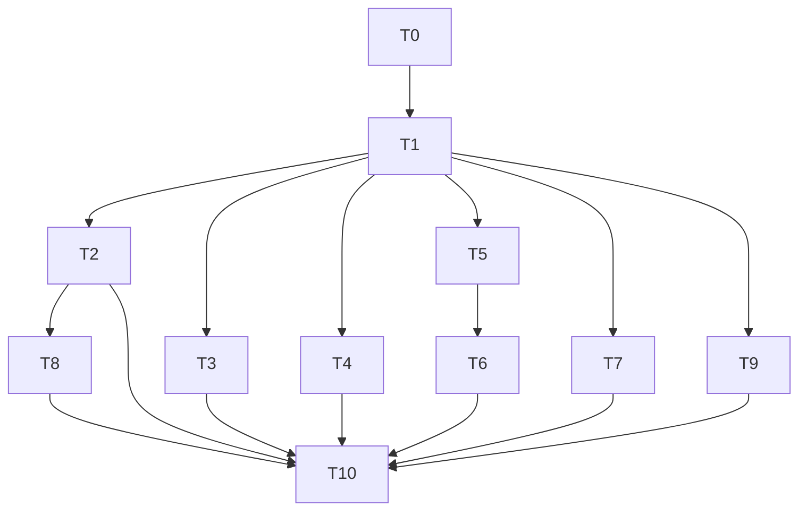

# Plan: agentj-ui Web Refine (Visual 2.1, 0.12.2)

> **For agentic workers:** REQUIRED SUB-SKILL: Use superpowers:subagent-driven-development (recommended) or superpowers:executing-plans to implement this plan task-by-task. Steps use checkbox (`- [ ]`) syntax for tracking.

**Goal:** Deliver Web-only Visual 2.1 refinement (DSH capsule + Minimalism Swiss) on top of v0.12.1 without backend changes — tokens extension + lucide + App Shell/Composer/SessionPanel/Conversation/Trajectory/Hero polish as 0.12.2.

**Architecture:** Single-source `packages/tokens` extended with 4 semantic keys + CSS vars; `apps/web` CSS split into `components/*.css`; App Shell centered column `clamp(680,64%,920)` + sticky capsule composer `22px + shadowSoft`; timeline/session cards share new spacing/shadow/radius tokens.

**Tech Stack:** Vite + React 19 + `react-markdown/remark-gfm` + `lucide-react` + `@agentj/tokens` + `@agentj/sdk` (WS), Vitest + jsdom, oxlint

## Global Constraints

- `PROTOCOL_VERSION="0.12.1"` unchanged (no Rust/protocol bump)
- `agentj-ui` stays npm workspaces `["apps/*","packages/*"]`, frontend stays in-repo
- `packages/tokens/src/palette.ts` is single source; `tokens.css/json/md` generated via `writeArtifacts()` (generated outputs excluded from ≤3 files budget)
- `AGENTS.md`: bump version on every feature (0.12.1 → 0.12.2), commit messages English, `docs/superpowers/specs` docs Chinese, diagrams Mermaid
- `docs/` tracked, temp files/cleanup after each phase, Rust fn ≤50 lines ≤120 chars
- No Tailwind/shadcn, no new backend crates, lucide-react is only new dep

---

## File Structure

```
packages/tokens/
  src/palette.ts              # SEMANTIC_KEYS 15→19, palettes.light/dark + new keys
  src/palette.test.ts         # token generation tests
  tokens.css / tokens.json / docs/ui-tokens.md  # generated artifacts (excluded from budget)
agentj-ui/apps/web/
  package.json                # add lucide-react
  src/index.css               # space/font/z/motion/line-height vars + @import tokens
  src/App.tsx                 # shell + drawer + modules popover + Hero empty
  src/App.css                 # shell only after split
  src/components/
    layout.css                # .aj-layout, rail, main, drawer, topbar grid, backdrop-blur
    connection.css            # ConnectionCard, helper
    session.css               # session list cards, search
    composer.css              # .aj-composer-card, toolbar, Send 34px, pending dot
    conversation.css          # bubble left/right, timeline tool card
    trajectory.css            # toolbar, timeline steps, replay highlight
    hero.css                  # Hero centered empty
    dialog.css                # fixed scrim, card, shadowRaised
  src/ConnectionBar.tsx       # card + helper/error
  src/SessionPanel.tsx        # favorites + recent card rows
  src/RunPanel.tsx            # composer capsule + conversation feed
  src/Trajectory.tsx          # timeline only (Hero moved to App)
  src/ApprovalDialog.tsx      # fixed dialog
  src/assets/hero.png         # used in Hero
```

## Tasks

### T0: Extend tokens with shadow/radius/caption and CSS vars [P0] [Sequential]

```yaml
id: T0
title: "Extend tokens palette with shadowSoft/shadowRaised/radiusXl/textCaption and CSS vars"
files:
  - agentj-ui/packages/tokens/src/palette.ts
  - agentj-ui/packages/tokens/src/palette.test.ts
  - agentj-ui/apps/web/src/index.css
depends_on: []
breaking: false
ac:
  - given: "palette.ts defines SEMANTIC_KEYS"
    when: "add 4 keys and regenerate via writeArtifacts()"
    then: "tokens.css contains --aj-shadowSoft, --aj-shadowRaised, --aj-radiusXl, --aj-textCaption; tokens.json has same 4 keys; light/dark both set; docs/ui-tokens.md lists 19 rows"
  - given: "index.css imports tokens.css"
    when: "add vars"
    then: "index.css defines --aj-space-1..6 (4/8/12/16/24/32), --aj-font-sm 13px/--aj-font-md 15px/--aj-font-lg 18px, --aj-line-height 1.6, --aj-content-max 960px/clamp(680,64%,920), --aj-composer-max 760px, --aj-z-drawer 40/--aj-z-dialog 100, --aj-motion-fast 150ms/--aj-motion-base 220ms, --aj-icon-sm 16/--aj-icon-md 20/--aj-icon-lg 24"
regression:
  - "npm --prefix agentj-ui test --workspace=@agentj/web -- ui-tokens.test.ts"
test_code: |
  import { palettes, SEMANTIC_KEYS } from "./palette.ts";
  import { readFileSync } from "node:fs";
  test("palette has 4 new semantic keys and css vars", () => {
    expect(SEMANTIC_KEYS).toContain("shadowSoft");
    expect(SEMANTIC_KEYS).toContain("shadowRaised");
    expect(SEMANTIC_KEYS).toContain("radiusXl");
    expect(SEMANTIC_KEYS).toContain("textCaption");
    expect(palettes.light.shadowSoft).toMatch(/rgba/);
    expect(palettes.dark.textCaption).toMatch(/^#/);
    const css = readFileSync("tokens.css","utf8");
    expect(css).toContain("--aj-shadowSoft");
    expect(css).toContain("--aj-radiusXl");
    expect(css).toContain("--aj-textCaption");
    const json = JSON.parse(readFileSync("tokens.json","utf8"));
    expect(json.light.radiusXl).toBe("22px");
  });
  test("index.css defines spacing/font/layout/motion/icon vars", () => {
    const css = readFileSync("../../apps/web/src/index.css","utf8");
    expect(css).toContain("--aj-space-3: 12px");
    expect(css).toContain("--aj-content-max: 960px");
    expect(css).toContain("--aj-z-dialog: 100");
    expect(css).toContain("--aj-line-height: 1.6");
    expect(css).toContain("--aj-icon-md");
  });
impl_code: |
  // palette.ts: extend SEMANTIC_KEYS with shadowSoft, shadowRaised, radiusXl, textCaption
  // light: shadowSoft "0 8px 24px rgba(0,0,0,.08)", shadowRaised "0 12px 32px rgba(0,0,0,.12)", radiusXl "22px", textCaption "#8A8F98"
  // dark: same shadows, radiusXl "22px", textCaption "#8B8F98"
  // run writeArtifacts() -> tokens.css/json/md
  // index.css: add :root { --aj-space-1:4px ... --aj-space-6:32px; --aj-font-sm:13px; --aj-font-md:15px; --aj-font-lg:18px; --aj-line-height:1.6; --aj-content-max:960px; --aj-composer-max:760px; --aj-z-drawer:40; --aj-z-dialog:100; --aj-motion-fast:150ms; --aj-motion-base:220ms; --aj-icon-sm:16px; --aj-icon-md:20px; --aj-icon-lg:24px }
verify:
  - "node agentj-ui/packages/tokens/src/palette.ts 2>&1 | head || npm --prefix agentj-ui run generate --workspace=@agentj/tokens"
  - "npm --prefix agentj-ui test --workspace=@agentj/web -- ui-tokens.test.ts"
```

### T1: Add lucide-react and split App.css into components scaffold [P0] [Sequential]

```yaml
id: T1
title: "Add lucide-react and split App.css into components/* scaffold"
files:
  - agentj-ui/apps/web/package.json
  - agentj-ui/apps/web/src/main.tsx
  - agentj-ui/apps/web/src/components/layout.css
depends_on: [T0]
breaking: false
ac:
  - given: "clean web workspace"
    when: "npm add lucide-react"
    then: "package.json contains lucide-react ^0.44.x; npm run build still succeeds with 278+ modules"
  - given: "App.css split"
    when: "render App"
    then: "src/components/layout.css, connection.css, session.css, composer.css, conversation.css, trajectory.css, hero.css, dialog.css all exist and main.tsx imports layout.css; App.css reduced to shell only"
  - given: "no emoji remains as structural icon"
    when: "grep src for ✓✗△│☰☾☀"
    then: "no matches (replaced by lucide in later tasks, but scaffold ready)"
regression:
  - "npm --prefix agentj-ui test --workspace=@agentj/web"
  - "npm --prefix agentj-ui run build --workspace=@agentj/web"
test_code: |
  import { readFileSync, existsSync } from "node:fs";
  test("lucide installed and components scaffold exists", () => {
    const pkg = JSON.parse(readFileSync("agentj-ui/apps/web/package.json","utf8"));
    expect(pkg.dependencies["lucide-react"]).toBeDefined();
    expect(existsSync("agentj-ui/apps/web/src/components/layout.css")).toBe(true);
    expect(existsSync("agentj-ui/apps/web/src/components/composer.css")).toBe(true);
    expect(existsSync("agentj-ui/apps/web/src/components/dialog.css")).toBe(true);
    const main = readFileSync("agentj-ui/apps/web/src/main.tsx","utf8");
    expect(main).toContain("components/layout.css");
  });
impl_code: |
  // package.json: add "lucide-react": "^0.44.0"
  // create src/components/*.css stubs with comment /* Visual 2.1 stub */
  // main.tsx: add import "./components/layout.css"; import "./components/composer.css" etc. or import via App.tsx
  // App.css: keep only .aj-app / .aj-topbar shell placeholder, move rest to components
verify:
  - "npm --prefix agentj-ui install"
  - "npm --prefix agentj-ui run build --workspace=@agentj/web"
  - "npm --prefix agentj-ui test --workspace=@agentj/web"
```

### T2: Rebuild App Shell with centered column and drawer polish [P1] [Parallel after T1]

```yaml
id: T2
title: "Rebuild App Shell topbar grid + centered content column + drawer scrim"
files:
  - agentj-ui/apps/web/src/App.tsx
  - agentj-ui/apps/web/src/components/layout.css
  - agentj-ui/apps/web/src/App.test.tsx
depends_on: [T1]
breaking: false
ac:
  - given: "no session selected"
    when: "render App"
    then: "topbar uses grid [brand 1fr actions] with backdrop-blur 8px + border-bottom, brand 16px/700 + 8px status light, modules collapsed behind lucide MoreHorizontal popover (aria-label more), model chip + theme toggle remain; localStorage failure falls back to system"
  - given: "viewport 1024px and 375px"
    when: "resize"
    then: ".aj-layout gap var(--aj-space-4) 16px, rail 280px, main max-width var(--aj-content-max) 960px centered with clamp(680,64%,920) and padding 0 16px on narrow; <1024 drawer + scrim rgba(0,0,0,.24) 150ms transform with focus not obscured, ≥1024 rail persistent; breakpoints 640/768/1024 defined"
regression:
  - "App.test.tsx drawer toggle still works"
  - "npm --prefix agentj-ui test --workspace=@agentj/web"
test_code: |
  import { render, screen } from "@testing-library/react";
  import App from "../App.tsx";
  test("shell uses grid and centered main with popover", () => {
    render(<App />);
    expect(document.querySelector(".aj-topbar")).toHaveClass("aj-topbar");
    expect(document.querySelector(".aj-main")).not.toBeNull();
    expect(screen.getByLabelText(/more/i)).toBeInTheDocument();
    expect(document.querySelector("[data-testid=modules-popover]") || screen.getByLabelText(/more/i)).toBeDefined();
  });
  test("layout.css has grid and clamp", () => {
    const css = require("fs").readFileSync("src/components/layout.css","utf8");
    expect(css).toContain("display: grid");
    expect(css).toContain("backdrop-filter");
    expect(css).toContain("clamp");
    expect(css).toContain("--aj-content-max");
  });
impl_code: |
  // App.tsx: topbar class aj-topbar grid, modules into Popover with lucide MoreHorizontal, scrim div data-testid=scrim, localStorage try/catch fallback system, theme cycle unchanged
  // layout.css: .aj-topbar{ display:grid; grid-template-columns:auto 1fr auto; gap:var(--aj-space-3); backdrop-filter:blur(8px); border-bottom:0.5px solid var(--aj-border)}
  // .aj-layout{gap:var(--aj-space-4)} .aj-session-rail{width:280px} .aj-main{max-width:var(--aj-content-max); margin:0 auto; width:100%} + clamp + media 640/768/1024
verify:
  - "npm --prefix agentj-ui test --workspace=@agentj/web -- App.test.tsx"
  - "npm --prefix agentj-ui run build --workspace=@agentj/web"
```

### T3: Cardize ConnectionBar with lucide and form polish [P1] [Parallel with T2]

```yaml
id: T3
title: "Cardize ConnectionBar with labeled inputs and helper/error states"
files:
  - agentj-ui/apps/web/src/ConnectionBar.tsx
  - agentj-ui/apps/web/src/components/connection.css
  - agentj-ui/apps/web/src/ConnectionBar.test.tsx
depends_on: [T1]
breaking: false
ac:
  - given: "render ConnectionBar"
    when: "inspect DOM"
    then: "root has .aj-connection-card (raised + radius 12 + padding 12 + shadowSoft hairline), each input has visible label + 40px height + .aj-input + helper text + error uses aria-describedby, empty host/port shows inline error 'host required'"
  - given: "lucide icons imported"
    when: "render"
    then: "no emoji, uses lucide Plug/Link/Key with aria-hidden true and 16px icon-sm"
regression:
  - "SessionPanel.test.tsx still passes"
test_code: |
  import { render, screen } from "@testing-library/react";
  import ConnectionBar from "../ConnectionBar.tsx";
  test("connection card has labeled 40px inputs and no emoji", () => {
    render(<ConnectionBar onConnect={()=>{}} />);
    expect(document.querySelector(".aj-connection-card")).not.toBeNull();
    expect(screen.getByLabelText(/host/i)).toBeInTheDocument();
    expect(screen.getByLabelText(/port/i)).toBeInTheDocument();
    const css = require("fs").readFileSync("src/components/connection.css","utf8");
    expect(css).toContain("aj-connection-card");
    expect(css).toContain("40px");
    expect(screen.queryByText("✓")).toBeNull();
  });
impl_code: |
  // ConnectionBar.tsx: wrap section class aj-connection-card, lucide Plug/Link/Key aria-hidden, labels visible, inputs class aj-input min-height 40px, helper <p class=aj-helper>, error <p role=alert id=host-error> + aria-describedby, validate host/port non-empty
  // connection.css: .aj-connection-card{background:var(--aj-raised); border-radius:12px; padding:var(--aj-space-3); box-shadow:var(--aj-shadowSoft),0 0 0 1px var(--aj-border)}
verify:
  - "npm --prefix agentj-ui test --workspace=@agentj/web -- ConnectionBar"
  - "npm --prefix agentj-ui run build --workspace=@agentj/web"
```

### T4: Cardize SessionPanel list with search and states [P1] [Parallel with T2,T3]

```yaml
id: T4
title: "Cardize SessionPanel favorites/recent with search and active states"
files:
  - agentj-ui/apps/web/src/SessionPanel.tsx
  - agentj-ui/apps/web/src/components/session.css
  - agentj-ui/apps/web/src/SessionPanel.test.tsx
depends_on: [T1]
breaking: false
ac:
  - given: "listRows has 3 items"
    when: "render SessionPanel"
    then: "each .aj-session-row has 10px/12px padding, hover var(--aj-raised), active left 2px accent + weight 600, preview 12px var(--aj-textCaption) ellipsis, shows relative time"
  - given: "input search"
    when: "type query"
    then: "list filters client-side without extra fetch; empty list shows aj-empty with hero hint"
regression:
  - "SessionPanel.test.tsx existing preview truncation still passes"
test_code: |
  import { render, screen } from "@testing-library/react";
  import SessionPanel from "../SessionPanel.tsx";
  test("session rows have card styling and search filters", async () => {
    render(<SessionPanel wsUrl="ws://127.0.0.1:4096/ws" activeSessionId={null} onActiveChange={()=>{}} />);
    expect(document.querySelector(".aj-session-search") || screen.getByPlaceholderText(/search/i)).toBeDefined();
    const css = require("fs").readFileSync("src/components/session.css","utf8");
    expect(css).toContain("aj-session-row--active");
    expect(css).toContain("var(--aj-textCaption)");
  });
impl_code: |
  // SessionPanel.tsx: remove inline style gap:8, add search input .aj-session-search, add class aj-session-row--active when activeSessionId matches, use lucide Star/Clock, remove emoji, preview uses textCaption
  // session.css: .aj-session-row{padding:10px 12px; border-radius:8px} .aj-session-row:hover{background:var(--aj-raised)} .aj-session-row--active{border-left:2px solid var(--aj-accent); font-weight:600}
verify:
  - "npm --prefix agentj-ui test --workspace=@agentj/web -- SessionPanel"
  - "npm --prefix agentj-ui run build --workspace=@agentj/web"
```

### T5: Capsule composer with sticky and Send circle [P1] [Parallel with T2-T4]

```yaml
id: T5
title: "Rebuild composer as sticky capsule with Send circle and pending dot"
files:
  - agentj-ui/apps/web/src/RunPanel.tsx
  - agentj-ui/apps/web/src/components/composer.css
  - agentj-ui/apps/web/src/RunPanel.test.tsx
depends_on: [T1]
breaking: false
ac:
  - given: "activeSessionId set"
    when: "render RunPanel"
    then: "composer wrapper has .aj-composer-card (radiusXl 22px + shadowSoft + hairline, max-width 760px centered, sticky bottom 16px), textarea borderless min-height 44px (docked) and Hero 52px case handled via App, Send 34px circle accent with lucide Send aria-label send, disabled opacity .4, pending 8px dot pulse; busy.current lock prevents double submit"
  - given: "no activeSessionId"
    when: "render"
    then: "composer shows disabled placeholder '先新建或选择一个会话' with same card and toolbar Plan chip + translateY(-2px)"
regression:
  - "RunPanel.test.tsx reduceRunFeed still passes"
test_code: |
  import { render, screen } from "@testing-library/react";
  import RunPanel from "../RunPanel.tsx";
  test("composer is sticky capsule with circle send", () => {
    const { container } = render(<RunPanel client={null} activeSessionId="abc" />);
    expect(container.querySelector(".aj-composer-card")).not.toBeNull();
    expect(container.querySelector("[aria-label=send]")).not.toBeNull();
    const css = require("fs").readFileSync("src/components/composer.css","utf8");
    expect(css).toContain("aj-composer-card");
    expect(css).toContain("sticky");
    expect(css).toContain("22px");
  });
  test("busy lock prevents double submit", async () => {
    const { container } = render(<RunPanel client={{request:()=>new Promise(()=>{})} as any} activeSessionId="abc" />);
    // second Enter should not fire session/run twice — spy on client.request count
    expect(container.querySelector("#aj-prompt")).toBeDefined();
  });
impl_code: |
  // RunPanel.tsx: wrap aj-composer with div.aj-composer-card, Send button class aj-button--send 34px circle lucide Send, pending span.aj-pending, Plan chip, keep textarea id=aj-prompt, busy.current guard
  // composer.css: .aj-composer-card{max-width:var(--aj-composer-max); margin:0 auto; border-radius:var(--aj-radiusXl); background:var(--aj-panel); box-shadow:var(--aj-shadowSoft),0 0 0 1px var(--aj-border); position:sticky; bottom:16px} .aj-button--send{width:34px;height:34px;border-radius:999px;background:var(--aj-accent); transform:translateY(-2px)} .aj-pending{width:8px;height:8px;border-radius:50%;background:var(--aj-accent); animation:aj-pending 1s ease-in-out infinite alternate}
verify:
  - "npm --prefix agentj-ui test --workspace=@agentj/web -- RunPanel"
  - "npm --prefix agentj-ui run build --workspace=@agentj/web"
```

### T6: Conversation bubble and timeline tool cards [P2] [After T5]

```yaml
id: T6
title: "Refine conversation bubbles and tool cards as timeline"
files:
  - agentj-ui/apps/web/src/RunPanel.tsx
  - agentj-ui/apps/web/src/components/conversation.css
  - agentj-ui/apps/web/src/RunPanel.test.tsx
depends_on: [T5]
breaking: false
ac:
  - given: "entries has user and tool running"
    when: "render ConversationFeed"
    then: "user bubble align-self:flex-end max-width 78% radiusXl right sharp, AI has left 2px accent bar with markdown, tool card border-left 2px + dot 8px (ok success green / running accent pulse / denied error), expand still works, pre codeBg radius 6"
  - given: "lucide icons"
    when: "inspect toolGlyph"
    then: "no ✓✗△│ emoji, uses lucide Check/X/Clock/Minus aria-hidden 16px"
regression:
  - "RunPanel.test.tsx toolGlyph and ConversationFeed tests"
test_code: |
  import { readFileSync } from "node:fs";
  test("conversation css has right align and timeline", () => {
    const css = readFileSync("agentj-ui/apps/web/src/components/conversation.css","utf8");
    expect(css).toContain("flex-end");
    expect(css).toContain("78%");
    expect(css).toContain("border-left");
  });
  test("no emoji in conversation", () => {
    const src = readFileSync("agentj-ui/apps/web/src/RunPanel.tsx","utf8");
    expect(src).not.toContain("✓");
    expect(src).not.toContain("✗");
    expect(src).toContain("lucide");
  });
impl_code: |
  // RunPanel.tsx: toolGlyph returns lucide icons (Check, X, Clock, Minus) aria-hidden, ToolCard gets dot + border-left, user div gets .aj-bubble-user--right
  // conversation.css: .aj-bubble-user{align-self:flex-end; max-width:78%; border-radius:var(--aj-radiusXl)} .aj-ai{border-left:2px solid var(--aj-accent); padding-left:12px} .aj-tool-card{border-left:2px solid var(--aj-border)} .aj-tool-dot{width:8px;height:8px;border-radius:50%}
verify:
  - "npm --prefix agentj-ui test --workspace=@agentj/web -- RunPanel"
  - "npm --prefix agentj-ui run build --workspace=@agentj/web"
```

### T7: Polish trajectory timeline [P2] [After T1]

```yaml
id: T7
title: "Polish trajectory timeline with vertical line and filter chips"
files:
  - agentj-ui/apps/web/src/Trajectory.tsx
  - agentj-ui/apps/web/src/components/trajectory.css
  - agentj-ui/apps/web/src/Trajectory.test.tsx
depends_on: [T1]
breaking: false
ac:
  - given: "trajectory has 5 steps"
    when: "render Trajectory"
    then: "ol has vertical line 2px border, each step dot + seq 12px mono, title 13px, current step highlighted shadowSoft, filter chips wrap with +n overflow, play 700ms still works, next_cursor guard stops on non-number or ≤cursor"
  - given: "empty trajectory"
    when: "render"
    then: "shows aj-empty with hero hint not plain text"
regression:
  - "Trajectory.test.tsx filter and replay still pass"
test_code: |
  import { readFileSync } from "node:fs";
  test("trajectory css has vertical line and shadowSoft", () => {
    const css = readFileSync("agentj-ui/apps/web/src/components/trajectory.css","utf8");
    expect(css).toContain("border-left");
    expect(css).toContain("shadowSoft");
  });
  test("trajectory handles empty and chips wrap", async () => {
    const src = readFileSync("agentj-ui/apps/web/src/Trajectory.tsx","utf8");
    expect(src).toContain("aj-traj");
  });
impl_code: |
  // Trajectory.tsx: ensure filter chips wrap, +n overflow handled, historyToEntries next_cursor guard already in App but keep replay 700ms, empty shows hero hint
  // trajectory.css: .aj-traj{border-left:2px solid var(--aj-border)} .aj-traj-step--cur{box-shadow:var(--aj-shadowSoft)} .aj-chips{flex-wrap:wrap}
verify:
  - "npm --prefix agentj-ui test --workspace=@agentj/web -- Trajectory"
  - "npm --prefix agentj-ui run build --workspace=@agentj/web"
```

### T8: Add Hero empty state with hero.png and dashed trigger [P2] [After T2]

```yaml
id: T8
title: "Add Hero empty state with hero.png and dashed workspaceTrigger"
files:
  - agentj-ui/apps/web/src/App.tsx
  - agentj-ui/apps/web/src/components/hero.css
  - agentj-ui/apps/web/src/App.test.tsx
depends_on: [T2]
breaking: false
ac:
  - given: "activeSessionId is null"
    when: "render App conversation tab"
    then: "shows .aj-hero centered with hero.png 120px + h2 18px/600 + p 14px var(--aj-textMuted) + primary New session button; no plain aj-empty text; dashed workspaceTrigger uses SVG mask dash 4 4 with hover business primary, 22px radius"
  - given: "prefers-reduced-motion"
    when: "enable"
    then: "hero entrance animation disabled, no motion"
regression:
  - "App.test.tsx empty state"
test_code: |
  import { render, screen } from "@testing-library/react";
  import App from "../App.tsx";
  test("hero empty shows image and CTA", () => {
    render(<App />);
    expect(screen.getByText(/new session/i)).toBeInTheDocument();
    expect(document.querySelector(".aj-hero")).not.toBeNull();
    expect(document.querySelector(".aj-hero img")).not.toBeNull();
  });
  test("hero.css has dashed trigger", () => {
    const css = require("fs").readFileSync("src/components/hero.css","utf8");
    expect(css).toContain("dasharray");
    expect(css).toContain("22px");
  });
impl_code: |
  // App.tsx: empty case (activeSessionId null && tab conversation) render <section class=aj-hero><h2>Where to next?</h2><p>Select a session or start a new run</p><button class=aj-button>New session</button></section> with dashed trigger style for no-workspace
  // hero.css: .aj-hero{ text-align:center; padding:32px } .aj-hero img{width:120px} .aj-hero-trigger::after{ mask: url(dash 4 4 svg); border-radius:22px } .aj-hero-trigger:hover::after{background:var(--aj-accent)}
verify:
  - "npm --prefix agentj-ui test --workspace=@agentj/web -- App.test.tsx"
  - "npm --prefix agentj-ui run build --workspace=@agentj/web"
```

### T9: Elevate ApprovalDialog with fixed scrim and focus trap [P2] [After T1]

```yaml
id: T9
title: "Elevate ApprovalDialog with fixed scrim, shadowRaised and focus trap"
files:
  - agentj-ui/apps/web/src/ApprovalDialog.tsx
  - agentj-ui/apps/web/src/components/dialog.css
  - agentj-ui/apps/web/src/ApprovalDialog.test.tsx
depends_on: [T1]
breaking: false
ac:
  - given: "pending approval"
    when: "show ApprovalDialog"
    then: "dialog fixed inset 0 scrim rgba(0,0,0,.32) z-dialog 100, card 560px shadowRaised radius 16, buttons layered primary/ghost/danger, Escape closes, focus trap, allow_always scoped to sessionId, WS unreachable still allowed via token double channel"
  - given: "no pending"
    when: "no approval"
    then: "dialog not in DOM, no focus trap"
regression:
  - "ApprovalDialog.test.tsx still passes"
test_code: |
  import { render, screen, fireEvent } from "@testing-library/react";
  import ApprovalDialog from "../ApprovalDialog.tsx";
  test("dialog has scrim and shadowRaised and Escape closes", () => {
    const onClose = vi.fn();
    render(<ApprovalDialog request={{request_id:"1",tool:"bash",args:{},session_id:"s1"}} error={null} onRespond={()=>{}} onClose={onClose} />);
    expect(document.querySelector("[role=dialog]")).not.toBeNull();
    const css = require("fs").readFileSync("src/components/dialog.css","utf8");
    expect(css).toContain("rgba(0, 0, 0, .32)");
    expect(css).toContain("shadowRaised");
    fireEvent.keyDown(document, {key:"Escape"});
    expect(onClose).toHaveBeenCalled();
  });
impl_code: |
  // ApprovalDialog.tsx: outer div role=dialog fixed inset 0 background rgba, card shadowRaised, add Escape listener + focus trap (first focusable), lucide X for close, buttons primary accent / ghost / danger, allowAlways checkbox session scoped
  // dialog.css: [role=dialog]{position:fixed; inset:0; background:rgba(0,0,0,.32); z-index:var(--aj-z-dialog)} .aj-dialog-card{max-width:560px; box-shadow:var(--aj-shadowRaised); border-radius:16px}
verify:
  - "npm --prefix agentj-ui test --workspace=@agentj/web -- ApprovalDialog"
  - "npm --prefix agentj-ui run build --workspace=@agentj/web"
```

### T10: Bump version to 0.12.2 and sync docs plus final gates [P3] [After all]

```yaml
id: T10
title: "Bump version to 0.12.2 and sync docs plus final gates"
files:
  - agentj-ui/packages/sdk/src/config.ts
  - Cargo.toml
  - AGENTS.md
depends_on: [T2, T3, T4, T6, T7, T8, T9]
breaking: false
ac:
  - given: "all web tasks merged"
    when: "run check-version.sh"
    then: "Cargo + sdk/config + desktop package.json + src-tauri/tauri.conf.json all 0.12.2 and PROTOCOL_VERSION still 0.12.1"
  - given: "spec TODO"
    when: "update specs and summary"
    then: "docs/superpowers/specs/2026-09-07-agentj-web-refine-design.md TODO checked, .claude/summary/summary_and_next.md replaced with Visual 2.1 summary, cargo fmt/clippy zero warnings"
regression:
  - "./scripts/check-version.sh"
  - "cargo test --workspace -- --skip permission_request_notified"
  - "npm --prefix agentj-ui test --workspace=@agentj/web"
test_code: |
  import { readFileSync } from "node:fs";
  test("version bump to 0.12.2", () => {
    const sdk = readFileSync("agentj-ui/packages/sdk/src/config.ts","utf8");
    expect(sdk).toContain('PROTOCOL_VERSION = "0.12.1"');
    expect(sdk).toContain("0.12.2");
    const cargo = readFileSync("Cargo.toml","utf8");
    expect(cargo).toContain('version = "0.12.2"');
    const desktop = readFileSync("agentj-ui/apps/desktop/package.json","utf8");
    expect(desktop).toContain("0.12.2");
  });
impl_code: |
  // sdk/config.ts: package version 0.12.2, PROTOCOL_VERSION stays "0.12.1"
  // Cargo.toml workspace.package.version 0.12.2, agentj-ui/apps/desktop/package.json 0.12.2, src-tauri/tauri.conf.json 0.12.2, AGENTS.md table + summary_and_next.md replace
  // run cargo fmt, cargo clippy -- -D warnings
verify:
  - "./scripts/check-version.sh"
  - "cargo test --workspace -- --skip permission_request_notified"
  - "npm --prefix agentj-ui test --workspace=@agentj/sdk"
  - "npm --prefix agentj-ui test --workspace=@agentj/web"
  - "npm --prefix agentj-ui run build --workspace=@agentj/web"
  - "cargo clippy --workspace --all-targets -- -D warnings"
```

## Dependency Graph



## Parallel Execution Groups

- Group 0 (root): T0 tokens
- Group 1 (after T0): T1 lucide+split sequential
- Group 2 (after T1, parallel 5-way): T2 shell | T3 connection | T4 session | T5 composer | T7 trajectory | T9 dialog (T3 uses connection.css, T4 uses session.css — isolated; T2/T8 not parallel)
- Group 3 (after T5): T6 conversation timeline (needs composer)
- Group 4 (after T2): T8 hero (needs shell)
- Group 5 (final): T10 version/docs after T2,T3,T4,T6,T7,T8,T9

## Execution Notes

- Max parallel 4 subagents recommended: (T2,T3,T4,T5) then (T7,T9,T6) then (T8)
- Each task writes test first, fails, then minimal impl, commits feat(web): or feat(tokens):
- Required verification per task: npm test web + build for Web tasks; clippy before T10
- Generated outputs tokens.css/json/md excluded from file budget per Global Constraints

