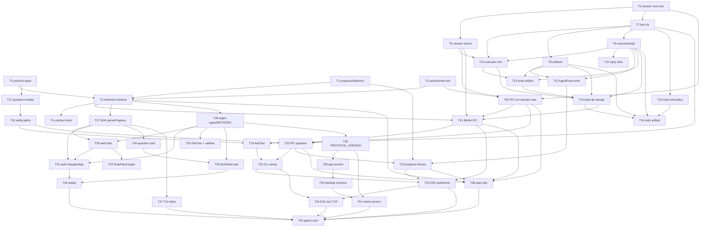

# Plan: AgentJ Protocol Extension — file/list + `$/progress` todo/file_change + `$/askQuestion` / `question/respond`（三栏工作台真实数据源，0.15.0）

## Agent Worker Instructions

- Required sub-skills: `superpowers:subagent-driven-development` (preferred) or `superpowers:executing-plans`
- Execution mode: `subagent-driven-development` — fresh subagent per task, two-stage review between tasks
- Required verification (every Rust task): scoped test first (`cargo test -p <crate> <filter>`), then milestone gates for tasks marked [GATE]: `cargo test --workspace`, `cargo clippy --workspace --all-targets -- -D warnings`, `cargo test -p agentj-protocol -- drift`
- Required verification (frontend tasks): `npm --prefix agentj-ui test --workspace=@agentj/sdk`, `npm --prefix agentj-ui test --workspace=@agentj/web`, `npm --prefix agentj-ui run build --workspace=@agentj/web`, `bun --cwd agentj-ui/apps/tui test` (scoped vitest MUST run via the workspace script — `npx vitest` from repo root does not load the web vite config/jsdom)
- Generated files: `schemas/*.json` (via `cargo run -p agentj-protocol --bin gen_schemas`), `agentj-ui/packages/protocol/types.d.ts` (via protocol generate script), `agentj-ui/packages/sdk/src/methods.ts` (via sdk generate script) — regenerate with their generators, never hand-edit, and commit them with the owning task
- Version: feature → minor `0.14.6 → 0.15.0`; `PROTOCOL_VERSION 0.12.1 → 0.13.0`
- Language: task titles / AC / code in English; commit messages in English; design/spec docs in Chinese
- No new third-party dependencies (diff is hand-rolled; git via subprocess; `agentj-question` uses workspace-existing crates only)
- Rust style: function ≤50 lines, ≤120 chars per line

**Goal:** Replace the three-column workbench demo/half-derived data sources with real protocol data: `file/list` request (lazy file tree + git statuses), `$/progress` kinds `todo` / `file_change` (emitted from a new built-in `todo` tool, `write` before/after diff, and `bash` git sampling), and a model-question flow (`$/askQuestion` + `question/respond`) driven by a new built-in `ask` tool.

**Architecture:** New wire types live in `agentj-protocol` (additive, schema-drift gated). Tool execution in `agentj-core` produces structured `TurnArtifact`s (write diff in `artifacts.rs`, bash git sampling in `git_sample.rs`), which ride the existing `ToolCallReply` → `TurnRunner` → `AgentEvent` → `dispatch_session_run` stream and become `$/progress` frames. Questions use a new `agentj-question` crate (mirrors `agentj-permission`: pending map + notifier + owner gate + settle hook). Sessions gain an optional `project_root` that becomes the single root for sandboxing, permission checks, bash cwd, path rebasing and change paths.

**Tech Stack:** Rust 1.96+ (16 → 17 workspace crates), JSON-RPC 2.0 + schemars schemas, tokio, serde; TypeScript (SDK + React 19 web + Bun/OpenTUI TUI); no new dependencies.

## Global Constraints

- Protocol additive discipline: wire fields snake_case; new types/fields carry `@since 0.13.0` doc markers; unknown values tolerated only on value enums (`#[serde(other)]` + `#[schemars(skip)]`); `ProgressValue` gains new `kind` branches (consumers ignore unknown kinds by `$`-prefix convention)
- Error codes: only NEW code is `-32807 PathNotAllowed`; existing codes keep their meanings
- Caps (fixed values, do not change): file/list entries ≤ 2000 (`truncated:true`), `depth` 1..=8, single diff ≤ 64 KiB (`diff:null` + `diff_truncated:true`), ≤ 64 bash change artifacts per call, todo items validated (content non-empty, status enum)
- `file/list` sandbox: session `project_root` (canonicalized; default process CWD); lexical normalization THEN `canonicalize` + `starts_with(root)`; symlink entries escaping the root are skipped; `.git` entry excluded
- sort order: directories first, then name ascending (deterministic)
- `todo` / `ask` tools are default-allow (no approval dialogs); they are registered as builtins/plugin-registered tools
- Frontend: colors only via `var(--aj-*)`; git dots M=warning(orange)/A=success(green)/U=textCaption(gray)/D=error(red); diff tints `--aj-diffAddTint`/`--aj-diffDelTint`; `+N` success / `-N` error; unified diff expands only when `diff !== null`
- Demo mode (`?demo=1` / `agentj.demo`) is preserved as a whole-block override: demo ON = fixtures only (no real frames rendered); demo OFF = real protocol data. Existing storage keys keep their meanings (`agentj.ask.collapsed` etc.)
- UI copy: existing strings from `docs/design/three-column/design.md` are preserved (`运行详情`, `任务`, `文件变更`, `✓ 已选择：`, `跳过`, `提交`); NEW empty/loading strings exactly: `加载中…` / `加载失败` / `重试` / `空目录` / `未选择会话`
- `<1024px` responsive behavior, keyboard a11y, and composer selectors are unchanged by this feature
- TUI: runview adds a READ-ONLY todos block; TUI must never crash on new kinds (unknown frames ignored); file_change + question cards are out of TUI scope

## Design Consistency (docs/design/three-column)

This plan implements the data contract drafted in `docs/design/three-column/protocol-extension-prompt.md` while honoring the interface spec `docs/design/three-column/design.md`. Mapping + documented refinements:

| docs/design source | Contract element | Tasks |
|---|---|---|
| design.md §2 文件 tab（懒加载/折叠/git 点 M/A/U） + prompt §3.1 | `file/list` + `FileEntry.git_status` (M/A/U/D) | T0, T3, T21, T32 |
| design.md §2 右栏任务（勾选列表/状态 pill） + prompt §3.2 | `$/progress kind:"todo"` + `TodoItem` | T1, T11, T15, T16, T23, T30, T33, T37 |
| design.md §2 文件变更（+N/-N/徽标/unified diff） + prompt §3.3 | `$/progress kind:"file_change"` + `FileChange` | T1, T13, T14, T23, T31 |
| design.md §4.3 / §6 提问卡（展开/折叠/单选多选/其他/跳过/记录卡 + `agentj.ask.collapsed`） + prompt §3.4 | `$/askQuestion` + `question/respond` | T0, T17–T19, T22, T34, T35, T36 |
| prompt §5–§6 发射点/前端接入/回放 | AgentEvent stream + trajectory replay + SDK parseProgress | T9–T14, T22, T23, T27, T30–T36 |
| prompt §4 版本与门禁（§8.18–8.20、§7.3、§3.4、§9.4、§11.3） | docs/specs/ipc-protocol.md sync | T38 |
| design.md §9 验收 #5（提问卡片可展开/折叠、提交后问答记录进入信息流、`跳过` 可用） | real ask tool replaces demo | T26, T34, T35, T36 |

Documented refinements vs the draft prompt (rationale in the design spec): `depth` clamped 1..=8 (draft left it open); deterministic sort order added; `path` not-found / not-a-directory → `-32602`; `diff_truncated` modeled as an optional bool field; `question/respond` check order = parse → owner → params → settle; spec sections become §8.18–§8.22 because `session/list` + `session/history` sections are missing from the current document; `session/new` gains an additive `project_root` param (draft assumed a session root without defining one); question settlement excludes session archive/delete — agentj-ipc has no dispatch arms for `session/archive` / `session/delete` today (pre-existing gap), so settlement is covered by respond/timeout/cancel/connection-close instead.

---

### T0: Add file/list and question wire types to agentj-protocol [P0] [Sequential]

```yaml
- id: T0
  title: "Add FileList* and AskQuestion/QuestionRespond wire types with serde + schema tests"
  files:
    - crates/agentj-protocol/src/file.rs
    - crates/agentj-protocol/src/question.rs
    - crates/agentj-protocol/src/lib.rs
  depends_on: []
  breaking: false
  ac:
    - given: "FileListParams with session_id/file path depth"
      when: "serialized to JSON"
      then: "keys are snake_case session_id/path/depth and None fields are omitted"
    - given: "a legacy/filelist payload with unknown FileKind value"
      when: "deserialized"
      then: "kind maps to FileKind::Unknown (serde other) and does not error"
    - given: "GitFileStatus values M/A/U/D"
      when: "round-tripped through JSON"
      then: "wire strings are exactly \"M\"/\"A\"/\"U\"/\"D\" and git_status null is omitted when None"
    - given: "AskQuestionParams with 2 options and defaults omitted"
      when: "serialized"
      then: "allow_multiple=false and allow_other=true are still present; header/timeout_s omitted when None"
    - given: "QuestionRespondParams {question_id, answers, skipped omitted}"
      when: "deserialized from wire without skipped"
      then: "skipped defaults to false"
  regression:
    - "cargo test -p agentj-protocol (existing base/session/permission/streaming suites keep passing)"
  test_code: |
    // crates/agentj-protocol/src/file.rs #[cfg(test)]
    #[test]
    fn file_list_params_roundtrip_omits_none() {
        let p = FileListParams { session_id: "s1".into(), path: None, depth: Some(2) };
        let v = serde_json::to_value(&p).unwrap();
        assert_eq!(v["session_id"], "s1");
        assert_eq!(v["depth"], 2);
        assert!(v.get("path").is_none());
    }
    #[test]
    fn file_kind_unknown_tolerated() {
        let k: FileKind = serde_json::from_str("\"socket\"").unwrap();
        assert_eq!(k, FileKind::Unknown);
    }
    #[test]
    fn git_file_status_maps_single_letters() {
        let s = serde_json::to_value(GitFileStatus::U).unwrap();
        assert_eq!(s, "U");
    }
    // crates/agentj-protocol/src/question.rs #[cfg(test)]
    #[test]
    fn ask_defaults_present_and_optional_fields_omitted() { /* allow_* present; header/timeout_s absent */ }
    #[test]
    fn question_respond_skipped_defaults_false() { /* from_str without skipped -> false */ }
  impl_code: |
    // crate module layout: add `pub mod file;` and `pub mod question;` to src/lib.rs
    // file.rs: FileListParams{session_id: SessionId, path: Option<String>, depth: Option<u32>},
    //   FileListResult{entries: Vec<FileEntry>, truncated: bool},
    //   FileEntry{name, path, kind: FileKind, size: Option<u64>, mtime_ms: Option<u64>, git_status: Option<GitFileStatus>},
    //   FileKind{File,Dir,Unknown} #[serde(rename_all="snake_case")] + #[serde(other)] #[schemars(skip)] on Unknown,
    //   GitFileStatus{M,A,U,D,Unknown} explicit #[serde(rename="M")] etc + other/skip (doc @since 0.13.0)
    // question.rs: AskQuestionParams{question_id: String, session_id: SessionId, question: String,
    //   header: Option<String> #[serde(skip_serializing_if="Option::is_none")],
    //   options: Vec<AskOption>, allow_multiple: bool #[serde(default)], allow_other: bool #[serde(default="default_true")],
    //   timeout_s: Option<u64> skip-none}, AskOption{id,label,hint:Option<String>},
    //   QuestionRespondParams{question_id, answers: Vec<String>, skipped: bool #[serde(default)]},
    //   QuestionRespondResult{accepted: bool}; helper fn default_true() -> bool { true }
  verify:
    - "cargo test -p agentj-protocol file_ && cargo test -p agentj-protocol question_"
    - "cargo test -p agentj-protocol"
```

### T1: Extend ProgressValue and TrajectoryValue with todo / file_change / question kinds [P0] [Sequential]

```yaml
- id: T1
  title: "Extend ProgressValue with Todo/FileChange variants and TrajectoryValue with replay variants"
  files:
    - crates/agentj-protocol/src/streaming.rs
    - crates/agentj-protocol/src/trajectory.rs
  depends_on: []
  breaking: false
  ac:
    - given: "ProgressValue::Todo { session_id, revision, items }"
      when: "serialized"
      then: "JSON has kind:\"todo\", session_id, revision, items[]"
    - given: "a TodoStatus wire value \"blocked\" (unknown)"
      when: "deserialized"
      then: "maps to TodoStatus::Unknown without error"
    - given: "ProgressValue::FileChange with diff:None and diff_truncated:None"
      when: "serialized"
      then: "change object omits diff and diff_truncated keys"
    - given: "TrajectoryValue Todo/FileChange/AskQuestion/QuestionAnswer variants"
      when: "serialized"
      then: "each carries the same payload fields used by the live frames (replay parity)"
  regression:
    - "cargo test -p agentj-protocol streaming (existing text/tool_call/tool_result/usage/permission tests)"
    - "existing schema test asserting ProgressValue has oneOf/anyOf still passes"
  test_code: |
    #[test]
    fn progress_todo_kind_wire_shape() {
        let v = ProgressValue::Todo { session_id: "s1".into(), revision: 3,
            items: vec![TodoItem{ id:"t1".into(), content:"task".into(), status: TodoStatus::InProgress }] };
        let j = serde_json::to_value(&v).unwrap();
        assert_eq!(j["kind"], "todo");
        assert_eq!(j["revision"], 3);
        assert_eq!(j["items"][0]["status"], "in_progress");
    }
    #[test]
    fn todo_status_unknown_tolerated() { /* from_str("\"blocked\"") == TodoStatus::Unknown */ }
    #[test]
    fn file_change_omits_none_diff_fields() { /* get("diff").is_none() */ }
    #[test]
    fn trajectory_new_variants_roundtrip() { /* ask_question + question_answer serde roundtrip */ }
  impl_code: |
    // streaming.rs: pub struct TodoItem{id,content,status:TodoStatus};
    //   pub enum TodoStatus{Pending,InProgress,Completed,Cancelled,Unknown} rename_all snake_case + other/skip;
    //   pub struct FileChange{path,op:FileChangeKind,additions:u64,deletions:u64,
    //     tool_call_id:Option<String> skip-none,diff:Option<String> skip-none,diff_truncated:Option<bool> skip-none};
    //   pub enum FileChangeKind{Add,Modify,Delete,Unknown} rename_all snake_case + other/skip;
    //   ProgressValue::Todo{session_id,revision:u64,items:Vec<TodoItem>} + ProgressValue::FileChange{session_id,change:FileChange}
    //   (mirror existing Permission variant style; doc @since 0.13.0)
    // trajectory.rs: TrajectoryValue::Todo{revision,items}, FileChange{change},
    //   AskQuestion{question_id,question,header:Option<String>,options:Vec<AskOption>,allow_multiple,allow_other},
    //   QuestionAnswer{question_id,answers:Vec<String>,skipped:bool}; update per-variant schema test list
  verify:
    - "cargo test -p agentj-protocol streaming"
    - "cargo test -p agentj-protocol trajectory"
```

### T2: Add SessionNewParams and PATH_NOT_ALLOWED error code [P0] [Sequential]

```yaml
- id: T2
  title: "Add SessionNewParams.project_root and error_codes::PATH_NOT_ALLOWED (-32807)"
  files:
    - crates/agentj-protocol/src/session.rs
    - crates/agentj-protocol/src/base.rs
  depends_on: []
  breaking: false
  ac:
    - given: "SessionNewParams { project_root: None }"
      when: "serialized"
      then: "emits {} with project_root omitted"
    - given: "SessionNewParams from wire {project_root:\"/tmp/proj\"}"
      when: "deserialized"
      then: "project_root equals /tmp/proj"
    - given: "error_codes::PATH_NOT_ALLOWED"
      when: "read by the reserved-values unit test"
      then: "equals -32807 and no other code changed"
  regression:
    - "cargo test -p agentj-protocol base (error_codes_have_reserved_values updated but all previous values asserted)"
  test_code: |
    #[test]
    fn session_new_params_project_root_roundtrip() {
        let p = SessionNewParams { project_root: Some("/tmp/proj".into()) };
        assert_eq!(serde_json::to_value(&p).unwrap()["project_root"], "/tmp/proj");
        assert!(serde_json::to_value(SessionNewParams{project_root:None}).unwrap().get("project_root").is_none());
    }
    // base.rs test update
    assert_eq!(error_codes::PATH_NOT_ALLOWED, -32807);
  impl_code: |
    // session.rs: pub struct SessionNewParams { #[serde(skip_serializing_if="Option::is_none")] pub project_root: Option<String> } (@since 0.13.0)
    // base.rs: pub const PATH_NOT_ALLOWED: i32 = -32807; // extend reserved-values test
  verify:
    - "cargo test -p agentj-protocol -- drift"
```

### T3: Register methods, schemas and registry expectations [P0] [GATE] [Sequential]

```yaml
- id: T3
  title: "Register file/list + $/askQuestion + question/respond in methods.json and schema registry; regenerate schemas"
  files:
    - protocol/methods.json
    - crates/agentj-protocol/src/schema.rs
    - crates/agentj-protocol/tests/registry.rs
  depends_on: [T0, T1, T2]
  breaking: false
  ac:
    - given: "methods.json"
      when: "registry test reads it"
      then: "21 methods exist and session/new now carries params SessionNewParams"
    - given: "new entries"
      when: "parsed"
      then: "file/list=request/client_to_server params FileListParams result FileListResult; $/askQuestion=notification/server_to_client params AskQuestionParams; question/respond=request/client_to_server params QuestionRespondParams result QuestionRespondResult"
    - given: "methods.json top-level protocol_version"
      when: "read"
      then: "it is \"0.13.0\" (synced while methods.json is owned by this task; was stale \"0.3.0\")"
    - given: "gen_schemas ran"
      when: "drift test compares committed schemas"
      then: "zero drift; new schema files exist for all 13 new registered types"
  regression:
    - "cargo test -p agentj-protocol -- drift (after regeneration)"
    - "registry test still validates all directions and schema references"
  test_code: |
    // tests/registry.rs — update expected list + count
    assert_eq!(methods.len(), 21);
    assert!(methods.iter().any(|m| m.method == "file/list" && m.kind == "request"));
    assert!(methods.iter().any(|m| m.method == "$/askQuestion" && m.direction == "server_to_client"));
    assert!(methods.iter().any(|m| m.method == "question/respond"));
    assert_eq!(session_new.params.as_deref(), Some("SessionNewParams"));
  impl_code: |
    // methods.json: add 3 entries in the existing shape + change session/new "params": null -> "SessionNewParams"
    //   + set top-level "protocol_version": "0.3.0" -> "0.13.0"
    // schema.rs generate_schemas(): insert 13 new entries via schema_for!:
    //   FileListParams,FileListResult,FileEntry,FileKind,AskQuestionParams,AskOption,
    //   QuestionRespondParams,QuestionRespondResult,TodoItem,TodoStatus,FileChange,FileChangeKind,SessionNewParams
    // run: cargo run -p agentj-protocol --bin gen_schemas  (commit all schemas/*.json)
  verify:
    - "cargo run -p agentj-protocol --bin gen_schemas"
    - "cargo test -p agentj-protocol -- drift"
    - "cargo test -p agentj-protocol"
    - "git status --short schemas  # regenerated files staged with the task"
```

### T4: Add contract wire-shape tests for the new methods [P1] [Sequential]

```yaml
- id: T4
  title: "Add envelope-level wire shape tests for file/list, $/askQuestion, question/respond"
  files:
    - crates/agentj-protocol/tests/contract.rs
  depends_on: [T3]
  breaking: false
  ac:
    - given: "a RequestMessage for file/list with typed params"
      when: "serialized"
      then: "method is file/list and params carry session_id/path/depth"
    - given: "a NotificationMessage for $/askQuestion"
      when: "serialized"
      then: "jsonrpc=2.0, method=$/askQuestion, params.options length 2"
    - given: "a question/respond request + QuestionRespondResult"
      when: "serialized"
      then: "accepted:true serializes under result"
  regression:
    - "existing contract.rs notification/request tests (progress, permissionRequest) keep passing"
  test_code: |
    #[test]
    fn file_list_request_wire_shape() { /* RequestMessage {method:"file/list", params: FileListParams...} -> assert json */ }
    #[test]
    fn ask_question_notification_wire_shape() { /* NotificationMessage method "$/askQuestion" */ }
    #[test]
    fn question_respond_result_wire_shape() { /* ResponseMessage result accepted */ }
  impl_code: |
    // Append three tests mirroring progress_notification_wire_shape and
    // permission_request_notification_wire_shape_with_origin_client (no production code)
  verify:
    - "cargo test -p agentj-protocol --test contract"
```

### T5: Add project_root to SessionSnapshot and SessionStore defaults [P0] [Sequential]

```yaml
- id: T5
  title: "Add SessionSnapshot.project_root (serde default) and SessionStore project_root/set_project_root default methods"
  files:
    - crates/agentj-core/src/types.rs
    - crates/agentj-core/src/module.rs
  depends_on: []
  breaking: true
  ac:
    - given: "a legacy SessionSnapshot JSON without project_root"
      when: "deserialized"
      then: "project_root is None (serde default) and no error"
    - given: "the default SessionStore impl"
      when: "project_root(sid) is called on a store that does not override it"
      then: "returns None; set_project_root returns Ok (no-op)"
    - given: "SessionSnapshot with project_root Some(\"/tmp/p\")"
      when: "serialized"
      then: "project_root is present in the document"
  regression:
    - "cargo test -p agentj-core session (snapshot/restore tests)"
    - "cargo test -p agentj-session (store tests compile against the unchanged trait)"
  test_code: |
    #[test]
    fn snapshot_without_root_deserializes_none() {
        let raw = r#"{"session_id":"s","status":"active","messages":[],"created_at":1,"updated_at":2}"#;
        let snap: SessionSnapshot = serde_json::from_str(raw).unwrap();
        assert_eq!(snap.project_root, None);
    }
    #[test]
    fn default_store_project_root_is_none() { /* a minimal SessionStore impl -> None */ }
  impl_code: |
    // types.rs: SessionSnapshot add `#[serde(default, skip_serializing_if="Option::is_none")] pub project_root: Option<String>`
    // module.rs SessionStore: default methods
    //   fn project_root(&self, _s: &SessionId) -> Option<PathBuf> { None }
    //   fn set_project_root(&self, _s: &SessionId, _r: PathBuf) -> Result<(), ModuleError> { Ok(()) }
    // fix SessionSnapshot struct literals in core (snapshot() default body) with project_root: None
  verify:
    - "cargo test -p agentj-core snapshot"
    - "cargo test -p agentj-core && cargo test -p agentj-session"
```

### T6: Persist project_root in both session stores [P0] [Sequential]

```yaml
- id: T6
  title: "Persist project_root in FileBackedStore and InMemoryStore"
  files:
    - crates/agentj-session/src/file_store.rs
    - crates/agentj-session/src/lib.rs
  depends_on: [T5]
  breaking: false
  ac:
    - given: "InMemoryStore.set_project_root(sid, /tmp/p)"
      when: "project_root(sid) is read"
      then: "returns /tmp/p"
    - given: "FileBackedStore with set_project_root"
      when: "persist() runs and a NEW FileBackedStore opens the same dir"
      then: "project_root survives the restart (snapshot roundtrip)"
    - given: "FileBackedStore.restore(snapshot with root) on a missing session"
      when: "project_root is read"
      then: "returns the restored root"
  regression:
    - "cargo test -p agentj-session (file_store persistence + corrupt-skip tests)"
  test_code: |
    #[test]
    fn file_backed_store_persists_project_root_across_restart() {
        let dir = tempfile::tempdir().unwrap();
        let store = FileBackedStore::new(dir.path()).unwrap();
        let sid = store.create().unwrap();
        store.set_project_root(&sid, PathBuf::from("/tmp/proj")).unwrap();
        let reopened = FileBackedStore::new(dir.path()).unwrap();
        assert_eq!(reopened.project_root(&sid), Some(PathBuf::from("/tmp/proj")));
    }
  impl_code: |
    // file_store.rs: add roots: Mutex<HashMap<SessionId, PathBuf>>; load from snap.project_root in new();
    //   persist() includes project_root; override project_root/set_project_root
    // lib.rs (InMemoryStore): add roots map + overrides
  verify:
    - "cargo test -p agentj-session"
```

### T7: Add ToolCallContext, execute_with_context default, and path rebasing helper [P0] [Sequential]

```yaml
- id: T7
  title: "Add ToolCallContext + Tool::execute_with_context default + rebase_tool_args; wire into execute_async"
  files:
    - crates/agentj-core/src/module.rs
    - crates/agentj-core/src/tool_paths.rs
    - crates/agentj-core/src/lib.rs
  depends_on: [T5]
  breaking: true
  ac:
    - given: "an existing tool that only implements execute()"
      when: "execute_async runs it"
      then: "execute_with_context default delegates to execute (behavior unchanged)"
    - given: "rebase_tool_args(\"read\", {\"path\":\"src/main.rs\"}, /root)"
      when: "called"
      then: "path becomes /root/src/main.rs; absolute /other/x is left untouched"
    - given: "rebase_tool_args(\"glob\", {\"pattern\":\"**/*.rs\"}, /root)"
      when: "called"
      then: "pattern becomes /root/**/*.rs; non-path args (bash command) unchanged"
    - given: "execute_async with a perm_ctx (session_id + workspace_root)"
      when: "the tool runs"
      then: "ToolCallContext carries the same session_id/workspace_root and rebased args reach write/read/grep/glob"
  regression:
    - "cargo test -p agentj-core tool_executor (all existing permission/deny/timeout paths)"
    - "cargo test -p agentj-tools (builtin tool tests unchanged)"
  test_code: |
    #[test]
    fn rebase_relative_paths_under_root() {
        let args = serde_json::json!({"path": "src/main.rs"});
        let out = rebase_tool_args("read", args, Path::new("/root"));
        assert_eq!(out["path"], "/root/src/main.rs");
    }
    #[test]
    fn default_execute_with_context_delegates() { /* dummy tool; ctx ignored; result equals execute() */ }
  impl_code: |
    // module.rs: pub struct ToolCallContext{session_id:SessionId, workspace_root:PathBuf};
    //   Tool trait: fn execute_with_context(&self, input, _ctx:&ToolCallContext) -> Result<Value,ToolError> { self.execute(input) }
    //   execute_async: build ctx from perm_ctx; args = rebase_tool_args(name,args,&perm_ctx.workspace_root);
    //   then tool.execute_with_context(args,&ctx)
    // tool_paths.rs: pub fn rebase_tool_args(name,args,root) — match name: read|write -> "path",
    //   grep -> "path", glob -> "pattern"; join only when value is a relative string
    // lib.rs: pub mod tool_paths;
  verify:
    - "cargo test -p agentj-core rebase"
    - "cargo test -p agentj-core && cargo test -p agentj-tools"
```

### T8: Add core artifacts module (native types, write diff, todo snapshot) [P0] [Sequential]

```yaml
- id: T8
  title: "Create artifacts module: TurnArtifact types, unified_diff, write_change, todo_snapshot_from_args"
  files:
    - crates/agentj-core/src/artifacts.rs
    - crates/agentj-core/src/lib.rs
  depends_on: [T7]
  breaking: false
  ac:
    - given: "before None and after \"a\\nb\" for a write"
      when: "write_change runs"
      then: "op=Add, additions=2, deletions=0, diff is a unified diff with only + lines"
    - given: "before \"a\\nb\\nc\" and after \"a\\nx\\nc\""
      when: "write_change runs"
      then: "op=Modify, additions=1, deletions=1, diff contains '-b' and '+x'"
    - given: "content producing a diff larger than 64 KiB"
      when: "write_change runs"
      then: "diff=None and diff_truncated=true while additions/deletions still reported"
    - given: "todo args items [{content:\"a\"},{content:\"a\"}] with valid statuses"
      when: "todo_snapshot_from_args runs"
      then: "ids are stable (same content -> same base hash) and the duplicate gets a distinct suffix id"
    - given: "todo args with an invalid status string"
      when: "todo_snapshot_from_args runs"
      then: "returns Err(String) (the tool layer surfaces it)"
    - given: "todo args items: []"
      when: "todo_snapshot_from_args runs"
      then: "returns Ok with an empty snapshot (legal clear)"
  regression:
    - "cargo test -p agentj-core (no other module affected)"
  test_code: |
    #[test]
    fn write_change_add_counts_lines_and_diff() { /* asserts above */ }
    #[test]
    fn write_change_diff_truncates_over_cap() { /* long content -> diff None, truncated true */ }
    #[test]
    fn todo_snapshot_derives_stable_ids_and_dedup() { /* two identical contents -> ids t<hash> and t<hash>#2 */ }
  impl_code: |
    // artifacts.rs: pub enum TurnArtifact{FileChange(FileChangeArtifact),Todo(TodoSnapshot)};
    //   pub struct FileChangeArtifact{path,op:FileChangeOp,additions:u64,deletions:u64,
    //     tool_call_id:Option<String>,diff:Option<String>,diff_truncated:bool};
    //   pub enum FileChangeOp{Add,Modify,Delete};
    //   pub struct TodoSnapshot{items:Vec<TodoItemArtifact>};
    //   pub struct TodoItemArtifact{id,content,status:TodoStatusArtifact}; pub enum TodoStatusArtifact{...4};
    //   pub const DIFF_MAX_BYTES: usize = 64*1024;
    //   pub fn unified_diff(before:&str,after:&str)->String (line-level LCS DP, cap lines product <=4M;
    //     over cap -> multiset-approximation counts + empty diff + truncated flag);
    //   pub fn write_change(path,before:Option<&str>,after:&str,tool_call_id)->FileChangeArtifact;
    //   pub fn todo_snapshot_from_args(args:&Value)->Result<TodoSnapshot,String> (validate items/status; FNV-1a id + #n suffix)
    // lib.rs: pub mod artifacts;
  verify:
    - "cargo test -p agentj-core artifacts"
```

### T9: Introduce ToolExecutionOutcome and extend ToolCallReply payload [P0] [Sequential]

```yaml
- id: T9
  title: "Add ToolExecutionOutcome and change ToolCallReply result to carry artifacts"
  files:
    - crates/agentj-core/src/module.rs
    - crates/agentj-core/src/turn_runner.rs
    - crates/agentj-core/src/tool_executor.rs
  depends_on: [T7]
  breaking: true
  ac:
    - given: "ToolExecutorModule handles a tool call"
      when: "the tool succeeds"
      then: "reply carries ToolExecutionOutcome{result, artifacts:[]} (artifacts empty until T13/T14/T16)"
    - given: "TurnRunner receives the outcome"
      when: "it forwards the tool result"
      then: "AgentEvent::ToolResult still carries the tool output string and the turn loop continues"
    - given: "a tool failure"
      when: "the outcome is sent"
      then: "reply is Err(ToolError) exactly as before (no artifacts on failure)"
  regression:
    - "cargo test -p agentj-core turn_runner (cancel + max-iterations + tool loop tests)"
    - "cargo test -p agentj-core tool_executor"
  test_code: |
    #[test]
    fn tool_executor_replies_with_outcome() { /* assert outcome.result == tool output; artifacts empty */ }
  impl_code: |
    // module.rs: pub struct ToolExecutionOutcome{pub result: serde_json::Value, pub artifacts: Vec<TurnArtifact>};
    //   ToolCallReply sender type: Result<ToolExecutionOutcome, ToolError>
    // tool_executor.rs: map Ok(value) -> Ok(ToolExecutionOutcome{result:value, artifacts:vec![]})
    // turn_runner.rs: tool_rx Ok(outcome) -> use outcome.result for AgentEvent::ToolResult / pipeline.reflux
  verify:
    - "cargo test -p agentj-core"
```

### T10: Update remaining ToolCallReply call sites [P0] [Sequential]

```yaml
- id: T10
  title: "Update kernel/dispatcher/agent_loop ToolCallReply sites to the new payload"
  files:
    - crates/agentj-core/src/kernel.rs
    - crates/agentj-core/src/dispatcher.rs
    - crates/agentj-core/src/agent_loop_module.rs
  depends_on: [T9]
  breaking: false
  ac:
    - given: "the workspace compiles after T9's type change"
      when: "kernel/dispatcher/agent_loop helpers construct or consume ToolCallReply"
      then: "they wrap results in ToolExecutionOutcome{result, artifacts:vec![]} and read .result"
    - given: "existing dispatch/routing tests"
      when: "run"
      then: "all pass unchanged in behavior"
  regression:
    - "cargo test -p agentj-core (kernel + dispatcher + agent_loop suites)"
  test_code: |
    // Adjust existing test helpers that build replies; new expectation:
    tx.send(Ok(ToolExecutionOutcome { result: json!({"ok": true}), artifacts: vec![] }))
  impl_code: |
    // kernel.rs: two ToolCallRequest send helpers — wrap test/tool replies
    // dispatcher.rs: two receive-side helpers — read .result
    // agent_loop_module.rs: receive branch — read .result
  verify:
    - "cargo test -p agentj-core"
    - "cargo test --workspace --no-run"
```

### T11: Emit AgentEvent Todo / FileChange with per-session revision [P0] [GATE] [Sequential]

```yaml
- id: T11
  title: "Add AgentEvent::Todo/FileChange and emit them from TurnRunner with revision counter"
  files:
    - crates/agentj-core/src/types.rs
    - crates/agentj-core/src/turn_runner.rs
  depends_on: [T8, T9]
  breaking: true
  ac:
    - given: "a tool outcome with a Todo artifact"
      when: "TurnRunner forwards results"
      then: "it sends AgentEvent::ToolResult first, then AgentEvent::Todo{revision, snapshot} with revision starting at 1 for the session"
    - given: "a second Todo artifact in the same session"
      when: "emitted"
      then: "revision increments to 2 (monotonic per session)"
    - given: "a FileChange artifact"
      when: "emitted"
      then: "AgentEvent::FileChange(change) carries path/op/counts/diff/tool_call_id unchanged"
  regression:
    - "cargo test -p agentj-core turn_runner (tool loop + cancel tests)"
  test_code: |
    #[tokio::test]
    async fn turn_runner_emits_todo_with_incrementing_revision() {
        // script provider + tool executor returning artifacts; collect AgentEvents;
        // assert sequence [ToolCall, ToolResult, Todo{revision:1}, Todo{revision:2}]
    }
    #[tokio::test]
    async fn turn_runner_emits_file_change_after_tool_result() { /* order + payload */ }
  impl_code: |
    // types.rs: AgentEvent::Todo{revision:u64, snapshot:TodoSnapshot}, AgentEvent::FileChange(FileChangeArtifact)
    // turn_runner.rs: field todo_revisions: Arc<Mutex<HashMap<SessionId,u64>>>;
    //   after sending ToolResult, iterate outcome.artifacts:
    //   Todo -> revision += 1 -> send Todo; FileChange -> send FileChange
  verify:
    - "cargo test -p agentj-core turn_runner"
    - "cargo test --workspace --no-run"
```

### T12: Resolve per-session project root in ToolExecutorModule [P0] [Sequential]

```yaml
- id: T12
  title: "Resolve session project_root in ToolExecutorModule and use it for permission + rebasing"
  files:
    - crates/agentj-core/src/tool_executor.rs
  depends_on: [T6, T7, T9]
  breaking: false
  ac:
    - given: "a session with project_root /tmp/proj"
      when: "a tool call for that session executes"
      then: "PermissionContext.workspace_root is /tmp/proj and relative path args are rebased under it"
    - given: "a session without a project_root"
      when: "a tool call executes"
      then: "the process CWD is used (current behavior preserved)"
  regression:
    - "cargo test -p agentj-core tool_executor"
    - "cargo test -p agentj-core permission"
  test_code: |
    #[tokio::test]
    async fn executor_uses_session_project_root() {
        // store with root /tmp/proj; capture perm_ctx via a recording checker;
        // assert workspace_root == /tmp/proj
    }
  impl_code: |
    // tool_executor.rs handle(): root = ctx.session.project_root(&session_id)
    //   .map(PathBuf::from).unwrap_or_else(|| self.workspace_root.clone());
    // build PermissionContext{ workspace_root: root.clone(), .. } (args passed through; execute_async rebases)
  verify:
    - "cargo test -p agentj-core tool_executor"
```

### T13: Produce write file_change artifacts [P0] [Sequential]

```yaml
- id: T13
  title: "Produce file_change artifact for write tool calls (pre/post read + diff)"
  files:
    - crates/agentj-core/src/tool_executor.rs
    - crates/agentj-core/src/artifacts.rs
  depends_on: [T8, T9, T12]
  breaking: false
  ac:
    - given: "a write tool call creating a new file"
      when: "the tool succeeds"
      then: "outcome.artifacts contains FileChange{op:Add, tool_call_id:call_id, path relative to root}"
    - given: "a write overwriting an existing file"
      when: "the tool succeeds"
      then: "op:Modify with line counts/diff computed from the pre-read content"
    - given: "the pre-read fails with a non-NotFound error"
      when: "the write succeeds"
      then: "the tool result is returned normally and NO artifact is produced (degrade, never fail the tool)"
    - given: "the post-read fails after a successful write"
      when: "artifacts are built"
      then: "the tool result is returned normally and NO artifact is produced"
  regression:
    - "cargo test -p agentj-core tool_executor"
  test_code: |
    #[tokio::test]
    async fn write_produces_add_then_modify_artifacts() {
        // temp root; write file #1 -> artifact Add; write file #2 -> Modify with additions/deletions
    }
  impl_code: |
    // tool_executor.rs: for name == "write": resolve rebased path from args;
    //   read before (NotFound -> None; other error -> skip artifact);
    //   execute_async as usual; on Ok read after; artifacts.push(write_change(rel_path, before, after, call_id))
    //   relative path computed against root
  verify:
    - "cargo test -p agentj-core tool_executor"
```

### T14: Produce bash file_change artifacts via git sampling [P0] [Sequential]

```yaml
- id: T14
  title: "Add git_sample module and emit bash file_change artifacts from before/after git state"
  files:
    - crates/agentj-core/src/git_sample.rs
    - crates/agentj-core/src/tool_executor.rs
    - crates/agentj-core/src/lib.rs
  depends_on: [T8, T9, T12, T13]
  breaking: false
  ac:
    - given: "a git repo where a bash command modifies a tracked file"
      when: "the bash tool completes"
      then: "a FileChange{op:Modify} artifact is emitted with git-authoritative additions/deletions and a diff (≤64 KiB)"
    - given: "a bash command creating a new untracked file"
      when: "it completes"
      then: "FileChange{op:Add, diff:None} with additions from the file line count"
    - given: "a non-git directory"
      when: "bash runs"
      then: "no artifacts are emitted and the tool result is unaffected"
    - given: "more than 64 changed files"
      when: "artifacts are built"
      then: "at most 64 artifacts are emitted (truncated silently)"
    - given: "a bash command that fails with ToolError"
      when: "it returns"
      then: "no artifacts are emitted"
    - given: "a bash command renaming A to B (git --no-renames)"
      when: "artifacts are built"
      then: "two artifacts: Delete(A) and Add(B)"
  regression:
    - "cargo test -p agentj-core tool_executor"
  test_code: |
    #[tokio::test]
    async fn bash_git_sampling_detects_modify_add_delete() {
        // temp dir: git init + commit file A;
        // run `sh -c "echo x >> A && echo new > B && rm -f A"` equivalents through the module;
        // assert Modify(A), Add(B), Delete(A) artifacts with counts
    }
    #[tokio::test]
    async fn bash_outside_git_emits_nothing() { /* temp non-repo -> empty */ }
    #[tokio::test]
    async fn bash_failure_and_rename() { /* Err -> empty; rename -> Delete+Add pair */ }
  impl_code: |
    // git_sample.rs: struct GitSnapshot{ top: PathBuf, statuses: HashMap<String,(char,char)>, numstat: HashMap<String,(u64,u64)> };
    //   pub async fn sample(root)->Option<GitSnapshot> (tokio::process: rev-parse --show-toplevel,
    //     status --porcelain -z --no-renames, diff HEAD --numstat -z; any failure -> None)
    //   pub async fn changes_between(before:Option<&GitSnapshot>, after:&GitSnapshot, root, call_id)->Vec<FileChangeArtifact>
    //     (set diff of statuses ∪ numstat changes; op mapping; tracked diff via `git diff HEAD -- <path>` capped; untracked diff=None)
    // tool_executor.rs: name=="bash" -> sample before/execute/sample after -> artifacts
    // lib.rs: pub mod git_sample;
  verify:
    - "cargo test -p agentj-core git_sample && cargo test -p agentj-core tool_executor"
```

### T15: Add built-in todo tool and default-allow policy for todo/ask [P0] [Sequential]

```yaml
- id: T15
  title: "Add TodoTool builtin, BashTool cwd override, and default-allow permission mode for todo/ask"
  files:
    - crates/agentj-tools/src/builtins.rs
    - crates/agentj-tools/src/lib.rs
    - crates/agentj-permission/src/policy.rs
  depends_on: [T7]
  breaking: false
  ac:
    - given: "valid todo args items:[{content,status}]"
      when: "TodoTool::execute runs"
      then: "returns Ok with an echoed {ok:true,count:N} payload"
    - given: "invalid args (items missing OR empty content OR bad status)"
      when: "TodoTool::execute runs"
      then: "returns Err(ToolError) describing the invalid field"
    - given: "builtin_default_modes_match_design test"
      when: "evaluated"
      then: "todo and ask map to PermissionMode::Allow; bash/write remain Ask; read/glob/grep remain Allow"
    - given: "a BashTool call with ToolCallContext.workspace_root = /tmp/proj"
      when: "execute_with_context runs `pwd`"
      then: "stdout is /tmp/proj (subprocess cwd overridden to the session root)"
  regression:
    - "cargo test -p agentj-tools (existing builtin tests)"
    - "cargo test -p agentj-permission (engine/policy tests)"
  test_code: |
    #[test]
    fn todo_tool_rejects_empty_content() { /* execute json!({"items":[{"content":"","status":"pending"}]}) -> Err */ }
    #[test]
    fn bash_tool_uses_context_workspace_root() { /* execute_with_context "pwd" -> output contains temp dir */ }
    #[test]
    fn builtin_default_modes_match_design() {
        assert_eq!(builtin_default_mode("todo"), PermissionMode::Allow);
        assert_eq!(builtin_default_mode("ask"), PermissionMode::Allow);
        assert_eq!(builtin_default_mode("write"), PermissionMode::Ask);
    }
  impl_code: |
    // builtins.rs: pub struct TodoTool; impl Tool{name:"todo", description, input_schema (items/content/status enum),
    //   execute validate (empty items[] is legal — clears the snapshot)}
    //   register in register_builtins(); lib.rs re-export TodoTool
    //   BashTool: override execute_with_context -> Command::current_dir(ctx.workspace_root)
    // policy.rs: builtin_default_mode match add "read"|"glob"|"grep"|"todo"|"ask" => Allow
  verify:
    - "cargo test -p agentj-tools && cargo test -p agentj-permission"
```

### T16: Emit todo artifacts from executor [P0] [Sequential]

```yaml
- id: T16
  title: "Produce Todo artifact for todo tool calls in ToolExecutorModule"
  files:
    - crates/agentj-core/src/tool_executor.rs
  depends_on: [T8, T9, T14, T15]
  breaking: false
  ac:
    - given: "a successful todo tool call"
      when: "the executor builds artifacts"
      then: "outcome.artifacts contains TurnArtifact::Todo with ids derived (FNV-1a + dedup suffix) and statuses mapped"
    - given: "malformed todo args that the tool already rejected"
      when: "the tool returns Err"
      then: "no artifacts are produced"
  regression:
    - "cargo test -p agentj-core tool_executor"
  test_code: |
    #[tokio::test]
    async fn todo_tool_call_yields_snapshot_artifact() { /* 2 items -> artifact with 2 ids */ }
  impl_code: |
    // tool_executor.rs: name=="todo" && result Ok -> artifacts.push(TurnArtifact::Todo(todo_snapshot_from_args(&args)?))
    //   malformed -> skip (log debug), keep tool result
  verify:
    - "cargo test -p agentj-core tool_executor"
```

### T17: Scaffold agentj-question crate with QuestionModule (ask/respond) [P0] [Sequential]

```yaml
- id: T17
  title: "Create agentj-question crate: QuestionModule pending map, ask_blocking, respond, session_of"
  files:
    - crates/agentj-question/Cargo.toml
    - crates/agentj-question/src/lib.rs
    - crates/agentj-question/src/module.rs
  depends_on: [T0]
  breaking: false
  ac:
    - given: "a pending question from ask_blocking (spawned thread)"
      when: "respond(qid, [option_id], false) is called"
      then: "accepted=true and the blocked caller receives Answers([option_id])"
    - given: "a question already settled"
      when: "respond is called again"
      then: "accepted=false (no error)"
    - given: "an unknown question_id"
      when: "respond is called"
      then: "accepted=false (no error)"
    - given: "answers referencing an option id outside the pending options (no other: prefix)"
      when: "respond is called"
      then: "Err(RespondError::UnknownOptions)"
    - given: "allow_multiple=false and two answers"
      when: "respond is called"
      then: "Err(RespondError::TooManyAnswers)"
    - given: "settle hook registered"
      when: "a question settles once"
      then: "hook fires exactly once with the settlement"
  regression:
    - "cargo test --workspace --no-run (new crate builds; workspace unaffected)"
  test_code: |
    #[test]
    fn ask_and_respond_roundtrip() {
        let m = Arc::new(QuestionModule::new());
        let m2 = m.clone();
        let h = std::thread::spawn(move || m2.ask_blocking("s1", params_with_options(), |_| true));
        let qid = wait_for_pending(&m);
        assert_eq!(m.respond(&qid, vec!["a".into()], false).unwrap(), RespondOutcome::Accepted(true));
        assert_eq!(h.join().unwrap()..outcome(), QuestionOutcome::Answered{answers: vec!["a".into()]});
    }
    #[test]
    fn duplicate_respond_is_idempotent_false() { /* second respond -> Accepted(false) */ }
    #[test]
    fn respond_validates_options_and_single_choice() { /* UnknownOptions / TooManyAnswers */ }
  impl_code: |
    // Cargo.toml: name agentj-question; deps agentj-core, agentj-protocol, serde, serde_json, uuid(v4)
    // module.rs: pending: Mutex<HashMap<String,PendingQuestion>>; settled: Mutex<HashMap<String,SettledQuestion>>;
    //   notifier: RwLock<Option<Arc<dyn Fn(&AskQuestionParams,&str)->bool + Send + Sync>>>  (bool = owner delivered)
    //   settle_hook: RwLock<Option<Arc<dyn Fn(&str,&str,&QuestionSettlement) + Send + Sync>>>
    //   pub fn ask_blocking(&self, session_id,&AskQuestionParams)->(String,QuestionOutcome):
    //     uuid qid; insert pending with std mpsc::Sender; call notifier; if notifier false -> settle skip immediately;
    //     recv_timeout(timeout_s) or recv(); timeout -> settle skip; return
    //   pub fn respond(&self,qid,answers,skipped)->Result<RespondOutcome,RespondError>; session_of; cancel_session
    // QuestionSettlement{question_id,session_id,outcome}; settle_once helper fires hook
  verify:
    - "cargo test -p agentj-question"
```

### T18: Complete QuestionModule settle paths (timeout / cancel / hook) [P0] [Sequential]

```yaml
- id: T18
  title: "Implement timeout, cancel_session and settle-hook exactly-once semantics"
  files:
    - crates/agentj-question/src/module.rs
  depends_on: [T17]
  breaking: false
  ac:
    - given: "timeout_s = 1 and no respond"
      when: "ask_blocking runs"
      then: "returns Skipped after ~1s and the settle hook fires once"
    - given: "cancel_session(sid) with two pending questions for that session"
      when: "called"
      then: "both settle Skipped and both blocked callers return; hooks fire once each"
    - given: "respond racing a timeout"
      when: "both fire"
      then: "exactly one settlement wins; the loser observes accepted=false / no double hook"
    - given: "cancel with no pending questions"
      when: "called"
      then: "no-op"
    - given: "a settle hook that panics"
      when: "a question settles"
      then: "ask_blocking still returns normally and the panic does not propagate (hook isolated)"
  regression:
    - "cargo test -p agentj-question (T17 cases)"
  test_code: |
    #[test]
    fn timeout_settles_skip_and_fires_hook_once() { /* hook Mutex<Vec<_>>; timeout_s 1 */ }
    #[test]
    fn cancel_session_settles_all_pending() { /* two questions -> both Skipped */ }
    #[test]
    fn settle_hook_panic_is_isolated() { /* hook panics; ask still returns Skipped; no unwind */ }
  impl_code: |
    // module.rs: timeout uses recv_timeout; on timeout attempt remove-pending; if removed -> settle skip + hook
    // cancel_session iterates pending by session, drains, sends Skipped, hook per question
    // settle_once(id, settlement): mutex-guarded removal decides the single winner for respond/timeout races
  verify:
    - "cargo test -p agentj-question"
```

### T19: Implement AskTool [P0] [Sequential]

```yaml
- id: T19
  title: "Add AskTool implementing Tool + execute_with_context via QuestionModule"
  files:
    - crates/agentj-question/src/tool.rs
    - crates/agentj-question/src/lib.rs
  depends_on: [T7, T18]
  breaking: false
  ac:
    - given: "input with 1 option"
      when: "AskTool::execute_with_context runs"
      then: "returns Err(ToolError) (options must be 2..=8)"
    - given: "valid input and a responder"
      when: "execute_with_context runs with a ToolCallContext"
      then: "emits the question to the notifier with ctx.session_id, blocks, and returns a JSON string {question_id, answers, skipped}"
    - given: "notifier reports no owner"
      when: "the ask runs"
      then: "it settles immediately as skipped and the tool returns {skipped:true}"
  regression:
    - "cargo test -p agentj-question"
    - "cargo test -p agentj-core (tool trait default unchanged)"
  test_code: |
    #[test]
    fn ask_tool_requires_two_options() { /* Err for 1 option */ }
    #[test]
    fn ask_tool_returns_answers_json() {
        // module with notifier that spawns a responder thread; assert result contains "answers"
    }
  impl_code: |
    // tool.rs: pub struct AskTool{module: Arc<QuestionModule>}; Tool impl{name:"ask", description,
    //   input_schema{question,header,options[{id,label,hint}],allow_multiple,allow_other,timeout_s}};
    //   override execute_with_context(input,ctx)->validate->m.ask_blocking(ctx.session_id,&params)->
    //   serde_json::to_string(&json!({"question_id":qid,"answers":..,"skipped":..}))
    // lib.rs: pub use tool::AskTool; pub use module::{QuestionModule,QuestionOutcome,RespondOutcome,RespondError}
  verify:
    - "cargo test -p agentj-question"
```

### T20: IPC error.data field + session/new project_root dispatch [P0] [Sequential]

```yaml
- id: T20
  title: "Add optional error data to IPC errors and handle session/new project_root"
  files:
    - crates/agentj-ipc/src/lib.rs
  depends_on: [T2, T5, T6]
  breaking: false
  ac:
    - given: "a DispatchError with data"
      when: "the JSON-RPC error response is built"
      then: "error.data is present; without data the key is omitted (wire compatible)"
    - given: "session/new params {project_root:\"/tmp/proj\"} (absolute existing dir)"
      when: "dispatched"
      then: "the session is created and set_project_root stores the canonicalized path"
    - given: "session/new project_root relative OR missing OR a file"
      when: "dispatched"
      then: "returns -32602 with error.data{path, reason}"
    - given: "session/new without params (legacy client)"
      when: "dispatched"
      then: "behaves exactly as before"
  regression:
    - "cargo test -p agentj-ipc session_new (existing dispatch tests)"
    - "cargo test -p agentj-ipc (all handler tests)"
  test_code: |
    #[tokio::test]
    async fn session_new_with_project_root_persists_it() { /* handle_request -> store.project_root(sid) == canonical tmp */ }
    #[tokio::test]
    async fn session_new_rejects_relative_root_with_32602() { /* error.data.reason == "invalid_project_root" */ }
    #[test]
    fn error_object_omits_data_when_none() { /* serde shape */ }
  impl_code: |
    // lib.rs: JsonRpcError/DispatchError { code, message, #[serde(skip_serializing_if="Option::is_none")] data: Option<Value> };
    //   constructors default data None; add helpers invalid_params_with_data / internal_with_data / path_not_allowed
    // dispatch_session_new(&self, req:&RequestMessage, conn_id): read params.project_root;
    //   validate absolute + is_dir -> canonicalize; session_store.set_project_root(&sid,path); error -> -32602+data
  verify:
    - "cargo test -p agentj-ipc"
```

### T21: Implement file/list IPC handler [P0] [GATE] [Sequential]

```yaml
- id: T21
  title: "Implement file/list dispatch: sandboxed enumeration with depth/limit/git status"
  files:
    - crates/agentj-ipc/src/file_list.rs
    - crates/agentj-ipc/src/lib.rs
  depends_on: [T3, T6, T14, T20]
  breaking: false
  ac:
    - given: "a session with project_root /tmp/proj containing src/main.rs and .git/"
      when: "file/list {session_id, depth:None} dispatches"
      then: "entries contain src/ (dir) and any files at root, `.git` is excluded, ordering is dirs-first name-asc"
    - given: "path \"..\" or an absolute path outside the root or a symlink target outside the root"
      when: "file/list dispatches"
      then: "-32807 with error.data {path, reason:\"outside_project_root\"}"
    - given: "path pointing at a file"
      when: "file/list dispatches"
      then: "-32602 with error.data {path, reason:\"not_a_directory\"}"
    - given: "more than 2000 entries reachable at depth 8"
      when: "file/list dispatches"
      then: "entries length is 2000 and truncated=true"
    - given: "a git repo with one modified, one untracked and one deleted file"
      when: "file/list dispatches"
      then: "git_status is M/A/D respectively for those entries"
    - given: "unknown session_id"
      when: "file/list dispatches"
      then: "-32802 SessionNotFound"
    - given: "depth 9"
      when: "file/list dispatches"
      then: "-32602 with error.data {reason:\"invalid_depth\"}"
    - given: "a path that does not exist"
      when: "file/list dispatches"
      then: "-32602 with error.data {path, reason:\"not_found\"}"
    - given: "an existing but unreadable directory"
      when: "file/list dispatches"
      then: "-32603 with error.data {path, reason}"
    - given: "an entry whose metadata read fails"
      when: "entries are assembled"
      then: "that entry is skipped and the rest are returned"
  regression:
    - "cargo test -p agentj-ipc (existing dispatch tests: session/list, session/history, progress broadcast)"
  test_code: |
    // crates/agentj-ipc/src/file_list.rs #[cfg(test)]
    #[test]
    fn list_root_is_sorted_and_excludes_git() { /* temp tree: dir src, file a.rs, .git dir -> [src, a.rs] */ }
    #[test]
    fn escape_via_dotdot_is_rejected() { /* path "../x" -> Err(OutsideRoot) */ }
    #[test]
    fn symlink_escape_entry_is_skipped() { /* link -> /etc; entry absent from result */ }
    #[test]
    fn depth_and_truncation_respected() { /* >limit synthetic tree -> truncated */ }
    #[test]
    fn depth_over_eight_rejected() { /* depth 9 -> Err(InvalidDepth) */ }
    #[test]
    fn missing_path_is_not_found() { /* path "nope" -> Err(NotFound) */ }
    // crates/agentj-ipc/src/lib.rs tests
    #[tokio::test]
    async fn dispatch_file_list_maps_errors_to_codes_and_data() { /* -32807/-32602/-32802 shapes */ }
  impl_code: |
    // file_list.rs: pub enum FileListError{NotFound,NotADirectory,OutsideRoot{path},InvalidDepth,Io{path,reason}};
    //   pub fn list(root:&Path, path:Option<&str>, depth:Option<u32>) -> Result<FileListResult,FileListError>
    //   (lexical normalize + canonicalize + starts_with(root); BFS depth<=8; limit 2000; skip .git;
    //    metadata; symlink canonicalize-escape skip; dirs-first name-asc per level)
    //   pub fn git_statuses(snapshot:&agentj_core::git_sample::GitSnapshot, rel:&str) -> Option<(char,char)>
    // lib.rs: dispatch arm "file/list" -> dispatch_file_list(&req): session check (-32802),
    //   root = session_store.project_root(sid).unwrap_or(current_dir);
    //   call git_sample::sample(root).await (None -> all null); map errors per ac
  verify:
    - "cargo test -p agentj-ipc file_list"
    - "cargo test -p agentj-ipc"
```

### T22: Integrate QuestionModule into IPC (notifier, respond, settle on cancel/disconnect) [P0] [Sequential]

```yaml
- id: T22
  title: "Wire question_module into IpcServer: owner-directed notify, respond dispatch, cancel/disconnect settlement"
  files:
    - crates/agentj-ipc/src/lib.rs
    - crates/agentj-ipc/src/tcp.rs
    - crates/agentj-ipc/Cargo.toml
  depends_on: [T18, T20, T21]
  breaking: false
  ac:
    - given: "a pending question for session s owned by conn A"
      when: "the notifier fires"
      then: "conn A receives a $/askQuestion notification; the notifier returns true (owner delivered)"
    - given: "no owner connection for the session"
      when: "the notifier fires"
      then: "it returns false (module settles the question as skipped)"
    - given: "question/respond from a non-owner connection"
      when: "dispatched"
      then: "-32806 NotAuthorized"
    - given: "question/respond for an unknown/settled question_id"
      when: "dispatched"
      then: "result {accepted:false} without owner check or error"
    - given: "invalid answers (unknown option id)"
      when: "dispatched"
      then: "-32602 with error.data {unknown_options:[...]}"
    - given: "a non-owner sending malformed answers"
      when: "dispatched"
      then: "-32806 (owner gate precedes parameter validation; only the question_id shape check precedes the gate)"
    - given: "allow_multiple=false and two answers from the owner"
      when: "dispatched"
      then: "-32602 with error.data {reason:\"too_many_answers\"}"
    - given: "$/cancelRequest for a session with a pending question"
      when: "dispatched"
      then: "the question settles skipped and the ask tool unblocks"
    - given: "the owner connection closes (unregister path)"
      when: "the connection is removed"
      then: "all pending questions owned by that connection settle skipped"
    - given: "settle hook fires"
      when: "trajectory_store is present"
      then: "TrajectoryValue::QuestionAnswer is recorded exactly once per question (AskQuestion recorded at notify time)"
  regression:
    - "cargo test -p agentj-ipc (permission respond tests + registry tests)"
    - "cargo test -p agentj-ipc tcp (bind/serve tests updated for the new bind param)"
  test_code: |
    #[tokio::test]
    async fn question_respond_non_owner_rejected() { /* conn B responds to A's question -> -32806 */ }
    #[tokio::test]
    async fn question_respond_unknown_id_is_idempotent_false() { /* accepted:false */ }
    #[tokio::test]
    async fn cancel_request_settles_pending_question() { /* module has no pending after dispatch */ }
    #[tokio::test]
    async fn notifier_targets_owner_connection() { /* registry subscriber receives $/askQuestion */ }
  impl_code: |
    // Cargo.toml: add agentj-question path dep
    // lib.rs: IpcServer.question_module: Option<Arc<QuestionModule>>;
    //   attach_question_notifier(): owner-directed $/askQuestion json (mirror attach_permission_notifier) +
    //     record TrajectoryValue::AskQuestion; returns owner.is_some(); settle hook records QuestionAnswer
    //   dispatch arm "question/respond" -> dispatch_question_respond(req, conn_id):
    //     shape check -> session_of -> owner gate -> module.respond -> map errors
    //   dispatch_cancel_request: question_module.cancel_session(sid)
    //   ConnectionRegistry: add sessions_owned_by(conn_id) helper; serve_connection unregister path ->
    //     for sid in owned: question_module.cancel_session(sid)
    //   serve_stdio: attach_question_notifier()
    // tcp.rs: bind(...) takes question_module param; attach_question_notifier() (update bind callers/tests)
    // NOTE (documented refinement): session/archive + session/delete have no IPC dispatch arms today (pre-existing gap);
    //   question settlement is covered by respond/timeout/cancel/connection-close, not archive/delete — see the
    //   "Design Consistency" refinements. Do not add archive/delete dispatch in this plan.
  verify:
    - "cargo test -p agentj-ipc"
    - "cargo test -p agentj-ipc tcp"
```

### T23: Convert Todo/FileChange events to frames + trajectory [P0] [GATE] [Sequential]

```yaml
- id: T23
  title: "Map AgentEvent Todo/FileChange to $/progress frames and trajectory records in dispatch_session_run"
  files:
    - crates/agentj-ipc/src/lib.rs
  depends_on: [T1, T11, T22]
  breaking: false
  ac:
    - given: "AgentEvent::Todo{revision, snapshot}"
      when: "dispatch_session_run processes it"
      then: "subscribers receive $/progress {kind:\"todo\", session_id, revision, items} and trajectory records TrajectoryValue::Todo"
    - given: "AgentEvent::FileChange(change)"
      when: "processed"
      then: "subscribers receive $/progress {kind:\"file_change\", session_id, change} with diff fields preserved and trajectory records FileChange"
    - given: "trajectory replay via session/history after a run"
      when: "paged"
      then: "todo/file_change events are present with their payloads (replay parity)"
  regression:
    - "cargo test -p agentj-ipc (subscriber_receives_progress_broadcast + session_history tests)"
  test_code: |
    #[test]
    fn todo_event_to_protocol_value_roundtrip() { /* conversion fn: revision/items preserved */ }
    #[test]
    fn file_change_event_to_protocol_value_roundtrip() { /* diff/diff_truncated preserved */ }
    #[tokio::test]
    async fn subscriber_receives_todo_and_file_change_broadcast() { /* mirrors existing broadcast test */ }
  impl_code: |
    // lib.rs dispatch_session_run match arms:
    //   AgentEvent::Todo{revision,snapshot} -> build_progress_frame(token, ProgressValue::Todo{...converted items...})
    //     + broadcast_to_session + record_trajectory(TrajectoryValue::Todo)
    //   AgentEvent::FileChange(fc) -> ProgressValue::FileChange{...} + broadcast + record
    // helper fns: todo_items_into_wire(Vec<TodoItemArtifact>) -> Vec<protocol::TodoItem>;
    //   file_change_into_wire(FileChangeArtifact) -> protocol::FileChange; status/op enums mapped 1:1
  verify:
    - "cargo test -p agentj-ipc"
```

### T24: Wire QuestionModule + AskTool in agentj-cli [P0] [GATE] [Sequential]

```yaml
- id: T24
  title: "Construct QuestionModule, register AskTool, inject into stdio + TCP servers"
  files:
    - crates/agentj-cli/src/main.rs
    - crates/agentj-cli/Cargo.toml
  depends_on: [T19, T22]
  breaking: false
  ac:
    - given: "agentj serve (stdio) starts"
      when: "a run calls the ask tool"
      then: "the owner connection can receive $/askQuestion and respond (notifier attached)"
    - given: "agentj serve --port starts"
      when: "TcpIpcServer::bind runs"
      then: "the question module is injected and the notifier attached for TCP sessions"
    - given: "the tool registry"
      when: "tools/list definitions are assembled"
      then: "todo (builtin) and ask are both registered and default-allow"
  regression:
    - "cargo test -p agentj-cli (e2e_cli + e2e_serve existing tests)"
    - "cargo test -p agentj-ipc (bind signature consumers)"
  test_code: |
    // e2e coverage lands in T25/T26; this task's scoped check is compile + existing e2e:
    // cargo test -p agentj-cli --test e2e_cli
  impl_code: |
    // Cargo.toml: add agentj-question path dep
    // main.rs: let question_module = Arc::new(QuestionModule::new());
    //   tools.register(Arc::new(AskTool::new(question_module.clone()))); (after register_builtins)
    //   build_ipc_server(..., question_module.clone()): ipc_server.question_module = Some(..)
    //   serve_tcp(..., question_module): pass to TcpIpcServer::bind
  verify:
    - "cargo test -p agentj-cli --test e2e_cli"
    - "cargo test --workspace --no-run"
```

### T25: E2E — file/list + scripted run emitting todo/file_change [P0] [GATE] [Sequential]

```yaml
- id: T25
  title: "E2E: mock-workbench scenario; stdio file/list and run frames (todo + write file_change)"
  files:
    - crates/agentj-model/src/factory.rs
    - crates/agentj-cli/tests/e2e_cli.rs
  depends_on: [T21, T23, T24]
  breaking: false
  ac:
    - given: "provider kind \"mock-workbench\""
      when: "the first model call happens"
      then: "it scripts a todo tool call with two items; the second call scripts a write call for e2e-artifact.txt; the third call returns a text delta + Done"
    - given: "a served session created with project_root = temp dir"
      when: "file/list is requested with no path"
      then: "the response contains the config file entry and no .git entry"
    - given: "session/run executes the scripted scenario"
      when: "stdout is collected"
      then: "it contains \"kind\":\"todo\" with revision 1 and \"kind\":\"file_change\" with \"op\":\"add\" for e2e-artifact.txt; the file exists in the temp root"
  regression:
    - "cargo test -p agentj-cli --test e2e_cli (existing serve/session tests)"
    - "cargo test -p agentj-model (factory tests updated with the new kind)"
  test_code: |
    // tests/e2e_cli.rs
    #[test]
    fn e2e_file_list_root_after_session_new_with_project_root() { /* spawn serve; session/new {project_root}; file/list; assert entries */ }
    #[test]
    fn e2e_run_emits_todo_and_file_change_frames() {
        // config: kind="mock-workbench", [permission.tools.write] mode="allow", [session] dir=...
        // spawn with .current_dir(temp); session/new {project_root: temp}; session/run;
        // assert stdout contains "kind\":\"todo", "revision\":1, "kind\":\"file_change", "\\\"op\\\":\\\"add\\\""
    }
  impl_code: |
    // factory.rs: struct MockWorkbench{calls} scripting todo -> write -> delta/done;
    //   factory branch "mock-workbench" => MockWorkbench::new()
    // e2e_cli.rs: two tests following the e2e_serve spawn/config pattern (std::fs::write config, then serve)
  verify:
    - "cargo test -p agentj-model factory_creates_mock_workbench"
    - "cargo test -p agentj-cli --test e2e_cli"
```

### T26: E2E — ask round-trip over TCP [P1] [Sequential]

```yaml
- id: T26
  title: "E2E: mock-ask scenario; TCP $/askQuestion notification and question/respond round-trip"
  files:
    - crates/agentj-model/src/factory.rs
    - crates/agentj-cli/tests/e2e_serve.rs
  depends_on: [T24, T25]
  breaking: false
  ac:
    - given: "provider kind \"mock-ask\""
      when: "the first model call happens"
      then: "it scripts an ask tool call with question + two options; the second call returns a text delta + Done"
    - given: "a TCP server run of that scenario with a connected owner"
      when: "the client reads lines"
      then: "a $/askQuestion notification arrives with question_id and 2 options"
    - given: "the client responds question/respond {answers:[\"opt-a\"]} on the same connection"
      when: "the tool unblocks"
      then: "the run completes and the tool result contains opt-a"
  regression:
    - "cargo test -p agentj-cli --test e2e_serve (usage + resident lifecycle tests)"
  test_code: |
    #[test]
    fn e2e_tcp_ask_roundtrip() {
        // spawn serve --port 0; parse "listening on addr"; TcpStream; session/new; session/run;
        // read until $/askQuestion; extract question_id; send question/respond; read until response;
        // assert tool result / completion within timeout
    }
  impl_code: |
    // factory.rs: struct MockAsk{calls}; branch "mock-ask" => MockAsk::new()
    // e2e_serve.rs: TCP test following serve_port_resident_kernel_lifecycle conventions
  verify:
    - "cargo test -p agentj-cli --test e2e_serve"
```

### T27: SDK parseProgress todo / file_change [P0] [Sequential]

```yaml
- id: T27
  title: "Extend parseProgress with todo and file_change frames (unknown-still-ignored)"
  files:
    - agentj-ui/packages/sdk/src/progress.ts
    - agentj-ui/packages/sdk/src/__tests__/progress.test.ts
    - agentj-ui/packages/sdk/src/index.ts
  depends_on: [T3]
  breaking: false
  ac:
    - given: "a $/progress frame value.kind=\"todo\" with revision 2 and two items"
      when: "parseProgress runs"
      then: "{kind:\"todo\", session_id, revision:2, items:[{id,content,status}...]}"
    - given: "value.kind=\"todo\" with items not an array"
      when: "parseProgress runs"
      then: "returns {kind:\"unknown\"} without throwing"
    - given: "value.kind=\"file_change\" with change{path,op,additions,deletions}"
      when: "parseProgress runs"
      then: "returns {kind:\"file_change\", session_id?, change:{...}} with nullable diff/tool_call_id passed through"
    - given: "an unknown kind \"future_kind\""
      when: "parseProgress runs"
      then: "still returns {kind:\"unknown\"} (backward compatible)"
  regression:
    - "agentj-ui/packages/sdk progress.test.ts existing cases (text/tool_call/tool_result/usage/permission/unknown)"
  test_code: |
    it("parses a todo frame", () => {
      expect(parseProgress({ token: 7, value: { kind: "todo", session_id: "s1", revision: 2,
        items: [{ id: "t1", content: "a", status: "in_progress" }] } }))
        .toEqual({ kind: "todo", session_id: "s1", revision: 2, items: [{ id: "t1", content: "a", status: "in_progress" }] });
    });
    it("degrades malformed todo to unknown", () => { /* items: 3 */ });
    it("parses a file_change frame", () => { /* change fields pass through */ });
  impl_code: |
    // progress.ts: extend ProgressFrame union:
    //   {kind:"todo"; session_id: string; revision: number; items: TodoItemFrame[]}
    //   {kind:"file_change"; session_id: string; change: FileChangeFrame}
    //   export types TodoItemFrame{id,content,status}, FileChangeFrame{path,op,additions,deletions,tool_call_id,diff,diff_truncated?}
    //   switch cases before default: validate required fields; invalid -> unknown
    // index.ts: export the new types
  verify:
    - "npm --prefix agentj-ui test --workspace=@agentj/sdk"
```

### T28: Regenerate protocol types and SDK METHODS [P0] [Sequential]

```yaml
- id: T28
  title: "Regenerate packages/protocol types.d.ts and sdk methods.ts from schemas/methods.json"
  files:
    - agentj-ui/packages/protocol/types.d.ts
    - agentj-ui/packages/sdk/src/methods.ts
    - agentj-ui/packages/sdk/src/__tests__/config.test.ts
  depends_on: [T3]
  breaking: false
  ac:
    - given: "schemas were regenerated in T3"
      when: "npm --prefix agentj-ui run generate --workspace=@agentj/protocol runs"
      then: "types.d.ts contains FileListParams/FileListResult/FileEntry/AskQuestionParams/QuestionRespondParams/QuestionRespondResult/ProgressValue todo+file_change branches and tsc --noEmit passes"
    - given: "methods.json has 21 methods"
      when: "npm --prefix agentj-ui run generate --workspace=@agentj/sdk runs"
      then: "methods.ts exports fileList:\"file/list\", askQuestion:\"$/askQuestion\", questionRespond:\"question/respond\" and keeps all previous entries"
    - given: "the stale registry-count assertion in config.test.ts (18, title \"16-method registry\")"
      when: "the sdk suite runs"
      then: "it is updated to 21 with the title corrected and the suite is green"
  regression:
    - "npm --prefix agentj-ui run build --workspace=@agentj/protocol"
    - "npm --prefix agentj-ui test --workspace=@agentj/sdk"
  test_code: |
    // agentj-ui/packages/sdk/src/__tests__/config.test.ts — update the registry-count test (was 18, title "16-method registry")
    it("methods cover the 21-method registry", () => {
      expect(METHODS.kernelStatus).toBe("kernel/status");
      expect(Object.keys(METHODS)).toHaveLength(21);
      expect(METHODS.fileList).toBe("file/list");
      expect(METHODS.askQuestion).toBe("$/askQuestion");
      expect(METHODS.questionRespond).toBe("question/respond");
    });
  impl_code: |
    // run the two generators; never hand-edit the generated files
    // regenerate exactly: npm --prefix agentj-ui run generate --workspace=@agentj/protocol
    //                     npm --prefix agentj-ui run generate --workspace=@agentj/sdk
  verify:
    - "npm --prefix agentj-ui run build --workspace=@agentj/protocol"
    - "npm --prefix agentj-ui test --workspace=@agentj/sdk"
```

### T29: Bump PROTOCOL_VERSION and update its SDK test literals [P0] [Sequential]

```yaml
- id: T29
  title: "Bump PROTOCOL_VERSION 0.12.1->0.13.0 and update the two SDK tests that hard-assert the literal"
  files:
    - agentj-ui/packages/sdk/src/config.ts
    - agentj-ui/packages/sdk/src/__tests__/config.test.ts
    - agentj-ui/packages/sdk/src/__tests__/init-default.test.ts
  depends_on: [T28]
  breaking: false
  ac:
    - given: "config.ts"
      when: "read"
      then: "PROTOCOL_VERSION is \"0.13.0\" (VERSION untouched until T39)"
    - given: "config.test.ts / init-default.test.ts"
      when: "read"
      then: "both assert PROTOCOL_VERSION === \"0.13.0\" and the init-default test title reflects the new value"
    - given: "the sdk suite"
      when: "run"
      then: "all tests pass (no hard-coded 0.12.1 assertions remain)"
  regression:
    - "agentj-ui/packages/sdk suites other than the two edited tests"
    - "web App.test.tsx uses module-mock literals and is intentionally unaffected"
  test_code: |
    // config.test.ts line 8: expect(PROTOCOL_VERSION).toBe("0.13.0");
    // init-default.test.ts line 33: expect(PROTOCOL_VERSION).toBe("0.13.0"); + title updated
  impl_code: |
    // config.ts: PROTOCOL_VERSION "0.12.1" -> "0.13.0"
    // (methods.json protocol_version is bumped in T3 where methods.json is owned)
  verify:
    - "npm --prefix agentj-ui test --workspace=@agentj/sdk"
```

### T30: Web todo state + App wiring [P0] [Sequential]

```yaml
- id: T30
  title: "Add todoState reducer (revision gate, history rebuild) and wire into App right panel"
  files:
    - agentj-ui/apps/web/src/todoState.ts
    - agentj-ui/apps/web/src/todoState.test.ts
    - agentj-ui/apps/web/src/App.tsx
  depends_on: [T27, T28]
  breaking: false
  ac:
    - given: "state revision 2"
      when: "a todo frame with revision 2 arrives"
      then: "state is unchanged (stale snapshot dropped)"
    - given: "a todo frame with revision 3 and new items"
      when: "applied"
      then: "items are replaced wholesale with the new snapshot"
    - given: "history events containing todo frames revisions 1 and 4"
      when: "todosFromHistory runs"
      then: "the revision-4 snapshot is returned"
    - given: "session/history returns events for the active session"
      when: "App loads them"
      then: "todosFromHistory(events) sets the todo state (replay rebuilds the right panel)"
    - given: "a todo frame item with unknown status \"blocked\""
      when: "applyTodoFrame runs"
      then: "the item status is normalized to \"pending\""
    - given: "demo mode OFF and a todo frame received for the active session"
      when: "App renders"
      then: "TodoPanel receives the real items; demo ON renders DEMO_TODOS only"
    - given: "the active session changes"
      when: "the effect runs"
      then: "todo state resets to empty"
  regression:
    - "App.test.tsx shell + history tests (updated for the extra notification handler)"
    - "demoData.test.ts gate precedence unchanged"
  test_code: |
    // todoState.test.ts
    it("drops stale revisions", () => { /* rev 2 then rev 1 -> rev 2 kept */ });
    it("rebuilds from history with max revision", () => { /* [1,4] -> 4 */ });
    it("ignores non-todo frames", () => { /* text frame -> same reference */ });
  impl_code: |
    // todoState.ts: export type TodoView{id,content,status}; EMPTY_TODO_STATE{revision:-1,items:[]};
    //   applyTodoFrame(state, frame): kind!=="todo"||frame.revision<=state.revision -> state else {revision,items};
    //   unknown statuses normalized to "pending" at the reducer (TodoView has the 4-status union, structurally
    //   identical to the existing TodoPanel item type so App stays build-green before T33)
    //   todosFromHistory(events): filter value.kind==="todo" -> max revision snapshot
    // App.tsx: const [todos,setTodos]=useState(EMPTY_TODO_STATE);
    //   reset effect on activeSessionId; third notification handler applies todo frames;
    //   on history load: setTodos(todosFromHistory(historyEvents));
    //   TodoPanel items={demo ? DEMO_TODOS : todos.items}
  verify:
    - "npm --prefix agentj-ui test --workspace=@agentj/web -- todoState"
    - "npm --prefix agentj-ui test --workspace=@agentj/web"
```

### T31: Web change state replaces half-derive [P0] [Sequential]

```yaml
- id: T31
  title: "Replace the half-derive path with the file_change reducer; wire App and history rebuild"
  files:
    - agentj-ui/apps/web/src/changes.ts
    - agentj-ui/apps/web/src/changes.test.ts
    - agentj-ui/apps/web/src/App.tsx
  depends_on: [T27, T28, T30]
  breaking: false
  ac:
    - given: "a file_change frame op=add for src/a.ts"
      when: "applyFileChange runs"
      then: "a row {path:\"src/a.ts\",op:\"add\",additions,deletions,diff,toolCallId} is appended"
    - given: "an existing row for src/a.ts and a later op=modify frame"
      when: "applied"
      then: "the row is replaced in place (upsert by path)"
    - given: "history events with two file_change frames"
      when: "changesFromHistory runs"
      then: "both changes are merged in order"
    - given: "a write tool_call progress frame (legacy half-derive input)"
      when: "parsed"
      then: "it no longer creates a row (legacy half-derive `applyProgressChanges` retired)"
  regression:
    - "ChangeList.test.tsx still renders rows + expands diff when non-null"
    - "App.test.tsx streaming test (updated: no derived rows from tool_call)"
  test_code: |
    it("upserts by path", () => { /* add then modify -> 1 row, op modify */ });
    it("ignores tool_call frames", () => { /* write tool_call -> same reference */ });
    it("rebuilds from history", () => { /* 2 frames -> 2 rows */ });
  impl_code: |
    // changes.ts: keep FileChangeRow shape (deletions stays number|null; protocol fills numbers);
    //   applyFileChange(prev, frame); changesFromHistory(events); delete applyProgressChanges
    // App.tsx: handler -> applyFileChange; derivedChanges state renamed fileChanges;
    //   initial + history merge via changesFromHistory(historyEvents); reset on session change
  verify:
    - "npm --prefix agentj-ui test --workspace=@agentj/web -- changes"
    - "npm --prefix agentj-ui test --workspace=@agentj/web"
```

### T32: FileTree lazy loading via file/list [P0] [Sequential]

```yaml
- id: T32
  title: "Make FileTree fetch directories lazily via file/list and wire it from UnifiedSidebar"
  files:
    - agentj-ui/apps/web/src/components/FileTree.tsx
    - agentj-ui/apps/web/src/components/UnifiedSidebar.tsx
    - agentj-ui/apps/web/src/components/fileTree.test.tsx
  depends_on: [T28]
  breaking: true
  ac:
    - given: "client + sessionId present and demo OFF"
      when: "FileTree mounts"
      then: "it requests file/list {session_id, depth:1} with no path and renders returned entries"
    - given: "a collapsed directory entry"
      when: "the user expands it"
      then: "it requests file/list {session_id, path:\"<dir>\", depth:1} once; subsequent toggles reuse cached children"
    - given: "the request fails"
      when: "rendering"
      then: "shows `加载失败` with a `重试` button that re-requests the same path"
    - given: "an empty directory response"
      when: "expanded"
      then: "shows `空目录`"
    - given: "no sessionId"
      when: "rendering"
      then: "shows `未选择会话`"
    - given: "entries with git_status M/A/U/D"
      when: "rendered"
      then: "status dots use the M/A/U/D tint classes (warning/success/textCaption/error tokens)"
    - given: "demo mode ON"
      when: "rendering"
      then: "fixture nodes render with no network requests"
    - given: "UnifiedSidebar renders the files tab"
      when: "demo OFF"
      then: "FileTree receives client, activeSessionId and demo=false; demo ON passes demo=true"
    - given: "loading/error/empty states"
      when: "rendered"
      then: "no new CSS classes are needed: 加载中…/加载失败/空目录 reuse .aj-empty and 重试 reuses .aj-button--ghost"
  regression:
    - "fileTree.test.tsx previous expand/collapse/footer cases reworked to the fetched model"
    - "scaffold/a11y tests unaffected"
  test_code: |
    it("lazy-loads a directory on expand", async () => { /* mock client.request -> assert path/depth; children appear */ });
    it("shows retry after failure", async () => { /* reject once -> 加载失败; click 重试 -> resolves */ });
    it("uses demo fixtures without requests", () => { /* demo=true -> no request calls */ });
  impl_code: |
    // FileTree.tsx: props {client:RpcClient|null; sessionId:string|null; demo:boolean};
    //   state: entries Map<path,FileEntryView[]>, loading Set, errors Map, expanded Set;
    //   loadDir(path) via client.request(METHODS.fileList,{session_id:sid,path:path||undefined,depth:1});
    //   root load on mount/session change; render recursive NodeList from map; footer stats from loaded tree
    //   (U excluded from change count as before); reuse existing .aj-empty / .aj-button--ghost classes
    // UnifiedSidebar.tsx: <FileTree client={client} sessionId={activeSessionId} demo={demo} /> (drop node wiring)
  verify:
    - "npm --prefix agentj-ui test --workspace=@agentj/web -- fileTree"
    - "npm --prefix agentj-ui run build --workspace=@agentj/web"
```

### T33: Decouple TodoPanel from demoData types [P1] [Sequential]

```yaml
- id: T33
  title: "Point TodoPanel at the todoState TodoView type (drop the demoData type import)"
  files:
    - agentj-ui/apps/web/src/components/TodoPanel.tsx
    - agentj-ui/apps/web/src/components/todoPanel.test.tsx
  depends_on: [T30]
  breaking: false
  ac:
    - given: "TodoPanel rendered with TodoView items"
      when: "a bogus status is passed defensively"
      then: "it still renders the pending pill (component fallback preserved)"
    - given: "the component module"
      when: "imports are inspected"
      then: "no import from ../demoData remains (demo fixtures are consumed only by App/RunPanel)"
  regression:
    - "todoPanel.test.tsx counters/pills/collapse/empty cases"
  test_code: |
    it("renders unknown status as pending", () => { /* cast a bogus status -> 待办 pill */ });
  impl_code: |
    // TodoPanel.tsx: import type {TodoView} from "../todoState"; props items: TodoView[]
  verify:
    - "npm --prefix agentj-ui test --workspace=@agentj/web -- todoPanel"
    - "npm --prefix agentj-ui test --workspace=@agentj/web"
```

### T34: AskQuestionCard protocol types [P1] [Sequential]

```yaml
- id: T34
  title: "Switch AskQuestionCard to protocol question view types (plus minimal RunPanel call-site adapter)"
  files:
    - agentj-ui/apps/web/src/components/AskQuestionCard.tsx
    - agentj-ui/apps/web/src/components/askQuestionCard.test.tsx
    - agentj-ui/apps/web/src/RunPanel.tsx
  depends_on: [T27]
  breaking: true
  ac:
    - given: "allowMultiple=false"
      when: "rendered"
      then: "options are native radio inputs and selecting one replaces the selection"
    - given: "allowMultiple=true"
      when: "options toggle"
      then: "checkboxes allow multiple selections and the collapsed summary lists all selected labels joined by `、`"
    - given: "allowOther=true and other text entered"
      when: "submitted"
      then: "AskAnswer carries other text separately from optionIds"
    - given: "nothing selected and no other text"
      when: "rendered"
      then: "提交 is disabled"
    - given: "collapsed"
      when: "selections exist"
      then: "single-line summary is `✓ 已选择：<labels>` and clicking re-expands (persistence stays in RunPanel)"
    - given: "RunPanel's demo question path"
      when: "the build runs"
      then: "it compiles against the new props via a minimal adapter mapping DEMO_QUESTION -> AskQuestionView (full RPC integration is T35)"
  regression:
    - "askQuestionCard.test.tsx previous select/submit/collapse/skip cases reworked to the new prop types"
    - "bug003 collapsed-summary regression behavior stays intact"
  test_code: |
    it("submits multiple option ids", () => { /* on submit: {optionIds:["a","b"],other:""} */ });
    it("includes other: text", () => { /* other -> other field */ });
    it("disables submit when empty selection", () => { /* expect button disabled */ });
  impl_code: |
    // export types: AskOptionView{id,label,hint?}; AskQuestionView{questionId,question,header?,options,allowMultiple,allowOther};
    //   AskAnswer{optionIds:string[];other:string}
    // props: {question:AskQuestionView; collapsed:boolean; selectedLabel?:string; onToggleCollapsed; onSubmit(AskAnswer); onSkip}
    // input type switches radio/checkbox by allowMultiple; other input only when allowOther
    // RunPanel.tsx: minimal adapter mapping DEMO_QUESTION -> AskQuestionView and handleAskSubmit building AskAnswer
  verify:
    - "npm --prefix agentj-ui test --workspace=@agentj/web -- askQuestionCard"
```

### T35: RunPanel question integration (subscribe + respond + QA record) [P0] [Sequential]

```yaml
- id: T35
  title: "Drive AskQuestionCard from $/askQuestion and answer via question/respond; record Q&A in feed"
  files:
    - agentj-ui/apps/web/src/RunPanel.tsx
    - agentj-ui/apps/web/src/RunPanel.test.tsx
  depends_on: [T28, T34]
  breaking: false
  ac:
    - given: "a $/askQuestion notification for the panel's active session"
      when: "received"
      then: "the card renders with the question text, options and collapsed state from `agentj.ask.collapsed`"
    - given: "a notification for another session"
      when: "received"
      then: "it is ignored"
    - given: "the user selects an option and submits"
      when: "submit fires"
      then: "client.request(METHODS.questionRespond,{question_id,answers:[optionId],skipped:false}) is sent; on accepted:true the card clears and a QA record entry is appended to the feed"
    - given: "the user clicks 跳过"
      when: "skip fires"
      then: "question/respond {skipped:true} is sent and the record shows `已跳过`"
    - given: "demo mode ON"
      when: "rendered"
      then: "demo card behavior is unchanged (no RPC)"
  regression:
    - "RunPanel.test.tsx reduceRunFeed cases + demo ask cases"
    - "App.test.tsx streaming/approval tests (panels remount by key unchanged)"
  test_code: |
    it("renders a real question and responds", async () => { /* fake client captures methods; assert questionRespond params */ });
    it("ignores other-session questions", () => { /* session_id mismatch -> no card */ });
    it("appends a QA record after submit", () => { /* feed contains question + chosen label */ });
  impl_code: |
    // RunPanel.tsx: state pendingQuestion: AskQuestionView|null (from $/askQuestion, filtered by activeSessionId);
    //   handler added alongside the progress handler; submit -> build answers (optionIds + "other:"+text) ->
    //   client.request(METHODS.questionRespond,...) -> on accepted clear + push qa RunEntry; skip -> skipped:true + record
    //   card render: demo ? DEMO_QUESTION path : pendingQuestion; keep askCollapsed persistence
  verify:
    - "npm --prefix agentj-ui test --workspace=@agentj/web -- RunPanel"
    - "npm --prefix agentj-ui test --workspace=@agentj/web"
```

### T36: Replay mappers for new kinds [P1] [Sequential]

```yaml
- id: T36
  title: "Extend Trajectory replay mappers: ask/answer -> QA records; todo/file_change skipped in feed"
  files:
    - agentj-ui/apps/web/src/Trajectory.tsx
    - agentj-ui/apps/web/src/App.test.tsx
  depends_on: [T31, T35]
  breaking: false
  ac:
    - given: "history events with ask_question then question_answer"
      when: "historyToConversation runs"
      then: "a QA record entry carries the question text and the selected labels"
    - given: "an ask_question with no answer at the end of history"
      when: "mapped"
      then: "the QA record shows `已跳过`"
    - given: "todo and file_change trajectory events"
      when: "historyToConversation runs"
      then: "no feed entries are produced (panels rebuild via todoState/changes history helpers)"
    - given: "skipped question_answer event"
      when: "mapped"
      then: "record shows `已跳过` and no user answer pill"
  regression:
    - "App.test.tsx Trajectory mapper tests (existing kinds user/thinking/tool_call/tool_result/permission/usage/error)"
  test_code: |
    it("maps ask+answer into a QA record", () => { /* corpus -> entry {kind:"qa", question, labels:["三栏"]} */ });
    it("maps unanswered ask to skipped record", () => { /* -> 已跳过 */ });
  impl_code: |
    // Trajectory.tsx: RawEvent value.kind branches ask_question/question_answer in historyToEntries + historyToConversation;
    //   pendingAsk map; RunEntry qa variant {question, labels, skipped}
  verify:
    - "npm --prefix agentj-ui test --workspace=@agentj/web -- App.test"
    - "npm --prefix agentj-ui test --workspace=@agentj/web"
```

### T37: TUI read-only todos block [P1] [Sequential]

```yaml
- id: T37
  title: "TUI runview: render read-only TODO block from $/progress todo frames"
  files:
    - agentj-ui/apps/tui/src/runview.tsx
    - agentj-ui/apps/tui/src/app.tsx
    - agentj-ui/apps/tui/src/runview.test.tsx
  depends_on: [T27]
  breaking: false
  ac:
    - given: "a todo frame with revision 1 arriving"
      when: "the TUI applies progress"
      then: "the runview shows the TODO block with the item contents and status markers"
    - given: "a later stale todo frame (revision <= current)"
      when: "applied"
      then: "display is unchanged"
    - given: "an unknown progress kind"
      when: "applied"
      then: "no crash and no render change (existing behavior)"
  regression:
    - "bun --cwd agentj-ui/apps/tui test (app/runview/permission suites)"
  test_code: |
    it("renders todo items from a frame", () => { /* testRender -> expect item text + marker */ });
    it("ignores stale revisions", () => { /* rev 2 then rev 1 -> unchanged */ });
  impl_code: |
    // app.tsx: todos state + revision gate in the progress handler; pass to runview
    // runview.tsx: readonly TODO block (text list with [x]/[~]/[ ] markers before the entries area)
  verify:
    - "bun --cwd agentj-ui/apps/tui test"
```

### T38: Update ipc-protocol.md spec document [P0] [Sequential]

```yaml
- id: T38
  title: "Sync docs/specs/ipc-protocol.md: §3.4 -32807, §7.3 kinds, §8.1/§8.18-8.22, §9.4, §10, §11.3"
  files:
    - docs/specs/ipc-protocol.md
  depends_on: [T3, T20, T21, T22, T23]
  breaking: false
  ac:
    - given: "§3.4 error table"
      when: "read"
      then: "contains a `-32807 | PathNotAllowed | agentj` row with @since 0.13.0"
    - given: "§7.3 ProgressValue discriminator table"
      when: "read"
      then: "lists all 7 kinds text/tool_call/tool_result/usage/permission/todo/file_change with required fields (usage+permission rows are the previously missing ones)"
    - given: "§8.1 method index"
      when: "counted"
      then: "21 methods are listed including session/list, session/history, file/list, $/askQuestion, question/respond"
    - given: "§8.18–§8.22"
      when: "read"
      then: "five method sections exist in LSP six-part shape (能力声明/请求/响应/部分结果/error.data): session/list, session/history, file/list, $/askQuestion, question/respond"
    - given: "§10 machine-readable model + counts"
      when: "read"
      then: "schema count matches committed schemas and method mapping table lists all 21"
    - given: "§11.3 changelog"
      when: "read"
      then: "a 0.13.0 entry lists: 3 new methods, -32807, new progress kinds, SessionNewParams, all-additive"
  regression:
    - "docs/superpowers/specs design docs untouched by this task"
  test_code: |
    # doc gates are grep-based:
    grep -c '"kind"' docs/specs/ipc-protocol.md   # manual check after edit
  impl_code: |
    // Write the markdown edits exactly as designed in the spec §8 表格 + 设计文档 §契约.
    // Keep the existing five-label structure (能力声明 -> 请求 -> 响应 -> 部分结果 -> error.data).
    // §8.18 session/list, §8.19 session/history (backfill missing sections), §8.20 file/list,
    // §8.21 $/askQuestion, §8.22 question/respond; fix §8.1 count 16->21.
  verify:
    - "grep -n '8.18\\|8.19\\|8.20\\|8.21\\|8.22' docs/specs/ipc-protocol.md"
    - "grep -n '32807' docs/specs/ipc-protocol.md"
```

### T39: Bump workspace + sdk VERSION to 0.15.0 [P1] [Sequential]

```yaml
- id: T39
  title: "Bump workspace version and sdk VERSION to 0.15.0 (+ config.test.ts literal)"
  files:
    - Cargo.toml
    - agentj-ui/packages/sdk/src/config.ts
    - agentj-ui/packages/sdk/src/__tests__/config.test.ts
  depends_on: [T29]
  breaking: false
  ac:
    - given: "Cargo.toml [workspace.package].version"
      when: "read"
      then: "0.15.0"
    - given: "sdk config.ts VERSION"
      when: "read"
      then: "0.15.0 (PROTOCOL_VERSION stays 0.13.0)"
    - given: "config.test.ts"
      when: "run"
      then: "the VERSION assertion reads \"0.15.0\" and the sdk suite is green"
  regression:
    - "cargo build -p agentj-core (workspace inherits the new version)"
    - "agentj-ui sdk suite other than config.test.ts"
  test_code: |
    // config.test.ts line 7: expect(VERSION).toBe("0.15.0"); + test title "version bumped to 0.15.0"
  impl_code: |
    // exact replacements: Cargo.toml version, config.ts VERSION, config.test.ts literal;
    // Cargo.lock regenerates on the next cargo build
  verify:
    - "cargo build --workspace --quiet"
    - "npm --prefix agentj-ui test --workspace=@agentj/sdk"
```

### T40: Sync desktop shell versions to 0.15.0 [P1] [Sequential]

```yaml
- id: T40
  title: "Bump desktop package.json + tauri.conf.json + src-tauri/Cargo.toml to 0.15.0"
  files:
    - agentj-ui/apps/desktop/package.json
    - agentj-ui/apps/desktop/src-tauri/tauri.conf.json
    - agentj-ui/apps/desktop/src-tauri/Cargo.toml
  depends_on: [T39]
  breaking: false
  ac:
    - given: "the three desktop version fields"
      when: "read"
      then: "all are 0.15.0 (matching the workspace)"
  regression:
    - "node agentj-ui/apps/desktop/check-desktop-ui.mjs (UI wiring check unchanged)"
  test_code: |
    # assertions land in check-version.sh (T41)
  impl_code: |
    // exact replacements of the three version strings
    // (agentj-ui/apps/desktop/src-tauri/Cargo.lock stays historical; not part of the version gate)
  verify:
    - "grep -q '\"version\": \"0.15.0\"' agentj-ui/apps/desktop/package.json"
    - "grep -q '\"version\": \"0.15.0\"' agentj-ui/apps/desktop/src-tauri/tauri.conf.json"
    - "grep -q 'version = \"0.15.0\"' agentj-ui/apps/desktop/src-tauri/Cargo.toml"
```

### T41: Update check-version.sh expectations [P1] [Sequential]

```yaml
- id: T41
  title: "Extend check-version.sh: app 0.15.0 + PROTOCOL_VERSION 0.13.0 + methods.json protocol_version gate"
  files:
    - scripts/check-version.sh
  depends_on: [T29, T40]
  breaking: false
  ac:
    - given: "check-version.sh"
      when: "run"
      then: "it asserts Cargo 0.15.0, sdk VERSION 0.15.0, PROTOCOL_VERSION 0.13.0, desktop 0.15.0 (all three fields) and methods.json protocol_version 0.13.0, then prints version-ok"
  regression:
    - "./scripts/check-version.sh (previous negative checks for 0.10.0 artifacts kept)"
  test_code: |
    # new greps added to the script:
    grep -q 'export const VERSION = "0.15.0"' agentj-ui/packages/sdk/src/config.ts || exit 1
    grep -q '"protocol_version": "0.13.0"' protocol/methods.json || exit 1
  impl_code: |
    // update 0.14.6 -> 0.15.0 expectations; PROTOCOL_VERSION 0.12.1 -> 0.13.0; add the two new greps
  verify:
    - "./scripts/check-version.sh"
```

### T42: Full gates + repo doc sync [P0] [GATE] [Sequential]

```yaml
- id: T42
  title: "Run all gates and sync AGENTS.md/README.md/summary with the new capability"
  files:
    - AGENTS.md
    - README.md
    - .agents/summary/summary_and_next.md
  depends_on: [T25, T26, T36, T37, T38, T41]
  breaking: false
  ac:
    - given: "the full workspace"
      when: "cargo test --workspace runs"
      then: "all tests pass (existing + new)"
    - given: "clippy"
      when: "cargo clippy --workspace --all-targets -- -D warnings runs"
      then: "zero warnings"
    - given: "frontend"
      when: "sdk tests + web tests + web build + tui tests run"
      then: "all green"
    - given: "docs sync"
      when: "read"
      then: "AGENTS.md/README.md/summary describe the protocol extension feature, versions 0.15.0 / protocol 0.13.0, and the summary's next-step list is replaced per repo convention"
  regression:
    - "full gate suite above runs the entire existing test corpus"
  test_code: |
    # evidence = raw command outputs recorded in the task report
  impl_code: |
    // 1) cargo fmt; cargo test --workspace; cargo clippy --workspace --all-targets -- -D warnings
    // 2) cargo test -p agentj-protocol -- drift
    // 3) npm --prefix agentj-ui test --workspace=@agentj/sdk && web tests && web build
    // 4) bun --cwd agentj-ui/apps/tui test; ./scripts/check-version.sh
    // 5) update AGENTS.md (feature bullet + versions), README.md (features/protocol counts),
    //    .agents/summary/summary_and_next.md (replace current feature block; next steps = push/PR)
  verify:
    - "cargo test --workspace"
    - "cargo clippy --workspace --all-targets -- -D warnings"
    - "cargo test -p agentj-protocol -- drift"
    - "npm --prefix agentj-ui test --workspace=@agentj/sdk && npm --prefix agentj-ui test --workspace=@agentj/web && npm --prefix agentj-ui run build --workspace=@agentj/web"
    - "bun --cwd agentj-ui/apps/tui test && ./scripts/check-version.sh"
```

## Dependency Graph



## Parallel Execution Groups

Waves derive from the `depends_on` fields (a task may start as soon as its deps are done; waves below are the earliest-start scheduling batches and already serialize every shared-file hotspot):

- **Wave 1:** T0, T1, T2, T5
- **Wave 2:** T3, T6, T7, T17
- **Wave 3:** T4, T8, T9, T15, T18, T20, T27, T28
- **Wave 4:** T10, T11, T12, T19, T29, T30, T32, T34, T37
- **Wave 5:** T13, T31, T33, T35, T39
- **Wave 6:** T14, T36, T40
- **Wave 7:** T16, T21, T41
- **Wave 8:** T22
- **Wave 9:** T23, T24
- **Wave 10:** T25, T38
- **Wave 11:** T26
- **Wave 12:** T42 (final gate + sync)

**NOTE on serialization:** shared-file hotspots are serialized through `depends_on` chains — `crates/agentj-ipc/src/lib.rs` (T20 → T21 → T22 → T23), `crates/agentj-core/src/tool_executor.rs` (T9, T12 → T13 → T14 → T16), `crates/agentj-model/src/factory.rs` (T25 → T26), and `agentj-ui/apps/web/src/App.tsx` (T30 → T31). Do not run hotspot tasks in parallel.

