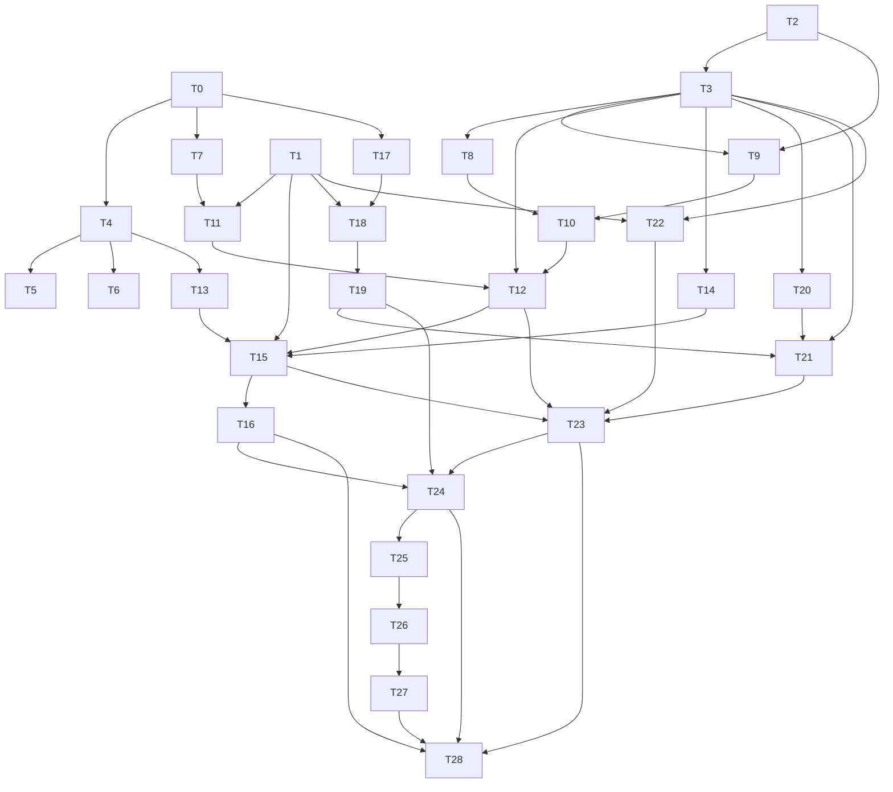

# Plan: agentj 工作台三栏布局 + Composer 选项 + 模型提问卡片（0.14.0）

## Agent Worker Instructions

- Required sub-skills: `superpowers:subagent-driven-development` (preferred) or `superpowers:executing-plans`
- Execution mode: `subagent-driven-development` — fresh subagent per task, review between tasks
- Required verification (every task): scoped suite `npm --prefix agentj-ui test --workspace=@agentj/web -- <test file>` + full `npm --prefix agentj-ui test --workspace=@agentj/web` + `npm --prefix agentj-ui run build --workspace=@agentj/web` (scoped vitest MUST run via the workspace script — `npx vitest` from repo root does not load the web vite config/jsdom)
- Required verification (milestone tasks T12/T23/T28): additionally `npm --prefix agentj-ui test --workspace=@agentj/sdk`, `cargo test --workspace -- --skip permission_request_notified`, `cargo clippy --workspace --all-targets -- -D warnings`, `cargo test -p agentj-protocol -- drift`, `bun --cwd agentj-ui/apps/tui test`, `./scripts/check-version.sh`
- Version bump: feature → minor `0.13.0 → 0.14.0`; `PROTOCOL_VERSION` stays `0.12.1`
- Language: task titles/ACs/code in English; UI copy strings MUST use the exact Chinese from `docs/design/three-column/preview-*.png`
- Scope: Phase 1 (UI with placeholder/half data) only — the Phase 2 protocol extension (`file/list`, `$/progress todo|file_change`, `$/askQuestion`) is a roadmap in the design spec and is NOT part of this plan

**Goal:** Refactor the Web workspace into a three-column workbench (Sessions/Files sidebar, conversation center, Run-details panel), add composer Model/Agent/Entropy popovers and an ask-question card, with a demo mode that makes the UI pixel-comparable to `docs/design/three-column/preview-01..08.png`.

**Architecture:** `palette.ts` gains radius/tint keys + a `LAYOUT` constant block (generated). A `layoutStore` owns all layout/composer/ask persistence. `WorkspaceShell` + `SplitPane` replace the naked `.aj-layout`; `RightPanel`/`TodoPanel`/`ChangeList` fill the third column with demo or `write`-derived half-data. Composer splits into `ComposerOptions`/`OptionPopover`; `AskQuestionCard` is demo-driven. Extra sidebar features migrate to a topbar `TopbarMenu`.

**Tech Stack:** Vite + React 19 + `@agentj/sdk` + `@agentj/tokens` + `lucide-react` (no new deps)

## Global Constraints

- No Rust crate / `packages/sdk` / `packages/protocol` changes except the `VERSION` string bump; `PROTOCOL_VERSION` frozen at `0.12.1`
- No new dependencies; pure CSS `components/*.css`, `lucide-react` only
- All colors via `var(--aj-*)`; no raw hex in component CSS; tints come from generated tokens
- Tokens single source: edit `packages/tokens/src/palette.ts` then `npm --prefix agentj-ui run generate --workspace=@agentj/tokens`; never hand-edit `tokens.css`
- CSS import order in `main.tsx`: `tokens.css` → `index.css` → `App.css` → `components/*.css`
- UI copy must match previews exactly (e.g. `搜索会话…`, `+ 新建会话`, `运行详情`, `任务`, `文件变更`, `已按此决定继续执行。`)
- Storage keys are additive: `agentj.layout.*`, `agentj.composer.*`, `agentj.ask.collapsed`, `agentj.demo`; existing keys never change meaning
- `prefers-reduced-motion` disables all transitions/animations in new CSS

---

### T0: Extend tokens with radius/tint keys and LAYOUT constants [P0] [Sequential]

```yaml
- id: T0
  title: "Extend palette with radius/tint keys and LAYOUT constants block"
  files:
    - agentj-ui/packages/tokens/src/palette.ts
    - agentj-ui/packages/tokens/src/palette.test.ts
    - agentj-ui/apps/web/src/components/scaffold.test.ts
  depends_on: []
  breaking: false
  ac:
    - given: "palette.ts SEMANTIC_KEYS is extended"
      when: "palette.test asserts SEMANTIC_KEYS"
      then: "it equals the 24-key list ending with textCaption,radiusCtl,radiusCard,accentTint,diffAddTint,diffDelTint"
    - given: "tokens are regenerated"
      when: "tokens.css is read"
      then: "it contains --aj-radiusCtl:8px --aj-radiusCard:12px --aj-accentTint:rgba(65,118,230,.10) in the light block and --aj-accentTint:rgba(103,158,254,.12) in the dark block"
    - given: "LAYOUT constants are exported"
      when: "tokens.css is read"
      then: "it contains --aj-leftWidth:256px --aj-rightWidth:320px --aj-splitterHit:7px --aj-topbarH:48px --aj-gap:12px in a single :root block"
    - given: "tokens.json regenerated"
      when: "palette.test parses tokens.json"
      then: "json.layout.leftWidth is 256px and json.dark.radiusCard is 12px"
    - given: "scaffold.test counts palette keys"
      when: "count regex includes the 5 new keys"
      then: "count is 24 (was 19)"
  regression:
    - "npm --prefix agentj-ui test --workspace=@agentj/tokens (palette.test.ts all other cases)"
    - "npm --prefix agentj-ui test --workspace=@agentj/web theme.test.ts still passes (index.css untouched here)"
  test_code: |
    // packages/tokens/src/palette.test.ts — update expected key list and add new assertions
    const expected = [
      "bg","sidebar","panel","raised","text","textMuted","accent","accentOnAccent",
      "userBubble","border","codeBg","inlineCodeBg","success","error","warning",
      "shadowSoft","shadowRaised","radiusXl","textCaption",
      "radiusCtl","radiusCard","accentTint","diffAddTint","diffDelTint",
    ];
    it("emits radius and tint tokens into tokens.css", () => {
      expect(css).toContain("--aj-radiusCtl:8px");
      expect(css).toContain("--aj-radiusCard:12px");
      expect(css).toContain("--aj-accentTint:rgba(65,118,230,.10)");
      expect(css).toContain("--aj-diffAddTint:rgba(34,197,94,.14)");
      expect(css).toContain("--aj-diffDelTint:rgba(236,19,19,.10)");
    });
    it("emits LAYOUT constants once in :root", () => {
      expect(css).toContain("--aj-leftWidth:256px");
      expect(css).toContain("--aj-leftMin:200px");
      expect(css).toContain("--aj-rightWidth:320px");
      expect(css).toContain("--aj-splitterHit:7px");
      expect(css).toContain("--aj-topbarH:48px");
      expect(css).toContain("--aj-gap:12px");
    });
    it("mirrors LAYOUT in tokens.json", () => {
      const parsed = JSON.parse(json);
      expect(parsed.layout.leftWidth).toBe("256px");
      expect(parsed.dark.radiusCard).toBe("12px");
      expect(parsed.light.radiusCtl).toBe("8px");
    });
    // apps/web/src/components/scaffold.test.ts — bump palette key count 19 -> 24
    const count = (palette.match(/"(bg|sidebar|panel|raised|text|textMuted|accent|accentOnAccent|userBubble|border|codeBg|inlineCodeBg|success|error|warning|shadowSoft|shadowRaised|radiusXl|textCaption|radiusCtl|radiusCard|accentTint|diffAddTint|diffDelTint)"/g) ?? []).length;
    expect(count).toBe(24);
  impl_code: |
    // palette.ts
    // 1) append to SEMANTIC_KEYS: "radiusCtl","radiusCard","accentTint","diffAddTint","diffDelTint"
    // 2) light: radiusCtl:"8px", radiusCard:"12px", accentTint:"rgba(65,118,230,.10)",
    //    diffAddTint:"rgba(34,197,94,.14)", diffDelTint:"rgba(236,19,19,.10)"
    // 3) dark: radiusCtl:"8px", radiusCard:"12px", accentTint:"rgba(103,158,254,.12)",
    //    diffAddTint:"rgba(34,197,94,.12)", diffDelTint:"rgba(242,90,90,.12)"
    // 4) export const LAYOUT = { leftWidth:"256px", leftMin:"200px", leftMax:"420px",
    //    rightWidth:"320px", rightMin:"260px", rightMax:"480px",
    //    splitterHit:"7px", topbarH:"48px", gap:"12px" } as const;
    // 5) tokensCss(): :root { lightVars + layoutVars } where layoutVars = Object.entries(LAYOUT)
    //    .map(([k,v]) => `--aj-${k}:${v}`).join(";") + ";"
    // 6) tokensJson(): JSON.stringify({ ...palettes, layout: LAYOUT }, null, 2)
    // 7) tokensMarkdown(): append a `layout` table after the token table
  verify:
    - "npm --prefix agentj-ui run generate --workspace=@agentj/tokens"
    - "npm --prefix agentj-ui test --workspace=@agentj/tokens"
    - "npm --prefix agentj-ui test --workspace=@agentj/web"
    - "git status --short agentj-ui/packages/tokens  # tokens.css/json/md regenerated and staged with the task"
```

### T1: Create layoutStore for layout/composer/ask/favorites persistence [P0] [Sequential]

```yaml
- id: T1
  title: "Create layoutStore with layout, composer, ask and favorites persistence"
  files:
    - agentj-ui/apps/web/src/layoutStore.ts
    - agentj-ui/apps/web/src/layoutStore.test.ts
  depends_on: []
  breaking: false
  ac:
    - given: "localStorage is empty"
      when: "loadLayout() is called"
      then: "returns {leftWidth:256, rightWidth:320, leftTab:'sessions', rightCollapsed:false}"
    - given: "agentj.layout.leftWidth stores 999 (out of range)"
      when: "loadLayout() is called"
      then: "leftWidth clamps to 420"
    - given: "agentj.layout.leftWidth stores 'abc'"
      when: "loadLayout() is called"
      then: "falls back to 256 without throwing"
    - given: "saveLayout({leftWidth:300}) is called"
      when: "loadLayout() is called"
      then: "returns leftWidth 300 and agentj.layout.leftWidth is '300'"
    - given: "a subscriber is registered via subscribeLayout"
      when: "saveLayout is called"
      then: "the subscriber fires once with the merged state"
    - given: "agentj.composer.entropy stores 9 and agent stores 'bogus'"
      when: "loadComposerPrefs() is called"
      then: "entropy clamps to 2 and agent falls back to 'build'"
    - given: "agentj.ask.collapsed stores '1'"
      when: "loadAskCollapsed() is called"
      then: "returns true"
    - given: "favorites stored as ['a']"
      when: "toggleFavorite('a') then toggleFavorite('b')"
      then: "list becomes ['b'] then ['a','b'] and agentj.favorites is persisted"
    - given: "another tab writes agentj.layout.leftWidth=999"
      when: "a storage event for that key fires"
      then: "subscribeLayout consumers receive a re-read state clamped to 420 without throwing"
  regression:
    - "npm --prefix agentj-ui test --workspace=@agentj/web projectStore.test.ts unchanged"
  test_code: |
    import { loadLayout, saveLayout, subscribeLayout, loadComposerPrefs, saveComposerPrefs,
             loadAskCollapsed, saveAskCollapsed, loadFavorites, toggleFavorite } from "./layoutStore";
    beforeEach(() => localStorage.clear());
    test("defaults and clamps", () => {
      expect(loadLayout()).toEqual({ leftWidth: 256, rightWidth: 320, leftTab: "sessions", rightCollapsed: false });
      localStorage.setItem("agentj.layout.leftWidth", "999");
      expect(loadLayout().leftWidth).toBe(420);
      localStorage.setItem("agentj.layout.leftWidth", "abc");
      expect(loadLayout().leftWidth).toBe(256);
      localStorage.setItem("agentj.layout.rightWidth", "100");
      expect(loadLayout().rightWidth).toBe(260);
    });
    test("roundtrip, invalid leftTab fallback and events", () => {
      const seen: unknown[] = [];
      const unsub = subscribeLayout((s) => seen.push(s));
      saveLayout({ leftWidth: 300 });
      expect(loadLayout().leftWidth).toBe(300);
      expect(seen.length).toBe(1);
      localStorage.setItem("agentj.layout.leftTab", "bogus");
      expect(loadLayout().leftTab).toBe("sessions");
      unsub();
    });
    test("composer prefs clamp and enum fallback", () => {
      localStorage.setItem("agentj.composer.entropy", "9");
      localStorage.setItem("agentj.composer.agent", "bogus");
      const p = loadComposerPrefs();
      expect(p.entropy).toBe(2);
      expect(p.agent).toBe("build");
      saveComposerPrefs({ entropy: 1.2, agent: "plan" });
      expect(loadComposerPrefs().entropy).toBe(1.2);
      expect(loadComposerPrefs().agent).toBe("plan");
    });
    test("ask collapsed and favorites toggle", () => {
      expect(loadAskCollapsed()).toBe(false);
      saveAskCollapsed(true);
      expect(loadAskCollapsed()).toBe(true);
      localStorage.setItem("agentj.favorites", JSON.stringify(["a"]));
      toggleFavorite("a");
      expect(loadFavorites()).toEqual([]);
      toggleFavorite("b");
      expect(loadFavorites()).toEqual(["b"]);
    });
    test("storage events re-read with clamping", () => {
      const seen: { leftWidth: number }[] = [];
      const unsub = subscribeLayout((s) => seen.push(s as { leftWidth: number }));
      localStorage.setItem("agentj.layout.leftWidth", "999");
      window.dispatchEvent(new StorageEvent("storage", { key: "agentj.layout.leftWidth", newValue: "999" }));
      expect(seen.at(-1)?.leftWidth).toBe(420);
      unsub();
    });
  impl_code: |
    // layoutStore.ts — mirrors projectStore.ts patterns (safeParse + try/catch + defaults)
    // export const LAYOUT_LIMITS = { leftMin:200, leftMax:420, rightMin:260, rightMax:480 } as const;
    // export type LayoutState = { leftWidth:number; rightWidth:number; leftTab:"sessions"|"files"; rightCollapsed:boolean };
    // export type ComposerPrefs = { model:string|null; agent:"build"|"plan"|"explore"; entropy:number };
    // loadLayout(): read 4 keys; Number() guard; clamp; invalid leftTab -> "sessions"; rightCollapsed -> boolean
    // saveLayout(patch): merge with loadLayout(); setItem 4 keys; window.dispatchEvent(new CustomEvent("agentj:layout-updated"))
    // subscribeLayout(cb): addEventListener "agentj:layout-updated" + "storage"; returns unsubscribe that removes both
    // loadComposerPrefs()/saveComposerPrefs(): keys agentj.composer.model|agent|entropy; agent enum validated; entropy clamp 0..2 default 0.7
    // loadAskCollapsed()/saveAskCollapsed(): key agentj.ask.collapsed, "1" -> true
    // loadFavorites()/saveFavorites()/toggleFavorite(): reuse key agentj.favorites (string[] validation)
  verify:
    - "npm --prefix agentj-ui test --workspace=@agentj/web -- src/layoutStore.test.ts"
    - "npm --prefix agentj-ui test --workspace=@agentj/web"
    - "npm --prefix agentj-ui run build --workspace=@agentj/web"
```

### T2: Derive file-change rows from write tool_call frames [P0] [Sequential]

```yaml
- id: T2
  title: "Create changes.ts deriving file-change rows from write tool_call frames"
  files:
    - agentj-ui/apps/web/src/changes.ts
    - agentj-ui/apps/web/src/changes.test.ts
  depends_on: []
  breaking: false
  ac:
    - given: "an empty change list and a write frame {path:'a.ts', content:'x\\ny'}"
      when: "applyProgressChanges([], frame) is called"
      then: "returns [{path:'a.ts', op:'add', additions:2, deletions:null, diff:null, toolCallId:'c1'}]"
    - given: "a.ts already present with op add"
      when: "another write frame for a.ts arrives"
      then: "op becomes 'modify' and additions update, list length stays 1"
    - given: "a tool_call frame with name 'read'"
      when: "applyProgressChanges is called"
      then: "returns the previous list unchanged"
    - given: "a write tool_call with malformed arguments (no path or content)"
      when: "applyProgressChanges is called"
      then: "returns the previous list unchanged without throwing"
    - given: "a non-tool_call frame"
      when: "applyProgressChanges is called"
      then: "returns the previous list unchanged"
  regression:
    - "npm --prefix agentj-ui test --workspace=@agentj/web RunPanel.test.tsx reduceRunFeed still passes"
  test_code: |
    import { applyProgressChanges, type FileChangeRow } from "./changes";
    const write = (path: string, content: string) =>
      ({ kind: "tool_call", id: "c1", name: "write", arguments: { path, content } });
    test("add then modify", () => {
      let rows: FileChangeRow[] = [];
      rows = applyProgressChanges(rows, write("a.ts", "x\ny"));
      expect(rows).toEqual([{ path: "a.ts", op: "add", additions: 2, deletions: null, diff: null, toolCallId: "c1" }]);
      rows = applyProgressChanges(rows, write("a.ts", "x\ny\nz"));
      expect(rows.length).toBe(1);
      expect(rows[0].op).toBe("modify");
      expect(rows[0].additions).toBe(3);
    });
    test("ignores non-write, malformed and non-tool frames", () => {
      const rows = applyProgressChanges([], write("a.ts", "1"));
      expect(applyProgressChanges(rows, { kind: "tool_call", id: "c2", name: "read", arguments: { path: "a.ts" } })).toBe(rows);
      expect(applyProgressChanges(rows, { kind: "tool_call", id: "c3", name: "write", arguments: {} })).toBe(rows);
      expect(applyProgressChanges(rows, { kind: "text", text: "hi" })).toBe(rows);
    });
  impl_code: |
    // changes.ts
    // export type FileChangeRow = { path:string; op:"add"|"modify"|"delete";
    //   additions:number; deletions:number|null; diff:string|null; toolCallId:string|null };
    // export function applyProgressChanges(prev: FileChangeRow[], frame: unknown): FileChangeRow[] {
    //   narrow frame to {kind:"tool_call", name:"write", id, arguments:{path,content}} via
    //   typeof checks; on mismatch return prev (identity, no copy);
    //   additions = content.split("\n").length; op = prev.some(path) ? "modify" : "add";
    //   upsert row; deletions/diff stay null (protocol gap: not derivable)
    // }
  verify:
    - "npm --prefix agentj-ui test --workspace=@agentj/web -- src/changes.test.ts"
    - "npm --prefix agentj-ui test --workspace=@agentj/web"
```

### T3: Create demoData module gated by agentj.demo or ?demo=1 [P0] [Sequential after T2]

```yaml
- id: T3
  title: "Create demoData module with preview-matching fixtures and a demo switch"
  files:
    - agentj-ui/apps/web/src/demoData.ts
    - agentj-ui/apps/web/src/demoData.test.ts
  depends_on: [T2]
  breaking: false
  ac:
    - given: "localStorage is empty and URL has no ?demo=1"
      when: "isDemoEnabled() is called"
      then: "returns false"
    - given: "localStorage agentj.demo is '1'"
      when: "isDemoEnabled() is called"
      then: "returns true"
    - given: "?demo=1 in the URL"
      when: "isDemoEnabled() is called"
      then: "returns true even if localStorage is unset"
    - given: "a subscriber registered via subscribeDemo"
      when: "setDemoEnabled(true) is called"
      then: "subscriber fires with true and agentj.demo persisted"
    - given: "DEMO_TODOS / DEMO_FILE_TREE / DEMO_CHANGES / DEMO_QUESTION are imported"
      when: "their shapes are inspected"
      then: "todos have 4 items with statuses done/done/progress/todo; changes include SplitPane.tsx +86 add and App.tsx modify with a non-null diff; question has 3 options with hint on the second"
  regression:
    - "npm --prefix agentj-ui test --workspace=@agentj/web projectStore.test.ts unchanged"
  test_code: |
    import { isDemoEnabled, setDemoEnabled, subscribeDemo, DEMO_TODOS, DEMO_CHANGES, DEMO_QUESTION } from "./demoData";
    beforeEach(() => { localStorage.clear(); window.history.replaceState(null, "", "/"); });
    test("gate precedence", () => {
      expect(isDemoEnabled()).toBe(false);
      localStorage.setItem("agentj.demo", "1");
      expect(isDemoEnabled()).toBe(true);
      localStorage.clear();
      window.history.replaceState(null, "", "/?demo=1");
      expect(isDemoEnabled()).toBe(true);
    });
    test("setDemoEnabled persists and notifies", () => {
      const seen: boolean[] = [];
      const unsub = subscribeDemo((v) => seen.push(v));
      setDemoEnabled(true);
      expect(localStorage.getItem("agentj.demo")).toBe("1");
      expect(seen).toEqual([true]);
      unsub();
    });
    test("fixtures match preview states", () => {
      expect(DEMO_TODOS.map((t) => t.status)).toEqual(["completed", "completed", "in_progress", "pending"]);
      expect(DEMO_CHANGES.find((c) => c.path === "SplitPane.tsx")?.additions).toBe(86);
      expect(DEMO_CHANGES.find((c) => c.path === "App.tsx")?.diff).toContain("SplitPane");
      expect(DEMO_QUESTION.options[1].hint).toBe("推荐");
    });
  impl_code: |
    // demoData.ts
    // export type TodoItem = { id:string; content:string; status:"pending"|"in_progress"|"completed"|"cancelled" };
    // export type FileNode = { name:string; path:string; kind:"file"|"dir"; git?: "M"|"A"|"U"|"D"|null; children?: FileNode[] };
    //   (single source of the tree type — FileTree in T14 imports it)
    // export DEMO_CHANGES typed as FileChangeRow[] (import the type from ./changes)
    // isDemoEnabled(): ?demo=1 via new URLSearchParams(window.location.search) (guarded) OR localStorage agentj.demo==="1"
    // setDemoEnabled(v): setItem; dispatch CustomEvent("agentj:demo-updated", {detail:v})
    // subscribeDemo(cb): listener for "agentj:demo-updated" + "storage"; returns unsubscribe
    // Fixtures copied from docs/design/three-column/preview-01..08:
    //   DEMO_TODOS: 解析现有 App 布局/completed, 定义三栏 grid 与宽度 token/completed,
    //               实现 SplitPane 拖拽与持久化/in_progress, 补充响应式与键盘可达性/pending
    //   DEMO_FILE_TREE: agentj -> agentj-ui/apps/web/src/App.tsx(M) UnifiedSidebar.tsx(A) RunPanel.tsx(A)... + crates/main.rs(U) + README.md
    //   DEMO_CHANGES: SplitPane.tsx +86 新增; App.tsx +24 -6 修改 (diff with ± lines); tokens/palette.ts +3 -1 修改
    //   DEMO_QUESTION: 请选择本次重构的范围？ options 仅前端三栏布局 / 三栏 + 协议扩展(推荐) / 全部（含 TUI）(范围较大)
    //   DEMO_QA_RECORD: 是否同时更新 TUI？ -> 暂时不动 TUI + 已按此决定继续执行。
  verify:
    - "npm --prefix agentj-ui test --workspace=@agentj/web -- src/demoData.test.ts"
    - "npm --prefix agentj-ui test --workspace=@agentj/web"
```

### T4: Align web index.css and theme gate with generated tokens [P0] [After T0]

```yaml
- id: T4
  title: "Remove kebab radius defs from index.css and assert generated camel tokens"
  files:
    - agentj-ui/apps/web/src/index.css
    - agentj-ui/apps/web/src/theme.test.ts
    - agentj-ui/apps/web/src/components/scaffold.test.ts
  depends_on: [T0]
  breaking: false
  ac:
    - given: "index.css no longer defines --aj-radius-card/--aj-radius-ctl/--aj-gap"
      when: "theme.test reads index.css"
      then: "index.css does not contain '--aj-radius-ctl' or '--aj-radius-card' and still contains --aj-motion/--aj-font/--aj-space-3; both --aj-gap assertions in theme.test.ts (the regexp at ~line 79 and the generic match at ~line 84) plus scaffold.test.ts are updated to the generated-token form"
    - given: "tokens.css is generated with camel radius vars"
      when: "theme.test reads packages/tokens/tokens.css"
      then: "it contains --aj-radiusCtl:8px and --aj-radiusCard:12px"
    - given: "the test run"
      when: "vitest executes"
      then: "all previous theme.test cases (import order, data-theme, accentOnAccent) still pass, with the stale --aj-gap assertion updated to the generated-token form"
    - given: "scaffold.test.ts asserted index.css density vars"
      when: "the task lands"
      then: "its --aj-gap assertion is removed from the index.css case and replaced by an assertion that packages/tokens/tokens.css contains --aj-gap:12px"
  regression:
    - "npm --prefix agentj-ui test --workspace=@agentj/web theme.test.ts (all original cases)"
    - "npm --prefix agentj-ui test --workspace=@agentj/tokens"
  test_code: |
    // theme.test.ts — replace the "exposes radius..." case and add generated-token case
    it("exposes radius, motion and easing design tokens", () => {
      expect(indexCss).not.toContain("--aj-radius-ctl");
      expect(indexCss).not.toContain("--aj-radius-card");
      expect(indexCss).toContain("cubic-bezier(0.4,0,0.2,1)");
      const tokens = readFileSync(join(process.cwd(), "..", "..", "packages/tokens/tokens.css"), "utf8");
      expect(tokens).toContain("--aj-radiusCtl:8px");
      expect(tokens).toContain("--aj-radiusCard:12px");
    });
    it("keeps layout constants single-sourced in tokens.css", () => {
      expect(indexCss).not.toMatch(/--aj-gap:\s*12px/);
    });
    // theme.test.ts — ALSO update the existing "T0 sidebar width and density vars" describe:
    //   drop `expect(indexCss).toMatch(/--aj-gap:\s*12px/)` (keep --aj-sidebar-width 256px + shadow asserts)
    //   AND drop the generic `expect(indexCss).toMatch(/--aj-gap/)` in `it("density vars present")`
    //   (or repoint it at packages/tokens/tokens.css) — otherwise the suite fails after --aj-gap moves
    // scaffold.test.ts — in its "density vars present" case remove the `--aj-gap` assertion on index.css,
    //   and instead read packages/tokens/tokens.css via join(webRoot, "../../packages/tokens/tokens.css")
    //   asserting it contains "--aj-gap:12px"
  impl_code: |
    // index.css — delete lines: --aj-radius-card: 10px; --aj-radius-ctl: 6px; --aj-gap: 12px;
    // (they now come from generated tokens.css :root block; keep all other vars untouched)
    // theme.test.ts — update both cases in "T0 sidebar width and density vars": drop the /--aj-gap:\s*12px/ match
    //   and the generic /--aj-gap/ match in "density vars present" (repoint at tokens.css or remove)
    // scaffold.test.ts — update the "density vars present" case (drop the index.css --aj-gap match;
    //   assert --aj-gap now lives in packages/tokens/tokens.css)
  verify:
    - "npm --prefix agentj-ui run generate --workspace=@agentj/tokens"
    - "npm --prefix agentj-ui test --workspace=@agentj/web -- src/theme.test.ts"
    - "npm --prefix agentj-ui test --workspace=@agentj/web"
```

### T5: Migrate radius references in untouched component CSS batch A [P1] [After T4]

```yaml
- id: T5
  title: "Migrate radius token references to camelCase in connection/session/dialog CSS"
  files:
    - agentj-ui/apps/web/src/components/connection.css
    - agentj-ui/apps/web/src/components/session.css
    - agentj-ui/apps/web/src/components/dialog.css
  depends_on: [T4]
  breaking: false
  ac:
    - given: "the three CSS files are migrated"
      when: "the guard script runs"
      then: "zero --aj-radius-ctl/--aj-radius-card occurrences remain and each former kebab declaration uses var(--aj-radiusCtl)"
    - given: "rule coverage is unchanged"
      when: "a diff is reviewed"
      then: "no selector or declaration other than the radius token name is modified (verified refs: connection.css:48, session.css:39, dialog.css:45 all var(--aj-radius-ctl))"

  regression:
    - "npm --prefix agentj-ui test --workspace=@agentj/web ConnectionBar.test.tsx + ApprovalDialog.test.tsx"
  test_code: |
    # Executable guard (must fail before the rename, pass after) — run exactly as shown in verify
    node -e "const fs=require('fs');const files=['agentj-ui/apps/web/src/components/connection.css','agentj-ui/apps/web/src/components/session.css','agentj-ui/apps/web/src/components/dialog.css'];for(const f of files){if(/--aj-radius-(ctl|card)/.test(fs.readFileSync(f,'utf8'))){console.error('kebab ref remains: '+f);process.exit(1)}}console.log('radius-migration-ok')"
  impl_code: |
    // Mechanical token renames at the verified lines (values come from palette; the global radius move is 6px -> 8px ctl / 10px -> 12px card):
    // connection.css:48  var(--aj-radius-ctl)  -> var(--aj-radiusCtl)
    // session.css:39     var(--aj-radius-ctl)  -> var(--aj-radiusCtl)
    // dialog.css:45      var(--aj-radius-ctl)  -> var(--aj-radiusCtl)
  verify:
    - "node -e \"const fs=require('fs');const files=['agentj-ui/apps/web/src/components/connection.css','agentj-ui/apps/web/src/components/session.css','agentj-ui/apps/web/src/components/dialog.css'];for(const f of files){if(/--aj-radius-(ctl|card)/.test(fs.readFileSync(f,'utf8'))){console.error('kebab ref remains: '+f);process.exit(1)}}console.log('radius-migration-ok')\""
    - "npm --prefix agentj-ui test --workspace=@agentj/web"
    - "npm --prefix agentj-ui run build --workspace=@agentj/web"
```

### T6: Migrate radius references in untouched component CSS batch B [P1] [After T4]

```yaml
- id: T6
  title: "Migrate app/conversation CSS radius refs and hero radiusXl hardcode"
  files:
    - agentj-ui/apps/web/src/App.css
    - agentj-ui/apps/web/src/components/conversation.css
    - agentj-ui/apps/web/src/components/hero.css
  depends_on: [T4]
  breaking: false
  ac:
    - given: "the three files are migrated"
      when: "the guard script runs"
      then: "zero kebab radius refs remain in App.css and conversation.css, and each former ref uses var(--aj-radiusCtl)/var(--aj-radiusCard)"
    - given: "hero.css rounds the empty-state card"
      when: "hero.css is read"
      then: "border-radius uses var(--aj-radiusXl) and no 'border-radius: 22px' declaration remains (the line-38 comment may keep its wording; the guard matches declarations only)"
    - given: "assistant inline code inside .aj-ai"
      when: "conversation.css is read"
      then: "it styles inline code with background var(--aj-inlineCodeBg) and border-radius var(--aj-radiusCtl)"
  regression:
    - "npm --prefix agentj-ui test --workspace=@agentj/web Trajectory.test.tsx"
  test_code: |
    # Executable guard (must fail before, pass after) — run exactly as shown in verify
    node -e "const fs=require('fs');const files=['agentj-ui/apps/web/src/App.css','agentj-ui/apps/web/src/components/conversation.css'];for(const f of files){if(/--aj-radius-(ctl|card)/.test(fs.readFileSync(f,'utf8'))){console.error('kebab ref remains: '+f);process.exit(1)}}if(/border-radius: ?22px/.test(fs.readFileSync('agentj-ui/apps/web/src/components/hero.css','utf8'))){console.error('hero.css still hardcodes border-radius 22px');process.exit(1)}console.log('radius-migration-ok')"
  impl_code: |
    // App.css:4,19            var(--aj-radius-ctl)  -> var(--aj-radiusCtl)
    // conversation.css:50     var(--aj-radius-card) -> var(--aj-radiusCard)
    // hero.css:41,52          border-radius: 22px   -> var(--aj-radiusXl)
    // conversation.css        add inline-code rule for assistant text: .aj-ai code { background: var(--aj-inlineCodeBg);
    //                         border:0.5px solid var(--aj-border); border-radius: var(--aj-radiusCtl); padding:1px 6px; font-size:11.5px; }
  verify:
    - "node -e \"const fs=require('fs');const files=['agentj-ui/apps/web/src/App.css','agentj-ui/apps/web/src/components/conversation.css'];for(const f of files){if(/--aj-radius-(ctl|card)/.test(fs.readFileSync(f,'utf8'))){console.error('kebab ref remains: '+f);process.exit(1)}}if(/border-radius: ?22px/.test(fs.readFileSync('agentj-ui/apps/web/src/components/hero.css','utf8'))){console.error('hero.css still hardcodes border-radius 22px');process.exit(1)}console.log('radius-migration-ok')\""
    - "npm --prefix agentj-ui test --workspace=@agentj/web"
    - "npm --prefix agentj-ui run build --workspace=@agentj/web"
```

### T7: Create SplitPane (drag, keyboard, reset, separator a11y) [P0] [After T0]

```yaml
- id: T7
  title: "Create SplitPane component with drag, keyboard and reset interactions"
  files:
    - agentj-ui/apps/web/src/components/SplitPane.tsx
    - agentj-ui/apps/web/src/components/split.css
    - agentj-ui/apps/web/src/components/splitPane.test.tsx
  depends_on: [T0]
  breaking: false
  ac:
    - given: "a left SplitPane at width 256"
      when: "ArrowRight pressed"
      then: "onResize fires with 264 (side-aware: right separator reverses arrows)"
    - given: "Shift+ArrowRight pressed"
      when: "the handler runs"
      then: "onResize fires with width+32"
    - given: "Home pressed"
      when: "the handler runs"
      then: "onReset fires"
    - given: "the separator is focused and Enter pressed on a right-side pane"
      when: "onToggleCollapse is provided"
      then: "onToggleCollapse fires (left side ignores Enter/Space)"
    - given: "a pointer drag from x=100 to x=130 on a left separator"
      when: "pointerup fires"
      then: "onResize received 286 during the move and onCommit fires once with the final width (persistence is commit-based)"
    - given: "a drag beyond max"
      when: "pointermove to x=900"
      then: "onResize clamps at 420"
    - given: "a pointercancel mid-drag"
      when: "the cancel handler runs"
      then: "onResize restores the pre-drag width and onCommit never fires"
    - given: "the separator element"
      when: "attributes are inspected"
      then: "role=separator aria-orientation=vertical tabIndex=0 aria-valuenow/min/max present and aria-valuenow equals width"
  regression:
    - "npm --prefix agentj-ui test --workspace=@agentj/web theme.test.ts"
  test_code: |
    import { render, fireEvent } from "@testing-library/react";
    import SplitPane from "./SplitPane";
    test("keyboard resize, reset and aria", () => {
      const onResize = vi.fn(); const onReset = vi.fn();
      const { getByRole } = render(<SplitPane side="left" width={256} min={200} max={420} defaultWidth={256} onResize={onResize} onReset={onReset} />);
      const sep = getByRole("separator");
      expect(sep).toHaveAttribute("aria-valuenow", "256");
      expect(sep).toHaveAttribute("aria-valuemin", "200");
      fireEvent.keyDown(sep, { key: "ArrowRight" });
      expect(onResize).toHaveBeenLastCalledWith(264);
      fireEvent.keyDown(sep, { key: "ArrowRight", shiftKey: true });
      expect(onResize).toHaveBeenLastCalledWith(288);
      fireEvent.keyDown(sep, { key: "Home" });
      expect(onReset).toHaveBeenCalled();
      fireEvent.doubleClick(sep);
      expect(onReset).toHaveBeenCalledTimes(2);
    });
    test("pointer drag clamps to max", () => {
      const onResize = vi.fn();
      const { getByRole } = render(<SplitPane side="left" width={256} min={200} max={420} defaultWidth={256} onResize={onResize} onReset={() => {}} />);
      const sep = getByRole("separator") as HTMLElement;
      (sep as HTMLElement & { setPointerCapture?: unknown }).setPointerCapture = () => {};
      fireEvent.pointerDown(sep, { clientX: 100, pointerId: 1 });
      fireEvent.pointerMove(sep, { clientX: 130, pointerId: 1 });
      expect(onResize).toHaveBeenLastCalledWith(286);
      fireEvent.pointerMove(sep, { clientX: 900, pointerId: 1 });
      expect(onResize).toHaveBeenLastCalledWith(420);
      fireEvent.pointerUp(sep, { pointerId: 1 });
    });
    test("commit on pointerup and restore on pointercancel", () => {
      const onResize = vi.fn(); const onCommit = vi.fn();
      const { getByRole } = render(<SplitPane side="left" width={256} min={200} max={420} defaultWidth={256} onResize={onResize} onCommit={onCommit} onReset={() => {}} />);
      const sep = getByRole("separator") as HTMLElement;
      (sep as HTMLElement & { setPointerCapture?: unknown }).setPointerCapture = () => {};
      fireEvent.pointerDown(sep, { clientX: 100, pointerId: 1 });
      fireEvent.pointerMove(sep, { clientX: 130, pointerId: 1 });
      fireEvent.pointerUp(sep, { pointerId: 1 });
      expect(onCommit).toHaveBeenCalledTimes(1);
      expect(onCommit).toHaveBeenLastCalledWith(286);
      fireEvent.pointerDown(sep, { clientX: 200, pointerId: 2 });
      fireEvent.pointerMove(sep, { clientX: 260, pointerId: 2 });
      fireEvent.pointerCancel(sep, { pointerId: 2 });
      expect(onResize).toHaveBeenLastCalledWith(256);
      expect(onCommit).toHaveBeenCalledTimes(1);
    });
    test("right side Enter toggles collapse and arrows reverse", () => {
      const onResize = vi.fn(); const onToggleCollapse = vi.fn();
      const { getByRole } = render(<SplitPane side="right" width={320} min={260} max={480} defaultWidth={320} onResize={onResize} onReset={() => {}} onToggleCollapse={onToggleCollapse} />);
      const sep = getByRole("separator");
      fireEvent.keyDown(sep, { key: "ArrowLeft" });
      expect(onResize).toHaveBeenLastCalledWith(328);
      fireEvent.keyDown(sep, { key: "Enter" });
      expect(onToggleCollapse).toHaveBeenCalled();
    });
  impl_code: |
    // SplitPane.tsx — controlled component; props { side, width, min, max, defaultWidth, collapsed?, onResize, onCommit?, onReset, onToggleCollapse? }
    //   internal dragStart ref {x, width}
    // pointerdown: capture (el.setPointerCapture?.(id) guarded), record start; pointermove: dx = e.clientX - start.x;
    //   next = clamp(start.width + (side==="left" ? dx : -dx), min, max); onResize(next);
    // pointerup: onCommit?.(last next ?? width); clear dragStart;
    // pointercancel: onResize(start.width) restore pre-drag width; clear dragStart; never commit
    // keydown: ArrowLeft/ArrowRight delta 8 (shift 32), left: ArrowRight=+, right: ArrowLeft=+; after onResize also onCommit?.(next);
    //   Home -> onReset; Enter/Space -> side==="right" && onToggleCollapse?.()
    // render: <div className="aj-splitter" data-side={side} role="separator" aria-orientation="vertical"
    //   tabIndex={0} aria-label={side==="left" ? "调整左栏宽度" : "调整右栏宽度"}
    //   aria-valuenow={width} aria-valuemin={min} aria-valuemax={max} onPointerDown onPointerMove onPointerUp onPointerCancel onDoubleClick onKeyDown>
    //   <span className="aj-splitter__line" /><span className="aj-splitter__grip" aria-hidden="true"><i/><i/><i/></span></div>
    // split.css — .aj-splitter { width: var(--aj-splitterHit); flex: 0 0 auto; cursor: col-resize; touch-action: none;
    //   display:flex; align-items:center; justify-content:center; position:relative; background: var(--aj-bg); }
    //   .aj-splitter__line { width:1px; height:100%; background: var(--aj-border); }
    //   .aj-splitter__grip { position:absolute; display:flex; flex-direction:column; gap:3px; opacity:.6; }
    //   .aj-splitter__grip i { width:2px; height:2px; border-radius:50%; background: var(--aj-textCaption); }
    //   hover/drag: .aj-splitter:hover .aj-splitter__line, [data-dragging="true"] .aj-splitter__line { background: var(--aj-accent); }
    //   focus-visible outline via index.css; @media (prefers-reduced-motion: reduce) { .aj-splitter * { transition:none; } }
  verify:
    - "npm --prefix agentj-ui test --workspace=@agentj/web -- src/components/splitPane.test.tsx"
    - "npm --prefix agentj-ui test --workspace=@agentj/web"
    - "npm --prefix agentj-ui run build --workspace=@agentj/web"
```

### T8: Create TodoPanel with status pills and empty state [P0] [After T3]

```yaml
- id: T8
  title: "Create TodoPanel with checkbox states, status pills and protocol-gap empty state"
  files:
    - agentj-ui/apps/web/src/components/TodoPanel.tsx
    - agentj-ui/apps/web/src/components/todoPanel.test.tsx
  depends_on: [T3]
  breaking: false
  ac:
    - given: "4 demo todos (2 completed, 1 in_progress, 1 pending)"
      when: "TodoPanel renders"
      then: "counter shows '2 / 4' and status pills read 已完成 / 进行中 / 待办"
    - given: "a completed todo"
      when: "its checkbox is inspected"
      then: "it renders a check mark with class cb done and is disabled (read-only in phase 1)"
    - given: "an in_progress todo"
      when: "rendered"
      then: "checkbox has class cb prog with a pulsing dot child"
    - given: "items is an empty array"
      when: "TodoPanel renders"
      then: "shows the text 待协议支持 and no counter digits"
  regression:
    - "npm --prefix agentj-ui test --workspace=@agentj/web demoData.test.ts"
  test_code: |
    import { render, screen } from "@testing-library/react";
    import TodoPanel from "./TodoPanel";
    test("renders counter, pill states and rows", () => {
      const items = [
        { id: "1", content: "解析现有 App 布局", status: "completed" as const },
        { id: "2", content: "定义三栏 grid 与宽度 token", status: "completed" as const },
        { id: "3", content: "实现 SplitPane 拖拽与持久化", status: "in_progress" as const },
        { id: "4", content: "补充响应式与键盘可达性", status: "pending" as const },
      ];
      const { container } = render(<TodoPanel items={items} />);
      expect(screen.getByText("2 / 4")).toBeInTheDocument();
      expect(screen.getByText("已完成")).toBeInTheDocument();
      expect(screen.getByText("进行中")).toBeInTheDocument();
      expect(screen.getByText("待办")).toBeInTheDocument();
      expect(container.querySelectorAll(".aj-todo .cb.done").length).toBe(2);
      expect(container.querySelectorAll(".aj-todo .cb.prog").length).toBe(1);
    });
    test("empty state shows protocol gap notice", () => {
      render(<TodoPanel items={[]} />);
      expect(screen.getByText("待协议支持")).toBeInTheDocument();
    });
  impl_code: |
    // TodoPanel.tsx — props { items: TodoItem[] } (TodoItem from demoData.ts)
    // count = items.filter(status==="completed").length
    // header: <div className="sec-head"><span>任务</span><span className="count">{count} / {items.length}</span></div>
    // rows: <div className="aj-todo"><span className={`cb ${cls}`}>{done ? "✓" : ""}</span>
    //   <span className="todo-label">{content}</span><span className={`pill-st ${st}`}>{label}</span></div>
    // classes: done->cb done + pill-st done; in_progress->cb prog + pill-st prog; pending->cb pending + pill-st todo;
    //   cancelled (possible protocol value) renders with pending styling + label 已取消, no crash
    // empty: <p className="aj-empty">待协议支持</p>（无计数）
    // styles live in rightpanel.css (T10)
  verify:
    - "npm --prefix agentj-ui test --workspace=@agentj/web -- src/components/todoPanel.test.tsx"
    - "npm --prefix agentj-ui test --workspace=@agentj/web"
```

### T9: Create ChangeList with expandable unified diff [P0] [After T2]

```yaml
- id: T9
  title: "Create ChangeList with counts, op badges and expandable unified diff"
  files:
    - agentj-ui/apps/web/src/components/ChangeList.tsx
    - agentj-ui/apps/web/src/components/changeList.test.tsx
  depends_on: [T2, T3]
  breaking: false
  ac:
    - given: "3 change rows (add SplitPane.tsx +86, modify App.tsx +24 -6 with diff, modify palette.ts +3 -1)"
      when: "ChangeList renders"
      then: "rows show file badge TS, mono path, +N green and -N red, badges 新增/修改"
    - given: "a row with a non-null diff"
      when: "the row is clicked"
      then: "a unified diff panel expands with + lines tinted via diffAddTint class and - lines via diffDelTint class"
    - given: "a row whose diff is null"
      when: "rendered"
      then: "the row is not a button (no aria-expanded) and cannot expand"
    - given: "changes is empty"
      when: "rendered"
      then: "shows 待协议支持 empty text"
  regression:
    - "npm --prefix agentj-ui test --workspace=@agentj/web changes.test.ts"
  test_code: |
    import { render, screen, fireEvent } from "@testing-library/react";
    import ChangeList from "./ChangeList";
    const rows = [
      { path: "SplitPane.tsx", op: "add" as const, additions: 86, deletions: null, diff: null, toolCallId: null },
      { path: "App.tsx", op: "modify" as const, additions: 24, deletions: 6, diff: "+ <SplitPane>\n- <div className=\"layout\">", toolCallId: null },
    ];
    test("rows and badges", () => {
      render(<ChangeList changes={rows} />);
      expect(screen.getByText("+86")).toBeInTheDocument();
      expect(screen.getByText("-6")).toBeInTheDocument();
      expect(screen.getAllByText("新增").length).toBe(1);
      expect(screen.getAllByText("修改").length).toBe(1);
    });
    test("diff expands only when present", () => {
      const { container } = render(<ChangeList changes={rows} />);
      const buttons = screen.getAllByRole("button");
      expect(buttons.length).toBe(1);
      fireEvent.click(buttons[0]);
      expect(container.querySelectorAll(".diff-line.add").length).toBe(1);
      expect(container.querySelectorAll(".diff-line.del").length).toBe(1);
    });
    test("empty state", () => {
      render(<ChangeList changes={[]} />);
      expect(screen.getByText("待协议支持")).toBeInTheDocument();
    });
  impl_code: |
    // ChangeList.tsx — props { changes: FileChangeRow[] } (type from changes.ts)
    // header: <div className="sec-head"><span>文件变更</span><span className="count">{changes.length}</span></div>
    // row: file badge (ext or TS fallback), path mono, counts (+N green always; -N red only when != null),
    //   badge: add->新增 badge-new, modify->修改 badge-mod
    // click toggles aria-expanded; expanded renders .diff-wrap > .diff-head (path · unified diff + +N -N) + .diff lines
    // diff line classification: startsWith("+") -> add, startsWith("-") -> del, else ctx
    // no diff -> render <div className="fc"> non-interactive (no button role)
    // empty -> <p className="aj-empty">待协议支持</p>
    // styles live in rightpanel.css (T10)
  verify:
    - "npm --prefix agentj-ui test --workspace=@agentj/web -- src/components/changeList.test.tsx"
    - "npm --prefix agentj-ui test --workspace=@agentj/web"
```

### T10: Create RightPanel container with collapse rail and section styles [P0] [After T8,T9]

```yaml
- id: T10
  title: "Create RightPanel with collapse rail, sections and right-panel styles"
  files:
    - agentj-ui/apps/web/src/components/RightPanel.tsx
    - agentj-ui/apps/web/src/components/rightpanel.css
    - agentj-ui/apps/web/src/components/rightPanel.test.tsx
  depends_on: [T8, T9]
  breaking: false
  ac:
    - given: "RightPanel with collapsed=false"
      when: "rendered"
      then: "header shows 运行详情 and a collapse button with aria-expanded=true; content region visible"
    - given: "collapsed=true"
      when: "rendered"
      then: "container has class aj-right--collapsed, width resolves to 40px via CSS var, and children stay mounted (queryable, hidden)"
    - given: "the collapse button clicked"
      when: "onToggle fires"
      then: "callback called once (state owned by parent)"
    - given: "demo data"
      when: "RightPanel receives TodoPanel + ChangeList children"
      then: "both sections render inside .aj-right__body"
  regression:
    - "npm --prefix agentj-ui test --workspace=@agentj/web todoPanel.test.tsx + changeList.test.tsx"
  test_code: |
    import { render, screen, fireEvent } from "@testing-library/react";
    import RightPanel from "./RightPanel";
    test("expanded header and toggle", () => {
      const onToggle = vi.fn();
      const { container } = render(<RightPanel collapsed={false} onToggle={onToggle}><div data-testid="body" /></RightPanel>);
      expect(screen.getByText("运行详情")).toBeInTheDocument();
      fireEvent.click(screen.getByRole("button", { name: /折叠右栏|展开右栏/ }));
      expect(onToggle).toHaveBeenCalledTimes(1);
      expect(container.querySelector(".aj-right")).not.toBeNull();
    });
    test("collapsed keeps children mounted", () => {
      const { container } = render(<RightPanel collapsed onToggle={() => {}}><div data-testid="body" /></RightPanel>);
      expect(container.classList.contains("aj-right--collapsed")).toBe(false);
      expect(container.querySelector(".aj-right")?.classList.contains("aj-right--collapsed")).toBe(true);
      expect(container.querySelector("[data-testid=body]")).not.toBeNull();
    });
  impl_code: |
    // RightPanel.tsx — props { collapsed:boolean; onToggle:()=>void; children:ReactNode }
    // <aside className={`aj-right${collapsed ? " aj-right--collapsed" : ""}`} aria-label="运行详情">
    //   <header className="aj-right__head"><span className="aj-right__title">运行详情</span>
    //     <button className="aj-right__collapse" aria-expanded={!collapsed} aria-label={collapsed ? "展开右栏" : "折叠右栏"}
    //       onClick={onToggle}>{collapsed ? "«" : "»"}</button></header>
    //   <div className="aj-right__body" aria-hidden={collapsed || undefined}>{children}</div>
    // </aside>
    // rightpanel.css — .aj-right { width: var(--aj-right-w, 320px); min-width: 0; background: var(--aj-sidebar);
    //   border-left: 0.5px solid var(--aj-border); display:flex; flex-direction:column; transition: width var(--aj-motion) var(--aj-ease); overflow:hidden; }
    //   .aj-right--collapsed { width: 40px; } .aj-right--collapsed .aj-right__body { visibility:hidden; }
    //   .aj-right__head { height:44px; display:flex; align-items:center; justify-content:space-between; padding:0 12px; border-bottom:0.5px solid var(--aj-border); }
    //   .aj-right__collapse { width:32px; height:32px; border-radius: var(--aj-radiusCtl); border:0.5px solid var(--aj-border); background: var(--aj-panel); color: var(--aj-textMuted); }
    //   section styles: .sec-head (11px uppercase caption + .count pill), .aj-todo (cb done/prog/pending + pill-st done/prog/todo),
    //   .fc row + .badge-new/.badge-mod + tint vars, .diff-wrap/.diff-head/.diff-line.add/.del (diffAddTint/diffDelTint)
    //   @media (prefers-reduced-motion: reduce) { .aj-right { transition:none; } .cb.prog::after { animation:none; } }
  verify:
    - "npm --prefix agentj-ui test --workspace=@agentj/web -- src/components/rightPanel.test.tsx"
    - "npm --prefix agentj-ui test --workspace=@agentj/web"
    - "npm --prefix agentj-ui run build --workspace=@agentj/web"
```

### T11: Create WorkspaceShell hosting three columns and split handles [P0] [After T1,T7]

```yaml
- id: T11
  title: "Create WorkspaceShell with three columns, drag persistence and right rail"
  files:
    - agentj-ui/apps/web/src/components/WorkspaceShell.tsx
    - agentj-ui/apps/web/src/components/layout.css
    - agentj-ui/apps/web/src/components/workspaceShell.test.tsx
  depends_on: [T1, T7]
  breaking: false
  ac:
    - given: "WorkspaceShell with left/center/right children"
      when: "rendered"
      then: "container has classes aj-layout and aj-workspace with two role=separator elements and child regions .aj-shell__left/.aj-shell__center/.aj-shell__right"
    - given: "stored layout leftWidth=300"
      when: "Shell mounts"
      then: "container style --aj-left-w is 300px and left region width style follows"
    - given: "ArrowRight pressed on the left separator with default widths"
      when: "the shell commit handler runs"
      then: "agentj.layout.leftWidth is persisted as 264 in localStorage"
    - given: "Enter pressed on the right separator"
      when: "the shell handler runs"
      then: "onRightCollapsedChange(true) fires (persistence is App-owned per T12)"
    - given: "the center column styles"
      when: "layout.css is read"
      then: ".aj-shell__center is full-width and inner feed/composer content is capped at 720px centered (no clamp on the column itself)"
    - given: "a second subscribeLayout consumer in the same window"
      when: "another saveLayout happens"
      then: "the shell width updates without remount"
  regression:
    - "npm --prefix agentj-ui test --workspace=@agentj/web scaffold.test.ts (BUG-004 .aj-layout gap rules stay valid)"
  test_code: |
    import { render, fireEvent, screen } from "@testing-library/react";
    import WorkspaceShell from "./WorkspaceShell";
    beforeEach(() => localStorage.clear());
    test("three columns, separators and stored width", () => {
      localStorage.setItem("agentj.layout.leftWidth", "300");
      const { container } = render(
        <WorkspaceShell right={<div>R</div>} rightCollapsed={false} onRightCollapsedChange={() => {}}>
          <div>L</div><div>C</div>
        </WorkspaceShell>);
      const root = container.querySelector(".aj-workspace") as HTMLElement;
      expect(root.style.getPropertyValue("--aj-left-w")).toBe("300px");
      expect(screen.getAllByRole("separator").length).toBe(2);
      expect(container.querySelector(".aj-shell__center")).not.toBeNull();
    });
    test("keyboard resize persists", () => {
      render(<WorkspaceShell right={<div>R</div>} rightCollapsed={false} onRightCollapsedChange={() => {}}>
        <div>L</div><div>C</div></WorkspaceShell>);
      fireEvent.keyDown(screen.getAllByRole("separator")[0], { key: "ArrowRight" });
      expect(localStorage.getItem("agentj.layout.leftWidth")).toBe("264");
    });
    test("right toggle persists collapse", () => {
      const onCollapse = vi.fn();
      render(<WorkspaceShell right={<div>R</div>} rightCollapsed={false} onRightCollapsedChange={onCollapse}>
        <div>L</div><div>C</div></WorkspaceShell>);
      fireEvent.keyDown(screen.getByRole("separator", { name: "调整右栏宽度" }), { key: "Enter" });
      expect(onCollapse).toHaveBeenCalledWith(true);
    });
  impl_code: |
    // WorkspaceShell.tsx — props (children: [left, center], right, rightCollapsed, onRightCollapsedChange, rightDrawerOpen?)
    // state: layout = loadLayout(); useEffect subscribeLayout(setLayout)
    // handlers: onLeftResize/onRightResize => setLayout live preview state only (no persistence)
    //   onLeftCommit(w) => saveLayout({leftWidth:w}); onRightCommit(w) => saveLayout({rightWidth:w})
    //   onLeftReset => saveLayout({leftWidth:256}); onRightReset => saveLayout({rightWidth:320});
    //   onRightToggleCollapse => onRightCollapsedChange(!rightCollapsed)
    // dynamic clamp: measure container width (ref + getBoundingClientRect) and cap left/right so the center keeps >= 480px
    // render:
    // <div className={`aj-layout aj-workspace${rightDrawerOpen ? " aj-workspace--right-open" : ""}`}
    //      style={{ "--aj-left-w": `${layout.leftWidth}px`, "--aj-right-w": `${layout.rightWidth}px` }}>
    //   <div className="aj-shell__left">{left}</div>
    //   <SplitPane side="left" width={layout.leftWidth} min={200} max={420} defaultWidth={256} onResize={...} onCommit={...} onReset={...} />
    //   <main className="aj-shell__center">{center}</main>
    //   <SplitPane side="right" width={layout.rightWidth} min={260} max={480} defaultWidth={320} onResize={...} onCommit={...} onReset={...} onToggleCollapse={...} />
    //   <div className="aj-shell__right">{right}</div>
    // </div>
    // layout.css — migrate its 3 kebab radius refs (lines 81 & 209: --aj-radius-ctl -> var(--aj-radiusCtl); line 96: --aj-radius-card -> var(--aj-radiusCard));
    //   keep .aj-layout { display:flex; gap: var(--aj-gap); } (BUG-004 guard);
    //   .aj-shell__left { flex: 0 1 var(--aj-left-w, 256px); min-width:200px; max-width:420px; }
    //   .aj-shell__center { flex: 1 1 auto; min-width: 480px; display:flex; flex-direction:column; }
    //   .aj-shell__center .aj-conv, .aj-shell__center .aj-composer-card { width:100%; max-width:720px; margin:0 auto; }
    //   replace the legacy .aj-main clamp(680px,64%,920px)/--aj-content-max sizing with full width (the 720px cap moves to the inner content above)
    //   .aj-shell__right { flex: 0 1 var(--aj-right-w, 320px); min-width:260px; max-width:480px; }
    //   <1024px: hide both splitters (display:none), right becomes fixed drawer (translateX(100%) + .aj-workspace--right-open shows it), left keeps existing drawer rules
    //   add right-drawer scrim styles reusing .aj-scrim
  verify:
    - "npm --prefix agentj-ui test --workspace=@agentj/web -- src/components/workspaceShell.test.tsx"
    - "npm --prefix agentj-ui test --workspace=@agentj/web"
    - "npm --prefix agentj-ui run build --workspace=@agentj/web"
```

### T12: Wire WorkspaceShell and RightPanel into App (integration v1) [P0] [After T3,T10,T11]

```yaml
- id: T12
  title: "Wire WorkspaceShell and RightPanel into App with demo-aware right column"
  files:
    - agentj-ui/apps/web/src/App.tsx
    - agentj-ui/apps/web/src/main.tsx
    - agentj-ui/apps/web/src/App.test.tsx
  depends_on: [T3, T10, T11]
  breaking: false
  ac:
    - given: "App renders"
      when: "the DOM is inspected"
      then: "a .aj-workspace root exists with .aj-sidebar on the left, center RunPanel area and .aj-right panel on the right"
    - given: "demo mode is off"
      when: "the right panel renders"
      then: "任务 and 文件变更 sections show 待协议支持 empty states"
    - given: "agentj.demo is '1' before mount"
      when: "App mounts"
      then: "right panel renders DEMO_TODOS counter 2 / 4 and DEMO_CHANGES rows (+86 visible)"
    - given: "a write tool_call progress frame for the active session"
      when: "the App-level notification handler processes it"
      then: "the right panel ChangeList gains a row for that path (applyProgressChanges)"
    - given: "switching active session"
      when: "session id changes"
      then: "derived real-change rows reset to empty"
  regression:
    - "npm --prefix agentj-ui test --workspace=@agentj/web RunPanel.test.tsx"
    - "npm --prefix agentj-ui test --workspace=@agentj/sdk"
  test_code: |
    import { render, screen } from "@testing-library/react";
    import App from "./App";
    // reuse the existing App.test sdk mock harness (vi.mock("@agentj/sdk")) from the current file
    test("shell + right panel render", () => {
      render(<App />);
      expect(document.querySelector(".aj-workspace")).not.toBeNull();
      expect(screen.getByText("运行详情")).toBeInTheDocument();
      expect(screen.getByText("任务")).toBeInTheDocument();
      expect(screen.getByText("文件变更")).toBeInTheDocument();
    });
    test("demo fixtures light up the right panel", () => {
      localStorage.setItem("agentj.demo", "1");
      render(<App />);
      expect(screen.getByText("2 / 4")).toBeInTheDocument();
      expect(screen.getByText("+86")).toBeInTheDocument();
      localStorage.clear();
    });
  impl_code: |
    // App.tsx changes (keep topbar/theme/drawer/approval logic untouched):
    // 1) replace <div className="aj-layout"> with <WorkspaceShell right={<RightPanel collapsed={rightCollapsed} onToggle={...}><TodoPanel items={demo ? DEMO_TODOS : []} /><ChangeList changes={demo ? DEMO_CHANGES : derived} /></RightPanel>} ...>
    // 2) left slot keeps <UnifiedSidebar .../>; center keeps existing main content (viewtabs + RunPanel/Trajectory)
    // 3) rightCollapsed state initialised from loadLayout().rightCollapsed; onToggle -> saveLayout + setState;
    //    a subscribeLayout listener also updates it so multi-tab/external changes propagate
    // 4) demo state: useState(isDemoEnabled()); useEffect(() => subscribeDemo(setDemo))
    // 5) derived changes: useState<FileChangeRow[]>([]); a second notification handler filters parseProgress ->
    //    applyProgressChanges; reset on activeSessionId change (useEffect [activeSessionId])
    // 6) main.tsx: append imports "./components/split.css" and "./components/rightpanel.css" (after layout.css)
    // 7) App.test.tsx: update assertions that referenced the old .aj-layout-only structure; keep drawer/theme/hero cases;
    //    sidebar-internal assertions move to UnifiedSidebar.test.tsx (do not assert Threads here)
  verify:
    - "npm --prefix agentj-ui test --workspace=@agentj/web -- src/App.test.tsx"
    - "npm --prefix agentj-ui test --workspace=@agentj/web"
    - "npm --prefix agentj-ui run build --workspace=@agentj/web"
    - "npm --prefix agentj-ui test --workspace=@agentj/sdk"
```

### T13: Create SidebarTabs segmented control [P0] [After T4]

```yaml
- id: T13
  title: "Create SidebarTabs segmented control with 会话/文件 states"
  files:
    - agentj-ui/apps/web/src/components/SidebarTabs.tsx
    - agentj-ui/apps/web/src/components/sidebar.css
    - agentj-ui/apps/web/src/components/sidebarTabs.test.tsx
  depends_on: [T4]
  breaking: false
  ac:
    - given: "tab=sessions"
      when: "SidebarTabs renders"
      then: "会话 button has class active and aria-selected=true; 文件 has aria-selected=false"
    - given: "the 文件 button clicked"
      when: "onChange fires"
      then: "callback called with 'files'"
    - given: "sidebar.css"
      when: "read"
      then: "contains .aj-seg rules (flex gap 4px; buttons flex:1 height:30px radius via --aj-radiusCtl; active panel bg + hairline)"
  regression:
    - "npm --prefix agentj-ui test --workspace=@agentj/web scaffold.test.ts (sidebar.css existence + 0.5px hairline)"
  test_code: |
    import { render, screen, fireEvent } from "@testing-library/react";
    import SidebarTabs from "./SidebarTabs";
    test("segmented states and change events", () => {
      const onChange = vi.fn();
      render(<SidebarTabs tab="sessions" onChange={onChange} />);
      expect(screen.getByRole("tab", { name: "会话" })).toHaveAttribute("aria-selected", "true");
      fireEvent.click(screen.getByRole("tab", { name: "文件" }));
      expect(onChange).toHaveBeenCalledWith("files");
    });
  impl_code: |
    // SidebarTabs.tsx — props { tab:"sessions"|"files"; onChange:(t:"sessions"|"files")=>void }
    // <div className="aj-seg" role="tablist" aria-label="侧栏切换">
    //   <button role="tab" aria-selected={tab==="sessions"} className={tab==="sessions"?"active":""} onClick={()=>onChange("sessions")}>会话</button>
    //   <button role="tab" aria-selected={tab==="files"} className={tab==="files"?"active":""} onClick={()=>onChange("files")}>文件</button></div>
    // sidebar.css — append .aj-seg block: display:flex; gap:4px; padding:6px 8px; border-top/bottom:0.5px solid var(--aj-border);
    //   .aj-seg button { flex:1; height:30px; border-radius: var(--aj-radiusCtl); border:none; background:transparent; color: var(--aj-textMuted); font-size:13px; font-weight:600; }
    //   .aj-seg button.active { background: var(--aj-panel); color: var(--aj-text); border:0.5px solid var(--aj-border); }
  verify:
    - "npm --prefix agentj-ui test --workspace=@agentj/web -- src/components/sidebarTabs.test.tsx"
    - "npm --prefix agentj-ui test --workspace=@agentj/web"
```

### T14: Create FileTree with lazy expand and git status dots [P0] [After T3]

```yaml
- id: T14
  title: "Create FileTree with expandable directories, git status dots and footer stats"
  files:
    - agentj-ui/apps/web/src/components/FileTree.tsx
    - agentj-ui/apps/web/src/components/filetree.css
    - agentj-ui/apps/web/src/components/fileTree.test.tsx
  depends_on: [T3]
  breaking: false
  ac:
    - given: "a node tree with nested dirs and files"
      when: "FileTree renders"
      then: "top-level rows visible, nested children hidden until expanded, and indent classes indent-1/indent-2 apply per depth"
    - given: "a directory row"
      when: "clicked"
      then: "aria-expanded toggles and its children appear/disappear"
    - given: "a file with git 'M'"
      when: "rendered"
      then: "shows an M letter and a dot element with the warning color class"
    - given: "an empty tree"
      when: "rendered"
      then: "shows 待协议支持 empty text and footer stats 0 个文件 · 0 处变更"
    - given: "the footer"
      when: "rendered"
      then: "contains 展开全部 action text"
  regression:
    - "npm --prefix agentj-ui test --workspace=@agentj/web demoData.test.ts"
  test_code: |
    import { render, screen, fireEvent } from "@testing-library/react";
    import FileTree from "./FileTree";
    const tree = [
      { name: "agentj-ui/", path: "agentj-ui", kind: "dir" as const, children: [
        { name: "App.tsx", path: "agentj-ui/App.tsx", kind: "file" as const, git: "M" as const },
      ]},
      { name: "README.md", path: "README.md", kind: "file" as const, git: null },
    ];
    test("expand/collapse and status dots", () => {
      const { container } = render(<FileTree nodes={tree} />);
      expect(screen.queryByText("App.tsx")).toBeNull();
      fireEvent.click(screen.getByRole("button", { name: /agentj-ui/ }));
      expect(screen.getByText("App.tsx")).toBeInTheDocument();
      expect(container.querySelector(".status-M")).not.toBeNull();
      fireEvent.click(screen.getByRole("button", { name: /agentj-ui/ }));
      expect(screen.queryByText("App.tsx")).toBeNull();
    });
    test("empty state and footer", () => {
      render(<FileTree nodes={[]} />);
      expect(screen.getByText("待协议支持")).toBeInTheDocument();
      expect(screen.getByText(/0 个文件 · 0 处变更/)).toBeInTheDocument();
      expect(screen.getByText(/展开全部/)).toBeInTheDocument();
    });
  impl_code: |
    // FileTree.tsx — props { nodes: FileNode[] }; import type { FileNode } from "../demoData" (single definition owned by T3)
    // expanded state: Record<string, boolean> local; dir rows are <button aria-expanded aria-controls> with chevron ▸/▾;
    // file rows: icon (File from lucide) + name + status letter + dot; depth -> className `trow indent-${depth}`
    // stats: count files (recursive) + count git!==null, footer <div className="left-foot"><span>{n} 个文件 · {m} 处变更</span><span>展开全部</span></div>
    // empty: <p className="aj-empty">待协议支持</p>
    // filetree.css — mono 12.5px tree, .trow padding 3px 6px radius var(--aj-radiusCtl),
    //   .indent-1/2/3 { padding-left: 16px/32px/48px }, .status-M/.A/.U/.D colors (warning/success/textCaption/error),
    //   .dot { width:6px;height:6px;border-radius:50%; } background matching state
  verify:
    - "npm --prefix agentj-ui test --workspace=@agentj/web -- src/components/fileTree.test.tsx"
    - "npm --prefix agentj-ui test --workspace=@agentj/web"
```

### T15: Rework UnifiedSidebar into tabs + flat recent list + project groups [P0] [After T1,T12,T13,T14]

```yaml
- id: T15
  title: "Rework UnifiedSidebar into SidebarTabs, flat recent list and project groups"
  files:
    - agentj-ui/apps/web/src/components/UnifiedSidebar.tsx
    - agentj-ui/apps/web/src/components/sidebar.css
    - agentj-ui/apps/web/src/components/UnifiedSidebar.test.tsx
  depends_on: [T1, T12, T13, T14]
  breaking: false
  ac:
    - given: "the sidebar renders"
      when: "inspected"
      then: "SidebarTabs is present with 会话 active, and the old Threads heading / Filter / Sort / View / Settings / Help / Favorites group / ContinueField / ConnectionBar are all absent"
    - given: "tab=会话 with a session list from the client"
      when: "rendered"
      then: "a flat recent list renders rows with title + meta line (时间 · 项目), active row has the left accent bar class, and pagination shows at most 50 rows plus a 显示更多 button when more exist"
    - given: "the 文件 tab is clicked"
      when: "state switches"
      then: "FileTree renders (demo nodes when demo enabled, otherwise empty state) and agentj.layout.leftTab is 'files'"
    - given: "agentj.layout.leftTab is 'files' before mount"
      when: "the sidebar renders"
      then: "the 文件 tab is already selected on mount (leftTab restore — the 记忆 behavior) and its panel is rendered"
    - given: "the bottom footer"
      when: "rendered"
      then: "contains + 添加项目 only"
    - given: "the + 新建会话 button"
      when: "clicked"
      then: "the existing new-session handler runs (session/new with the current project) without touching tab state"
    - given: "a session row hover action"
      when: "the star toggle is clicked"
      then: "toggleFavorite persists the session id to agentj.favorites"
    - given: "an agentj:sidebar-prefs event {sort:'created', filter:'favorites'}"
      when: "the sidebar listener fires"
      then: "the flat list re-sorts by creation and filters to favorites only"
  regression:
    - "npm --prefix agentj-ui test --workspace=@agentj/web projectStore.test.ts"
    - "npm --prefix agentj-ui test --workspace=@agentj/web sidebarTabs.test.tsx + fileTree.test.tsx"
  test_code: |
    import { render, screen, fireEvent } from "@testing-library/react";
    import UnifiedSidebar from "./UnifiedSidebar";
    const client = { request: async (m: string) => m === "session/list" ? { sessions: [
        { session_id: "s1", state: "active", preview: "hi", updated_at: String(Date.now()) },
      ]} : null, setNotificationHandler: () => {} };
    test("tabs, no legacy widgets, files tab persistence", async () => {
      const { container } = render(<UnifiedSidebar wsUrl="ws://x" client={client as never} activeSessionId={null} onActiveChange={() => {}} />);
      expect(screen.getByRole("tab", { name: "会话" })).toBeInTheDocument();
      expect(screen.queryByText("Threads")).toBeNull();
      expect(screen.queryByLabelText("Settings")).toBeNull();
      expect(container.querySelector(".aj-sidebar__footer")?.textContent).toContain("添加项目");
      fireEvent.click(screen.getByRole("tab", { name: "文件" }));
      expect(localStorage.getItem("agentj.layout.leftTab")).toBe("files");
      localStorage.clear();
    });
    test("restores the persisted tab on mount", () => {
      localStorage.setItem("agentj.layout.leftTab", "files");
      render(<UnifiedSidebar wsUrl="ws://x" client={client as never} activeSessionId={null} onActiveChange={() => {}} />);
      expect(screen.getByRole("tab", { name: "文件" })).toHaveAttribute("aria-selected", "true");
      localStorage.clear();
    });
    test("flat list renders sessions and star toggle persists", async () => {
      const { container } = render(<UnifiedSidebar wsUrl="ws://x" client={client as never} activeSessionId={null} onActiveChange={() => {}} />);
      await screen.findByText("hi");
      fireEvent.click(container.querySelector(".aj-star") as HTMLElement);
      expect(JSON.parse(localStorage.getItem("agentj.favorites") ?? "[]")).toContain("s1");
    });
  impl_code: |
    // UnifiedSidebar.tsx rewrite (keep: project groups, session/list fetch, collapse, paging, unreachable, search)
    // - Props: { wsUrl; client; activeSessionId; onActiveChange; unreachable?; onConnect? /* deprecated, unused until T23 */ }
    // - favorites: import { loadFavorites, toggleFavorite } from "../layoutStore" (remove the local loadFavorites/persistFavorites helpers)
    // - tab state: useState<"sessions"|"files">(() => loadLayout().leftTab) so the persisted tab is restored on mount (记忆)
    // - top: <SidebarTabs tab={tab} onChange={(t) => { saveLayout({leftTab:t}); setTab(t); }} />
    // - 会话 panel: search input aria-label "搜索会话"; <button className="btn-primary">+ 新建会话</button>;
    //   flat list: all sessions sorted by updated_at desc, page 50 + 显示更多; row = title (preview/id) + meta 时间 · 项目名;
    //   active row class aj-sess--active (panel bg + hairline + 2px accent left bar via ::before); star button per row (aria-label 收藏)
    //   sort/filter via window listener for "agentj:sidebar-prefs" -> apply to flat list
    // - divider + <div className="section-label">项目</div> + existing project group map (unchanged markup/classes)
    // - 文件 panel: <FileTree nodes={demo ? DEMO_FILE_TREE : []} />
    // - footer: <div className="aj-sidebar__footer"><button>+ 添加项目</button></div> (onAddProject)
    // - remove imports/usages of ConnectionBar, ContinueField, Filter/ArrowUpDown/LayoutGrid/Settings/HelpCircle, favorites group markup
    // sidebar.css — migrate its 4 kebab radius refs (lines 47/73/126/158: --aj-radius-ctl -> var(--aj-radiusCtl));
    //   add seg/tabs spacing (from T13), .btn-primary (accent fill 34px radius var(--aj-radiusCtl)),
    //   .aj-sess rows (padding 8px 10px radius var(--aj-radiusCtl), ::before 2px accent bar top/bottom 6px),
    //   .section-label uppercase caption, keep reduced-motion block; remove dead toolbar/favorites/footer icon styles
  verify:
    - "npm --prefix agentj-ui test --workspace=@agentj/web -- src/components/UnifiedSidebar.test.tsx"
    - "npm --prefix agentj-ui test --workspace=@agentj/web"
    - "npm --prefix agentj-ui run build --workspace=@agentj/web"
```

### T16: Update a11y and scaffold regression gates for the new structure [P0] [After T15]

```yaml
- id: T16
  title: "Update a11y and scaffold gates for three-column sidebar structure"
  files:
    - agentj-ui/apps/web/src/components/a11y.test.tsx
    - agentj-ui/apps/web/src/components/scaffold.test.ts
  depends_on: [T15]
  breaking: false
  ac:
    - given: "a11y.test runs against the reworked sidebar"
      when: "executed"
      then: "chevrons still expose aria-expanded + aria-controls; no test references favorites rows or ContinueField"
    - given: "60 sessions from the client"
      when: "the sidebar renders"
      then: "rendered session rows stay at or below 100 (50 flat + 50 grouped) and at least one 显示更多 button exists"
    - given: "the unreachable case"
      when: "sidebar renders with unreachable"
      then: "aj-sidebar--unreachable class and CSS opacity/var(--aj-error) rules still asserted"
    - given: "scaffold.test"
      when: "executed"
      then: "component CSS existence list includes split.css rightpanel.css filetree.css and main.tsx contains components/split.css"
  regression:
    - "npm --prefix agentj-ui test --workspace=@agentj/web ConnectionBar.test.tsx + theme.test.ts"
    - "npm --prefix agentj-ui run build --workspace=@agentj/web"
  test_code: |
    // a11y.test.tsx — replace the favorites-driven cases:
    test("keyboard a11y — chevron has aria-expanded + aria-controls", () => { /* same as before, renders UnifiedSidebar with mock client */ });
    test("sidebar rows stay aria-selected and focusable", async () => {
      // render with a 60-session mock client; await rows; rows = document.querySelectorAll("[aria-selected]")
      expect(rows.length).toBeLessThanOrEqual(100);
      expect(rows.length).toBeGreaterThan(0);
      expect(screen.getAllByRole("button", { name: /显示更多/ }).length).toBeGreaterThan(0);
    });
    test("unreachable styling", () => { /* class + sidebar.css opacity 0.6 + var(--aj-error) */ });
    // scaffold.test.ts — extend the existence list and main.tsx assertion:
    for (const f of ["layout.css","connection.css","session.css","composer.css","conversation.css","trajectory.css","hero.css","dialog.css","split.css","rightpanel.css","filetree.css"]) { ... }
    expect(main).toContain("components/split.css");
  impl_code: |
    // Test-only changes; if any behavior genuinely regressed (e.g. missing aria-controls id), fix it in
    // UnifiedSidebar.tsx? No — that file belongs to T15; report as a T15 bug via continue-task instead.
  verify:
    - "npm --prefix agentj-ui test --workspace=@agentj/web -- src/components/a11y.test.tsx src/components/scaffold.test.ts"
    - "npm --prefix agentj-ui test --workspace=@agentj/web"
```

### T17: Create OptionPopover upward popover primitive [P0] [After T0]

```yaml
- id: T17
  title: "Create OptionPopover with Esc/outside-close, alignment and panel styling"
  files:
    - agentj-ui/apps/web/src/components/OptionPopover.tsx
    - agentj-ui/apps/web/src/components/options.css
    - agentj-ui/apps/web/src/components/optionPopover.test.tsx
  depends_on: [T0]
  breaking: false
  ac:
    - given: "open=false"
      when: "OptionPopover renders"
      then: "nothing is rendered into the DOM"
    - given: "open=true"
      when: "Escape is pressed"
      then: "onClose fires once"
    - given: "open=true"
      when: "a mousedown outside the panel occurs"
      then: "onClose fires; a mousedown inside the panel does not"
    - given: "open=true with align='right' and width=264"
      when: "inspected"
      then: "panel has classes pop and pop-right and style width 264px; role=presentation container keeps focus on the panel"
  regression:
    - "npm --prefix agentj-ui test --workspace=@agentj/web RunPanel.test.tsx"
  test_code: |
    import { render, fireEvent } from "@testing-library/react";
    import OptionPopover from "./OptionPopover";
    test("esc and outside close", () => {
      const onClose = vi.fn();
      const { rerender } = render(<OptionPopover open={false} onClose={onClose}><div>panel</div></OptionPopover>);
      expect(document.querySelector(".pop")).toBeNull();
      rerender(<OptionPopover open onClose={onClose} align="right" width={264} labelledBy="t"><div>panel</div></OptionPopover>);
      const pop = document.querySelector(".pop") as HTMLElement;
      expect(pop.classList.contains("pop-right")).toBe(true);
      expect(pop.style.width).toBe("264px");
      fireEvent.keyDown(document, { key: "Escape" });
      expect(onClose).toHaveBeenCalledTimes(1);
      fireEvent.mouseDown(pop.querySelector("div")!);
      expect(onClose).toHaveBeenCalledTimes(1); // inside: no extra close
      fireEvent.mouseDown(document.body);
      expect(onClose).toHaveBeenCalledTimes(2);
    });
  impl_code: |
    // OptionPopover.tsx — props { open:boolean; onClose:()=>void; align?:"left"|"right"; width?:number; labelledBy?:string; children }
    // useEffect when open: document keydown Escape -> onClose; document mousedown -> if (!ref.current?.contains(target)) onClose;
    //   return cleanup both
    // render null when !open; else <div ref className={`pop ${align==="right"?"pop-right":"pop-left"}`}
    //   style={width ? { width } : undefined} role="group" aria-labelledby={labelledBy}
    //   {...rest}>  // forward extra props (onKeyDown, tabIndex, role) so consumers own listbox keyboard behavior on .pop
    //   {children}</div>  // T18 uses this to place the ↑/↓ handler on .pop
    // options.css — .pop { position:absolute; bottom: calc(100% + 8px); z-index:30; background: var(--aj-panel);
    //   border:0.5px solid var(--aj-border); border-radius: var(--aj-radiusCard); box-shadow: var(--aj-shadowRaised); padding:6px;
    //   max-height: min(420px, 60vh); overflow:auto; }
    //   .pop-left { left:0 } .pop-right { right:0 }
    //   .pop-title/.pop-item/.pop-row/.sel-item/.tick/.pop-sep/.slider/.pop-hint 按预览值（13px/11px、radiusCtl、accent vars）
  verify:
    - "npm --prefix agentj-ui test --workspace=@agentj/web -- src/components/optionPopover.test.tsx"
    - "npm --prefix agentj-ui test --workspace=@agentj/web"
```

### T18: Create ComposerOptions with model/agent/entropy selectors [P0] [After T1,T17]

```yaml
- id: T18
  title: "Create ComposerOptions with three mutual-exclusive selectors and persistence"
  files:
    - agentj-ui/apps/web/src/components/ComposerOptions.tsx
    - agentj-ui/apps/web/src/components/composerOptions.test.tsx
    - agentj-ui/apps/web/src/components/options.css
  depends_on: [T1, T17]
  breaking: false
  ac:
    - given: "model prop is deepseek-chat and stored agent default"
      when: "ComposerOptions renders"
      then: "triggers read ◆ deepseek-chat and ⚙ Build and ∿ 均衡 with aria-expanded=false"
    - given: "the model trigger is clicked"
      when: "openId becomes model"
      then: "exactly one .pop is rendered and the model trigger has aria-expanded=true"
    - given: "model popover open"
      when: "the agent trigger is clicked"
      then: "model popover unmounts and agent popover opens (one at a time)"
    - given: "the user selects Plan"
      when: "clicked"
      then: "trigger label becomes ⚙ Plan and agentj.composer.agent is 'plan'"
    - given: "the entropy slider is set to 1.2"
      when: "change fires"
      then: "agentj.composer.entropy is '1.2' and the panel value label reads 1.2"
    - given: "Escape pressed"
      when: "a popover is open"
      then: "it closes and focus returns to its trigger button"
    - given: "a popover is open with multiple options"
      when: "ArrowDown/ArrowUp pressed then Enter"
      then: "the highlight moves across role=option rows and Enter selects the highlighted option"
    - given: "options.css holds the responsive popover rule"
      when: "options.css is read"
      then: "it contains @media (max-width: 1023px) { .pop { left:8px; right:8px; width:auto } }"
  regression:
    - "npm --prefix agentj-ui test --workspace=@agentj/web layoutStore.test.ts"
  test_code: |
    import { render, screen, fireEvent } from "@testing-library/react";
    import ComposerOptions from "./ComposerOptions";
    beforeEach(() => localStorage.clear());
    test("three triggers and mutual exclusion", () => {
      render(<ComposerOptions model="deepseek-chat" />);
      fireEvent.click(screen.getByRole("button", { name: /deepseek-chat/ }));
      expect(document.querySelectorAll(".pop").length).toBe(1);
      fireEvent.click(screen.getByRole("button", { name: /Build/ }));
      expect(document.querySelectorAll(".pop").length).toBe(1);
      expect(screen.getByRole("button", { name: /Build/ })).toHaveAttribute("aria-expanded", "true");
    });
    test("agent selection persists", () => {
      render(<ComposerOptions model="deepseek-chat" />);
      fireEvent.click(screen.getByRole("button", { name: /Build/ }));
      fireEvent.click(screen.getByText("Plan"));
      expect(localStorage.getItem("agentj.composer.agent")).toBe("plan");
      expect(screen.getByRole("button", { name: /Plan/ })).toBeInTheDocument();
    });
    test("entropy preset and slider persist", () => {
      render(<ComposerOptions model="deepseek-chat" />);
      fireEvent.click(screen.getByRole("button", { name: /均衡/ }));
      fireEvent.click(screen.getByText(/高温 · 发散/));
      expect(localStorage.getItem("agentj.composer.entropy")).toBe("1.2");
    });
    test("keyboard navigation selects an option", () => {
      render(<ComposerOptions model="deepseek-chat" />);
      fireEvent.click(screen.getByRole("button", { name: /Build/ }));
      const pop = document.querySelector(".pop") as HTMLElement;
      fireEvent.keyDown(pop, { key: "ArrowDown" });
      fireEvent.keyDown(pop, { key: "Enter" });
      expect(localStorage.getItem("agentj.composer.agent")).toBe("plan");
    });
  impl_code: |
    // ComposerOptions.tsx — props { model?: string | null; children?: ReactNode } (children = send button slot)
    // state: openId: "model"|"agent"|"entropy"|null; prefs from loadComposerPrefs()
    // toolbar: <div className="comp-tools" ref={toolsRef}>  (ComposerOptions owns the single .comp-tools container)
    //   <button className="sel" aria-haspopup="listbox" aria-expanded onClick={()=>setOpenId(openId==="model"?null:"model")}><span className="g">◆</span>{model ?? "模型"}<span className="cv">⌄</span></button>
    //   <button className="sel" aria-haspopup="listbox" ...>⚙ {agentLabel}</button>
    //   <button className="sel" aria-haspopup="listbox" ...>∿ {entropyLabel}</button>
    //   <span className="spacer" />{children}  (RunPanel passes the circular send button)
    // keyboard: pass tabIndex={-1} + onKeyDown to OptionPopover so the .pop element owns ArrowUp/ArrowDown
    //   (highlight over role="option" rows) and Enter selection — the T18 test fires keyDown on .pop directly
    // panels (absolute, anchored to .comp-tools which is position:relative):
    //   model: static MODEL_LIST [{name:"deepseek-chat", cap:"128k 上下文 · 工具调用"}] + current ✓ + accentTint selected row; select -> saveComposerPrefs({model})
    //   agent: Build(默认 · 读写工具全开)/Plan(只读 · 先出方案不落盘)/Explore(只读 · 大范围检索) + footnote Agent 决定可用工具与权限范围。
    //   entropy: presets 低温·精确 0.2 / 均衡·推荐 0.7 / 高温·发散 1.2 + sep + 自定义 slider (input type=range min 0 max 2 step 0.1) + value + hint 数值越高输出越发散，越低越确定。
    // Esc close: OptionPopover onClose -> setOpenId(null) + trigger.focus()
    // options.css — append @media (max-width: 1023px) { .pop { left:8px; right:8px; width:auto } }
  verify:
    - "npm --prefix agentj-ui test --workspace=@agentj/web -- src/components/composerOptions.test.tsx"
    - "npm --prefix agentj-ui test --workspace=@agentj/web"
```

### T19: Replace composer toolbar with ComposerOptions in RunPanel [P0] [After T18]

```yaml
- id: T19
  title: "Integrate ComposerOptions into RunPanel toolbar and drop the status popover"
  files:
    - agentj-ui/apps/web/src/RunPanel.tsx
    - agentj-ui/apps/web/src/components/composer.css
    - agentj-ui/apps/web/src/RunPanel.test.tsx
  depends_on: [T18]
  breaking: false
  ac:
    - given: "RunPanel renders with model deepseek-chat"
      when: "composer inspected"
      then: "header shows the project picker and model chip; the toolbar row contains the three selector triggers and the circular send button; no status popover trigger (MoreHorizontal) exists"
    - given: "the composer root"
      when: "CSS is inspected"
      then: "panels are not clipped (composer/toolbar have position:relative and no overflow:hidden) and the send button is inside .comp-tools aligned right"
    - given: "composer.css token usage"
      when: "inspected"
      then: "no kebab --aj-radius-ctl/--aj-radius-card refs remain (migrated to camel tokens)"
    - given: "an existing conversation flows"
      when: "reduceRunFeed tests run"
      then: "all pre-existing feed cases still pass unchanged"
  regression:
    - "npm --prefix agentj-ui test --workspace=@agentj/web RunPanel.test.tsx (reduceRunFeed + tool card cases)"
  test_code: |
    // RunPanel.test.tsx — update composer structure cases:
    test("toolbar hosts selectors and send, no status popover", () => {
      render(<RunPanel client={noopClient} activeSessionId="s1" model="deepseek-chat" />);
      const toolbar = document.querySelector(".comp-tools") as HTMLElement;
      expect(toolbar.textContent).toContain("deepseek-chat");
      expect(toolbar.textContent).toContain("Build");
      expect(toolbar.textContent).toContain("均衡");
      expect(within(toolbar).getByRole("button", { name: /发送|send/i })).toBeInTheDocument();
      expect(screen.queryByLabelText("status")).toBeNull();
    });
  impl_code: |
    // RunPanel.tsx composer block:
    // - header keep: project picker + model chip (remove status popover wrap + MoreHorizontal)
    // - textarea unchanged (@ completion + / palette stay)
    // - toolbar: <ComposerOptions model={model}><button className="send aj-button--send" aria-label="发送">↑</button></ComposerOptions>
    //   (ComposerOptions owns .comp-tools; RunPanel supplies the send button as children — no nested duplicate container)
    // composer.css — migrate its 4 kebab radius refs (lines 34/69/112: --aj-radius-ctl -> var(--aj-radiusCtl); line 93: --aj-radius-card -> var(--aj-radiusCard));
    //   .comp-tools { display:flex; align-items:center; gap:6px; position:relative; }
    //   .sel { height:26px; padding:0 9px; border-radius:999px; background:var(--aj-panel); border:0.5px solid var(--aj-border);
    //          display:inline-flex; align-items:center; gap:6px; font-size:12px; color:var(--aj-textMuted); }
    //   .sel .cv { font-size:9px; color:var(--aj-textCaption); } .sel[aria-expanded="true"], .sel.on { background:var(--aj-raised); color:var(--aj-text); }
    //   remove old status popover rules; keep min-height:120px reserve and reduced-motion block
  verify:
    - "npm --prefix agentj-ui test --workspace=@agentj/web -- src/RunPanel.test.tsx"
    - "npm --prefix agentj-ui test --workspace=@agentj/web"
    - "npm --prefix agentj-ui run build --workspace=@agentj/web"
```

### T20: Create AskQuestionCard with collapse, options and submit/skip [P0] [After T3]

```yaml
- id: T20
  title: "Create AskQuestionCard with expandable options, other input and skip"
  files:
    - agentj-ui/apps/web/src/components/AskQuestionCard.tsx
    - agentj-ui/apps/web/src/components/ask.css
    - agentj-ui/apps/web/src/components/askQuestionCard.test.tsx
  depends_on: [T3]
  breaking: false
  ac:
    - given: "an expanded card with collapsed=false"
      when: "rendered"
      then: "shows ? badge, the question text, caption 模型需要你确认后再继续。, radio options with hints, and footer 其他…/跳过/提交"
    - given: "no option selected"
      when: "rendered"
      then: "提交 is disabled; after selecting an option it becomes enabled"
    - given: "an option selected and 提交 clicked"
      when: "onSubmit fires"
      then: "called with the option id (single-select); clicking a row selects it (class on + aria-checked)"
    - given: "其他… text typed"
      when: "提交 clicked"
      then: "onSubmit receives the free text instead of an option id"
    - given: "collapsed=true"
      when: "rendered"
      then: "shows one-line summary ✓ 已选择：<label> and clicking it calls onExpand"
    - given: "跳过 clicked"
      when: "handleSkip runs"
      then: "onSkip fires with no answer"
  regression:
    - "npm --prefix agentj-ui test --workspace=@agentj/web demoData.test.ts"
  test_code: |
    import { render, screen, fireEvent } from "@testing-library/react";
    import AskQuestionCard from "./AskQuestionCard";
    const q = { id: "q1", question: "请选择本次重构的范围？",
      options: [
        { id: "ui", label: "仅前端三栏布局" },
        { id: "full", label: "三栏 + 协议扩展", hint: "推荐" },
      ] };
    test("select and submit", () => {
      const onSubmit = vi.fn();
      render(<AskQuestionCard question={q} collapsed={false} onToggleCollapsed={() => {}} onSubmit={onSubmit} onSkip={() => {}} />);
      const submit = screen.getByRole("button", { name: "提交" });
      expect(submit).toBeDisabled();
      fireEvent.click(screen.getByText("三栏 + 协议扩展"));
      expect(submit).toBeEnabled();
      fireEvent.click(submit);
      expect(onSubmit).toHaveBeenCalledWith({ optionId: "full", other: "" });
    });
    test("other input overrides", () => {
      const onSubmit = vi.fn();
      render(<AskQuestionCard question={q} collapsed={false} onToggleCollapsed={() => {}} onSubmit={onSubmit} onSkip={() => {}} />);
      fireEvent.change(screen.getByLabelText("其他回答"), { target: { value: "自定义范围" } });
      fireEvent.click(screen.getByRole("button", { name: "提交" }));
      expect(onSubmit).toHaveBeenCalledWith({ optionId: null, other: "自定义范围" });
    });
    test("skip and collapsed summary", () => {
      const onSkip = vi.fn();
      const { rerender } = render(<AskQuestionCard question={q} collapsed={false} onToggleCollapsed={() => {}} onSubmit={() => {}} onSkip={onSkip} />);
      fireEvent.click(screen.getByRole("button", { name: "跳过" }));
      expect(onSkip).toHaveBeenCalled();
      rerender(<AskQuestionCard question={q} collapsed selectedLabel="三栏 + 协议扩展" onToggleCollapsed={() => {}} onSubmit={() => {}} onSkip={() => {}} />);
      expect(screen.getByText(/已选择：三栏 \+ 协议扩展/)).toBeInTheDocument();
    });
  impl_code: |
    // AskQuestionCard.tsx — props { question:{id,question,options:{id,label,hint?}[]}; collapsed:boolean;
    //   selectedLabel?:string; onToggleCollapsed():void; onSubmit(a:{optionId:string|null;other:string}):void; onSkip():void }
    // a11y: <section role="group" aria-labelledby={`ask-${question.id}`}>; options native <input type="radio" name=...>
    // expanded: header ? badge + h4 + collapse chevron button aria-expanded; caption; <label className={`opt ${selected===id?"on":""}`}>
    //   <input type="radio" .../> label + hint span; footer: input 其他… aria-label 其他回答 + 跳过 (ghost) + 提交 (accent, disabled until selection||other)
    // collapsed: <button className="ask-collapsed">{`✓ 已选择：${selectedLabel ?? "—"}`} ⌄</button>
    // ask.css — .ask (border-top hairline + padding-top), .ask-badge (22px radius 7 var(--aj-accentTint) accent glyph),
    //   .opt/.opt.on (accentTint bg; radio checked accent fill), .ask-foot buttons 32px radius var(--aj-radiusCtl),
    //   .btn-submit accent + accentOnAccent, reduced-motion guard
  verify:
    - "npm --prefix agentj-ui test --workspace=@agentj/web -- src/components/askQuestionCard.test.tsx"
    - "npm --prefix agentj-ui test --workspace=@agentj/web"
```

### T21: Wire demo ask card and QA record into RunPanel feed [P0] [After T3,T19,T20]

```yaml
- id: T21
  title: "Wire demo ask card submission into the conversation feed as a QA record"
  files:
    - agentj-ui/apps/web/src/RunPanel.tsx
    - agentj-ui/apps/web/src/RunPanel.test.tsx
    - agentj-ui/apps/web/src/components/ask.css
  depends_on: [T3, T19, T20]
  breaking: false
  ac:
    - given: "demo mode on"
      when: "RunPanel renders"
      then: "the composer shows AskQuestionCard with DEMO_QUESTION text 请选择本次重构的范围？ above the textarea and the feed is seeded with DEMO_QA_RECORD exactly once (preview-06 state)"
    - given: "an option selected and submitted"
      when: "the callback runs"
      then: "the card disappears, composer returns to normal, and the feed appends a qa entry rendering 模型提问 / 已折叠 / the question / → <answer> pill"
    - given: "跳过 clicked"
      when: "the callback runs"
      then: "the card disappears and no qa entry is appended"
    - given: "提交 clicked twice in a row"
      when: "the second click happens"
      then: "only one new qa record exists (repeat submit is ignored)"
    - given: "demo mode off"
      when: "RunPanel renders"
      then: "no ask card is rendered"
  regression:
    - "npm --prefix agentj-ui test --workspace=@agentj/web RunPanel.test.tsx (all pre-existing cases)"
  test_code: |
    // RunPanel.test.tsx additions:
    test("demo ask card submit appends QA record", () => {
      localStorage.setItem("agentj.demo", "1");
      render(<RunPanel client={noopClient} activeSessionId="s1" model="deepseek-chat" />);
      fireEvent.click(screen.getByText("三栏 + 协议扩展"));
      fireEvent.click(screen.getByRole("button", { name: "提交" }));
      expect(document.querySelector(".ask")).toBeNull(); // composer card removed
      const records = document.querySelectorAll(".qa");
      expect(records.length).toBe(2); // seeded DEMO_QA_RECORD + the new record
      const record = records[1] as HTMLElement;
      expect(record.textContent).toContain("模型提问");
      expect(record.textContent).toContain("三栏 + 协议扩展");
      localStorage.clear();
    });
    test("skip removes card without record", () => {
      localStorage.setItem("agentj.demo", "1");
      render(<RunPanel client={noopClient} activeSessionId="s1" />);
      fireEvent.click(screen.getByRole("button", { name: "跳过" }));
      expect(document.querySelector(".ask")).toBeNull(); // card removed
      expect(document.querySelectorAll(".qa").length).toBe(1); // only the seeded record remains
      localStorage.clear();
    });
  impl_code: |
    // RunPanel.tsx:
    // - RunEntry union gains { kind:"qa"; id:string; question:string; answer:string };
    // - demo state: useState(isDemoEnabled()); useEffect(subscribeDemo) ; askVisible state (true when demo)
    // - seed: when demo is on, ensure DEMO_QA_RECORD is present in entries exactly once at mount (preview-06 shows card + record together)
    // - askCollapsed: useState(loadAskCollapsed()); onToggleCollapsed -> saveAskCollapsed(next) + setAskCollapsed(next) (reactive, not read-on-render)
    // - composer: {askVisible && <AskQuestionCard question={DEMO_QUESTION} collapsed={askCollapsed} selectedLabel={...}
    //     onToggleCollapsed={...} onSubmit onSkip />}
    //   submit: guard repeated submits (submitted flag); setAskVisible(false);
    //     setEntries(prev => [...prev, { kind:"qa", id, question: DEMO_QUESTION.question, answer: label }])
    //   skip: setAskVisible(false)
    // - ConversationFeed: case "qa" renders <div className="qa"><div className="qa-head"><span className="qa-badge">?</span><span className="qa-title">模型提问</span>
    //     <span className="qa-fold">已折叠 ⌄</span></div><div className="qa-q">{question}</div>
    //     <div className="qa-a">→ {answer}</div><div className="qa-note">已按此决定继续执行。</div></div>
    // ask.css — append .qa* styles (panel card 12 radius, badge 18 radius 6 accentTint, answer pill accentTint + accent text)
  verify:
    - "npm --prefix agentj-ui test --workspace=@agentj/web -- src/RunPanel.test.tsx"
    - "npm --prefix agentj-ui test --workspace=@agentj/web"
    - "npm --prefix agentj-ui run build --workspace=@agentj/web"
```

### T22: Create TopbarMenu hosting migrated sidebar features [P0] [After T1,T3]

```yaml
- id: T22
  title: "Create TopbarMenu with connect/continue dialogs, prefs and demo switch"
  files:
    - agentj-ui/apps/web/src/components/TopbarMenu.tsx
    - agentj-ui/apps/web/src/components/topbarmenu.css
    - agentj-ui/apps/web/src/components/topbarMenu.test.tsx
  depends_on: [T1, T3]
  breaking: false
  ac:
    - given: "the trigger renders"
      when: "inspected"
      then: "button has aria-haspopup=menu aria-expanded=false and label 更多"
    - given: "opened"
      when: "the menu renders"
      then: "a non-interactive status section shows connection label + model, followed by items 连接设置… 继续会话… 收藏会话 排序 过滤 演示数据 设置 帮助; role=menu"
    - given: "the menu opens"
      when: "status section inspected"
      then: "it renders the connectionLabel prop text, the model name and any modules chips (replacing the removed topbar status popover content)"
    - given: "a favorite session in the 收藏会话 list"
      when: "clicked"
      then: "onContinue fires with that session id"
    - given: "演示数据 item clicked"
      when: "handler runs"
      then: "setDemoEnabled toggles agentj.demo and the item text reflects the new state"
    - given: "排序→创建时间 clicked"
      when: "handler runs"
      then: "window dispatched agentj:sidebar-prefs with {sort:'created'}"
    - given: "连接设置… clicked"
      when: "the dialog opens"
      then: "host/port/token inputs render; 连接 calls onConnect(host,port,token) and closes"
    - given: "Escape pressed"
      when: "menu open"
      then: "menu closes and focus returns to the trigger"
  regression:
    - "npm --prefix agentj-ui test --workspace=@agentj/web ConnectionBar.test.tsx"
  test_code: |
    import { render, screen, fireEvent, within } from "@testing-library/react";
    import TopbarMenu from "./TopbarMenu";
    test("menu items, demo toggle and prefs events", () => {
      const onConnect = vi.fn();
      const prefs: unknown[] = [];
      window.addEventListener("agentj:sidebar-prefs", (e) => prefs.push((e as CustomEvent).detail));
      render(<TopbarMenu model="deepseek-chat" connectionLabel="已连接 ws://127.0.0.1:4096" onConnect={onConnect} onContinue={() => {}} />);
      const trigger = screen.getByRole("button", { name: "更多" });
      expect(trigger).toHaveAttribute("aria-haspopup", "menu");
      fireEvent.click(trigger);
      expect(screen.getByText(/已连接 ws:/)).toBeInTheDocument(); // status section
      expect(screen.getByText(/deepseek-chat/)).toBeInTheDocument();
      for (const label of ["连接设置…", "继续会话…", "收藏会话", "排序", "过滤", "演示数据", "设置", "帮助"]) {
        expect(screen.getByText(label)).toBeInTheDocument();
      }
      fireEvent.click(screen.getByText("演示数据"));
      expect(localStorage.getItem("agentj.demo")).toBe("1");
      fireEvent.click(screen.getByText("排序"));
      fireEvent.click(screen.getByText("创建时间"));
      expect(prefs).toContainEqual({ sort: "created" });
      localStorage.clear();
    });
    test("connect dialog hosts ConnectionBar and roundtrips", () => {
      const onConnect = vi.fn();
      render(<TopbarMenu model="deepseek-chat" connectionLabel="未连接" onConnect={onConnect} onContinue={() => {}} />);
      fireEvent.click(screen.getByRole("button", { name: "更多" }));
      fireEvent.click(screen.getByText("连接设置…"));
      const dialog = screen.getByLabelText("connection"); // ConnectionBar section aria-label
      fireEvent.change(within(dialog).getByLabelText("Host"), { target: { value: "127.0.0.1" } });
      fireEvent.change(within(dialog).getByLabelText("Port"), { target: { value: "4096" } });
      fireEvent.click(within(dialog).getAllByRole("button").at(-1)!); // Connect submit
      expect(onConnect).toHaveBeenCalled();
    });
  impl_code: |
    // TopbarMenu.tsx — props { model?:string|null; connectionLabel?:string; modules?:string[]; onConnect(h,p,t):void; onContinue(id:string):void }
    //   connectionLabel defaults to "未连接" so the component/test stay decoupled from App state; modules render as chips when provided
    // state: open; dialog: null|"connect"|"continue"; demo = isDemoEnabled()
    // trigger: <button className="aj-icon-btn" aria-haspopup="menu" aria-expanded={open} aria-label="更多" onClick={toggle}>⋯</button>
    // menu: role=menu; first a status section (non-interactive): connection dot + {connectionLabel} + model chip;
    //   separator; then items; submenu pattern for 排序/过滤 -> second-level panel with radio-ish items
    //   dispatchPrefs(patch) => window.dispatchEvent(new CustomEvent("agentj:sidebar-prefs", { detail: patch }))
    // dialogs rendered via fixed overlay (reuse .aj-dialog styles from dialog.css);
    // connect dialog hosts the existing <ConnectionBar onConnect={onConnect} /> component (D8);
    // continue dialog renders a session-id input + 继续 button calling onContinue
    // topbarmenu.css — .aj-menu (panel bg, radiusCard, shadowRaised, min-width 200px, padding 6px), .aj-menu__item (8px radius, hover raised),
    //   .aj-right-toggle { display:none } @media (max-width:1023px) { .aj-right-toggle { display:inline-flex } }
    //   (T23 renders the right-drawer toggle button; its style is owned here so T23 does not need to edit this file)
    //   .aj-menu__sep, .aj-menu__sub (nested), reduced-motion
  verify:
    - "npm --prefix agentj-ui test --workspace=@agentj/web -- src/components/topbarMenu.test.tsx"
    - "npm --prefix agentj-ui test --workspace=@agentj/web"
```

### T23: Integrate TopbarMenu, right drawer toggle and finalize App wiring [P0] [After T15,T21,T22]

```yaml
- id: T23
  title: "Integrate TopbarMenu into App, wire right drawer toggle and drop deprecated props"
  files:
    - agentj-ui/apps/web/src/App.tsx
    - agentj-ui/apps/web/src/App.test.tsx
    - agentj-ui/apps/web/src/components/UnifiedSidebar.tsx
  depends_on: [T12, T15, T21, T22]
  breaking: false
  ac:
    - given: "App renders at ≥1024px"
      when: "topbar inspected"
      then: "model pill and the 更多 trigger are present; the standalone status popover is removed and the theme-cycle button remains functional; drawer toggle hidden"
    - given: "viewport <1024px (matchMedia mocked)"
      when: "App renders"
      then: "a 运行详情 drawer toggle button exists and toggles aj-workspace--right-open; Escape/scrim closes it"
    - given: "menu 连接设置… used"
      when: "连接 clicked"
      then: "App onConnect runs (same behavior as the old sidebar ConnectionBar)"
    - given: "UnifiedSidebar source"
      when: "inspected"
      then: "the deprecated onConnect prop is removed from Props and App no longer passes it"
  regression:
    - "npm --prefix agentj-ui test --workspace=@agentj/web UnifiedSidebar.test.tsx + topbarMenu.test.tsx"
  test_code: |
    // App.test.tsx — topbar + drawer cases (extend the existing sdk mock harness):
    test("topbar menu replaces the old popover", () => {
      render(<App />);
      expect(screen.getByRole("button", { name: "更多" })).toBeInTheDocument();
      expect(screen.queryByLabelText("status")).toBeNull();
    });
    test("narrow viewport exposes the right drawer toggle", () => {
      window.matchMedia = ((q: string) => ({ matches: q.includes("max-width: 1023px"),
        addEventListener: () => {}, removeEventListener: () => {} })) as never;
      render(<App />);
      const toggle = screen.getByRole("button", { name: /运行详情/ });
      fireEvent.click(toggle);
      expect(document.querySelector(".aj-workspace--right-open")).not.toBeNull();
    });
  impl_code: |
    // App.tsx — replace the old status popover block with <TopbarMenu model={modelName}
    //   connectionLabel={connected ? `已连接 ${wsUrl}` : "未连接"} modules={modules}
    //   onConnect={...} onContinue={(id) => setActiveSessionIdAndHydrate(id)} />
    // add rightDrawerOpen state + <button className="aj-right-toggle" aria-label="运行详情" aria-expanded={rightDrawerOpen}>…</button>
    //   rendered always (CSS hides it ≥1024px); pass rightDrawerOpen into WorkspaceShell; close on scrim click + Escape
    // remove onConnect prop from the UnifiedSidebar usage
    // UnifiedSidebar.tsx — delete the deprecated onConnect?: prop from Props (no behavior change)
    // (.aj-right-toggle styling is owned by T22's topbarmenu.css — this task does not edit that file)
  verify:
    - "npm --prefix agentj-ui test --workspace=@agentj/web -- src/App.test.tsx"
    - "npm --prefix agentj-ui test --workspace=@agentj/web"
    - "npm --prefix agentj-ui run build --workspace=@agentj/web"
```

### T24: Responsive drawer polish, popover width rules and a11y gates [P0] [After T19,T23]

```yaml
- id: T24
  title: "Polish <1024 drawer/popover rules and extend a11y gates"
  files:
    - agentj-ui/apps/web/src/components/layout.css
    - agentj-ui/apps/web/src/main.tsx
    - agentj-ui/apps/web/src/components/a11y.test.tsx
  depends_on: [T16, T19, T23]
  breaking: false
  ac:
    - given: "viewport <1024px"
      when: "CSS is evaluated"
      then: "splitters are display:none; right panel is a fixed drawer (translateX(100%)) shown only with aj-workspace--right-open; no horizontal overflow"
    - given: "viewport <1024px"
      when: "the layout renders"
      then: "no horizontal scrolling occurs and the right drawer + scrim are keyboard-dismissible (options.css narrow rule is delivered in T18)"
    - given: "keyboard-only flow"
      when: "separator receives Arrow/Home and Enter"
      then: "aria-valuenow updates and collapse toggles (asserted in a11y suite)"
    - given: "main.tsx"
      when: "read"
      then: "imports filetree.css, options.css, ask.css and topbarmenu.css after layout.css"
    - given: "prefers-reduced-motion"
      when: "CSS scanned"
      then: "layout.css and new component CSS keep transition:none/animation:none guards"
  regression:
    - "npm --prefix agentj-ui test --workspace=@agentj/web workspaceShell.test.tsx + scaffold.test.ts"
  test_code: |
    // a11y.test.tsx additions:
    test("separator exposes full aria contract and keyboard control", () => {
      // render WorkspaceShell; separator = getByRole("separator", { name: "调整左栏宽度" })
      expect(sep).toHaveAttribute("aria-valuemin", "200");
      expect(sep).toHaveAttribute("aria-valuemax", "420");
      fireEvent.keyDown(sep, { key: "ArrowRight" });
      expect(sep).toHaveAttribute("aria-valuenow", "264");
    });
    test("responsive layout rules present", () => {
      const layout = readCss("layout.css");
      expect(layout).toMatch(/@media\s*\(max-width:\s*1023px\)/);
      expect(layout).toMatch(/display:\s*none/); // splitters hidden on narrow
    });
  impl_code: |
    // layout.css — add narrow-viewport block: splitters display:none; .aj-shell__right fixed right:0 top:var(--aj-topbarH)
    //   bottom:0 width:min(320px, 86vw) transform:translateX(100%); .aj-workspace--right-open .aj-shell__right { transform:none }
    //   .aj-right-toggle visibility handled in topbarmenu.css; keep reduced-motion block
    // options.css narrow-viewport rule is delivered in T18 (files: ComposerOptions.tsx + options.css)
    // main.tsx — append imports: "./components/filetree.css", "./components/options.css", "./components/ask.css", "./components/topbarmenu.css"
  verify:
    - "npm --prefix agentj-ui test --workspace=@agentj/web -- src/components/a11y.test.tsx"
    - "npm --prefix agentj-ui test --workspace=@agentj/web"
    - "npm --prefix agentj-ui run build --workspace=@agentj/web"
```

### T25: Bump workspace and SDK version to 0.14.0 [P2] [After T24]

```yaml
- id: T25
  title: "Bump Cargo workspace and sdk config VERSION to 0.14.0"
  files:
    - Cargo.toml
    - agentj-ui/packages/sdk/src/config.ts
    - agentj-ui/packages/sdk/src/__tests__/config.test.ts
  depends_on: [T24]
  breaking: false
  ac:
    - given: "the bump lands"
      when: "sdk config is imported"
      then: "VERSION is 0.14.0 and PROTOCOL_VERSION stays 0.12.1"
    - given: "Cargo.toml workspace"
      when: "read"
      then: "version = \"0.14.0\""
  regression:
    - "cargo test -p agentj-protocol -- drift"
    - "npm --prefix agentj-ui test --workspace=@agentj/sdk"
  test_code: |
    // append to agentj-ui/packages/sdk/src/__tests__/config.test.ts
    import { VERSION, PROTOCOL_VERSION } from "../config.js";
    it("version bumped to 0.14.0", () => {
      expect(VERSION).toBe("0.14.0");
      expect(PROTOCOL_VERSION).toBe("0.12.1");
    });
  impl_code: |
    // agentj-ui/packages/sdk/src/config.ts — export const VERSION = "0.14.0" (PROTOCOL_VERSION untouched)
    // Cargo.toml — [workspace.package] version = "0.14.0"
  verify:
    - "npm --prefix agentj-ui test --workspace=@agentj/sdk"
    - "cargo test -p agentj-protocol -- drift"
```

### T26: Sync Desktop shell version to 0.14.0 [P2] [After T25]

```yaml
- id: T26
  title: "Sync desktop tauri.conf, package.json and src-tauri Cargo to 0.14.0"
  files:
    - agentj-ui/apps/desktop/src-tauri/tauri.conf.json
    - agentj-ui/apps/desktop/package.json
    - agentj-ui/apps/desktop/src-tauri/Cargo.toml
  depends_on: [T25]
  breaking: false
  ac:
    - given: "desktop version files updated"
      when: "their version fields are read"
      then: "tauri.conf.json, package.json and src-tauri/Cargo.toml all carry 0.14.0 (the global check-version gate runs in T27 after the script's expectations are updated)"
    - given: "desktop shell config"
      when: "check-desktop-ui.mjs runs"
      then: "window assertions 900/600/1100/760 unchanged and pass"
  regression:
    - "node agentj-ui/apps/desktop/check-desktop-ui.mjs"
  test_code: |
    test("desktop versions", async () => {
      const conf = JSON.parse(await import("node:fs").then((m) => m.readFileSync("agentj-ui/apps/desktop/src-tauri/tauri.conf.json", "utf8")));
      expect(conf.version).toBe("0.14.0");
      const pkg = JSON.parse(await import("node:fs").then((m) => m.readFileSync("agentj-ui/apps/desktop/package.json", "utf8")));
      expect(pkg.version).toBe("0.14.0");
    });
  impl_code: |
    // tauri.conf.json version -> "0.14.0"; package.json version -> "0.14.0"; src-tauri/Cargo.toml version = "0.14.0"
  verify:
    - "grep -n '0.14.0' agentj-ui/apps/desktop/src-tauri/tauri.conf.json agentj-ui/apps/desktop/package.json agentj-ui/apps/desktop/src-tauri/Cargo.toml"
    - "node agentj-ui/apps/desktop/check-desktop-ui.mjs"
```

### T27: Update check-version.sh expectations to 0.14.0 [P2] [After T26]

```yaml
- id: T27
  title: "Update scripts/check-version.sh expectations to 0.14.0"
  files:
    - scripts/check-version.sh
  depends_on: [T26]
  breaking: false
  ac:
    - given: "the script still greps for 0.13.0"
      when: "the task lands"
      then: "scripts/check-version.sh contains no '0.13.0' literal and greps Cargo.toml, sdk config.ts and the three desktop version sources for 0.14.0 (PROTOCOL_VERSION assertion stays 0.12.1)"
    - given: "all version bumps landed"
      when: "./scripts/check-version.sh runs"
      then: "prints version-ok and exits 0"
  regression:
    - "node agentj-ui/apps/desktop/check-desktop-ui.mjs"
  test_code: |
    # Executable guard (fails while the script still expects 0.13.0)
    node -e "const s=require('fs').readFileSync('scripts/check-version.sh','utf8');if(s.includes('0.13.0')){console.error('stale 0.13.0 expectation remains');process.exit(1)};if(!s.includes('0.14.0')){console.error('0.14.0 expectation missing');process.exit(1)};console.log('check-version-script-ok')"
  impl_code: |
    // scripts/check-version.sh — replace the 0.13.0 expectation literals (Cargo grep + sdk config grep +
    //   desktop tauri.conf/package.json/Cargo.toml greps, per the script's current structure) with 0.14.0;
    //   leave the PROTOCOL_VERSION 0.12.1 assertion untouched
  verify:
    - "node -e \"const s=require('fs').readFileSync('scripts/check-version.sh','utf8');if(s.includes('0.13.0')){process.exit(1)};if(!s.includes('0.14.0')){process.exit(1)};console.log('check-version-script-ok')\""
    - "./scripts/check-version.sh"
    - "node agentj-ui/apps/desktop/check-desktop-ui.mjs"
```

### T28: Full gates and documentation sync [P2] [After T16,T23,T24,T27]

```yaml
- id: T28
  title: "Run full gates and sync AGENTS/README/summary for three-column workbench"
  files:
    - AGENTS.md
    - README.md
    - .agents/summary/summary_and_next.md
  depends_on: [T16, T23, T24, T27]
  breaking: false
  ac:
    - given: "all tasks landed"
      when: "the full gate suite runs"
      then: "web vitest + build, sdk tests, cargo test/clippy/drift, tui tests, check-version all pass"
    - given: "docs synced"
      when: "AGENTS.md and README.md are read"
      then: "both mention 0.14.0 and the three-column workbench (WorkspaceShell / RightPanel / composer options / ask card)"
    - given: "summary file"
      when: "read"
      then: "current feature replaced by the three-column workbench (T0-T28 checklist state, remaining issues, next steps)"
  regression:
    - "npm --prefix agentj-ui test --workspace=@agentj/web"
    - "bun --cwd agentj-ui/apps/tui test"
  test_code: |
    test("docs mention the feature", async () => {
      const agents = await import("node:fs").then((m) => m.readFileSync("AGENTS.md", "utf8"));
      expect(agents).toMatch(/0\.14\.0/);
      expect(agents).toMatch(/三栏|WorkspaceShell/);
      const readme = await import("node:fs").then((m) => m.readFileSync("README.md", "utf8"));
      expect(readme).toMatch(/0\.14\.0/);
    });
  impl_code: |
    // AGENTS.md — bump Project Status to v0.14.0 三栏工作台; add WorkspaceShell/RightPanel/ComposerOptions/AskQuestionCard to Architecture; commands unchanged
    // README.md — version badge 0.14.0 + Features entry for three-column workbench + demo switch
    // .agents/summary/summary_and_next.md — REPLACE content: current feature = three-column workbench 0.14.0,
    //   progress (T0-T28), remaining issues (protocol gaps for TODO/file tree/ask), next steps (acceptance + PR)
    // run full gates and record results verbatim in the task log
  verify:
    - "npm --prefix agentj-ui test --workspace=@agentj/web"
    - "npm --prefix agentj-ui run build --workspace=@agentj/web"
    - "npm --prefix agentj-ui test --workspace=@agentj/sdk"
    - "cargo test --workspace -- --skip permission_request_notified"
    - "cargo clippy --workspace --all-targets -- -D warnings"
    - "cargo test -p agentj-protocol -- drift"
    - "bun --cwd agentj-ui/apps/tui test"
    - "./scripts/check-version.sh"
```

## Dependency Graph



## Parallel Execution Groups

- Group 0 (foundation, parallel): T0 (tokens), T1 (layoutStore), T2 (changes derivation)
- Group 1 (parallel after G0): T3 (demoData, after T2), T4 (index/theme, after T0), T7 (SplitPane, after T0)
- Group 2 (parallel): T5, T6 (radius migrations, after T4), T13 (SidebarTabs, after T4), T8 (TodoPanel, after T3), T9 (ChangeList, after T2/T3), T14 (FileTree, after T3), T17 (OptionPopover, after T0)
- Group 3 (parallel): T10 (RightPanel, after T8/T9), T11 (WorkspaceShell, after T1/T7), T18 (ComposerOptions, after T1/T17)
- Group 4 (disjoint files): T12 (App v1, after T3/T10/T11) then T15 (sidebar rework, after T1/T12/T13/T14); in parallel T19 (composer integration, after T18), T20 (AskQuestionCard, after T3), T22 (TopbarMenu, after T1/T3)
- Group 5 (parallel): T16 (a11y/scaffold gates, after T15), T21 (ask + QA record, after T19/T20)
- Group 6: T23 (App v2 + menu, after T12/T15/T21/T22)
- Group 7: T24 (responsive + a11y, after T16/T19/T23)
- Group 8 (sequential): T25 → T26 → T27 → T28 (version → desktop sync → check-version script → full gates + docs)

Note: T15 declares `depends_on [T1, T12, T13, T14]`, so despite sharing Group 4 it only starts after T12 completes; its other dependencies are satisfied much earlier. T16 and T24 both edit `a11y.test.tsx` — T24 depends on T16, serializing them.

Preferred order: T0/T1/T2 → T3/T4/T7 → T5/T6/T8/T9/T13/T14/T17 → T10/T11/T18 → T12 → T15/T19/T20/T22 → T16/T21 → T23 → T24 → T25 → T26 → T27 → T28.

## Spec Coverage Map（design.md → tasks）

| 设计规格 | 覆盖任务 |
|---|---|
| G1 三栏 Shell + 拖拽/双击/持久化（commit 时写入）+ 折叠 40px + <1024 抽屉 + 中栏 720 居中 | T1, T7, T11, T12, T24 |
| G2 左栏（会话/文件 tab、搜索、新建、平铺列表、项目分组、文件树、+添加项目） | T13, T14, T15, T16 |
| G3 右栏（TodoPanel + ChangeList + diff） | T8, T9, T10, T12 |
| G4 Composer 3 行版 + 三选择器（互斥/持久化/键盘 ↑↓ Enter/不裁剪） | T17, T18, T19 |
| G5 提问卡（展开/折叠/提交/跳过/问答记录） | T20, T21 |
| G6 交互与可达性（键盘/aria/reduced-motion/无横向滚动） | T7, T11, T23, T24 |
| 持久化键表（agentj.layout / composer / ask / demo） | T1, T15, T18, T20, T22 |
| 额外功能迁顶栏菜单（状态/模块 + 连接/继续/收藏/排序/过滤/演示/设置/帮助） | T22, T23 |
| Demo 模式（agentj.demo / ?demo=1 / 菜单开关） | T3, T12, T14, T21, T22 |
| Tokens 24 keys + LAYOUT + kebab→camel 迁移（全部 17 处 CSS refs；layout/sidebar/composer 在各重写任务内完成） | T0, T4, T5, T6, T11, T15, T19 |
| 变更半数据（write 派生，-N/diff 不伪造） | T2, T9, T12 |
| 版本 0.14.0 + Desktop 同源 + PROTOCOL_VERSION 冻结 | T25, T26 |
| 版本门禁脚本更新（check-version.sh → 0.14.0） | T27 |
| 文档同步与全量门禁 | T28 |
| design.md §9 验收 1-8 | T7(1), T13/T14/T15(2), T10(3), T18/T19(4), T20/T21(5), T24(6), T7/T11/T24(7), T28(8) |
