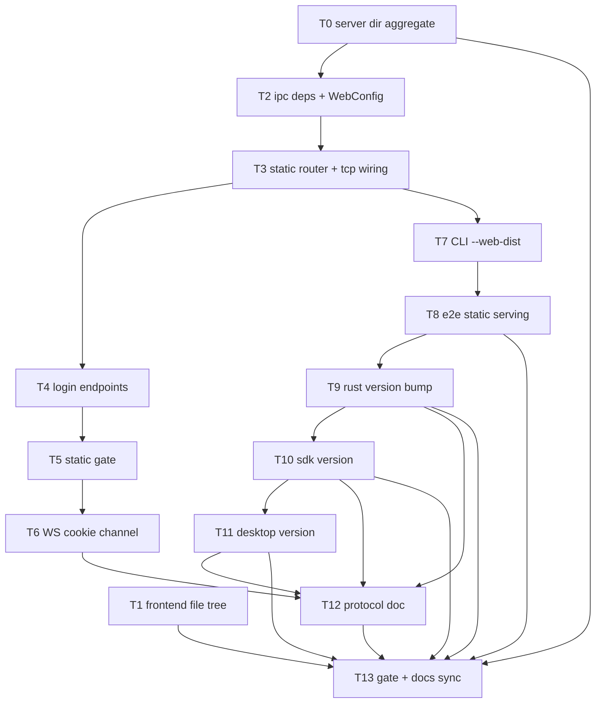

# Plan: AgentJ 内核托管 Web UI（静态文件服务 + 远程登录）与文件树状态补强（0.19.0）

> 设计源：`docs/superpowers/specs/2026-09-19-agentj-kernel-hosted-web-ui-design.md`（已评审通过）
> 实现范围：`agentj-ipc`（web 模块 / ws / tcp / file_list）+ `agentj-cli`（flags/发现/日志）+ `agentj-ui/apps/web`（FileTree）+ 版本与文档同步。

## Agent Worker Instructions

- Required sub-skills: `superpowers:subagent-driven-development` (preferred) or `superpowers:executing-plans`
- Execution mode: `subagent-driven-development` — fresh subagent per task, two-stage review between tasks
- Required verification (every Rust task): scoped test first (`cargo test -p <crate> <filter>`), then milestone gates for tasks marked [GATE]: `cargo test --workspace`, `cargo clippy --workspace --all-targets -- -D warnings`, `cargo test -p agentj-protocol -- drift`
- Required verification (frontend tasks): `npm --prefix agentj-ui test --workspace=@agentj/web`（scoped vitest MUST run via the workspace script — `npx vitest` from repo root does not load the web vite config/jsdom）、`npm --prefix agentj-ui run build --workspace=@agentj/web`
- Generated files (regenerate, never hand-edit beyond the noted single versions): `Cargo.lock`（`cargo check --workspace`）、`agentj-ui/apps/desktop/src-tauri/Cargo.lock`（desktop `cargo check`）、`agentj-ui/package-lock.json`（npm install / package-lock-only）。Commit them with the owning task.
- Dependencies: 仅新增 `agentj-ipc` → `tower-http { version = "0.6", features = ["fs", "set-header"] }` + `uuid { version = "1", features = ["v4"] }`；**非新第三方**（均在 Cargo.lock 传递依赖/工作区既有）。启用 `fs` 新增 `http-range-header` / `mime_guess` / `unicase` 三个 lock 条目——**已本地 registry 缓存，构建可 offline**。
- Version: feature → minor `0.18.1 → 0.19.0`；`PROTOCOL_VERSION` 保持 `0.13.0`（无 wire/schema/methods.json 变化）
- Language: task titles / AC / code in English; commit messages in English; design/plan docs in Chinese
- Rust style: function ≤50 lines, ≤120 chars per line
- Git: one commit per task（`feat(ipc):` / `feat(cli):` / `feat(web):` / `chore:` / `docs:` 前缀）

**Goal:** `agentj serve` / `agentj dashboard` 在同端口托管 `agentj-ui/apps/web/dist`（ServeDir + SPA fallback + 缓存策略），远程访问走混合鉴权（回环 peer 开放 / 非回环 + token → 内嵌登录页 + 不透明会话 cookie，WS 增 cookie 通道 + Origin 校验）；同时补强左栏文件树（目录聚合状态、去冗余圆点）。

**Architecture:** `agentj-ipc` 新增 `web` 模块承载 HTTP 面（登录/登出/门控/静态挂载/路由组装），`ws.rs` 保留升级与连接逻辑并把 `ws_router` 委托给 `web::build_router`；`WsServerState` 增 `web: Arc<WebConfig>` 字段，`TcpBindOptions` 增 `web_dist`；`agentj-cli` 负责 dist 四级发现与启动日志；文件树目录聚合由 `attach_git_statuses` 填充既有可选字段（wire 零变化），前端移除圆点并让目录行渲染状态字母。

**Tech Stack:** Rust 1.96+（axum 0.8.9 / tower-http 0.6.11 / uuid 1，均为既有或 lock 已解析）、TypeScript（React 19 web）、vitest。

## Global Constraints

- **No wire contract change**：不新增/修改 JSON-RPC 方法、类型、schema、`protocol/methods.json`；`PROTOCOL_VERSION` 保持 `0.13.0`；目录聚合仅填充既有 `FileEntry.git_status`（`Option`）字段
- **Auth matrix（统一判定，逐字）**：静态门控生效条件 = `dist 已解析` ∧ `token 已配置（非空）` ∧ `peer 非回环` ∧ `无有效会话 cookie`；回环 peer 永远免登录；登录门仅在 dist 已解析时启用
- **Cookie 契约**：名 `agentj_session`；值 = `uuid v4` 不透明随机会话 ID（服务端内存集合，重启即失效）；属性固定 `HttpOnly; SameSite=Lax; Path=/`（会话 cookie，无 Max-Age）；`/logout` 撤销并清 cookie
- **WS 通道**：`?token=`（行为不变）/ cookie（须带**同源 Origin**：`Origin` 形态 `http(s)://<host>` 的 authority 必须等于 `Host`，缺失或不匹配仅拒绝 cookie 通道）/ `initialize.token`（行为不变）；cookie 通道连接免 `initialize.token`（升级层已鉴权）
- **dist 发现顺序**：`--web-dist` > `AGENTJ_WEB_DIST` > `<cwd>/agentj-ui/apps/web/dist` > exe 相对（`../share/agentj/web`、`./web`）；首个含 `index.html` 者胜出；**显式来源（flag/env）无效 → 警告 + 停止发现（静态禁用，不静默回落）**；自动候选无 index → 跳过；全部落空 → 静态面 404 + 启动 hint；服务不因 UI 资产缺失退出
- **缓存策略**：`/assets` → `Cache-Control: public, max-age=31536000, immutable`；根 fallback（含 index.html）→ `Cache-Control: no-cache`；**逐服务包裹**（`SetResponseHeaderLayer::overriding(...).layer(service)`），禁止 `Router::layer`（会波及 `/ws` 与登录路由）
- **SPA fallback**：`ServeDir::fallback(ServeFile::new(index))`（未知路径 200 + index 内容）；**不得用 `not_found_service`**（会强制 404）；根挂载必须 `fallback_service`（`nest_service("/")` panic）
- **文件树**：目录聚合优先级 `U > D > M > A`（任一后裔命中取最高）；状态字母 + 色义保留（`.status-M/A/U/D`），`.dot` 元素与 `.dot-*` 样式移除；页脚计数逻辑不变（`collectStats` 已跳过目录）
- **既有语义不动**：`?token=` 403、`initialize.token` -32806、`max-connections` 503、非回环无 token 启动告警、HTTP 请求不触发停机/不占 `max-connections`
- **安全边界（已接受，写入测试注释）**：ServeDir 跟随符号链接（不 canonicalize）；登录无速率限制；`next` 白名单 = 以 `/` 开头且非 `//` 开头，否则回落 `/`

## Design Consistency

| 设计文档节 | 要素 | 任务 |
|---|---|---|
| §G1/D7/D8 文件树补强 | 目录聚合 U>D>M>A + 去圆点 | T0, T1 |
| §D1/D9 静态托管与共存 | ServeDir fallback(200) + /assets + /ws 优先 | T2, T3 |
| §D2/D3/D4 鉴权 | 登录门 + 不透明会话 cookie + WS cookie 通道 | T4, T5, T6 |
| §D5 dist 发现 | --web-dist/env/auto 四级 | T7 |
| §D6 缓存 | immutable / no-cache 逐服务 | T3 |
| §测试策略 | in-process + e2e | T3–T8 |
| §D10 版本与文档（G6/G7） | 0.19.0 + README/AGENTS/summary/协议文档 | T9–T13 |

---

### T0: Add directory aggregate status to file/list [P0] [Parallel with T1]

```yaml
- id: T0
  title: "Fill FileEntry.git_status for directories with the highest-priority descendant status"
  files:
    - crates/agentj-ipc/src/file_list.rs
    - crates/agentj-ipc/src/lib.rs
  depends_on: []
  breaking: false
  ac:
    - given: "a git snapshot with statuses src/m.rs=M and src/deep/d.rs=D"
      when: "aggregate_dir_status(\"src\", statuses) is computed"
      then: "returns Some(GitFileStatus::D) (U > D > M > A)"
    - given: "statuses only outside the directory (\"srcx/a.rs\")"
      when: "aggregate_dir_status(\"src\", statuses) is computed"
      then: "returns None (prefix must be \"src/\")"
    - given: "a repo where a tracked file src/del.txt was deleted from disk (git shows ' D')"
      when: "file/list lists the root"
      then: "the src dir entry carries git_status \"D\" although the file itself is not listed"
    - given: "a non-git root"
      when: "file/list lists a directory containing subdirectories"
      then: "all dir entries keep git_status null (existing degradation, no error)"
  regression:
    - "cargo test -p agentj-ipc file_list::tests::git_status_mapping_follows_porcelain"
    - "cargo test -p agentj-ipc dispatch_file_list_reports_git_statuses"
    - "cargo test -p agentj-ipc dispatch_file_list_subdirectory_git_status_is_root_relative"
  test_code: |
    // crates/agentj-ipc/src/file_list.rs #[cfg(test)] (synthetic snapshot, no git needed)
    #[test]
    fn dir_status_aggregates_descendants_by_priority() {
        let mut statuses = HashMap::new();
        statuses.insert("src/m.rs".to_string(), (' ', 'M'));
        statuses.insert("src/deep/d.rs".to_string(), (' ', 'D'));
        statuses.insert("src/add.rs".to_string(), ('?', '?'));
        assert_eq!(aggregate_dir_status("src", &statuses), Some(GitFileStatus::D));
        statuses.insert("src/conflict.rs".to_string(), ('U', 'U'));
        assert_eq!(aggregate_dir_status("src", &statuses), Some(GitFileStatus::U));
        statuses.remove("src/conflict.rs");
        statuses.remove("src/deep/d.rs");
        assert_eq!(aggregate_dir_status("src", &statuses), Some(GitFileStatus::M));
        assert_eq!(aggregate_dir_status("srcx", &statuses), None);
        assert_eq!(aggregate_dir_status("src/deep", &statuses), None);
        assert_eq!(aggregate_dir_status("src", &Default::default()), None, "no statuses = no dir status");
    }
    // crates/agentj-ipc/src/lib.rs #[tokio::test] (mirrors dispatch_file_list_reports_git_statuses)
    #[tokio::test]
    async fn dispatch_file_list_reports_aggregate_dir_status() {
        let root = temp_dir_filelist("git-dir-agg");
        git_run(&root, &["init", "-q"]);
        std::fs::create_dir_all(root.join("src/deep")).unwrap();
        std::fs::write(root.join("src/deep/del.txt"), "1\n").unwrap();
        git_run(&root, &["add", "."]);
        git_run(&root, &["-c", "user.name=AgentJ", "-c", "user.email=agentj@example.com",
                         "commit", "-qm", "init"]);
        std::fs::remove_file(root.join("src/deep/del.txt")).unwrap(); // worktree delete -> ' D'
        let (server, sid) = file_list_server(&root);
        let v = file_list_call(&server, &sid, None, None).await;
        assert!(v["error"].is_null(), "call must succeed: {v}");
        let entry = |name: &str| -> serde_json::Value {
            v["result"]["entries"].as_array().unwrap().iter()
                .find(|e| e["name"] == name).cloned().unwrap_or(serde_json::Value::Null)
        };
        assert_eq!(entry("src")["git_status"], "D", "deleted descendant surfaces on the dir: {v}");
        std::fs::remove_dir_all(&root).ok();
    }
  impl_code: |
    // file_list.rs — priority ladder (U=0 best) + prefix scan over the same snapshot map
    pub fn aggregate_dir_status(
        dir: &str,
        statuses: &std::collections::HashMap<String, (char, char)>,
    ) -> Option<GitFileStatus> {
        if dir.is_empty() { return None; }
        let prefix = format!("{dir}/");
        let mut best: Option<GitFileStatus> = None;
        for (path, (x, y)) in statuses {
            if !path.starts_with(&prefix) { continue; }
            if let Some(status) = map_git_status(*x, *y) {
                if best.as_ref().map_or(true, |b| status_priority(&status) < status_priority(b)) {
                    best = Some(status);
                }
            }
        }
        best
    }
    fn status_priority(s: &GitFileStatus) -> u8 {
        match s { GitFileStatus::U => 0, GitFileStatus::D => 1, GitFileStatus::M => 2,
                  GitFileStatus::A => 3, GitFileStatus::Unknown => 4 }
    }
    // lib.rs attach_git_statuses: replace the `if entry.kind == FileKind::File` block with
    match entry.kind {
        FileKind::File => {
            entry.git_status = snapshot.as_ref()
                .and_then(|s| file_list::git_statuses(s, &entry.path))
                .and_then(|(x, y)| file_list::map_git_status(x, y));
        }
        FileKind::Dir => {
            entry.git_status = snapshot.as_ref()
                .and_then(|s| file_list::aggregate_dir_status(&entry.path, &s.statuses));
        }
        FileKind::Unknown => {}
    }
  verify:
    - "cargo test -p agentj-ipc file_list"
    - "cargo test -p agentj-ipc dispatch_file_list"
```

### T1: Render dir aggregate status and drop the redundant dot in FileTree [P1] [Parallel with T0]

```yaml
- id: T1
  title: "Render StatusCell on dir rows and remove the .dot element/styles"
  files:
    - agentj-ui/apps/web/src/components/FileTree.tsx
    - agentj-ui/apps/web/src/components/filetree.css
    - agentj-ui/apps/web/src/components/fileTree.test.tsx
  depends_on: []
  breaking: false
  ac:
    - given: "a root listing whose dir entry src carries git_status \"M\""
      when: "the tree renders the dir row"
      then: "the dir row contains a .status-M letter span (no .dot element anywhere)"
    - given: "file entries with M/A/U/D statuses"
      when: "the tree renders"
      then: "letters .status-M/.status-A/.status-U/.status-D are present and container.querySelector(\".dot\") is null"
    - given: "the existing footer counting test fixture"
      when: "the tree renders"
      then: "2 个文件 · 1 处变更 is unchanged (dirs never counted)"
  regression:
    - "npm --prefix agentj-ui test --workspace=@agentj/web -- fileTree"
    - "test: lazy-loads a directory on expand and caches children"
    - "test: dir icon swaps Folder/FolderOpen with the expanded state"
  test_code: |
    // fileTree.test.tsx — update existing test name + assertions, add dir status test
    test("renders M/A/U/D git letters from git_status and no dot", async () => {
      const calls: Call[] = [];
      const client = mockClient((path) => ({ entries: path ? CHILDREN : ROOT, truncated: false }), calls);
      const { container } = render(<FileTree client={client} sessionId="s1" demo={false} />);
      await screen.findByText("src");
      fireEvent.click(screen.getByRole("button", { name: /src/ }));
      await screen.findByText("App.tsx");
      expect(container.querySelector(".status-M")).not.toBeNull();
      expect(container.querySelector(".status-A")).not.toBeNull();
      expect(container.querySelector(".status-U")).not.toBeNull();
      expect(container.querySelector(".status-D")).not.toBeNull();
      expect(container.querySelector(".dot")).toBeNull();
    });
    test("dir rows show the aggregate status letter", async () => {
      const root: RawEntry[] = [{ name: "src", path: "src", kind: "dir", git_status: "D" }];
      const client = mockClient(() => ({ entries: root, truncated: false }));
      const { container } = render(<FileTree client={client} sessionId="s1" demo={false} />);
      await screen.findByText("src");
      expect(container.querySelector(".trow-dir .status-D")).not.toBeNull();
      expect(container.querySelector(".trow-dir .dot")).toBeNull();
    });
  impl_code: |
    // FileTree.tsx — StatusCell keeps the letter only
    function StatusCell({ git }: { git: GitLetter }) {
      return <span className={`status-txt status-${git}`}>{git}</span>;
    }
    // dir row (inside the .trow-dir <button>, after <span className="name">):
    <span className="name">{node.name}</span>
    {node.git ? <StatusCell git={node.git} /> : null}
    // filetree.css — delete `.trow .dot` (L111-116) and `.dot-M/.dot-A/.dot-U/.dot-D`
    // (L136-139); keep `.status-txt` + `.status-M/A/U/D` (letter colors unchanged)
  verify:
    - "npm --prefix agentj-ui test --workspace=@agentj/web -- fileTree"
    - "npm --prefix agentj-ui run build --workspace=@agentj/web"
```

### T2: Add tower-http/uuid deps and the web module skeleton [P0] [Sequential head of the web hotspot]

```yaml
- id: T2
  title: "Add web module with WebConfig, cookie/origin/next helpers and unit tests"
  files:
    - crates/agentj-ipc/Cargo.toml
    - crates/agentj-ipc/src/lib.rs
    - crates/agentj-ipc/src/web.rs
  depends_on: [T0]
  breaking: false
  ac:
    - given: "safe_next inputs None / \"/ok\" / \"//evil\" / \"https://evil\""
      when: "safe_next is called"
      then: "returns \"/\" / \"/ok\" / \"/\" / \"/\""
    - given: "a WebConfig with token Some(\"\") (empty string)"
      when: "it is constructed via WebConfig::new"
      then: "token normalizes to None and enabled() reflects dist presence"
    - given: "a session id issued by issue_session"
      when: "is_valid_session / revoke_session are used"
      then: "valid before revoke, invalid after"
  regression:
    - "test: looks_like_http_classifies_correctly"
    - "cargo test -p agentj-ipc"
    - "cargo clippy -p agentj-ipc --all-targets -- -D warnings"
  test_code: |
    // crates/agentj-ipc/src/web.rs #[cfg(test)]
    #[test]
    fn safe_next_whitelists_same_site_paths_only() {
        assert_eq!(safe_next(None), "/");
        assert_eq!(safe_next(Some("/ok?x=1")), "/ok?x=1");
        assert_eq!(safe_next(Some("//evil")), "/");
        assert_eq!(safe_next(Some("https://evil")), "/");
    }
    #[test]
    fn sessions_roundtrip_and_empty_token_normalizes_to_none() {
        let web = WebConfig::new(None, Some(String::new()));
        assert!(web.token.is_none());
        let sid = web.issue_session();
        assert!(web.is_valid_session(&sid));
        web.revoke_session(&sid);
        assert!(!web.is_valid_session(&sid));
    }
    #[test]
    fn pct_encode_escapes_query_delimiters() {
        assert_eq!(pct_encode("/a b?c&d"), "/a%20b%3Fc%26d");
    }
  impl_code: |
    // agentj-ipc/Cargo.toml [dependencies] +=
    // tower-http = { version = "0.6", features = ["fs", "set-header"] }
    // uuid = { version = "1", features = ["v4"] }
    // lib.rs += `pub mod web;` (alphabetical module list)
    // web.rs:
    pub const SESSION_COOKIE: &str = "agentj_session";

    pub struct WebConfig {
        pub dist: Option<std::path::PathBuf>,
        pub token: Option<String>,
        sessions: std::sync::RwLock<std::collections::HashSet<String>>,
    }
    impl WebConfig {
        pub fn disabled() -> Self { Self::new(None, None) }
        pub fn new(dist: Option<std::path::PathBuf>, token: Option<String>) -> Self {
            Self { dist, token: token.filter(|t| !t.is_empty()),
                   sessions: std::sync::RwLock::new(std::collections::HashSet::new()) }
        }
        pub fn enabled(&self) -> bool { self.dist.is_some() }
        pub fn issue_session(&self) -> String {
            let id = uuid::Uuid::new_v4().to_string();
            self.sessions.write().expect("sessions").insert(id.clone());
            id
        }
        pub fn is_valid_session(&self, id: &str) -> bool {
            self.sessions.read().expect("sessions").contains(id)
        }
        pub fn revoke_session(&self, id: &str) {
            self.sessions.write().expect("sessions").remove(id);
        }
    }
    pub fn peer_is_loopback(peer: std::net::SocketAddr) -> bool { peer.ip().is_loopback() }
    pub fn session_cookie(headers: &axum::http::HeaderMap) -> Option<&str> {
        headers.get(axum::http::header::COOKIE)?.to_str().ok()?
            .split(';').find_map(|p| p.trim().strip_prefix("agentj_session="))
    }
    pub fn origin_matches_host(headers: &axum::http::HeaderMap) -> bool {
        let host = headers.get(axum::http::header::HOST).and_then(|v| v.to_str().ok());
        let origin = headers.get(axum::http::header::ORIGIN).and_then(|v| v.to_str().ok());
        match (host, origin) {
            (Some(h), Some(o)) => o.strip_prefix("http://").or_else(|| o.strip_prefix("https://")) == Some(h),
            _ => false,
        }
    }
    pub fn safe_next(next: Option<&str>) -> String {
        match next {
            Some(n) if n.starts_with('/') && !n.starts_with("//") => n.to_string(),
            _ => "/".to_string(),
        }
    }
    pub fn pct_encode(s: &str) -> String {
        s.bytes().map(|b| match b {
            b'A'..=b'Z' | b'a'..=b'z' | b'0'..=b'9' | b'-' | b'_' | b'.' | b'~' | b'/' =>
                (b as char).to_string(),
            _ => format!("%{b:02X}"),
        }).collect()
    }
    fn escape_html(s: &str) -> String {
        s.replace('&', "&amp;").replace('<', "&lt;").replace('>', "&gt;").replace('"', "&quot;")
    }
    pub fn login_page_html(error: Option<&str>, next: &str) -> String {
        let error = error.map(|e| format!("<p class=\"err\">{}</p>", escape_html(e))).unwrap_or_default();
        format!(
            "<!doctype html><html><head><meta charset=\"utf-8\"><title>AgentJ</title></head>\
             <body><main><h1>AgentJ</h1><p>输入访问令牌以连接到内核。</p>{error}\
             <form method=\"post\" action=\"/login\"><input type=\"hidden\" name=\"next\" value=\"{}\">\
             <input name=\"token\" type=\"password\" required autofocus><button>登录</button></form>\
             </main></body></html>",
            escape_html(next)
        )
    }
  verify:
    - "cargo test -p agentj-ipc web::"
    - "cargo clippy -p agentj-ipc --all-targets -- -D warnings"
```

### T3: Mount ServeDir static services in the router [P0] [Sequential after T2]

```yaml
- id: T3
  title: "Delegate ws_router to web::build_router mounting /assets + SPA fallback with cache layers"
  files:
    - crates/agentj-ipc/src/web.rs
    - crates/agentj-ipc/src/ws.rs
    - crates/agentj-ipc/src/tcp.rs
  depends_on: [T2]
  breaking: true
  ac:
    - given: "a WebConfig with dist pointing at a fixture dir containing index.html + assets/app.js"
      when: "GET / is served through build_router"
      then: "200 with index body and Cache-Control: no-cache"
    - given: "the same dist"
      when: "GET /assets/app.js is served"
      then: "200 with Cache-Control: public, max-age=31536000, immutable"
    - given: "the same dist"
      when: "GET /unknown-route is served"
      then: "200 with the index.html body (SPA fallback via .fallback(), not 404)"
    - given: "WebConfig::disabled() (no dist)"
      when: "GET / is served"
      then: "404 (static surface absent, no error)"
    - given: "the existing /ws route and a dist-backed router"
      when: "a WS client connects with ?token= as before"
      then: "upgrade behavior is unchanged (explicit route beats fallback)"
  regression:
    - "cargo test -p agentj-ipc"
    - "cargo test -p agentj-ipc --test ws_classifier"
    - "cargo test -p agentj-cli --test e2e_ws"
  test_code: |
    // crates/agentj-ipc/src/web.rs #[cfg(test)] — in-process oneshot (tower::ServiceExt)
    fn temp_dist(tag: &str) -> std::path::PathBuf {
        let dir = std::env::temp_dir().join(format!("agentj-web-{}-{tag}", std::process::id()));
        let _ = std::fs::remove_dir_all(&dir);
        std::fs::create_dir_all(dir.join("assets")).unwrap();
        std::fs::write(dir.join("index.html"), "<html>agentj-index</html>").unwrap();
        std::fs::write(dir.join("assets/app.js"), "console.log(1)").unwrap();
        dir
    }
    fn test_state(web: crate::web::WebConfig) -> std::sync::Arc<crate::ws::WsServerState> {
        let kernel = agentj_core::kernel::Kernel::new();
        let session: std::sync::Arc<dyn agentj_core::module::SessionStore> =
            std::sync::Arc::new(agentj_session::InMemoryStore::new());
        std::sync::Arc::new(crate::ws::WsServerState {
            shared: std::sync::Arc::new(crate::IpcServer::new(kernel, session)),
            token: None,
            max_connections: 16,
            active_ws: std::sync::atomic::AtomicUsize::new(0),
            web: std::sync::Arc::new(web),
        })
    }
    async fn get(router: axum::Router, path: &str) -> (axum::http::StatusCode, axum::http::HeaderMap, String) {
        use tower::util::ServiceExt;
        let res = router.oneshot(
            axum::http::Request::builder().uri(path).body(axum::body::Body::empty()).unwrap(),
        ).await.unwrap();
        let (status, headers) = (res.status(), res.headers().clone());
        let body = axum::body::to_bytes(res.into_body(), 1 << 20).await.unwrap();
        (status, headers, String::from_utf8_lossy(&body).to_string())
    }
    #[tokio::test]
    async fn serves_index_assets_and_spa_fallback_with_cache_headers() {
        let dist = temp_dist("static");
        let state = test_state(crate::web::WebConfig::new(Some(dist.clone()), None));
        let peer: std::net::SocketAddr = "127.0.0.1:5555".parse().unwrap();
        let (s, h, b) = get(crate::web::build_router(state.clone(), peer), "/").await;
        assert_eq!(s, axum::http::StatusCode::OK);
        assert!(b.contains("agentj-index"));
        assert_eq!(h.get(axum::http::header::CACHE_CONTROL).unwrap(), "no-cache");
        let (s, h, _) = get(crate::web::build_router(state.clone(), peer), "/assets/app.js").await;
        assert_eq!(s, axum::http::StatusCode::OK);
        assert!(h.get(axum::http::header::CACHE_CONTROL).unwrap().to_str().unwrap().contains("immutable"));
        let (s, _, b) = get(crate::web::build_router(state, peer), "/unknown-route").await;
        assert_eq!(s, axum::http::StatusCode::OK, "SPA fallback must be 200");
        assert!(b.contains("agentj-index"));
        std::fs::remove_dir_all(&dist).ok();
    }
    #[tokio::test]
    async fn missing_dist_returns_404() {
        let state = test_state(crate::web::WebConfig::disabled());
        let peer: std::net::SocketAddr = "127.0.0.1:5555".parse().unwrap();
        let (s, _, _) = get(crate::web::build_router(state, peer), "/").await;
        assert_eq!(s, axum::http::StatusCode::NOT_FOUND);
    }
  impl_code: |
    // web.rs build_router (no login/gate yet — T4/T5 extend it):
    pub fn build_router(state: std::sync::Arc<crate::ws::WsServerState>, peer: std::net::SocketAddr) -> axum::Router {
        use tower::Layer as _;
        let ws_route = axum::routing::get({
            let state = state.clone();
            move |q: axum::extract::Query<crate::ws::WsQuery>, ws: axum::extract::WebSocketUpgrade| {
                let state = state.clone();
                async move { crate::ws::ws_upgrade(state, q, peer, ws).await }
            }
        });
        let mut router = axum::Router::new().route("/ws", ws_route);
        if let Some(dist) = state.web.dist.clone() {
            let spa = tower_http::services::ServeDir::new(&dist)
                .fallback(tower_http::services::ServeFile::new(dist.join("index.html")));
            let spa = tower_http::set_header::SetResponseHeaderLayer::overriding(
                axum::http::header::CACHE_CONTROL,
                axum::http::HeaderValue::from_static("no-cache"),
            ).layer(spa);
            let assets = tower_http::set_header::SetResponseHeaderLayer::overriding(
                axum::http::header::CACHE_CONTROL,
                axum::http::HeaderValue::from_static("public, max-age=31536000, immutable"),
            ).layer(tower_http::services::ServeDir::new(dist.join("assets")));
            router = router.nest_service("/assets", assets).fallback_service(spa);
        }
        router
    }
    // ws.rs:
    pub struct WsServerState { pub shared: ..., pub token: ..., pub max_connections: ...,
        pub active_ws: AtomicUsize, pub web: std::sync::Arc<crate::web::WebConfig> }
    pub fn ws_router(state: Arc<WsServerState>, peer: SocketAddr) -> Router {
        crate::web::build_router(state, peer)   // L112-120 body replaced; remove unused `get` import
    }
    pub(crate) async fn ws_upgrade(...)          // visibility raised for web.rs
    // tcp.rs:
    pub struct TcpBindOptions { ..., pub web_dist: Option<std::path::PathBuf> }  // Default: None
    // bind(): let web = Arc::new(crate::web::WebConfig::new(options.web_dist.clone(), options.token.clone()));
    //         WsServerState { ..., web }
  verify:
    - "cargo test -p agentj-ipc web::"
    - "cargo test -p agentj-ipc --test ws_classifier"
    - "cargo clippy -p agentj-ipc --all-targets -- -D warnings"
```

### T4: Add login page and session cookie endpoints [P0] [Sequential after T3]

```yaml
- id: T4
  title: "Add GET/POST /login and POST /logout backed by opaque in-memory sessions"
  files:
    - crates/agentj-ipc/src/web.rs
  depends_on: [T3]
  breaking: false
  ac:
    - given: "a token-configured WebConfig"
      when: "POST /login with form token=secret&next=%2Ffoo"
      then: "302 Location /foo and Set-Cookie contains agentj_session, HttpOnly, SameSite=Lax, Path=/"
    - given: "a token-configured WebConfig"
      when: "POST /login with a wrong token"
      then: "401 with the login page body (error line) — no Set-Cookie"
    - given: "an issued session cookie"
      when: "POST /logout with that cookie"
      then: "302 /login and the session id no longer validates (cookie cleared with Max-Age=0)"
    - given: "GET /login?next=%2Ffoo"
      when: "the page renders"
      then: "200 html containing a form POST action /login and hidden next value /foo"
  regression:
    - "cargo test -p agentj-ipc web::"
    - "cargo test -p agentj-ipc --test ws_classifier"
  test_code: |
    // crates/agentj-ipc/src/web.rs #[cfg(test)] — reuse `get`; add form_post helper
    async fn form_post(router: axum::Router, path: &str, body: &str) -> (axum::http::StatusCode, axum::http::HeaderMap, String) {
        use tower::util::ServiceExt;
        let res = router.oneshot(
            axum::http::Request::builder().method("POST").uri(path)
                .header(axum::http::header::CONTENT_TYPE, "application/x-www-form-urlencoded")
                .body(axum::body::Body::from(body.to_string())).unwrap(),
        ).await.unwrap();
        let (status, headers) = (res.status(), res.headers().clone());
        let bytes = axum::body::to_bytes(res.into_body(), 1 << 20).await.unwrap();
        (status, headers, String::from_utf8_lossy(&bytes).to_string())
    }
    #[tokio::test]
    async fn login_sets_session_cookie_and_redirects_to_next() {
        let web = crate::web::WebConfig::new(None, Some("secret".into()));
        let state = test_state(web);
        let peer: std::net::SocketAddr = "127.0.0.1:5555".parse().unwrap();
        let (s, h, _) = form_post(crate::web::build_router(state, peer), "/login", "token=secret&next=%2Ffoo").await;
        assert_eq!(s, axum::http::StatusCode::FOUND);
        assert_eq!(h.get(axum::http::header::LOCATION).unwrap(), "/foo");
        let cookie = h.get(axum::http::header::SET_COOKIE).unwrap().to_str().unwrap();
        assert!(cookie.contains("agentj_session=") && cookie.contains("HttpOnly")
                && cookie.contains("SameSite=Lax") && cookie.contains("Path=/"));
    }
    #[tokio::test]
    async fn login_with_wrong_token_is_401_and_logout_revokes() {
        let state = test_state(crate::web::WebConfig::new(None, Some("secret".into())));
        let peer: std::net::SocketAddr = "127.0.0.1:5555".parse().unwrap();
        let (s, h, _) = form_post(crate::web::build_router(state.clone(), peer), "/login", "token=nope").await;
        assert_eq!(s, axum::http::StatusCode::UNAUTHORIZED);
        assert!(h.get(axum::http::header::SET_COOKIE).is_none());
        let sid = state.web.issue_session();
        use tower::util::ServiceExt;
        let res = crate::web::build_router(state.clone(), peer).oneshot(
            axum::http::Request::builder().method("POST").uri("/logout")
                .header(axum::http::header::COOKIE, format!("agentj_session={sid}"))
                .body(axum::body::Body::empty()).unwrap(),
        ).await.unwrap();
        assert_eq!(res.status(), axum::http::StatusCode::FOUND);
        assert!(!state.web.is_valid_session(&sid));
    }
    #[tokio::test]
    async fn login_page_renders_form_with_hidden_next() {
        let state = test_state(crate::web::WebConfig::new(None, Some("secret".into())));
        let peer: std::net::SocketAddr = "127.0.0.1:5555".parse().unwrap();
        let (s, _, body) = get(crate::web::build_router(state, peer), "/login?next=%2Ffoo").await;
        assert_eq!(s, axum::http::StatusCode::OK);
        assert!(body.contains("action=\"/login\""), "form action: {body}");
        assert!(body.contains("value=\"/foo\""), "hidden next: {body}");
    }
  impl_code: |
    // web.rs — add to build_router before the static mount:
    #[derive(serde::Deserialize)] struct LoginQuery { next: Option<String> }
    #[derive(serde::Deserialize)] struct LoginForm { token: String, next: Option<String> }
    fn redirect_found(location: &str) -> axum::response::Response {
        (
            axum::http::StatusCode::FOUND,
            [(axum::http::header::LOCATION, location.to_string())],
        ).into_response()
    }
    async fn submit_login(web: &WebConfig, form: LoginForm) -> axum::response::Response {
        let expected = web.token.as_deref().unwrap_or_default();
        if !expected.is_empty() && form.token == expected {
            let sid = web.issue_session();
            let mut res = redirect_found(&safe_next(form.next.as_deref()));
            res.headers_mut().insert(
                axum::http::header::SET_COOKIE,
                format!("{SESSION_COOKIE}={sid}; HttpOnly; SameSite=Lax; Path=/")
                    .parse().expect("valid cookie header"),
            );
            res
        } else {
            (
                axum::http::StatusCode::UNAUTHORIZED,
                axum::response::Html(login_page_html(Some("访问令牌无效"), &safe_next(form.next.as_deref()))),
            ).into_response()
        }
    }
    async fn logout(web: &WebConfig, headers: axum::http::HeaderMap) -> axum::response::Response {
        if let Some(sid) = session_cookie(&headers) { web.revoke_session(sid); }
        let mut res = redirect_found("/login");
        res.headers_mut().insert(
            axum::http::header::SET_COOKIE,
            format!("{SESSION_COOKIE}=; HttpOnly; SameSite=Lax; Path=/; Max-Age=0")
                .parse().expect("valid cookie header"),
        );
        res
    }
    // build_router additions (fully qualified axum paths; helper names stay unshadowed in tests):
    let web = state.web.clone();
    let login_get = {
        let web = web.clone();
        move |q: axum::extract::Query<LoginQuery>| {
            let web = web.clone();
            async move { axum::response::Html(login_page_html(None, &safe_next(q.next.as_deref()))) }
        }
    };
    let login_post = {
        let web = web.clone();
        move |form: axum::extract::Form<LoginForm>| {
            let web = web.clone();
            async move { submit_login(&web, form).await }
        }
    };
    let logout_post = {
        let web = web.clone();
        move |headers: axum::http::HeaderMap| {
            let web = web.clone();
            async move { logout(&web, headers).await }
        }
    };
    router = router
        .route("/login", axum::routing::get(login_get).post(login_post))
        .route("/logout", axum::routing::post(logout_post));
    // NOTE: /login + /logout are NOT behind the gate (added in T5); no redirect loop.
  verify:
    - "cargo test -p agentj-ipc web::"
```

### T5: Add the static-surface login gate [P0] [Sequential after T4]

```yaml
- id: T5
  title: "Wrap /assets and the SPA fallback with the hybrid auth gate middleware"
  files:
    - crates/agentj-ipc/src/web.rs
  depends_on: [T4]
  breaking: false
  ac:
    - given: "dist + token=secret + peer 203.0.113.7 without a cookie"
      when: "GET / is served"
      then: "302 Location /login?next=/ (path pct-encoded; '/' kept readable)"
    - given: "the same but peer 127.0.0.1"
      when: "GET / is served"
      then: "200 (loopback peers bypass the gate)"
    - given: "the same remote peer with a valid issued session cookie"
      when: "GET / is served"
      then: "200"
    - given: "dist + no token + remote peer"
      when: "GET / is served"
      then: "200 (no token means nothing to authenticate)"
    - given: "dist + token + remote peer"
      when: "GET /login and POST /login are served"
      then: "both reachable without redirect (gate never wraps login routes)"
    - given: "a forged/invalid cookie from a remote peer"
      when: "GET /assets/app.js is served"
      then: "302 → /login?next=/assets/app.js (invalid cookie treated like no cookie; assets are gated too; the gate re-attaches the /assets prefix stripped by nest_service)"
  regression:
    - "cargo test -p agentj-ipc web::"
    - "cargo test -p agentj-ipc --test ws_classifier"
  test_code: |
    // web.rs #[cfg(test)]
    #[tokio::test]
    async fn remote_peer_without_cookie_is_redirected_to_login() {
        let dist = temp_dist("gate");
        let state = test_state(crate::web::WebConfig::new(Some(dist.clone()), Some("secret".into())));
        let remote: std::net::SocketAddr = "203.0.113.7:41000".parse().unwrap();
        let (s, h, _) = get(crate::web::build_router(state.clone(), remote), "/").await;
        assert_eq!(s, axum::http::StatusCode::FOUND);
        assert_eq!(h.get(axum::http::header::LOCATION).unwrap(), "/login?next=/");
        let (s, _, _) = get(crate::web::build_router(state.clone(), remote), "/login").await;
        assert_eq!(s, axum::http::StatusCode::OK);
        std::fs::remove_dir_all(&dist).ok();
    }
    #[tokio::test]
    async fn loopback_and_cookie_paths_pass_the_gate() {
        let dist = temp_dist("gate-pass");
        let web = crate::web::WebConfig::new(Some(dist.clone()), Some("secret".into()));
        let sid = web.issue_session();
        let state = test_state(web);
        let local: std::net::SocketAddr = "127.0.0.1:5555".parse().unwrap();
        let (s, _, _) = get(crate::web::build_router(state.clone(), local), "/").await;
        assert_eq!(s, axum::http::StatusCode::OK);
        let remote: std::net::SocketAddr = "203.0.113.7:41000".parse().unwrap();
        use tower::util::ServiceExt;
        let res = crate::web::build_router(state, remote).oneshot(
            axum::http::Request::builder().uri("/")
                .header(axum::http::header::COOKIE, format!("agentj_session={sid}"))
                .body(axum::body::Body::empty()).unwrap(),
        ).await.unwrap();
        assert_eq!(res.status(), axum::http::StatusCode::OK);
        std::fs::remove_dir_all(&dist).ok();
    }
    #[tokio::test]
    async fn forged_cookie_and_asset_requests_are_gated() {
        let dist = temp_dist("gate-forged");
        let state = test_state(crate::web::WebConfig::new(Some(dist.clone()), Some("secret".into())));
        let remote: std::net::SocketAddr = "203.0.113.7:41000".parse().unwrap();
        use tower::util::ServiceExt;
        let res = crate::web::build_router(state, remote).oneshot(
            axum::http::Request::builder().uri("/assets/app.js")
                .header(axum::http::header::COOKIE, "agentj_session=forged")
                .body(axum::body::Body::empty()).unwrap(),
        ).await.unwrap();
        assert_eq!(res.status(), axum::http::StatusCode::FOUND, "forged cookie must redirect");
        assert_eq!(
            res.headers().get(axum::http::header::LOCATION).unwrap(),
            "/login?next=/assets/app.js"
        );
        std::fs::remove_dir_all(&dist).ok();
    }
    #[tokio::test]
    async fn no_token_remote_peer_passes_without_login() {
        let dist = temp_dist("gate-notoken");
        let state = test_state(crate::web::WebConfig::new(Some(dist.clone()), None));
        let remote: std::net::SocketAddr = "203.0.113.7:41000".parse().unwrap();
        let (s, _, _) = get(crate::web::build_router(state, remote), "/").await;
        assert_eq!(s, axum::http::StatusCode::OK);
        std::fs::remove_dir_all(&dist).ok();
    }
  impl_code: |
    // web.rs
    pub fn gate_required(web: &WebConfig, peer: std::net::SocketAddr, headers: &axum::http::HeaderMap) -> bool {
        web.enabled() && web.token.is_some() && !peer_is_loopback(peer)
            && !session_cookie(headers).is_some_and(|sid| web.is_valid_session(sid))
    }
    async fn gate(web: Arc<WebConfig>, peer: std::net::SocketAddr, mount: &'static str,
                  req: axum::extract::Request, next: axum::middleware::Next) -> axum::response::Response {
        if gate_required(&web, peer, req.headers()) {
            // `nest_service` strips the mount prefix before the inner service (and this layer)
            // runs, so re-attach it: the redirect must carry the full same-origin path.
            let full_path = format!("{mount}{}", req.uri().path());
            return redirect_found(&format!("/login?next={}", pct_encode(&full_path)));
        }
        next.run(req).await
    }
    // build_router static mount becomes (one gate per mount; "" for the root fallback):
    let web_for_assets = state.web.clone();
    let gate_assets = axum::middleware::from_fn(move |req, next| {
        let web = web_for_assets.clone();
        async move { gate(web, peer, "/assets", req, next).await }
    });
    let web_for_spa = state.web.clone();
    let gate_spa = axum::middleware::from_fn(move |req, next| {
        let web = web_for_spa.clone();
        async move { gate(web, peer, "", req, next).await }
    });
    router = router
        .nest_service("/assets", gate_assets.layer(assets))
        .fallback_service(gate_spa.layer(spa));
  verify:
    - "cargo test -p agentj-ipc web::"
    - "cargo clippy -p agentj-ipc --all-targets -- -D warnings"
```

### T6: Add the WS cookie channel with Origin check [P0] [Sequential after T5]

```yaml
- id: T6
  title: "Accept valid session cookies as a third WS auth channel and skip initialize.token for it"
  files:
    - crates/agentj-ipc/src/ws.rs
    - crates/agentj-ipc/src/web.rs
    - crates/agentj-ipc/tests/ws_classifier.rs
  depends_on: [T5]
  breaking: false
  ac:
    - given: "token=secret and a session obtained via POST /login"
      when: "a WS client connects with that Cookie and Origin http://<addr> (same host)"
      then: "upgrade succeeds and initialize WITHOUT token returns connection_id (no -32806)"
    - given: "the same cookie"
      when: "the WS client omits the Origin header"
      then: "the cookie channel is refused (403) — other channels unaffected"
    - given: "the same cookie"
      when: "Origin is http://evil.example (cross-origin)"
      then: "refused (403)"
    - given: "token=secret and no cookie"
      when: "a WS client connects with ?token=wrong"
      then: "still refused (403, existing behavior regression)"
  regression:
    - "cargo test -p agentj-ipc --test ws_classifier"
    - "test: same_port_serves_ws_and_raw_tcp"
    - "test: ws_initialize_without_token_fails_with_not_authorized"
  test_code: |
    // tests/ws_classifier.rs — extend helpers + new tests
    async fn bind_server_with_web(token: Option<String>, web_dist: Option<std::path::PathBuf>)
        -> (std::net::SocketAddr, tokio::task::JoinHandle<()>) {
        let kernel = Kernel::new();
        let session: Arc<dyn SessionStore> = Arc::new(InMemoryStore::new());
        let mut server = TcpIpcServer::bind("127.0.0.1:0", kernel, session, None, None, TcpBindOptions {
            token, max_connections: 16, web_dist, ..Default::default()
        }).await.unwrap();
        let addr = server.local_addr().unwrap();
        (addr, tokio::spawn(async move { let _ = server.run().await; }))
    }
    async fn http_post(addr: std::net::SocketAddr, path: &str, body: &str) -> String {
        let mut stream = tokio::net::TcpStream::connect(addr).await.unwrap();
        let req = format!("POST {path} HTTP/1.1\r\nHost: {addr}\r\nContent-Type: application/x-www-form-urlencoded\r\nContent-Length: {}\r\nConnection: close\r\n\r\n{body}", body.len());
        stream.write_all(req.as_bytes()).await.unwrap();
        let mut buf = String::new();
        let mut reader = tokio::io::BufReader::new(&mut stream);
        let _ = tokio::time::timeout(std::time::Duration::from_secs(2), async {
            let mut line = String::new();
            while reader.read_line(&mut line).await.unwrap_or(0) > 0 { buf.push_str(&line); line.clear(); }
        }).await;
        buf
    }
    fn login_cookie(response: &str) -> String {
        response.lines().find(|l| l.to_ascii_lowercase().starts_with("set-cookie:"))
            .and_then(|l| l.splitn(2, ':').nth(1))
            .map(|v| v.trim().split(';').next().unwrap().to_string())
            .expect("login must set a cookie")
    }
    // file top: add `use tokio_tungstenite::tungstenite::client::IntoClientRequest;`
    #[tokio::test]
    async fn ws_cookie_channel_accepts_same_origin_and_skips_initialize_token() {
        let (addr, handle) = bind_server_with_web(Some("secret".into()), None).await;
        let resp = http_post(addr, "/login", "token=secret").await;
        assert!(resp.starts_with("HTTP/1.1 302"), "login must redirect: {resp}");
        let cookie = login_cookie(&resp);
        let mut req = format!("ws://{addr}/ws").into_client_request().unwrap();
        req.headers_mut().insert("cookie", cookie.parse().unwrap());
        req.headers_mut().insert("origin", format!("http://{addr}").parse().unwrap());
        let (mut ws, _) = tokio_tungstenite::connect_async(req).await.unwrap();
        ws.send(Message::Text(initialize_line(1).into())).await.unwrap();
        let text = ws.next().await.unwrap().unwrap().to_text().unwrap().to_string();
        assert!(text.contains("connection_id"), "cookie channel needs no initialize.token: {text}");
        ws.close(None).await.unwrap();
        handle.abort();
    }
    #[tokio::test]
    async fn ws_cookie_channel_requires_same_origin() {
        let (addr, handle) = bind_server_with_web(Some("secret".into()), None).await;
        let cookie = login_cookie(&http_post(addr, "/login", "token=secret").await);
        // no Origin -> refused
        let mut req = format!("ws://{addr}/ws").into_client_request().unwrap();
        req.headers_mut().insert("cookie", cookie.parse().unwrap());
        assert!(tokio_tungstenite::connect_async(req).await.is_err());
        // cross-origin -> refused
        let mut req = format!("ws://{addr}/ws").into_client_request().unwrap();
        req.headers_mut().insert("cookie", cookie.parse().unwrap());
        req.headers_mut().insert("origin", "http://evil.example".parse().unwrap());
        assert!(tokio_tungstenite::connect_async(req).await.is_err());
        handle.abort();
    }
  impl_code: |
    // ws.rs — ws_upgrade gains a HeaderMap and a cookie path
    pub(crate) async fn ws_upgrade(
        state: Arc<WsServerState>, query: WsQuery, peer: SocketAddr,
        ws: WebSocketUpgrade, headers: axum::http::HeaderMap,
    ) -> Response {
        let cookie_authed = state.web.token.is_some()
            && crate::web::session_cookie(&headers)
                .is_some_and(|sid| state.web.is_valid_session(sid))
            && crate::web::origin_matches_host(&headers);
        let query_ok = match state.token.as_deref() {
            None => true,
            Some(t) => query.token.as_deref() == Some(t),
        };
        if !query_ok && !cookie_authed {
            return (StatusCode::FORBIDDEN, "missing or invalid token").into_response();
        }
        // max_connections unchanged; on_upgrade:
        let required = if cookie_authed { None } else { state.token.clone() };
        ws.on_upgrade(move |socket| async move {
            let conn = WsConnection::new(socket, peer.to_string());
            let _ = Arc::clone(&state.shared)
                .serve_connection(Box::new(conn), required.as_deref()).await;
            state.active_ws.fetch_sub(1, Ordering::SeqCst);
        })
    }
    // web.rs build_router /ws closure adds the HeaderMap extractor:
    // move |q: Query<WsQuery>, ws: WebSocketUpgrade, headers: axum::http::HeaderMap| { ... ws_upgrade(state, q, peer, ws, headers) }
  verify:
    - "cargo test -p agentj-ipc --test ws_classifier"
    - "cargo clippy -p agentj-ipc --all-targets -- -D warnings"
```

### T7: Add --web-dist, discovery and startup logging to the CLI [P0] [Parallel with T4/T5]

```yaml
- id: T7
  title: "Add --web-dist flags, resolve_web_dist discovery and http URL logging to serve/dashboard"
  files:
    - crates/agentj-cli/src/main.rs
  depends_on: [T3]
  breaking: false
  ac:
    - given: "an explicit --web-dist valid dir and a valid cwd candidate"
      when: "resolve_web_dist runs"
      then: "the explicit dir wins"
    - given: "an explicit --web-dist dir without index.html"
      when: "resolve_web_dist runs (even though a valid env/cwd candidate exists)"
      then: "returns None (stop discovery; caller warns) — no silent fallback"
    - given: "no flag/env but <cwd>/agentj-ui/apps/web/dist with index.html"
      when: "resolve_web_dist runs"
      then: "the cwd candidate wins"
    - given: "a valid dist"
      when: "serve --port 0 starts"
      then: "stdout prints `web ui on http://<host>:<port>/ (dist: <path>)` after the websocket line"
    - given: "no dist anywhere"
      when: "serve --port 0 starts"
      then: "stderr warns that web dist was not found (with the build hint); serving continues"
  regression:
    - "cargo test -p agentj-cli"
    - "test: serve_host_defaults_to_loopback"
    - "test: dashboard_accepts_token_flag"
  test_code: |
    // main.rs mod tests — std temp dirs (no new dev-deps; CLI has no tempfile)
    fn temp_dist_dir(tag: &str, with_index: bool) -> std::path::PathBuf {
        let dir = std::env::temp_dir().join(format!("agentj-cli-web-{}-{tag}", std::process::id()));
        let _ = std::fs::remove_dir_all(&dir);
        std::fs::create_dir_all(&dir).unwrap();
        if with_index { std::fs::write(dir.join("index.html"), "<html></html>").unwrap(); }
        dir
    }
    #[test]
    fn resolve_web_dist_prefers_explicit_and_stops_on_invalid() {
        let explicit = temp_dist_dir("explicit", true);
        let cwd = temp_dist_dir("cwd-valid", true);
        assert_eq!(resolve_web_dist(Some(explicit.clone()), None, &cwd, &cwd), Some(explicit.clone()));
        let bad = temp_dist_dir("explicit-bad", false);
        assert_eq!(resolve_web_dist(Some(bad), None, &cwd, &cwd), None,
                   "invalid explicit source must stop discovery");
        std::fs::remove_dir_all(&explicit).ok();
        std::fs::remove_dir_all(&cwd).ok();
    }
    #[test]
    fn resolve_web_dist_falls_back_to_cwd_and_env_order() {
        let cwd = temp_dist_dir("cwd-order", false);
        let env_dir = temp_dist_dir("env-order", true);
        assert_eq!(resolve_web_dist(None, Some(env_dir.clone()), &cwd, &cwd), Some(env_dir.clone()));
        let cwd_valid = temp_dist_dir("cwd-valid2", true);
        assert_eq!(resolve_web_dist(None, None, &cwd_valid, &cwd_valid), Some(cwd_valid.clone()));
        std::fs::remove_dir_all(&cwd).ok();
        std::fs::remove_dir_all(&env_dir).ok();
        std::fs::remove_dir_all(&cwd_valid).ok();
    }
    #[test]
    fn resolve_web_dist_uses_exe_relative_candidate() {
        let base = std::env::temp_dir().join(format!("agentj-cli-exe-{}", std::process::id()));
        let _ = std::fs::remove_dir_all(&base);
        let exe_dir = base.join("bin");
        let share = base.join("share/agentj/web");
        std::fs::create_dir_all(&exe_dir).unwrap();
        std::fs::create_dir_all(&share).unwrap();
        std::fs::write(share.join("index.html"), "<html></html>").unwrap();
        let empty_cwd = base.join("nowhere");
        let found = resolve_web_dist(None, None, &empty_cwd, &exe_dir);
        assert_eq!(
            found.map(|p| p.canonicalize().unwrap()),
            Some(share.canonicalize().unwrap()),
            "exe-relative ../share/agentj/web must be discovered"
        );
        std::fs::remove_dir_all(&base).ok();
    }
    #[test]
    fn serve_and_dashboard_accept_web_dist_flag() {
        let cli = Cli::try_parse_from(["agentj", "serve", "--port", "0", "--web-dist", "/tmp/dist"]).unwrap();
        match cli.command {
            Some(Commands::Serve { web_dist, .. }) =>
                assert_eq!(web_dist.as_deref(), Some(std::path::Path::new("/tmp/dist"))),
            _ => panic!("expected serve subcommand"),
        }
        let cli = Cli::try_parse_from(["agentj", "dashboard", "--port", "4096", "--web-dist", "/tmp/dist"]).unwrap();
        match cli.command {
            Some(Commands::Dashboard { web_dist, .. }) =>
                assert_eq!(web_dist.as_deref(), Some(std::path::Path::new("/tmp/dist"))),
            _ => panic!("expected dashboard subcommand"),
        }
    }
  impl_code: |
    // Commands::Serve / Dashboard each gain:
    /// Directory containing the built Web UI (index.html); overrides auto-discovery.
    #[arg(long)]
    web_dist: Option<std::path::PathBuf>,
    // TcpServeOptions += pub web_dist: Option<std::path::PathBuf>;
    fn resolve_web_dist(
        explicit: Option<std::path::PathBuf>, env: Option<std::path::PathBuf>,
        cwd: &std::path::Path, exe_dir: &std::path::Path,
    ) -> Option<std::path::PathBuf> {
        for (candidate, source) in [(explicit, "--web-dist"), (env, "AGENTJ_WEB_DIST")] {
            let Some(dir) = candidate else { continue };
            if dir.join("index.html").is_file() { return Some(dir); }
            eprintln!("warning: {source} path {} has no index.html; static web UI disabled", dir.display());
            return None; // explicit source: stop discovery, never silently serve another dir
        }
        [cwd.join("agentj-ui/apps/web/dist"), exe_dir.join("../share/agentj/web"), exe_dir.join("web")]
            .into_iter().find(|d| d.join("index.html").is_file())
    }
    // serve_tcp: resolve before bind (cwd/exe via std::env::current_dir/current_exe),
    // pass `web_dist: web_dist.clone()` into TcpBindOptions, then after `local`:
    //   Some(dir) => println!("web ui on http://{}:{}/ (dist: {})", bracket_ipv6(&options.host), local.port(), dir.display()),
    //   None => eprintln!("warning: web dist not found; build it via `npm --prefix agentj-ui run build --workspace=@agentj/web` or pass --web-dist <PATH>")
    // Both dispatch arms (Serve/Dashboard) fill TcpServeOptions.web_dist from the clap field.
  verify:
    - "cargo test -p agentj-cli"
    - "cargo clippy -p agentj-cli --all-targets -- -D warnings"
```

### T8: Add the static-serving e2e test [P1] [After T7]

```yaml
- id: T8
  title: "Add e2e_http_static covering GET /, assets cache header, SPA fallback and missing-dist warning"
  files:
    - crates/agentj-cli/tests/e2e_http_static.rs
  depends_on: [T7]
  breaking: false
  ac:
    - given: "serve --port 0 --web-dist <fixture dist>"
      when: "GET / is requested"
      then: "200 and the body contains the index marker"
    - given: "the same server"
      when: "GET /assets/app.js is requested"
      then: "200 with Cache-Control containing immutable"
    - given: "the same server"
      when: "GET /does-not-exist is requested"
      then: "200 with the index marker (SPA fallback)"
    - given: "the same server"
      when: "GET /ws is requested without WebSocket upgrade headers"
      then: "a 4xx response (upgrade rejected) — NOT the SPA index (explicit /ws route wins over the fallback)"
    - given: "serve --port 0 without --web-dist (no discoverable dist)"
      when: "GET / is requested"
      then: "404 and stderr contains 'web dist not found'"
  regression:
    - "cargo test -p agentj-cli --test e2e_serve"
    - "cargo test -p agentj-cli --test e2e_ws"
  test_code: |
    // tests/e2e_http_static.rs (mirrors e2e_serve.rs helpers: read_listening_addr + AutoReap)
    fn temp_dist(tag: &str) -> std::path::PathBuf { /* same as e2e patterns: temp_dir + index.html + assets/app.js */ }
    fn http_get(addr: &str, path: &str) -> String {
        let mut stream = std::net::TcpStream::connect(addr).unwrap();
        stream.set_read_timeout(Some(Duration::from_secs(5))).unwrap();
        write!(stream, "GET {path} HTTP/1.1\r\nHost: {addr}\r\nConnection: close\r\n\r\n").unwrap();
        let mut buf = String::new();
        let _ = std::io::Read::read_to_string(&mut stream, &mut buf);
        buf
    }
    #[test]
    fn serve_serves_web_dist_with_spa_fallback_and_cache_headers() {
        let dist = temp_dist("e2e");
        let mut child = AutoReap(Command::new(env!("CARGO_BIN_EXE_agentj"))
            .args(["--config", concat!(env!("CARGO_MANIFEST_DIR"), "/tests/fixtures/permission_deny.toml"),
                   "serve", "--port", "0", "--web-dist", dist.to_str().unwrap()])
            .stdout(Stdio::piped()).stderr(Stdio::piped()).spawn().unwrap());
        let addr = read_listening_addr(&mut BufReader::new(child.0.stdout.take().unwrap()));
        let root = http_get(&addr, "/");
        assert!(root.starts_with("HTTP/1.1 200"), "GET /: {root}");
        assert!(root.contains("agentj-e2e-index"), "index body: {root}");
        let js = http_get(&addr, "/assets/app.js");
        assert!(js.to_ascii_lowercase().contains("cache-control: public, max-age=31536000, immutable"), "assets: {js}");
        let spa = http_get(&addr, "/does-not-exist");
        assert!(spa.starts_with("HTTP/1.1 200") && spa.contains("agentj-e2e-index"), "fallback: {spa}");
        let ws = http_get(&addr, "/ws");
        assert!(!ws.contains("agentj-e2e-index"), "/ws must not fall back to index: {ws}");
        assert!(ws.starts_with("HTTP/1.1 4"), "/ws without upgrade headers expects 4xx: {ws}");
        std::fs::remove_dir_all(&dist).ok();
    }
    #[test]
    fn serve_without_dist_returns_404_and_warns() {
        let mut child = AutoReap(Command::new(env!("CARGO_BIN_EXE_agentj"))
            .args(["--config",
                   concat!(env!("CARGO_MANIFEST_DIR"), "/tests/fixtures/permission_deny.toml"),
                   "serve", "--port", "0"])
            .env_remove("AGENTJ_WEB_DIST")
            .stdout(Stdio::piped()).stderr(Stdio::piped()).spawn().unwrap());
        let mut stderr = child.0.stderr.take().unwrap();
        let addr = read_listening_addr(&mut BufReader::new(child.0.stdout.take().unwrap()));
        let root = http_get(&addr, "/");
        assert!(root.starts_with("HTTP/1.1 404"), "GET / without dist: {root}");
        let _ = child.0.kill();
        let mut err = String::new();
        let _ = std::io::Read::read_to_string(&mut stderr, &mut err);
        assert!(err.contains("web dist not found"), "stderr must hint: {err}");
    }
  impl_code: |
    // Test-only file; no production code. Define in-file helpers (integration tests are separate
    // crates — cross-file imports do not exist): read_listening_addr (pattern from
    // tests/e2e_serve.rs L79-95) and AutoReap (L110-117). temp_dist(tag) creates
    // <temp>/agentj-cli-e2e-web-<tag>/ with index.html containing the marker agentj-e2e-index
    // and assets/app.js containing console.log(1).
  verify:
    - "cargo test -p agentj-cli --test e2e_http_static"
```

### T9: Bump the Rust workspace version and the check-version gate [P1] [After T8]

```yaml
- id: T9
  title: "Bump workspace 0.18.1 -> 0.19.0 in Cargo.toml/check-version.sh and refresh Cargo.lock"
  files:
    - Cargo.toml
    - Cargo.lock
    - scripts/check-version.sh
  depends_on: [T8]
  breaking: false
  ac:
    - given: "check-version.sh updated to expect 0.19.0 but Cargo.toml still 0.18.1"
      when: "./scripts/check-version.sh runs"
      then: "fails (red) — the script is the failing test"
    - given: "all version expectation edits are applied to the script"
      when: "the script lines are inspected"
      then: "L3/L4/L8/L9/L12 all expect 0.19.0 while L5/L6/L7 (PROTOCOL_VERSION) still expect 0.13.0; the script prints version-ok once T10+T11 land (all five bumped sources agree)"
    - given: "the refreshed Cargo.lock"
      when: "git diff Cargo.lock is inspected"
      then: "only workspace member version lines changed (no dependency churn)"
  regression:
    - "cargo test -p agentj-protocol -- drift"
    - "cargo check --workspace"
  test_code: |
    # scripts/check-version.sh — apply ALL version expectation edits FIRST (red step):
    # L3:  grep -q 'version = "0.19.0"' Cargo.toml
    # L4:  grep -q 'export const VERSION = "0.19.0"' agentj-ui/packages/sdk/src/config.ts
    # L8:  grep -q '"version": "0.19.0"' agentj-ui/apps/desktop/src-tauri/tauri.conf.json
    # L9:  grep -q '"version": "0.19.0"' agentj-ui/apps/desktop/package.json
    # L12: grep -q 'version = "0.19.0"' agentj-ui/apps/desktop/src-tauri/Cargo.toml
    # PROTOCOL_VERSION lines (L5/L6/L7) stay "0.13.0" — untouched.
    # Run: ./scripts/check-version.sh -> expected FAIL at L4 until T10 lands and at L8/L9/L12 until T11 lands.
  impl_code: |
    # Cargo.toml L6: version = "0.19.0"   (workspace.package)
    # Refresh lock: cargo check --workspace    (Cargo.lock workspace entries -> 0.19.0)
    # scripts/check-version.sh: apply the five expectation edits from test_code
    #   (L3 Cargo, L4 sdk VERSION, L8/L9/L12 desktop) — never touch L5/L6/L7.
  verify:
    - "cargo check --workspace && git diff --stat Cargo.lock && grep -q 0.19.0 Cargo.toml"
    - "./scripts/check-version.sh  # turns fully green once T10/T11 land (script also guards sdk/desktop)"
```

### T10: Bump the SDK version [P1] [After T8]

```yaml
- id: T10
  title: "Bump sdk VERSION to 0.19.0 and update the version assertion test"
  files:
    - agentj-ui/packages/sdk/src/config.ts
    - agentj-ui/packages/sdk/src/__tests__/config.test.ts
  depends_on: [T9]
  breaking: false
  ac:
    - given: "config.test.ts still asserting 0.18.1"
      when: "npm --prefix agentj-ui test --workspace=@agentj/sdk runs after the test rename only"
      then: "fails (red)"
    - given: "VERSION bumped to 0.19.0"
      when: "the sdk suite runs"
      then: "passes; PROTOCOL_VERSION assertion stays 0.13.0"
  regression:
    - "test: config.test.ts resolveWsUrl derives the host from the page location"
    - "test: methods cover the 21-method registry"
    - "npm --prefix agentj-ui test --workspace=@agentj/sdk"
  test_code: |
    // config.test.ts — rename + update the version test (red first):
    it("version bumped to 0.19.0", () => {
      expect(VERSION).toBe("0.19.0");
      expect(PROTOCOL_VERSION).toBe("0.13.0");
    });
  impl_code: |
    // config.ts L1: export const VERSION = "0.19.0";
    // (PROTOCOL_VERSION line unchanged)
  verify:
    - "npm --prefix agentj-ui test --workspace=@agentj/sdk"
```

### T11: Bump the desktop version triple [P1] [After T8]

```yaml
- id: T11
  title: "Bump desktop package.json / tauri.conf.json / src-tauri Cargo.toml to 0.19.0"
  files:
    - agentj-ui/apps/desktop/package.json
    - agentj-ui/apps/desktop/src-tauri/tauri.conf.json
    - agentj-ui/apps/desktop/src-tauri/Cargo.toml
  depends_on: [T10]
  breaking: false
  ac:
    - given: "the desktop version sources are bumped (T9 Cargo + T10 sdk already landed)"
      when: "./scripts/check-version.sh runs"
      then: "prints version-ok (all five bumped sources agree; the three desktop checks L8/L9/L12 pass)"
    - given: "regenerated lockfiles (agentj-ui/package-lock.json L14 desktop entry, src-tauri/Cargo.lock)"
      when: "git diff is inspected"
      then: "only the desktop package version lines changed"
  regression:
    - "node agentj-ui/apps/desktop/check-desktop-ui.mjs"
    - "./scripts/check-version.sh"
  test_code: |
    # Red step: ./scripts/check-version.sh is already failing after T9 (expects 0.19.0)
    # and turns green only when all three files below are updated.
  impl_code: |
    # agentj-ui/apps/desktop/package.json L4: "version": "0.19.0"
    # agentj-ui/apps/desktop/src-tauri/tauri.conf.json L4: "version": "0.19.0"
    # agentj-ui/apps/desktop/src-tauri/Cargo.toml L3: version = "0.19.0"
    # Regenerate locks: npm --prefix agentj-ui install --package-lock-only
    #   (or hand-update the single desktop entry in agentj-ui/package-lock.json L14)
    #   (cd agentj-ui/apps/desktop/src-tauri && cargo check)  -> src-tauri/Cargo.lock
  verify:
    - "./scripts/check-version.sh"
    - "node agentj-ui/apps/desktop/check-desktop-ui.mjs"
```

### T12: Document the HTTP surface and backfill the design doc status [P1] [After T6/T9-T11]

```yaml
- id: T12
  title: "Extend ipc-protocol.md §2.3, add the 0.19.0 changelog entry and backfill the design doc status"
  files:
    - docs/specs/ipc-protocol.md
    - docs/superpowers/specs/2026-09-19-agentj-kernel-hosted-web-ui-design.md
  depends_on: [T6, T9, T10, T11]
  breaking: false
  ac:
    - given: "the protocol spec §2.3 WebSocket section"
      when: "the new subsection is added (locate via `grep -n '鉴权双通道' docs/specs/ipc-protocol.md`, currently L52)"
      then: "it documents: ServeDir static hosting at /; /login GET+POST and /logout POST; cookie channel (agentj_session, HttpOnly/SameSite=Lax) requiring same-origin Origin; ?token= / initialize.token unchanged; PROTOCOL_VERSION remains 0.13.0 (HTTP-layer only, no wire change)"
    - given: "the changelog section §11"
      when: "the 0.19.0 entry is added"
      then: "it states: no wire changes; HTTP surface additions (static hosting + hybrid auth) only"
    - given: "the implementation has landed (versions bumped in T9–T11)"
      when: "the docs sync runs"
      then: "the design doc 实施状态 section is backfilled (landed version 0.19.0, gate command list, branch/PR reference)"
  regression:
    - "./scripts/check-version.sh"
    - "cargo test -p agentj-protocol -- drift"
  test_code: |
    # Documentation task — the failing check is the absent text:
    # grep -q 'agentj_session' docs/specs/ipc-protocol.md  -> FAIL before the edit
  impl_code: |
    # Insert after the §2.3 鉴权双通道 bullet (currently L52), keeping §2.3 numbering:
    #   - **Web UI 静态托管（HTTP 层，v0.19.0）**：`agentj serve --web-dist <dist>`（或自动发现）
    #     在同端口托管 Web UI：`/` 返回 index.html、`/assets/*` 长缓存、未知路径回落 index（200）；
    #     非回环 + token 时静态资源经登录门（内嵌 `/login` 表单 → 不透明会话 cookie `agentj_session`，
    #     HttpOnly/SameSite=Lax）；WS 增 cookie 通道（须同源 Origin），`?token=` 与
    #     `initialize.token` 通道不变；`/logout` 撤销会话。以上均为 HTTP 层行为，
    #     wire 契约与 `PROTOCOL_VERSION`（0.13.0）不变。
    # Append to §11 变更日志: 0.19.0 条目（仅 HTTP 面新增：静态托管 + 混合鉴权；无 wire 变化）。
    # Design doc: replace the 实施状态 待实现 block with 落地版本 0.19.0 + gate list + branch/PR.
  verify:
    - "grep -n 'agentj_session' docs/specs/ipc-protocol.md"
    - "./scripts/check-version.sh"
```

### T13: [GATE] Full gates + docs auto-sync [P0] [Final]

```yaml
- id: T13
  title: "Run the full release gate and sync README/AGENTS/summary, then commit the docs"
  files:
    - README.md
    - AGENTS.md
    - .agents/summary/summary_and_next.md
  depends_on: [T0, T1, T8, T9, T10, T11, T12]
  breaking: false
  ac:
    - given: "all feature tasks merged"
      when: "the full gate runs"
      then: "cargo test/clippy/fmt/drift + sdk/web/tui suites + web build + check-version + check-desktop-ui all pass"
    - given: "implementation and gates are complete"
      when: "the test-acceptance stage runs"
      then: "实机核对清单（右栏任务/文件变更 + 文件树字母与目录聚合）与 Playwright 验收（本地打开即用、远程登录闭环、curl -I 缓存头）通过；结果记录进 summary"
    - given: "the gate is green"
      when: "docs are synced"
      then: "README (serve/dashboard usage + --web-dist + 远程登录说明 + feature bullet + v0.19.0), AGENTS.md (banner + Project Status + architecture notes), summary_and_next.md (replace with v0.19.0 block, next steps) are updated and committed as `docs: auto-sync AGENTS.md, README.md, summary after kernel-hosted web ui (v0.19.0)`"
  regression:
    - "test: serve_port_resident_kernel_lifecycle"
    - "test: serve_port_accepts_ws_clients_and_keeps_tcp_attach"
    - "cargo test --workspace"
    - "npm --prefix agentj-ui test --workspace=@agentj/web"
  test_code: |
    # Gates ARE the tests for this final task; run them before touching docs:
    # 1) cargo fmt --check && cargo test --workspace
    # 2) cargo clippy --workspace --all-targets -- -D warnings
    # 3) cargo test -p agentj-protocol -- drift
    # 4) npm --prefix agentj-ui test --workspace=@agentj/sdk && npm --prefix agentj-ui test --workspace=@agentj/web
    # 5) npm --prefix agentj-ui run build --workspace=@agentj/web && bun --cwd agentj-ui/apps/tui test
    # 6) ./scripts/check-version.sh && node agentj-ui/apps/desktop/check-desktop-ui.mjs
  impl_code: |
    # README.md: add v0.19.0 feature summary + `agentj serve --port 4096 --web-dist <PATH>` usage +
    #   远程登录（--host + --token → 浏览器登录页）说明；update 版本行/测试计数。
    # AGENTS.md: top banner (v0.19.0 …) + Project Status + Web/agentj-ipc architecture notes
    #   (web 模块 / 静态托管 / 登录门 / WS cookie 通道 / 目录聚合)。
    # .agents/summary/summary_and_next.md: REPLACE the current block with the v0.19.0 feature
    #   (progress / remaining issues / next steps); commit per repo convention.
  verify:
    - "cargo test --workspace"
    - "cargo clippy --workspace --all-targets -- -D warnings"
    - "cargo test -p agentj-protocol -- drift"
    - "npm --prefix agentj-ui test --workspace=@agentj/sdk && npm --prefix agentj-ui test --workspace=@agentj/web && npm --prefix agentj-ui run build --workspace=@agentj/web"
    - "bun --cwd agentj-ui/apps/tui test && ./scripts/check-version.sh && node agentj-ui/apps/desktop/check-desktop-ui.mjs"
```

## Dependency Graph



## Parallel Execution Groups

Waves derive from the `depends_on` fields; shared-file hotspots are serialized by construction:

- **Wave 1:** T0, T1
- **Wave 2:** T2
- **Wave 3:** T3
- **Wave 4:** T4, T7
- **Wave 5:** T5, T8
- **Wave 6:** T6, T9
- **Wave 7:** T10
- **Wave 8:** T11
- **Wave 9:** T12
- **Wave 10:** T13 (final gate + sync)

**NOTE on serialization:** `crates/agentj-ipc/src/web.rs` is a serial hotspot (T2 → T3 → T4 → T5 → T6) — never run these in parallel; `crates/agentj-ipc/src/lib.rs` is shared by T0 (`attach_git_statuses`) and T2 (`pub mod web;`), so T2 carries `depends_on: [T0]` and starts in Wave 2; `crates/agentj-ipc/src/ws.rs` is touched by T3 then T6; `crates/agentj-ipc/tests/ws_classifier.rs` is touched only by T6. Version tasks are chained **T9 → T10 → T11** (each completes the next red→green step of `check-version.sh`; the script is fully green only after T11), and T12 additionally depends on T9–T11 so the design-doc backfill records settled versions.
