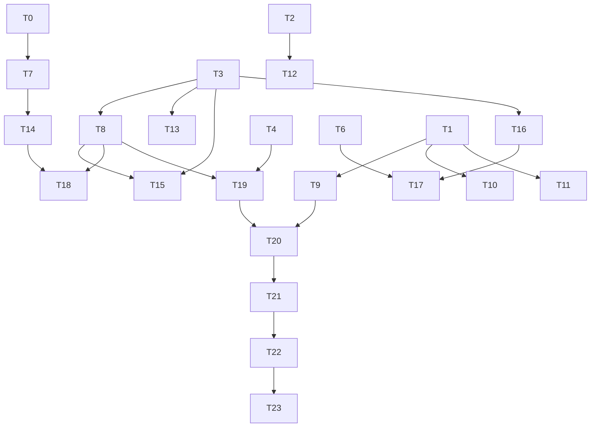

# Plan: Web 工作台六项增强 —— 代码卡片 / 显示设置 / 会话菜单 / 项目配置（0.17.0）

## Agent Worker Instructions

- Required sub-skills: `superpowers:subagent-driven-development` (preferred) or `superpowers:executing-plans`
- Execution mode: `subagent-driven-development` — fresh subagent per task, review between tasks
- Required verification (every task): scoped suite `npm --prefix agentj-ui test --workspace=@agentj/web -- <test file>` + full `npm --prefix agentj-ui test --workspace=@agentj/web` + `npm --prefix agentj-ui run build --workspace=@agentj/web` (scoped vitest MUST run via the workspace script — `npx vitest` from repo root does not load the web vite config/jsdom)
- Required verification (milestone task T23): additionally `npm --prefix agentj-ui test --workspace=@agentj/sdk`, `cargo test --workspace`, `cargo clippy --workspace --all-targets -- -D warnings`, `cargo test -p agentj-protocol -- drift`, `bun --cwd agentj-ui/apps/tui test`, `./scripts/check-version.sh`, `node agentj-ui/apps/desktop/check-desktop-ui.mjs`
- Version bump: feature → minor `0.16.5 → 0.17.0`; `PROTOCOL_VERSION` stays `0.13.0` (no protocol changes)
- Post-dev acceptance: the Playwright 实机验收（六项 + 深浅主题 + 键盘链路）runs via `/jskill-test-acceptance` after development; it is not part of T23
- Language: task titles/ACs/code in English; UI copy strings MUST use the exact Chinese defined in the design spec (`已复制`, `复制失败`, `清理所有会话…`, `过滤`, `排序`, `全部`, `仅收藏`, `最近更新`, `创建时间`, `显示`, `项目`, `恢复默认`, `编辑项目`)
- Scope: `agentj-ui/apps/web` + version strings only; the only new dependency is `rehype-highlight` (web workspace); `project_root` uses an existing v0.13.0 protocol capability (no backend edits)

**Goal:** Deliver six Web-workbench enhancements — markdown code blocks as highlightable/collapsible/copyable cards, per-zone display font settings plus code/line-height/density/reduced-motion controls, source-code file-tree icons, a sidebar session-list menu (filter/sort moved out of Settings), project editing (work dir / default project / default model) with `project_root` wiring, and a Settings "项目" panel with global defaults + list management.

**Architecture:** All changes stay inside `agentj-ui/apps/web`, reusing three existing patterns: the `sidebarPrefsStore` store recipe (JSON key + field validation + same-tab CustomEvent + cross-tab storage), the `TopbarMenu` hover-flyout menu pattern (mirrored right), and the `WorkspaceShell` inline-CSS-vars injection pattern. Display settings apply through a single last-imported override layer `components/displayPrefs.css` so no zone stylesheet is touched. Project extensions ride on the existing `projectStore` record (optional fields, zero migration).

**Tech Stack:** Vite + React 19 + `@agentj/sdk` + `@agentj/tokens` + `lucide-react` + `react-markdown`/`remark-gfm` + new `rehype-highlight`

## Global Constraints

- No Rust crate / `packages/sdk` runtime / `packages/protocol` changes except the `VERSION` string bump; `PROTOCOL_VERSION` frozen at `0.13.0`; `session/new` params gain `project_root` only (existing capability)
- New dependency: `rehype-highlight` only; all other code is pure React + CSS + `lucide-react`
- All colors via `var(--aj-*)`; no raw hex in new CSS
- CSS import order in `main.tsx`: `tokens.css` → `index.css` → `App.css` → `components/*.css`; `displayPrefs.css` MUST be the LAST component import (it is an override layer; equal-specificity later-import wins)
- CSS var fallbacks everywhere: every new `var(--aj-font-*, <current px>)` MUST carry the current value as fallback so jsdom tests and no-JS renders are unchanged
- localStorage keys are additive: `agentj.displayPrefs`, `agentj.projectDefaults`; existing keys never change meaning; old `Project` records (no new fields) are tolerated as "unset"
- Display default = current visuals: conversation 15px / left 13px / right 13px / code 12px anchors, line-height `1.55` (current body value; the spec's rounded `1.6` is superseded by this exact value to keep "default = current"), density `default`, reducedMotion `false`
- Reduced motion: manual toggle writes `documentElement[data-reduced-motion]`; the existing `@media (prefers-reduced-motion: reduce)` rules stay untouched
- UI copy strings (exact): `已复制`, `复制失败`, `清理所有会话…`, `过滤`, `排序`, `全部`, `仅收藏`, `最近更新`, `创建时间`, `显示`, `项目`, `恢复默认`, `编辑项目 <名称>`, `新项目工作目录`, `默认项目`
- `session/new` sends `project_root` only when the target project has a non-empty absolute `workDir`; otherwise params stay `{}`
- Commit per task with an English conventional message; stage only the task's files (plus regenerated lockfile for T14)

---

### T0: Add copyText clipboard util with legacy fallback [P0] [Sequential]

```yaml
- id: T0
  title: "Add copyText util with clipboard→execCommand fallback chain"
  files:
    - agentj-ui/apps/web/src/copyText.ts
    - agentj-ui/apps/web/src/copyText.test.ts
  depends_on: []
  breaking: false
  ac:
    - given: "navigator.clipboard.writeText resolves"
      when: "copyText('hello') is called"
      then: "it resolves true and writeText was called with 'hello'"
    - given: "navigator.clipboard.writeText rejects (non-secure context, e.g. http LAN)"
      when: "copyText('x') is called"
      then: "it falls back to a textarea + document.execCommand('copy') and resolves true when execCommand returns true"
    - given: "clipboard is undefined and execCommand returns false"
      when: "copyText('x') is called"
      then: "it resolves false and no exception escapes"
  regression:
    - "npm --prefix agentj-ui test --workspace=@agentj/web  # full suite stays green (util is additive)"
  test_code: |
    // agentj-ui/apps/web/src/copyText.test.ts
    import { afterEach, describe, expect, it, vi } from "vitest";
    import { copyText } from "./copyText";

    function setClipboard(value: unknown): void {
      Object.defineProperty(navigator, "clipboard", { value, configurable: true });
    }

    describe("copyText", () => {
      afterEach(() => {
        vi.restoreAllMocks();
        delete (document as unknown as { execCommand?: unknown }).execCommand;
      });

      it("uses navigator.clipboard when available", async () => {
        const writeText = vi.fn().mockResolvedValue(undefined);
        setClipboard({ writeText });
        await expect(copyText("hello")).resolves.toBe(true);
        expect(writeText).toHaveBeenCalledWith("hello");
      });

      it("falls back to textarea + execCommand when clipboard rejects", async () => {
        setClipboard({ writeText: vi.fn().mockRejectedValue(new Error("denied")) });
        const exec = vi.fn().mockReturnValue(true);
        (document as unknown as { execCommand: unknown }).execCommand = exec;
        await expect(copyText("fallback")).resolves.toBe(true);
        expect(exec).toHaveBeenCalledWith("copy");
      });

      it("returns false when both paths fail without throwing", async () => {
        setClipboard(undefined);
        (document as unknown as { execCommand: unknown }).execCommand = vi.fn().mockReturnValue(false);
        await expect(copyText("nope")).resolves.toBe(false);
      });
    });
  impl_code: |
    // agentj-ui/apps/web/src/copyText.ts
    // 1) export async function copyText(text: string): Promise<boolean>
    // 2) try navigator.clipboard?.writeText → true (guard typeof navigator/document for SSR/jsdom)
    // 3) legacyCopy(text): create textarea, set value + readonly + position:fixed + opacity:0,
    //    appendChild, select(), const ok = document.execCommand("copy"); removeChild; return ok
    // 4) catch everything, always return boolean (never throw)
  verify:
    - "npm --prefix agentj-ui test --workspace=@agentj/web -- src/copyText.test.ts"
    - "npm --prefix agentj-ui test --workspace=@agentj/web"
```

### T1: Create displayPrefsStore for per-zone display settings [P0] [Sequential]

```yaml
- id: T1
  title: "Create displayPrefsStore mirroring sidebarPrefsStore recipe"
  files:
    - agentj-ui/apps/web/src/displayPrefsStore.ts
    - agentj-ui/apps/web/src/displayPrefsStore.test.ts
  depends_on: []
  breaking: false
  ac:
    - given: "localStorage is empty"
      when: "loadDisplayPrefs() is called"
      then: "returns {fontConversation:'md',fontLeft:'md',fontRight:'md',fontCode:'md',lineHeight:'default',density:'default',reducedMotion:false}"
    - given: "a JSON object with invalid enum values (fontLeft:'huge', density:'dense') and non-boolean reducedMotion"
      when: "loadDisplayPrefs() is called"
      then: "each invalid field falls back to its default field-by-field and valid fields are kept"
    - given: "saveDisplayPrefs({fontConversation:'lg'}) is called"
      when: "the same-tab event 'agentj:display-prefs-updated' fires"
      then: "subscribers receive the merged prefs and localStorage agentj.displayPrefs contains fontConversation:'lg'"
    - given: "a subscribeDisplayPrefs subscriber is active"
      when: "a 'storage' event for key agentj.displayPrefs fires (cross-tab)"
      then: "the subscriber is invoked with re-read prefs"
  regression:
    - "npm --prefix agentj-ui test --workspace=@agentj/web -- src/sidebarPrefsStore.test.ts  # recipe unchanged"
  test_code: |
    // agentj-ui/apps/web/src/displayPrefsStore.test.ts
    import { beforeEach, describe, expect, it, vi } from "vitest";
    import {
      DISPLAY_PREFS_DEFAULTS, DISPLAY_PREFS_EVENT, DISPLAY_PREFS_KEY,
      loadDisplayPrefs, saveDisplayPrefs, subscribeDisplayPrefs,
    } from "./displayPrefsStore";

    describe("displayPrefsStore", () => {
      beforeEach(() => localStorage.clear());

      it("returns defaults when storage is empty", () => {
        expect(loadDisplayPrefs()).toEqual(DISPLAY_PREFS_DEFAULTS);
      });

      it("falls back field-by-field on malformed values", () => {
        localStorage.setItem(DISPLAY_PREFS_KEY, JSON.stringify({
          fontConversation: "lg", fontLeft: "huge", density: "dense", reducedMotion: "yes",
        }));
        const prefs = loadDisplayPrefs();
        expect(prefs.fontConversation).toBe("lg");
        expect(prefs.fontLeft).toBe("md");
        expect(prefs.density).toBe("default");
        expect(prefs.reducedMotion).toBe(false);
      });

      it("persists patches and notifies same-tab subscribers", () => {
        const seen = vi.fn();
        const unsub = subscribeDisplayPrefs(seen);
        const next = saveDisplayPrefs({ fontCode: "xl" });
        expect(next.fontCode).toBe("xl");
        expect(JSON.parse(localStorage.getItem(DISPLAY_PREFS_KEY)!)).toMatchObject({ fontCode: "xl" });
        expect(seen).toHaveBeenCalledWith(expect.objectContaining({ fontCode: "xl" }));
        unsub();
      });

      it("re-reads on cross-tab storage events", () => {
        const seen = vi.fn();
        const unsub = subscribeDisplayPrefs(seen);
        window.dispatchEvent(new StorageEvent("storage", { key: DISPLAY_PREFS_KEY }));
        expect(seen).toHaveBeenCalled();
        unsub();
      });
    });
  impl_code: |
    // agentj-ui/apps/web/src/displayPrefsStore.ts — copy the sidebarPrefsStore.ts recipe:
    // 1) types FontScale="sm"|"md"|"lg"|"xl"; DisplayLineHeight="compact"|"default"|"relaxed";
    //    DisplayDensity="default"|"compact"; DisplayPrefs = {fontConversation,fontLeft,fontRight,fontCode,
    //    lineHeight,density,reducedMotion}
    // 2) DISPLAY_PREFS_KEY="agentj.displayPrefs"; DISPLAY_PREFS_EVENT="agentj:display-prefs-updated";
    //    DISPLAY_PREFS_DEFAULTS={...all 'md' except lineHeight:'default',density:'default',reducedMotion:false}
    // 3) readRaw/writeRaw/safeParse private helpers (try/catch); isFontScale/isLineHeight/isDensity guards
    // 4) loadDisplayPrefs(): field-by-field validation with defaults
    // 5) saveDisplayPrefs(patch): merge over loadDisplayPrefs(), persist JSON, dispatch CustomEvent(detail=next), return next
    // 6) subscribeDisplayPrefs(cb): same-tab event + window "storage" filtered by key; return unsubscribe
  verify:
    - "npm --prefix agentj-ui test --workspace=@agentj/web -- src/displayPrefsStore.test.ts"
    - "npm --prefix agentj-ui test --workspace=@agentj/web"
```

### T2: Extend fileIcons with source-code extensions, db category and filename specials [P1] [Sequential]

```yaml
- id: T2
  title: "Extend fileIcons.ts with source langs, db category and Dockerfile/Makefile specials"
  files:
    - agentj-ui/apps/web/src/fileIcons.ts
    - agentj-ui/apps/web/src/fileIcons.test.ts
  depends_on: []
  breaking: false
  ac:
    - given: "a file named main.rs / main.go / app.py / Main.java / lib.c / lib.cpp"
      when: "fileIconFor(name) is called"
      then: "each returns category 'code' (was 'default' before this task)"
    - given: "a file named schema.sql / data.db / cache.sqlite"
      when: "fileIconFor(name) is called"
      then: "each returns category 'db' with the lucide Database icon"
    - given: "files named Dockerfile / Makefile / CMakeLists.txt (no or non-code extension)"
      when: "fileIconFor(name) is called"
      then: "each returns category 'code'"
    - given: "a file named data.xyz or LICENSE"
      when: "fileIconFor(name) is called"
      then: "still falls back to {Icon: File, category: 'default'}"
    - given: "the db category resolves to a renderable icon"
      when: "the existing renderable-icon pattern (typeof Icon === 'object') is applied to schema.sql / data.db"
      then: "both resolve with category 'db' and a component object Icon (no JSX needed in this .ts test file)"
  regression:
    - "npm --prefix agentj-ui test --workspace=@agentj/web -- src/fileIcons.test.ts  # existing rows (tsx/vue/json/md/scss/toml/sh/png/gz/lock/…) unchanged"
    - "npm --prefix agentj-ui test --workspace=@agentj/web -- src/components/fileTree.test.tsx"
  test_code: |
    // agentj-ui/apps/web/src/fileIcons.test.ts — append cases to the existing table
    // ALSO update the existing fallback test (line 47): remove the Makefile→default assertion
    // (Makefile now maps to code via filename specials); keep LICENSE / data.xyz.
    const rows: Array<[string, string]> = [
      ["main.rs", "code"], ["main.go", "code"], ["app.py", "code"], ["Main.java", "code"],
      ["lib.c", "code"], ["lib.h", "code"], ["lib.cpp", "code"], ["lib.hpp", "code"],
      ["prog.cs", "code"], ["app.rb", "code"], ["index.php", "code"], ["Main.kt", "code"],
      ["App.swift", "code"], ["app.scala", "code"], ["init.lua", "code"], ["main.dart", "code"],
      ["script.r", "code"], ["task.ex", "code"], ["core.exs", "code"], ["main.hs", "code"],
      ["core.clj", "code"], ["service.proto", "code"], ["schema.graphql", "code"],
      ["index.html", "code"], ["data.xml", "code"],
      ["schema.sql", "db"], ["data.db", "db"], ["cache.sqlite", "db"],
    ];
    test.each(rows)("maps %s to %s", (name, category) => {
      expect(fileIconFor(name).category).toBe(category);
    });
    test("maps build files by name", () => {
      for (const name of ["Dockerfile", "Makefile", "CMakeLists.txt"]) {
        expect(fileIconFor(name).category).toBe("code");
      }
    });

    test("resolves the db icon via the renderable-icon pattern", () => {
      for (const name of ["schema.sql", "data.db"]) {
        const match = fileIconFor(name);
        expect(match.category).toBe("db");
        expect(typeof match.Icon).toBe("object");
      }
    });
  impl_code: |
    // agentj-ui/apps/web/src/fileIcons.ts
    // 1) import Database from lucide-react; add "db" to FileCategory union
    // 2) extend the code category extensions with:
    //    rs,go,py,rb,java,kt,kts,scala,swift,c,h,cpp,hpp,cc,cxx,hh,cs,php,lua,dart,r,pl,pm,ex,exs,erl,hrl,hs,clj,cljs,cljc,ml,fs,fsx,vb,jl,zig,nim,proto,graphql,gql,html,htm,xml
    // 3) add { category:"db", Icon: Database, extensions:["sql","db","sqlite","sqlite3"] }
    // 4) const FILENAME_SPECIALS: Record<string, FileCategory> = { Dockerfile:"code", Makefile:"code", "CMakeLists.txt":"code" }
    // 5) fileIconFor(name): basename after '/' first; check FILENAME_SPECIALS[basename] → return its category icon;
    //    else existing extension scan; fallback File/default unchanged
    // 6) keep the export surface: FileCategory, FileIconMatch, extensionOf, fileIconFor
  verify:
    - "npm --prefix agentj-ui test --workspace=@agentj/web -- src/fileIcons.test.ts"
    - "npm --prefix agentj-ui test --workspace=@agentj/web"
```

### T3: Extend projectStore with project fields, update/delete and defaults [P0] [Sequential]

```yaml
- id: T3
  title: "Extend projectStore: workDir/isDefault/defaultModel/defaultAgent, updateProject, deleteProject, projectDefaults"
  files:
    - agentj-ui/apps/web/src/projectStore.ts
    - agentj-ui/apps/web/src/projectStore.test.ts
  depends_on: []
  breaking: false
  ac:
    - given: "an old Project record {id,name,createdAt} without the new fields"
      when: "loadProjects() is called"
      then: "the record is returned as-is (fields read as undefined = unset); no migration write happens"
    - given: "projects A (isDefault false) and B"
      when: "updateProject('B', {isDefault:true}) is called"
      then: "B.isDefault is true, A.isDefault is cleared, and 'agentj:projects-updated' fires once"
    - given: "updateProject('A', {name:'Renamed'}) when another project already uses 'Renamed'"
      when: "it persists"
      then: "the stored name is deduplicated to 'Renamed (2)' (existing dedupName rule)"
    - given: "a project C with 3 sessions in agentj.projectMap"
      when: "deleteProject(C) is called"
      then: "it returns {reassigned:3}, C is removed, and the 3 map entries now point to 'default'"
    - given: "deleteProject('default') is called"
      when: "it runs"
      then: "it returns null and the projects list is unchanged (Inbox guard)"
    - given: "agentj.currentProject is missing and project B has isDefault:true"
      when: "loadCurrentProject() is called"
      then: "it returns B.id (fallback chain: stored → isDefault → 'default')"
    - given: "saveProjectDefaults({workDir:'/repo'}) was called"
      when: "loadProjectDefaults() is called"
      then: "it returns {workDir:'/repo'}; malformed JSON falls back to {workDir:null}"
  regression:
    - "npm --prefix agentj-ui test --workspace=@agentj/web -- src/projectStore.test.ts  # existing create/assign/get/fallback cases (updated only where the fallback chain is extended)"
    - "npm --prefix agentj-ui test --workspace=@agentj/web -- src/components/UnifiedSidebar.test.tsx"
  test_code: |
    // agentj-ui/apps/web/src/projectStore.test.ts — append
    it("updateProject enforces a single default project", () => {
      localStorage.clear();
      const a = createProject("Alpha");
      const b = createProject("Beta");
      updateProject(b.id, { isDefault: true });
      const list = loadProjects();
      expect(list.find((p) => p.id === b.id)?.isDefault).toBe(true);
      expect(list.find((p) => p.id === a.id)?.isDefault).toBeFalsy();
    });
    it("deleteProject reassigns sessions and reports the count", () => {
      localStorage.clear();
      const p = createProject("Gamma");
      assignSession("s1", p.id); assignSession("s2", p.id); assignSession("s3", p.id);
      expect(sessionCountForProject(p.id)).toBe(3);
      expect(deleteProject(p.id)).toEqual({ reassigned: 3 });
      expect(loadProjects().some((x) => x.id === p.id)).toBe(false);
      expect(getProjectForSession("s1")).toBe("default");
    });
    it("refuses to delete the Inbox project", () => {
      localStorage.clear();
      loadProjects();
      expect(deleteProject("default")).toBeNull();
      expect(loadProjects().some((x) => x.id === "default")).toBe(true);
    });
    it("loadCurrentProject falls back to the default project", () => {
      localStorage.clear();
      const b = createProject("Beta");
      updateProject(b.id, { isDefault: true });
      localStorage.removeItem("agentj.currentProject");
      expect(loadCurrentProject()).toBe(b.id);
    });
    it("persists project defaults with tolerant parsing", () => {
      localStorage.clear();
      expect(loadProjectDefaults()).toEqual({ workDir: null });
      saveProjectDefaults({ workDir: "/repo" });
      expect(loadProjectDefaults()).toEqual({ workDir: "/repo" });
      localStorage.setItem("agentj.projectDefaults", "{oops");
      expect(loadProjectDefaults()).toEqual({ workDir: null });
    });
    it("tolerates legacy records without the new fields", () => {
      localStorage.clear();
      localStorage.setItem("agentj.projects", JSON.stringify([
        { id: "default", name: "Inbox", createdAt: 0 },
        { id: "p1", name: "Legacy", createdAt: 1 },
      ]));
      const list = loadProjects();
      expect(list.find((p) => p.id === "p1")).toMatchObject({ name: "Legacy" });
      expect(list.find((p) => p.id === "p1")?.workDir).toBeUndefined();
    });
    it("dedups names through updateProject", () => {
      localStorage.clear();
      createProject("Alpha");
      const beta = createProject("Beta");
      updateProject(beta.id, { name: "Alpha" });
      expect(loadProjects().find((p) => p.id === beta.id)?.name).toBe("Alpha (2)");
    });
    it("recomputes current and default when deleting the default project", () => {
      localStorage.clear();
      const beta = createProject("Beta");
      updateProject(beta.id, { isDefault: true });
      setCurrentProject(beta.id);
      expect(deleteProject(beta.id)).toEqual({ reassigned: 0 });
      expect(loadCurrentProject()).toBe("default");
      expect(loadProjects().some((p) => p.isDefault)).toBe(false);
    });
  impl_code: |
    // agentj-ui/apps/web/src/projectStore.ts
    // 1) Project += workDir?: string|null; isDefault?: boolean; defaultModel?: string|null; defaultAgent?: string|null
    // 2) createProject(name, workDir?: string) — normalize: trim, "" → null; set on the new record
    // 3) updateProject(id, patch: Partial<Pick<Project,"name"|"workDir"|"isDefault"|"defaultModel"|"defaultAgent">>): Project|null
    //    - find; dedup name via existing dedupName; isDefault:true clears others; normalize empty strings to null;
    //      persist + notifyProjectsUpdated; return updated record
    // 4) renameProject delegates to updateProject (keeps validating name); now also notifies
    // 5) deleteProject(id): id==="default" → null; else remove, rewrite projectMap entries → "default",
    //    delete collapsed[id], fix current (remove key if it was the deleted id), clear isDefault loss,
    //    persist all, notifyProjectsUpdated + notifyCurrentProjectUpdated when current changed; return {reassigned}
    // 6) sessionCountForProject(id): count values in loadMapRaw() === id
    // 7) getDefaultProject(): projects.find(p => p.isDefault) ?? loadProjects()[0]
    // 8) loadCurrentProject(): stored valid → stored; else getDefaultProject().id; else "default"
    // 9) KEY_PROJECT_DEFAULTS="agentj.projectDefaults"; loadProjectDefaults(): {workDir:string|null} tolerant;
    //    saveProjectDefaults(patch) merges + persists
  verify:
    - "npm --prefix agentj-ui test --workspace=@agentj/web -- src/projectStore.test.ts"
    - "npm --prefix agentj-ui test --workspace=@agentj/web"
```

### T4: Add a modal stack so nested dialogs close top-most only [P1] [Sequential]

```yaml
- id: T4
  title: "Add module-level modal stack to ModalDialog (top-most handles Esc/backdrop)"
  files:
    - agentj-ui/apps/web/src/components/ModalDialog.tsx
    - agentj-ui/apps/web/src/components/modalDialog.test.tsx
  depends_on: []
  breaking: false
  ac:
    - given: "two ModalDialogs are mounted (settings → project edit)"
      when: "Escape is pressed once"
      then: "only the second (top-most) dialog's onClose is called"
    - given: "the top-most dialog is unmounted after the first Escape"
      when: "Escape is pressed again"
      then: "the remaining dialog's onClose is called"
    - given: "a mousedown lands on the top-most dialog's backdrop"
      when: "it is handled"
      then: "only the top-most dialog closes (lower dialog stays mounted)"
    - given: "a single dialog is open (existing usages)"
      when: "Escape or backdrop mousedown happens"
      then: "behaviour is unchanged (regression)"
  regression:
    - "npm --prefix agentj-ui test --workspace=@agentj/web -- src/components/modalDialog.test.tsx"
    - "npm --prefix agentj-ui test --workspace=@agentj/web -- src/components/topbarMenu.test.tsx"
    - "npm --prefix agentj-ui test --workspace=@agentj/web -- src/components/settingsDialog.test.tsx"
  test_code: |
    // agentj-ui/apps/web/src/components/modalDialog.test.tsx — append
    it("closes only the top-most dialog on Escape", () => {
      const closeA = vi.fn();
      const closeB = vi.fn();
      render(<ModalDialog title="A" onClose={closeA}>a</ModalDialog>);
      render(<ModalDialog title="B" onClose={closeB}>b</ModalDialog>);
      fireEvent.keyDown(document, { key: "Escape" });
      expect(closeB).toHaveBeenCalledTimes(1);
      expect(closeA).not.toHaveBeenCalled();
    });
    it("passes Escape through to the next dialog after the top one unmounts", () => {
      const closeA = vi.fn();
      const closeB = vi.fn();
      const { rerender } = render(
        <>
          <ModalDialog title="A" onClose={closeA}>a</ModalDialog>
          <ModalDialog title="B" onClose={closeB}>b</ModalDialog>
        </>,
      );
      fireEvent.keyDown(document, { key: "Escape" });
      rerender(<ModalDialog title="A" onClose={closeA}>a</ModalDialog>);
      fireEvent.keyDown(document, { key: "Escape" });
      expect(closeA).toHaveBeenCalledTimes(1);
    });
  impl_code: |
    // agentj-ui/apps/web/src/components/ModalDialog.tsx
    // 1) module scope: const modalStack: number[] = []; let nextModalId = 1;
    // 2) component: const idRef = useRef<number>(); if (idRef.current == null) idRef.current = nextModalId++;
    // 3) useEffect on mount: modalStack.push(id); cleanup: splice the id out
    // 4) isTop = () => modalStack[modalStack.length-1] === idRef.current
    // 5) keydown Escape handler: only call onCloseRef.current() when isTop()
    // 6) backdrop onMouseDown: same isTop() guard
    // 7) everything else (portal, aria, card classes) unchanged
    // 8) focus management unchanged: callers own refocus (nested-scenario focus return is asserted in T19)
  verify:
    - "npm --prefix agentj-ui test --workspace=@agentj/web -- src/components/modalDialog.test.tsx"
    - "npm --prefix agentj-ui test --workspace=@agentj/web"
```

### T5: Add displayPrefs.css override layer and import it last [P0] [Sequential]

```yaml
- id: T5
  title: "Add displayPrefs.css override layer (zones + density + reduced motion) imported last in main.tsx"
  files:
    - agentj-ui/apps/web/src/components/displayPrefs.css
    - agentj-ui/apps/web/src/displayPrefsCss.test.ts
    - agentj-ui/apps/web/src/main.tsx
  depends_on: []
  breaking: false
  ac:
    - given: "displayPrefs.css exists"
      when: "the file is read as text"
      then: "it contains `font-size: var(--aj-font-conv, 15px)` on .aj-conv, `var(--aj-font-left, 13px)`, `var(--aj-font-right, 13px)`, `var(--aj-font-code, 12px)` usages and a `--aj-lh-conv` line-height"
    - given: "the stylesheet is an override layer"
      when: "main.tsx import order is read"
      then: "the index of `components/displayPrefs.css` is greater than the index of `components/conversation.css` and `components/dialog.css` (last component import)"
    - given: "density and motion hooks are declared"
      when: "the file is read as text"
      then: "it contains `.aj-workspace[data-density=\"compact\"]` rules and a `:root[data-reduced-motion=\"true\"]` kill-switch for transitions/animations"
    - given: "no display prefs are applied (jsdom / plain render)"
      when: "any zone stylesheet renders"
      then: "every new var() usage carries the current px value as fallback so rendering is unchanged"
  regression:
    - "npm --prefix agentj-ui test --workspace=@agentj/web -- src/theme.test.ts"
    - "npm --prefix agentj-ui test --workspace=@agentj/web -- src/components/scaffold.test.ts"
    - "npm --prefix agentj-ui run build --workspace=@agentj/web"
  test_code: |
    // agentj-ui/apps/web/src/displayPrefsCss.test.ts
    import { describe, expect, it } from "vitest";
    import { readFileSync } from "node:fs";
    import { dirname, join } from "node:path";
    import { fileURLToPath } from "node:url";

    const here = dirname(fileURLToPath(import.meta.url));
    const css = readFileSync(join(here, "components/displayPrefs.css"), "utf8");
    const main = readFileSync(join(here, "main.tsx"), "utf8");

    describe("displayPrefs.css override layer", () => {
      it("consumes all four zone font vars with current-value fallbacks", () => {
        expect(css).toMatch(/var\(--aj-font-conv,\s*15px\)/);
        expect(css).toMatch(/var\(--aj-font-left,\s*13px\)/);
        expect(css).toMatch(/var\(--aj-font-right,\s*13px\)/);
        expect(css).toMatch(/var\(--aj-font-code,\s*12px\)/);
        expect(css).toMatch(/--aj-lh-conv/);
      });
      it("is imported as the last component stylesheet", () => {
        const target = main.indexOf("components/displayPrefs.css");
        expect(target).toBeGreaterThan(main.indexOf("components/conversation.css"));
        expect(target).toBeGreaterThan(main.indexOf("components/dialog.css"));
        expect(target).toBeGreaterThan(main.indexOf("components/topbarmenu.css"));
      });
      it("declares density and reduced-motion hooks", () => {
        expect(css).toContain('.aj-workspace[data-density="compact"]');
        expect(css).toContain(':root[data-reduced-motion="true"]');
      });
    });
  impl_code: |
    // agentj-ui/apps/web/src/components/displayPrefs.css — single override layer (later import wins at equal specificity):
    // -- conversation zone (.aj-conv root carries size+line-height; explicit smaller surfaces stay adapted):
    //    .aj-conv { font-size: var(--aj-font-conv, 15px); line-height: var(--aj-lh-conv, 1.55); }
    //    .aj-ai code { font-size: calc(var(--aj-font-code, 12px) - 0.5px); }
    //    .aj-tool-output { font-size: var(--aj-font-code, 12px); }
    //    .aj-composer-card .aj-input { font-size: calc(var(--aj-font-conv, 15px) - 1px); }
    //    .aj-composer__project-btn { font-size: calc(var(--aj-font-conv, 15px) - 2px); }
    // -- trajectory (same group as conversation):
    //    .aj-traj-title { font-size: calc(var(--aj-font-conv, 15px) - 2px); }   /* 13 at md */
    //    .aj-traj-seq { font-size: calc(var(--aj-font-conv, 15px) - 3px); }     /* 12 at md */
    // -- left zone:
    //    .aj-sidebar__body, .aj-sidebar__search input, .aj-seg button, .aj-sidebar .btn-primary { font-size: var(--aj-font-left, 13px); }
    //    .aj-sess__title { font-size: calc(var(--aj-font-left, 13px) - 1px); }  /* 12 at md */
    //    .tree { font-size: calc(var(--aj-font-left, 13px) - 0.5px); }          /* 12.5 at md */
    //    .aj-sess__meta, .section-label, .aj-sidebar__subgroup-title, .left-foot { font-size: calc(var(--aj-font-left, 13px) - 2px); }
    //    .trow .status-txt { font-size: calc(var(--aj-font-left, 13px) - 3px); }
    // -- right zone:
    //    .aj-right__title, .aj-right__collapse, .sec-head { font-size: calc(var(--aj-font-right, 13px) + 1px); } /* 14 at md */
    //    .todo-label { font-size: var(--aj-font-right, 13px); }
    //    .fc-path { font-size: calc(var(--aj-font-right, 13px) - 0.5px); }      /* 12.5 at md */
    //    .diff { font-size: calc(var(--aj-font-code, 12px) - 0.5px); }          /* 11.5 at md */
    // -- density compact (gaps/paddings only, no hit-area shrink):
    //    .aj-workspace[data-density="compact"] .aj-conv { gap: 6px; }
    //    .aj-workspace[data-density="compact"] .aj-sess { min-height: 48px; padding: 6px 30px 6px 10px; }
    //    .aj-workspace[data-density="compact"] .aj-composer-card { gap: 6px; padding: 10px 16px; }
    //    .aj-workspace[data-density="compact"] .sec-body { padding: 0 12px 6px; }
    //    .aj-workspace[data-density="compact"] .fc { padding: 5px 9px; }
    // -- reduced motion kill-switch:
    //    :root[data-reduced-motion="true"] *, :root[data-reduced-motion="true"] *::before,
    //    :root[data-reduced-motion="true"] *::after { transition: none !important; animation: none !important; }
    // main.tsx: append `import "./components/displayPrefs.css";` AFTER `import "./components/dialog.css";`
  verify:
    - "npm --prefix agentj-ui test --workspace=@agentj/web -- src/displayPrefsCss.test.ts"
    - "npm --prefix agentj-ui test --workspace=@agentj/web"
    - "npm --prefix agentj-ui run build --workspace=@agentj/web"
```

### T6: Create SessionListMenu with hover flyouts for filter/sort [P0] [Sequential]

```yaml
- id: T6
  title: "Create SessionListMenu (cleanup + filter/sort hover flyouts, mirrored to the right)"
  files:
    - agentj-ui/apps/web/src/components/SessionListMenu.tsx
    - agentj-ui/apps/web/src/components/sessionListMenu.test.tsx
    - agentj-ui/apps/web/src/components/topbarmenu.css
  depends_on: []
  breaking: false
  ac:
    - given: "the trigger button is clicked"
      when: "the menu renders"
      then: "it shows a role=menu with 清理所有会话…, 过滤 › and 排序 › rows (aria-haspopup=menu on both rows)"
    - given: "deletableCount is 0"
      when: "the menu is open"
      then: "清理所有会话… has aria-disabled=true and does not call onCleanup when clicked"
    - given: "the pointer enters the 过滤 row"
      when: "the flyout opens"
      then: "it contains menuitemradio options 全部 / 仅收藏 with ✓ on the current sidebarPrefs.filter"
    - given: "仅收藏 is clicked in the filter flyout"
      when: "the click is handled"
      then: "saveSidebarPrefs({filter:'favorites'}) is persisted and the menu closes"
    - given: "a flyout is open"
      when: "Escape is pressed once"
      then: "only the flyout closes; a second Escape closes the menu"
    - given: "a mousedown lands outside the component root"
      when: "it is handled"
      then: "menu and flyout both close"
  regression:
    - "npm --prefix agentj-ui test --workspace=@agentj/web -- src/sidebarPrefsStore.test.ts"
    - "npm --prefix agentj-ui test --workspace=@agentj/web -- src/components/topbarMenu.test.tsx"
  test_code: |
    // agentj-ui/apps/web/src/components/sessionListMenu.test.tsx
    import { fireEvent, render, screen } from "@testing-library/react";
    import { beforeEach, describe, expect, it, vi } from "vitest";
    import SessionListMenu from "./SessionListMenu";
    import { loadSidebarPrefs } from "../sidebarPrefsStore";

    function open(): void {
      fireEvent.click(screen.getByRole("button", { name: "会话列表菜单" }));
    }

    describe("SessionListMenu", () => {
      beforeEach(() => localStorage.clear());

      it("opens and runs the cleanup action", () => {
        const onCleanup = vi.fn();
        render(<SessionListMenu deletableCount={3} onCleanup={onCleanup} />);
        open();
        fireEvent.click(screen.getByRole("menuitem", { name: "清理所有会话…" }));
        expect(onCleanup).toHaveBeenCalledTimes(1);
        expect(screen.queryByRole("menu")).toBeNull();
      });

      it("disables cleanup when nothing is deletable", () => {
        const onCleanup = vi.fn();
        render(<SessionListMenu deletableCount={0} onCleanup={onCleanup} />);
        open();
        const item = screen.getByRole("menuitem", { name: "清理所有会话…" });
        expect(item).toHaveAttribute("aria-disabled", "true");
        fireEvent.click(item);
        expect(onCleanup).not.toHaveBeenCalled();
      });

      it("hover opens the filter flyout and persists a pick", () => {
        render(<SessionListMenu deletableCount={1} onCleanup={() => {}} />);
        open();
        fireEvent.mouseEnter(screen.getByRole("menuitem", { name: /过滤/ }));
        fireEvent.click(screen.getByRole("menuitemradio", { name: /仅收藏/ }));
        expect(loadSidebarPrefs().filter).toBe("favorites");
        expect(screen.queryByRole("menu")).toBeNull();
      });

      it("Escape closes the flyout first, then the menu", () => {
        render(<SessionListMenu deletableCount={1} onCleanup={() => {}} />);
        open();
        fireEvent.mouseEnter(screen.getByRole("menuitem", { name: /排序/ }));
        expect(screen.getByRole("menu", { name: "排序" })).toBeTruthy();
        fireEvent.keyDown(document, { key: "Escape" });
        expect(screen.queryByRole("menu", { name: "排序" })).toBeNull();
        expect(screen.getByRole("menu")).toBeTruthy();
        fireEvent.keyDown(document, { key: "Escape" });
        expect(screen.queryByRole("menu")).toBeNull();
      });

      it("closes on outside mousedown", () => {
        render(<SessionListMenu deletableCount={1} onCleanup={() => {}} />);
        open();
        fireEvent.mouseDown(document.body);
        expect(screen.queryByRole("menu")).toBeNull();
      });

      it("ArrowDown roams the flyout items", () => {
        // import act alongside fireEvent/render/screen
        render(<SessionListMenu deletableCount={1} onCleanup={() => {}} />);
        open();
        fireEvent.mouseEnter(screen.getByRole("menuitem", { name: /过滤/ }));
        fireEvent.keyDown(screen.getByRole("menu", { name: "过滤" }), { key: "ArrowDown" });
        expect(document.activeElement?.textContent).toMatch(/全部/);
      });

      it("closes the flyout after the 120ms leave delay", () => {
        vi.useFakeTimers();
        render(<SessionListMenu deletableCount={1} onCleanup={() => {}} />);
        open();
        fireEvent.mouseEnter(screen.getByRole("menuitem", { name: /过滤/ }));
        fireEvent.mouseLeave(screen.getByRole("menuitem", { name: /过滤/ }));
        act(() => { vi.advanceTimersByTime(150); });
        expect(screen.queryByRole("menu", { name: "过滤" })).toBeNull();
        vi.useRealTimers();
      });
    });
  impl_code: |
    // agentj-ui/apps/web/src/components/SessionListMenu.tsx
    // Props: { deletableCount: number; busy?: boolean; onCleanup: () => void }
    // 1) Reuse the TopbarMenu flyout recipe: FLYOUT_CLOSE_DELAY_MS=120, cancelClose/scheduleClose timerRef,
    //    document keydown Escape layering (flyout first, then menu), outside-mousedown via rootRef,
    //    onFlyoutKeyDown ArrowUp/Down cycling menuitem/menuitemradio
    // 2) prefs: useState(loadSidebarPrefs) + useEffect(() => subscribeSidebarPrefs(setPrefs), [])
    // 3) trigger: <button className="aj-button--ghost aj-sidebar__menu-btn" aria-haspopup="menu"
    //    aria-expanded={open} aria-label="会话列表菜单"><MoreHorizontal size={14}/></button>
    //    (lucide-react export MoreHorizontal; fallback Ellipsis if the installed version recommends it)
    // 4) menu: <div className="aj-menu aj-sidebar__menu" role="menu">
    //      清理所有会话…: role=menuitem class "aj-menu__item aj-menu__item--danger",
    //        aria-disabled={deletableCount === 0}, click → guard + onCleanup() + closeAll()
    //      separator; 过滤 row → flyout menu aria-label="过滤": menuitemradio 全部/仅收藏 (✓ aria-checked)
    //      排序 row → flyout menu aria-label="排序": menuitemradio 最近更新/创建时间
    //      pick handler → saveSidebarPrefs({filter}) / saveSidebarPrefs({sort}) then closeAll()
    //    Rows mirror TopbarMenu markup: .aj-menu__row + .aj-menu__item + .aj-menu__chevron › +
    //      .aj-menu__flyout .aj-menu__flyout--right + hover bridge
    // topbarmenu.css additions:
    //   .aj-sidebar__menu-btn { display:inline-flex; align-items:center; justify-content:center; }
    //   .aj-sidebar__menu { right:auto; left:0; }
    //   .aj-menu__flyout--right { right:auto; left:calc(100% + 6px); }
    //   .aj-menu__flyout--right::before { right:auto; left:-8px; }
    //   .aj-menu__item--danger { color: var(--aj-error); }
    //   .aj-menu__item[aria-disabled="true"] { opacity:.5; cursor:not-allowed; }
  verify:
    - "npm --prefix agentj-ui test --workspace=@agentj/web -- src/components/sessionListMenu.test.tsx"
    - "npm --prefix agentj-ui test --workspace=@agentj/web"
    - "npm --prefix agentj-ui run build --workspace=@agentj/web"
```

### T7: Create CodeBlockCard with collapse, copy and hljs theme [P0] [Sequential]

```yaml
- id: T7
  title: "Create CodeBlockCard (language label, collapse toggle, copy feedback) + codeblock.css hljs theme"
  files:
    - agentj-ui/apps/web/src/components/CodeBlockCard.tsx
    - agentj-ui/apps/web/src/components/codeblock.css
    - agentj-ui/apps/web/src/components/codeBlockCard.test.tsx
  depends_on: [T0]
  breaking: false
  ac:
    - given: "children render a <code class=language-rust> element"
      when: "CodeBlockCard renders"
      then: "the header shows the language label 'rust' and a copy button labeled 复制代码"
    - given: "the card is expanded"
      when: "the toggle button is clicked"
      then: "the pre element gets hidden=true and the toggle aria-expanded flips to false; a second click restores it"
    - given: "copyText resolves true"
      when: "the copy button is clicked"
      then: "a role=status region shows 已复制"
    - given: "copyText resolves false"
      when: "the copy button is clicked"
      then: "the status region shows 复制失败"
    - given: "the card is collapsed"
      when: "the component re-renders with appended children text (streaming)"
      then: "the card stays collapsed (state survives re-render)"
    - given: "children render a <code> element without a language class (unknown/plain language)"
      when: "CodeBlockCard renders"
      then: "the card renders with the fallback label 'code' and a working copy button (no crash, no highlight required)"
  regression:
    - "npm --prefix agentj-ui test --workspace=@agentj/web -- src/RunPanel.test.tsx"
    - "npm --prefix agentj-ui run build --workspace=@agentj/web  # component-level CSS import (WorkspaceShell precedent)"
  test_code: |
    // agentj-ui/apps/web/src/components/codeBlockCard.test.tsx
    import { fireEvent, render, screen } from "@testing-library/react";
    import { beforeEach, describe, expect, it, vi } from "vitest";
    import CodeBlockCard from "./CodeBlockCard";
    import { copyText } from "../copyText";

    vi.mock("../copyText", () => ({ copyText: vi.fn() }));

    const code = <code className="language-rust">{"fn main() {}"}</code>;

    describe("CodeBlockCard", () => {
      beforeEach(() => vi.mocked(copyText).mockReset());

      it("shows the language and toggles collapse", () => {
        render(<CodeBlockCard>{code}</CodeBlockCard>);
        expect(screen.getByText("rust")).toBeTruthy();
        fireEvent.click(screen.getByRole("button", { name: "折叠代码" }));
        expect((document.querySelector(".aj-code__body") as HTMLPreElement).hidden).toBe(true);
        expect(screen.getByRole("button", { name: "展开代码" })).toBeTruthy();
      });

      it("copies and shows 已复制", async () => {
        vi.mocked(copyText).mockResolvedValue(true);
        render(<CodeBlockCard>{code}</CodeBlockCard>);
        fireEvent.click(screen.getByRole("button", { name: "复制代码" }));
        expect(await screen.findByText("已复制")).toBeTruthy();
      });

      it("shows 复制失败 when copyText resolves false", async () => {
        vi.mocked(copyText).mockResolvedValue(false);
        render(<CodeBlockCard>{code}</CodeBlockCard>);
        fireEvent.click(screen.getByRole("button", { name: "复制代码" }));
        expect(await screen.findByText("复制失败")).toBeTruthy();
      });

      it("keeps collapsed state across streaming re-renders", () => {
        const { rerender } = render(<CodeBlockCard>{code}</CodeBlockCard>);
        fireEvent.click(screen.getByRole("button", { name: "折叠代码" }));
        rerender(<CodeBlockCard>{<code className="language-rust">{"fn main() {} // more"}</code>}</CodeBlockCard>);
        expect((document.querySelector(".aj-code__body") as HTMLPreElement).hidden).toBe(true);
      });

      it("renders plain/unknown-language blocks with the fallback label", () => {
        render(<CodeBlockCard>{<code>{"plain text"}</code>}</CodeBlockCard>);
        expect(screen.getByText("code")).toBeTruthy();
        expect(screen.getByRole("button", { name: "复制代码" })).toBeTruthy();
      });
    });
  impl_code: |
    // agentj-ui/apps/web/src/components/CodeBlockCard.tsx
    // 1) import "./codeblock.css"; type Props = { children?: ReactNode } (react-markdown pre override)
    // 2) languageOf(children): isValidElement walk → props.className.match(/language-([\w-]+)/) → "rust"
    // 3) state: collapsed (false), status: "idle"|"copied"|"error"; preRef on the <pre>
    // 4) copy: const ok = await copyText(preRef.current?.textContent ?? ""); setStatus(ok?"copied":"error");
    //    setTimeout reset 1500ms (clear timer on unmount)
    // 5) markup:
    //    <figure className="aj-code">
    //      <figcaption className="aj-code__head">
    //        <button className="aj-code__toggle" aria-expanded={!collapsed}
    //          aria-label={collapsed ? "展开代码" : "折叠代码"} onClick={toggle}>
    //          {collapsed ? <ChevronRight/> : <ChevronDown/>}<span className="aj-code__lang">{lang ?? "code"}</span>
    //        </button>
    //        <span className="aj-code__actions">
    //          <span className="aj-code__status" role="status" aria-live="polite">
    //            {status === "copied" ? "已复制" : status === "error" ? "复制失败" : ""}</span>
    //          <button className="aj-code__copy" aria-label="复制代码" onClick={onCopy}>
    //            {status === "copied" ? <Check/> : <Copy/>}</button>
    //        </span>
    //      </figcaption>
    //      <pre ref={preRef} className="aj-code__body" hidden={collapsed}>{children}</pre>
    //    </figure>
    // codeblock.css: card frame (codeBg + border + radiusCard), header 28px row, muted 11px controls,
    //   body padding 10 12 + overflow-x auto + font-size var(--aj-font-code, 12px),
    //   neutralize nested inline-code styling: .aj-code__body code { background:none; border:0; padding:0; font-size:inherit; }
    //   hljs semantic mapping (no tokens change):
    //     .aj-code .hljs-keyword,.hljs-literal,.hljs-selector-tag → var(--aj-accent)
    //     .aj-code .hljs-string,.hljs-attr → var(--aj-success)
    //     .aj-code .hljs-number,.hljs-built_in,.hljs-type → var(--aj-warning)
    //     .aj-code .hljs-comment,.hljs-quote → var(--aj-textMuted) italic
    //     .aj-code .hljs-title,.hljs-function,.hljs-section → var(--aj-text) 600
    //     .aj-code .hljs-tag,.hljs-deletion → var(--aj-error)
  verify:
    - "npm --prefix agentj-ui test --workspace=@agentj/web -- src/components/codeBlockCard.test.tsx"
    - "npm --prefix agentj-ui test --workspace=@agentj/web"
    - "npm --prefix agentj-ui run build --workspace=@agentj/web"
```

### T8: Create ProjectEditDialog and export composer option lists [P0] [Sequential]

```yaml
- id: T8
  title: "Create ProjectEditDialog (name/workDir/isDefault/defaultModel/defaultAgent) and export AGENT_LIST"
  files:
    - agentj-ui/apps/web/src/components/ProjectEditDialog.tsx
    - agentj-ui/apps/web/src/components/projectEditDialog.test.tsx
    - agentj-ui/apps/web/src/components/ComposerOptions.tsx
  depends_on: [T3]
  breaking: false
  ac:
    - given: "a project {name:'Alpha', workDir:null}"
      when: "ProjectEditDialog renders"
      then: "name input shows Alpha, work dir input is empty, 默认项目 switch is off, both selects show 未设置"
    - given: "the work dir input holds a relative path 'foo/bar'"
      when: "the user types it"
      then: "an inline error (须为绝对路径) appears and the save button is disabled"
    - given: "name is emptied"
      when: "the save button state is computed"
      then: "save is disabled"
    - given: "valid values are submitted"
      when: "保存 is clicked"
      then: "updateProject(id, {name, workDir, isDefault, defaultModel, defaultAgent}) persisted the patch and onSaved/onClose are called"
    - given: "another project B is currently the default"
      when: "默认项目 is enabled and saved for project A"
      then: "B.isDefault is cleared (store exclusivity, asserted via loadProjects)"
  regression:
    - "npm --prefix agentj-ui test --workspace=@agentj/web -- src/components/composerOptions.test.tsx  # AGENTS → AGENT_LIST rename keeps behaviour"
    - "npm --prefix agentj-ui test --workspace=@agentj/web -- src/projectStore.test.ts"
  test_code: |
    // agentj-ui/apps/web/src/components/projectEditDialog.test.tsx
    import { fireEvent, render, screen } from "@testing-library/react";
    import { beforeEach, describe, expect, it, vi } from "vitest";
    import ProjectEditDialog from "./ProjectEditDialog";
    import { createProject, loadProjects, updateProject } from "../projectStore";

    describe("ProjectEditDialog", () => {
      beforeEach(() => localStorage.clear());

      it("validates the work dir and saves the patch", () => {
        const project = createProject("Alpha");
        const onClose = vi.fn();
        render(<ProjectEditDialog project={project} onClose={onClose} />);
        fireEvent.change(screen.getByLabelText("项目名称"), { target: { value: "Alpha2" } });
        fireEvent.change(screen.getByLabelText("工作目录"), { target: { value: "relative/path" } });
        expect(screen.getByText("须为绝对路径")).toBeTruthy();
        expect(screen.getByRole("button", { name: "保存" })).toBeDisabled();
        fireEvent.change(screen.getByLabelText("工作目录"), { target: { value: "/repo/alpha" } });
        fireEvent.click(screen.getByRole("switch", { name: "默认项目" }));
        fireEvent.click(screen.getByRole("button", { name: "保存" }));
        const saved = loadProjects().find((p) => p.id === project.id);
        expect(saved?.name).toBe("Alpha2");
        expect(saved?.workDir).toBe("/repo/alpha");
        expect(saved?.isDefault).toBe(true);
        expect(onClose).toHaveBeenCalledTimes(1);
      });

      it("clears the previous default project on save", () => {
        const a = createProject("Alpha");
        const b = createProject("Beta");
        updateProject(b.id, { isDefault: true });
        render(<ProjectEditDialog project={a} onClose={() => {}} />);
        fireEvent.click(screen.getByRole("switch", { name: "默认项目" }));
        fireEvent.click(screen.getByRole("button", { name: "保存" }));
        const list = loadProjects();
        expect(list.find((p) => p.id === a.id)?.isDefault).toBe(true);
        expect(list.find((p) => p.id === b.id)?.isDefault).toBeFalsy();
      });
    });
  impl_code: |
    // agentj-ui/apps/web/src/components/ComposerOptions.tsx
    //  - rename const AGENTS → export const AGENT_LIST (keep ModelEntry/AgentEntry shapes); update内部引用
    //  - MODEL_LIST already exported; no other changes
    // agentj-ui/apps/web/src/components/ProjectEditDialog.tsx
    //  - Props: { project: Project; onClose: () => void; onSaved?: (p: Project) => void }
    //  - local state seeded from project: name, workDir (?? ""), isDefault (?? false), model (?? ""), agent (?? "")
    //  - ModalDialog title="编辑项目"; fields use existing .aj-field/.aj-label/.aj-input classes:
    //      项目名称 text input (autoFocus); 工作目录 text input placeholder="/path/to/project" + hint
    //        + inline error span (須为绝对路径) when workDir !== "" && !workDir.startsWith("/")
    //      默认项目 role=switch button (aria-checked) — reuse .aj-settings-switch styles
    //      默认模型 <select> options: 未设置 + MODEL_LIST names (import { MODEL_LIST, AGENT_LIST } from "./ComposerOptions")
    //      默认 Agent <select> options: 未设置 + AGENT_LIST labels
    //  - save: updateProject(project.id, {name, workDir: workDir.trim() || null, isDefault,
    //      defaultModel: model || null, defaultAgent: agent || null}) → onSaved?.(updated) → onClose()
    //  - save disabled when !name.trim() || (workDir !== "" && !workDir.startsWith("/"))
  verify:
    - "npm --prefix agentj-ui test --workspace=@agentj/web -- src/components/projectEditDialog.test.tsx"
    - "npm --prefix agentj-ui test --workspace=@agentj/web"
    - "npm --prefix agentj-ui run build --workspace=@agentj/web"
```

### T9: Create SettingsDisplayPanel for the 显示 settings tab [P0] [Sequential]

```yaml
- id: T9
  title: "Create SettingsDisplayPanel (3 zone fonts + code font + line-height + density + reduced motion + reset)"
  files:
    - agentj-ui/apps/web/src/components/SettingsDisplayPanel.tsx
    - agentj-ui/apps/web/src/components/settingsDisplayPanel.test.tsx
    - agentj-ui/apps/web/src/components/settingsDialog.css
  depends_on: [T1]
  breaking: false
  ac:
    - given: "the panel renders with default prefs"
      when: "the 对话/轨迹 fieldset is read"
      then: "the 中 radio is checked (default md)"
    - given: "the user picks 特大 for the 对话/轨迹 group"
      when: "the radio change fires"
      then: "saveDisplayPrefs({fontConversation:'xl'}) persisted to agentj.displayPrefs"
    - given: "the 减弱动画 switch is clicked"
      when: "the toggle runs"
      then: "agentj.displayPrefs.reducedMotion flips to true and the switch aria-checked matches"
    - given: "some prefs were changed"
      when: "恢复默认 is clicked"
      then: "storage equals DISPLAY_PREFS_DEFAULTS and every control resets"
    - given: "the density fieldset"
      when: "紧凑 is picked"
      then: "saveDisplayPrefs({density:'compact'}) persisted"
  regression:
    - "npm --prefix agentj-ui test --workspace=@agentj/web -- src/displayPrefsStore.test.ts"
    - "npm --prefix agentj-ui test --workspace=@agentj/web -- src/components/settingsDialog.test.tsx  # panel not yet mounted there; suite stays green"
  test_code: |
    // agentj-ui/apps/web/src/components/settingsDisplayPanel.test.tsx
    import { fireEvent, render, screen } from "@testing-library/react";
    import { beforeEach, describe, expect, it } from "vitest";
    import SettingsDisplayPanel from "./SettingsDisplayPanel";
    import { DISPLAY_PREFS_DEFAULTS, loadDisplayPrefs } from "../displayPrefsStore";

    describe("SettingsDisplayPanel", () => {
      beforeEach(() => localStorage.clear());

      it("persists a font scale pick", () => {
        render(<SettingsDisplayPanel />);
        fireEvent.click(screen.getByRole("radio", { name: "特大" }));
        expect(loadDisplayPrefs().fontConversation).toBe("xl");
      });

      it("toggles reduced motion", () => {
        render(<SettingsDisplayPanel />);
        const sw = screen.getByRole("switch", { name: "减弱动画" });
        expect(sw).toHaveAttribute("aria-checked", "false");
        fireEvent.click(sw);
        expect(loadDisplayPrefs().reducedMotion).toBe(true);
      });

      it("resets to defaults", () => {
        render(<SettingsDisplayPanel />);
        fireEvent.click(screen.getByRole("radio", { name: "特大" }));
        fireEvent.click(screen.getByRole("button", { name: "恢复默认" }));
        expect(loadDisplayPrefs()).toEqual(DISPLAY_PREFS_DEFAULTS);
      });

      it("persists density", () => {
        render(<SettingsDisplayPanel />);
        fireEvent.click(screen.getByRole("radio", { name: "紧凑" }));
        expect(loadDisplayPrefs().density).toBe("compact");
      });
    });
  impl_code: |
    // agentj-ui/apps/web/src/components/SettingsDisplayPanel.tsx
    //  - state: prefs via useState(loadDisplayPrefs) + subscribeDisplayPrefs effect
    //  - helper apply(patch): setPrefs(saveDisplayPrefs(patch))
    //  - structure (reuse .aj-settings-group/.aj-settings-fieldset/.aj-settings-legend/.aj-settings-radio):
    //      fieldset 对话/轨迹 → radios 小/中/大/特大 → fontConversation
    //      fieldset 左侧栏 → fontLeft;  fieldset 右侧栏 → fontRight;  fieldset 代码 → fontCode
    //      fieldset 行高 → 紧凑/默认/宽松 → lineHeight
    //      fieldset 界面密度 → 默认/紧凑 → density
    //      .aj-settings-toggle row 减弱动画 → role=switch (aria-checked) → reducedMotion
    //      footer <button className="aj-button--ghost" onClick={() => setPrefs(saveDisplayPrefs({...DISPLAY_PREFS_DEFAULTS}))}>恢复默认</button>
    //  - each group renders all four scale options with value/name attributes controlled by prefs (radio checked)
    //  - settingsDialog.css: add `.aj-settings-foot { display:flex; justify-content:flex-end; margin-top:12px; }` if needed
  verify:
    - "npm --prefix agentj-ui test --workspace=@agentj/web -- src/components/settingsDisplayPanel.test.tsx"
    - "npm --prefix agentj-ui test --workspace=@agentj/web"
    - "npm --prefix agentj-ui run build --workspace=@agentj/web"
```

### T10: Inject display vars from WorkspaceShell [P0] [Sequential]

```yaml
- id: T10
  title: "Inject --aj-font-* / --aj-lh-conv styleVars and data-density from WorkspaceShell"
  files:
    - agentj-ui/apps/web/src/components/WorkspaceShell.tsx
    - agentj-ui/apps/web/src/components/workspaceShell.test.tsx
  depends_on: [T1]
  breaking: false
  ac:
    - given: "default prefs (all md)"
      when: "WorkspaceShell renders"
      then: "the .aj-workspace root has style vars --aj-font-conv:15px, --aj-font-left:13px, --aj-font-right:13px, --aj-font-code:12px, --aj-lh-conv:1.55"
    - given: "saveDisplayPrefs({fontConversation:'lg', density:'compact', lineHeight:'relaxed'}) is dispatched"
      when: "the store event fires"
      then: "the root re-renders with --aj-font-conv:17px, --aj-lh-conv:1.8 and data-density=compact"
    - given: "density is default"
      when: "the root attributes are read"
      then: "data-density=default"
  regression:
    - "npm --prefix agentj-ui test --workspace=@agentj/web -- src/components/workspaceShell.test.tsx  # existing width/rail assertions unchanged"
    - "npm --prefix agentj-ui test --workspace=@agentj/web -- src/components/splitPane.test.tsx"
  test_code: |
    // agentj-ui/apps/web/src/components/workspaceShell.test.tsx — append
    it("injects display font vars and density", () => {
      render(
        <WorkspaceShell right={<div />} rightCollapsed={false} onRightCollapsedChange={() => {}}>
          <div>l</div>
          <div>c</div>
        </WorkspaceShell>,
      );
      const root = document.querySelector(".aj-workspace") as HTMLElement;
      expect(root.style.getPropertyValue("--aj-font-conv")).toBe("15px");
      expect(root.style.getPropertyValue("--aj-font-left")).toBe("13px");
      expect(root.style.getPropertyValue("--aj-font-right")).toBe("13px");
      expect(root.style.getPropertyValue("--aj-font-code")).toBe("12px");
      expect(root.style.getPropertyValue("--aj-lh-conv")).toBe("1.55");
      expect(root.dataset.density).toBe("default");
      act(() => { saveDisplayPrefs({ fontConversation: "lg", density: "compact", lineHeight: "relaxed" }); });
      expect(root.style.getPropertyValue("--aj-font-conv")).toBe("17px");
      expect(root.style.getPropertyValue("--aj-lh-conv")).toBe("1.8");
      expect(root.dataset.density).toBe("compact");
    });
  impl_code: |
    // agentj-ui/apps/web/src/components/WorkspaceShell.tsx
    // 1) import { loadDisplayPrefs, subscribeDisplayPrefs } from "../displayPrefsStore"
    //    + type { DisplayPrefs, FontScale, DisplayLineHeight }
    // 2) const FONT_PX: Record<FontScale, {conv;left;right;code}> = {
    //      sm:{13,12,12,11}, md:{15,13,13,12}, lg:{17,14.5,14.5,13.5}, xl:{19,16,16,15} } (px strings)
    //    const LH: Record<DisplayLineHeight,string> = { compact:"1.4", default:"1.55", relaxed:"1.8" }
    // 3) const [display, setDisplay] = useState<DisplayPrefs>(() => loadDisplayPrefs());
    //    useEffect(() => subscribeDisplayPrefs(setDisplay), [])
    // 4) styleVars += { "--aj-font-conv": FONT_PX[display.fontConversation].conv, ...code/left/right,
    //      "--aj-lh-conv": LH[display.lineHeight] }
    // 5) root div gains data-density={display.density}
  verify:
    - "npm --prefix agentj-ui test --workspace=@agentj/web -- src/components/workspaceShell.test.tsx"
    - "npm --prefix agentj-ui test --workspace=@agentj/web"
    - "npm --prefix agentj-ui run build --workspace=@agentj/web"
```

### T11: Apply reducedMotion to documentElement from App [P0] [Sequential]

```yaml
- id: T11
  title: "Sync displayPrefs.reducedMotion to documentElement[data-reduced-motion] in App"
  files:
    - agentj-ui/apps/web/src/App.tsx
    - agentj-ui/apps/web/src/App.test.tsx
  depends_on: [T1]
  breaking: false
  ac:
    - given: "agentj.displayPrefs has reducedMotion:true"
      when: "App mounts"
      then: "document.documentElement.dataset.reducedMotion === 'true'"
    - given: "the attribute is set and saveDisplayPrefs({reducedMotion:false}) fires"
      when: "the store event arrives"
      then: "the attribute is removed from documentElement"
    - given: "default prefs (false)"
      when: "App mounts"
      then: "no data-reduced-motion attribute exists"
  regression:
    - "npm --prefix agentj-ui test --workspace=@agentj/web -- src/App.test.tsx  # theme-mode effect untouched"
  test_code: |
    // agentj-ui/apps/web/src/App.test.tsx — append (reuse the file's existing render harness)
    it("mirrors displayPrefs.reducedMotion onto documentElement", () => {
      localStorage.setItem("agentj.displayPrefs", JSON.stringify({ reducedMotion: true }));
      render(<App />);
      expect(document.documentElement.dataset.reducedMotion).toBe("true");
      act(() => { saveDisplayPrefs({ reducedMotion: false }); });
      expect(document.documentElement.dataset.reducedMotion).toBeUndefined();
      delete document.documentElement.dataset.reducedMotion;
    });
  impl_code: |
    // agentj-ui/apps/web/src/App.tsx
    // 1) import { loadDisplayPrefs, subscribeDisplayPrefs } from "./displayPrefsStore";
    //    import type { DisplayPrefs } from "./displayPrefsStore";
    // 2) add an effect next to the theme effect:
    //    useEffect(() => {
    //      const apply = (prefs: DisplayPrefs) => {
    //        const el = document.documentElement;
    //        if (prefs.reducedMotion) el.dataset.reducedMotion = "true";
    //        else delete el.dataset.reducedMotion;
    //      };
    //      apply(loadDisplayPrefs());
    //      return subscribeDisplayPrefs(apply);
    //    }, []);
  verify:
    - "npm --prefix agentj-ui test --workspace=@agentj/web -- src/App.test.tsx"
    - "npm --prefix agentj-ui test --workspace=@agentj/web"
    - "npm --prefix agentj-ui run build --workspace=@agentj/web"
```

### T12: Add db icon tint and CSS contract for the new category [P1] [Sequential]

```yaml
- id: T12
  title: "Add .file-icon--db tint to filetree.css and lock it with a CSS contract test"
  files:
    - agentj-ui/apps/web/src/components/filetree.css
    - agentj-ui/apps/web/src/components/scaffold.test.ts
  depends_on: [T2]
  breaking: false
  ac:
    - given: "fileIcons.ts now emits category 'db'"
      when: "filetree.css is read"
      then: "a .file-icon--db rule exists with color: var(--aj-*)"
    - given: "FileTree renders a file whose fileIconFor category is db"
      when: "the existing `${category}` modifier pattern applies"
      then: "the row carries file-icon--db (no FileTree change needed; the mapping is covered by the T2 unit test and the tint by the CSS contract test)"
  regression:
    - "npm --prefix agentj-ui test --workspace=@agentj/web -- src/components/fileTree.test.tsx"
    - "npm --prefix agentj-ui test --workspace=@agentj/web -- src/components/scaffold.test.ts"
  test_code: |
    // agentj-ui/apps/web/src/components/scaffold.test.ts — append a describe
    describe("file icon category tints", () => {
      function readFiletreeCss(): string {
        const webRoot = join(dirname(fileURLToPath(import.meta.url)), "../..");
        return readFileSync(join(webRoot, "src/components/filetree.css"), "utf8");
      }
      it("declares a db category tint", () => {
        const css = readFiletreeCss();
        expect(css).toMatch(/\.file-icon--db\s*\{[^}]*color:\s*var\(--aj-[a-zA-Z]+\)/);
      });
    });
  impl_code: |
    // agentj-ui/apps/web/src/components/filetree.css
    //  - add next to the other .file-icon--<category> tints (around lines 84-92):
    //      .file-icon--db { color: var(--aj-warning); }
    //  - FileTree.tsx itself is NOT modified (it renders `file-icon file-icon--${category}` already)
  verify:
    - "npm --prefix agentj-ui test --workspace=@agentj/web -- src/components/scaffold.test.ts"
    - "npm --prefix agentj-ui test --workspace=@agentj/web"
    - "npm --prefix agentj-ui run build --workspace=@agentj/web"
```

### T13: Add work-dir field to the add-project dialog [P1] [Sequential]

```yaml
- id: T13
  title: "Add 工作目录 field (prefilled from projectDefaults) to TopbarMenu add-project dialog"
  files:
    - agentj-ui/apps/web/src/components/TopbarMenu.tsx
    - agentj-ui/apps/web/src/components/topbarMenu.test.tsx
  depends_on: [T3]
  breaking: false
  ac:
    - given: "agentj.projectDefaults.workDir is /repo/default"
      when: "the add-project dialog opens"
      then: "the 工作目录 input is prefilled with /repo/default"
    - given: "name 演示 and work dir /repo/demo are entered"
      when: "添加 is clicked"
      then: "the created project in agentj.projects has workDir '/repo/demo' and becomes the current project"
    - given: "the work dir input is left empty"
      when: "添加 is clicked"
      then: "the created project has workDir null (store normalizes the empty string)"
  regression:
    - "npm --prefix agentj-ui test --workspace=@agentj/web -- src/components/topbarMenu.test.tsx  # existing menu/dialog cases"
  test_code: |
    // agentj-ui/apps/web/src/components/topbarMenu.test.tsx — append
    it("prefills and submits the work dir for new projects", () => {
      localStorage.clear();
      saveProjectDefaults({ workDir: "/repo/default" });
      render(<TopbarMenu onConnect={() => {}} onContinue={() => {}} />);
      fireEvent.click(screen.getByRole("button", { name: "更多" }));
      fireEvent.mouseEnter(screen.getByRole("menuitem", { name: /项目/ }));
      fireEvent.click(screen.getByRole("menuitem", { name: "＋ 添加项目" }));
      const dir = screen.getByLabelText("工作目录") as HTMLInputElement;
      expect(dir.value).toBe("/repo/default");
      fireEvent.change(screen.getByLabelText("项目名称"), { target: { value: "演示" } });
      fireEvent.change(dir, { target: { value: "/repo/demo" } });
      fireEvent.click(screen.getByRole("button", { name: "添加" }));
      const created = loadProjects().find((p) => p.name === "演示");
      expect(created?.workDir).toBe("/repo/demo");
    });
  impl_code: |
    // agentj-ui/apps/web/src/components/TopbarMenu.tsx
    // 1) import { loadProjectDefaults } from "../projectStore"
    // 2) add state addWorkDir; openAddProject(): setAddName(""); setAddWorkDir(loadProjectDefaults().workDir ?? "")
    // 3) dialog: add a second field after 项目名称:
    //      <label htmlFor="aj-add-project-dir" className="aj-label">工作目录</label>
    //      <input id="aj-add-project-dir" className="aj-input" value={addWorkDir}
    //        onChange={(e) => setAddWorkDir(e.target.value)} placeholder="/path/to/project" />
    // 4) submitAddProject: createProject(name, addWorkDir.trim() || undefined); setAddWorkDir("") 时同步清空
  verify:
    - "npm --prefix agentj-ui test --workspace=@agentj/web -- src/components/topbarMenu.test.tsx"
    - "npm --prefix agentj-ui test --workspace=@agentj/web"
    - "npm --prefix agentj-ui run build --workspace=@agentj/web"
```

### T14: Wire rehype-highlight + CodeBlockCard into RunPanel markdown [P0] [Sequential]

```yaml
- id: T14
  title: "Add rehype-highlight dependency and render markdown code fences through CodeBlockCard"
  files:
    - agentj-ui/apps/web/package.json
    - agentj-ui/apps/web/src/RunPanel.tsx
    - agentj-ui/apps/web/src/RunPanel.test.tsx
  depends_on: [T7]
  breaking: false
  ac:
    - given: "an ai entry contains a fenced rust code block"
      when: "ConversationFeed renders it"
      then: "a .aj-code card with the rust language label and a 复制代码 button is rendered (no bare .aj-ai > pre)"
    - given: "an ai entry contains inline `code`"
      when: "ConversationFeed renders it"
      then: "it stays inline (no .aj-code card)"
    - given: "GFM markdown (**bold**, tables)"
      when: "rendered"
      then: "existing GFM behaviour is unchanged (strong/table still present)"
    - given: "the highlighter runs"
      when: "the code element is inspected"
      then: "it carries hljs classes (e.g. hljs-keyword) for the rust source"
    - given: "a streaming ai entry contains an unclosed fence (backtick-rust without a closing fence)"
      when: "ConversationFeed renders it"
      then: "it still renders a .aj-code card (react-markdown fallback) without crashing"
  regression:
    - "npm --prefix agentj-ui test --workspace=@agentj/web -- src/RunPanel.test.tsx  # GFM/tool/usage cases updated only where the pre markup changed"
  test_code: |
    // agentj-ui/apps/web/src/RunPanel.test.tsx — append
    it("renders fenced code as a CodeBlockCard", () => {
      const entries = [{ kind: "ai" as const, text: "```rust\nfn main() {}\n```" }];
      const { container } = render(<ConversationFeed entries={entries} />);
      expect(container.querySelector(".aj-code")).not.toBeNull();
      expect(container.querySelector(".aj-code__lang")?.textContent).toBe("rust");
      expect(screen.getByRole("button", { name: "复制代码" })).toBeTruthy();
      expect(container.querySelector(".hljs-keyword")).not.toBeNull();
    });
    it("keeps inline code inline", () => {
      const entries = [{ kind: "ai" as const, text: "use `cargo test` now" }];
      const { container } = render(<ConversationFeed entries={entries} />);
      expect(container.querySelector(".aj-code")).toBeNull();
      expect(container.querySelector(".aj-ai code")).not.toBeNull();
    });

    it("renders an unclosed fence as a code card (streaming)", () => {
      const entries = [{ kind: "ai" as const, text: "```rust\nfn main() {" }];
      const { container } = render(<ConversationFeed entries={entries} />);
      expect(container.querySelector(".aj-code")).not.toBeNull();
    });
  impl_code: |
    // agentj-ui/apps/web/package.json — dependencies += "rehype-highlight": "^7.0.0"
    //   then run: npm --prefix agentj-ui install  (regenerates agentj-ui/package-lock.json)
    // agentj-ui/apps/web/src/RunPanel.tsx
    //   import rehypeHighlight from "rehype-highlight";
    //   import CodeBlockCard from "./components/CodeBlockCard";
    //   <ReactMarkdown remarkPlugins={[remarkGfm]} rehypePlugins={[rehypeHighlight]}
    //     components={{ pre: CodeBlockCard as Components["pre"] }}>{entry.text}</ReactMarkdown>
    //   (import type { Components } from "react-markdown" if the cast is needed for the custom pre)
  verify:
    - "npm --prefix agentj-ui install"
    - "npm --prefix agentj-ui test --workspace=@agentj/web -- src/RunPanel.test.tsx"
    - "npm --prefix agentj-ui test --workspace=@agentj/web"
    - "npm --prefix agentj-ui run build --workspace=@agentj/web"
```

### T15: Apply project default model/agent on project switch [P1] [Sequential]

```yaml
- id: T15
  title: "ComposerOptions applies project defaultModel/defaultAgent on current-project changes"
  files:
    - agentj-ui/apps/web/src/components/ComposerOptions.tsx
    - agentj-ui/apps/web/src/components/composerOptions.test.tsx
  depends_on: [T3, T8]
  breaking: false
  ac:
    - given: "project Alpha has defaultModel 'deepseek-chat' and defaultAgent 'plan'"
      when: "setCurrentProject(Alpha) fires agentj:current-project-updated"
      then: "agentj.composer.model and agentj.composer.agent are persisted and the trigger labels update"
    - given: "project Beta has no defaults"
      when: "it becomes current"
      then: "the composer prefs stay unchanged (explicit user selection is preserved)"
    - given: "the app mounts while the current project has defaults"
      when: "ComposerOptions first renders"
      then: "the defaults are applied once on mount"
  regression:
    - "npm --prefix agentj-ui test --workspace=@agentj/web -- src/components/composerOptions.test.tsx  # existing selection/persistence cases"
  test_code: |
    // agentj-ui/apps/web/src/components/composerOptions.test.tsx — append
    it("applies project defaults when the current project changes", () => {
      localStorage.clear();
      const alpha = createProject("Alpha");
      updateProject(alpha.id, { defaultModel: "deepseek-chat", defaultAgent: "plan" });
      render(<ComposerOptions />);
      act(() => { setCurrentProject(alpha.id); });
      expect(localStorage.getItem("agentj.composer.model")).toBe("deepseek-chat");
      expect(localStorage.getItem("agentj.composer.agent")).toBe("plan");
      expect(screen.getByRole("button", { name: /deepseek-chat/ })).toBeTruthy();
    });

    it("keeps explicit prefs when the project has no defaults", () => {
      localStorage.clear();
      saveComposerPrefs({ model: "custom-model", agent: "build" });
      const beta = createProject("Beta");
      render(<ComposerOptions />);
      act(() => { setCurrentProject(beta.id); });
      expect(localStorage.getItem("agentj.composer.model")).toBe("custom-model");
      expect(localStorage.getItem("agentj.composer.agent")).toBe("build");
    });

    it("applies the current project defaults once on mount", () => {
      localStorage.clear();
      const alpha = createProject("Alpha");
      updateProject(alpha.id, { defaultModel: "deepseek-chat", defaultAgent: "plan" });
      setCurrentProject(alpha.id);
      render(<ComposerOptions />);
      expect(localStorage.getItem("agentj.composer.model")).toBe("deepseek-chat");
      expect(localStorage.getItem("agentj.composer.agent")).toBe("plan");
    });
  impl_code: |
    // agentj-ui/apps/web/src/components/ComposerOptions.tsx
    // 1) imports: { loadCurrentProject, loadProjects } from "../projectStore"; ComposerAgent type已存在
    // 2) useEffect(() => { ... }, []) with:
    //      const applyFor = (id: string) => {
    //        const project = loadProjects().find((p) => p.id === id);
    //        if (!project) return;
    //        const patch: Partial<ComposerPrefs> = {};
    //        if (project.defaultModel) patch.model = project.defaultModel;
    //        if (project.defaultAgent) patch.agent = project.defaultAgent as ComposerAgent;
    //        if (Object.keys(patch).length === 0) return;
    //        setPrefs((prev) => ({ ...prev, ...patch }));
    //        saveComposerPrefs(patch);
    //      };
    //      applyFor(loadCurrentProject());                       // mount apply
    //      const onCurrent = (event: Event) => { const id = (event as CustomEvent<{id?: string}>).detail?.id;
    //        if (typeof id === "string") applyFor(id); };
    //      window.addEventListener("agentj:current-project-updated", onCurrent);
    //      return () => window.removeEventListener("agentj:current-project-updated", onCurrent);
  verify:
    - "npm --prefix agentj-ui test --workspace=@agentj/web -- src/components/composerOptions.test.tsx"
    - "npm --prefix agentj-ui test --workspace=@agentj/web"
    - "npm --prefix agentj-ui run build --workspace=@agentj/web"
```

### T16: Send project_root on session/new for projects with a work dir [P0] [Sequential]

```yaml
- id: T16
  title: "UnifiedSidebar.handleNewSession passes project_root when the target project has workDir"
  files:
    - agentj-ui/apps/web/src/components/UnifiedSidebar.tsx
    - agentj-ui/apps/web/src/components/UnifiedSidebar.test.tsx
  depends_on: [T3]
  breaking: false
  ac:
    - given: "the current project has workDir '/repo/alpha'"
      when: "新建会话 is clicked"
      then: "the session/new request params are exactly { project_root: '/repo/alpha' }"
    - given: "the current project has no workDir"
      when: "新建会话 is clicked"
      then: "the session/new request params remain {} (backend defaults to process CWD)"
    - given: "session/new rejects because project_root cannot be canonicalized"
      when: "新建会话 fails"
      then: "the existing role=alert error banner shows the message and no session is selected (no code change — existing catch path)"
  regression:
    - "npm --prefix agentj-ui test --workspace=@agentj/web -- src/components/UnifiedSidebar.test.tsx  # delete/cleanup/project-inheritance cases"
  test_code: |
    // agentj-ui/apps/web/src/components/UnifiedSidebar.test.tsx — append
    it("sends project_root when the project defines a work dir", async () => {
      localStorage.clear();
      const alpha = createProject("Alpha");
      updateProject(alpha.id, { workDir: "/repo/alpha" });
      setCurrentProject(alpha.id);
      const requests: Array<{ method: string; params: unknown }> = [];
      const client = {
        request: vi.fn(async (method: string, params: unknown) => {
          requests.push({ method, params });
          if (method === "session/new") return { session_id: "s1" };
          return {};
        }),
      };
      render(
        <UnifiedSidebar wsUrl="ws://x" client={client} activeSessionId={null} onActiveChange={() => {}} />,
      );
      fireEvent.click(screen.getByRole("button", { name: /新建会话/ }));
      await waitFor(() => expect(requests.some((r) => r.method === "session/new")).toBe(true));
      expect(requests.find((r) => r.method === "session/new")?.params).toEqual({
        project_root: "/repo/alpha",
      });
    });

    it("omits project_root when the project has no work dir", async () => {
      localStorage.clear();
      const beta = createProject("Beta");
      setCurrentProject(beta.id);
      const requests: Array<{ method: string; params: unknown }> = [];
      const client = {
        request: vi.fn(async (method: string, params: unknown) => {
          requests.push({ method, params });
          if (method === "session/new") return { session_id: "s2" };
          return {};
        }),
      };
      render(
        <UnifiedSidebar wsUrl="ws://x" client={client} activeSessionId={null} onActiveChange={() => {}} />,
      );
      fireEvent.click(screen.getByRole("button", { name: /新建会话/ }));
      await waitFor(() => expect(requests.some((r) => r.method === "session/new")).toBe(true));
      expect(requests.find((r) => r.method === "session/new")?.params).toEqual({});
    });

    it("surfaces session/new failures via the error banner", async () => {
      localStorage.clear();
      const alpha = createProject("Alpha");
      updateProject(alpha.id, { workDir: "/repo/alpha" });
      setCurrentProject(alpha.id);
      const client = {
        request: vi.fn(async (method: string) => {
          if (method === "session/new") throw new Error("-32807 PathNotAllowed: /repo/alpha");
          return {};
        }),
      };
      render(
        <UnifiedSidebar wsUrl="ws://x" client={client} activeSessionId={null} onActiveChange={() => {}} />,
      );
      fireEvent.click(screen.getByRole("button", { name: /新建会话/ }));
      expect(await screen.findByRole("alert")).toBeTruthy();
    });
  impl_code: |
    // agentj-ui/apps/web/src/components/UnifiedSidebar.tsx — handleNewSession(targetProjectId)
    //  const target = loadProjects().find((p) => p.id === targetProjectId);
    //  const params = target?.workDir ? { project_root: target.workDir } : {};
    //  ...(rpc as RpcClient).request(METHODS.sessionNew, params)  // both branches (shared client + openOpClient fallback)
    //  - no other logic changes; SessionPanel.tsx is dead code (not imported anywhere) and stays untouched
  verify:
    - "npm --prefix agentj-ui test --workspace=@agentj/web -- src/components/UnifiedSidebar.test.tsx"
    - "npm --prefix agentj-ui test --workspace=@agentj/web"
    - "npm --prefix agentj-ui run build --workspace=@agentj/web"
```

### T17: Adopt SessionListMenu in the sidebar actions row [P0] [Sequential]

```yaml
- id: T17
  title: "Replace the sidebar cleanup button with SessionListMenu (confirm dialog flow preserved)"
  files:
    - agentj-ui/apps/web/src/components/UnifiedSidebar.tsx
    - agentj-ui/apps/web/src/components/UnifiedSidebar.test.tsx
    - agentj-ui/apps/web/src/components/sidebar.css
  depends_on: [T6, T16]
  breaking: false
  ac:
    - given: "the sessions tab is visible"
      when: "the action row renders"
      then: "it shows + 新建会话 and the 会话列表菜单 trigger (the old 清理 ghost button is gone)"
    - given: "3 deletable sessions"
      when: "the menu opens and 清理所有会话… is clicked"
      then: "the 清理会话 confirmation dialog opens (unchanged ModalDialog flow)"
    - given: "only the active session exists"
      when: "the menu opens"
      then: "清理所有会话… is aria-disabled (nothing deletable)"
    - given: "the confirmation is accepted"
      when: "删除全部 runs"
      then: "session/delete is issued per deletable id (existing performDelete path unchanged)"
  regression:
    - "npm --prefix agentj-ui test --workspace=@agentj/web -- src/components/UnifiedSidebar.test.tsx  # delete/cleanup cases updated to the menu flow"
    - "npm --prefix agentj-ui test --workspace=@agentj/web -- src/components/sessionListMenu.test.tsx"
  test_code: |
    // agentj-ui/apps/web/src/components/UnifiedSidebar.test.tsx — update the cleanup case
    it("opens the cleanup dialog from the session list menu", async () => {
      const client = { request: vi.fn(async () => ({ sessions: [
        { session_id: "a", preview: "one" }, { session_id: "b", preview: "two" },
      ] })) };
      render(
        <UnifiedSidebar wsUrl="ws://x" client={client} activeSessionId={null} onActiveChange={() => {}} />,
      );
      await screen.findByText("one");
      fireEvent.click(screen.getByRole("button", { name: "会话列表菜单" }));
      fireEvent.click(screen.getByRole("menuitem", { name: "清理所有会话…" }));
      expect(await screen.findByText(/将删除/)).toBeTruthy();
    });
  impl_code: |
    // agentj-ui/apps/web/src/components/UnifiedSidebar.tsx
    // 1) remove `Eraser` from the lucide import; add `import SessionListMenu from "./SessionListMenu";`
    // 2) action row: delete the 清理 <button> (lines ~393-402) and render
    //      <SessionListMenu deletableCount={deletableIds.length} busy={busy} onCleanup={requestCleanup} />
    //    (+ 新建会话 button unchanged)
    // 3) keep requestCleanup / requestDelete / performDelete / confirm ModalDialog exactly as-is
    // sidebar.css
    //  - drop the `.aj-sidebar__cleanup { ... }` rule; add:
    //      .aj-sidebar__menu-btn { flex: 0 0 auto; display: inline-flex; align-items: center; justify-content: center; }
    //  - ensure .aj-sidebar__actions keeps its layout (新建会话 grows, menu trigger stays compact)
  verify:
    - "npm --prefix agentj-ui test --workspace=@agentj/web -- src/components/UnifiedSidebar.test.tsx"
    - "npm --prefix agentj-ui test --workspace=@agentj/web"
    - "npm --prefix agentj-ui run build --workspace=@agentj/web"
```

### T18: Add per-project edit buttons to the composer picker [P0] [Sequential]

```yaml
- id: T18
  title: "Composer picker rows get an edit button opening ProjectEditDialog without switching project"
  files:
    - agentj-ui/apps/web/src/RunPanel.tsx
    - agentj-ui/apps/web/src/RunPanel.test.tsx
    - agentj-ui/apps/web/src/components/composer.css
  depends_on: [T8, T14]
  breaking: false
  ac:
    - given: "the picker is open with projects Alpha and Beta"
      when: "the row for Alpha is read"
      then: "it shows an edit button labeled 编辑项目 Alpha on its right"
    - given: "the current project is Beta"
      when: "编辑项目 Alpha is clicked"
      then: "the ProjectEditDialog opens for Alpha and the current project stays Beta (click does not select)"
    - given: "the edit dialog saves a new name"
      when: "onSaved fires"
      then: "the picker list and trigger label reload from the store"
  regression:
    - "npm --prefix agentj-ui test --workspace=@agentj/web -- src/RunPanel.test.tsx  # picker keyboard nav + code card cases"
  test_code: |
    // agentj-ui/apps/web/src/RunPanel.test.tsx — append
    it("edits a project from the picker without switching", async () => {
      localStorage.clear();
      createProject("Alpha");
      const beta = createProject("Beta");
      setCurrentProject(beta.id);
      render(<RunPanel client={null} activeSessionId={null} initialEntries={[]} />);
      fireEvent.click(screen.getByRole("button", { name: "project picker" }));
      fireEvent.click(screen.getByRole("button", { name: "编辑项目 Alpha" }));
      expect(screen.getByRole("dialog", { name: "编辑项目" })).toBeTruthy();
      expect(screen.getByRole("button", { name: "project picker" }).textContent).toContain("Beta");
    });
  impl_code: |
    // agentj-ui/apps/web/src/RunPanel.tsx
    // 1) import ProjectEditDialog from "./components/ProjectEditDialog"; import { Pencil } from "lucide-react"
    // 2) const [editingProject, setEditingProject] = useState<Project | null>(null);
    // 3) picker option <li> body becomes:
    //      <span className="aj-composer__picker-name">{p.name}</span>
    //      <button type="button" className="aj-composer__picker-edit"
    //        aria-label={`编辑项目 ${p.name}`}
    //        onClick={(e) => { e.stopPropagation(); setEditingProject(p); }}>
    //        <Pencil size={12} aria-hidden="true" />
    //      </button>
    // 4) after the picker block: {editingProject && (
    //      <ProjectEditDialog project={editingProject} onClose={() => setEditingProject(null)}
    //        onSaved={() => setProjects(loadProjects())} />)}
    // composer.css
    //   .aj-composer__picker-option { display:flex; align-items:center; gap:8px; }
    //   .aj-composer__picker-name { flex:1; min-width:0; overflow:hidden; text-overflow:ellipsis; white-space:nowrap; }
    //   .aj-composer__picker-edit { display:inline-flex; align-items:center; justify-content:center; width:22px; height:22px;
    //     border:0; border-radius:6px; background:transparent; color:var(--aj-textMuted); cursor:pointer; }
    //   .aj-composer__picker-edit:hover { background:var(--aj-raised); color:var(--aj-text); }
  verify:
    - "npm --prefix agentj-ui test --workspace=@agentj/web -- src/RunPanel.test.tsx"
    - "npm --prefix agentj-ui test --workspace=@agentj/web"
    - "npm --prefix agentj-ui run build --workspace=@agentj/web"
```

### T19: Create SettingsProjectPanel (global defaults + project list + delete) [P0] [Sequential]

```yaml
- id: T19
  title: "Create SettingsProjectPanel with global defaults, project list, edit and guarded delete"
  files:
    - agentj-ui/apps/web/src/components/SettingsProjectPanel.tsx
    - agentj-ui/apps/web/src/components/settingsProjectPanel.test.tsx
    - agentj-ui/apps/web/src/components/settingsProjectPanel.css
  depends_on: [T3, T8, T4]
  breaking: false
  ac:
    - given: "projects Inbox, Alpha (workDir /repo/alpha, default), Beta"
      when: "the panel renders"
      then: "the list shows all three; Alpha carries the 默认 badge; Alpha's row shows /repo/alpha; Inbox's delete button is disabled"
    - given: "the 默认项目 select shows Alpha"
      when: "Beta is picked"
      then: "updateProject persists isDefault on Beta, clears it on Alpha, and currentProject becomes Beta (setCurrentProject + agentj:current-project-updated — the D11 switch source)"
    - given: "the 新项目工作目录 input holds /repo/base"
      when: "the value changes"
      then: "agentj.projectDefaults.workDir becomes /repo/base"
    - given: "Alpha has 2 sessions mapped in agentj.projectMap"
      when: "删除 is clicked on Alpha and the confirm is accepted"
      then: "the confirm text contains 2 个会话将归属回 Inbox and deleteProject reassigns them to Inbox"
    - given: "编辑 is clicked on Beta"
      when: "the dialog opens"
      then: "ProjectEditDialog shows Beta (nested modal; Esc closes only this dialog)"
    - given: "the edit dialog is open from the project list"
      when: "it closes (save or Escape)"
      then: "focus returns to that row's 编辑 button (D12 focus return)"
  regression:
    - "npm --prefix agentj-ui test --workspace=@agentj/web -- src/projectStore.test.ts"
    - "npm --prefix agentj-ui test --workspace=@agentj/web -- src/components/modalDialog.test.tsx"
  test_code: |
    // agentj-ui/apps/web/src/components/settingsProjectPanel.test.tsx
    import { fireEvent, render, screen } from "@testing-library/react";
    import { beforeEach, describe, expect, it } from "vitest";
    import SettingsProjectPanel from "./SettingsProjectPanel";
    import {
      assignSession, createProject, deleteProject, loadProjectDefaults, loadProjects, saveProjectDefaults, updateProject,
    } from "../projectStore";

    describe("SettingsProjectPanel", () => {
      beforeEach(() => localStorage.clear());

      it("lists projects and guards the Inbox delete", () => {
        const alpha = createProject("Alpha");
        updateProject(alpha.id, { workDir: "/repo/alpha", isDefault: true });
        render(<SettingsProjectPanel />);
        expect(screen.getByText("Alpha")).toBeTruthy();
        expect(screen.getByText("/repo/alpha")).toBeTruthy();
        expect(screen.getByRole("button", { name: "删除项目 Inbox" })).toBeDisabled();
        expect(screen.getByRole("button", { name: "删除项目 Alpha" })).toBeEnabled();
      });

      it("persists the global default project", () => {
        const alpha = createProject("Alpha");
        const beta = createProject("Beta");
        updateProject(alpha.id, { isDefault: true });
        render(<SettingsProjectPanel />);
        fireEvent.change(screen.getByLabelText("默认项目"), { target: { value: beta.id } });
        expect(loadProjects().find((p) => p.id === beta.id)?.isDefault).toBe(true);
        expect(loadProjects().find((p) => p.id === alpha.id)?.isDefault).toBeFalsy();
        expect(loadCurrentProject()).toBe(beta.id); // D11 switch source (import loadCurrentProject)
      });

      it("persists new-project work dir default", () => {
        render(<SettingsProjectPanel />);
        fireEvent.change(screen.getByLabelText("新项目工作目录"), { target: { value: "/repo/base" } });
        expect(loadProjectDefaults().workDir).toBe("/repo/base");
      });

      it("confirms delete with the reassigned session count", () => {
        const alpha = createProject("Alpha");
        assignSession("s1", alpha.id);
        assignSession("s2", alpha.id);
        render(<SettingsProjectPanel />);
        fireEvent.click(screen.getByRole("button", { name: "删除项目 Alpha" }));
        expect(screen.getByText(/2 个会话将归属回 Inbox/)).toBeTruthy();
        fireEvent.click(screen.getByRole("button", { name: "删除" }));
        expect(loadProjects().some((p) => p.id === alpha.id)).toBe(false);
      });

      it("returns focus to the edit trigger after closing the dialog", async () => {
        // import waitFor alongside fireEvent/render/screen
        createProject("Alpha");
        render(<SettingsProjectPanel />);
        const edit = screen.getByRole("button", { name: "编辑项目 Alpha" });
        fireEvent.click(edit);
        fireEvent.keyDown(document, { key: "Escape" });
        await waitFor(() => expect(document.activeElement).toBe(edit)); // rAF-deferred refocus
      });
    });
  impl_code: |
    // agentj-ui/apps/web/src/components/SettingsProjectPanel.tsx
    //  - state: projects(useState(loadProjects)), defaults(useState(loadProjectDefaults)),
    //    editing(Project|null), confirmDelete(Project|null); listen "agentj:projects-updated"
    //  - global section (.aj-settings-group):
    //      select aria-label 默认项目: options = projects; value = getDefaultProject().id
    //        onChange: updateProject(id, {isDefault:true}) + setCurrentProject(id)  // D11 switch source →
    //          dispatches agentj:current-project-updated so T15 applies the project's default model/agent
    //        + refresh
    //      input aria-label 新项目工作目录 value=defaults.workDir ?? "" placeholder="/path/to/project"
    //        onChange: setDefaults(saveProjectDefaults({workDir: v.trim() || null}))
    //  - list rows (.aj-settings-project): name 13px/600 + workDir 11px mono muted or 未设置 +
    //    默认 badge (when isDefault) + edit icon button aria-label `编辑项目 ${name}` +
    //    delete icon button aria-label `删除项目 ${name}` (disabled when id==="default")
    //  - editing → <ProjectEditDialog project={editing} onClose={closeEditing}
    //      onSaved={() => { setProjects(loadProjects()); closeEditing(); }} />
    //    closeEditing(): setEditing(null) + refocus the row's 编辑 button via requestAnimationFrame
    //      (editBtnRefs: Map<projectId, HTMLButtonElement> populated by the row ref callback)
    //  - confirmDelete → <ModalDialog title="删除项目"> text: `删除项目「X」？该项目下 ${sessionCountForProject(id)} 个会话将归属回 Inbox。此操作不可恢复。`
    //    actions 取消 / 删除 (danger) → deleteProject(id) + refresh
    // settingsProjectPanel.css: list row layout, muted mono path, badge pill (accentTint bg + accent text), icon buttons
  verify:
    - "npm --prefix agentj-ui test --workspace=@agentj/web -- src/components/settingsProjectPanel.test.tsx"
    - "npm --prefix agentj-ui test --workspace=@agentj/web"
    - "npm --prefix agentj-ui run build --workspace=@agentj/web"
```

### T20: Restructure SettingsDialog tabs (连接 / 显示 / 项目 / 演示数据) [P0] [Sequential]

```yaml
- id: T20
  title: "Restructure SettingsDialog: drop 会话列表, mount 显示 + 项目 panels"
  files:
    - agentj-ui/apps/web/src/components/SettingsDialog.tsx
    - agentj-ui/apps/web/src/components/settingsDialog.test.tsx
  depends_on: [T9, T19]
  breaking: false
  ac:
    - given: "the settings dialog renders"
      when: "the tablist is read"
      then: "exactly four tabs appear in order: 连接 / 显示 / 项目 / 演示数据"
    - given: "the previous 会话列表 settings"
      when: "any tab is opened"
      then: "no 排序/过滤 radio groups exist inside the dialog (moved to the sidebar menu)"
    - given: "the 显示 tab is selected"
      when: "the panel renders"
      then: "SettingsDisplayPanel is mounted (减弱动画 switch + 恢复默认 button present)"
    - given: "the 项目 tab is selected"
      when: "the panel renders"
      then: "SettingsProjectPanel is mounted (默认项目 select present)"
    - given: "the 连接 and 演示数据 tabs"
      when: "they are selected"
      then: "ConnectionBar and the demo switch behave exactly as before"
  regression:
    - "npm --prefix agentj-ui test --workspace=@agentj/web -- src/components/settingsDialog.test.tsx  # tab-specific cases updated; connection/demo unchanged"
    - "npm --prefix agentj-ui test --workspace=@agentj/web -- src/components/sessionListMenu.test.tsx"
  test_code: |
    // agentj-ui/apps/web/src/components/settingsDialog.test.tsx — update + append
    it("shows the four final categories and mounts both new panels", () => {
      render(<SettingsDialog onConnect={() => {}} onClose={() => {}} />);
      const tabs = screen.getAllByRole("tab").map((t) => t.textContent);
      expect(tabs).toEqual(["连接", "显示", "项目", "演示数据"]);
      expect(screen.queryByText("会话列表")).toBeNull();
      fireEvent.click(screen.getByRole("tab", { name: "显示" }));
      expect(screen.getByRole("switch", { name: "减弱动画" })).toBeTruthy();
      fireEvent.click(screen.getByRole("tab", { name: "项目" }));
      expect(screen.getByLabelText("默认项目")).toBeTruthy();
    });

    it("keeps keyboard roaming across four tabs", () => {
      render(<SettingsDialog onConnect={() => {}} onClose={() => {}} />);
      const first = screen.getByRole("tab", { name: "连接" });
      first.focus();
      fireEvent.keyDown(first, { key: "ArrowDown" });
      expect(document.activeElement?.textContent).toBe("显示");
      fireEvent.keyDown(document.activeElement as Element, { key: "End" });
      expect(document.activeElement?.textContent).toBe("演示数据");
    });
  impl_code: |
    // agentj-ui/apps/web/src/components/SettingsDialog.tsx
    // 1) type CategoryId = "connection" | "display" | "project" | "demo";
    //    CATEGORIES = [连接, 显示, 项目, 演示数据] (exact labels/order)
    // 2) remove sidebarPrefs imports, prefs state, pickSort/pickFilter callbacks and the whole
    //    `active === "sessions"` panel block
    // 3) import SettingsDisplayPanel from "./SettingsDisplayPanel"; SettingsProjectPanel from "./SettingsProjectPanel"
    // 4) panels: {active === "display" && <SettingsDisplayPanel />}
    //            {active === "project" && <SettingsProjectPanel />}
    //    keep connection + demo blocks unchanged
  verify:
    - "npm --prefix agentj-ui test --workspace=@agentj/web -- src/components/settingsDialog.test.tsx"
    - "npm --prefix agentj-ui test --workspace=@agentj/web"
    - "npm --prefix agentj-ui run build --workspace=@agentj/web"
```

### T21: Bump workspace and SDK versions to 0.17.0 [P2] [Sequential]

```yaml
- id: T21
  title: "Bump workspace Cargo.toml, sdk VERSION and desktop src-tauri Cargo to 0.17.0"
  files:
    - Cargo.toml
    - agentj-ui/packages/sdk/src/config.ts
    - agentj-ui/apps/desktop/src-tauri/Cargo.toml
  depends_on: [T20]
  breaking: false
  ac:
    - given: "the workspace manifest"
      when: "Cargo.toml is read"
      then: "version = \"0.17.0\" in [workspace.package]"
    - given: "the SDK config"
      when: "config.ts is read"
      then: "export const VERSION = \"0.17.0\" and PROTOCOL_VERSION remains \"0.13.0\""
    - given: "the desktop Rust crate"
      when: "src-tauri/Cargo.toml is read"
      then: "version = \"0.17.0\""
  regression:
    - "npm --prefix agentj-ui test --workspace=@agentj/sdk"
    - "cargo check --workspace --quiet  # manifests still parse"
  test_code: |
    // shell check (process-level AC)
    node -e "const s=require('fs').readFileSync('Cargo.toml','utf8');if(!/version = \"0\.17\.0\"/.test(s))process.exit(1);console.log('workspace-version-ok')"
    node -e "const s=require('fs').readFileSync('agentj-ui/packages/sdk/src/config.ts','utf8');if(!s.includes('VERSION = \"0.17.0\"'))process.exit(1);if(!s.includes('PROTOCOL_VERSION = \"0.13.0\"'))process.exit(1);console.log('sdk-version-ok')"
  impl_code: |
    // Cargo.toml — [workspace.package] version = "0.16.5" → "0.17.0"
    // agentj-ui/packages/sdk/src/config.ts — VERSION "0.16.5" → "0.17.0"; PROTOCOL_VERSION untouched
    // agentj-ui/apps/desktop/src-tauri/Cargo.toml — version = "0.16.5" → "0.17.0"
  verify:
    - "node -e \"const s=require('fs').readFileSync('Cargo.toml','utf8');if(!/version = \\\"0\\.17\\.0\\\"/.test(s))process.exit(1);console.log('ok')\""
    - "npm --prefix agentj-ui test --workspace=@agentj/sdk"
```

### T22: Bump desktop manifests and the version-gate script [P2] [Sequential]

```yaml
- id: T22
  title: "Bump desktop package.json/tauri.conf.json and update scripts/check-version.sh to 0.17.0"
  files:
    - agentj-ui/apps/desktop/package.json
    - agentj-ui/apps/desktop/src-tauri/tauri.conf.json
    - scripts/check-version.sh
  depends_on: [T21]
  breaking: false
  ac:
    - given: "the desktop manifests"
      when: "both files are read"
      then: "version is 0.17.0 in each"
    - given: "the gate script"
      when: "./scripts/check-version.sh runs"
      then: "it prints version-ok (all 0.17.0 greps pass, PROTOCOL_VERSION 0.13.0 untouched)"
  regression:
    - "node agentj-ui/apps/desktop/check-desktop-ui.mjs"
  test_code: |
    // process-level AC: the script itself is the test
    // 1) update greps 0.16.5 → 0.17.0 in scripts/check-version.sh
    // 2) ./scripts/check-version.sh must print version-ok
  impl_code: |
    // agentj-ui/apps/desktop/package.json — "version": "0.16.5" → "0.17.0"
    // agentj-ui/apps/desktop/src-tauri/tauri.conf.json — "version": "0.16.5" → "0.17.0"
    // scripts/check-version.sh — replace every 0.16.5 pattern with 0.17.0 (five occurrences, lines 3/4/8/9/12: workspace Cargo, sdk VERSION, tauri.conf.json, desktop package.json, src-tauri Cargo)
    //   (workspace Cargo, sdk VERSION, tauri.conf.json, desktop package.json, src-tauri Cargo)
  verify:
    - "./scripts/check-version.sh"
    - "node agentj-ui/apps/desktop/check-desktop-ui.mjs"
```

### T23: Full gates + documentation sync [P2] [Final]

```yaml
- id: T23
  title: "Run full gates and sync AGENTS.md / README.md / summary for the six-item enhancement"
  files:
    - AGENTS.md
    - README.md
    - .agents/summary/summary_and_next.md
  depends_on: [T22]
  breaking: false
  ac:
    - given: "all tasks landed"
      when: "the full gate suite runs"
      then: "web vitest + build, sdk tests, cargo test/clippy/drift, tui tests, check-version, desktop-ui all pass"
    - given: "docs synced"
      when: "AGENTS.md and README.md are read"
      then: "both mention 0.17.0 and the six enhancements (code card / display settings / icons / session menu / project edit / settings project panel)"
    - given: "the summary file"
      when: "read"
      then: "current feature = this enhancement (task checklist state, remaining issues, next steps)"
    - given: "the design spec TODO section"
      when: "docs/superpowers/specs/2026-09-19-agentj-web-workbench-enhancement-design.md is read"
      then: "its G1-G6 + G0 checklist is fully ticked with the completion date"
  regression:
    - "npm --prefix agentj-ui test --workspace=@agentj/web"
    - "bun --cwd agentj-ui/apps/tui test"
  test_code: |
    // process-level AC
    node -e "const s=require('fs').readFileSync('AGENTS.md','utf8');if(!/0\.17\.0/.test(s))process.exit(1);console.log('agents-ok')"
    node -e "const s=require('fs').readFileSync('README.md','utf8');if(!/0\.17\.0/.test(s))process.exit(1);console.log('readme-ok')"
  impl_code: |
    // AGENTS.md — Project Status → v0.17.0 six-item enhancement; Architecture/Commands updated
    //   (new: CodeBlockCard/copyText, displayPrefsStore + displayPrefs.css, SessionListMenu,
    //    ProjectEditDialog/SettingsProjectPanel, project_root wiring; web tests count; rehype-highlight dep)
    // README.md — version + Features entry for the six enhancements
    // .agents/summary/summary_and_next.md — REPLACE content with the completed feature state
    // spec TODO section — tick G1..G6 + G0 with date; amend the D4 line-height note (1.6 → 1.55 supersession)
    //   and the model/agent candidate source (MODEL_LIST/AGENT_LIST); keep the plan checkbox list in sync
    // Playwright 实机验收（六项 + 深浅主题 + 键盘链路）runs in the post-dev /jskill-test-acceptance flow, not in this task
    // record gate results verbatim in the task log
  verify:
    - "npm --prefix agentj-ui test --workspace=@agentj/web"
    - "npm --prefix agentj-ui run build --workspace=@agentj/web"
    - "npm --prefix agentj-ui test --workspace=@agentj/sdk"
    - "cargo test --workspace"
    - "cargo clippy --workspace --all-targets -- -D warnings"
    - "cargo test -p agentj-protocol -- drift"
    - "bun --cwd agentj-ui/apps/tui test"
    - "./scripts/check-version.sh"
    - "node agentj-ui/apps/desktop/check-desktop-ui.mjs"
```

## Dependency Graph



## Parallel Execution Groups

- Group 0 (foundation, fully parallel — disjoint files): T0 (copyText), T1 (displayPrefsStore), T2 (fileIcons), T3 (projectStore), T4 (ModalDialog stack), T5 (displayPrefs.css + main.tsx), T6 (SessionListMenu + topbarmenu.css)
- Group 1 (parallel after their Group-0 deps): T7 (after T0), T8 (after T3), T9 (after T1), T10 (after T1), T11 (after T1), T12 (after T2), T13 (after T3), T16 (after T3)
- Group 2 (parallel): T14 (after T7), T15 (after T8 — T3 already satisfied), T17 (after T6+T16), T19 (after T3+T8+T4)
- Group 3 (parallel): T18 (after T14+T8 release), T20 (after T9+T19)
- Group 4 (sequential): T21 → T22 → T23

Shared-file serialization notes: T8 → T15 (both edit `ComposerOptions.tsx`); T14 → T18 (both edit `RunPanel.tsx`); T16 → T17 (both edit `UnifiedSidebar.tsx`); T20 edits `SettingsDialog.tsx` only after its two panels exist. No other task pair shares a file inside the same group.

Preferred order: `T0/T1/T2/T3/T4/T5/T6` → `T7/T8/T9/T10/T11/T12/T13/T16` → `T14/T15/T17/T19` → `T18/T20` → `T21` → `T22` → `T23`.

## Spec Coverage Map（design spec → tasks）

| 设计规格 | 覆盖任务 |
|---|---|
| G1 代码卡片（D1 接入 / D2 复制降级链 / D3 高亮映射） | T0, T7, T14 |
| G2 显示设置（D4 字号机制 / D5 减弱动画 / D6 显示 tab） | T1, T5, T9, T10, T11, T20 |
| G3 文件树源码图标（扩展名 + db 类 + 文件名特例） | T2, T12 |
| G4 会话列表菜单（D7 镜像菜单 / 设置「会话列表」移除） | T6, T17, T20 |
| G5 项目编辑（D8 记录扩展 / D9 project_root / D11 默认模型） | T3, T8, T13, T15, T16, T18 |
| G6 设置「项目」（D8 默认 / D10 删除守卫 / D12 嵌套弹窗栈） | T3, T4, T19, T20 |
| D13 版本与范围（0.17.0 / PROTOCOL_VERSION 0.13.0 / rehype-highlight 唯一新依赖） | T14, T21, T22 |
| 错误处理表（11 行：复制降级 / 脏 JSON / workDir 校验 / canonicalize 失败 / 删除守卫 / 清理禁用 / 嵌套 Esc / 未知语言 / 未闭合围栏 等） | T0, T1, T3, T4, T6, T7, T8, T14, T16, T19 |
| 测试策略与门禁（全量 web + sdk + cargo + tui + check-version + desktop-ui；Playwright 实机验收由 `/jskill-test-acceptance` 执行） | 每任务 `verify` + T23 |
| 文档同步（AGENTS / README / summary / spec TODO + D4 修订） | T23 |

> Process note: the plan checkboxes above and the spec's `TODO 清单`（G1-G6 + G0）are ticked during T23 together with the docs-sync commit, mirroring the repo convention（`docs: auto-sync … after {phase}`）. Exact spec-vs-plan refinements recorded for reviewers:
> 1. `line-height default = 1.55`（spec rounded to 1.6; the exact current value is required to keep "default = current rendering"）.
> 2. Model/Agent candidates for `ProjectEditDialog` come from `ComposerOptions.MODEL_LIST` / `AGENT_LIST`（the composer's real source, hardcoded today）; the spec's "kernel/status 清单" phrasing is superseded and the "list unavailable → disabled" edge case is dropped accordingly（the lists are always present）.
> 3. `a11y.test.tsx` is not modified: the spec's "新菜单键盘/Esc 路径" update is covered in `sessionListMenu.test.tsx`（keyboard roaming / Esc layering / outside-mousedown / hover-close-delay），so behaviour coverage is equivalent at the component level.
