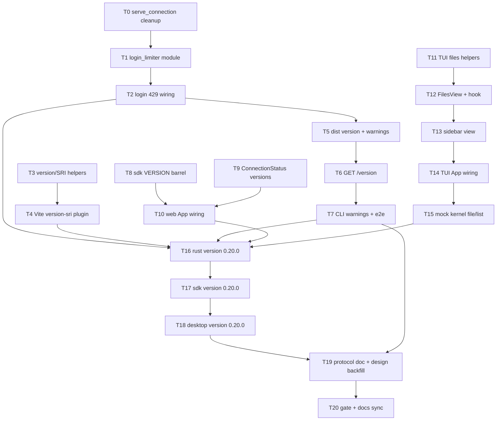

# Plan: AgentJ v0.20.0 内核托管面加固与 TUI 文件视图（四项）

> 设计源：`docs/superpowers/specs/2026-09-20-agentj-web-hardening-and-tui-files-design.md`（已评审通过）
> 实现范围：`agentj-ipc`（serve_connection 清理 / login_limiter / web 版本与 SRI 读取 / `/version`）+ `agentj-cli`（启动警告 + e2e）+ `agentj-ui/apps/web`（构建插件 + ConnectionStatus）+ `agentj-ui/packages/sdk`（VERSION 导出）+ `agentj-ui/apps/tui`（Files 视图）+ 版本与文档同步。
> 语言：任务标题 / AC / 代码为英文；计划头与说明为中文；commit message 英文；设计/计划文档中文。

## Agent Worker Instructions

- Required sub-skills: `superpowers:subagent-driven-development` (preferred) or `superpowers:executing-plans`
- Execution mode: `subagent-driven-development` — fresh subagent per task, two-stage review between tasks
- Required verification (every Rust task): scoped test first (`cargo test -p <crate> <filter>`), then milestone gates for tasks marked [GATE]: `cargo test --workspace`, `cargo clippy --workspace --all-targets -- -D warnings`, `cargo test -p agentj-protocol -- drift`
- Required verification (web tasks): `npm --prefix agentj-ui test --workspace=@agentj/web -- <filter>`（scoped vitest MUST run via the workspace script）、`npm --prefix agentj-ui run build --workspace=@agentj/web`
- Required verification (sdk tasks): `npm --prefix agentj-ui test --workspace=@agentj/sdk`
- Required verification (TUI tasks): `bun --cwd agentj-ui/apps/tui test`
- Generated files (regenerate, never hand-edit beyond the noted single versions): `Cargo.lock`（`cargo check --workspace`）、`agentj-ui/apps/desktop/src-tauri/Cargo.lock`（desktop `cargo check`）、`agentj-ui/package-lock.json`（npm install / package-lock-only）。Commit them with the owning task.
- Dependencies: 无第三方新增。唯一 manifest 补充 = `agentj-cli` `[dev-dependencies] agentj-protocol`（workspace 内部路径依赖，供 e2e fixture 读取协议版本，T7）。
- Version: feature → minor `0.19.0 → 0.20.0`；`PROTOCOL_VERSION` 保持 `0.13.0`（无 wire/schema/methods.json 变化）
- Language: task titles / AC / code in English; commit messages in English; design/plan docs in Chinese
- Rust style: function ≤50 lines, ≤120 chars per line
- Git: one commit per task（`refactor(ipc):` / `feat(ipc):` / `feat(cli):` / `feat(web):` / `feat(sdk):` / `feat(tui):` / `chore:` / `docs:` 前缀）

**Goal:** 清理 `serve_connection` 遗留 token 参数；为登录门加按 IP 失败计数 + 指数锁定（429 + Retry-After）；web 构建注入 `dist/version.json` 与 SRI `integrity`，内核启动比对并新增未鉴权 `GET /version` 探针与 Web 版本展示；TUI 侧栏新增 Files 视图（懒加载树 + 目录聚合状态字母）。

**Architecture:** `agentj-ipc` 新增独立 `login_limiter` 模块（策略可注入、`now` 显式传参），`WebConfig` 持有 limiter 与 dist 版本事实，`web.rs` 扩展 `/version` 路由与启动警告，login 流按 `peer.ip()` 节流（`auth_routes` 增传 `peer`）；`agentj-cli` 打印 dist 版本警告并扩展 `e2e_http_static`；`agentj-ui/apps/web` 新增仓库内 Vite 插件（`writeBundle` 生成 version.json + 注入 sha384 SRI，零依赖），Web 连接面板消费 wire 的 `server_info.version`；`agentj-ui/apps/tui` 新增 `files.ts`（纯函数）/ `files.tsx`（FilesView + useFileTree），`sidebar.tsx` 增视图参数，`app.tsx` 增键位分支。

**Tech Stack:** Rust 1.96+（axum 0.8 / tokio / serde_json / uuid，均既有）、TypeScript（React 19 web / @opentui/react TUI）、vitest、bun test、Node 内建 `node:crypto`（SRI 哈希）。

## Global Constraints

- **No wire contract change**：不新增/修改 JSON-RPC 方法、类型、schema、`protocol/methods.json`；`PROTOCOL_VERSION` 保持 `0.13.0`；`/version` 为 HTTP 静态面路由（非 JSON-RPC 方法）
- **Version**：工作区 0.19.0 → 0.20.0（Cargo.toml/Cargo.lock + sdk `VERSION` + desktop ×3 + `scripts/check-version.sh`）；`PROTOCOL_VERSION` 行不动
- **依赖**：无第三方新增；Node 仅 `node:crypto`/`node:fs`/`node:path`；Rust 复用 std/serde_json；`agentj-cli` 仅新增 workspace 内部 `[dev-dependencies] agentj-protocol`
- **② 限流策略常量（逐字）**：`free_attempts=5`、`base_lockout=30s`、`max_lockout=900s`、`idle_ttl=1800s`、`max_tracked=1024`；`lockout(n) = min(30s × 2^(n−5), 900s)`（n ≥ 5）；第 5 次失败起 429；**锁定期间不校验 token**，每次尝试计数 +1 并升级锁定；成功清零；按 `peer.ip()` 计数（回环同样计数）；`Retry-After` = 秒（ceil，≥1）
- **② 响应**：失败 1–4 次 → 401（既有登录页错误文案）；锁定 → 429 + `Retry-After` + 登录页（文案「尝试次数过多，请在 N 秒后重试」+ hidden next）；无 `Set-Cookie`；成功 → 302 + 既有 cookie 语义
- **③ 版本事实**：`dist/version.json` = `{product_version, protocol_version, build_time}`（snake_case；版本取自 `packages/sdk/src/config.ts` 单一真源）；内核启动比对 `env!("CARGO_PKG_VERSION")` 与 `agentj_protocol::PROTOCOL_VERSION`；缺失/不可解析/不一致 → 启动警告（服务继续）
- **③ SRI**：入口 `index.html` 中同源 `script` 与 `link`（rel=stylesheet/modulepreload/preload）引用计算 `sha384-<base64>` 并写 `integrity`；跳过带 scheme、`//`、`data:`、`#` 的引用与 `link rel=icon`；本地引用文件缺失 → 构建失败（throw）；`/version` 未鉴权、显式路由（优先于 SPA fallback）、`Cache-Control: no-store`
- **④ TUI**：侧栏宽 `SIDEBAR_WIDTH = 32`（内容宽 28）；键位 `f` 切换视图 / `j,k,↑,↓` 移动 / `Enter,l,→` 目录展开收起 / `h,←` 收起或跳父级 / `r` 刷新；缩进 2 字符/层（上限 6 层）；字母右对齐（预留 2 字符）且不截断；色义 `M→warning、A→success、U→textCaption、D→error`；展开状态不持久化；会话切换清空重取；无活动会话显示占位
- **既有语义不动**：`?token=` 403、`initialize.token` -32806、`max-connections` 503、回环/无 token 直出、`/login`/`/logout` 不在门后、`/assets` immutable + 根 `no-cache`、HTTP 请求不触发停机
- **Rust 风格**：函数 ≤50 行、行 ≤120 字符；新增公共类型仅 `DistVersion`（web.rs）；limiter 为 `pub(crate)`

## Design Consistency

| 设计文档节 | 要素 | 任务 |
|---|---|---|
| §①/D1 | `serve_connection` 去 token 参数 + 失活局部变量清理 | T0 |
| §②/D2–D4 与策略表 | limiter 模块 / WebConfig 接线 / 429 响应 | T1, T2 |
| §③/D5–D7 构建侧 | version.json + SRI 纯函数 / Vite 插件 | T3, T4 |
| §③/D5/D8 内核侧 | dist 版本读取 + 启动警告 + `/version` | T5, T6 |
| §③ CLI 与 e2e | 启动警告打印 + e2e 版本断言 | T7 |
| §③/D9 Web 展示 | SDK VERSION 导出 / ConnectionStatus / App 接线 | T8, T9, T10 |
| §④/D10/D11 与键位表 | 纯函数 / FilesView+useFileTree / 侧栏视图 / App 接线 / mock e2e | T11–T15 |
| §D12 版本与门禁 | 0.20.0 三连 bump + 文档 + 全量门禁 | T16–T20 |

---
### T0: Remove the legacy token argument from serve_connection [P0] [Parallel with T3/T8/T9/T11]

```yaml
- id: T0
  title: "Drop the unused token parameter from IpcServer::serve_connection and its call sites"
  files:
    - crates/agentj-ipc/src/lib.rs
    - crates/agentj-ipc/src/tcp.rs
    - crates/agentj-ipc/src/ws.rs
  depends_on: []
  breaking: true
  ac:
    - given: "the 2-arg signature (self, conn) is in place"
      when: "cargo check -p agentj-ipc runs before call-site fixes"
      then: "E0061 errors report exactly 8 call sites (tcp.rs, ws.rs, lib.rs tests x6)"
    - given: "all call sites updated and dead locals removed"
      when: "cargo test -p agentj-ipc runs"
      then: "all existing tests pass unchanged; the `token` local in tcp.rs and `required` in ws.rs are gone"
    - given: "the refactor is complete"
      when: "cargo clippy -p agentj-ipc --all-targets -- -D warnings runs"
      then: "zero warnings (no unused variable/dead_code)"
  regression:
    - "cargo test -p agentj-ipc"
    - "cargo test -p agentj-ipc --test ws_classifier"
    - "cargo test -p agentj-ipc token_gate_rejects_unauthenticated_clients"
  test_code: |
    // Refactor TDD = compile-level red step + the regression suite as oracle.
    // 1) Green baseline: cargo test -p agentj-ipc
    // 2) Red: edit the definition in lib.rs to remove the third parameter:
    //      pub async fn serve_connection(self: Arc<Self>, conn: Box<dyn Connection>)
    //    cargo check -p agentj-ipc  -> E0061 at:
    //      src/tcp.rs:220, src/ws.rs:186,
    //      src/lib.rs:2478, 4284, 4286, 4309, 4360, 4362
    // 3) Green: apply impl_code below; rerun the regression commands.
  impl_code: |
    // lib.rs (definition ~L1335): drop `_token: Option<&str>`.
    pub async fn serve_connection(
        self: std::sync::Arc<Self>,
        conn: Box<dyn Connection>,
    ) -> Result<(), IpcError> {
        // body unchanged
    }

    // tcp.rs accept loop (~L207): delete `let token = self.token.clone();`
    // and call: .serve_connection(Box::new(conn)).await
    // (`self.token` stays: it feeds WsServerState.token only)

    // ws.rs ws_upgrade (~L172-189): delete the `required` local entirely;
    // keep `supplied` (cookie channel initialize-token injection):
    //   let supplied = if cookie_authed { state.token.clone() } else { None };
    //   ws.on_upgrade(move |socket| async move {
    //       let conn = WsConnection::new(socket, peer.to_string()).with_init_token(supplied);
    //       let _ = Arc::clone(&state.shared).serve_connection(Box::new(conn)).await;
    //       state.active_ws.fetch_sub(1, Ordering::SeqCst);
    //   })

    // lib.rs tests: six calls `s.serve_connection(Box::new(conn), None)` -> drop the `None`.
    // WsServerState.token / WsQuery.token stay (they drive ?token= comparison + injection).
  verify:
    - "cargo test -p agentj-ipc"
    - "cargo test -p agentj-ipc --test ws_classifier"
    - "cargo clippy -p agentj-ipc --all-targets -- -D warnings"
```

### T1: Add the login_limiter module with the policy state machine [P0] [After T0]

```yaml
- id: T1
  title: "Add per-IP LoginLimiter (count + exponential lockout) with injectable policy and clock"
  files:
    - crates/agentj-ipc/src/login_limiter.rs
    - crates/agentj-ipc/src/lib.rs
  depends_on: [T0]
  breaking: false
  ac:
    - given: "default policy and a fresh IP"
      when: "record_failure runs 4 times"
      then: "each returns Throttle::Allow"
    - given: "default policy"
      when: "the 5th record_failure runs"
      then: "returns Locked with retry_after = 30s (and check() reports Locked)"
    - given: "an IP already locked at 5 failures"
      when: "record_failure runs during the lockout"
      then: "failures becomes 6 and retry_after becomes 60s; each further attempt doubles; caps at 900s"
    - given: "3 failures recorded"
      when: "record_success runs, then 4 more failures"
      then: "the 4 failures stay Allow (counter cleared); the next one locks"
    - given: "an entry untouched for idle_ttl"
      when: "record_failure runs with a later now"
      then: "the entry is pruned first (counters restart at 0)"
    - given: "max_tracked entries and a new IP"
      when: "record_failure inserts a new entry"
      then: "the least-recently-active entry is evicted"
    - given: "two different IPs"
      when: "one is locked"
      then: "the other is unaffected; loopback IPs count like any other"
  regression:
    - "cargo test -p agentj-ipc"
  test_code: |
    // crates/agentj-ipc/src/login_limiter.rs #[cfg(test)]
    use super::*;

    fn ip(s: &str) -> std::net::IpAddr { s.parse().unwrap() }
    fn at(t0: std::time::Instant, secs: u64) -> std::time::Instant {
        t0 + std::time::Duration::from_secs(secs)
    }

    #[test]
    fn locks_on_fifth_failure_then_escalates_to_the_cap() {
        let limiter = LoginLimiter::new();
        let t0 = std::time::Instant::now();
        let who = ip("203.0.113.7");
        for i in 0..4 {
            assert_eq!(limiter.record_failure(who, at(t0, i)), Throttle::Allow);
        }
        assert_eq!(
            limiter.record_failure(who, at(t0, 4)),
            Throttle::Locked { retry_after: std::time::Duration::from_secs(30) }
        );
        assert!(matches!(limiter.check(who, at(t0, 5)), Throttle::Locked { .. }));
        assert_eq!(
            limiter.record_failure(who, at(t0, 5)),
            Throttle::Locked { retry_after: std::time::Duration::from_secs(60) }
        );
        let mut last = std::time::Duration::ZERO;
        for i in 6..12 {
            if let Throttle::Locked { retry_after } = limiter.record_failure(who, at(t0, i)) {
                last = retry_after;
            }
        }
        assert_eq!(last, std::time::Duration::from_secs(900), "lockout caps at 15min");
    }

    #[test]
    fn success_clears_counters_and_idle_entries_reset() {
        let limiter = LoginLimiter::new();
        let t0 = std::time::Instant::now();
        let who = ip("203.0.113.7");
        for i in 0..3 { let _ = limiter.record_failure(who, at(t0, i)); }
        limiter.record_success(who);
        for i in 0..4 {
            assert_eq!(limiter.record_failure(who, at(t0, 10 + i)), Throttle::Allow);
        }
        // idle prune: advance past idle_ttl (30min default) -> counter restarts
        assert_eq!(limiter.record_failure(who, at(t0, 4000)), Throttle::Allow);
    }

    #[test]
    fn ips_are_isolated_and_loopback_counts() {
        let limiter = LoginLimiter::new();
        let t0 = std::time::Instant::now();
        for i in 0..5 { let _ = limiter.record_failure(ip("203.0.113.7"), at(t0, i)); }
        assert!(matches!(limiter.check(ip("198.51.100.9"), at(t0, 5)), Throttle::Allow));
        for i in 0..5 { let _ = limiter.record_failure(ip("127.0.0.1"), at(t0, i)); }
        assert!(matches!(limiter.check(ip("127.0.0.1"), at(t0, 5)), Throttle::Locked { .. }));
    }

    #[test]
    fn tracked_entries_are_bounded() {
        let policy = Policy { max_tracked: 2, ..Policy::default() };
        let limiter = LoginLimiter::with_policy(policy);
        let t0 = std::time::Instant::now();
        for i in 0..4 { let _ = limiter.record_failure(ip("10.0.0.1"), at(t0, i)); }
        for i in 0..2 { let _ = limiter.record_failure(ip("10.0.0.2"), at(t0, 10 + i)); }
        let _ = limiter.record_failure(ip("10.0.0.3"), at(t0, 20)); // evicts 10.0.0.1
        assert_eq!(limiter.record_failure(ip("10.0.0.1"), at(t0, 21)), Throttle::Allow,
                   "evicted entry restarts from zero");
    }
  impl_code: |
    // crates/agentj-ipc/src/login_limiter.rs (new file; ~130 lines incl. docs)
    //! Login failure throttling (design D2/D3): per-IP counters + exponential
    //! lockout, in-memory like the session set; `now` is injected for testability.

    use std::collections::HashMap;
    use std::net::IpAddr;
    use std::sync::Mutex;
    use std::time::{Duration, Instant};

    #[derive(Clone, Debug)]
    pub(crate) struct Policy {
        pub(crate) free_attempts: u32,
        pub(crate) base_lockout: Duration,
        pub(crate) max_lockout: Duration,
        pub(crate) idle_ttl: Duration,
        pub(crate) max_tracked: usize,
    }

    impl Default for Policy {
        fn default() -> Self {
            Self {
                free_attempts: 5,
                base_lockout: Duration::from_secs(30),
                max_lockout: Duration::from_secs(900),
                idle_ttl: Duration::from_secs(1800),
                max_tracked: 1024,
            }
        }
    }

    #[derive(Clone, Debug, PartialEq, Eq)]
    pub(crate) enum Throttle {
        Allow,
        Locked { retry_after: Duration },
    }

    #[derive(Debug)]
    struct Entry {
        failures: u32,
        locked_until: Option<Instant>,
        last: Instant,
    }

    pub(crate) struct LoginLimiter {
        policy: Policy,
        entries: Mutex<HashMap<IpAddr, Entry>>,
    }

    impl LoginLimiter {
        pub(crate) fn new() -> Self { Self::with_policy(Policy::default()) }

        pub(crate) fn with_policy(policy: Policy) -> Self {
            Self { policy, entries: Mutex::new(HashMap::new()) }
        }

        pub(crate) fn check(&self, ip: IpAddr, now: Instant) -> Throttle {
            let mut entries = self.entries.lock().expect("login limiter");
            Self::prune_idle(&mut entries, ip, self.policy.idle_ttl, now);
            entries.get(&ip).map_or(Throttle::Allow, |e| Self::status(e, now))
        }

        pub(crate) fn record_failure(&self, ip: IpAddr, now: Instant) -> Throttle {
            let mut entries = self.entries.lock().expect("login limiter");
            Self::prune_idle(&mut entries, ip, self.policy.idle_ttl, now);
            if !entries.contains_key(&ip) {
                Self::evict_oldest(&mut entries, self.policy.max_tracked);
            }
            let entry = entries.entry(ip).or_insert(Entry {
                failures: 0, locked_until: None, last: now,
            });
            entry.failures = entry.failures.saturating_add(1);
            entry.last = now;
            if entry.failures < self.policy.free_attempts {
                return Throttle::Allow;
            }
            let lockout = self.lockout_for(entry.failures);
            entry.locked_until = Some(now + lockout);
            Throttle::Locked { retry_after: lockout }
        }

        pub(crate) fn record_success(&self, ip: IpAddr) {
            self.entries.lock().expect("login limiter").remove(&ip);
        }

        fn lockout_for(&self, failures: u32) -> Duration {
            let exp = failures.saturating_sub(self.policy.free_attempts).min(16);
            self.policy
                .base_lockout
                .saturating_mul(2u32.saturating_pow(exp))
                .min(self.policy.max_lockout)
        }

        fn status(entry: &Entry, now: Instant) -> Throttle {
            match entry.locked_until {
                Some(until) if until > now => Throttle::Locked { retry_after: until - now },
                _ => Throttle::Allow,
            }
        }

        fn prune_idle(entries: &mut HashMap<IpAddr, Entry>, ip: IpAddr, ttl: Duration, now: Instant) {
            if entries.get(&ip).is_some_and(|e| now.duration_since(e.last) > ttl) {
                entries.remove(&ip);
            }
        }

        fn evict_oldest(entries: &mut HashMap<IpAddr, Entry>, max: usize) {
            if entries.len() < max { return; }
            if let Some(oldest) = entries.iter().min_by_key(|(_, e)| e.last).map(|(ip, _)| *ip) {
                entries.remove(&oldest);
            }
        }
    }

    // crates/agentj-ipc/src/lib.rs: add `pub(crate) mod login_limiter;`
    // next to the other module declarations (alphabetical position).
  verify:
    - "cargo test -p agentj-ipc login_limiter"
    - "cargo clippy -p agentj-ipc --all-targets -- -D warnings"
```

---
### T2: Throttle POST /login with 429 and Retry-After [P0] [After T1]

```yaml
- id: T2
  title: "Wire LoginLimiter into submit_login and thread peer through auth_routes"
  files:
    - crates/agentj-ipc/src/web.rs
  depends_on: [T1]
  breaking: false
  ac:
    - given: "a token-configured WebConfig and a remote peer"
      when: "5 wrong-token POSTs to /login are served"
      then: "responses 1-4 are 401 without Set-Cookie; the 5th is 429 with Retry-After: 30 and the throttle page body"
    - given: "the same peer is locked"
      when: "POST /login sends the correct token"
      then: "429 (token is not verified during lockout)"
    - given: "an injected ms-scale policy (base 50ms)"
      when: "the lockout expires and the correct token arrives"
      then: "302 with Set-Cookie; the counter is cleared (two more wrong attempts are 401, not 429)"
    - given: "a loopback peer"
      when: "6 wrong-token POSTs are served"
      then: "the last is 429 (loopback counts like any peer)"
    - given: "a policy with base_lockout 1500ms / free_attempts 1"
      when: "the lockout response is built"
      then: "Retry-After is 2 (rounded up); a 50ms base yields 1 (floor minimum)"
  regression:
    - "cargo test -p agentj-ipc web::"
    - "test: login_sets_session_cookie_and_redirects_to_next"
    - "test: login_with_wrong_token_is_401_and_logout_revokes"
    - "test: remote_peer_without_cookie_is_redirected_to_login"
  test_code: |
    // crates/agentj-ipc/src/web.rs #[cfg(test)] — reuse form_post/get/test_state.
    use std::time::Duration;

    fn small_policy() -> crate::login_limiter::Policy {
        crate::login_limiter::Policy {
            free_attempts: 2,
            base_lockout: Duration::from_millis(50),
            max_lockout: Duration::from_millis(400),
            idle_ttl: Duration::from_secs(60),
            max_tracked: 16,
        }
    }

    #[tokio::test]
    async fn fifth_failure_is_429_and_locked_requests_skip_token_check() {
        let state = test_state(crate::web::WebConfig::new(None, Some("secret".into())));
        let remote: std::net::SocketAddr = "203.0.113.7:41000".parse().unwrap();
        for _ in 0..4 {
            let (s, h, _) = form_post(
                crate::web::build_router(state.clone(), remote), "/login", "token=nope",
            ).await;
            assert_eq!(s, axum::http::StatusCode::UNAUTHORIZED);
            assert!(h.get(axum::http::header::SET_COOKIE).is_none());
        }
        let (s, h, body) = form_post(
            crate::web::build_router(state.clone(), remote), "/login", "token=nope",
        ).await;
        assert_eq!(s, axum::http::StatusCode::TOO_MANY_REQUESTS);
        assert_eq!(h.get(axum::http::header::RETRY_AFTER).unwrap(), "30");
        assert!(h.get(axum::http::header::SET_COOKIE).is_none());
        assert!(body.contains("尝试次数过多"), "throttle page: {body}");
        let (s, _, _) = form_post(
            crate::web::build_router(state, remote), "/login", "token=secret",
        ).await;
        assert_eq!(s, axum::http::StatusCode::TOO_MANY_REQUESTS, "lockout must skip token check");
    }

    #[tokio::test]
    async fn lockout_expires_and_success_resets_the_counter() {
        let web = crate::web::WebConfig::new(None, Some("secret".into()))
            .with_login_limiter(crate::login_limiter::LoginLimiter::with_policy(small_policy()));
        let state = test_state(web);
        let remote: std::net::SocketAddr = "203.0.113.7:41000".parse().unwrap();
        let _ = form_post(crate::web::build_router(state.clone(), remote), "/login", "token=nope").await;
        let (s, _, _) = form_post(crate::web::build_router(state.clone(), remote), "/login", "token=nope").await;
        assert_eq!(s, axum::http::StatusCode::TOO_MANY_REQUESTS);
        tokio::time::sleep(Duration::from_millis(60)).await;
        let (s, h, _) = form_post(crate::web::build_router(state.clone(), remote), "/login", "token=secret").await;
        assert_eq!(s, axum::http::StatusCode::FOUND, "lockout must expire");
        assert!(h.get(axum::http::header::SET_COOKIE).is_some());
        for _ in 0..2 {
            let (s, _, _) = form_post(crate::web::build_router(state.clone(), remote), "/login", "token=nope").await;
            assert_eq!(s, axum::http::StatusCode::UNAUTHORIZED, "success cleared the counter");
        }
    }

    #[tokio::test]
    async fn loopback_failures_are_counted_too() {
        let state = test_state(crate::web::WebConfig::new(None, Some("secret".into())));
        let local: std::net::SocketAddr = "127.0.0.1:5555".parse().unwrap();
        for _ in 0..6 {
            let _ = form_post(crate::web::build_router(state.clone(), local), "/login", "token=nope").await;
        }
        let (s, _, _) = form_post(crate::web::build_router(state, local), "/login", "token=nope").await;
        assert_eq!(s, axum::http::StatusCode::TOO_MANY_REQUESTS);
    }

    #[tokio::test]
    async fn retry_after_rounds_up_and_never_drops_below_one() {
        let policy = crate::login_limiter::Policy {
            free_attempts: 1,
            base_lockout: Duration::from_millis(1500),
            ..Default::default()
        };
        let web = crate::web::WebConfig::new(None, Some("secret".into()))
            .with_login_limiter(crate::login_limiter::LoginLimiter::with_policy(policy));
        let state = test_state(web);
        let remote: std::net::SocketAddr = "203.0.113.7:41000".parse().unwrap();
        let (s, h, _) = form_post(crate::web::build_router(state, remote), "/login", "token=nope").await;
        assert_eq!(s, axum::http::StatusCode::TOO_MANY_REQUESTS);
        assert_eq!(h.get(axum::http::header::RETRY_AFTER).unwrap(), "2", "1500ms must ceil to 2s");

        let policy = crate::login_limiter::Policy {
            free_attempts: 1,
            base_lockout: Duration::from_millis(50),
            ..Default::default()
        };
        let web = crate::web::WebConfig::new(None, Some("secret".into()))
            .with_login_limiter(crate::login_limiter::LoginLimiter::with_policy(policy));
        let state = test_state(web);
        let remote: std::net::SocketAddr = "203.0.113.8:41000".parse().unwrap();
        let (_, h, _) = form_post(crate::web::build_router(state, remote), "/login", "token=nope").await;
        assert_eq!(h.get(axum::http::header::RETRY_AFTER).unwrap(), "1", "sub-second locks floor to 1s");
    }
  impl_code: |
    // web.rs — imports:
    use crate::login_limiter::{LoginLimiter, Throttle};
    use std::time::Instant;

    // WebConfig gains `login_limiter: LoginLimiter` (private) + a test hook:
    impl WebConfig {
        pub fn new(dist: ..., token: ...) -> Self {
            Self { dist, token: token.filter(|t| !t.is_empty()), sessions: ...,
                   login_limiter: LoginLimiter::new() }
        }
        #[cfg(test)]
        pub(crate) fn with_login_limiter(mut self, limiter: LoginLimiter) -> Self {
            self.login_limiter = limiter;
            self
        }
    }

    // submit_login: check -> locked branch (escalate) / success / failure.
    async fn submit_login(web: &WebConfig, peer: std::net::SocketAddr, form: LoginForm)
        -> axum::response::Response
    {
        let now = Instant::now();
        let ip = peer.ip();
        if matches!(web.login_limiter.check(ip, now), Throttle::Locked { .. }) {
            return throttle_response(web.login_limiter.record_failure(ip, now), form.next.as_deref());
        }
        let expected = web.token.as_deref().unwrap_or_default();
        if !expected.is_empty() && form.token == expected {
            web.login_limiter.record_success(ip);
            let sid = web.issue_session();
            let mut res = redirect_found(&safe_next(form.next.as_deref()));
            res.headers_mut().insert(axum::http::header::SET_COOKIE,
                format!("{SESSION_COOKIE}={sid}; HttpOnly; SameSite=Lax; Path=/")
                    .parse().expect("valid cookie header"));
            res
        } else {
            throttle_response(web.login_limiter.record_failure(ip, now), form.next.as_deref())
        }
    }

    fn unauthorized_response(next: Option<&str>) -> axum::response::Response {
        (axum::http::StatusCode::UNAUTHORIZED,
         axum::response::Html(login_page_html(Some("访问令牌无效"), &safe_next(next))))
            .into_response()
    }

    fn throttle_response(throttle: Throttle, next: Option<&str>) -> axum::response::Response {
        let Throttle::Locked { retry_after } = throttle else {
            return unauthorized_response(next);
        };
        let secs = retry_after.as_millis().div_ceil(1000).max(1) as u64;
        let message = format!("尝试次数过多，请在 {secs} 秒后重试");
        let mut res = (axum::http::StatusCode::TOO_MANY_REQUESTS,
                       axum::response::Html(login_page_html(Some(&message), &safe_next(next))))
            .into_response();
        res.headers_mut().insert(
            axum::http::header::RETRY_AFTER,
            axum::http::HeaderValue::from_str(&secs.to_string()).expect("retry-after"),
        );
        res
    }

    // auth_routes gains `peer: std::net::SocketAddr` and forwards it:
    fn auth_routes(router, web: Arc<WebConfig>, peer: std::net::SocketAddr) -> axum::Router {
        // login_post closure: async move { submit_login(&web, peer, form.0).await }
    }
    // build_router: router = auth_routes(router, state.web.clone(), peer);
  verify:
    - "cargo test -p agentj-ipc web::"
    - "cargo clippy -p agentj-ipc --all-targets -- -D warnings"
```

### T3: Add version/SRI pure helpers and extend the vitest include [P0] [Parallel with T0/T8/T9/T11]

```yaml
- id: T3
  title: "Add build/version-sri.ts helpers (sha384 SRI injection + version.json) with unit tests"
  files:
    - agentj-ui/apps/web/build/version-sri.ts
    - agentj-ui/apps/web/build/version-sri.test.ts
    - agentj-ui/apps/web/vite.config.ts
  depends_on: []
  breaking: false
  ac:
    - given: "index.html referencing /assets/app.js and the asset text 'console.log(1)\\n'"
      when: "injectSri runs with a resolver returning those bytes"
      then: "the tag carries integrity sha384-M203vLCvZdI2DAFEpVs3YNPxNFNtwrWrHY9XrXkEzOjLmndNNAWAdMk0uRYc2i2r"
    - given: "tags for https://cdn/x.js, //cdn/x.js, data:text/javascript,1 and link rel=icon"
      when: "injectSri runs"
      then: "none of them receive an integrity attribute"
    - given: "a tag referencing /assets/missing.js"
      when: "injectSri runs"
      then: "it throws an Error naming the missing asset"
    - given: "a tag that already carries an old integrity value"
      when: "injectSri runs"
      then: "the old value is replaced (single integrity attribute after re-run)"
    - given: "a temp dist directory with index.html + assets/app.js"
      when: "finalizeDist runs"
      then: "dist/version.json holds snake_case product_version/protocol_version/build_time and index.html carries the sha384 integrity"
  regression:
    - "npm --prefix agentj-ui test --workspace=@agentj/web"
  test_code: |
    // agentj-ui/apps/web/build/version-sri.test.ts
    import { describe, expect, it } from "vitest";
    import { mkdtempSync, mkdirSync, readFileSync, rmSync, writeFileSync } from "node:fs";
    import { tmpdir } from "node:os";
    import { join } from "node:path";
    import { buildVersionJson, finalizeDist, injectSri } from "./version-sri";

    const APP_JS = "console.log(1)\n";
    const EXPECTED = "sha384-M203vLCvZdI2DAFEpVs3YNPxNFNtwrWrHY9XrXkEzOjLmndNNAWAdMk0uRYc2i2r";

    it("injects sha384 integrity for local script and stylesheet refs", () => {
      const html = [
        '<script type="module" crossorigin src="/assets/app.js"></script>',
        '<link rel="stylesheet" crossorigin href="/assets/app.css">',
      ].join("\n");
      const out = injectSri(html, (ref) =>
        ref === "/assets/app.js" ? Buffer.from(APP_JS) : Buffer.from("body{}"),
      );
      expect(out.html).toContain(EXPECTED);
      expect(out.hashed.sort()).toEqual(["/assets/app.css", "/assets/app.js"]);
    });

    it("skips external, data and non-asset links", () => {
      const html = [
        '<script src="https://cdn/x.js"></script>',
        '<script src="//cdn/x.js"></script>',
        '<script src="data:text/javascript,1"></script>',
        '<link rel="icon" href="/favicon.svg">',
      ].join("\n");
      const out = injectSri(html, () => null);
      expect(out.html).not.toContain("integrity");
    });

    it("throws when a local reference is missing", () => {
      expect(() => injectSri('<script src="/assets/gone.js"></script>', () => null))
        .toThrow(/gone\.js/);
    });

    it("replaces an existing integrity attribute", () => {
      const html = '<script src="/assets/app.js" integrity="sha384-old"></script>';
      const out = injectSri(html, () => Buffer.from(APP_JS));
      expect(out.html.match(/integrity=/g)).toHaveLength(1);
      expect(out.html).not.toContain("sha384-old");
    });

    it("writes version.json and rewrites index.html in a dist directory", () => {
      const dir = mkdtempSync(join(tmpdir(), "agentj-sri-"));
      mkdirSync(join(dir, "assets"));
      writeFileSync(join(dir, "index.html"), '<script src="/assets/app.js"></script>');
      writeFileSync(join(dir, "assets/app.js"), APP_JS);
      finalizeDist(dir, { productVersion: "0.20.0", protocolVersion: "0.13.0", buildTime: "2026-09-20T00:00:00Z" });
      const v = JSON.parse(readFileSync(join(dir, "version.json"), "utf8")) as Record<string, string>;
      expect(v.product_version).toBe("0.20.0");
      expect(v.protocol_version).toBe("0.13.0");
      expect(readFileSync(join(dir, "index.html"), "utf8")).toContain(EXPECTED);
      rmSync(dir, { recursive: true, force: true });
    });

    it("buildVersionJson emits the documented snake_case shape", () => {
      const raw = buildVersionJson({ productVersion: "1.2.3", protocolVersion: "0.13.0", buildTime: "t" });
      expect(JSON.parse(raw)).toEqual({
        product_version: "1.2.3", protocol_version: "0.13.0", build_time: "t",
      });
    });
  impl_code: |
    // agentj-ui/apps/web/build/version-sri.ts (new; pure helpers, zero deps)
    import { createHash } from "node:crypto";
    import { existsSync, readFileSync, writeFileSync } from "node:fs";
    import { join } from "node:path";

    export type DistVersions = { productVersion: string; protocolVersion: string; buildTime: string };
    export type SriResult = { html: string; hashed: string[] };

    const TAG_RE = /<(script|link)\b[^>]*?(src|href)="([^"]+)"[^>]*>/g;

    function isSriTarget(tag: string, attr: string): boolean {
      if (tag.startsWith("<script")) return attr === "src";
      return /rel="(stylesheet|modulepreload|preload)"/.test(tag);
    }

    function isLocalRef(ref: string): boolean {
      return ref.startsWith("/") && !ref.startsWith("//");
    }

    function integrityOf(bytes: Buffer): string {
      return `sha384-${createHash("sha384").update(bytes).digest("base64")}`;
    }

    export function injectSri(html: string, readAsset: (ref: string) => Buffer | null): SriResult {
      const hashed: string[] = [];
      const out = html.replace(TAG_RE, (tag, _name: string, attr: string, ref: string) => {
        if (!isSriTarget(tag, attr) || !isLocalRef(ref)) return tag;
        const bytes = readAsset(ref);
        if (!bytes) throw new Error(`SRI: referenced asset is missing from dist: ${ref}`);
        const integrity = integrityOf(bytes);
        hashed.push(ref);
        const stripped = tag.replace(/\s+integrity="[^"]*"/, "");
        return stripped.replace(/(\s(?:src|href)=")/, ` integrity="${integrity}"$1`);
      });
      return { html: out, hashed };
    }

    export function buildVersionJson(v: DistVersions): string {
      return `${JSON.stringify(
        { product_version: v.productVersion, protocol_version: v.protocolVersion, build_time: v.buildTime },
        null,
        2,
      )}\n`;
    }

    export function finalizeDist(distDir: string, v: DistVersions): SriResult {
      const htmlPath = join(distDir, "index.html");
      if (!existsSync(htmlPath)) throw new Error(`SRI: ${htmlPath} not found; run vite build first`);
      const html = readFileSync(htmlPath, "utf8");
      const result = injectSri(html, (ref) => {
        const file = join(distDir, ref.replace(/^\//, ""));
        return existsSync(file) ? readFileSync(file) : null;
      });
      writeFileSync(htmlPath, result.html);
      writeFileSync(join(distDir, "version.json"), buildVersionJson(v));
      return result;
    }

    // vite.config.ts — extend the vitest include so build/ tests run:
    test: {
      environment: "jsdom",
      globals: true,
      include: ["src/**/*.test.{ts,tsx}", "build/**/*.test.ts"],
    },
  verify:
    - "npm --prefix agentj-ui test --workspace=@agentj/web -- version-sri"
    - "npm --prefix agentj-ui run build --workspace=@agentj/web"
```

---
### T4: Add the Vite version-sri plugin and register it [P0] [After T3]

```yaml
- id: T4
  title: "Emit dist/version.json and SRI integrity through a writeBundle Vite plugin"
  files:
    - agentj-ui/apps/web/build/version-sri-plugin.ts
    - agentj-ui/apps/web/vite.config.ts
  depends_on: [T3]
  breaking: false
  ac:
    - given: "the plugin is registered and npm run build completes"
      when: "dist/index.html is inspected"
      then: "every local script/stylesheet ref carries integrity sha384-"
    - given: "the same build"
      when: "dist/version.json is parsed"
      then: "product_version equals the sdk VERSION literal and protocol_version equals the sdk PROTOCOL_VERSION literal"
    - given: "the freshly built dist"
      when: "each integrity value is recomputed from the referenced asset bytes"
      then: "the recomputed sha384 base64 equals the emitted value (browser-equivalent verification)"
    - given: "the built dist"
      when: "version.json is compared with the sdk VERSION literal read from config.ts"
      then: "they are equal (single-source version truth)"
    - given: "a build run before the plugin is registered"
      when: "dist/index.html is inspected"
      then: "no integrity attribute exists (the red step)"
  regression:
    - "npm --prefix agentj-ui test --workspace=@agentj/web -- version-sri"
    - "npm --prefix agentj-ui run build --workspace=@agentj/web"
  test_code: |
    # Red step: register nothing yet, run the build, then assert the gap:
    #   npm --prefix agentj-ui run build --workspace=@agentj/web
    #   node -e "const h=require('fs').readFileSync('agentj-ui/apps/web/dist/index.html','utf8');if(!/integrity=/.test(h)){console.log('RED: no integrity');process.exit(1)}"
    # Green step after impl — verify SRI values by recomputing them (browser semantics):
    #   node -e "const fs=require('fs'),c=require('crypto');
    #     const dir='agentj-ui/apps/web/dist';
    #     const html=fs.readFileSync(dir+'/index.html','utf8');
    #     const tags=[...html.matchAll(/<(script|link)\b[^>]*?(?:src|href)=\"(\/[^\"]+)\"[^>]*?(?:integrity=\"(sha384-[^\"]+)\")?[^>]*>/g)];
    #     let n=0;
    #     for(const m of tags){ if(!m[3]) continue; const b=fs.readFileSync(dir+m[2]); const want='sha384-'+c.createHash('sha384').update(b).digest('base64'); if(want!==m[3]){console.error('MISMATCH',m[2]);process.exit(1)} n++; }
    #     if(!n){console.error('no integrity tags');process.exit(1)}
    #     const v=JSON.parse(fs.readFileSync(dir+'/version.json','utf8'));
    #     const cfg=fs.readFileSync('agentj-ui/packages/sdk/src/config.ts','utf8').match(/export const VERSION = "([^"]+)"/)[1];
    #     if(!v.product_version||!v.protocol_version||!v.build_time||v.product_version!==cfg){console.error('bad version.json');process.exit(1)}
    #     console.log('sri-ok',v.product_version,n)"
  impl_code: |
    // agentj-ui/apps/web/build/version-sri-plugin.ts (new)
    import { resolve } from "node:path";
    import type { Plugin } from "vite";
    // Single version source of truth; tsconfig.node enables allowImportingTsExtensions.
    import { PROTOCOL_VERSION, VERSION } from "../../../packages/sdk/src/config.ts";
    import { finalizeDist } from "./version-sri.ts";

    export function versionSriPlugin(): Plugin {
      let root = process.cwd();
      return {
        name: "agentj:version-sri",
        apply: "build",
        configResolved(config) {
          root = config.root;
        },
        writeBundle(options) {
          const distDir = resolve(root, options.dir ?? "dist");
          finalizeDist(distDir, {
            productVersion: VERSION,
            protocolVersion: PROTOCOL_VERSION,
            buildTime: new Date().toISOString(),
          });
        },
      };
    }

    // agentj-ui/apps/web/vite.config.ts:
    import { versionSriPlugin } from "./build/version-sri-plugin.ts";
    export default defineConfig({
      plugins: [react(), versionSriPlugin()],
      // ...rest unchanged
    });
  verify:
    - "npm --prefix agentj-ui run build --workspace=@agentj/web"
    - "npm --prefix agentj-ui test --workspace=@agentj/web -- version-sri"
```

### T5: Read dist/version.json, expose warnings, add the tcp accessor [P0] [After T2]

```yaml
- id: T5
  title: "Parse DistVersion in WebConfig, expose startup_warnings(), add TcpIpcServer::web_config"
  files:
    - crates/agentj-ipc/src/web.rs
    - crates/agentj-ipc/src/tcp.rs
  depends_on: [T2]
  breaking: false
  ac:
    - given: "a dist with a version.json matching this binary (product + protocol)"
      when: "startup_warnings() runs"
      then: "the list is empty"
    - given: "a dist with product_version 0.0.1-test"
      when: "startup_warnings() runs"
      then: "a warning names both 0.0.1-test and the current CARGO_PKG_VERSION"
    - given: "a dist without version.json (legacy build)"
      when: "startup_warnings() runs"
      then: "one warning mentioning version.json and a rebuild hint"
    - given: "a dist whose version.json is malformed JSON"
      when: "startup_warnings() runs"
      then: "one warning containing 'unreadable'"
    - given: "WebConfig::disabled() (no dist)"
      when: "startup_warnings() runs"
      then: "the list is empty (the missing-dist warning stays the CLI's concern)"
    - given: "TcpIpcServer bound with a fixture web_dist"
      when: "web_config() is called"
      then: "it returns the shared Arc<WebConfig> whose dist_version() is Some"
  regression:
    - "cargo test -p agentj-ipc web::"
    - "cargo test -p agentj-ipc tcp::"
  test_code: |
    // crates/agentj-ipc/src/web.rs #[cfg(test)] — extend the temp_dist helper:
    fn write_version_json(dir: &std::path::Path, product: &str, protocol: &str) {
        std::fs::write(
            dir.join("version.json"),
            format!("{{\"product_version\":\"{product}\",\"protocol_version\":\"{protocol}\",\"build_time\":\"t\"}}"),
        ).unwrap();
    }

    #[test]
    fn startup_warnings_cover_aligned_missing_and_mismatched_dists() {
        let aligned = temp_dist("ver-aligned");
        write_version_json(&aligned, env!("CARGO_PKG_VERSION"), agentj_protocol::PROTOCOL_VERSION);
        let web = WebConfig::new(Some(aligned.clone()), None);
        assert!(web.dist_version().is_some());
        assert!(web.startup_warnings().is_empty(), "{:?}", web.startup_warnings());

        let mismatched = temp_dist("ver-mismatch");
        write_version_json(&mismatched, "0.0.1-test", "0.0.1");
        let warnings = WebConfig::new(Some(mismatched.clone()), None).startup_warnings();
        assert_eq!(warnings.len(), 2);
        assert!(warnings.iter().any(|w| w.contains("0.0.1-test") && w.contains(env!("CARGO_PKG_VERSION"))));
        assert!(warnings.iter().any(|w| w.contains("protocol")));

        let legacy = temp_dist("ver-legacy"); // no version.json
        let warnings = WebConfig::new(Some(legacy.clone()), None).startup_warnings();
        assert_eq!(warnings.len(), 1);
        assert!(warnings[0].contains("version.json"));

        let broken = temp_dist("ver-broken");
        std::fs::write(broken.join("version.json"), "{not json").unwrap();
        let warnings = WebConfig::new(Some(broken.clone()), None).startup_warnings();
        assert!(warnings[0].contains("unreadable"), "{warnings:?}");

        assert!(WebConfig::disabled().startup_warnings().is_empty());
        for d in [aligned, mismatched, legacy, broken] { std::fs::remove_dir_all(&d).ok(); }
    }

    // crates/agentj-ipc/src/tcp.rs #[cfg(test)] — add next to the token test:
    #[tokio::test]
    async fn web_config_exposes_the_dist_version() {
        let dir = std::env::temp_dir().join(format!("agentj-tcp-web-{}", std::process::id()));
        let _ = std::fs::remove_dir_all(&dir);
        std::fs::create_dir_all(&dir).unwrap();
        std::fs::write(dir.join("index.html"), "<html></html>").unwrap();
        std::fs::write(
            dir.join("version.json"),
            "{\"product_version\":\"9.9.9\",\"protocol_version\":\"9.9.9\"}",
        ).unwrap();
        let server = TcpIpcServer::bind(
            "127.0.0.1:0", agentj_core::kernel::Kernel::new(), crate::test_support::stub_session(),
            None, None,
            TcpBindOptions { web_dist: Some(dir.clone()), ..Default::default() },
        ).await.unwrap();
        let version = server.web_config().dist_version().cloned().expect("parsed");
        assert_eq!(version.product_version, "9.9.9");
        assert!(version.build_time.is_none(), "build_time is optional");
        std::fs::remove_dir_all(&dir).ok();
    }
  impl_code: |
    // web.rs — new public type + WebConfig fields + readers:
    #[derive(Clone, Debug, PartialEq, serde::Deserialize)]
    pub struct DistVersion {
        pub product_version: String,
        pub protocol_version: String,
        #[serde(default)]
        pub build_time: Option<String>,
    }

    fn read_dist_version(dist: Option<&std::path::Path>) -> (Option<DistVersion>, Option<String>) {
        let Some(dir) = dist else { return (None, None) };
        let path = dir.join("version.json");
        if !path.is_file() { return (None, None); }
        match std::fs::read_to_string(&path) {
            Ok(raw) => match serde_json::from_str::<DistVersion>(&raw) {
                Ok(version) => (Some(version), None),
                Err(e) => (None, Some(e.to_string())),
            },
            Err(e) => (None, Some(e.to_string())),
        }
    }

    // WebConfig { ..., dist_version: Option<DistVersion>, dist_version_error: Option<String> }
    // new(): let (dist_version, dist_version_error) = read_dist_version(dist.as_deref());

    impl WebConfig {
        pub fn dist_version(&self) -> Option<&DistVersion> { self.dist_version.as_ref() }

        /// Startup diagnostics: empty when aligned or no dist is configured.
        pub fn startup_warnings(&self) -> Vec<String> {
            if self.dist.is_none() { return Vec::new(); }
            let mut out = Vec::new();
            match (&self.dist_version, &self.dist_version_error) {
                (Some(v), _) => {
                    let product = env!("CARGO_PKG_VERSION");
                    if v.product_version != product {
                        out.push(format!(
                            "warning: web dist was built for agentj {} but this server is {}; rebuild the UI",
                            v.product_version, product));
                    }
                    let protocol = agentj_protocol::PROTOCOL_VERSION;
                    if v.protocol_version != protocol {
                        out.push(format!(
                            "warning: web dist targets protocol {} but this server speaks {}; rebuild the UI",
                            v.protocol_version, protocol));
                    }
                }
                (None, Some(err)) => out.push(format!(
                    "warning: web dist version.json is unreadable ({err}); rebuild the UI")),
                (None, None) => out.push(
                    "warning: web dist has no version.json (stale build?); rebuild the UI".to_string()),
            }
            out
        }
    }

    // tcp.rs — accessor next to shared_server():
    pub fn web_config(&self) -> Arc<crate::web::WebConfig> {
        Arc::clone(&self.ws_state.web)
    }
  verify:
    - "cargo test -p agentj-ipc web:: && cargo test -p agentj-ipc tcp::"
    - "cargo clippy -p agentj-ipc --all-targets -- -D warnings"
```

### T6: Add the unauthenticated GET /version probe [P0] [After T5]

```yaml
- id: T6
  title: "Add GET /version returning server + dist version facts with Cache-Control no-store"
  files:
    - crates/agentj-ipc/src/web.rs
  depends_on: [T5]
  breaking: false
  ac:
    - given: "a dist with version.json and a remote peer with token configured"
      when: "GET /version is served"
      then: "200 application/json, no-store, product_version == env CARGO_PKG_VERSION, dist_present true, dist.product_version from the file"
    - given: "no dist"
      when: "GET /version is served"
      then: "200 with dist_present false and dist null (not 404)"
    - given: "a dist mounted (SPA fallback active)"
      when: "GET /version is served"
      then: "the body is the version JSON, never the index.html marker"
    - given: "remote peer + token + no cookie"
      when: "GET /version is served"
      then: "200 (the probe is not behind the login gate)"
  regression:
    - "cargo test -p agentj-ipc web::"
    - "test: serves_index_assets_and_spa_fallback_with_cache_headers"
    - "test: remote_peer_without_cookie_is_redirected_to_login"
  test_code: |
    // crates/agentj-ipc/src/web.rs #[cfg(test)]
    #[tokio::test]
    async fn version_endpoint_reports_server_and_dist_versions() {
        let dist = temp_dist("version-route");
        std::fs::write(
            dist.join("version.json"),
            "{\"product_version\":\"0.0.1-test\",\"protocol_version\":\"0.0.1\",\"build_time\":\"2026-09-20T00:00:00Z\"}",
        ).unwrap();
        let state = test_state(crate::web::WebConfig::new(Some(dist.clone()), Some("secret".into())));
        let remote: std::net::SocketAddr = "203.0.113.7:41000".parse().unwrap();
        let (s, h, b) = get(crate::web::build_router(state, remote), "/version").await;
        assert_eq!(s, axum::http::StatusCode::OK);
        assert_eq!(h.get(axum::http::header::CACHE_CONTROL).unwrap(), "no-store");
        assert!(h.get(axum::http::header::CONTENT_TYPE).unwrap().to_str().unwrap()
            .starts_with("application/json"));
        assert!(!b.contains("agentj-index"), "/version must not fall back to the SPA: {b}");
        let v: serde_json::Value = serde_json::from_str(&b).unwrap();
        assert_eq!(v["product_version"], env!("CARGO_PKG_VERSION"));
        assert_eq!(v["protocol_version"], agentj_protocol::PROTOCOL_VERSION);
        assert_eq!(v["dist_present"], true);
        assert_eq!(v["dist"]["product_version"], "0.0.1-test");
        assert_eq!(v["dist"]["build_time"], "2026-09-20T00:00:00Z");
        std::fs::remove_dir_all(&dist).ok();
    }

    #[tokio::test]
    async fn version_endpoint_without_dist_reports_null_dist() {
        let state = test_state(crate::web::WebConfig::disabled());
        let peer: std::net::SocketAddr = "203.0.113.7:41000".parse().unwrap();
        let (s, _, b) = get(crate::web::build_router(state, peer), "/version").await;
        assert_eq!(s, axum::http::StatusCode::OK);
        let v: serde_json::Value = serde_json::from_str(&b).unwrap();
        assert_eq!(v["dist_present"], false);
        assert!(v["dist"].is_null());
    }
  impl_code: |
    // web.rs — handler + explicit route (before static_surface so the fallback
    // never swallows it; /version is not behind the gate, like /login):
    async fn version_handler(web: std::sync::Arc<WebConfig>) -> axum::response::Response {
        let dist = web.dist_version();
        let body = serde_json::json!({
            "product_version": env!("CARGO_PKG_VERSION"),
            "protocol_version": agentj_protocol::PROTOCOL_VERSION,
            "dist_present": web.dist.is_some(),
            "dist": dist.map(|v| serde_json::json!({
                "product_version": v.product_version,
                "protocol_version": v.protocol_version,
                "build_time": v.build_time,
            })),
        });
        let mut res = axum::Json(body).into_response();
        res.headers_mut().insert(
            axum::http::header::CACHE_CONTROL,
            axum::http::HeaderValue::from_static("no-store"),
        );
        res
    }

    // build_router():
    let version_route = {
        let web = state.web.clone();
        move || { let web = web.clone(); async move { version_handler(web).await } }
    };
    let mut router = axum::Router::new()
        .route("/ws", ws_route)
        .route("/version", axum::routing::get(version_route));
    router = auth_routes(router, state.web.clone(), peer);
    // static_surface mount unchanged (fallback still serves the SPA)
  verify:
    - "cargo test -p agentj-ipc web::"
    - "cargo clippy -p agentj-ipc --all-targets -- -D warnings"
```

---
### T7: Print dist version warnings at CLI startup and cover with e2e [P0] [After T5, T6]

```yaml
- id: T7
  title: "Print startup_warnings in serve_tcp and extend e2e_http_static with /version + warning assertions"
  files:
    - crates/agentj-cli/src/main.rs
    - crates/agentj-cli/tests/e2e_http_static.rs
    - crates/agentj-cli/Cargo.toml
  depends_on: [T5, T6]
  breaking: false
  ac:
    - given: "serve --port 0 --web-dist <fixture with a matching version.json>"
      when: "the server starts"
      then: "stderr contains no 'no version.json' and no 'was built for' warning"
    - given: "the same server"
      when: "GET /version is requested"
      then: "200 JSON containing this workspace's CARGO_PKG_VERSION"
    - given: "serve --web-dist <fixture with product_version 0.0.0-test>"
      when: "the server starts"
      then: "stderr contains '0.0.0-test' (version mismatch warning) and the server keeps serving"
    - given: "the first fixture keeps SPA fallback and cache headers"
      when: "the existing assertions run"
      then: "they still pass (no regression)"
  regression:
    - "cargo test -p agentj-cli --test e2e_http_static"
    - "cargo test -p agentj-cli --test e2e_serve"
  test_code: |
    // crates/agentj-cli/tests/e2e_http_static.rs — helper + assertions.
    fn write_version_json(dir: &std::path::Path, product: &str, protocol: &str) {
        std::fs::write(
            dir.join("version.json"),
            format!("{{\"product_version\":\"{product}\",\"protocol_version\":\"{protocol}\",\"build_time\":\"t\"}}"),
        ).unwrap();
    }

    // In serve_serves_web_dist_with_spa_fallback_and_cache_headers, after temp_dist:
    //   write_version_json(&dist, env!("CARGO_PKG_VERSION"), agentj_protocol::PROTOCOL_VERSION);
    // then before remove_dir_all:
    //   let ver = http_get(&addr, "/version");
    //   assert!(ver.starts_with("HTTP/1.1 200"), "/version: {ver}");
    //   assert!(ver.contains(env!("CARGO_PKG_VERSION")), "/version body: {ver}");
    // and after child.0.kill() + stderr read (mirror the no-dist test):
    //   assert!(!err.contains("no version.json"), "aligned dist must not warn: {err}");
    //   assert!(!err.contains("was built for"), "aligned dist must not warn: {err}");

    #[test]
    fn serve_warns_when_dist_version_mismatches() {
        let dist = temp_dist("e2e-mismatch");
        write_version_json(&dist, "0.0.0-test", agentj_protocol::PROTOCOL_VERSION);
        let mut child = AutoReap(Command::new(env!("CARGO_BIN_EXE_agentj"))
            .args(["--config", concat!(env!("CARGO_MANIFEST_DIR"), "/tests/fixtures/permission_deny.toml"),
                   "serve", "--port", "0", "--web-dist", dist.to_str().unwrap()])
            .stdout(Stdio::piped()).stderr(Stdio::piped()).spawn().unwrap());
        let mut stderr = child.0.stderr.take().unwrap();
        let addr = read_listening_addr(&mut BufReader::new(child.0.stdout.take().unwrap()));
        let ver = http_get(&addr, "/version");
        assert!(ver.starts_with("HTTP/1.1 200"), "server keeps serving: {ver}");
        let _ = child.0.kill();
        let mut err = String::new();
        let _ = std::io::Read::read_to_string(&mut stderr, &mut err);
        assert!(err.contains("0.0.0-test"), "mismatch warning must name the dist version: {err}");
        std::fs::remove_dir_all(&dist).ok();
    }
  impl_code: |
    // crates/agentj-cli/Cargo.toml — new dev-dependency (workspace-internal):
    [dev-dependencies]
    agentj-protocol = { path = "../agentj-protocol" }

    // main.rs serve_tcp: after the `match &web_dist` block, before the insecure warning:
    for warning in tcp.web_config().startup_warnings() {
        eprintln!("{warning}");
    }
  verify:
    - "cargo test -p agentj-cli --test e2e_http_static"
    - "cargo clippy -p agentj-cli --all-targets -- -D warnings"
```

### T8: Export VERSION from the SDK barrel [P1] [Parallel with T0/T3/T9/T11]

```yaml
- id: T8
  title: "Re-export VERSION from the @agentj/sdk package barrel"
  files:
    - agentj-ui/packages/sdk/src/index.ts
    - agentj-ui/packages/sdk/src/__tests__/config.test.ts
  depends_on: []
  breaking: false
  ac:
    - given: "the SDK barrel"
      when: "VERSION is imported from the package index"
      then: "it equals the config.ts literal (and PROTOCOL_VERSION stays 0.13.0)"
  regression:
    - "npm --prefix agentj-ui test --workspace=@agentj/sdk"
  test_code: |
    // agentj-ui/packages/sdk/src/__tests__/config.test.ts — append:
    it("re-exports VERSION through the package barrel", async () => {
      const barrel = (await import("../index.js")) as { VERSION?: string };
      expect(barrel.VERSION).toBe(VERSION);
    });
  impl_code: |
    // agentj-ui/packages/sdk/src/index.ts line 10:
    export { PROTOCOL_VERSION, VERSION, resolveWsUrl } from "./config.js";
  verify:
    - "npm --prefix agentj-ui test --workspace=@agentj/sdk"
```

### T9: Show UI and kernel versions in ConnectionStatus [P1] [Parallel with T0/T3/T8/T11]

```yaml
- id: T9
  title: "Add a version row (uiVersion · serverVersion) with mismatch warning to ConnectionStatus"
  files:
    - agentj-ui/apps/web/src/components/ConnectionStatus.tsx
    - agentj-ui/apps/web/src/components/connectionStatus.test.tsx
  depends_on: []
  breaking: false
  ac:
    - given: "uiVersion 0.20.0 and serverVersion 0.20.0"
      when: "the panel opens"
      then: "it shows 版本 UI 0.20.0 · 内核 0.20.0 with data-state ok and no warning marker"
    - given: "serverVersion 0.19.0 against uiVersion 0.20.0"
      when: "the panel opens"
      then: "the row carries data-state warn and a warning marker"
    - given: "serverVersion null"
      when: "the panel opens"
      then: "the row renders 内核 未知"
    - given: "no version props at all"
      when: "the panel opens"
      then: "no version row is rendered (existing panels unchanged)"
  regression:
    - "npm --prefix agentj-ui test --workspace=@agentj/web -- connectionStatus"
    - "test: hovering the light opens the panel with connection, model and modules"
  test_code: |
    // agentj-ui/apps/web/src/components/connectionStatus.test.tsx — append:
    test("shows UI and kernel versions with a mismatch warning", () => {
      render(<ConnectionStatus {...base} uiVersion="0.20.0" serverVersion="0.20.0" />);
      fireEvent.mouseEnter(screen.getByTestId("connection-status"));
      const row = screen.getByTestId("status-versions");
      expect(row).toHaveTextContent("版本 UI 0.20.0 · 内核 0.20.0");
      expect(row).toHaveAttribute("data-state", "ok");
    });

    test("warns on a version mismatch and shows unknown when the server is unknown", () => {
      const { rerender } = render(<ConnectionStatus {...base} uiVersion="0.20.0" serverVersion="0.19.0" />);
      fireEvent.mouseEnter(screen.getByTestId("connection-status"));
      expect(screen.getByTestId("status-versions")).toHaveAttribute("data-state", "warn");
      expect(screen.getByTestId("status-versions")).toHaveTextContent("⚠");
      fireEvent.mouseLeave(screen.getByTestId("connection-status"));
      rerender(<ConnectionStatus {...base} uiVersion="0.20.0" serverVersion={null} />);
      fireEvent.mouseEnter(screen.getByTestId("connection-status"));
      expect(screen.getByTestId("status-versions")).toHaveTextContent("内核 未知");
    });

    test("omits the version row when no versions are provided", () => {
      render(<ConnectionStatus {...base} />);
      fireEvent.mouseEnter(screen.getByTestId("connection-status"));
      expect(screen.queryByTestId("status-versions")).toBeNull();
    });
  impl_code: |
    // ConnectionStatus.tsx — Props += `uiVersion?: string | null; serverVersion?: string | null;`
    export default function ConnectionStatus({ state, label, model, modules, uiVersion, serverVersion }: Props) {
      const mismatch = Boolean(uiVersion && serverVersion && uiVersion !== serverVersion);
      // inside the open panel, after the modules rows:
      //   {(uiVersion || serverVersion) && (
      //     <span className="aj-status-row" data-testid="status-versions"
      //           data-state={mismatch ? "warn" : "ok"}>
      //       {`版本 UI ${uiVersion ?? "未知"} · 内核 ${serverVersion ?? "未知"}${mismatch ? " ⚠" : ""}`}
      //     </span>
      //   )}
    }
  verify:
    - "npm --prefix agentj-ui test --workspace=@agentj/web -- connectionStatus"
    - "npm --prefix agentj-ui run build --workspace=@agentj/web"
```

### T10: Wire server_info and VERSION into the web App [P1] [After T8, T9]

```yaml
- id: T10
  title: "Retain server_info.version from initialize and pass uiVersion/serverVersion to ConnectionStatus"
  files:
    - agentj-ui/apps/web/src/App.tsx
    - agentj-ui/apps/web/src/App.test.tsx
  depends_on: [T8, T9]
  breaking: false
  ac:
    - given: "the initialize reply contains server_info.version 0.0.1-test"
      when: "the app connects and the status panel opens"
      then: "the panel shows 内核 0.0.1-test and UI 0.20.0 with data-state warn"
    - given: "initialize omits server_info"
      when: "the panel opens"
      then: "内核 未知 is shown (no crash)"
    - given: "the protocol mismatch banner path"
      when: "initialize returns an incompatible protocol_version"
      then: "the existing banner behavior is unchanged"
  regression:
    - "npm --prefix agentj-ui test --workspace=@agentj/web -- App"
    - "test: protocol version banner remains unchanged"
  test_code: |
    // agentj-ui/apps/web/src/App.test.tsx — extend the hoisted shared + sdk mock:
    //   shared.serverInfoVersion = { value: "0.0.1-test" };
    //   mock initialize() -> { protocol_version: shared.initVersion.value,
    //                          server_info: { name: "agentj", version: shared.serverInfoVersion.value } }
    //   the mock's returned module object += VERSION: "0.20.0"
    // then append:
    test("status panel shows the kernel version from initialize", async () => {
      render(<App />);
      await waitFor(() => expect(screen.getByTestId("connection-status")).toBeInTheDocument());
      fireEvent.mouseEnter(screen.getByTestId("connection-status"));
      await waitFor(() => {
        const row = screen.getByTestId("status-versions");
        expect(row).toHaveTextContent("内核 0.0.1-test");
        expect(row).toHaveTextContent("UI 0.20.0");
        expect(row).toHaveAttribute("data-state", "warn");
      });
    });
  impl_code: |
    // App.tsx:
    import { METHODS, PROTOCOL_VERSION, ResponseRouter, RpcClient, VERSION,
             WebSocketTransport, resolveWsUrl, parseProgress } from "@agentj/sdk";
    // useSharedKernel:
    const [serverVersion, setServerVersion] = useState<string | null>(null);
    // inside cli.initialize(PROTOCOL_VERSION).then((res) => { ... })
    setServerVersion(res.server_info?.version ?? null);
    // return { ..., serverVersion }
    // render:
    //   <ConnectionStatus
    //     state={connState}
    //     label={...}
    //     model={modelName}
    //     modules={...}
    //     uiVersion={VERSION}
    //     serverVersion={serverVersion}
    //   />
  verify:
    - "npm --prefix agentj-ui test --workspace=@agentj/web -- App"
    - "npm --prefix agentj-ui run build --workspace=@agentj/web"
```

---
### T11: Add TUI file-tree pure helpers [P0] [Parallel with T0/T3/T8/T9]

```yaml
- id: T11
  title: "Add files.ts (flatten/move/format/color helpers) with unit tests"
  files:
    - agentj-ui/apps/tui/src/files.ts
    - agentj-ui/apps/tui/src/files.test.ts
  depends_on: []
  breaking: false
  ac:
    - given: "a tree with an expanded dir carrying two children"
      when: "flattenVisible runs"
      then: "rows are [dir depth 0, child depth 1, child depth 1] in DFS order"
    - given: "a collapsed dir with loaded children"
      when: "flattenVisible runs"
      then: "children are omitted"
    - given: "row depth 8 and width 28 with an M letter"
      when: "formatFileRowParts runs"
      then: "indent caps at 6 levels, the body is padded so the letter occupies the last column, and the letter is returned separately"
    - given: "a long file name"
      when: "formatFileRowParts runs"
      then: "the name is truncated with an ellipsis while the letter stays intact"
    - given: "an expanded dir with a loaded empty child list"
      when: "flattenVisible runs"
      then: "a muted (empty) note row follows the dir at depth+1"
    - given: "an expanded dir with truncated true"
      when: "flattenVisible runs"
      then: "a muted ellipsis-truncated note row follows its children at depth+1"
    - given: "an expanded dir with an error"
      when: "flattenVisible runs"
      then: "an error note row containing the message follows its children"
    - given: "an expanded dir whose first load failed (error set, children still null)"
      when: "flattenVisible runs"
      then: "an error note row with the message follows the dir at depth+1"
    - given: "letters M/A/U/D and an unknown value"
      when: "toGitLetter and statusLetterColor run"
      then: "M/A/U/D map to warning/success/textCaption/error; unknown maps to null"
    - given: "selected indexes at the boundaries"
      when: "moveSelection runs"
      then: "indexes clamp to [0, count-1] and stay 0 for an empty list"
  regression:
    - "bun --cwd agentj-ui/apps/tui test"
  test_code: |
    // agentj-ui/apps/tui/src/files.test.ts
    import { describe, expect, test } from "bun:test";
    import {
      buildFileNode, clampSelection, flattenVisible, formatFileRowParts, isEmptyExpandedDir,
      moveSelection, parentPath, statusLetterColor, toGitLetter, updateNode,
    } from "./files.ts";
    import type { FileNode } from "./files.ts";

    function node(partial: Partial<FileNode> & { name: string; path: string; kind: "file" | "dir" }): FileNode {
      return { gitStatus: null, expanded: false, loading: false, error: null, truncated: false, children: null, ...partial };
    }

    describe("files helpers", () => {
      test("flattenVisible walks expanded dirs depth-first", () => {
        const tree = [node({ name: "src", path: "src", kind: "dir", expanded: true, children: [
          node({ name: "main.rs", path: "src/main.rs", kind: "file" }),
          node({ name: "util.rs", path: "src/util.rs", kind: "file" }),
        ] })];
        const rows = flattenVisible(tree);
        expect(rows.map((r) => [r.node.path, r.depth])).toEqual([
          ["src", 0], ["src/main.rs", 1], ["src/util.rs", 1],
        ]);
      });

      test("collapsed dirs hide loaded children", () => {
        const tree = [node({ name: "src", path: "src", kind: "dir", expanded: false, children: [
          node({ name: "main.rs", path: "src/main.rs", kind: "file" }),
        ] })];
        expect(flattenVisible(tree)).toHaveLength(1);
      });

      test("formatFileRowParts caps indent, right-aligns the letter and keeps it intact", () => {
        const deep = node({ name: "averyveryverylongfilename.ts", path: "d/e/f/averyveryverylongfilename.ts",
          kind: "file", gitStatus: "M" });
        const parts = formatFileRowParts({ node: deep, depth: 8 }, 28, true);
        expect(parts.letter).toBe("M");
        expect(parts.body).toHaveLength(26);
        expect(parts.body.startsWith("● ")).toBe(true);
        expect(parts.body).toContain("…");
        expect(parts.body.slice(2, 14)).toBe(" ".repeat(12)); // 6 levels max
      });

      test("moveSelection clamps and empty lists stay at 0", () => {
        expect(moveSelection(0, -1, 3)).toBe(0);
        expect(moveSelection(2, 1, 3)).toBe(2);
        expect(moveSelection(1, 1, 3)).toBe(2);
        expect(clampSelection(5, 0)).toBe(0);
      });

      test("updateNode patches nested nodes and parentPath resolves", () => {
        const tree = [node({ name: "src", path: "src", kind: "dir", children: [
          node({ name: "main.rs", path: "src/main.rs", kind: "file" }),
        ] })];
        const next = updateNode(tree, "src/main.rs", (n) => ({ ...n, gitStatus: "D" }));
        expect(next[0].children?.[0].gitStatus).toBe("D");
        expect(parentPath("src/main.rs")).toBe("src");
        expect(parentPath("README.md")).toBeNull();
      });

      test("status letters map to palette colors", () => {
        const palette = { warning: "w", success: "s", textCaption: "c", error: "e" };
        expect(statusLetterColor("M", palette)).toBe("w");
        expect(statusLetterColor("A", palette)).toBe("s");
        expect(statusLetterColor("U", palette)).toBe("c");
        expect(statusLetterColor("D", palette)).toBe("e");
        expect(statusLetterColor(null, palette)).toBeNull();
        expect(toGitLetter("X")).toBeNull();
        expect(toGitLetter(undefined)).toBeNull();
      });

      test("buildFileNode normalizes raw entries", () => {
        const n = buildFileNode({ name: "src", path: "src", kind: "dir", git_status: "M" });
        expect(n.gitStatus).toBe("M");
        expect(n.children).toBeNull();
        expect(n.expanded).toBe(false);
        expect(n.truncated).toBe(false);
      });

      test("note rows cover empty, truncated and errored expanded dirs", () => {
        const truncated = node({ name: "src", path: "src", kind: "dir", expanded: true, truncated: true,
          children: [node({ name: "main.rs", path: "src/main.rs", kind: "file" })] });
        const rows = flattenVisible([truncated]);
        expect(rows.map((r) => r.note?.text ?? r.node.name)).toEqual([
          "src", "main.rs", "… (truncated)",
        ]);
        expect(rows[2].note?.kind).toBe("muted");
        expect(rows[2].depth).toBe(1);

        const errored = node({ name: "bad", path: "bad", kind: "dir", expanded: true,
          error: "boom", children: [] });
        const errorRows = flattenVisible([errored]);
        expect(errorRows[1].note).toEqual({ text: "error: boom", kind: "error" });

        const firstLoadFailed = node({ name: "gone", path: "gone", kind: "dir", expanded: true,
          error: "PathNotAllowed", children: null });
        expect(flattenVisible([firstLoadFailed])[1].note)
          .toEqual({ text: "error: PathNotAllowed", kind: "error" });

        const empty = node({ name: "empty", path: "empty", kind: "dir", expanded: true, children: [] });
        expect(flattenVisible([empty])[1].note).toEqual({ text: "(empty)", kind: "muted" });

        expect(isEmptyExpandedDir(empty)).toBe(true);
        expect(isEmptyExpandedDir(node({ name: "loading", path: "loading", kind: "dir", expanded: true, children: null }))).toBe(false);
        expect(isEmptyExpandedDir(node({ name: "collapsed", path: "collapsed", kind: "dir", children: [] }))).toBe(false);
      });
    });
  impl_code: |
    // agentj-ui/apps/tui/src/files.ts (new; pure helpers only)
    export type GitLetter = "M" | "A" | "U" | "D";

    export type RawFileEntry = {
      name: string;
      path: string;
      kind: "file" | "dir";
      git_status?: string | null;
    };

    export type FileNode = {
      name: string;
      path: string;
      kind: "file" | "dir";
      gitStatus: GitLetter | null;
      expanded: boolean;
      loading: boolean;
      error: string | null;
      truncated: boolean;
      children: FileNode[] | null; // null = not loaded yet
    };

    export type VisibleRowNote = { text: string; kind: "muted" | "error" };
    export type VisibleRow = { node: FileNode; depth: number; note?: VisibleRowNote };
    export type RowParts = { body: string; letter: GitLetter | null };

    export const MAX_INDENT_DEPTH = 6;

    export function toGitLetter(raw: string | null | undefined): GitLetter | null {
      return raw === "M" || raw === "A" || raw === "U" || raw === "D" ? raw : null;
    }

    export function buildFileNode(raw: RawFileEntry): FileNode {
      return {
        name: raw.name,
        path: raw.path,
        kind: raw.kind,
        gitStatus: toGitLetter(raw.git_status),
        expanded: false,
        loading: false,
        error: null,
        truncated: false,
        children: null,
      };
    }

    export function flattenVisible(nodes: FileNode[], depth = 0): VisibleRow[] {
      const out: VisibleRow[] = [];
      for (const node of nodes) {
        out.push({ node, depth });
        if (node.kind === "dir" && node.expanded) {
          if (node.children) {
            out.push(...flattenVisible(node.children, depth + 1));
            if (node.error) {
              out.push({ node, depth: depth + 1, note: { text: `error: ${node.error}`, kind: "error" } });
            } else if (node.truncated) {
              out.push({ node, depth: depth + 1, note: { text: "… (truncated)", kind: "muted" } });
            } else if (isEmptyExpandedDir(node)) {
              out.push({ node, depth: depth + 1, note: { text: "(empty)", kind: "muted" } });
            }
          } else if (node.error) {
            // First load failed (children never arrived): surface the error inline.
            out.push({ node, depth: depth + 1, note: { text: `error: ${node.error}`, kind: "error" } });
          }
        }
      }
      return out;
    }

    export function isEmptyExpandedDir(node: FileNode): boolean {
      return node.kind === "dir" && node.expanded && node.children !== null && node.children.length === 0;
    }

    export function clampSelection(index: number, count: number): number {
      if (count <= 0) return 0;
      return Math.min(Math.max(0, index), count - 1);
    }

    export function moveSelection(index: number, delta: number, count: number): number {
      return clampSelection(index + delta, count);
    }

    export function updateNode(nodes: FileNode[], path: string, patch: (n: FileNode) => FileNode): FileNode[] {
      return nodes.map((n) => {
        if (n.path === path) return patch(n);
        if (!n.children) return n;
        const children = updateNode(n.children, path, patch);
        return children === n.children ? n : { ...n, children };
      });
    }

    export function parentPath(path: string): string | null {
      const idx = path.lastIndexOf("/");
      return idx <= 0 ? null : path.slice(0, idx);
    }

    export function truncate(s: string, max: number): string {
      if (s.length <= max) return s;
      return s.slice(0, Math.max(1, max - 1)) + "…";
    }

    export function formatFileRowParts(row: VisibleRow, width: number, selected: boolean): RowParts {
      const letter = row.node.gitStatus;
      const bodyWidth = Math.max(4, width - (letter ? 2 : 0));
      const indent = "  ".repeat(Math.min(row.depth, MAX_INDENT_DEPTH));
      const chevron = row.node.kind === "dir" ? (row.node.expanded ? "▼ " : "▶ ") : "";
      const marker = selected ? "● " : "  ";
      const budget = Math.max(1, bodyWidth - marker.length - indent.length - chevron.length);
      const body = `${marker}${indent}${chevron}${truncate(row.node.name, budget)}`;
      return { body: body.padEnd(bodyWidth), letter };
    }

    export function statusLetterColor(
      letter: GitLetter | null,
      palette: { warning: string; success: string; textCaption: string; error: string },
    ): string | null {
      switch (letter) {
        case "M": return palette.warning;
        case "A": return palette.success;
        case "U": return palette.textCaption;
        case "D": return palette.error;
        default: return null;
      }
    }
  verify:
    - "bun --cwd agentj-ui/apps/tui test files"
```

---
### T12: Add the FilesView component and useFileTree hook [P0] [After T11]

```yaml
- id: T12
  title: "Add FilesView (controlled rendering) and useFileTree (lazy file/list loading)"
  files:
    - agentj-ui/apps/tui/src/files.tsx
    - agentj-ui/apps/tui/src/filesView.test.tsx
  depends_on: [T11]
  breaking: false
  ac:
    - given: "nodes with src (dir, M, expanded) and a child file (D)"
      when: "FilesView renders"
      then: "the frame contains src and the child row, with letters M and D present"
    - given: "nodes null and noSession false"
      when: "FilesView renders"
      then: "a loading placeholder is shown"
    - given: "noSession true"
      when: "FilesView renders"
      then: "the select-a-session placeholder is shown"
    - given: "an error string AND non-empty nodes"
      when: "FilesView renders"
      then: "the error row is shown at the top and the tree rows stay visible (tree remains usable)"
    - given: "truncated true"
      when: "FilesView renders"
      then: "a truncation row is shown"
    - given: "an expanded dir with children [] (loaded from the reply)"
      when: "FilesView renders"
      then: "a muted (empty) row is shown under that dir"
    - given: "an expanded dir with truncated true (loaded from the reply)"
      when: "FilesView renders"
      then: "a muted ellipsis-truncated note row is shown under that dir's children"
    - given: "an expanded dir whose first load failed (children null + error)"
      when: "FilesView renders"
      then: "an error note row with the message is shown under the dir and the tree stays visible"
    - given: "a collapsed dir node whose children are null"
      when: "useFileTree.toggle(node) is called"
      then: "a file/list request fires with {session_id, path: node.path, depth: 1} and the children load on success"
    - given: "an expanded dir node"
      when: "useFileTree.collapse(node.path) is called"
      then: "children are hidden without any request (retained for re-expansion)"
  regression:
    - "bun --cwd agentj-ui/apps/tui test"
  test_code: |
    // agentj-ui/apps/tui/src/filesView.test.tsx
    import { describe, expect, test } from "bun:test";
    import { testRender } from "@opentui/react/test-utils";
    import { act } from "react";
    import { ThemeProvider } from "./theme.tsx";
    import { FilesView } from "./files.tsx";
    import type { FileNode } from "./files.ts";

    function node(partial: Partial<FileNode> & { name: string; path: string; kind: "file" | "dir" }): FileNode {
      return { gitStatus: null, expanded: false, loading: false, error: null, truncated: false, children: null, ...partial };
    }

    async function renderView(props: Parameters<typeof FilesView>[0]) {
      const setup = await testRender(
        <ThemeProvider><FilesView {...props} /></ThemeProvider>, { width: 60, height: 20 },
      );
      await act(async () => { await setup.flush(); });
      return setup;
    }

    describe("FilesView", () => {
      test("renders dir rows with status letters and expanded children", async () => {
        const setup = await renderView({
          nodes: [node({ name: "src", path: "src", kind: "dir", gitStatus: "M", expanded: true,
            children: [node({ name: "main.rs", path: "src/main.rs", kind: "file", gitStatus: "D" })] })],
          selected: 0, error: null, truncated: false, noSession: false, width: 28,
        });
        const frame = setup.captureCharFrame();
        expect(frame).toContain("src");
        expect(frame).toContain("main.rs");
        expect(frame).toContain("M");
        expect(frame).toContain("D");
        act(() => setup.renderer.destroy());
      });

      test("placeholders for no session, loading, empty, error and truncation", async () => {
        const noSession = await renderView({ nodes: null, selected: 0, error: null, truncated: false, noSession: true, width: 28 });
        expect(noSession.captureCharFrame()).toContain("select a session");
        act(() => noSession.renderer.destroy());

        const loading = await renderView({ nodes: null, selected: 0, error: null, truncated: false, noSession: false, width: 28 });
        expect(loading.captureCharFrame()).toContain("loading");
        act(() => loading.renderer.destroy());

        const empty = await renderView({ nodes: [], selected: 0, error: null, truncated: false, noSession: false, width: 28 });
        expect(empty.captureCharFrame()).toContain("(empty)");
        act(() => empty.renderer.destroy());

        const errored = await renderView({
          nodes: [node({ name: "src", path: "src", kind: "dir" })],
          selected: 0, error: "boom", truncated: false, noSession: false, width: 28,
        });
        const erroredFrame = errored.captureCharFrame();
        expect(erroredFrame).toContain("boom");
        expect(erroredFrame).toContain("src");
        act(() => errored.renderer.destroy());

        const cut = await renderView({
          nodes: [node({ name: "src", path: "src", kind: "dir" })],
          selected: 0, error: null, truncated: true, noSession: false, width: 28,
        });
        expect(cut.captureCharFrame()).toContain("truncated");
        act(() => cut.renderer.destroy());

        const perDir = await renderView({
          nodes: [node({ name: "src", path: "src", kind: "dir", expanded: true, truncated: true,
            children: [node({ name: "main.rs", path: "src/main.rs", kind: "file" })] })],
          selected: 0, error: null, truncated: false, noSession: false, width: 28,
        });
        expect(perDir.captureCharFrame()).toContain("truncated");
        act(() => perDir.renderer.destroy());

        const emptyDir = await renderView({
          nodes: [node({ name: "empty", path: "empty", kind: "dir", expanded: true, children: [] })],
          selected: 0, error: null, truncated: false, noSession: false, width: 28,
        });
        expect(emptyDir.captureCharFrame()).toContain("(empty)");
        act(() => emptyDir.renderer.destroy());

        const failedDir = await renderView({
          nodes: [node({ name: "gone", path: "gone", kind: "dir", expanded: true,
            error: "PathNotAllowed", children: null })],
          selected: 0, error: null, truncated: false, noSession: false, width: 28,
        });
        const failedFrame = failedDir.captureCharFrame();
        expect(failedFrame).toContain("PathNotAllowed");
        expect(failedFrame).toContain("gone");
        act(() => failedDir.renderer.destroy());
      });
    });
  impl_code: |
    // agentj-ui/apps/tui/src/files.tsx (new)
    import { useCallback, useEffect, useState } from "react";
    import { METHODS } from "@agentj/sdk";
    import type { RpcClient } from "@agentj/sdk";
    import { useTheme } from "./theme.tsx";
    import { buildFileNode, flattenVisible, formatFileRowParts, MAX_INDENT_DEPTH, statusLetterColor, updateNode } from "./files.ts";
    import type { FileNode, RawFileEntry } from "./files.ts";

    export type FileListReply = { entries?: RawFileEntry[]; truncated?: boolean };

    export type FilesViewProps = {
      nodes: FileNode[] | null;
      selected: number;
      error: string | null;
      truncated: boolean;
      noSession: boolean;
      width: number;
    };

    function messageOf(e: unknown): string {
      return e instanceof Error ? e.message : String(e);
    }

    export function FilesView({ nodes, selected, error, truncated, noSession, width }: FilesViewProps) {
      const { palette } = useTheme();
      if (noSession) return <text style={{ fg: palette.textMuted }}>select a session to browse files</text>;
      if (!nodes && !error) return <text style={{ fg: palette.textMuted }}>loading…</text>;
      const rows = flattenVisible(nodes ?? []);
      return (
        <box flexDirection="column" flexGrow={1}>
          {error ? <text style={{ fg: palette.error }}>{`error: ${error}`}</text> : null}
          {nodes !== null && nodes.length === 0 ? <text style={{ fg: palette.textMuted }}>(empty)</text> : null}
          {rows.map((row, i) => {
            if (row.note) {
              const color = row.note.kind === "error" ? palette.error : palette.textMuted;
              const indent = "  ".repeat(Math.min(row.depth, MAX_INDENT_DEPTH) + 1);
              return <text key={`${row.node.path}#note`} style={{ fg: color }}>{`${indent}${row.note.text}`}</text>;
            }
            const parts = formatFileRowParts(row, width, i === selected);
            const nameColor = row.node.kind === "dir" ? palette.text : palette.textMuted;
            const letterColor = statusLetterColor(row.node.gitStatus, palette) ?? nameColor;
            return (
              <box key={row.node.path} flexDirection="row">
                <text style={{ fg: nameColor }}>{parts.body}</text>
                {parts.letter ? <text style={{ fg: letterColor }}>{parts.letter}</text> : null}
                {row.node.loading ? <text style={{ fg: palette.textMuted }}> …</text> : null}
              </box>
            );
          })}
          {truncated ? <text style={{ fg: palette.textMuted }}>… (truncated)</text> : null}
        </box>
      );
    }

    export function useFileTree(client: RpcClient | null, sessionId: string | null) {
      const [nodes, setNodes] = useState<FileNode[] | null>(null);
      const [error, setError] = useState<string | null>(null);
      const [truncated, setTruncated] = useState(false);

      const request = useCallback(async (path: string | null): Promise<FileListReply> => {
        if (!client || !sessionId) throw new Error("no active session");
        return (await client.request(METHODS.fileList, {
          session_id: sessionId, path, depth: 1,
        })) as FileListReply;
      }, [client, sessionId]);

      const loadDir = useCallback(async (path: string): Promise<void> => {
        try {
          const reply = await request(path);
          setNodes((prev) => updateNode(prev ?? [], path, (n) => ({
            ...n, loading: false, expanded: true, error: null,
            truncated: Boolean(reply.truncated),
            children: (reply.entries ?? []).map(buildFileNode),
          })));
        } catch (e) {
          setNodes((prev) => updateNode(prev ?? [], path, (n) => ({ ...n, loading: false, error: messageOf(e) })));
        }
      }, [request]);

      const loadRoot = useCallback(async (): Promise<void> => {
        setNodes(null);
        setError(null);
        setTruncated(false);
        try {
          const reply = await request(null);
          setNodes((reply.entries ?? []).map(buildFileNode));
          setTruncated(Boolean(reply.truncated));
        } catch (e) {
          setError(messageOf(e));
          setNodes([]);
        }
      }, [request]);

      const toggle = useCallback((node: FileNode): void => {
        if (node.kind !== "dir" || node.expanded) return;
        if (node.children) {
          setNodes((prev) => updateNode(prev ?? [], node.path, (n) => ({ ...n, expanded: true })));
          return;
        }
        setNodes((prev) => updateNode(prev ?? [], node.path, (n) => ({ ...n, loading: true, expanded: true })));
        void loadDir(node.path);
      }, [loadDir]);

      const collapse = useCallback((path: string): void => {
        setNodes((prev) => updateNode(prev ?? [], path, (n) => ({ ...n, expanded: false })));
      }, []);

      const refresh = useCallback(async (): Promise<void> => {
        const expanded: string[] = [];
        const walk = (list: FileNode[] | null): void => {
          for (const n of list ?? []) {
            if (n.kind === "dir" && n.expanded && n.children) { expanded.push(n.path); walk(n.children); }
          }
        };
        walk(nodes);
        await loadRoot();
        for (const path of expanded) await loadDir(path);
      }, [nodes, loadRoot, loadDir]);

      useEffect(() => {
        if (!sessionId) {
          setNodes(null);
          setError(null);
          setTruncated(false);
          return;
        }
        void loadRoot();
      }, [sessionId, loadRoot]);

      return { nodes, error, truncated, toggle, collapse, refresh, loadRoot };
    }
  verify:
    - "bun --cwd agentj-ui/apps/tui test filesView"
```

### T13: Add the sidebar Files view switch [P0] [After T12]

```yaml
- id: T13
  title: "Add view switch (Threads/Files) to Sidebar rendering FilesView in the body"
  files:
    - agentj-ui/apps/tui/src/sidebar.tsx
    - agentj-ui/apps/tui/src/sidebar.test.tsx
  depends_on: [T12]
  breaking: false
  ac:
    - given: "view='files' with filesProps (sample nodes)"
      when: "Sidebar renders"
      then: "the header shows Files and the hint r refresh · f threads; the body shows the tree rows"
    - given: "the default view (absent prop)"
      when: "Sidebar renders"
      then: "the existing Threads header + search subtitle render unchanged (all sidebar tests pass)"
    - given: "view='threads' with filesProps"
      when: "Sidebar renders"
      then: "filesProps are ignored (session list rendered)"
  regression:
    - "bun --cwd agentj-ui/apps/tui test sidebar"
    - "test: renders Threads and projects"
    - "test: sidebar width constant is 32 chars"
    - "test: shows ▶ collapsed and ▼ expanded for projects"
  test_code: |
    // agentj-ui/apps/tui/src/sidebar.test.tsx — append:
    test("files view renders the tree and the switch hint", async () => {
      const { default: Sidebar } = await import("./sidebar.tsx");
      const nodes = [
        { name: "src", path: "src", kind: "dir" as const, gitStatus: "M" as const, expanded: false,
          loading: false, error: null, truncated: false, children: null },
      ];
      const setup = await testRender(
        <Sidebar projects={[]} sessions={[]} view="files"
          filesProps={{ nodes, selected: 0, error: null, truncated: false, noSession: false, width: 28 }} />,
        { width: 80, height: 24 },
      );
      await act(async () => { await setup.flush(); });
      const frame = setup.captureCharFrame();
      expect(frame).toMatch(/Files/);
      expect(frame).toMatch(/r refresh/);
      expect(frame).toMatch(/src/);
      expect(frame).toMatch(/M/);
      act(() => setup.renderer.destroy());
    });
  impl_code: |
    // sidebar.tsx:
    import { FilesView } from "./files.tsx";
    import type { FilesViewProps } from "./files.tsx";

    export type SidebarView = "threads" | "files";

    export type SidebarProps = {
      // ...existing fields
      view?: SidebarView;
      filesProps?: FilesViewProps;
    };

    // header:
    //   <box flexDirection="column" marginBottom={1}>
    //     <text>{view === "files" ? "Files" : "Threads"}</text>
    //     {view === "files"
    //       ? <text>r refresh · f threads</text>
    //       : <text>{q ? `⌕ ${query}` : "⌕ Search sessions"}</text>}
    //   </box>

    // body: the files view replaces the project/session groups:
    //   <box flexDirection="column" flexGrow={1}>
    //     {view === "files" && props.filesProps
    //       ? <FilesView {...props.filesProps} width={innerWidth} />
    //       : (/* existing project/session rendering unchanged */)}
    //   </box>
  verify:
    - "bun --cwd agentj-ui/apps/tui test sidebar"
```

---
### T14: Wire the Files view into the TUI App [P0] [After T13]

```yaml
- id: T14
  title: "Add sidebar view state, file keyboard branch and useFileTree wiring to AppInner"
  files:
    - agentj-ui/apps/tui/src/app.tsx
    - agentj-ui/apps/tui/src/app.test.tsx
  depends_on: [T13]
  breaking: false
  ac:
    - given: "a connected app with an active session"
      when: "f is pressed"
      then: "a file/list request fires with {session_id, path: null, depth: 1} and the sidebar shows Files"
    - given: "the files view with a directory as the first row"
      when: "Enter is pressed"
      then: "a second file/list fires with {session_id, path: 'src', depth: 1} and the child row appears"
    - given: "the files view"
      when: "j/k are pressed"
      then: "the selected row moves without changing the session selection; Enter on a file row triggers no request"
    - given: "the files view with an expanded dir selected"
      when: "Enter / l / right arrow is pressed"
      then: "the dir collapses (children hidden) with no extra request"
    - given: "the files view with a collapsed dir selected"
      when: "l / right arrow is pressed"
      then: "the dir expands (first expand triggers the lazy request)"
    - given: "the files view with a child row selected"
      when: "h / left arrow is pressed"
      then: "the selection jumps to the parent directory row"
    - given: "no active session"
      when: "f is pressed"
      then: "the Files view shows the select-a-session placeholder and no file/list request fires"
    - given: "the files view"
      when: "f is pressed again"
      then: "the Threads view returns and no further file/list fires"
    - given: "files fetched, then the active session changes"
      when: "the new session becomes active"
      then: "the tree is cleared and refetched for the new session id"
    - given: "the files view"
      when: "r is pressed"
      then: "the root is refetched and previously expanded directories are reloaded"
  regression:
    - "bun --cwd agentj-ui/apps/tui test app"
    - "test: active session streams standard-frame rows into the transcript"
    - "test: unreachable shows kernel unreachable"
  test_code: |
    // agentj-ui/apps/tui/src/app.test.tsx — append (mirrors the streaming fake handle):
    test("files view lazy-loads the tree and expands directories", async () => {
      const requests: Array<{ method: string; params: Record<string, unknown> }> = [];
      let router: ResponseRouter | null = null;
      type Handle = TransportHandle & { send: (l: string) => Promise<string> };
      const handle: Handle = {
        close() {},
        async send(line: string): Promise<string> {
          const req = JSON.parse(line) as { id: number; method: string; params: Record<string, unknown> };
          requests.push({ method: req.method, params: req.params ?? {} });
          let result: unknown = {};
          if (req.method === METHODS.sessionNew) result = { session_id: "s1" };
          if (req.method === METHODS.fileList) {
            result = req.params?.path
              ? { entries: [{ name: "main.rs", path: "src/main.rs", kind: "file", git_status: "D" }], truncated: false }
              : { entries: [
                  { name: "src", path: "src", kind: "dir", git_status: "M" },
                  { name: "README.md", path: "README.md", kind: "file", git_status: null },
                ], truncated: false };
          }
          return JSON.stringify({ jsonrpc: "2.0", id: req.id, result });
        },
      };
      const createHandle = (_url: string, r: ResponseRouter): TransportHandle => {
        router = r;
        queueMicrotask(() => act(() => handle.onStatusChange?.("open")));
        return handle;
      };
      const setup = await testRender(<App createTransport={createHandle} backoffBaseMs={60000} />, {});
      const input = getInput(setup);
      await act(async () => { await setup.waitFor(() => setup.captureCharFrame().toLowerCase().includes("connected")); });
      // no active session yet: f opens Files with a placeholder and fires no request
      await act(async () => { input.press("f"); await setup.flush(); });
      await act(async () => { await setup.waitFor(() => setup.captureCharFrame().includes("select a session")); });
      expect(requests.some((r) => r.method === METHODS.fileList)).toBe(false);
      await act(async () => { input.press("f"); await setup.flush(); });
      await act(async () => { input.press("down"); await setup.flush(); });
      await act(async () => { input.press("enter"); await setup.flush(); });   // creates s1
      await act(async () => { await setup.waitFor(() => setup.captureCharFrame().includes("s1")); });
      await act(async () => { input.press("f"); await setup.flush(); });
      await act(async () => {
        await setup.waitFor(() => requests.some((r) => r.method === METHODS.fileList));
      });
      expect(requests.find((r) => r.method === METHODS.fileList)?.params).toEqual({
        session_id: "s1", path: null, depth: 1,
      });
      await act(async () => { await setup.waitFor(() => setup.captureCharFrame().includes("src")); });
      await act(async () => { input.press("enter"); await setup.flush(); });   // expand src
      await act(async () => {
        await setup.waitFor(() => requests.some((r) => r.method === METHODS.fileList && r.params.path === "src"));
      });
      await act(async () => { await setup.waitFor(() => setup.captureCharFrame().includes("main.rs")); });
      // j selects the child row; h jumps back up to the parent dir row
      await act(async () => { input.press("j"); await setup.flush(); });
      await act(async () => { await setup.waitFor(() => /●\s+main\.rs/.test(setup.captureCharFrame())); });
      await act(async () => { input.press("h"); await setup.flush(); });
      await act(async () => { await setup.waitFor(() => /●\s*▼\s*src/.test(setup.captureCharFrame())); });
      // h on the expanded dir collapses it; l re-expands from the cached children (no new request)
      const beforeCollapse = requests.filter((r) => r.method === METHODS.fileList).length;
      await act(async () => { input.press("h"); await setup.flush(); });
      await act(async () => { await setup.waitFor(() => !setup.captureCharFrame().includes("main.rs")); });
      await act(async () => { input.press("l"); await setup.flush(); });
      await act(async () => { await setup.waitFor(() => setup.captureCharFrame().includes("main.rs")); });
      expect(requests.filter((r) => r.method === METHODS.fileList).length).toBe(beforeCollapse);
      // r refreshes the root and re-fetches expanded dirs
      const beforeRefresh = requests.filter((r) => r.method === METHODS.fileList).length;
      await act(async () => { input.press("r"); await setup.flush(); });
      await act(async () => {
        await setup.waitFor(() =>
          requests.filter((r) => r.method === METHODS.fileList).length >= beforeRefresh + 2);
      });
      const refreshed = requests.filter((r) => r.method === METHODS.fileList).slice(beforeRefresh);
      expect(refreshed.some((r) => r.params.path === null)).toBe(true);
      expect(refreshed.some((r) => r.params.path === "src")).toBe(true);
      await act(async () => { input.press("f"); await setup.flush(); });
      await act(async () => { await setup.waitFor(() => setup.captureCharFrame().includes("Threads")); });
      act(() => setup.renderer.destroy());
      void router;
    });
  impl_code: |
    // app.tsx — imports:
    import { useFileTree } from "./files.tsx";
    import { clampSelection, flattenVisible, moveSelection, parentPath } from "./files.ts";
    import type { SidebarView } from "./sidebar.tsx";

    // AppInner state (near the todos state):
    const [sidebarView, setSidebarView] = useState<SidebarView>("threads");
    const [filesIdx, setFilesIdx] = useState(0);
    const fileTree = useFileTree(client, sidebarView === "files" ? st.activeId : null);
    const filesRows = useMemo(() => flattenVisible(fileTree.nodes ?? []), [fileTree.nodes]);
    useEffect(() => { setFilesIdx((v) => clampSelection(v, filesRows.length)); }, [filesRows.length]);
    useEffect(() => { setFilesIdx(0); }, [st.activeId]);

    // global useKeyboard: insert right after the palette/permission guard block
    // (before the existing j/k branches); files-view keys return early so the
    // threads branches never run for them. `n` continues to fall through.
    //
    //   if (name === "f") {
    //     setSidebarView((v) => (v === "files" ? "threads" : "files"));
    //     return;
    //   }
    //   if (sidebarView === "files") {
    //     const rows = filesRows;
    //     const dirRow = rows[filesIdx];
    //     const toggleDir = (): void => {
    //       if (!dirRow || dirRow.node.kind !== "dir") return;
    //       if (dirRow.node.expanded) fileTree.collapse(dirRow.node.path);
    //       else fileTree.toggle(dirRow.node);
    //     };
    //     if (name === "j" || name === "down" || seq === "\u001B[B") { setFilesIdx((v) => moveSelection(v, 1, rows.length)); return; }
    //     if (name === "k" || name === "up" || seq === "\u001B[A") { setFilesIdx((v) => moveSelection(v, -1, rows.length)); return; }
    //     if (name === "return" || name === "enter" || seq === "\r" || seq === "\n") { toggleDir(); return; }
    //     if (name === "l" || name === "right" || seq === "\u001B[C") { toggleDir(); return; }
    //     if (name === "h" || name === "left" || seq === "\u001B[D") {
    //       if (!dirRow) return;
    //       if (dirRow.node.kind === "dir" && dirRow.node.expanded) { fileTree.collapse(dirRow.node.path); return; }
    //       const parent = parentPath(dirRow.node.path);
    //       if (parent) setFilesIdx(rows.findIndex((r) => r.node.path === parent));
    //       return;
    //     }
    //     if (name === "r") { void fileTree.refresh(); return; }
    //   }

    // Sidebar props:
    //   <Sidebar
    //     {...existing}
    //     view={sidebarView}
    //     filesProps={{
    //       nodes: fileTree.nodes,
    //       selected: filesIdx,
    //       error: fileTree.error,
    //       truncated: fileTree.truncated,
    //       noSession: st.activeId === null,
    //       width: 0, // overwritten by Sidebar with innerWidth
    //     }}
    //   />
  verify:
    - "bun --cwd agentj-ui/apps/tui test app"
    - "bun --cwd agentj-ui/apps/tui test sidebar"
```

### T15: Teach the TUI mock kernel file/list and cover it [P1] [After T14]

```yaml
- id: T15
  title: "Add a file/list handler to the mock kernel with a protocol-level e2e test"
  files:
    - agentj-ui/apps/tui/src/e2e/mock-kernel.ts
    - agentj-ui/apps/tui/src/e2e/mock-files.test.ts
  depends_on: [T14]
  breaking: false
  ac:
    - given: "the mock kernel"
      when: "a client sends file/list without path"
      then: "the reply lists src (dir, M) and README.md (file, null)"
    - given: "the mock kernel"
      when: "a client sends file/list with path 'src'"
      then: "the reply lists main.rs (file, M)"
  regression:
    - "bun --cwd agentj-ui/apps/tui test"
    - "test: full run flow against mock kernel"
  test_code: |
    // agentj-ui/apps/tui/src/e2e/mock-files.test.ts
    import { describe, expect, test } from "bun:test";
    import { startMockKernel } from "./mock-kernel.ts";

    type Ws = { send: (d: string) => void; close: () => void; on: (e: string, f: (a: never) => void) => void; off: (e: string, f: (a: never) => void) => void };

    async function rpc(ws: Ws, id: number, method: string, params?: unknown): Promise<unknown> {
      return new Promise((resolve) => {
        const onMessage = (data: Buffer): void => {
          const msg = JSON.parse(data.toString()) as { id?: number; result?: unknown };
          if (msg.id !== id) return;
          ws.off("message", onMessage as never);
          resolve(msg.result);
        };
        ws.on("message", onMessage as never);
        ws.send(JSON.stringify({ jsonrpc: "2.0", id, method, params }));
      });
    }

    describe("mock kernel file/list", () => {
      test("answers root and per-directory listings with git statuses", async () => {
        const k = await startMockKernel();
        const { WebSocket } = await import("ws");
        const ws = new WebSocket(k.url) as unknown as Ws;
        await new Promise<void>((resolve, reject) => {
          (ws as unknown as { on: (e: string, f: () => void) => void }).on("open", () => resolve());
          (ws as unknown as { on: (e: string, f: (err: Error) => void) => void }).on("error", (err) => reject(err));
        });
        await rpc(ws, 1, "initialize", { protocol_version: "0.13.0" });
        await rpc(ws, 2, "session/new", {});
        const root = (await rpc(ws, 3, "file/list", { session_id: "sess-1", depth: 1 })) as {
          entries: Array<{ name: string; kind: string; git_status: string | null }>;
        };
        expect(root.entries[0]).toMatchObject({ name: "src", kind: "dir", git_status: "M" });
        const sub = (await rpc(ws, 4, "file/list", { session_id: "sess-1", path: "src", depth: 1 })) as {
          entries: Array<{ name: string; kind: string; git_status: string | null }>;
        };
        expect(sub.entries[0]).toMatchObject({ name: "main.rs", kind: "file", git_status: "M" });
        ws.close();
        await k.close();
      }, 10000);
    });
  impl_code: |
    // e2e/mock-kernel.ts — add a case in handleMessage before the fallback reply:
    if (msg.method === "file/list") {
      const path = (msg.params?.["path"] as string | null | undefined) ?? null;
      const entries = path
        ? [{ name: "main.rs", path: "src/main.rs", kind: "file", git_status: "M" }]
        : [
            { name: "src", path: "src", kind: "dir", git_status: "M" },
            { name: "README.md", path: "README.md", kind: "file", git_status: null },
          ];
      reply(ws, msg.id, { entries, truncated: false });
      return;
    }
  verify:
    - "bun --cwd agentj-ui/apps/tui test e2e"
```

---
### T16: Bump the Rust workspace version and the check-version gate [P1] [After T2, T4, T7, T10, T15]

```yaml
- id: T16
  title: "Bump workspace 0.19.0 -> 0.20.0 in Cargo.toml/check-version.sh and refresh Cargo.lock"
  files:
    - Cargo.toml
    - Cargo.lock
    - scripts/check-version.sh
  depends_on: [T2, T4, T7, T10, T15]
  breaking: false
  ac:
    - given: "check-version.sh updated to expect 0.20.0 but Cargo.toml still 0.19.0"
      when: "./scripts/check-version.sh runs"
      then: "fails (red) — the script is the failing test"
    - given: "all version expectation edits are applied to the script"
      when: "the script lines are inspected"
      then: "the Cargo/sdk/desktop lines expect 0.20.0 while the PROTOCOL_VERSION lines still expect 0.13.0; the script prints version-ok once T17+T18 land"
    - given: "the refreshed Cargo.lock"
      when: "git diff Cargo.lock is inspected"
      then: "only workspace member version lines changed (no dependency churn)"
  regression:
    - "cargo test -p agentj-protocol -- drift"
    - "cargo check --workspace"
  test_code: |
    # scripts/check-version.sh — apply ALL version expectation edits FIRST (red step):
    #   grep -q 'version = "0.20.0"' Cargo.toml
    #   grep -q 'export const VERSION = "0.20.0"' agentj-ui/packages/sdk/src/config.ts
    #   grep -q '"version": "0.20.0"' agentj-ui/apps/desktop/src-tauri/tauri.conf.json
    #   grep -q '"version": "0.20.0"' agentj-ui/apps/desktop/package.json
    #   grep -q 'version = "0.20.0"' agentj-ui/apps/desktop/src-tauri/Cargo.toml
    # PROTOCOL_VERSION lines stay "0.13.0" — untouched.
    # Run: ./scripts/check-version.sh -> expected FAIL until T17/T18 land.
  impl_code: |
    # Cargo.toml L6: version = "0.20.0"   (workspace.package)
    # Refresh lock: cargo check --workspace    (Cargo.lock workspace entries -> 0.20.0)
    # scripts/check-version.sh: apply the five expectation edits from test_code
  verify:
    - "cargo check --workspace && git diff --stat Cargo.lock && grep -q 0.20.0 Cargo.toml"
    - "./scripts/check-version.sh  # green only after T17/T18 land"
```

### T17: Bump the SDK version [P1] [After T16]

```yaml
- id: T17
  title: "Bump sdk VERSION to 0.20.0 and update the version assertion test"
  files:
    - agentj-ui/packages/sdk/src/config.ts
    - agentj-ui/packages/sdk/src/__tests__/config.test.ts
  depends_on: [T16]
  breaking: false
  ac:
    - given: "config.test.ts still asserting 0.19.0"
      when: "npm --prefix agentj-ui test --workspace=@agentj/sdk runs after the test rename only"
      then: "fails (red)"
    - given: "VERSION bumped to 0.20.0"
      when: "the sdk suite runs"
      then: "passes; the PROTOCOL_VERSION assertion stays 0.13.0"
  regression:
    - "npm --prefix agentj-ui test --workspace=@agentj/sdk"
    - "test: methods cover the 21-method registry"
  test_code: |
    // config.test.ts — rename + update the version test (red first):
    it("version bumped to 0.20.0", () => {
      expect(VERSION).toBe("0.20.0");
      expect(PROTOCOL_VERSION).toBe("0.13.0");
    });
  impl_code: |
    // config.ts L1: export const VERSION = "0.20.0";
    // (PROTOCOL_VERSION line unchanged)
  verify:
    - "npm --prefix agentj-ui test --workspace=@agentj/sdk"
```

### T18: Bump the desktop version triple [P1] [After T17]

```yaml
- id: T18
  title: "Bump desktop package.json / tauri.conf.json / src-tauri Cargo.toml to 0.20.0"
  files:
    - agentj-ui/apps/desktop/package.json
    - agentj-ui/apps/desktop/src-tauri/tauri.conf.json
    - agentj-ui/apps/desktop/src-tauri/Cargo.toml
  depends_on: [T17]
  breaking: false
  ac:
    - given: "the desktop version sources are bumped (T16 Cargo + T17 sdk already landed)"
      when: "./scripts/check-version.sh runs"
      then: "prints version-ok (all five bumped sources agree)"
    - given: "regenerated lockfiles (agentj-ui/package-lock.json desktop entry, src-tauri/Cargo.lock)"
      when: "git diff is inspected"
      then: "only the desktop package version lines changed"
  regression:
    - "node agentj-ui/apps/desktop/check-desktop-ui.mjs"
    - "./scripts/check-version.sh"
  test_code: |
    # Red step: ./scripts/check-version.sh is already failing after T16 (expects 0.20.0)
    # and turns green only when all three files below are updated.
  impl_code: |
    # agentj-ui/apps/desktop/package.json L4: "version": "0.20.0"
    # agentj-ui/apps/desktop/src-tauri/tauri.conf.json L4: "version": "0.20.0"
    # agentj-ui/apps/desktop/src-tauri/Cargo.toml L3: version = "0.20.0"
    # Regenerate locks: npm --prefix agentj-ui install --package-lock-only
    #   (or hand-update the single desktop entry in agentj-ui/package-lock.json)
    #   (cd agentj-ui/apps/desktop/src-tauri && cargo check)  -> src-tauri/Cargo.lock
  verify:
    - "./scripts/check-version.sh"
    - "node agentj-ui/apps/desktop/check-desktop-ui.mjs"
```

### T19: Document the /version surface, 429 semantics, and backfill the design doc [P1] [After T7, T16, T17, T18]

```yaml
- id: T19
  title: "Extend ipc-protocol.md (HTTP surface + changelog) and backfill the design doc status"
  files:
    - docs/specs/ipc-protocol.md
    - docs/superpowers/specs/2026-09-20-agentj-web-hardening-and-tui-files-design.md
  depends_on: [T7, T16, T17, T18]
  breaking: false
  ac:
    - given: "the protocol spec HTTP static-surface subsection"
      when: "the new text is added"
      then: "it documents GET /version (ungated, no-store, JSON shape), login throttling (5 failures / 30s / x2 / 900s cap / Retry-After / lockout skips token check), and that PROTOCOL_VERSION remains 0.13.0 (HTTP layer only)"
    - given: "the changelog section"
      when: "the 0.20.0 entry is added"
      then: "it states: no wire changes; HTTP + build-tooling additions only"
    - given: "the implementation has landed (versions bumped in T16-T18)"
      when: "the design doc is updated"
      then: "a NEW 实施状态 section is appended (the document currently has none — only the header status line 设计定稿（待评审)) recording landed version 0.20.0, the gate list and the branch name"
  regression:
    - "./scripts/check-version.sh"
    - "cargo test -p agentj-protocol -- drift"
  test_code: |
    # Documentation task — the failing check is the absent text:
    #   grep -q '/version' docs/specs/ipc-protocol.md          -> FAIL before the edit
    #   grep -q 'Retry-After' docs/specs/ipc-protocol.md       -> FAIL before the edit
    #   grep -q '实施状态' docs/superpowers/specs/2026-09-20-agentj-web-hardening-and-tui-files-design.md -> FAIL before the edit
  impl_code: |
    # docs/specs/ipc-protocol.md — extend the §2.3 鉴权双通道 bullet list (currently L52-57)
    # with the two new HTTP-layer bullets and append the 0.20.0 changelog entry:
    #   - **GET /version（v0.20.0，HTTP 层未鉴权）**：返回 JSON `{product_version, protocol_version,
    #     dist_present, dist: {product_version, protocol_version, build_time} | null}`；
    #     `Cache-Control: no-store`；显式路由优先于 SPA fallback。
    #   - **登录限流（v0.20.0，HTTP 层）**：按来源 IP 计数，第 5 次失败起指数锁定
    #     （30s 起、×2、封顶 15min）；锁定期返回 `429 + Retry-After`（秒，向上取整、≥1），
    #     期间不校验 token 且新尝试升级锁定；登录成功清零。
    # Append to the changelog section: 0.20.0 条目（仅 HTTP 面与构建工具链：/version 探针 +
    #   登录限流 + dist version.json/SRI；无 wire 变化，PROTOCOL_VERSION 0.13.0）。
    # Design doc: APPEND a NEW 实施状态 section (none exists today) with 落地版本 0.20.0,
    #   the gate list and the branch name.
  verify:
    - "grep -n '/version' docs/specs/ipc-protocol.md && grep -n 'Retry-After' docs/specs/ipc-protocol.md && grep -n '实施状态' docs/superpowers/specs/2026-09-20-agentj-web-hardening-and-tui-files-design.md"
    - "./scripts/check-version.sh"
```

### T20: [GATE] Full gates + docs auto-sync [P0] [Final]

```yaml
- id: T20
  title: "Run the full release gate and sync README/AGENTS/summary, then commit the docs"
  files:
    - README.md
    - AGENTS.md
    - .agents/summary/summary_and_next.md
  depends_on: [T19]
  breaking: false
  ac:
    - given: "all feature tasks merged"
      when: "the full gate runs"
      then: "cargo test/clippy/fmt/drift + sdk/web/tui suites + web build + check-version + check-desktop-ui all pass"
    - given: "implementation and gates are complete"
      when: "the test-acceptance stage runs"
      then: "实机验收（curl 连续错 token -> 429/Retry-After；npm run build 后 dist 含 integrity 与 version.json；/version JSON；TUI Files 视图）通过，结果记录进 summary"
    - given: "the gate is green"
      when: "docs are synced"
      then: "README (v0.20.0 features + /version + 限流说明), AGENTS.md (banner + Project Status + architecture notes), summary_and_next.md (replace with the v0.20.0 block + next steps) are updated and committed as `docs: auto-sync AGENTS.md, README.md, summary after web hardening and tui files (v0.20.0)`"
  regression:
    - "test: serve_port_resident_kernel_lifecycle"
    - "cargo test --workspace"
    - "npm --prefix agentj-ui test --workspace=@agentj/web"
  test_code: |
    # Gates ARE the tests for this final task; run them before touching docs:
    # 1) cargo fmt --check && cargo test --workspace
    # 2) cargo clippy --workspace --all-targets -- -D warnings
    # 3) cargo test -p agentj-protocol -- drift
    # 4) npm --prefix agentj-ui test --workspace=@agentj/sdk && npm --prefix agentj-ui test --workspace=@agentj/web
    # 5) npm --prefix agentj-ui run build --workspace=@agentj/web && bun --cwd agentj-ui/apps/tui test
    # 6) ./scripts/check-version.sh && node agentj-ui/apps/desktop/check-desktop-ui.mjs
  impl_code: |
    # README.md: add the v0.20.0 feature summary (/version probe + login throttling +
    #   dist version.json/SRI + TUI Files view), usage notes for GET /version and 429,
    #   and refresh version/test counts.
    # AGENTS.md: top banner + Project Status + architecture notes (login_limiter,
    #   web version/SRI, TUI files view).
    # .agents/summary/summary_and_next.md: REPLACE the current block with the v0.20.0
    #   feature (progress / remaining issues / next steps) per repo convention.
  verify:
    - "cargo test --workspace"
    - "cargo clippy --workspace --all-targets -- -D warnings"
    - "cargo test -p agentj-protocol -- drift"
    - "npm --prefix agentj-ui test --workspace=@agentj/sdk && npm --prefix agentj-ui test --workspace=@agentj/web && npm --prefix agentj-ui run build --workspace=@agentj/web"
    - "bun --cwd agentj-ui/apps/tui test && ./scripts/check-version.sh && node agentj-ui/apps/desktop/check-desktop-ui.mjs"
```

## Dependency Graph



## Parallel Execution Groups

Waves derive from the `depends_on` fields; shared-file hotspots are serialized by construction:

- **Wave 1:** T0, T3, T8, T9, T11
- **Wave 2:** T1, T4, T10, T12
- **Wave 3:** T2, T13
- **Wave 4:** T5, T14
- **Wave 5:** T6, T15
- **Wave 6:** T7
- **Wave 7:** T16
- **Wave 8:** T17
- **Wave 9:** T18
- **Wave 10:** T19
- **Wave 11:** T20 (final gate + sync)

**NOTE on serialization:** `crates/agentj-ipc/src/web.rs` is a serial hotspot (T2 → T5 → T6) — never run these in parallel; `crates/agentj-ipc/src/lib.rs` is shared by T0 (signature + tests) and T1 (`pub(crate) mod login_limiter;`), so T1 carries `depends_on: [T0]`; `agentj-ui/apps/web/vite.config.ts` is touched by T3 (vitest include) then T4 (plugin registration); the TUI chain is serial on `files.ts` (T11 → T12 → T13 → T14 → T15) because each task imports the previous one's exports; version tasks are chained **T16 → T17 → T18** (each completes the next red→green step of `check-version.sh`; the script is fully green only after T18), and T19 additionally depends on T7 (the `/version` HTTP surface must exist before it is documented).
