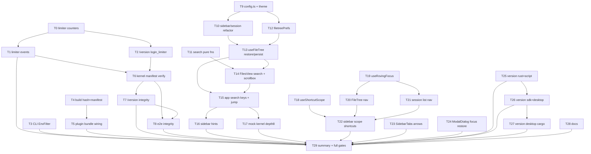

# Plan: AgentJ v0.21.0 — Limiter Observability, Asset Integrity, TUI Search & Web Focus Scope

> **Source spec:** `docs/superpowers/specs/2026-09-22-agentj-observability-integrity-and-interaction-design.md`
> **Version:** workspace `0.20.1` → **`0.21.0`**; `PROTOCOL_VERSION` stays **`0.13.0`** (no JSON-RPC wire changes)
> **Language:** task titles / ACs / code in English (per jskill-feature-plan); context notes in Chinese.

## Agent Worker Instructions

- **Required sub-skills:** `superpowers:subagent-driven-development` (recommended) or `superpowers:executing-plans`
- **Execution mode:** `subagent-driven-development` (fresh subagent per task, review between tasks)
- **Required verification (final; each task's `verify` field is authoritative for that task):**
  - `cargo fmt --check` · `cargo test --workspace` · `cargo clippy --workspace --all-targets -- -D warnings`
  - `cargo test -p agentj-protocol -- drift` (2 passed)
  - `npm --prefix agentj-ui test --workspace=@agentj/web`
  - `npm --prefix agentj-ui test --workspace=@agentj/sdk`
  - `bun --cwd agentj-ui/apps/tui test`
  - `npm --prefix agentj-ui run build --workspace=@agentj/web`
  - `./scripts/check-version.sh` · `node agentj-ui/apps/desktop/check-desktop-ui.mjs`
- **Version bump:** feature → minor (`0.21.0`); never change `PROTOCOL_VERSION`.
- **Live acceptance:** deferred to the acceptance stage (`jskill-test-acceptance`); automated gates are this plan's exit criteria.
- **Commits:** English messages, one logical change per commit (`feat:`, `fix:`, `chore:`, `docs:`).

## Global Constraints

1. **No wire changes:** no new JSON-RPC methods/types/schemas; `PROTOCOL_VERSION` = `0.13.0`; `protocol/methods.json` untouched.
2. **No new third-party crates:** `sha2` + `base64` are already in `Cargo.lock` (via `agentj-license` / `agentj-cli`); `tracing-subscriber` gains only the `env-filter` feature. Zero new npm dependencies.
3. **Rust style:** functions ≤50 lines, ≤120 chars/line; `#[serde(other)]` discipline unchanged.
4. **TUI persistence:** all new stores go through `src/config.ts`; `XDG_CONFIG_HOME` semantics unchanged; corrupt files silently ignored.
5. **Web a11y:** Tab keeps native behavior; single-letter shortcuts only when `document.activeElement` is inside the sidebar and the event target is not editable.
6. **Bilingual copy:** existing UI strings (Chinese) stay as-is; new TUI hint strings follow existing English style (`r refresh · f threads`).

---

## Tasks

### T0: Add aggregate counters to LoginLimiter [P0] [Sequential]

```yaml
- id: T0
  title: "Add aggregate counters and counters() snapshot to LoginLimiter"
  files:
    - crates/agentj-ipc/src/login_limiter.rs
  depends_on: []
  breaking: false
  ac:
    - given: "a limiter with free_attempts=3 and two recorded failures"
      when: "counters(now) is read"
      then: "attempts=2, failures=2, lockouts=0, blocked=0"
    - given: "a third failure crosses the threshold"
      when: "record_failure returns Locked and counters(now) is read"
      then: "lockouts=1 exactly once; a subsequent blocked attempt increments blocked=1 while lockouts stays 1"
    - given: "a locked entry and later record_success"
      when: "counters(now) is read"
      then: "cumulative failures never reset; tracked_ips drops to 0"
  regression:
    - "login_limiter::tests::locks_on_fifth_failure_then_escalates_to_the_cap"
    - "login_limiter::tests::success_clears_counters_and_idle_entries_reset"
    - "login_limiter::tests::tracked_entries_are_bounded"
  test_code: |
    #[test]
    fn counters_track_attempts_failures_lockouts_and_blocks() {
        let limiter = LoginLimiter::with_policy(Policy { free_attempts: 3, ..Policy::default() });
        let t0 = Instant::now();
        let ip = ip("198.51.100.9");
        for _ in 0..2 {
            let _ = limiter.check(ip, t0);          // attempts += 1
            let _ = limiter.record_failure(ip, t0); // failures += 1
        }
        let snap = limiter.counters(t0);
        assert_eq!((snap.attempts, snap.failures, snap.lockouts, snap.blocked), (2, 2, 0, 0));
        let _ = limiter.check(ip, t0);
        assert!(matches!(limiter.record_failure(ip, t0), Throttle::Locked { .. }));
        assert_eq!(limiter.counters(t0).lockouts, 1, "3rd failure starts the lockout");
        let _ = limiter.check(ip, t0);          // blocked attempt
        let _ = limiter.record_failure(ip, t0); // escalation
        let snap = limiter.counters(t0);
        assert_eq!((snap.blocked, snap.lockouts, snap.locked_now, snap.tracked_ips), (1, 1, 1, 1));
        limiter.record_success(ip);
        let snap = limiter.counters(t0);
        assert_eq!((snap.failures, snap.tracked_ips), (3, 0), "cumulative counters never reset");
    }
  impl_code: |
    // login_limiter.rs additions
    #[derive(Debug, Clone, Copy, PartialEq, Eq, Default)]
    pub(crate) struct Counters {
        pub(crate) attempts: u64, pub(crate) failures: u64,
        pub(crate) lockouts: u64, pub(crate) blocked: u64,
        pub(crate) locked_now: u64, pub(crate) tracked_ips: u64,
    }
    #[derive(Default)]
    struct CounterAtoms { attempts: AtomicU64, failures: AtomicU64, lockouts: AtomicU64, blocked: AtomicU64 }
    // LoginLimiter gains `counters: CounterAtoms` (init in with_policy).
    // check(): `self.counters.attempts.fetch_add(1, Ordering::Relaxed);` then existing status logic.
    // record_failure(): before mutation read `let was_locked = self.status(&entry, now).is_locked();`
    //   if was_locked { blocked += 1 } else { failures += 1 }
    //   after mutation: if !was_locked && now-locked → lockouts += 1 (transition only; escalation not counted)
    // record_success(): unchanged (entry removed).
    // counters(&self, now: Instant) -> Counters: scan entries under lock → locked_now / tracked_ips.
  verify:
    - "cargo test -p agentj-ipc login_limiter -- --nocapture"
    - "cargo clippy -p agentj-ipc --all-targets -- -D warnings"
```

### T1: Emit tracing events from LoginLimiter [P0] [Sequential]

```yaml
- id: T1
  title: "Emit warn/info/debug tracing events from limiter state changes"
  files:
    - crates/agentj-ipc/src/login_limiter.rs
    - crates/agentj-ipc/Cargo.toml
  depends_on: [T0]
  breaking: false
  ac:
    - given: "a capturing tracing subscriber at DEBUG level"
      when: "a failure starts a lockout"
      then: "captured output contains a WARN line with ip and retry_after_secs fields"
    - given: "the same subscriber"
      when: "record_success runs after failures"
      then: "captured output contains an INFO line with prior_failures"
    - given: "the same subscriber"
      when: "an ordinary (non-locking) failure and a blocked attempt occur"
      then: "captured output contains DEBUG lines for both"
  regression:
    - "login_limiter::tests::counters_track_attempts_failures_lockouts_and_blocks"
    - "web::tests::fifth_failure_is_429_and_locked_requests_skip_token_check"
  test_code: |
    #[derive(Clone, Default)]
    struct CaptureWriter(Arc<Mutex<Vec<u8>>>);
    impl std::io::Write for CaptureWriter {
        fn write(&mut self, buf: &[u8]) -> std::io::Result<usize> { self.0.lock().unwrap().extend_from_slice(buf); Ok(buf.len()) }
        fn flush(&mut self) -> std::io::Result<()> { Ok(()) }
    }
    impl<'a> tracing_subscriber::fmt::MakeWriter<'a> for CaptureWriter {
        type Writer = CaptureWriter;
        fn make_writer(&'a self) -> Self::Writer { self.clone() }
    }
    #[test]
    fn lockout_emits_warn_and_success_emits_info() {
        let buf = CaptureWriter::default();
        let sub = tracing_subscriber::fmt().with_writer(buf.clone())
            .with_max_level(tracing::Level::DEBUG).finish();
        let _guard = tracing::subscriber::set_default(sub);
        let limiter = LoginLimiter::with_policy(Policy { free_attempts: 1, ..Policy::default() });
        let t0 = Instant::now();
        let ip = ip("203.0.113.5");
        let _ = limiter.record_failure(ip, t0);
        limiter.record_success(ip);
        let out = String::from_utf8(buf.0.lock().unwrap().clone()).unwrap();
        assert!(out.contains("login lockout"), "warn expected: {out}");
        assert!(out.contains("login ok"), "info expected: {out}");
    }
  impl_code: |
    // Cargo.toml: add [dev-dependencies] tracing-subscriber = "0.3"
    // login_limiter.rs: use tracing::{debug, info, warn};
    // record_failure: new lockout → warn!(ip = %ip, failures, lockout_secs, "login lockout");
    //   escalation → debug!(ip = %ip, retry_after_secs, "login lockout extended");
    //   normal failure → debug!(ip = %ip, failures, "login failure");
    //   blocked → debug!(ip = %ip, retry_after_secs, "login blocked while locked");
    // record_success: info!(ip = %ip, prior_failures, "login ok");
    // NOTE: tracing-subscriber is a test-only dev-dependency (already in Cargo.lock; no new external crate).
  verify:
    - "cargo test -p agentj-ipc login_limiter -- --nocapture"
```

### T2: Expose login_limiter summary on GET /version [P0] [Parallel with T1]

```yaml
- id: T2
  title: "Add login_limiter counters block to the /version handler"
  files:
    - crates/agentj-ipc/src/web.rs
  depends_on: [T0]
  breaking: false
  ac:
    - given: "a remote peer with 3 wrong-token POSTs against small_policy"
      when: "GET /version is fetched"
      then: "JSON has login_limiter.attempts=3, failures=3, lockouts=1, blocked=0"
    - given: "a blocked attempt while locked"
      when: "GET /version is fetched"
      then: "login_limiter.blocked=1 and locked_now=1"
    - given: "the existing /version contract"
      when: "the response is read"
      then: "product_version/protocol_version/dist_present/dist and Cache-Control: no-store are unchanged"
  regression:
    - "web::tests::version_endpoint_reports_server_and_dist_versions"
    - "web::tests::login_sets_session_cookie_and_redirects_to_next"
  test_code: |
    #[tokio::test]
    async fn version_reports_login_limiter_counters() {
        let web = Arc::new(WebConfig::new(None, Some("secret".into()))
            .with_login_limiter(LoginLimiter::with_policy(small_policy())));
        let router = build_router(test_state(web), SocketAddr::from(([203, 0, 113, 7], 41000)));
        for _ in 0..3 {
            let _ = form_post(router.clone(), "/login", "token=wrong&next=%2F").await;
        }
        let (status, _, body) = get(router, "/version").await;
        assert_eq!(status, StatusCode::OK);
        let v: serde_json::Value = serde_json::from_str(&body).unwrap();
        assert_eq!(v["login_limiter"]["attempts"], 3);
        assert_eq!(v["login_limiter"]["failures"], 3);
        assert_eq!(v["login_limiter"]["lockouts"], 1);
    }
  impl_code: |
    // version_handler: after dist block, insert
    let c = web.login_limiter.counters(Instant::now());
    json!({ "login_limiter": {
        "attempts": c.attempts, "failures": c.failures, "lockouts": c.lockouts,
        "blocked": c.blocked, "locked_now": c.locked_now, "tracked_ips": c.tracked_ips }})
  verify:
    - "cargo test -p agentj-ipc web -- --nocapture"
```

### T3: CLI EnvFilter logging init [P0] [Parallel]

```yaml
- id: T3
  title: "Add logging module with EnvFilter (RUST_LOG, default info)"
  files:
    - crates/agentj-cli/src/logging.rs
    - crates/agentj-cli/src/main.rs
    - crates/agentj-cli/Cargo.toml
  depends_on: []
  breaking: false
  ac:
    - given: "RUST_LOG is unset"
      when: "the filter is built with spec=None"
      then: "max_level_hint() == Some(LevelFilter::INFO) (behavior identical to today)"
    - given: "spec=Some(\"debug\")"
      when: "the filter is built"
      then: "max_level_hint() == Some(LevelFilter::DEBUG)"
    - given: "the CLI source tree after the change"
      when: "grep for tracing_subscriber::fmt::init runs"
      then: "no direct fmt::init remains; only logging::init() initializes tracing"
  regression:
    - "cargo test -p agentj-cli (all existing CLI unit tests)"
  test_code: |
    #[test]
    fn filter_defaults_to_info_and_honors_debug_spec() {
        assert_eq!(super::filter_from(None).max_level_hint(), Some(tracing::level_filters::LevelFilter::INFO));
        assert_eq!(super::filter_from(Some("debug")).max_level_hint(), Some(tracing::level_filters::LevelFilter::DEBUG));
    }
  impl_code: |
    // logging.rs
    pub fn filter_from(spec: Option<&str>) -> EnvFilter {
        match spec {
            Some(s) => EnvFilter::new(s),
            None => EnvFilter::new("info"),
        }
    }
    pub fn init() {
        let spec = std::env::var("RUST_LOG").ok();
        tracing_subscriber::fmt().with_env_filter(filter_from(spec.as_deref())).init();
    }
    // Cargo.toml: tracing-subscriber = { version = "0.3", features = ["env-filter"] }
    // main.rs: replace `tracing_subscriber::fmt::init();` with `logging::init();` + `mod logging;`
  verify:
    - "cargo test -p agentj-cli -- --nocapture"
    - "! grep -rn 'tracing_subscriber::fmt::init' crates/agentj-cli/src"
    - "RUST_LOG=debug cargo run -p agentj-cli -- --version"
```

### T4: Build-side hash map and manifest generation [P0] [Parallel]

```yaml
- id: T4
  title: "Generate sha384 hash map and asset-manifest.json in version-sri helpers"
  files:
    - agentj-ui/apps/web/build/version-sri.ts
    - agentj-ui/apps/web/build/version-sri.test.ts
  depends_on: []
  breaking: false
  ac:
    - given: "two local files with known bytes"
      when: "hashAssets(files) runs"
      then: "the map values equal the known sha384-base64 digests"
    - given: "a bundle file list plus index.html"
      when: "finalizeDist runs"
      then: "asset-manifest.json contains every bundle file and the rewritten /index.html, and excludes version.json and asset-manifest.json itself"
    - given: "entry HTML referencing a local asset"
      when: "finalizeDist runs"
      then: "the injected integrity value equals the manifest value for that path"
  regression:
    - "version-sri.test.ts: injects sha384 integrity for local script and stylesheet refs"
    - "version-sri.test.ts: throws when a local reference is missing"
    - "version-sri.test.ts: replaces an existing integrity attribute"
  test_code: |
    it("writes a manifest covering bundle files and the rewritten index.html", () => {
      const dir = mkdtempSync(join(tmpdir(), "sri-manifest-"));
      writeFileSync(join(dir, "index.html"), `<script type="module" src="/assets/a.js"></script>`);
      mkdirSync(join(dir, "assets"));
      writeFileSync(join(dir, "assets/a.js"), "console.log(1)");
      writeFileSync(join(dir, "assets/hero.png"), "png-bytes");
      const result = finalizeDist(dir, VERSIONS, ["assets/a.js", "assets/hero.png"]);
      const manifest = JSON.parse(readFileSync(join(dir, "asset-manifest.json"), "utf8"));
      expect(manifest.algorithm).toBe("sha384");
      expect(Object.keys(manifest.assets).sort()).toEqual(["/assets/a.js", "/assets/hero.png", "/index.html"]);
      expect(manifest.assets["/assets/a.js"]).toBe(result.hashes["/assets/a.js"]);
      expect(readFileSync(join(dir, "index.html"), "utf8")).toContain(`integrity="${result.hashes["/assets/a.js"]}"`);
    });
  impl_code: |
    // version-sri.ts
    export type HashMap = Record<string, string>;
    export function hashAssets(files: { path: string; bytes: Buffer }[]): HashMap
    export function buildManifestJson(hashes: HashMap): string  // { algorithm:"sha384", assets: hashes } 2-space + \n
    // finalizeDist(distDir, versions, bundleFiles: string[]): SriResult
    //   1) hashes = hashAssets(bundleFiles + any asset referenced by index.html)
    //   2) injectSri(html, reader, hashes)   // read from map, not recompute
    //   3) write index.html; hashes["/index.html"] = sha384 of rewritten bytes
    //   4) write asset-manifest.json (exclude version.json + the manifest itself)
    //   5) write version.json
  verify:
    - "npm --prefix agentj-ui test --workspace=@agentj/web -- build/version-sri.test.ts"
```

### T5: Wire bundle enumeration into the Vite plugin [P0] [Sequential]

```yaml
- id: T5
  title: "Pass Rollup bundle file names into finalizeDist from writeBundle"
  files:
    - agentj-ui/apps/web/build/version-sri-plugin.ts
    - agentj-ui/apps/web/build/version-sri-plugin.test.ts
  depends_on: [T4]
  breaking: false
  ac:
    - given: "a fake bundle with an entry chunk, a dynamic chunk and an asset"
      when: "the plugin writeBundle hook runs against a temp dist"
      then: "asset-manifest.json lists all three plus /index.html and SRI is injected"
    - given: "the plugin hook"
      when: "bundle contains a chunk flagged isDynamicEntry"
      then: "that chunk appears in the manifest (dynamic-chunk coverage proof)"
  regression:
    - "version-sri.test.ts (all cases from T4)"
    - "npm --prefix agentj-ui run build --workspace=@agentj/web (integration)"
  test_code: |
    it("collects bundle chunks (including dynamic) into the manifest", async () => {
      const dir = mkdtempSync(join(tmpdir(), "sri-plugin-"));
      writeFileSync(join(dir, "index.html"), `<script type="module" src="/assets/index.js"></script>`);
      mkdirSync(join(dir, "assets"));
      writeFileSync(join(dir, "assets/index.js"), "export{}");
      writeFileSync(join(dir, "assets/chunk-lazy.js"), "export{}");
      const plugin = versionSriPlugin();
      const bundle = {
        "assets/index.js": { type: "chunk", fileName: "assets/index.js", isDynamicEntry: false },
        "assets/chunk-lazy.js": { type: "chunk", fileName: "assets/chunk-lazy.js", isDynamicEntry: true },
      };
      await plugin.writeBundle.call({} as never, { dir, root: dir } as never, bundle as never);
      const manifest = JSON.parse(readFileSync(join(dir, "asset-manifest.json"), "utf8"));
      expect(manifest.assets["/assets/chunk-lazy.js"]).toBeTruthy();
    });
  impl_code: |
    // version-sri-plugin.ts
    writeBundle(options, bundle) {
      const distDir = resolve(root, options.dir ?? "dist");
      const files = Object.values(bundle ?? {})
        .map((item) => item.fileName)
        .filter((name) => name !== "version.json" && name !== "asset-manifest.json");
      finalizeDist(distDir, { productVersion: VERSION, protocolVersion: PROTOCOL_VERSION,
        buildTime: new Date().toISOString() }, files);
    }
  verify:
    - "npm --prefix agentj-ui test --workspace=@agentj/web -- build/"
    - "npm --prefix agentj-ui run build --workspace=@agentj/web"
```

### T6: Kernel asset-manifest read and startup verification [P0] [Sequential]

```yaml
- id: T6
  title: "Verify dist assets against asset-manifest.json at startup"
  files:
    - crates/agentj-ipc/src/web.rs
    - crates/agentj-ipc/Cargo.toml
  depends_on: [T1, T2]
  breaking: false
  ac:
    - given: "a dist with a manifest listing one correct file and one missing file"
      when: "WebConfig::new runs"
      then: "integrity report has checked=1, missing=1 and startup_warnings() includes an integrity warning"
    - given: "a manifest whose file bytes changed after build"
      when: "WebConfig::new runs"
      then: "mismatched=1 and the warning names up to 3 offending paths"
    - given: "a manifest with algorithm != sha384 or a key containing '..'"
      when: "WebConfig::new runs"
      then: "the manifest is treated as unusable (warning) and verification is skipped"
    - given: "no dist directory"
      when: "WebConfig::new runs"
      then: "no integrity warning is produced (legacy dist-absent semantics)"
    - given: "a dist that has no asset-manifest.json"
      when: "WebConfig::new runs"
      then: "manifest_present=false, the stale-build warning is emitted, and the service continues"
    - given: "a manifest key that does not start with '/' (or contains '..')"
      when: "WebConfig::new runs"
      then: "the manifest is treated as unusable (warning) and verification is skipped"
  regression:
    - "web::tests::startup_warnings_cover_aligned_missing_and_mismatched_dists"
    - "web::tests::version_endpoint_without_dist_reports_null_dist"
  test_code: |
    #[test]
    fn integrity_report_counts_mismatches_and_missing() {
        let dir = temp_dist("integrity");
        fs::write(dir.join("index.html"), b"<html></html>").unwrap();
        let good = sha384_b64(b"<html></html>");
        write_manifest(&dir, &[("/index.html", &good), ("/assets/missing.js", "sha384-AAAA")]);
        let cfg = WebConfig::new(Some(dir), None);
        let report = cfg.integrity();
        assert_eq!((report.manifest_present, report.checked, report.missing), (true, 1, 1));
        assert!(cfg.startup_warnings().iter().any(|w| w.contains("integrity")));
    }
    #[test]
    fn manifest_with_parent_dir_key_is_unusable() {
        let dir = temp_dist("integrity-bad");
        write_manifest(&dir, &[("/../etc/passwd", "sha384-AAAA")]);
        let cfg = WebConfig::new(Some(dir), None);
        assert!(!cfg.integrity().manifest_present);
        assert!(cfg.startup_warnings().iter().any(|w| w.contains("asset manifest")));
    }
    #[test]
    fn missing_manifest_warns_but_keeps_serving() {
        let dir = temp_dist("no-manifest");
        fs::write(dir.join("index.html"), b"<html></html>").unwrap();
        let cfg = WebConfig::new(Some(dir), None);
        assert!(!cfg.integrity().manifest_present);
        assert!(cfg.startup_warnings().iter().any(|w| w.contains("asset-manifest")));
    }
    #[test]
    fn non_slash_key_is_unusable() {
        let dir = temp_dist("integrity-noslash");
        write_manifest(&dir, &[("assets/a.js", "sha384-AAAA")]);
        assert!(!WebConfig::new(Some(dir), None).integrity().manifest_present);
    }
  impl_code: |
    // Cargo.toml: sha2 = "0.10", base64 = "0.22"
    // web.rs
    #[derive(Deserialize)] struct AssetManifest { algorithm: String, assets: HashMap<String, String> }
    #[derive(Default, Clone)] pub(crate) struct IntegrityReport {
        pub(crate) manifest_present: bool, pub(crate) checked: u64,
        pub(crate) mismatched: u64, pub(crate) missing: u64 }
    // test helpers (same module):
    //   fn sha384_b64(bytes: &[u8]) -> String  // "sha384-" + BASE64_STANDARD.encode(Sha384::digest(bytes))
    //   fn write_manifest(dir: &Path, entries: &[(&str, &str)])  // writes {"algorithm":"sha384","assets":{…}}
    // read_asset_manifest(dist) -> (Option<AssetManifest>, Option<String>)
    //   validate: algorithm == "sha384"; every key starts with '/' and has no ".." component
    // verify_assets(dist, manifest) -> IntegrityReport  (read bytes, sha384 → base64 → compare)
    // WebConfig gains `integrity: IntegrityReport` computed once in new()
    // startup_warnings(): push "warning: web dist asset integrity check failed: N mismatched, M missing (…)"
    //   and "warning: web dist has no asset-manifest.json (stale build?)" / unreadable variant
  verify:
    - "cargo test -p agentj-ipc web -- --nocapture"
    - "cargo clippy -p agentj-ipc --all-targets -- -D warnings"
```

### T7: Expose integrity summary on GET /version [P0] [Sequential]

```yaml
- id: T7
  title: "Add integrity summary block to the /version handler"
  files:
    - crates/agentj-ipc/src/web.rs
  depends_on: [T6]
  breaking: false
  ac:
    - given: "a dist with a valid manifest"
      when: "GET /version is fetched"
      then: "integrity.manifest_present=true, checked>0, mismatched=0, missing=0"
    - given: "a dist without a manifest"
      when: "GET /version is fetched"
      then: "integrity.manifest_present=false and the endpoint still returns 200 JSON"
  regression:
    - "web::tests::version_reports_login_limiter_counters"
    - "web::tests::version_endpoint_reports_server_and_dist_versions"
  test_code: |
    #[tokio::test]
    async fn version_reports_asset_integrity_summary() {
        let dir = temp_dist("version-integrity");
        fs::write(dir.join("index.html"), b"<html></html>").unwrap();
        write_manifest(&dir, &[("/index.html", &sha384_b64(b"<html></html>"))]);
        let web = Arc::new(WebConfig::new(Some(dir), None));
        let (_, _, body) = get(build_router(test_state(web), SocketAddr::from(([127, 0, 0, 1], 5555))), "/version").await;
        let v: serde_json::Value = serde_json::from_str(&body).unwrap();
        assert_eq!(v["integrity"]["manifest_present"], true);
        assert_eq!(v["integrity"]["mismatched"], 0);
    }
  impl_code: |
    // version_handler: add
    json!({ "integrity": {
        "manifest_present": web.integrity().manifest_present,
        "checked": web.integrity().checked,
        "mismatched": web.integrity().mismatched,
        "missing": web.integrity().missing }})
  verify:
    - "cargo test -p agentj-ipc web -- --nocapture"
```

### T8: e2e integrity fixture [P0] [Sequential]

```yaml
- id: T8
  title: "Extend e2e_http_static with green and tampered integrity fixtures"
  files:
    - crates/agentj-cli/tests/e2e_http_static.rs
    - crates/agentj-cli/Cargo.toml
  depends_on: [T6, T7]
  breaking: false
  ac:
    - given: "a fixture dist with a correct manifest"
      when: "agentj serve --web-dist starts"
      then: "stderr contains no integrity warning and GET /version shows mismatched=0"
    - given: "a fixture whose manifest hash was tampered"
      when: "agentj serve --web-dist starts"
      then: "stderr contains the integrity warning"
  regression:
    - "e2e_http_static::serve_serves_web_dist_with_spa_fallback_and_cache_headers"
  test_code: |
    // helpers: write_asset_manifest(dir, entries) + sha384_b64(bytes) using dev-deps sha2/base64
    #[test]
    fn warns_when_manifest_hash_does_not_match() {
        let dir = fixture_dist_with_manifest(&[("/index.html", "sha384-AAAA")]);
        let out = run_serve_and_capture(&dir);
        assert!(out.stderr.contains("integrity"), "stderr: {}", out.stderr);
    }
    #[test]
    fn silent_when_manifest_matches() {
        let dir = fixture_dist_with_manifest_hashed_correctly();
        let out = run_serve_and_capture(&dir);
        assert!(!out.stderr.contains("integrity"), "stderr: {}", out.stderr);
    }
  impl_code: |
    // Cargo.toml [dev-dependencies]: sha2 = "0.10"  (base64 already a main dependency)
    // extend the existing fixture builder to also write asset-manifest.json; reuse the
    // existing "hold stdout reader" pattern from the static e2e.
  verify:
    - "cargo test -p agentj-cli --test e2e_http_static -- --nocapture"
```

### T9: TUI shared config module + theme refactor [P1] [Parallel]

```yaml
- id: T9
  title: "Extract config.ts (config dir + JSON helpers) and migrate theme.tsx"
  files:
    - agentj-ui/apps/tui/src/config.ts
    - agentj-ui/apps/tui/src/config.test.ts
    - agentj-ui/apps/tui/src/theme.tsx
  depends_on: []
  breaking: false
  ac:
    - given: "XDG_CONFIG_HOME=/tmp/x"
      when: "getConfigDir() runs"
      then: "it returns /tmp/x/agentj"
    - given: "a missing or corrupt JSON file"
      when: "readJsonFile runs"
      then: "it returns null and never throws"
    - given: "saveJsonFile writes an object"
      when: "the file is read back"
      then: "it is valid 2-space JSON and parent dirs exist"
    - given: "the theme store"
      when: "theme.test.tsx runs after the refactor"
      then: "load/save behavior is unchanged (same path, same shape)"
  regression:
    - "theme.test.tsx (load/save roundtrip, corrupt tolerance)"
  test_code: |
    import { mkdtempSync } from "node:fs";
    import { tmpdir } from "node:os";
    it("resolves XDG config dir and roundtrips JSON", () => {
      process.env.XDG_CONFIG_HOME = mkdtempSync(join(tmpdir(), "aj-config-"));
      expect(getConfigDir()).toBe(join(process.env.XDG_CONFIG_HOME, "agentj"));
      expect(readJsonFile("missing.json")).toBeNull();
      writeJsonFile("a/b.json", { x: 1 });
      expect(readJsonFile("a/b.json")).toEqual({ x: 1 });
    });
  impl_code: |
    // config.ts
    export function getConfigDir(): string
    export function readJsonFile<T>(name: string): T | null   // try/catch swallow
    export function writeJsonFile(name: string, value: unknown): void  // mkdirSync recursive + 2-space
    // theme.tsx: delete the local config-dir helper (currently getThemeConfigDir) + fs glue; use readJsonFile/writeJsonFile("theme.json")
  verify:
    - "bun --cwd agentj-ui/apps/tui test src/config.test.ts src/theme.test.tsx"
```

### T10: Migrate sidebar/session persistence to config.ts [P1] [Sequential]

```yaml
- id: T10
  title: "Migrate sidebar.tsx and session.tsx persistence onto config.ts"
  files:
    - agentj-ui/apps/tui/src/sidebar.tsx
    - agentj-ui/apps/tui/src/session.tsx
    - agentj-ui/apps/tui/src/sidebar.test.tsx
  depends_on: [T9]
  breaking: false
  ac:
    - given: "an existing projects.json written before the refactor"
      when: "loadCollapsed/loadProjects run"
      then: "they parse the same shape (collapsed/projects keys) with no migration"
    - given: "saveCollapsed prunes unknown top-level boolean keys"
      when: "the refactor is done"
      then: "the pruning allowlist behavior is unchanged (regression test green)"
  regression:
    - "sidebar.test.tsx (collapsed persistence via temp XDG_CONFIG_HOME)"
    - "session.test.tsx (history load/save, max 20)"
  test_code: |
    // sidebar.test.tsx addition: assert the persisted file path is unchanged
    it("persists collapsed state under the shared config dir", () => {
      process.env.XDG_CONFIG_HOME = mkdtempSync(join(tmpdir(), "aj-sidebar-"));
      saveCollapsed({ p1: true });
      expect(existsSync(join(process.env.XDG_CONFIG_HOME, "agentj", "projects.json"))).toBe(true);
    });
  impl_code: |
    // sidebar.tsx: remove local getConfigDir + read/write glue; keep getProjectsPath() as
    //   join(getConfigDir(), "projects.json"); use readJsonFile/writeJsonFile.
    // session.tsx: same for session-history.json.
  verify:
    - "bun --cwd agentj-ui/apps/tui test src/sidebar.test.tsx src/session.test.tsx"
```

### T11: TUI search pure functions [P1] [Parallel]

```yaml
- id: T11
  title: "Add buildSearchIndex/filterEntries/formatSearchRowParts to files.ts"
  files:
    - agentj-ui/apps/tui/src/files.ts
    - agentj-ui/apps/tui/src/files.test.ts
  depends_on: []
  breaking: false
  ac:
    - given: "flat file/list entries"
      when: "buildSearchIndex runs"
      then: "every entry keeps path/name/kind/gitStatus in wire order"
    - given: "query 'MAIN' and entries src/main.rs, docs/main.md"
      when: "filterEntries runs"
      then: "matching is case-insensitive; name-prefix matches sort before path-substring matches; ties break by path asc"
    - given: "more matches than the limit"
      when: "filterEntries runs"
      then: "rows are capped and `total` still reports the full match count"
    - given: "an empty query"
      when: "filterEntries runs"
      then: "rows=[] and total=0"
    - given: "a 28-char row budget with a long file name"
      when: "formatSearchRowParts runs"
      then: "the body fits the budget, the name is truncated and the status letter stays intact"
  regression:
    - "files.test.ts: flattenVisible depth-first / formatFileRowParts budget"
  test_code: |
    it("filters case-insensitively with name matches ranked first", () => {
      const index = buildSearchIndex([
        { name: "main.md", path: "docs/main.md", kind: "file" },
        { name: "main.rs", path: "src/main.rs", kind: "file" },
        { name: "lib.rs", path: "src/lib.rs", kind: "file" },
      ]);
      const out = filterEntries(index, "MAIN", 10);
      expect(out.rows.map((r) => r.path)).toEqual(["docs/main.md", "src/main.md"]);
      expect(out.total).toBe(2);
      expect(filterEntries(index, "", 10)).toEqual({ rows: [], total: 0 });
      const parts = formatSearchRowParts(index[0], 28, true);
      expect(parts.body.length).toBeLessThanOrEqual(28);
    });
  impl_code: |
    export type SearchEntry = { name: string; path: string; kind: "file" | "dir"; gitStatus: GitLetter | null };
    export function buildSearchIndex(entries: RawFileEntry[]): SearchEntry[]
    export function filterEntries(index: SearchEntry[], query: string, limit: number): { rows: SearchEntry[]; total: number }
    // rank: name.startsWith(q) → 0; name.includes(q) → 1; path.includes(q) → 2; then path asc
    export function formatSearchRowParts(row: SearchEntry, width: number, selected: boolean): RowParts
  verify:
    - "bun --cwd agentj-ui/apps/tui test src/files.test.ts"
```

### T12: TUI filetree preference store [P1] [Sequential]

```yaml
- id: T12
  title: "Add filetreePrefs.ts store for expanded paths per project key"
  files:
    - agentj-ui/apps/tui/src/filetreePrefs.ts
    - agentj-ui/apps/tui/src/filetreePrefs.test.ts
  depends_on: [T9]
  breaking: false
  ac:
    - given: "no filetree.json or a corrupt one"
      when: "loadFileTreePrefs runs"
      then: "it returns an empty expanded map and never throws"
    - given: "expanded paths for project p1"
      when: "saveFileTreePrefs({p1:[...]}, ['p1']) then load"
      then: "the roundtrip preserves order"
    - given: "more than 100 paths for one key"
      when: "save runs"
      then: "only the first 100 are persisted"
    - given: "a stale key p9 not in the current project list"
      when: "save runs with ['p1']"
      then: "p9 is dropped from the file"
  regression:
    - "config.test.ts (T9 helpers)"
  test_code: |
    it("caps entries per key and prunes stale project keys", () => {
      process.env.XDG_CONFIG_HOME = mkdtempSync(join(tmpdir(), "aj-filetree-"));
      const many = Array.from({ length: 120 }, (_, i) => `d${i}`);
      saveFileTreePrefs({ p1: many, p9: ["x"] }, ["p1"]);
      const loaded = loadFileTreePrefs();
      expect(loaded.p1).toHaveLength(100);
      expect(loaded.p9).toBeUndefined();
      writeFileSync(join(getConfigDir(), "filetree.json"), "{not json");
      expect(loadFileTreePrefs()).toEqual({ expanded: {} });
    });
  impl_code: |
    export type FileTreePrefs = { expanded: Record<string, string[]> };
    const FILE = "filetree.json";
    export function loadFileTreePrefs(): FileTreePrefs
    export function saveFileTreePrefs(prefs: FileTreePrefs, liveProjectIds: string[]): void
    // write: keep keys in liveProjectIds ∪ {"__default__"}; slice(0, 100) per key
  verify:
    - "bun --cwd agentj-ui/apps/tui test src/filetreePrefs.test.ts"
```

### T13: TUI useFileTree restore + persist integration [P1] [Sequential]

```yaml
- id: T13
  title: "Persist expanded dirs and restore them on session activation"
  files:
    - agentj-ui/apps/tui/src/files.tsx
    - agentj-ui/apps/tui/src/filesView.test.tsx
  depends_on: [T10, T12]
  breaking: false
  ac:
    - given: "filetree.json holds [src, src/components] for the active project"
      when: "the session activates and the root loads"
      then: "requests are issued depth-ascending (root → src → src/components) and both dirs end expanded"
    - given: "a persisted path that no longer exists"
      when: "restore runs"
      then: "the path is skipped silently and remaining paths still restore"
    - given: "the user toggles or collapses a directory"
      when: "the action completes"
      then: "saveFileTreePrefs is called with the live expanded set"
  regression:
    - "filesView.test.tsx: drops a file-list reply that resolves after the session changed"
    - "app.test.tsx: files view lazy-loads the tree and expands directories"
  test_code: |
    it("restores persisted expanded paths after the root load", async () => {
      process.env.XDG_CONFIG_HOME = mkdtempSync(join(tmpdir(), "aj-restore-"));
      saveFileTreePrefs({ p1: ["src", "src/components"] }, ["p1"]);
      const { client, calls } = fakeClientWithTree({ src: ["components"], "src/components": [] });
      render(<Probe client={client} sessionId="s1" projectKey="p1" />);
      await waitFor(() => expect(calls).toContainEqual(expect.objectContaining({ path: "src/components", depth: 1 })));
      expect(calls.filter((c) => c.path === "src")).toHaveLength(1);
    });
  impl_code: |
    // useFileTree(client, sessionId, projectKey)
    //   after loadRoot() resolves: prefs = loadFileTreePrefs().expanded[projectKey] ?? []
    //   sort by path depth; for each (≤50): ensure ancestors loaded via loadDir(ancestor),
    //   then updateNode(expanded:true) + loadDir(path); generation guard aborts on switch.
    //   toggle/collapse: collect expanded paths from live tree → saveFileTreePrefs({...}, liveIds)
  verify:
    - "bun --cwd agentj-ui/apps/tui test src/filesView.test.tsx"
```

### T14: TUI FilesView search rendering + scrollbox [P1] [Sequential]

```yaml
- id: T14
  title: "Render search results and add a scrollbox to the Files body"
  files:
    - agentj-ui/apps/tui/src/files.tsx
    - agentj-ui/apps/tui/src/filesView.test.tsx
  depends_on: [T11, T13]
  breaking: false
  ac:
    - given: "search mode with 2 matching rows"
      when: "FilesView renders"
      then: "rows show name + dimmed parent + status letter, selected row marked"
    - given: "truncated search index"
      when: "FilesView renders"
      then: "a `partial` hint line is rendered"
    - given: "a failed index request"
      when: "FilesView renders with search.error set"
      then: "an inline error row is rendered while the hint line stays visible"
    - given: "search mode and a selection change"
      when: "the selected row index changes"
      then: "the scrollbox scrollY is adjusted so the row stays visible"
    - given: "no search props"
      when: "FilesView renders"
      then: "tree rendering is unchanged (regression)"
  regression:
    - "filesView.test.tsx: dir rows show status letters and expanded children"
    - "filesView.test.tsx: placeholders (no session/loading/empty/error)"
  test_code: |
    it("renders search results with parent dir and partial hint", () => {
      const frame = testRender(
        <FilesView nodes={null} selected={1} error={null} truncated={false} noSession={false} width={28}
          search={{ active: true, query: "ma", rows: [
            { name: "main.rs", path: "src/main.rs", kind: "file", gitStatus: "M" },
            { name: "main.md", path: "docs/main.md", kind: "file", gitStatus: null }], total: 2,
            truncated: true, error: null }} />);
      expect(frame).toContain("main.rs");
      expect(frame).toContain("src/");
      expect(frame).toContain("partial");
      const errored = testRender(<FilesView nodes={null} selected={0} error={null} truncated={false}
        noSession={false} width={28} search={{ active: true, query: "ma", rows: [], total: 0,
        truncated: false, error: "file/list failed" }} />);
      expect(errored).toContain("file/list failed");
      expect(errored).toContain("esc back");
    });
  impl_code: |
    // FilesViewProps.search?: { active; query; rows; total; truncated; error }
    // when search.active: render hint line (type filter · enter jump · esc back [+ · partial]),
    //   error line, then rows via formatSearchRowParts; else render the existing tree.
    // Wrap the body in <scrollbox ref={scrollRef} flexGrow={1}>; useLayoutEffect/useEffect:
    //   scrollRef.current.scrollY = max(0, selectedIndex - 2)  // keep selection in view
  verify:
    - "bun --cwd agentj-ui/apps/tui test src/filesView.test.tsx"
```

### T15: TUI search mode keys and jump [P1] [Sequential]

```yaml
- id: T15
  title: "Add search mode state machine and ancestor-revealing jump in app.tsx"
  files:
    - agentj-ui/apps/tui/src/app.tsx
    - agentj-ui/apps/tui/src/app.test.tsx
  depends_on: [T13, T14]
  breaking: false
  ac:
    - given: "sidebar focus in Files view"
      when: "s is pressed"
      then: "one file/list request with {path:null, depth:8} is issued and search mode activates"
    - given: "search mode with query 'src'"
      when: "the user types f, n, c"
      then: "they become query text; no view toggle, no new session, no refresh request"
    - given: "search results with a selection"
      when: "Enter is pressed"
      then: "search exits, ancestors load in depth order, and the target row becomes selected"
    - given: "a non-empty query"
      when: "Esc is pressed once"
      then: "the query clears (mode stays); a second Esc exits search"
    - given: "a failed index request"
      when: "r is pressed"
      then: "the depth=8 request is issued again"
    - given: "a search result whose path no longer exists"
      when: "Enter is pressed"
      then: "search exits, the root refreshes, and a one-time error line is shown"
  regression:
    - "app.test.tsx: BUG-009 typing in the composer never triggers sidebar/file shortcuts"
    - "app.test.tsx: files view lazy-loads the tree and expands directories"
  test_code: |
    test("s enters search, printables filter, r rebuilds, enter jumps", async () => {
      const { calls, drop } = fakeKernel();
      const setup = await testRender(<App createTransport={fakeTransport} />, {});
      const input = getInput(setup);
      await act(async () => { input.press("tab"); await setup.flush(); });
      await act(async () => { input.press("f"); await setup.flush(); });
      await act(async () => { input.press("s"); await setup.flush(); });
      expect(calls).toContainEqual(expect.objectContaining({ method: "file/list", depth: 8 }));
      await act(async () => { input.type("fnc"); await setup.flush(); });
      expect(calls.filter((c) => c.depth === 8)).toHaveLength(1);   // f/n/c stay query text
      await act(async () => { input.press("esc"); await setup.flush(); }); // clear query
      await act(async () => { input.type("src"); await setup.flush(); });
      await act(async () => { input.press("r"); await setup.flush(); });   // r rebuilds the index
      expect(calls.filter((c) => c.depth === 8)).toHaveLength(2);
      await act(async () => { input.press("enter"); await setup.flush(); }); // jump
      expect(calls).toContainEqual(expect.objectContaining({ path: "src", depth: 1 }));
      // stale-jump branch (AC6): the indexed path disappeared
      drop("src/main.rs");
      await act(async () => { input.press("s"); await setup.flush(); });
      await act(async () => { input.type("main"); await setup.flush(); });
      await act(async () => { input.press("enter"); await setup.flush(); });
      expect(calls).toContainEqual(expect.objectContaining({ path: null, depth: 1 })); // root refresh
    });
  impl_code: |
    // app.tsx state: const [search, setSearch] = useState<SearchState | null>(null)
    //   SearchState = { query: string; index: SearchEntry[]; rows: SearchEntry[]; total: number; truncated: boolean; error: string | null; idx: number }
    // main handler order: modal gate → if (search && sidebarView==="files" && focus==="sidebar") handle search keys FIRST.
    //   Mapped keys take precedence over the printable fallback:
    //     Backspace → trim; Esc → clear-or-exit; ↑↓/j/k → move idx; Enter → revealPath(rows[idx].path) then exit;
    //     r → refetch index (query preserved);
    //   then printable fallback → append query + recompute rows. (return after each)
    // revealPath: split("/") → for each ancestor prefix (depth asc) ensure loaded then expand;
    //   find target index in flattenVisible and set filesIdx; if the path is gone (stale index):
    //   exit search + loadRoot() + one-time error line (search.error = "path no longer exists").
  verify:
    - "bun --cwd agentj-ui/apps/tui test src/app.test.tsx"
```

### T16: TUI sidebar hints for search [P1] [Sequential]

```yaml
- id: T16
  title: "Update sidebar hint lines for Files/search mode"
  files:
    - agentj-ui/apps/tui/src/sidebar.tsx
    - agentj-ui/apps/tui/src/sidebar.test.tsx
  depends_on: [T15]
  breaking: false
  ac:
    - given: "Files view with sidebar focus"
      when: "the sidebar renders"
      then: "hints read `s search · r refresh · f threads` plus `tab: compose`"
    - given: "search mode active"
      when: "the sidebar renders"
      then: "hints read `type filter · enter jump · esc back`"
    - given: "composer focus"
      when: "the sidebar renders"
      then: "no dead key hints are advertised (BUG-010 discipline)"
  regression:
    - "sidebar.test.tsx: files hints suppressed in composer focus"
  test_code: |
    it("advertises search hint in sidebar focus and in search mode", () => {
      const frame = testRender(<Sidebar {...baseProps} view="files" focusMode="sidebar" searchMode={null} />);
      expect(frame).toContain("s search");
      const searching = testRender(<Sidebar {...baseProps} view="files" focusMode="sidebar" searchMode={{ query: "ma" }} />);
      expect(searching).toContain("esc back");
    });
  impl_code: |
    // sidebar.tsx: SidebarProps.searchMode?: { query: string } | null
    // files + sidebar focus + !searchMode → "s search · r refresh · f threads" / "tab: compose"
    // files + searchMode → "type filter · enter jump · esc back"
  verify:
    - "bun --cwd agentj-ui/apps/tui test src/sidebar.test.tsx"
```

### T17: TUI mock kernel depth=8 e2e [P1] [Sequential]

```yaml
- id: T17
  title: "Support depth=8 fixtures in mock kernel e2e"
  files:
    - agentj-ui/apps/tui/src/e2e/mock-kernel.ts
    - agentj-ui/apps/tui/src/e2e/mock-files.test.ts
  depends_on: [T15]
  breaking: false
  ac:
    - given: "the mock kernel"
      when: "file/list arrives with depth=8"
      then: "it returns a flat fixture including nested paths (src/main.rs, docs/readme.md)"
    - given: "the e2e driver"
      when: "search + filter + Enter jump run over WS"
      then: "the target directory load request is observed"
  regression:
    - "e2e/mock-files.test.ts: root and src entries"
  test_code: |
    test("depth 8 returns the flat search fixture", async () => {
      const { client, calls } = await startMockKernel();
      const res = await client.request("file/list", { session_id: "s1", depth: 8 });
      expect(res.entries.map((e) => e.path)).toContain("src/main.rs");
      expect(calls[0]).toMatchObject({ depth: 8 });
    });
  impl_code: |
    // handleFileList: if (params.depth === 8) return SEARCH_FIXTURE (flat entries incl. nested paths)
    // else keep the existing depth=1 root/src fixtures.
  verify:
    - "bun --cwd agentj-ui/apps/tui test src/e2e/mock-files.test.ts"
```

### T18: Web useShortcutScope hook [P1] [Parallel]

```yaml
- id: T18
  title: "Add useShortcutScope hook gating shortcuts to sidebar focus"
  files:
    - agentj-ui/apps/web/src/hooks/useShortcutScope.ts
    - agentj-ui/apps/web/src/hooks/useShortcutScope.test.tsx
  depends_on: []
  breaking: false
  ac:
    - given: "focus is inside the scope ref"
      when: "a mapped key is pressed on document"
      then: "the handler fires"
    - given: "focus is outside the scope ref, or the event target is an input/textarea/contenteditable"
      when: "the key is pressed"
      then: "the handler does not fire"
    - given: "ctrl/meta/alt is held or event.isComposing is true"
      when: "the key is pressed"
      then: "the handler does not fire"
  regression:
    - "components/a11y.test.tsx (existing keyboard contracts)"
  test_code: |
    it("fires only while focus is inside the scope", () => {
      const onF = vi.fn();
      const { getByTestId } = render(
        <Scope onF={onF}><button data-testid="inside">in</button></Scope>);
      fireEvent.keyDown(document, { key: "f" });
      expect(onF).not.toHaveBeenCalled();                       // focus on body
      getByTestId("inside").focus();
      fireEvent.keyDown(document, { key: "f" });
      expect(onF).toHaveBeenCalledTimes(1);
    });
    it("ignores editable targets and modifier keys", () => {
      const onF = vi.fn();
      const { getByTestId } = render(<Scope onF={onF}><input data-testid="q" /></Scope>);
      getByTestId("q").focus();
      fireEvent.keyDown(document, { key: "f" });
      fireEvent.keyDown(document, { key: "f", ctrlKey: true });
      expect(onF).not.toHaveBeenCalled();
    });
  impl_code: |
    export function useShortcutScope(
      ref: RefObject<HTMLElement | null>,
      handlers: Record<string, () => void>,
    ): void {
      useEffect(() => {
        const onKeyDown = (event: KeyboardEvent) => {
          if (event.ctrlKey || event.metaKey || event.altKey || event.isComposing) return;
          const active = document.activeElement;
          if (!active || !ref.current?.contains(active)) return;
          if (active instanceof HTMLElement &&
              (active.tagName === "INPUT" || active.tagName === "TEXTAREA" ||
               active.tagName === "SELECT" || active.isContentEditable)) return;
          const handler = handlers[event.key];
          if (handler) { event.preventDefault(); handler(); }
        };
        document.addEventListener("keydown", onKeyDown);
        return () => document.removeEventListener("keydown", onKeyDown);
      }, [ref, handlers]);
    }
  verify:
    - "npm --prefix agentj-ui test --workspace=@agentj/web -- hooks/useShortcutScope"
```

### T19: Web useRovingFocus hook [P1] [Parallel]

```yaml
- id: T19
  title: "Add useRovingFocus helper for list/tree selection"
  files:
    - agentj-ui/apps/web/src/hooks/useRovingFocus.ts
    - agentj-ui/apps/web/src/hooks/useRovingFocus.test.tsx
  depends_on: []
  breaking: false
  ac:
    - given: "count=3 and selected=1"
      when: "moveBy(1) is applied"
      then: "selected becomes 2; moveBy(1) again clamps to 2"
    - given: "count=0"
      when: "any move is applied"
      then: "selected stays -1 (no selection)"
    - given: "a selected index"
      when: "tabIndexFor(i) is read"
      then: "the selected row is 0 and all others are -1"
  regression:
    - "components/sessionListMenu.test.tsx (flyout roving unchanged)"
  test_code: |
    it("moves and clamps a selection index", () => {
      expect(moveSelection(1, 1, 3)).toBe(2);
      expect(moveSelection(2, 1, 3)).toBe(2);
      expect(moveSelection(0, -1, 3)).toBe(0);
      expect(moveSelection(-1, 1, 0)).toBe(-1);
      expect(tabIndexFor(1, 1)).toBe(0);
      expect(tabIndexFor(0, 1)).toBe(-1);
    });
  impl_code: |
    export function moveSelection(current: number, delta: number, count: number): number {
      if (count <= 0) return -1;
      const base = current < 0 ? 0 : current;
      return Math.min(count - 1, Math.max(0, base + delta));
    }
    export function tabIndexFor(index: number, selected: number): 0 | -1 {
      return index === selected ? 0 : -1;
    }
    // hook wrapper: useRovingFocus({ count }) -> { selected, setSelected, moveBy }
  verify:
    - "npm --prefix agentj-ui test --workspace=@agentj/web -- hooks/useRovingFocus"
```

### T20: Web FileTree keyboard navigation [P1] [Sequential]

```yaml
- id: T20
  title: "Add roving selection and arrow/Enter navigation to FileTree"
  files:
    - agentj-ui/apps/web/src/components/fileTreeNav.ts
    - agentj-ui/apps/web/src/components/FileTree.tsx
    - agentj-ui/apps/web/src/components/fileTree.test.tsx
  depends_on: [T19]
  breaking: false
  ac:
    - given: "a loaded tree with root entries"
      when: "visiblePaths(entries, expanded) runs"
      then: "it returns depth-first paths with dirs before recursion, only expanded children included"
    - given: "focus on a row"
      when: "ArrowDown is pressed"
      then: "selection moves to the next visible row and focus follows (roving tabIndex)"
    - given: "a directory row"
      when: "Enter is pressed"
      then: "the directory toggles (same behavior as click)"
    - given: "the imperative handle"
      when: "moveBy(1) or refresh() is called"
      then: "selection moves / root + expanded dirs reload"
    - given: "a row"
      when: "rendered"
      then: "it carries role=treeitem with aria-selected and aria-expanded on dirs"
    - given: "focus on a row"
      when: "Home or End is pressed"
      then: "selection jumps to the first or last visible row"
    - given: "a directory row"
      when: "Space / ArrowRight / ArrowLeft is pressed"
      then: "Space toggles, ArrowRight expands, ArrowLeft collapses or jumps to the parent"
  regression:
    - "fileTree.test.tsx: lazy-loads a directory on expand"
    - "fileTree.test.tsx: shows git status letters"
  test_code: |
    it("moves selection with ArrowDown and toggles with Enter", async () => {
      const { client } = fakeClient({ "": [
        { name: "src", path: "src", kind: "dir" },
        { name: "README.md", path: "README.md", kind: "file" }] });
      const { getByText, container } = render(<FileTree client={client} sessionId="s1" demo={false} />);
      await waitFor(() => expect(getByText("src")).toBeTruthy());
      getByText("src").focus();
      fireEvent.keyDown(container.querySelector('[role="tree"]')!, { key: "ArrowDown" });
      expect(document.activeElement?.textContent).toContain("README.md");
      fireEvent.keyDown(container.querySelector('[role="tree"]')!, { key: "ArrowUp" });
      fireEvent.keyDown(container.querySelector('[role="tree"]')!, { key: "Enter" });
      fireEvent.keyDown(container.querySelector('[role="tree"]')!, { key: "End" });
      expect(document.activeElement?.textContent).toContain("README.md");
      await waitFor(() => expect(client.request).toHaveBeenCalledWith("file/list", expect.objectContaining({ path: "src" })));
    });
  impl_code: |
    // fileTreeNav.ts (pure): visiblePaths(entries, expanded): string[]
    // FileTree: const [selected, setSelected] = useState<string | null>(null);
    //   container <div role="tree" tabIndex={-1} onKeyDown={handleTreeKey}>
    //   rows get role="treeitem" aria-selected={path===selected} tabIndex={tabIndexFor(i, selectedIdx)}
    //   handleTreeKey: ArrowUp/Down → moveSelection + focus row (ref map by path);
    //     Home/End; Enter/Space → toggle (dirs); ArrowRight → expand; ArrowLeft → collapse/parent.
    //   useImperativeHandle(ref, () => ({ moveBy(delta), refresh() }))
    //   refresh(): reload ROOT then every expanded path (existing loadDir).
  verify:
    - "npm --prefix agentj-ui test --workspace=@agentj/web -- components/fileTree.test.tsx"
```

### T21: Web session list keyboard navigation [P1] [Sequential]

```yaml
- id: T21
  title: "Add roving tabindex and arrow navigation to the session list"
  files:
    - agentj-ui/apps/web/src/components/UnifiedSidebar.tsx
    - agentj-ui/apps/web/src/components/UnifiedSidebar.test.tsx
  depends_on: [T19]
  breaking: false
  ac:
    - given: "the session list with 3 rows"
      when: "ArrowDown is pressed on the first row"
      then: "focus and selection move to the second row"
    - given: "a focused row"
      when: "Enter is pressed"
      then: "the session continues (existing behavior)"
    - given: "the list"
      when: "rendered"
      then: "only the selected row has tabIndex=0; others are -1"
  regression:
    - "UnifiedSidebar.test.tsx (render, delete, favorites)"
  test_code: |
    it("moves focus with ArrowDown across session rows", async () => {
      render(<UnifiedSidebar {...propsWith3Sessions} />);
      await waitFor(() => expect(screen.getAllByRole("button", { name: /session/i }).length).toBeGreaterThan(0));
      const rows = document.querySelectorAll(".aj-sess");
      (rows[0] as HTMLElement).focus();
      fireEvent.keyDown(rows[0], { key: "ArrowDown" });
      expect(document.activeElement).toBe(rows[1]);
    });
  impl_code: |
    // UnifiedSidebar: const [selectedSessionId, setSelectedSessionId] = useState<string | null>(null)
    //   rows: tabIndex={r.id === selectedSessionId ? 0 : -1} (roving), data-session-id attr
    //   onKeyDown: ArrowDown/ArrowUp → moveSelection over visibleFlat ids + focus via querySelector
    //   keep Enter/Space continue; set selected on click/focus.
  verify:
    - "npm --prefix agentj-ui test --workspace=@agentj/web -- components/UnifiedSidebar.test.tsx"
```

### T22: Web sidebar scope shortcuts wiring [P1] [Sequential]

```yaml
- id: T22
  title: "Wire f/n/r/j/k/Escape shortcuts inside the sidebar scope"
  files:
    - agentj-ui/apps/web/src/components/UnifiedSidebar.tsx
    - agentj-ui/apps/web/src/components/UnifiedSidebar.test.tsx
  depends_on: [T18, T20, T21]
  breaking: false
  ac:
    - given: "focus inside the sidebar"
      when: "f is pressed"
      then: "the sidebar tab toggles (sessions ⇄ files) and the layout is persisted"
    - given: "focus inside the sidebar with the files tab"
      when: "r is pressed"
      then: "the FileTree handle refresh() runs"
    - given: "focus inside the sidebar"
      when: "n is pressed"
      then: "a new session is created via the existing handler"
    - given: "focus inside the sidebar"
      when: "j/k is pressed"
      then: "the active list selection moves (session list or file tree)"
    - given: "focus inside the sidebar"
      when: "Escape is pressed"
      then: "document.activeElement is the composer input #aj-prompt"
    - given: "focus in the composer and the user types f n r j k"
      when: "each key is pressed"
      then: "no sidebar action fires (BUG-009-equivalent regression)"
  regression:
    - "UnifiedSidebar.test.tsx (T21 navigation tests)"
    - "RunPanel.test.tsx (composer typing/Enter unaffected)"
  test_code: |
    it("toggles the sidebar tab with f and returns focus to the composer with Escape", () => {
      render(<UnifiedSidebar {...props} />);
      const section = screen.getByLabelText("sidebar");
      (document.querySelector(".aj-sess") as HTMLElement).focus();
      fireEvent.keyDown(document, { key: "f" });
      expect(screen.getByRole("tab", { name: "文件" })).toHaveAttribute("aria-selected", "true");
      fireEvent.keyDown(document, { key: "Escape" });
      expect(document.activeElement?.id).toBe("aj-prompt");
    });
    it("does nothing when focus is outside the sidebar", () => {
      render(<><UnifiedSidebar {...props} /><input id="aj-prompt" /></>);
      document.getElementById("aj-prompt")!.focus();
      fireEvent.keyDown(document, { key: "f" });
      expect(screen.getByRole("tab", { name: "会话" })).toHaveAttribute("aria-selected", "true");
    });
  impl_code: |
    // UnifiedSidebar: const rootRef = useRef<HTMLElement>(null);
    //   const fileTreeRef = useRef<FileTreeHandle>(null);
    //   useShortcutScope(rootRef, {
    //     f: () => { const next = tab === "sessions" ? "files" : "sessions"; saveLayout({leftTab: next}); setTab(next); },
    //     n: () => void handleNewSession(currentProjectId),
    //     r: () => { if (tab === "files") fileTreeRef.current?.refresh(); },
    //     j: () => moveActiveSelection(1),
    //     k: () => moveActiveSelection(-1),
    //     Escape: () => document.getElementById("aj-prompt")?.focus(),
    //   });
    //   moveActiveSelection: sessions → selectedSessionId order in visibleFlat;
    //     files → fileTreeRef.current?.moveBy(delta)
    //   <section ref={rootRef} ...> and <FileTree ref={fileTreeRef} ... />
  verify:
    - "npm --prefix agentj-ui test --workspace=@agentj/web -- components/UnifiedSidebar.test.tsx"
    - "npm --prefix agentj-ui test --workspace=@agentj/web -- RunPanel"
```

### T23: Web SidebarTabs arrow keys [P1] [Parallel]

```yaml
- id: T23
  title: "Add ArrowLeft/ArrowRight navigation to SidebarTabs"
  files:
    - agentj-ui/apps/web/src/components/SidebarTabs.tsx
    - agentj-ui/apps/web/src/components/sidebarTabs.test.tsx
  depends_on: []
  breaking: false
  ac:
    - given: "the sessions tab is selected"
      when: "ArrowRight is pressed on the tablist"
      then: "the files tab becomes selected via onChange"
    - given: "the files tab is selected"
      when: "ArrowLeft is pressed"
      then: "the sessions tab becomes selected"
    - given: "the tabs"
      when: "rendered"
      then: "the selected tab has tabIndex=0 and the other -1 (roving)"
  regression:
    - "sidebarTabs.test.tsx (click switching)"
  test_code: |
    it("switches tabs with arrow keys", () => {
      const onChange = vi.fn();
      render(<SidebarTabs tab="sessions" onChange={onChange} />);
      fireEvent.keyDown(screen.getByRole("tablist"), { key: "ArrowRight" });
      expect(onChange).toHaveBeenCalledWith("files");
    });
  impl_code: |
    // tablist onKeyDown: ArrowRight/ArrowLeft → onChange(next tab) + focus next tab button;
    // selected button tabIndex=0, other tabIndex=-1.
  verify:
    - "npm --prefix agentj-ui test --workspace=@agentj/web -- components/sidebarTabs.test.tsx"
```

### T24: Web ModalDialog focus restoration [P1] [Parallel]

```yaml
- id: T24
  title: "Restore focus to the opener when ModalDialog unmounts"
  files:
    - agentj-ui/apps/web/src/components/ModalDialog.tsx
    - agentj-ui/apps/web/src/components/modalDialog.test.tsx
  depends_on: []
  breaking: false
  ac:
    - given: "a trigger button opened the dialog"
      when: "the dialog unmounts"
      then: "document.activeElement is the trigger again"
    - given: "the trigger was removed from the DOM"
      when: "the dialog unmounts"
      then: "no error is thrown and focus is left as-is"
    - given: "nested dialogs"
      when: "the inner dialog closes"
      then: "focus returns to the element focused before the inner dialog opened"
  regression:
    - "modalDialog.test.tsx: Escape closes only the top-most dialog"
    - "modalDialog.test.tsx: backdrop dismissal"
  test_code: |
    it("restores focus to the opener on unmount", () => {
      const { rerender } = render(<><button data-testid="open">open</button></>);
      const trigger = screen.getByTestId("open");
      trigger.focus();
      rerender(<><button data-testid="open">open</button><ModalDialog title="t" onClose={() => {}}>x</ModalDialog></>);
      rerender(<><button data-testid="open">open</button></>);
      expect(document.activeElement).toBe(screen.getByTestId("open"));
    });
  impl_code: |
    // ModalDialog: const openerRef = useRef<Element | null>(null);
    //   on mount: openerRef.current = document.activeElement;
    //   cleanup (same effect as stack push): if (openerRef.current instanceof HTMLElement
    //     && openerRef.current.isConnected) openerRef.current.focus();
  verify:
    - "npm --prefix agentj-ui test --workspace=@agentj/web -- components/modalDialog.test.tsx"
```

### T25: Version bump — Rust workspace + gate script [P2] [Parallel]

```yaml
- id: T25
  title: "Bump workspace version to 0.21.0 and update check-version.sh"
  files:
    - Cargo.toml
    - Cargo.lock
    - scripts/check-version.sh
  depends_on: []
  breaking: false
  ac:
    - given: "Cargo.toml version = 0.21.0"
      when: "cargo metadata runs"
      then: "Cargo.lock records agentj* packages at 0.21.0"
    - given: "check-version.sh updated to the 0.21.0 assertions"
      when: "the script runs after T26 and T27 land (T27 is the last of the chain)"
      then: "./scripts/check-version.sh prints version-ok"
  regression:
    - "cargo test --workspace (version-agnostic)"
  test_code: |
    #!/bin/sh
    # Expected BEFORE the bump: check fails on the 0.21.0 assertions.
    ./scripts/check-version.sh || echo "expected failure before bump"
  impl_code: |
    # Cargo.toml [workspace.package] version = "0.21.0"
    # cargo update -w --offline   (refresh Cargo.lock workspace entries)
    # scripts/check-version.sh: s/0.20.1/0.21.0/ on the Cargo.toml + sdk + desktop greps;
    #   keep all PROTOCOL_VERSION = 0.13.0 assertions untouched.
  verify:
    - "grep -q 'version = \"0.21.0\"' Cargo.toml"
    - "cargo metadata --no-deps --format-version 1 | grep -c '0.21.0'"
```

### T26: Version bump — SDK + desktop manifests [P2] [Parallel]

```yaml
- id: T26
  title: "Bump sdk VERSION and desktop manifest versions to 0.21.0"
  files:
    - agentj-ui/packages/sdk/src/config.ts
    - agentj-ui/apps/desktop/package.json
    - agentj-ui/apps/desktop/src-tauri/tauri.conf.json
  depends_on: [T25]
  breaking: false
  ac:
    - given: "config.ts VERSION = 0.21.0"
      when: "check-version.sh runs"
      then: "the sdk grep passes while PROTOCOL_VERSION stays 0.13.0"
    - given: "desktop package.json + tauri.conf.json are 0.21.0"
      when: "node agentj-ui/apps/desktop/check-desktop-ui.mjs runs"
      then: "desktop-ui-ok"
  regression:
    - "npm --prefix agentj-ui test --workspace=@agentj/sdk"
  test_code: |
    # Test-first: fails before the bump (stale VERSION), passes after.
    grep -q 'export const VERSION = "0.21.0"' agentj-ui/packages/sdk/src/config.ts || echo "expected stale VERSION before bump"
  impl_code: |
    // config.ts: export const VERSION = "0.21.0";  (PROTOCOL_VERSION unchanged)
    // desktop package.json + tauri.conf.json: "version": "0.21.0"
  verify:
    - "grep -q '0.21.0' agentj-ui/packages/sdk/src/config.ts"
    - "node agentj-ui/apps/desktop/check-desktop-ui.mjs"
```

### T27: Version bump — desktop Cargo + lockfile [P2] [Parallel]

```yaml
- id: T27
  title: "Bump desktop Tauri crate version and lockfile to 0.21.0"
  files:
    - agentj-ui/apps/desktop/src-tauri/Cargo.toml
    - agentj-ui/apps/desktop/src-tauri/Cargo.lock
  depends_on: [T26]
  breaking: false
  ac:
    - given: "src-tauri/Cargo.toml version = 0.21.0"
      when: "cargo check runs in the desktop crate"
      then: "the lockfile records agentj-desktop at 0.21.0"
  regression:
    - "node agentj-ui/apps/desktop/check-desktop-ui.mjs"
  test_code: |
    grep -q 'version = "0.21.0"' agentj-ui/apps/desktop/src-tauri/Cargo.toml
  impl_code: |
    # bump version; refresh lock via:
    # cargo check --manifest-path agentj-ui/apps/desktop/src-tauri/Cargo.toml --offline
  verify:
    - "grep -A1 'name = \"agentj-desktop\"' agentj-ui/apps/desktop/src-tauri/Cargo.lock | grep 0.21.0"
    - "./scripts/check-version.sh"
```

### T28: Docs — protocol spec + README + AGENTS [P2] [Parallel]

```yaml
- id: T28
  title: "Document the new /version fields, manifest and shortcuts"
  files:
    - docs/specs/ipc-protocol.md
    - README.md
    - AGENTS.md
  depends_on: []
  breaking: false
  ac:
    - given: "the HTTP surface section of ipc-protocol.md"
      when: "it is read"
      then: "it documents login_limiter + integrity on GET /version and asset-manifest.json"
    - given: "README usage"
      when: "it is read"
      then: "it mentions RUST_LOG, the asset manifest and the TUI search key"
    - given: "AGENTS.md"
      when: "it is read"
      then: "the v0.21.0 summary line lists the four features"
  regression:
    - "./scripts/check-version.sh"
  test_code: |
    grep -q "asset-manifest" docs/specs/ipc-protocol.md || echo "expected missing before edit"
  impl_code: |
    # ipc-protocol.md: extend the HTTP 面 table (GET /version fields, asset-manifest.json contract,
    #   login_limiter summary, integrity summary).
    # README.md: add RUST_LOG + /version probe + manifest + TUI s-search to the usage section.
    # AGENTS.md: add the v0.21.0 paragraph (four features, gates, PROTOCOL_VERSION 0.13.0).
  verify:
    - "grep -q 'asset-manifest' docs/specs/ipc-protocol.md && grep -q 'login_limiter' docs/specs/ipc-protocol.md"
```

### T29: Summary sync + full gate suite [P2] [Final]

```yaml
- id: T29
  title: "Update summary_and_next.md and run the full gate suite"
  files:
    - .agents/summary/summary_and_next.md
    - docs/superpowers/specs/2026-09-22-agentj-observability-integrity-and-interaction-design.md
  depends_on: [T0, T1, T2, T3, T4, T5, T6, T7, T8, T9, T10, T11, T12, T13, T14, T15, T16, T17, T18, T19, T20, T21, T22, T23, T24, T25, T26, T27, T28]
  breaking: false
  ac:
    - given: "all tasks landed"
      when: "the full gate suite runs"
      then: "cargo fmt/test/clippy/drift, sdk, web, tui, web build, check-version (0.21.0), desktop-ui all pass"
    - given: "the gates passed"
      when: "summary_and_next.md is read"
      then: "it records v0.21.0 progress, gate counts and the next candidates"
    - given: "the gates passed"
      when: "the design doc is read"
      then: "实施状态 records v0.21.0, gate counts and the acceptance record"
    - given: "the automated gates passed"
      when: "the plan completes"
      then: "live acceptance (Playwright/TUI/curl) is explicitly deferred to the jskill-test-acceptance stage"
  regression:
    - "all suites above"
  test_code: |
    cargo fmt --check
    cargo test --workspace
    cargo clippy --workspace --all-targets -- -D warnings
    cargo test -p agentj-protocol -- drift
    npm --prefix agentj-ui test --workspace=@agentj/sdk
    npm --prefix agentj-ui test --workspace=@agentj/web
    bun --cwd agentj-ui/apps/tui test
    npm --prefix agentj-ui run build --workspace=@agentj/web
    ./scripts/check-version.sh
    node agentj-ui/apps/desktop/check-desktop-ui.mjs
  impl_code: |
    # Replace summary_and_next.md content with the v0.21.0 feature record
    # (progress, gate counts, remaining issues, next candidates) — replace, do not append.
    # Backfill 实施状态 in the design doc; note live acceptance is owned by the acceptance stage.
  verify:
    - "all commands above exit 0 with zero failures"
```

---

## Dependency Graph



## Parallel Execution Groups

- **Group A (no deps):** T0, T3, T4, T9, T11, T18, T19, T23, T24, T25, T28
- **Group B (after A):** T1, T2, T5, T10, T12, T20, T21, T26
- **Group C (after B):** T6, T13, T22, T27
- **Group D (after C):** T7, T14
- **Group E (after D):** T8, T15
- **Group F (after E):** T16, T17
- **Group G (final):** T29

> Workstream note: ① Rust (T0–T3) and ② build/kernel (T4–T8) touch disjoint files except `web.rs` (T2 → T6 → T7 strictly sequential) and `agentj-ipc/Cargo.toml` (T1 → T6). ③ TUI (T9–T17) and ④ Web (T18–T24) are fully independent of ①/②. The version-bump chain T25 → T26 → T27 runs in order (only T27 asserts `check-version.sh`); docs (T28) can land any time; T29 must be last.
