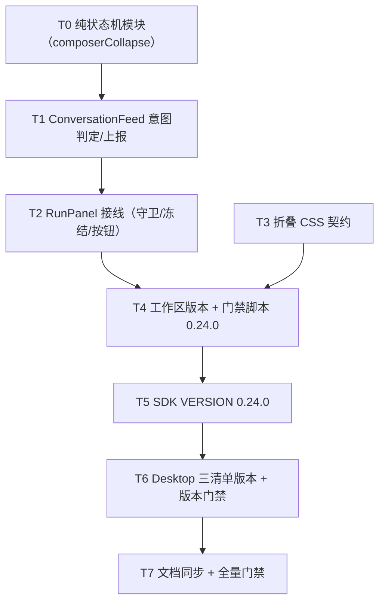

# Plan: 中栏 Composer 滚动自动收缩（v0.24.0，纯前端，无协议变更）

> **For agentic workers:** REQUIRED SUB-SKILL: Use `superpowers:subagent-driven-development` (recommended) or `superpowers:executing-plans` to implement this plan task-by-task. Steps use checkbox (`- [ ]`) syntax for tracking.

## Agent Worker Instructions

- Required sub-skills: `superpowers:subagent-driven-development` (preferred) or `superpowers:executing-plans`
- Execution mode: `subagent-driven-development` — fresh subagent per task, two-stage review between tasks
- Required verification (per task): scoped web vitest first, then the full gate at the end (T7): `cargo fmt --check`, `cargo test --workspace`, `cargo clippy --workspace --all-targets -- -D warnings`, `cargo test -p agentj-protocol -- drift`, `npm --prefix agentj-ui test --workspace=@agentj/sdk`, `npm --prefix agentj-ui test --workspace=@agentj/web`, `npm --prefix agentj-ui run build --workspace=@agentj/web`, `bun --cwd agentj-ui/apps/tui test`, `./scripts/check-version.sh`, `node agentj-ui/apps/desktop/check-desktop-ui.mjs`
- Scoped vitest MUST run through the workspace scripts (`npm --prefix agentj-ui test --workspace=@agentj/web -- <file>`); `npx vitest` from the repo root does not load the web vite config/jsdom
- Generated files: `Cargo.lock`, `agentj-ui/apps/desktop/src-tauri/Cargo.lock`, `agentj-ui/apps/web/dist/**` are produced by commands (`cargo metadata`, `npm run build`) — never hand-edit, stage them with the owning task
- Version: feature → minor, `0.23.1 → 0.24.0`; `PROTOCOL_VERSION` stays `0.15.0` (no wire change); gate = `scripts/check-version.sh`, which holds hardcoded expected literals — T4 bumps them with the workspace version, otherwise the gate fails after the bump
- Language: task titles / AC / code in English; commit messages in English; spec docs in Chinese
- No new third-party dependencies (`lucide-react` already present); web tokens only via `var(--aj-*)`
- Rust style (not touched here): function ≤50 lines, ≤120 chars per line

**Goal:** Implement the design in `docs/superpowers/specs/2026-09-25-agentj-composer-scroll-collapse-design.md` — the middle-column composer auto-collapses (smoothly) into the send-button position when the user scrolls up away from the bottom, and expands again on scroll-to-bottom or on clicking the expand button, with the draft always preserved, pending questions never hidden, and programmatic streaming auto-follow never triggering a collapse.

**Architecture:** A pure state-machine module (`composerCollapse.ts`: threshold classification + transition guards) is consumed by `ConversationFeed` (user-intent detection: `wheel`/`touchmove` + non-programmatic scroll direction with an animation lock) and by `RunPanel` (owns the transient `collapsed` flag, the `data-collapsed` attribute, the dual-role action button, the pending-question guard, and the freeze of `--aj-composer-h`). CSS in `composer.css` animates the card padding/background plus per-segment `max-height`/`opacity`/`visibility` collapse using the existing `--aj-motion` / `--aj-ease` tokens; the existing reduced-motion blocks already cover the composer subtree.

**Tech Stack:** React 19 + TypeScript + Vite + vitest/jsdom + @testing-library/react; plain CSS with existing design tokens; no new dependencies, no protocol/SDK/backend changes.

## Global Constraints

- Scope: `agentj-ui/apps/web` only. Desktop inherits the web build; TUI untouched; `PROTOCOL_VERSION` stays `0.15.0`; no schema / `protocol/methods.json` change.
- Collapse trigger is **user upward scroll only**, with an 8px hysteresis band: collapse when `distance > 48px` (`COLLAPSE_DISTANCE`), expand when `distance < 40px` (`EXPAND_DISTANCE`). `distance = max(0, scrollHeight - scrollTop - clientHeight)`.
- Programmatic auto-follow (`scrollIntoView` while `pinned`) must NEVER collapse; it is self-marked (`programmaticRef`) and the next scroll event consuming that mark is ignored.
- After a click-expand, further upward scrolling collapses again; only reaching the bottom keeps the composer expanded. Reaching the bottom expands automatically; clicking the button expands AND focuses the textarea (`{ preventScroll: true }`); auto-expand must not steal focus.
- Draft is always preserved: collapsing only changes rendering/CSS; `draft` state and the textarea DOM value are never reset by collapse/expand.
- Pending question (`pendingQuestion !== null`) blocks collapse and force-expands an already collapsed composer. Demo `askVisible` is NOT part of the guard (demo mode uses the same logic as the design requires).
- `collapsed` is transient (RunPanel local state; `key={activeSessionId}` remount resets it; no localStorage).
- While collapsed, `--aj-composer-h` is FROZEN (the ResizeObserver must not republish); on expand the live measurement resumes. This keeps `.aj-conv` scroll geometry stable (no scrollTop clamping / oscillation).
- Animation lock: 260ms (`COLLAPSE_LOCK_MS`) after every `collapsed` toggle, scroll-derived decisions pause; click and question events are never locked.
- Button: single DOM node, pixel-anchored (card keeps `width: 75%`, collapsed padding `0 16px 12px`); collapsed label `展开输入框` + `aria-expanded="false"` + `aria-controls="aj-prompt"` + `ChevronsUp` icon; expanded label `发送` + `↑` + existing `disabled={!activeSessionId || isBusy}` rule; collapsed button is never disabled.
- Collapsed segments (`header`, `body` wrapper, `.ask`) leave the tab order (`visibility: hidden`) and the toolbar selector wraps collapse (`max-width: 0`).
- No `overflow: hidden` on `.aj-composer-card`, `.aj-composer__header`, `.aj-composer__body` or `> .ask` (they host the option/at popovers when expanded); the collapsed-only `.sel-wrap` rule may use `overflow: hidden` because popovers are closed while collapsed.
- Reduced motion: the existing `@media (prefers-reduced-motion: reduce)` block in `composer.css` and the `:root[data-reduced-motion="true"]` kill-switch in `displayPrefs.css` must keep covering the composer subtree (no new motion token).
- Existing contracts locked by tests must keep passing: 75% float + `min-width` + `max-height: calc(100% - 32px)` + `.aj-conv` clearance (`composerFloat.test.ts`), ResizeObserver publication (`RunPanel.test.tsx`).
- Copy: `展开输入框`, `发送`; commit messages in English.
- Real-machine Playwright acceptance (zero button displacement, 200ms animation, reduced-motion instant switch, narrow viewport, light/dark) runs in the follow-up `jskill-test-acceptance` phase; this plan delivers unit + CSS-contract tests plus the full milestone gate. jsdom cannot observe CSS-driven focus/blur (`visibility: hidden`), so the "textarea blurs on collapse" path is covered there too.

## Design Consistency

| Spec element | Contract / UI | Tasks |
|---|---|---|
| 阈值分类（40/48 + 迟滞） | `composerCollapse.ts` `classifyScroll` | T0, T1 |
| 状态迁移 + 守卫（scroll-away / reach-bottom / expand-click / question-appeared） | `nextCollapsed` + `hasPendingQuestion`；会话切换由 `key={activeSessionId}` 重挂载重置 | T0, T2 |
| 用户意图双判 + 程序化排除 + 260ms 锁 | `ConversationFeed` refs/effects | T1 |
| `collapsed` 瞬态 + `data-collapsed` + 提问强制展开 + 弹层关闭 | `RunPanel` | T2 |
| 冻结/恢复 `--aj-composer-h` | `RunPanel` observer guard + expand effect | T2 |
| 按钮双职责（图标/aria/focus/disabled） | `.aj-button--send` + `ChevronsUp` | T2 |
| 分段收拢 + 透明卡片 + `pointer-events` | `composer.css` | T3 |
| 版本 `0.24.0` + 文档同步 + 全量门禁 | `Cargo.toml` + `scripts/check-version.sh`, `sdk/config.ts` (+test), desktop 3 文件, docs | T4, T5, T6, T7 |

## Tasks

### T0: Add the pure composer-collapse state machine [P0] [Sequential]

```yaml
- id: T0
  title: "Add composerCollapse module with threshold classification and transition guards"
  files:
    - agentj-ui/apps/web/src/composerCollapse.ts
    - agentj-ui/apps/web/src/composerCollapse.test.ts
  depends_on: []
  breaking: false
  ac:
    - given: "a non-programmatic upward scroll with distance 49px"
      when: "classifyScroll is called"
      then: "returns { type: 'scroll-away' }"
    - given: "a non-programmatic upward scroll with distance 48px (inside the hysteresis band)"
      when: "classifyScroll is called"
      then: "returns null"
    - given: "a non-programmatic downward scroll with distance 39px"
      when: "classifyScroll is called"
      then: "returns { type: 'reach-bottom' }"
    - given: "a programmatic scrollIntoView signal at distance 400px upward"
      when: "classifyScroll is called"
      then: "returns null (auto-follow never collapses)"
    - given: "collapsed=true and hasPendingQuestion=true"
      when: "nextCollapsed receives scroll-away"
      then: "returns true (stays collapsed; guard blocks only the collapse transition from expanded)"
    - given: "collapsed=true and hasPendingQuestion=false"
      when: "nextCollapsed receives expand-click / reach-bottom / question-appeared"
      then: "returns false"
    - given: "collapsed=true"
      when: "nextCollapsed receives scroll-away twice"
      then: "stays true (idempotent)"
  regression:
    - "npm --prefix agentj-ui test --workspace=@agentj/web -- src/RunPanel.test.tsx"
    - "npm --prefix agentj-ui test --workspace=@agentj/web -- src/components/composerFloat.test.ts"
  test_code: |
    import { describe, expect, it } from "vitest";
    import {
      COLLAPSE_DISTANCE,
      COLLAPSE_LOCK_MS,
      EXPAND_DISTANCE,
      classifyScroll,
      nextCollapsed,
    } from "./composerCollapse";

    describe("classifyScroll", () => {
      it("collapses on a user upward scroll past the 48px hysteresis edge", () => {
        expect(classifyScroll({ distance: 49, direction: "up", programmatic: false })).toEqual({
          type: "scroll-away",
        });
        expect(classifyScroll({ distance: 48, direction: "up", programmatic: false })).toBeNull();
      });

      it("expands on a user downward scroll inside the 40px bottom band", () => {
        expect(classifyScroll({ distance: 39, direction: "down", programmatic: false })).toEqual({
          type: "reach-bottom",
        });
        expect(classifyScroll({ distance: 40, direction: "down", programmatic: false })).toBeNull();
      });

      it("ignores programmatic auto-follow and neutral signals", () => {
        expect(classifyScroll({ distance: 400, direction: "up", programmatic: true })).toBeNull();
        expect(classifyScroll({ distance: 400, direction: "none", programmatic: false })).toBeNull();
        expect(classifyScroll({ distance: 400, direction: "down", programmatic: false })).toBeNull();
      });

      it("exports the shared thresholds and lock window", () => {
        expect(COLLAPSE_DISTANCE).toBe(48);
        expect(EXPAND_DISTANCE).toBe(40);
        expect(COLLAPSE_LOCK_MS).toBe(260);
      });
    });

    describe("nextCollapsed", () => {
      const noQuestion = { hasPendingQuestion: false };
      const withQuestion = { hasPendingQuestion: true };

      it("collapses on scroll-away and is idempotent", () => {
        expect(nextCollapsed(false, { type: "scroll-away" }, noQuestion)).toBe(true);
        expect(nextCollapsed(true, { type: "scroll-away" }, noQuestion)).toBe(true);
      });

      it("never collapses while a question is pending", () => {
        expect(nextCollapsed(false, { type: "scroll-away" }, withQuestion)).toBe(false);
        expect(nextCollapsed(true, { type: "scroll-away" }, withQuestion)).toBe(true);
      });

      it("expands on reach-bottom, expand-click and question-appeared", () => {
        expect(nextCollapsed(true, { type: "reach-bottom" }, noQuestion)).toBe(false);
        expect(nextCollapsed(true, { type: "expand-click" }, noQuestion)).toBe(false);
        expect(nextCollapsed(true, { type: "question-appeared" }, noQuestion)).toBe(false);
      });
    });
  impl_code: |
    /** Scroll-driven composer collapse state machine (pure, no DOM). */

    export const COLLAPSE_DISTANCE = 48;
    export const EXPAND_DISTANCE = 40;
    export const COLLAPSE_LOCK_MS = 260;

    export type ScrollDirection = "up" | "down" | "none";

    export type ScrollSignal = {
      /** Distance from the scroll bottom in px (caller clamps to >= 0). */
      distance: number;
      direction: ScrollDirection;
      /** True when the scroll was issued by our own scrollIntoView auto-follow. */
      programmatic: boolean;
    };

    // Session switches reset the flag through the existing `key={activeSessionId}`
    // remount, so no explicit reset event is needed.
    export type ComposerCollapseEvent =
      | { type: "scroll-away" }
      | { type: "reach-bottom" }
      | { type: "expand-click" }
      | { type: "question-appeared" };

    export type ComposerCollapseContext = { hasPendingQuestion: boolean };

    /** Maps a scroll signal to a state-machine event (8px hysteresis band: 40 / 48). */
    export function classifyScroll(signal: ScrollSignal): ComposerCollapseEvent | null {
      if (signal.programmatic) return null;
      if (signal.direction === "up" && signal.distance > COLLAPSE_DISTANCE) {
        return { type: "scroll-away" };
      }
      if (signal.direction === "down" && signal.distance < EXPAND_DISTANCE) {
        return { type: "reach-bottom" };
      }
      return null;
    }

    /** Pure transition: returns the next `collapsed` flag. */
    export function nextCollapsed(
      collapsed: boolean,
      event: ComposerCollapseEvent,
      ctx: ComposerCollapseContext,
    ): boolean {
      switch (event.type) {
        case "scroll-away":
          return ctx.hasPendingQuestion ? collapsed : true;
        case "reach-bottom":
        case "expand-click":
        case "question-appeared":
          return false;
      }
    }
  verify:
    - "npm --prefix agentj-ui test --workspace=@agentj/web -- src/composerCollapse.test.ts"
    - "npm --prefix agentj-ui run build --workspace=@agentj/web"
```

**Step 5: commit**
```bash
git add agentj-ui/apps/web/src/composerCollapse.ts agentj-ui/apps/web/src/composerCollapse.test.ts
git commit -m "feat(web): add composer collapse state machine module"
```

---

### T1: Classify conversation scroll intent and report collapse events [P1] [Parallel with T3]

```yaml
- id: T1
  title: "Extend ConversationFeed with user-intent classification, programmatic exclusion and the 260ms lock"
  files:
    - agentj-ui/apps/web/src/RunPanel.tsx
    - agentj-ui/apps/web/src/RunPanel.test.tsx
  depends_on: [T0]
  breaking: false
  ac:
    - given: "the feed sits at the bottom (distance 0)"
      when: "the user scrolls up so distance > 48px"
      then: "onLeaveBottom is called exactly once and onReachBottom is not called"
    - given: "the feed sits above the bottom (distance 500px)"
      when: "the user scrolls down so distance < 40px"
      then: "onReachBottom is called exactly once"
    - given: "the pinned auto-follow issued scrollIntoView and its scroll event fires"
      when: "the scroll event is consumed"
      then: "neither callback fires; the next real user scroll is classified normally"
    - given: "the collapsed prop just changed"
      when: "a user upward scroll arrives within 260ms"
      then: "no callback fires until the lock window elapses"
    - given: "no callback props are provided"
      when: "the user scrolls up past the threshold"
      then: "the component does not throw (props optional; existing feeds keep working)"
  regression:
    - "npm --prefix agentj-ui test --workspace=@agentj/web -- src/RunPanel.test.tsx"
  test_code: |
    // appended to agentj-ui/apps/web/src/RunPanel.test.tsx
    describe("ConversationFeed collapse reporting", () => {
      function setScroll(
        el: HTMLElement,
        { top, height, client }: { top: number; height: number; client: number },
      ) {
        Object.defineProperty(el, "scrollHeight", { configurable: true, value: height });
        Object.defineProperty(el, "clientHeight", { configurable: true, value: client });
        el.scrollTop = top;
      }

      it("reports leaving the bottom on a user upward scroll past 48px", () => {
        const onLeaveBottom = vi.fn();
        const onReachBottom = vi.fn();
        const { container } = render(
          <ConversationFeed
            entries={[user("hi")]}
            onLeaveBottom={onLeaveBottom}
            onReachBottom={onReachBottom}
          />,
        );
        const conv = container.querySelector(".aj-conv") as HTMLElement;
        setScroll(conv, { top: 600, height: 1000, client: 400 });
        fireEvent.scroll(conv); // arriving at the bottom (downward) reports reach-bottom
        onReachBottom.mockClear(); // isolate the upward-scroll behavior below
        fireEvent.wheel(conv, { deltaY: -120 });
        setScroll(conv, { top: 100, height: 1000, client: 400 });
        fireEvent.scroll(conv);
        expect(onLeaveBottom).toHaveBeenCalledTimes(1);
        expect(onReachBottom).not.toHaveBeenCalled();
      });

      it("reports reaching the bottom on a user downward scroll inside 40px", () => {
        const onReachBottom = vi.fn();
        const { container } = render(
          <ConversationFeed entries={[user("hi")]} onReachBottom={onReachBottom} />,
        );
        const conv = container.querySelector(".aj-conv") as HTMLElement;
        setScroll(conv, { top: 100, height: 1000, client: 400 });
        fireEvent.scroll(conv);
        fireEvent.wheel(conv, { deltaY: 120 });
        setScroll(conv, { top: 580, height: 1000, client: 400 });
        fireEvent.scroll(conv);
        expect(onReachBottom).toHaveBeenCalledTimes(1);
      });

      it("ignores the programmatic auto-follow scroll", () => {
        const onLeaveBottom = vi.fn();
        const scrollIntoView = vi.fn();
        (Element.prototype as unknown as { scrollIntoView?: unknown }).scrollIntoView = scrollIntoView;
        try {
          const { container, rerender } = render(
            <ConversationFeed entries={[user("hi")]} onLeaveBottom={onLeaveBottom} />,
          );
          const conv = container.querySelector(".aj-conv") as HTMLElement;
          setScroll(conv, { top: 100, height: 1000, client: 400 });
          rerender(
            <ConversationFeed entries={[user("hi"), user("go")]} onLeaveBottom={onLeaveBottom} />,
          );
          expect(scrollIntoView).toHaveBeenCalled();
          fireEvent.scroll(conv); // consumed as the programmatic follow
          fireEvent.wheel(conv, { deltaY: -120 });
          setScroll(conv, { top: 50, height: 1000, client: 400 });
          fireEvent.scroll(conv);
          expect(onLeaveBottom).toHaveBeenCalledTimes(1);
        } finally {
          delete (Element.prototype as unknown as { scrollIntoView?: unknown }).scrollIntoView;
        }
      });

      it("classifies a fresh wheel gesture as intent when the scroll delta is zero", () => {
        const onLeaveBottom = vi.fn();
        const { container } = render(
          <ConversationFeed entries={[user("hi")]} onLeaveBottom={onLeaveBottom} />,
        );
        const conv = container.querySelector(".aj-conv") as HTMLElement;
        setScroll(conv, { top: 100, height: 1000, client: 400 });
        fireEvent.scroll(conv); // baseline (distance 500 -> no event)
        expect(onLeaveBottom).not.toHaveBeenCalled();
        fireEvent.wheel(conv, { deltaY: -120 });
        fireEvent.scroll(conv); // zero delta -> the fresh gesture decides
        expect(onLeaveBottom).toHaveBeenCalledTimes(1);
      });

      it("pauses scroll-derived decisions for 260ms after a collapse toggle", () => {
        vi.useFakeTimers();
        try {
          const onLeaveBottom = vi.fn();
          const { container, rerender } = render(
            <ConversationFeed entries={[user("hi")]} collapsed={false} onLeaveBottom={onLeaveBottom} />,
          );
          const conv = container.querySelector(".aj-conv") as HTMLElement;
          rerender(
            <ConversationFeed entries={[user("hi")]} collapsed={true} onLeaveBottom={onLeaveBottom} />,
          );
          setScroll(conv, { top: 600, height: 1000, client: 400 });
          fireEvent.scroll(conv);
          fireEvent.wheel(conv, { deltaY: -120 });
          setScroll(conv, { top: 100, height: 1000, client: 400 });
          fireEvent.scroll(conv);
          expect(onLeaveBottom).not.toHaveBeenCalled();
          act(() => {
            vi.advanceTimersByTime(300);
          });
          fireEvent.wheel(conv, { deltaY: -120 });
          setScroll(conv, { top: 80, height: 1000, client: 400 });
          fireEvent.scroll(conv);
          expect(onLeaveBottom).toHaveBeenCalledTimes(1);
        } finally {
          vi.useRealTimers();
        }
      });
    });
  impl_code: |
    // agentj-ui/apps/web/src/RunPanel.tsx
    // 1) Extend the SDK-agnostic imports at the top of the file:
    import {
      COLLAPSE_LOCK_MS,
      EXPAND_DISTANCE,
      classifyScroll,
    } from "./composerCollapse";

    // 2) Replace the ConversationFeed component (lines ~183-269) with the version
    //    below; the JSX body between the handlers and </div> is unchanged.
    export function ConversationFeed({
      entries,
      pendingTool,
      model,
      elapsedMs,
      collapsed = false,
      onLeaveBottom,
      onReachBottom,
    }: {
      entries: RunEntry[];
      pendingTool?: string;
      model?: string;
      elapsedMs?: number;
      collapsed?: boolean;
      onLeaveBottom?: () => void;
      onReachBottom?: () => void;
    }) {
      const convRef = useRef<HTMLDivElement | null>(null);
      const endRef = useRef<HTMLDivElement | null>(null);
      const [pinned, setPinned] = useState(true);
      const programmaticRef = useRef(false);
      const prevTopRef = useRef(0);
      const gestureRef = useRef<{ direction: "up" | "down"; at: number } | null>(null);
      const prevTouchYRef = useRef(0);
      const lockUntilRef = useRef(0);
      const lockMountedRef = useRef(false);

      // Auto-follow while pinned; mark our own scrollIntoView as programmatic so the
      // classifier ignores it (streamed content growth must never collapse the composer).
      useEffect(() => {
        if (!pinned) return;
        const el = convRef.current;
        if (!el || el.scrollHeight - el.scrollTop - el.clientHeight <= 0) return;
        programmaticRef.current = true;
        (endRef.current as unknown as { scrollIntoView?: (o?: unknown) => void })?.scrollIntoView?.({
          block: "end",
        });
        const timer = window.setTimeout(() => {
          programmaticRef.current = false;
        }, 120);
        return () => window.clearTimeout(timer);
      });

      // Animation lock: pause scroll-derived decisions while collapse/expand settles.
      // The mount run is skipped so the first user scroll is still classified.
      useEffect(() => {
        if (!lockMountedRef.current) {
          lockMountedRef.current = true;
          return;
        }
        lockUntilRef.current = Date.now() + COLLAPSE_LOCK_MS;
      }, [collapsed]);

      return (
        <div
          ref={convRef}
          className="aj-conv"
          role="feed"
          aria-label="progress feed"
          onWheel={(e) => {
            if (e.deltaY === 0) return;
            gestureRef.current = { direction: e.deltaY < 0 ? "up" : "down", at: Date.now() };
          }}
      // touchmove feeds the same gestureRef pipeline as wheel; jsdom exposes no usable
      // Touch constructor, so the zero-delta gesture path is contract-tested via wheel.
      onTouchMove={(e) => {
        const y = e.touches[0]?.clientY;
            if (y === undefined) return;
            gestureRef.current = { direction: y > prevTouchYRef.current ? "up" : "down", at: Date.now() };
            prevTouchYRef.current = y;
          }}
          onScroll={(e) => {
            const el = e.currentTarget;
            const distance = Math.max(0, el.scrollHeight - el.scrollTop - el.clientHeight);
            const delta = el.scrollTop - prevTopRef.current;
            prevTopRef.current = el.scrollTop;
            setPinned(distance < EXPAND_DISTANCE);
            if (programmaticRef.current) {
              programmaticRef.current = false;
              return;
            }
            if (Date.now() < lockUntilRef.current) return;
            const gesture = gestureRef.current;
            const freshGesture = gesture && Date.now() - gesture.at <= 300 ? gesture.direction : null;
            const direction = delta < 0 ? "up" : delta > 0 ? "down" : freshGesture;
            const event = classifyScroll({ distance, direction: direction ?? "none", programmatic: false });
            if (event?.type === "scroll-away") onLeaveBottom?.();
            else if (event?.type === "reach-bottom") onReachBottom?.();
          }}
        >
          {/* entries.map(...) and <div ref={endRef} /> stay exactly as-is */}
        </div>
      );
    }
  verify:
    - "npm --prefix agentj-ui test --workspace=@agentj/web -- src/RunPanel.test.tsx"
    - "npm --prefix agentj-ui run build --workspace=@agentj/web"
```

**Step 5: commit**
```bash
git add agentj-ui/apps/web/src/RunPanel.tsx agentj-ui/apps/web/src/RunPanel.test.tsx
git commit -m "feat(web): classify conversation scroll intent for composer collapse"
```

---

### T2: Wire the collapse state into the composer (guard, freeze, dual-role button) [P2] [Sequential after T1]

```yaml
- id: T2
  title: "Own collapsed state in RunPanel, freeze --aj-composer-h, and turn the send button into a dual-role action button"
  files:
    - agentj-ui/apps/web/src/RunPanel.tsx
    - agentj-ui/apps/web/src/RunPanel.test.tsx
    - agentj-ui/apps/web/src/components/ComposerOptions.tsx
  depends_on: [T1]
  breaking: false
  ac:
    - given: "a user scroll away from the bottom on an active session"
      when: "the scroll is processed"
      then: ".aj-composer-card carries data-collapsed=\"true\" and the action button is named 展开输入框 with an svg icon"
    - given: "collapsed with draft text 'keep me'"
      when: "the action button is clicked"
      then: "data-collapsed is removed, the button is named 发送, the textarea still holds 'keep me' and receives focus"
    - given: "a pending question arrives via $/askQuestion notification"
      when: "the user scrolls up past the threshold"
      then: "the composer stays expanded"
    - given: "the composer is collapsed"
      when: "a pending question arrives"
      then: "the composer force-expands"
    - given: "collapsed with a known expanded measurement 180px"
      when: "the ResizeObserver reports a 90px box"
      then: "--aj-composer-h stays 180px; after expanding, a 200px report updates it to 200px"
    - given: "the model popover is open"
      when: "the composer collapses"
      then: "the popover element is removed and its trigger reports aria-expanded=false"
    - given: "no active session (expanded send button disabled)"
      when: "the composer is collapsed"
      then: "the action button is not disabled and expands on click"
    - given: "demo mode enabled (demo ask card visible but no pending question)"
      when: "the user scrolls away from the bottom"
      then: "the composer collapses (demo ask visibility is not a collapse guard)"
  regression:
    - "npm --prefix agentj-ui test --workspace=@agentj/web -- src/RunPanel.test.tsx"
    - "npm --prefix agentj-ui test --workspace=@agentj/web -- src/components/composerOptions.test.tsx"
  test_code: |
    // appended to agentj-ui/apps/web/src/RunPanel.test.tsx
    describe("RunPanel composer scroll collapse", () => {
      function setScroll(
        el: HTMLElement,
        { top, height, client }: { top: number; height: number; client: number },
      ) {
        Object.defineProperty(el, "scrollHeight", { configurable: true, value: height });
        Object.defineProperty(el, "clientHeight", { configurable: true, value: client });
        el.scrollTop = top;
      }
      function collapseViaScroll(container: HTMLElement) {
        const conv = container.querySelector(".aj-conv") as HTMLElement;
        setScroll(conv, { top: 600, height: 1000, client: 400 });
        fireEvent.scroll(conv);
        fireEvent.wheel(conv, { deltaY: -120 });
        setScroll(conv, { top: 100, height: 1000, client: 400 });
        fireEvent.scroll(conv);
      }
      function capturingClient() {
        let handler: ((method: string, params: unknown) => void) | null = null;
        const client = {
          setNotificationHandler: (h: (method: string, params: unknown) => void) => {
            handler = h;
          },
          removeNotificationHandler: () => {},
        } as unknown as Parameters<typeof RunPanel>[0]["client"];
        return {
          client,
          emit: (method: string, params: unknown) =>
            act(() => {
              handler?.(method, params);
            }),
        };
      }

      it("collapses on scroll away and swaps the button into expand mode", () => {
        const { container } = render(<RunPanel client={noopClient} activeSessionId="s1" />);
        expect(container.querySelector(".aj-composer-card")).not.toHaveAttribute("data-collapsed");
        collapseViaScroll(container);
        const card = container.querySelector(".aj-composer-card") as HTMLElement;
        expect(card).toHaveAttribute("data-collapsed", "true");
        const button = screen.getByRole("button", { name: "展开输入框" });
        expect(button).toHaveAttribute("aria-expanded", "false");
        expect(button.querySelector("svg")).not.toBeNull();
      });

      it("expands on click, keeps the draft and focuses the textarea", async () => {
        const { container } = render(<RunPanel client={noopClient} activeSessionId="s1" />);
        const textarea = container.querySelector("#aj-prompt") as HTMLTextAreaElement;
        fireEvent.change(textarea, { target: { value: "keep me" } });
        collapseViaScroll(container);
        fireEvent.click(screen.getByRole("button", { name: "展开输入框" }));
        await waitFor(() =>
          expect(container.querySelector(".aj-composer-card")).not.toHaveAttribute("data-collapsed"),
        );
        expect(textarea.value).toBe("keep me");
        await waitFor(() => expect(document.activeElement).toBe(textarea));
        expect(screen.getByRole("button", { name: "发送" })).toBeTruthy();
      });

      it("keeps the composer expanded while a question is pending", () => {
        const { client, emit } = capturingClient();
        const { container } = render(<RunPanel client={client} activeSessionId="s1" />);
        emit(METHODS.askQuestion, {
          question_id: "q1",
          session_id: "s1",
          question: "Continue?",
          options: [{ id: "yes", label: "Yes" }],
        });
        collapseViaScroll(container);
        expect(container.querySelector(".aj-composer-card")).not.toHaveAttribute("data-collapsed");
      });

      it("force-expands when a question arrives while collapsed", () => {
        const { client, emit } = capturingClient();
        const { container } = render(<RunPanel client={client} activeSessionId="s1" />);
        collapseViaScroll(container);
        expect(container.querySelector(".aj-composer-card")).toHaveAttribute("data-collapsed", "true");
        emit(METHODS.askQuestion, {
          question_id: "q1",
          session_id: "s1",
          question: "Continue?",
          options: [{ id: "yes", label: "Yes" }],
        });
        expect(container.querySelector(".aj-composer-card")).not.toHaveAttribute("data-collapsed");
      });

      it("collapses in demo mode (demo ask visibility is not a guard)", () => {
        setDemoEnabled(true);
        try {
          const { container } = render(<RunPanel client={noopClient} activeSessionId="s1" />);
          collapseViaScroll(container);
          expect(container.querySelector(".aj-composer-card")).toHaveAttribute("data-collapsed", "true");
        } finally {
          setDemoEnabled(false);
        }
      });

      it("freezes --aj-composer-h while collapsed and resumes after expand", () => {
        const captured: { cb: ResizeObserverCallback | null } = { cb: null };
        class FakeResizeObserver {
          constructor(cb: ResizeObserverCallback) {
            captured.cb = cb;
          }
          observe = vi.fn();
          unobserve = () => {};
          disconnect = vi.fn();
        }
        vi.stubGlobal("ResizeObserver", FakeResizeObserver);
        try {
          const { container } = render(<RunPanel client={noopClient} activeSessionId="s1" />);
          const composer = container.querySelector(".aj-composer-card") as HTMLElement;
          const card = container.querySelector(".aj-card") as HTMLElement;
          const report = (size: number) =>
            act(() => {
              captured.cb?.(
                [{ target: composer, borderBoxSize: [{ blockSize: size, inlineSize: 100 }] } as unknown as ResizeObserverEntry],
                {} as ResizeObserver,
              );
            });
          report(180);
          expect(card.style.getPropertyValue("--aj-composer-h")).toBe("180px");
          collapseViaScroll(container);
          report(90);
          expect(card.style.getPropertyValue("--aj-composer-h")).toBe("180px");
          fireEvent.click(screen.getByRole("button", { name: "展开输入框" }));
          report(200);
          expect(card.style.getPropertyValue("--aj-composer-h")).toBe("200px");
        } finally {
          vi.unstubAllGlobals();
        }
      });

      it("closes composer popovers when collapsing", () => {
        const { container } = render(<RunPanel client={noopClient} activeSessionId="s1" />);
        const trigger = container.querySelector("#composer-model-trigger") as HTMLButtonElement;
        fireEvent.click(trigger);
        expect(container.querySelector(".pop")).not.toBeNull();
        collapseViaScroll(container);
        expect(container.querySelector(".pop")).toBeNull();
        expect(trigger).toHaveAttribute("aria-expanded", "false");
      });

      it("keeps the collapsed action button enabled without an active session", () => {
        const { container } = render(<RunPanel client={noopClient} activeSessionId={null} />);
        expect(screen.getByRole("button", { name: "发送" })).toBeDisabled();
        collapseViaScroll(container);
        expect(screen.getByRole("button", { name: "展开输入框" })).not.toBeDisabled();
      });

      it("keeps the collapsed action button enabled while a run is busy", async () => {
        const busyClient = {
          request: () => new Promise(() => {}),
          setNotificationHandler: () => {},
          removeNotificationHandler: () => {},
        } as unknown as Parameters<typeof RunPanel>[0]["client"];
        const { container } = render(<RunPanel client={busyClient} activeSessionId="s1" />);
        fireEvent.change(container.querySelector("#aj-prompt") as HTMLTextAreaElement, {
          target: { value: "go" },
        });
        fireEvent.click(screen.getByRole("button", { name: "发送" }));
        await waitFor(() => expect(screen.getByRole("button", { name: "发送" })).toBeDisabled());
        collapseViaScroll(container);
        expect(screen.getByRole("button", { name: "展开输入框" })).not.toBeDisabled();
      });

      it("starts expanded after a session remount (key change)", () => {
        const { container, rerender } = render(
          <RunPanel key="s1" client={noopClient} activeSessionId="s1" />,
        );
        collapseViaScroll(container);
        expect(container.querySelector(".aj-composer-card")).toHaveAttribute("data-collapsed", "true");
        rerender(<RunPanel key="s2" client={noopClient} activeSessionId="s2" />);
        expect(container.querySelector(".aj-composer-card")).not.toHaveAttribute("data-collapsed");
      });
    });
  impl_code: |
    // ---- agentj-ui/apps/web/src/RunPanel.tsx ----
    // (a) imports
    import { Check, ChevronDown, ChevronsUp, Clock, Folder, Minus, Pencil, X } from "lucide-react";
    import { nextCollapsed, type ComposerCollapseEvent } from "./composerCollapse";

    // (b) state + refs — `collapsed`/refs go next to draft/isBusy/composerRef (~line 308);
    // `hasPendingQuestion` MUST be derived AFTER the `pendingQuestion` state declaration
    // (~line 314) to avoid a TDZ ReferenceError.
    const [collapsed, setCollapsed] = useState(false);
    const promptRef = useRef<HTMLTextAreaElement | null>(null);
    const collapsedRef = useRef(false);
    collapsedRef.current = collapsed;
    const hasPendingQuestionRef = useRef(false);
    const focusPromptRef = useRef(false);

    // placed after `const [pendingQuestion, setPendingQuestion] = useState(...)`:
    const hasPendingQuestion = pendingQuestion !== null;
    hasPendingQuestionRef.current = hasPendingQuestion;

    function applyCollapseEvent(event: ComposerCollapseEvent) {
      setCollapsed((current) =>
        nextCollapsed(current, event, { hasPendingQuestion: hasPendingQuestionRef.current }),
      );
    }

    function handleActionClick() {
      if (collapsed) {
        focusPromptRef.current = true;
        applyCollapseEvent({ type: "expand-click" });
        return;
      }
      if (busy.current) return;
      submit(draft);
      setDraft("");
      setAtFilter(null);
      setSlashOpen(false);
    }

    // (c) effects (place after the existing project-sync effect)
    // Force-expand whenever a question is waiting (never hide the ask card).
    useEffect(() => {
      if (hasPendingQuestion) applyCollapseEvent({ type: "question-appeared" });
    }, [hasPendingQuestion]);

    // Close every composer popover when collapsing; the composer hides them anyway.
    useEffect(() => {
      if (!collapsed) return;
      setPickerOpen(false);
      setAtFilter(null);
      setSlashOpen(false);
    }, [collapsed]);

    // Focus the prompt only for the explicit click-to-expand path (never on auto-expand).
    useEffect(() => {
      if (collapsed || !focusPromptRef.current) return;
      focusPromptRef.current = false;
      promptRef.current?.focus({ preventScroll: true });
    }, [collapsed]);

    // (d) freeze in the existing useLayoutEffect (lines ~424-440)
    const applyFullBoxHeight = (height: number) => {
      if (height <= 0 || collapsedRef.current) return; // frozen while collapsed
      card.style.setProperty("--aj-composer-h", `${Math.round(height)}px`);
    };

    // (e) re-publish the live measurement once expanded again (new effect)
    useEffect(() => {
      if (collapsed) return;
      const card = cardRef.current;
      const composer = composerRef.current;
      if (!card || !composer) return;
      const height = composer.getBoundingClientRect().height;
      if (height > 0) card.style.setProperty("--aj-composer-h", `${Math.round(height)}px`);
    }, [collapsed]);

    // (f) JSX
    <ConversationFeed
      entries={entries}
      pendingTool={pendingTool}
      model={model}
      elapsedMs={elapsedMs}
      collapsed={collapsed}
      onLeaveBottom={() => applyCollapseEvent({ type: "scroll-away" })}
      onReachBottom={() => applyCollapseEvent({ type: "reach-bottom" })}
    />
    <div ref={composerRef} className="aj-composer-card" data-collapsed={collapsed ? "true" : undefined}>
      ...
      <div className="aj-composer__body" style={{ position: "relative" }}>
        ...
        <textarea ref={promptRef} id="aj-prompt" ... />
      ...
      <ComposerOptions model={model} collapsed={collapsed}>
        <button
          type="button"
          className="send aj-button--send"
          aria-label={collapsed ? "展开输入框" : "发送"}
          aria-expanded={collapsed ? false : undefined}
          aria-controls={collapsed ? "aj-prompt" : undefined}
          disabled={collapsed ? false : !activeSessionId || isBusy}
          onClick={handleActionClick}
        >
          {collapsed ? <ChevronsUp size={16} aria-hidden="true" /> : "↑"}
        </button>
      </ComposerOptions>
    </div>

    // ---- agentj-ui/apps/web/src/components/ComposerOptions.tsx ----
    // (g) prop + close-on-collapse effect; keep everything else untouched.
    export type ComposerOptionsProps = {
      model?: string | null;
      collapsed?: boolean;
      children?: ReactNode;
    };
    export default function ComposerOptions({ model = null, collapsed = false, children }: ComposerOptionsProps) {
      // ...existing state...
      useEffect(() => {
        if (collapsed) setOpenId(null);
      }, [collapsed]);
      // ...existing render...
    }
  verify:
    - "npm --prefix agentj-ui test --workspace=@agentj/web -- src/RunPanel.test.tsx"
    - "npm --prefix agentj-ui test --workspace=@agentj/web -- src/components/composerOptions.test.tsx"
    - "npm --prefix agentj-ui run build --workspace=@agentj/web"
```

**Step 5: commit**
```bash
git add agentj-ui/apps/web/src/RunPanel.tsx agentj-ui/apps/web/src/RunPanel.test.tsx agentj-ui/apps/web/src/components/ComposerOptions.tsx
git commit -m "feat(web): collapse composer on scroll with expand button"
```

---

### T3: Animate the collapsed composer with existing motion tokens [P1] [Parallel with T1]

```yaml
- id: T3
  title: "Add collapsed-state CSS contracts: transparent anchored card, segmented collapse, no popover clipping"
  files:
    - agentj-ui/apps/web/src/components/composer.css
    - agentj-ui/apps/web/src/components/composerFloat.test.ts
  depends_on: []
  breaking: false
  ac:
    - given: "the collapsed attribute is set"
      when: "the composer.css contract is read"
      then: "the collapsed card rule sets padding 0 16px 12px, transparent background-color, transparent box-shadow, min-height 0 and pointer-events none; the collapsed .send rule restores pointer-events auto"
    - given: "the collapsed attribute is set"
      when: "each collapsible segment rule is read"
      then: ".aj-composer__header / .aj-composer__body / > .ask each collapse with max-height 0, opacity 0 and visibility hidden; the toolbar selector wrap collapses with max-width 0 and visibility hidden"
    - given: "the base composer rules"
      when: "the transition declarations are read"
      then: "each transition uses var(--aj-motion) and var(--aj-ease)"
    - given: "the file contains no overflow hidden on .aj-composer-card or its segments"
      when: "checked via the contract test"
      then: "popovers cannot be clipped when expanded"
    - given: "the reduced-motion block"
      when: "the contract test runs"
      then: "the @media (prefers-reduced-motion: reduce) block still covers .aj-composer-card"
  regression:
    - "npm --prefix agentj-ui test --workspace=@agentj/web -- src/components/composerFloat.test.ts"
  test_code: |
    // appended to agentj-ui/apps/web/src/components/composerFloat.test.ts
    describe("collapsed composer contracts", () => {
      test("collapsed card keeps only the anchored action button", () => {
        const css = readCss("composer.css");
        const card = ruleBody(css, '.aj-composer-card[data-collapsed="true"]');
        expect(card).toMatch(/padding:\s*0 16px 12px/);
        expect(card).toMatch(/background-color:\s*transparent/);
        expect(card).toMatch(/box-shadow:\s*0 0 0 0 transparent/);
        expect(card).toMatch(/min-height:\s*0/);
        expect(card).toMatch(/pointer-events:\s*none/);
        const send = ruleBody(css, '.aj-composer-card[data-collapsed="true"] .send');
        expect(send).toMatch(/pointer-events:\s*auto/);
      });

      test("collapsed segments collapse and leave the tab order", () => {
        const css = readCss("composer.css");
        for (const selector of [
          '.aj-composer-card[data-collapsed="true"] .aj-composer__header',
          '.aj-composer-card[data-collapsed="true"] .aj-composer__body',
          '.aj-composer-card[data-collapsed="true"] > .ask',
        ]) {
          const body = ruleBody(css, selector);
          expect(body, selector).toMatch(/max-height:\s*0/);
          expect(body, selector).toMatch(/opacity:\s*0/);
          expect(body, selector).toMatch(/visibility:\s*hidden/);
        }
        const wrap = ruleBody(css, '.aj-composer-card[data-collapsed="true"] .comp-tools .sel-wrap');
        expect(wrap).toMatch(/max-width:\s*0/);
        expect(wrap).toMatch(/visibility:\s*hidden/);
      });

      test("collapse transitions reuse the shared motion tokens", () => {
        const css = readCss("composer.css");
        expect(ruleBody(css, ".aj-composer-card")).toMatch(
          /transition:[\s\S]*var\(--aj-motion\)[\s\S]*var\(--aj-ease\)/,
        );
        expect(ruleBody(css, ".aj-composer__header")).toMatch(
          /transition:[\s\S]*var\(--aj-motion\)[\s\S]*var\(--aj-ease\)/,
        );
        expect(ruleBody(css, ".aj-composer-card > .ask")).toMatch(
          /transition:[\s\S]*var\(--aj-motion\)/,
        );
        const reducedStart = css.indexOf("@media (prefers-reduced-motion: reduce)");
        expect(reducedStart).toBeGreaterThanOrEqual(0);
        const reducedBlock = css.slice(reducedStart);
        expect(reducedBlock).toMatch(/\.aj-composer-card[^{]*\{[^}]*transition:\s*none\s*!important/);
      });

      test("collapsed rules never clip popovers (no overflow hidden on the card)", () => {
        const css = readCss("composer.css");
        const card = ruleBody(css, '.aj-composer-card[data-collapsed="true"]');
        expect(card).not.toMatch(/overflow/);
      });
    });
  impl_code: |
    /* ---- agentj-ui/apps/web/src/components/composer.css ---- */
    /* 1) add to the base `.aj-composer-card` rule (keep every existing declaration): */
    .aj-composer-card {
      /* ...existing declarations unchanged... */
      transition:
        padding var(--aj-motion) var(--aj-ease),
        gap var(--aj-motion) var(--aj-ease),
        min-height var(--aj-motion) var(--aj-ease),
        background-color var(--aj-motion) var(--aj-ease),
        box-shadow var(--aj-motion) var(--aj-ease);
    }

    /* 2) add to the existing `.aj-composer__header` rule: */
    .aj-composer__header {
      /* ...existing declarations unchanged... */
      max-height: 80px;
      transition:
        max-height var(--aj-motion) var(--aj-ease),
        opacity var(--aj-motion) var(--aj-ease),
        visibility var(--aj-motion) var(--aj-ease),
        padding var(--aj-motion) var(--aj-ease);
    }

    /* 3) add to the existing `.aj-composer-card > .ask` rule: */
    .aj-composer-card > .ask {
      /* ...existing min-height/overflow-y declarations unchanged... */
      max-height: 60vh;
      transition:
        max-height var(--aj-motion) var(--aj-ease),
        opacity var(--aj-motion) var(--aj-ease),
        visibility var(--aj-motion) var(--aj-ease);
    }

    /* 4) new: textarea wrapper (class added in T2) */
    .aj-composer__body {
      max-height: 120px;
      transition:
        max-height var(--aj-motion) var(--aj-ease),
        opacity var(--aj-motion) var(--aj-ease),
        visibility var(--aj-motion) var(--aj-ease);
    }

    /* 5) new: toolbar selector wraps collapse horizontally (max-width stays
       interpolable thanks to the explicit base value). */
    .aj-composer-card .comp-tools .sel-wrap {
      max-width: 240px;
      transition:
        max-width var(--aj-motion) var(--aj-ease),
        opacity var(--aj-motion) var(--aj-ease);
    }

    /* 6) new collapsed rules — one selector per rule (contract-testable) */
    .aj-composer-card[data-collapsed="true"] {
      min-height: 0;
      gap: 0;
      padding: 0 16px 12px;
      background-color: transparent;
      box-shadow: 0 0 0 0 transparent;
      pointer-events: none;
    }

    .aj-composer-card[data-collapsed="true"] .send {
      pointer-events: auto;
    }

    .aj-composer-card[data-collapsed="true"] .aj-composer__header {
      max-height: 0;
      padding: 0;
      opacity: 0;
      visibility: hidden;
      pointer-events: none;
    }

    .aj-composer-card[data-collapsed="true"] .aj-composer__body {
      max-height: 0;
      opacity: 0;
      visibility: hidden;
      pointer-events: none;
    }

    .aj-composer-card[data-collapsed="true"] > .ask {
      max-height: 0;
      opacity: 0;
      visibility: hidden;
      pointer-events: none;
    }

    .aj-composer-card[data-collapsed="true"] .comp-tools .sel-wrap {
      max-width: 0;
      opacity: 0;
      visibility: hidden;
      pointer-events: none;
      overflow: hidden;
    }
  verify:
    - "npm --prefix agentj-ui test --workspace=@agentj/web -- src/components/composerFloat.test.ts"
    - "npm --prefix agentj-ui run build --workspace=@agentj/web"
```

**Step 5: commit**
```bash
git add agentj-ui/apps/web/src/components/composer.css agentj-ui/apps/web/src/components/composerFloat.test.ts
git commit -m "style(web): animate collapsed composer with motion tokens"
```

---

### T4: Bump the workspace version and the version gate expectations to 0.24.0 [P3] [Sequential]

```yaml
- id: T4
  title: "Bump the Cargo workspace version and scripts/check-version.sh to 0.24.0 and regenerate the root lockfile"
  files:
    - Cargo.toml
    - scripts/check-version.sh
  depends_on: [T2, T3]
  breaking: false
  ac:
    - given: "the workspace manifest"
      when: "grepped"
      then: "version is 0.24.0"
    - given: "the version gate script"
      when: "grepped"
      then: "all five product-version expectations read 0.24.0 while the PROTOCOL_VERSION / protocol-methods.json expectations stay 0.15.0"
    - given: "the root Cargo.lock is regenerated by cargo metadata"
      when: "the lockfile diff is inspected"
      then: "workspace member versions show 0.24.0 and no dependency versions change"
  regression:
    - "cargo test -p agentj-core -- smoke"
  test_code: |
    # scripts/check-version.sh holds the expected literals; it cannot pass end-to-end
    # until T5/T6 land, so this task asserts the expectations (T6 runs it for real).
    grep -q 'version = "0.24.0"' Cargo.toml
    grep -q 'export const VERSION = "0.24.0"' scripts/check-version.sh
    grep -q '"version": "0.24.0"' scripts/check-version.sh
    grep -q 'PROTOCOL_VERSION = "0.15.0"' scripts/check-version.sh
    test "$(grep -c '0\.24\.0' scripts/check-version.sh)" -eq 5
  impl_code: |
    # Cargo.toml
    -version = "0.23.1"
    +version = "0.24.0"

    # scripts/check-version.sh — bump the five product-version expectations; the
    # PROTOCOL_VERSION (0.15.0) lines, the protocol/methods.json line and the two
    # negative (! grep '"version": "0.10.0"') guards stay byte-identical:
    -grep -q 'version = "0.23.1"' Cargo.toml || exit 1
    +grep -q 'version = "0.24.0"' Cargo.toml || exit 1
    -grep -q 'export const VERSION = "0.23.1"' agentj-ui/packages/sdk/src/config.ts || exit 1
    +grep -q 'export const VERSION = "0.24.0"' agentj-ui/packages/sdk/src/config.ts || exit 1
    -grep -q '"version": "0.23.1"' agentj-ui/apps/desktop/src-tauri/tauri.conf.json || exit 1
    +grep -q '"version": "0.24.0"' agentj-ui/apps/desktop/src-tauri/tauri.conf.json || exit 1
    -grep -q '"version": "0.23.1"' agentj-ui/apps/desktop/package.json || exit 1
    +grep -q '"version": "0.24.0"' agentj-ui/apps/desktop/package.json || exit 1
    -grep -q 'version = "0.23.1"' agentj-ui/apps/desktop/src-tauri/Cargo.toml || exit 1
    +grep -q 'version = "0.24.0"' agentj-ui/apps/desktop/src-tauri/Cargo.toml || exit 1
  verify:
    - "cargo metadata --format-version 1 > /dev/null && git status --short Cargo.lock"
    - "sh -n scripts/check-version.sh && grep -c '0.24.0' scripts/check-version.sh"
```

**Step 3: commit** (stage the regenerated root lockfile with the bump)
```bash
git add Cargo.toml Cargo.lock scripts/check-version.sh
git commit -m "chore: bump the workspace and version gate to 0.24.0"
```

---

### T5: Bump the SDK VERSION to 0.24.0 [P3] [Sequential]

```yaml
- id: T5
  title: "Bump SDK VERSION to 0.24.0 together with its config test"
  files:
    - agentj-ui/packages/sdk/src/config.ts
    - agentj-ui/packages/sdk/src/__tests__/config.test.ts
  depends_on: [T4]
  breaking: false
  ac:
    - given: "the SDK config"
      when: "the config test runs"
      then: "VERSION is 0.24.0 and PROTOCOL_VERSION is still 0.15.0"
  regression:
    - "npm --prefix agentj-ui test --workspace=@agentj/sdk"
  test_code: |
    // agentj-ui/packages/sdk/src/__tests__/config.test.ts — update the first test
    it("version bumped to 0.24.0", () => {
      expect(VERSION).toBe("0.24.0");
      expect(PROTOCOL_VERSION).toBe("0.15.0");
    });
  impl_code: |
    // agentj-ui/packages/sdk/src/config.ts
    -export const VERSION = "0.23.1";
    +export const VERSION = "0.24.0";
  verify:
    - "npm --prefix agentj-ui test --workspace=@agentj/sdk"
    - "npm --prefix agentj-ui run build --workspace=@agentj/sdk"
```

**Step 3: commit**
```bash
git add agentj-ui/packages/sdk/src/config.ts agentj-ui/packages/sdk/src/__tests__/config.test.ts
git commit -m "chore: bump the sdk to 0.24.0"
```

---

### T6: Bump the desktop shell to 0.24.0 and run the version gate [P4] [Sequential]

```yaml
- id: T6
  title: "Bump desktop package/tauri/Cargo manifests to 0.24.0 and pass check-version"
  files:
    - agentj-ui/apps/desktop/package.json
    - agentj-ui/apps/desktop/src-tauri/tauri.conf.json
    - agentj-ui/apps/desktop/src-tauri/Cargo.toml
  depends_on: [T5]
  breaking: false
  ac:
    - given: "the desktop manifests"
      when: "grepped"
      then: "package.json, tauri.conf.json and src-tauri/Cargo.toml all report 0.24.0"
    - given: "all four version surfaces"
      when: "./scripts/check-version.sh runs"
      then: "prints version-ok (0.24.0 + PROTOCOL_VERSION 0.15.0)"
    - given: "the desktop lockfile is regenerated"
      when: "the desktop metadata command runs"
      then: "src-tauri/Cargo.lock records agentj-ui 0.24.0"
  regression:
    - "node agentj-ui/apps/desktop/check-desktop-ui.mjs"
  test_code: |
    grep -q 'version = "0.24.0"' agentj-ui/apps/desktop/src-tauri/Cargo.toml
    grep -q '"version": "0.24.0"' agentj-ui/apps/desktop/package.json
    grep -q '"version": "0.24.0"' agentj-ui/apps/desktop/src-tauri/tauri.conf.json
  impl_code: |
    # agentj-ui/apps/desktop/package.json
    -  "version": "0.23.1",
    +  "version": "0.24.0",
    # agentj-ui/apps/desktop/src-tauri/tauri.conf.json  (top-level "version")
    -  "version": "0.23.1",
    +  "version": "0.24.0",
    # agentj-ui/apps/desktop/src-tauri/Cargo.toml [package]
    -version = "0.23.1"
    +version = "0.24.0"
  verify:
    - "cargo metadata --manifest-path agentj-ui/apps/desktop/src-tauri/Cargo.toml --format-version 1 > /dev/null"
    - "./scripts/check-version.sh"
    - "node agentj-ui/apps/desktop/check-desktop-ui.mjs"
```

**Step 3: commit** (stage the regenerated desktop lockfile)
```bash
git add agentj-ui/apps/desktop/package.json agentj-ui/apps/desktop/src-tauri/tauri.conf.json agentj-ui/apps/desktop/src-tauri/Cargo.toml agentj-ui/apps/desktop/src-tauri/Cargo.lock
git commit -m "chore: bump the desktop shell to 0.24.0"
```

---

### T7: Sync docs and run the full milestone gate [P6] [Sequential]

```yaml
- id: T7
  title: "Sync AGENTS.md / README.md / frontend summary and run the full milestone gate"
  files:
    - AGENTS.md
    - README.md
    - .agents/summary/summary_and_next_fe.md
  depends_on: [T6]
  breaking: false
  ac:
    - given: "the docs sync"
      when: "grepped"
      then: "AGENTS.md and README.md describe v0.24.0 (composer scroll collapse) and the bumped version; README's check-version line reads 0.24.0"
    - given: "the frontend summary"
      when: "read"
      then: "the current feature section is v0.24.0 (feature record + gates + remaining issues + next steps) and the `## 待实施` table still contains entry ③ (Web 接入服务端搜索), unchanged"
    - given: "the full milestone gate"
      when: "every command runs"
      then: "all pass; the recorded web/sdk test counts match the run output"
  regression:
    - "npm --prefix agentj-ui test --workspace=@agentj/web"
    - "npm --prefix agentj-ui test --workspace=@agentj/sdk"
  test_code: |
    grep -q 'v0.24.0' README.md
    grep -q '0.24.0' AGENTS.md
    grep -q '0.24.0' scripts/check-version.sh
    grep -q '## 待实施' .agents/summary/summary_and_next_fe.md
    grep -q 'Web 接入服务端搜索' .agents/summary/summary_and_next_fe.md
  impl_code: |
    # Docs are prose; the exact strings below are mandatory. Record the test counts
    # printed by the gate commands (web 580 -> 580+N, sdk 54, tui 146, Rust 660).
    #
    # AGENTS.md
    # - Leading "> Updated <date> — v0.24.0 ..." line: describe composer scroll collapse
    #   (上滚 >48px 收缩 / 回底 <40px 或点击展开 / 草稿保留 / 待答提问不收缩 /
    #   冻结 --aj-composer-h / 按钮图标·aria 切换), and the gate counts.
    # - Commands section: `npm ... test --workspace=@agentj/web` count -> the actual
    #   gate output (was 580); keep Rust 660 / sdk 54 / tui 146 unless the gate shows
    #   a different number.
    # - Keep every historical version line intact.
    #
    # README.md
    # - "> 当前版本：**v0.23.1**——..." paragraph -> v0.24.0 with the same feature summary;
    #   move the previous v0.23.1 text into the 历史版本 chain.
    # - `./scripts/check-version.sh` line: "均为 0.23.1" -> "均为 0.24.0".
    # - `npm ... test --workspace=@agentj/web` count line -> actual gate count.
    # - Keep `PROTOCOL_VERSION 0.15.0` mentions unchanged.
    #
    # .agents/summary/summary_and_next_fe.md
    # - Replace the "当前功能" header/content with v0.24.0: feature record (what shipped),
    #   verification table with exact gate counts, 遗留问题 / 已知限制, 下一步.
    # - PRESERVE the `## 待实施` table verbatim (entry ③ Web 接入服务端搜索 stays pending).
    # - Do not touch summary_and_next_se.md (backend untouched; side-scoped files).
  verify:
    - "cargo fmt --check"
    - "cargo test --workspace"
    - "cargo clippy --workspace --all-targets -- -D warnings"
    - "cargo test -p agentj-protocol -- drift"
    - "npm --prefix agentj-ui test --workspace=@agentj/sdk"
    - "npm --prefix agentj-ui test --workspace=@agentj/web"
    - "npm --prefix agentj-ui run build --workspace=@agentj/web"
    - "bun --cwd agentj-ui/apps/tui test"
    - "./scripts/check-version.sh"
    - "node agentj-ui/apps/desktop/check-desktop-ui.mjs"
```

**Step 2: commit**
```bash
git add AGENTS.md README.md .agents/summary/summary_and_next_fe.md
git commit -m "docs: auto-sync AGENTS.md, README.md, summary (fe) after composer scroll collapse"
```

## Dependency Graph



## Parallel Execution Groups

- Group A (after T0): **T1**, **T3** — different files (`RunPanel.tsx`/`RunPanel.test.tsx` vs `composer.css`/`composerFloat.test.ts`), no shared state; T3's `data-collapsed` / `aj-composer__body` contracts are fixed by the design.
- Group B (after T1): **T2** — same files as T1, strictly sequential.
- Group C: **T4 → T5 → T6 → T7** — release-gate chain; T7 must be last (records final gate output).
