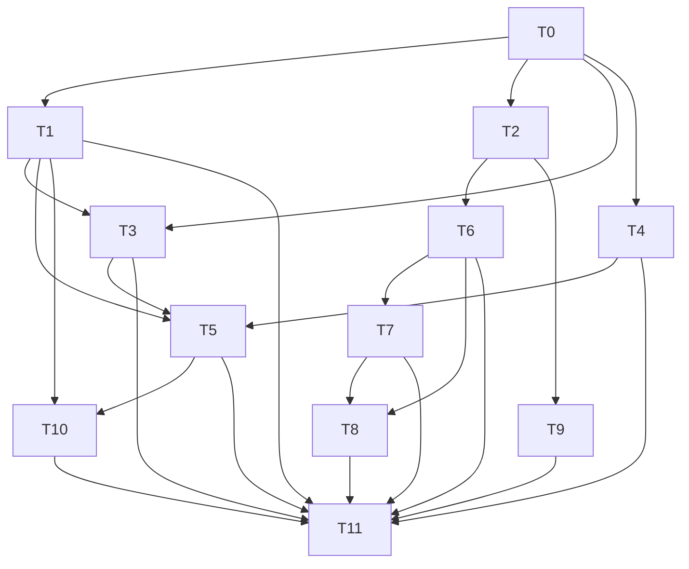

# Plan: 右边栏运行详情 — 任务与文件变更协议设计实现（v0.23.0 / PROTOCOL 0.15.0）

## Agent Worker Instructions

- Required sub-skills: `superpowers:subagent-driven-development` (preferred) or `superpowers:executing-plans`
- Execution mode: `subagent-driven-development` — fresh subagent per task, two-stage review between tasks
- Required verification (every Rust task): scoped test first (`cargo test -p <crate> <filter>`), then milestone gates for tasks marked [GATE]: `cargo test --workspace`, `cargo clippy --workspace --all-targets -- -D warnings`, `cargo test -p agentj-protocol -- drift`
- Required verification (frontend tasks): `npm --prefix agentj-ui test --workspace=@agentj/sdk`, `npm --prefix agentj-ui test --workspace=@agentj/web`, `npm --prefix agentj-ui run build --workspace=@agentj/web`, `bun --cwd agentj-ui/apps/tui test` (scoped vitest MUST run via the workspace script — `npx vitest` from repo root does not load the web vite config/jsdom)
- Generated files: `schemas/*.json` (via `cargo run -p agentj-protocol --bin gen_schemas`), `agentj-ui/packages/protocol/types.d.ts` (via `npm --prefix agentj-ui run generate --workspace=@agentj/protocol`), `agentj-ui/packages/sdk/src/methods.ts` (via `npm --prefix agentj-ui run generate --workspace=@agentj/sdk`) — regenerate with their generators, never hand-edit, and commit them with the owning task
- Version: feature → minor `0.22.0 → 0.23.0`; `PROTOCOL_VERSION 0.14.0 → 0.15.0` (single source = `agentj-ui/packages/sdk/src/config.ts` + `crates/agentj-protocol/src/lib.rs` + `protocol/methods.json`; `scripts/check-version.sh` gates all three)
- Language: task titles / AC / code in English; commit messages in English; spec docs in Chinese
- No new third-party dependencies; `uuid` already available via `agentj-ipc` (workspace dep)
- Rust style: function ≤50 lines, ≤120 chars per line

**Goal:** Implement the "Right Panel — Run Details" protocol and UI defined in `docs/superpowers/specs/2026-09-25-agentj-right-panel-run-details-design.md`: add `run_id` dimension (UUID v4 per `session/run`), per-run `revision`/`seq`, `FileChangeSource` (write/bash) with `total_bytes` truncation disclosure, and `session/history {run_id}` filtering — all additive (`Option + skip_serializing_if`). Frontend merges to "summary per (run_id, path) + history drawer per seq" and groups by `run_id`; bash rows are count-only with no diff expansion;旧数据 (`run_id=null`) stays readable.

**Architecture:** Wire types in `agentj-protocol` (leaf) → `agentj-core` TurnRunner generates `run_id` and per-run counters, artifacts emit `source + total_bytes` → `agentj-ipc` dispatch broadcasts `$/progress {run_id}` and persists `TrajectoryValue {run_id}` and filters `session/history` → SDK `parseProgress` tolerates new fields → Web reducers switch to `(run_id, revision)` / `(run_id, path)` keys and RightPanel groups by run → TUI keeps TodoBlock read-only but tolerates `run_id`.

**Tech Stack:** Rust 1.96+ (17 crates, no new crate), JSON-RPC 2.0 + schemars schemas (51 → ~55), tokio, serde; TypeScript (SDK + React 19 web + Bun/OpenTUI TUI); no new dependencies.

## Global Constraints

- Additive discipline: all new fields `Option<T> + #[serde(default, skip_serializing_if="Option::is_none")]` (Rust) / `?:` (TS); new enum `FileChangeSource` carries `#[serde(other)] + #[schemars(skip)] Unknown`; `ProgressValue` unknown `kind` ignored by `$`-prefix convention
- `run_id` is UUID v4 string; generation = `uuid::Uuid::new_v4().to_string()` at `session/run` entry; wire validation: `session/history` with `run_id` containing non-UUID or >128 chars → `-32602 InvalidParams` with `data{reason:"invalid_run_id"}`; live frames with illegal `run_id` are treated as `None` (no error) and bucketed as "未分组（历史）" (ungrouped); source-default heuristic: legacy `FileChange` without `source` degrades to `write` when `diff.is_some()` else `bash`/`unknown` with no badge
- `revision` semantics change: was per-session monotonic (`todo_revisions: HashMap<SessionId,u64>`); now per-run monotonic (`HashMap<RunId,u64>` keyed by UUID string, globally unique; legacy `HashMap<SessionId,u64>` migrated/cleared on first new run); client discards stale frames by `(run_id, revision)` when `run_id` present, else by `revision` (compat)
- `seq` is per-run monotonic `u64` for `FileChange` ordering inside a run; allocated in TurnRunner alongside `revision`; `TrajectoryEvent.seq` (global per-session) remains unchanged and is NOT reused; when `seq` is absent (old data) drawer falls back to ordering by `TrajectoryEvent.seq`
- `DIFF_MAX_BYTES = 64*1024` unchanged; new `total_bytes: Option<u64>` = original diff byte length when truncated; `diff_truncated` remains `Option<bool>` (true only when truncated); expanded diff is inline truncated text with hint only — no `file/diff` lazy-load method in this feature
- `FileChangeSource`: `write` = LCS unified diff path (diff may exist), `bash` = `git_sample` numstat path (diff always None, counts only); single source of truth is `agentj-protocol::FileChangeSource` (core re-exports, no duplicate enum)
- `session/history {run_id?, cursor?, limit?}`: when `run_id` present, filter Todo/FileChange by `run_id` **first**, then paginate the filtered set by `cursor`/`limit`; other `TrajectoryValue` kinds pass through unfiltered to preserve timeline; `run_id=None` → full history (unchanged); `run_id` with no matches → `events:[]`; pagination cursor is the global `TrajectoryEvent.seq`
- Sort / caps / sandbox unchanged: `file/list` sort dirs-first + name asc; `depth` 1..8; `truncated` ≤2000; `.git` excluded; sandbox `canonicalize + starts_with(root)`; symlink escape skipped; `file/list git_status` (M/A/U/D) remains parity-checked via existing `file_list` git mapping (no wire change)
- Frontend tokens only via `var(--aj-*)`; existing `layoutStore` keys (`agentj.layout.*`, `agentj.displayPrefs`, etc.) keep meanings; new grouping state is derived, not persisted (no new localStorage key unless needed for drawer)
- UI copy: keep existing strings; new strings: `已截断（原始 N KiB）`, `bash 变更无 diff，仅计数`, `未分组（历史）`, `本次运行`, `历史`
- Demo mode preserved as whole-block override; TUI file_change view out of scope (TUI only keeps TodoBlock)

## Design Consistency

| Spec element | Contract / UI | Tasks |
|---|---|---|
| `run_id` generation & echo | `SessionRunResult.run_id?` + TurnRunner UUID | T0, T3, T5 |
| `$/progress kind:todo {run_id, revision}` per-run monotonic | `ProgressValue::Todo` additive + client `(run_id, revision)` gate | T0, T2, T6 |
| `FileChange {run_id, seq, source, total_bytes}` + outer `ProgressValue.run_id` | `FileChange` + `FileChangeSource` + per-run seq | T0, T4, T6 |
| `TrajectoryValue::Todo/FileChange {run_id}` persistence | trajectory replay parity | T0, T5 |
| `session/history {run_id?}` filtering | filtered replay, empty on no match, `-32602` on illegal | T0, T5 |
| `PROTOCOL_VERSION 0.15.0` + workspace `0.23.0` | `lib.rs` + `protocol/methods.json` + `sdk/config.ts` + schemas | T1 |
| SDK `parseProgress` tolerance | new fields optional, unknown source → unknown | T2 |
- `run_id` is UUID v4 string; generation = `uuid::Uuid::new_v4().to_string()` at `session/run` entry; wire validation: `session/history` with `run_id` containing non-UUID or >128 chars → `-32602 InvalidParams` with `data{reason:"invalid_run_id"}`; live frames with illegal `run_id` are treated as `None` (no error) and bucketed as "未分组（历史）" (ungrouped); source-default heuristic: legacy `FileChange` without `source` degrades to `write` when `diff.is_some()` else `bash`/`unknown` with no badge
- `revision` semantics change: was per-session monotonic (`todo_revisions: HashMap<SessionId,u64>`); now per-run monotonic (`HashMap<RunId,u64>` keyed by UUID string, globally unique; legacy `HashMap<SessionId,u64>` migrated/cleared on first new run); client discards stale frames by `(run_id, revision)` when `run_id` present, else by `revision` (compat)
- `seq` is per-run monotonic `u64` for `FileChange` ordering inside a run; allocated in TurnRunner alongside `revision`; `TrajectoryEvent.seq` (global per-session) remains unchanged and is NOT reused; when `seq` is absent (old data) drawer falls back to ordering by `TrajectoryEvent.seq`
- `DIFF_MAX_BYTES = 64*1024` unchanged; new `total_bytes: Option<u64>` = original diff byte length when truncated; `diff_truncated` remains `Option<bool>` (true only when truncated); expanded diff is inline truncated text with hint only — no `file/diff` lazy-load method in this feature
- `FileChangeSource`: `write` = LCS unified diff path (diff may exist), `bash` = `git_sample` numstat path (diff always None, counts only); single source of truth is `agentj-protocol::FileChangeSource` (core re-exports, no duplicate enum)
- `session/history {run_id?, cursor?, limit?}`: when `run_id` present, filter Todo/FileChange by `run_id` **first**, then paginate the filtered set by `cursor`/`limit`; other `TrajectoryValue` kinds pass through unfiltered to preserve timeline; `run_id=None` → full history (unchanged); `run_id` with no matches → `events:[]`; pagination cursor is the global `TrajectoryEvent.seq`
- Sort / caps / sandbox unchanged: `file/list` sort dirs-first + name asc; `depth` 1..=8; `truncated` ≤2000; `.git` excluded; sandbox `canonicalize + starts_with(root)`; symlink escape skipped; `file/list git_status` (M/A/U/D) remains parity-checked via existing `file_list` git mapping (no wire change)
---

### T0: Extend protocol wire types for run-scoped todo/file_change [P0] [Sequential]

```yaml
- id: T0
  title: "Extend FileChange, ProgressValue, TrajectoryValue, SessionHistoryParams and SessionRunResult with run_id/source/seq/total_bytes"
  files:
    - crates/agentj-protocol/src/streaming.rs
    - crates/agentj-protocol/src/trajectory.rs
    - crates/agentj-protocol/src/session.rs
  depends_on: []
  breaking: false
  ac:
    - given: "FileChange with source=write, seq=5, total_bytes=70000, diff_truncated=true"
      when: "serialized to JSON"
      then: "keys include source:\"write\", seq:5, total_bytes:70000, diff_truncated:true in snake_case and omitted when None"
    - given: "FileChange wire with unknown source \"edit\""
      when: "deserialized"
      then: "source maps to FileChangeSource::Unknown without error (serde other)"
    - given: "ProgressValue::Todo with run_id=\"550e8400-...\" and revision=3"
      when: "round-tripped"
      then: "kind is \"todo\", run_id and revision preserved, absent run_id omits the key"
    - given: "SessionHistoryParams with run_id present and absent"
      when: "serialized"
      then: "run_id is present only when Some, and deserializes with default None when omitted (compat)"
    - given: "SessionRunResult with run_id"
      when: "serialized with None"
      then: "run_id key is omitted (skip_serializing_if)"
  regression:
    - "cargo test -p agentj-protocol streaming (existing ProgressValue text/tool_call/tool_result/usage/permission suites)"
    - "cargo test -p agentj-protocol trajectory (existing replay suites)"
    - "cargo test -p agentj-protocol session (existing session/new, history paging)"
  test_code: |
    #[test]
    fn file_change_source_unknown_tolerated() {
        let fc: FileChange = serde_json::from_str(r#"{"path":"a.txt","op":"modify","additions":1,"deletions":0,"source":"edit"}"#).unwrap();
        assert_eq!(fc.source, Some(FileChangeSource::Unknown));
    }
    #[test]
    fn file_change_new_fields_roundtrip() {
        let fc = FileChange { path: "src/main.rs".into(), op: FileChangeKind::Modify, additions: 10, deletions: 2,
            tool_call_id: Some("call_1".into()), diff: Some("@@ -1 +1 @@\n-hi\n+hello".into()),
            diff_truncated: Some(true), run_id: Some("550e8400-e29b-41d4-a716-446655440000".into()),
            seq: Some(5), source: Some(FileChangeSource::Write), total_bytes: Some(70000) };
        let v = serde_json::to_value(&fc).unwrap();
        assert_eq!(v["source"], "write");
        assert_eq!(v["seq"], 5);
        assert_eq!(v["total_bytes"], 70000);
        let back: FileChange = serde_json::from_value(v).unwrap();
        assert_eq!(back.source, Some(FileChangeSource::Write));
    }
    #[test]
    fn progress_todo_run_id_additive() {
        let pv = ProgressValue::Todo { session_id: "s1".into(), run_id: Some("r1".into()), revision: 3, items: vec![] };
        let j = serde_json::to_value(&pv).unwrap();
        assert_eq!(j["kind"], "todo");
        assert_eq!(j["run_id"], "r1");
        let pv2: ProgressValue = serde_json::from_value(serde_json::json!({"kind":"todo","session_id":"s1","revision":3,"items":[]})).unwrap();
        match pv2 { ProgressValue::Todo { run_id, .. } => assert!(run_id.is_none()), _ => panic!() }
    }
    #[test]
    fn session_history_params_run_id_optional() {
        let p: SessionHistoryParams = serde_json::from_str(r#"{"session_id":"s1"}"#).unwrap();
        assert!(p.run_id.is_none());
        let p2 = SessionHistoryParams { session_id: "s1".into(), cursor: None, limit: None, run_id: Some("r1".into()) };
        assert_eq!(serde_json::to_value(&p2).unwrap()["run_id"], "r1");
    }
  impl_code: |
    // streaming.rs:
    //   pub enum FileChangeSource { Write, Bash, #[serde(other)] #[schemars(skip)] Unknown } // rename_all snake_case, @since 0.15.0
    //   pub struct FileChange { path, op, additions, deletions, tool_call_id?, diff?, diff_truncated?, 
    //     #[serde(default, skip_serializing_if="Option::is_none")] pub run_id: Option<String>,
    //     #[serde(default, skip_serializing_if="Option::is_none")] pub seq: Option<u64>,
    //     #[serde(default, skip_serializing_if="Option::is_none")] pub source: Option<FileChangeSource>,
    //     #[serde(default, skip_serializing_if="Option::is_none")] pub total_bytes: Option<u64>, } // @since 0.15.0
    //   pub enum ProgressValue { ..., Todo { session_id, #[serde(default, skip_serializing_if="Option::is_none")] run_id: Option<String>, revision, items },
    //     FileChange { session_id, #[serde(default, skip_serializing_if="Option::is_none")] run_id: Option<String>, change: FileChange } } // outer run_id routing hint
    // trajectory.rs:
    //   pub enum TrajectoryValue { ..., Todo { revision, items, #[serde(default, skip_serializing_if="Option::is_none")] run_id: Option<String> },
    //     FileChange { change: FileChange, #[serde(default, skip_serializing_if="Option::is_none")] run_id: Option<String> } }
    // session.rs:
    //   pub struct SessionHistoryParams { session_id, cursor?, limit?, #[serde(default, skip_serializing_if="Option::is_none")] pub run_id: Option<String> } // @since 0.15.0
    //   pub struct SessionRunResult { content, tool_calls?, usage?, #[serde(default, skip_serializing_if="Option::is_none")] pub run_id: Option<String> } // @since 0.15.0
  verify:
    - "cargo test -p agentj-protocol --lib"
    - "cargo test -p agentj-protocol"
```

### T1: Bump protocol version and regenerate schemas [P0] [GATE] [Sequential]

```yaml
- id: T1
  title: "Bump PROTOCOL_VERSION to 0.15.0 and workspace to 0.23.0, register new schemas"
  files:
    - crates/agentj-protocol/src/lib.rs
    - protocol/methods.json
    - crates/agentj-protocol/src/schema.rs
  depends_on: [T0]
  breaking: false
  ac:
    - given: "crates/agentj-protocol/src/lib.rs PROTOCOL_VERSION"
      when: "read"
      then: "equals \"0.15.0\""
    - given: "protocol/methods.json top-level protocol_version"
      when: "parsed"
      then: "equals \"0.15.0\" and still contains 21 methods (no new method)"
    - given: "cargo run -p agentj-protocol --bin gen_schemas"
      when: "drift test compares committed schemas"
      then: "zero drift and new schema FileChangeSource exists plus updated FileChange/ProgressValue/TrajectoryValue/SessionHistoryParams/SessionRunResult schemas reflect new optional fields"
  regression:
    - "cargo test -p agentj-protocol -- drift (after regeneration)"
    - "./scripts/check-version.sh passes for 0.23.0 / 0.15.0"
  test_code: |
    #[test]
    fn protocol_version_is_0_15_0() {
        assert_eq!(crate::PROTOCOL_VERSION, "0.15.0");
    }
    #[test]
    fn methods_json_protocol_version_synced() {
        let raw = std::fs::read_to_string(concat!(env!("CARGO_MANIFEST_DIR"), "/../../protocol/methods.json")).unwrap();
        let v: serde_json::Value = serde_json::from_str(&raw).unwrap();
        assert_eq!(v["protocol_version"], "0.15.0");
        assert_eq!(v["methods"].as_array().unwrap().len(), 21);
    }
    #[test]
    fn new_schemas_present() {
        let schemas = crate::schema::generate_schemas();
        assert!(schemas.contains_key("FileChangeSource"));
        assert!(schemas.contains_key("FileChange"));
        assert!(schemas.contains_key("ProgressValue"));
        assert!(schemas.contains_key("SessionHistoryParams"));
    }
  impl_code: |
    // lib.rs: pub const PROTOCOL_VERSION: &str = "0.15.0";
    // protocol/methods.json: { "protocol_version": "0.15.0", "methods": [/* 21 entries unchanged */] }
    // schema.rs generate_schemas(): add FileChangeSource to the schema_for! map (via import from streaming.rs)
    //   and ensure SessionRunResult/SessionHistoryParams updated types are included
    // run: cargo run -p agentj-protocol --bin gen_schemas  (commit schemas/*.json — covers FileChangeSource.json, ProgressValue.json, TrajectoryValue.json, SessionHistoryParams.json, SessionRunResult.json, FileChange.json)
    // NOTE: workspace package version 0.22.0 -> 0.23.0 is done in T11 (final gate) to keep this task at 3 files
  verify:
    - "cargo run -p agentj-protocol --bin gen_schemas"
    - "cargo test -p agentj-protocol -- drift"
    - "./scripts/check-version.sh"
```

### T2: Extend SDK progress parser and version constants [P1] [Parallel with T1]

```yaml
- id: T2
  title: "Extend SDK parseProgress with run_id/source/seq/total_bytes and bump SDK VERSION/PROTOCOL_VERSION"
  files:
    - agentj-ui/packages/sdk/src/progress.ts
    - agentj-ui/packages/sdk/src/config.ts
  depends_on: [T0]
  breaking: false
  ac:
    - given: "a $/progress todo frame with run_id and revision"
      when: "parseProgress called"
      then: "returns {kind:\"todo\", runId:\"r1\", revision:3, items:[...]} and omits runId when absent"
    - given: "a file_change frame with source=bash, seq, total_bytes, diff absent"
      when: "parseProgress called"
      then: "returns change with source:\"bash\", seq, totalBytes, diff:null without throwing"
    - given: "a file_change frame with unknown source \"edit\" and unknown op"
      when: "parsed"
      then: "source is \"edit\" (preserved) and op degrades downstream; parseProgress never throws"
    - given: "a legacy file_change frame without source but with diff present vs without diff"
      when: "parseProgress called"
      then: "downstream heuristic degrades to write when diff present else bash/unknown with no badge (no throw)"
    - given: "a $/progress frame with illegal run_id \"not-a-uuid\" or length >128"
      when: "parseProgress called"
      then: "runId is treated as undefined (bucketed as ungrouped), no error thrown"
    - given: "SDK config VERSION and PROTOCOL_VERSION"
      when: "imported"
      then: "VERSION is \"0.23.0\" and PROTOCOL_VERSION is \"0.15.0\""
  regression:
    - "npm --prefix agentj-ui test --workspace=@agentj/sdk (existing progress/router/config suites)"
  test_code: |
    // progress.test.ts
    test("todo frame with run_id parses", () => {
      const f = parseProgress({ kind: "todo", session_id: "s1", run_id: "r1", revision: 3, items: [{ id: "a", content: "t", status: "pending" }] });
      expect(f.kind).toBe("todo");
      if (f.kind === "todo") { expect((f as any).runId).toBe("r1"); expect(f.revision).toBe(3); }
    });
    test("file_change with source and seq parses", () => {
      const f = parseProgress({ kind: "file_change", session_id: "s1", run_id: "r1", change: { path: "a.txt", op: "modify", additions: 1, deletions: 0, source: "bash", seq: 5 } });
      expect(f.kind).toBe("file_change");
      if (f.kind === "file_change") { expect((f.change as any).source).toBe("bash"); expect((f.change as any).seq).toBe(5); }
    });
    test("unknown source does not throw", () => {
      expect(() => parseProgress({ kind: "file_change", session_id: "s1", change: { path: "a", op: "modify", additions: 0, deletions: 0, source: "edit" } })).not.toThrow();
    });
    test("legacy without source degrades by diff presence", () => {
      const withDiff = parseProgress({ kind: "file_change", session_id: "s1", change: { path: "a", op: "modify", additions: 1, deletions: 0, diff: "@@ -1 +1 @@" } });
      expect((withDiff as any).change.source).toBeUndefined(); // heuristic applied downstream (render), not here
      const noDiff = parseProgress({ kind: "file_change", session_id: "s1", change: { path: "a", op: "modify", additions: 1, deletions: 0 } });
      expect((noDiff as any).change.diff).toBeNull();
    });
    test("illegal run_id treated as undefined", () => {
      const f = parseProgress({ kind: "todo", session_id: "s1", run_id: "not-a-uuid", revision: 1, items: [] });
      expect((f as any).runId).toBeUndefined();
    });
  impl_code: |
    // progress.ts:
    //   export type FileChangeFrame = { path, op, additions, deletions, tool_call_id, diff, diff_truncated?, run_id?: string, seq?: number, source?: string, total_bytes?: number }
    //   export type TodoFrame = { kind:"todo", session_id, runId?: string, revision, items }
    //   parseFileChange: read run_id/seq/source/total_bytes as optional (typeof string/number checks, else null/undefined); validate run_id via UUID regex/len>128 -> drop
    //   parseProgress: for kind:"todo" read run_id optional with same UUID/len validation; for kind:"file_change" read run_id outer + change.run_id (change.run_id wins when both present), preserve source/seq/total_bytes; live illegal run_id dropped (no error)
    //   never throws; unknown kind -> {kind:"unknown", raw}
    // config.ts:
    //   export const VERSION = "0.23.0"; export const PROTOCOL_VERSION = "0.15.0";
  verify:
    - "npm --prefix agentj-ui test --workspace=@agentj/sdk"
```

### T3: Generate TurnRunner run_id and per-run revision/seq counters [P1] [Sequential]

```yaml
- id: T3
  title: "Generate UUID run_id per session/run and switch todo revision to per-run monotonic plus per-run file_change seq"
  files:
    - crates/agentj-core/src/turn_runner.rs
    - crates/agentj-core/src/types.rs
  depends_on: [T0, T1]
  breaking: false
  ac:
    - given: "two successive session/run calls on the same session_id"
      when: "TurnRunner dispatches turns"
      then: "each turn emits events with distinct run_id (UUID v4) and todo revisions start at 1 per run"
    - given: "three file changes inside one run"
      when: "artifacts are emitted"
      then: "their seq values are 1,2,3 strictly increasing within that run and reset to 1 on next run"
    - given: "a legacy consumer ignoring run_id"
      when: "frames are observed"
      then: "frames still contain valid revision/seq and session_id (no regression)"
  regression:
    - "cargo test -p agentj-core turn_runner (existing todo revision, cancel, tool loop tests)"
  test_code: |
    #[tokio::test]
    async fn run_id_unique_per_turn() {
        let (runner, mut rx) = test_runner();
        let id1 = runner.start_run("s1", "prompt 1").await.unwrap();
        let id2 = runner.start_run("s1", "prompt 2").await.unwrap();
        assert_ne!(id1, id2);
        assert!(is_uuid_v4(&id1));
    }
    #[tokio::test]
    async fn todo_revision_per_run() {
        let (runner, mut rx) = test_runner_with_todo();
        let run1 = runner.start_run("s1", "do").await.unwrap();
        runner.emit_todo("s1", &run1, vec![todo_item("a","pending")]).await;
        runner.emit_todo("s1", &run1, vec![todo_item("a","in_progress")]).await;
        let frames = collect_todo_frames(&mut rx).await;
        assert_eq!(frames[0].revision, 1);
        assert_eq!(frames[1].revision, 2);
        let run2 = runner.start_run("s1", "do2").await.unwrap();
        runner.emit_todo("s1", &run2, vec![todo_item("b","pending")]).await;
        let frames2 = collect_todo_frames(&mut rx).await;
        assert_eq!(frames2.last().unwrap().revision, 1); // reset per run
    }
    #[tokio::test]
    async fn file_change_seq_per_run() {
        let (runner, mut rx) = test_runner_with_todo();
        let run = runner.start_run("s1", "do").await.unwrap();
        runner.emit_file_change("s1", &run, "a.txt", "write").await;
        runner.emit_file_change("s1", &run, "b.txt", "write").await;
        runner.emit_file_change("s1", &run, "a.txt", "write").await;
        let frames = collect_file_change_frames(&mut rx).await;
        assert_eq!(frames[0].seq, Some(1));
        assert_eq!(frames[1].seq, Some(2));
        assert_eq!(frames[2].seq, Some(3));
    }
  impl_code: |
    // turn_runner.rs:
    //   use uuid::Uuid; // already available via workspace (agentj-ipc re-export; add to agentj-core if needed with same version)
    //   field: todo_revisions: Arc<Mutex<HashMap<String /* RunId UUID */, u64>>>  // key is RunId only (UUID globally unique), not (SessionId,RunId); legacy per-session map cleared/migrated on first new run
    //   field: file_change_seqs: Arc<Mutex<HashMap<String /* RunId */, u64>>>
    //   field: active_runs: Arc<Mutex<HashMap<SessionId, String /* current RunId */>>>
    //   pub async fn start_run(&self, session_id, content) -> String { let run_id = Uuid::new_v4().to_string(); active_runs.insert(session_id, run_id.clone()); run_id }
    //   fn next_todo_revision(&self, run_id: &str) -> u64 { per-run counter inc for that RunId }
    //   fn next_file_change_seq(&self, run_id: &str) -> u64 { per-run counter inc for that RunId }
    //   AgentEvent::Todo { session_id, run_id, revision, items } / FileChange { session_id, run_id, seq, change }
    //   ToolCallContext gains run_id: String field (Option<String> for compat; new runs Some); artifact construction reads ctx.run_id
    //   types.rs: extend AgentEvent enum variants with run_id: String and seq where applicable; FileChangeSource is re-exported from agentj-protocol (no duplicate enum in core — see T4)
  verify:
    - "cargo test -p agentj-core turn_runner"
    - "cargo test -p agentj-core"
```


### T4: Tag file change artifacts with source and total_bytes [P1] [Parallel with T3]

```yaml
- id: T4
  title: "Tag write artifacts as source=write with truncation total_bytes and bash artifacts as source=bash"
  files:
    - crates/agentj-core/src/artifacts.rs
    - crates/agentj-core/src/tool_executor.rs
  depends_on: [T0]
  breaking: false
  ac:
    - given: "write_change with before and after diff exceeding 64KiB"
      when: "artifact built"
      then: "diff is truncated to 64KiB prefix, diff_truncated true, total_bytes equals original diff length, source=write"
    - given: "write_change with small diff"
      when: "built"
      then: "source=write, total_bytes is None or equals diff len, diff_truncated None/false"
    - given: "bash git_sample producing 2 file changes"
      when: "artifacts assembled"
      then: "each has source=bash, diff None, diff_truncated None, additions/deletions counts preserved"
  regression:
    - "cargo test -p agentj-core artifacts (existing LCS/diff/write_change/todo_snapshot tests)"
    - "cargo test -p agentj-core git_sample (existing bash sampling tests)"
  test_code: |
    #[test]
    fn write_change_truncation_sets_total_bytes() {
        let big_after = "a\n".repeat(70 * 1024);
        let art = write_change("big.txt", None, &big_after, Some("call1"));
        assert_eq!(art.source, FileChangeSource::Write);
        assert_eq!(art.diff_truncated, Some(true));
        assert!(art.total_bytes.unwrap() > 64*1024);
        assert!(art.diff.as_ref().unwrap().len() <= 64*1024);
    }
    #[test]
    fn bash_changes_tagged_bash() {
        let changes = bash_changes_from_sample(vec![("a.txt", 5, 1)], Some("call2"));
        for c in &changes { assert_eq!(c.source, FileChangeSource::Bash); assert!(c.diff.is_none()); }
    }
  impl_code: |
    // artifacts.rs: re-export FileChangeSource from agentj-protocol (no duplicate enum); use crate::protocol::FileChangeSource alias
    //   pub struct FileChangeArtifact { path, op, additions, deletions, tool_call_id, diff, diff_truncated, run_id?, seq?, source: Option<FileChangeSource>, total_bytes }
    //   pub fn write_change(..., run_id, seq) -> FileChangeArtifact { set source=Some(Write); if diff.len() > DIFF_MAX { total_bytes=Some(diff.len()); diff=Some(truncated); diff_truncated=Some(true) } else { total_bytes=None } }
    //   pub fn bash_file_changes(sample_before, sample_after, ...) -> Vec<FileChangeArtifact> { each with source=Some(Bash), diff=None, diff_truncated=None, total_bytes=None }
    // tool_executor.rs: pass run_id/seq through ToolCallContext into artifact construction; map git_sample numstat entries to Bash source
  verify:
    - "cargo test -p agentj-core artifacts"
    - "cargo test -p agentj-core"
```

### T5: Wire IPC broadcast, trajectory persistence and session/history filtering [P1] [Sequential]

```yaml
- id: T5
  title: "Broadcast run_id in $/progress, persist TrajectoryValue run_id, and filter session/history by run_id"
  files:
    - crates/agentj-ipc/src/lib.rs
    - crates/agentj-ipc/src/trajectory.rs
  depends_on: [T0, T3, T4]
  breaking: false
  ac:
    - given: "a live session/run producing todo and file_change events with run_id=r1"
      when: "subscribed client receives $/progress"
      then: "todo frame contains run_id:r1 and file_change frames contain run_id:r1, seq, source, total_bytes"
    - given: "session/history called with run_id=r1, cursor and limit pagination"
      when: "trajectory contains Todo/FileChange for r1 and r2 plus Other kinds (e.g. ToolCall)"
      then: "response filters Todo/FileChange to r1 first, then paginates by cursor/limit; Other kinds pass through unfiltered"
    - given: "a $/progress frame with illegal run_id \"not-a-uuid\" or length >128"
      when: "received live"
      then: "treated as null (no error), bucketed as ungrouped (未分组)"
    - given: "session/history called with run_id=\"not-a-uuid\""
      when: "dispatched"
      then: "returns -32602 InvalidParams with data{reason:\"invalid_run_id\"}"
    - given: "SessionRunResult for a completed run"
      when: "returned to the caller"
      then: "contains run_id matching the broadcast frames"
      then: "contains run_id matching the broadcast frames"
  regression:
    - "cargo test -p agentj-ipc (existing dispatch, trajectory, file_list tests)"
    - "e2e_ws: existing session/run + progress broadcast tests still pass"
  test_code: |
    #[tokio::test]
    async fn broadcast_includes_run_id() {
        let (server, client) = ws_pair().await;
        let run_id = client.session_run("s1", "hello").await.unwrap().run_id.unwrap();
        let frames = client.collect_progress_todo().await;
        assert!(frames.iter().all(|f| f.run_id.as_deref() == Some(&run_id)));
    }
    #[tokio::test]
    async fn history_filters_by_run_id() {
        let run1 = client.session_run("s1", "a").await.unwrap().run_id.unwrap();
        let run2 = client.session_run("s1", "b").await.unwrap().run_id.unwrap();
        let all = client.session_history("s1", None).await.unwrap();
        let filtered = client.session_history_with_run("s1", Some(run1.clone())).await.unwrap();
        assert!(filtered.events.iter().all(|e| match &e.value { TrajectoryValue::Todo{run_id,..}|TrajectoryValue::FileChange{run_id,..} => run_id.as_deref()==Some(&run1), _ => true }));
    }
    #[tokio::test]
    async fn history_invalid_run_id_rejects() {
        let err = client.session_history_with_run("s1", Some("not-a-uuid".into())).await.unwrap_err();
        assert_eq!(err.code, -32602);
    }
  impl_code: |
    // lib.rs dispatch_session_run:
    //   on AgentEvent::Todo/FileChange: construct ProgressValue with run_id (Some), map core FileChangeArtifact -> protocol FileChange (source/seq/total_bytes)
    //   broadcast via broadcast_to_session(session_id, ProgressParams{token, value})
    //   persist TrajectoryEvent{ session_id, seq: global, value: TrajectoryValue::Todo/FileChange{run_id: Some(run_id.clone())} }
    //   SessionRunResult { content, tool_calls, usage, run_id: Some(run_id) }
    // trajectory.rs / history handler:
    //   fn is_valid_run_id(s: &str) -> bool { Uuid::parse_str(s).is_ok() && s.len()<=128 }
    //   if params.run_id.is_some() && !is_valid_run_id(&run_id) { return Err(DispatchError{code:-32602, data: json!({"reason":"invalid_run_id"})}) }
    //   filter: events.iter().filter(|e| match &e.value { Todo{run_id: r,..}|FileChange{run_id: r,..} => r.as_deref()==params.run_id.as_deref(), _ => true })
    //   when params.run_id present, only Todo/FileChange are filtered; others pass through
  verify:
    - "cargo test -p agentj-ipc"
    - "cargo test --workspace"
```

### T6: Update web reducers for per-run revision and per-run path upsert with drawer seq [P1] [Parallel with T3]

```yaml
- id: T6
  title: "Update todoState and changes reducers for (run_id, revision) and (run_id, path) plus history drawer"
  files:
    - agentj-ui/apps/web/src/todoState.ts
    - agentj-ui/apps/web/src/changes.ts
  depends_on: [T2]
  breaking: false
  ac:
    - given: "TodoState with run_id=r1 revision=2"
      when: "applyTodoFrame receives r1 revision=1 (stale) and r1 revision=3 (fresh) and r2 revision=1"
      then: "stale frame is ignored (same reference), fresh r1 advances, r2 is treated as separate run and also applies"
    - given: "TodoState with run_id=null (legacy) revision=5"
      when: "applyTodoFrame receives legacy revision=4 and 6"
      then: "4 is ignored, 6 applies (compat fallback when run_id missing)"
    - given: "$/progress todo with illegal run_id \"not-a-uuid\""
      when: "applyTodoFrame receives it"
      then: "treated as null/ungrouped, revision gate falls back to legacy compat path"
    - given: "FileChange rows for r1 path=a.txt seq=1 and seq=2 (same path)"
      when: "applyFileChange called twice"
      then: "second upserts the summary row for (r1,a.txt) and appends to per-run history ordered by seq"
    - given: "a legacy FileChange without source but with/without diff"
      when: "ChangeList renders the row"
      then: "diff present degrades to write badge, no diff degrades to bash/unknown with no badge and non-expandable"
    - given: "FileChange without seq (old data) appears in drawer"
      when: "history drawer orders entries"
      then: "falls back to TrajectoryEvent.seq ordering"
    - given: "session/history events for r1 with revisions 1 and 3 and for r2 with revision 2"
      when: "todosFromHistory and changesFromHistory called with run_id filter"
      then: "todosFromHistory picks max revision per run; changesFromHistory merges in seq order"
    - given: "a run with no todos and no changes"
      when: "RightPanel renders that run group"
      then: "shows per-run empty state (e.g. 暂无任务 / 暂无变更) rather than blank"
  regression:
    - "npm --prefix agentj-ui test --workspace=@agentj/web todoState and changes suites (existing revision gate and upsert tests)"
  test_code: |
    test("todo per-run revision gate", () => {
      let s = applyTodoFrame(EMPTY_TODO_STATE, { kind:"todo", session_id:"s1", runId:"r1", revision:2, items:[{id:"a",content:"t",status:"pending"}] });
      const stale = applyTodoFrame(s, { kind:"todo", session_id:"s1", runId:"r1", revision:1, items:[] });
      expect(stale).toBe(s);
      const fresh = applyTodoFrame(s, { kind:"todo", session_id:"s1", runId:"r1", revision:3, items:[] });
      expect(fresh.revision).toBe(3);
      const otherRun = applyTodoFrame(s, { kind:"todo", session_id:"s1", runId:"r2", revision:1, items:[] });
      expect(otherRun.revision).toBe(1); // per-run, r2 fresh even though 1 < 2
    });
    test("file_change per-run upsert", () => {
      let rows: FileChangeRow[] = [];
      rows = applyFileChange(rows, { kind:"file_change", session_id:"s1", runId:"r1", change:{ path:"a.txt", op:"add", additions:1, deletions:0, seq:1, source:"write", diff:"@@" } });
      rows = applyFileChange(rows, { kind:"file_change", session_id:"s1", runId:"r1", change:{ path:"a.txt", op:"modify", additions:2, deletions:1, seq:2, source:"write", diff:"@@" } });
      expect(rows.filter(r=>r.path==="a.txt" && r.runId==="r1")).toHaveLength(1);
      expect(rows[0].additions).toBe(2);
    });
    test("legacy null run_id compat", () => {
      let s = applyTodoFrame(EMPTY_TODO_STATE, { kind:"todo", session_id:"s1", revision:5, items:[] } as any);
      const stale = applyTodoFrame(s, { kind:"todo", session_id:"s1", revision:4, items:[] } as any);
      expect(stale).toBe(s);
    });
  impl_code: |
    // todoState.ts:
    //   export type TodoState = { byRun: Map<string|null, {revision:number, items:TodoView[]}>, currentRunId?: string } // or grouped map
    //   Alternative minimal: keep TodoState as before but store runId in state; applyTodoFrame(state, frame):
    //     if frame.runId == null: legacy path (revision <= state.revision ? ignore : apply)
    //     else: per-run map; if frame.runId !== state.currentRunId then treat as separate bucket; within bucket revision gate
    //   todosFromHistory(events, runIdFilter?): when runIdFilter present, filter events by value.run_id; else pick max revision per run
    // changes.ts:
    //   export type FileChangeRow = { path, op, additions, deletions, diff, toolCallId, runId?: string, seq?: number, source?: string, totalBytes?: number }
    //   export type ChangesState = { summary: FileChangeRow[], history: FileChangeRow[] } // or summary Map<(runId,path), row>
    //   applyFileChange(prev, frame): key = (frame.runId ?? frame.change.run_id ?? "__legacy__", change.path); upsert summary by key; append to history sorted by seq
    //   changesFromHistory(events): upsert summary by (run_id, path) and build history in seq order
    //   Unknown source/op preserved; bash rows diff=null
  verify:
    - "npm --prefix agentj-ui test --workspace=@agentj/web -- todoState changes"
    - "npm --prefix agentj-ui test --workspace=@agentj/web"
```

### T7: Implement RightPanel run grouping and ChangeList source badges with drawer [P1] [Sequential]

```yaml
- id: T7
  title: "Implement RightPanel run grouping and ChangeList source badges, truncation hint and history drawer"
  files:
    - agentj-ui/apps/web/src/components/RightPanel.tsx
    - agentj-ui/apps/web/src/components/ChangeList.tsx
  depends_on: [T6]
  breaking: false
  ac:
    - given: "two runs r1 and r2 each with file changes"
      when: "RightPanel renders"
      then: "changes are grouped under run headers (\"本次运行\" for current run, run short id for others, \"未分组（历史）\" for null)"
    - given: "a write row with total_bytes 70000 and diff_truncated true"
      when: "row is expanded"
      then: "diff is shown inline with hint \"已截断（原始 68 KiB）\" and no file/diff method is called (truncation is disclosure-only)"
    - given: "a run group with zero todos and zero changes"
      when: "RightPanel renders that group"
      then: "shows per-run empty placeholder (e.g. 暂无任务 / 暂无变更) rather than blank"
    - given: "a bash row"
      when: "rendered"
      then: "badge shows \"bash\" (or degraded no-badge for legacy without source and no diff), row is not expandable, tooltip says \"bash 变更无 diff，仅计数\""
    - given: "a file path appearing twice in same run (seq 1 and 2)"
      when: "user clicks history drawer"
      then: "drawer lists both entries ordered by seq with tool_call_id grouping; entries without seq fall back to TrajectoryEvent.seq order"
  regression:
    - "npm --prefix agentj-ui test --workspace=@agentj/web RightPanel/ChangeList (existing accordion/split/resize tests)"
  test_code: |
    test("groups by run_id", () => {
      const { getByText } = render(<RightPanel runs={[{runId:"r1", changes:[row("a.txt","r1")]},{runId:"r2", changes:[row("b.txt","r2")]}]} />);
      expect(getByText(/r1/)).toBeInTheDocument();
      expect(getByText(/r2/)).toBeInTheDocument();
    });
    test("bash row not expandable", () => {
      const { queryByRole } = render(<ChangeList rows={[bashRow("a.txt")]} />);
      expect(queryByRole("button", {name:/expand/})).toBeNull();
    });
    test("truncation hint shown", () => {
      const { getByText } = render(<ChangeList rows={[truncatedRow("a.txt", 70000)]} expandedPath="a.txt" />);
      expect(getByText(/已截断/)).toBeInTheDocument();
    });
  impl_code: |
    // RightPanel.tsx: derive grouped = groupBy(runId ?? "__legacy__", changes); sort currentRunId first, then by run recency; render section per group
    // ChangeList.tsx: props rows: FileChangeRow[] (already grouped upstream or grouping inside); render per row: source badge (write=accent, bash=muted, unknown=plain), +N/-N, path, expansion control disabled when source==="bash" or diff==null
    //   expanded diff panel: when diff_truncated && total_bytes, show banner "已截断（原始 {Math.ceil(totalBytes/1024)} KiB）"
    //   history drawer: collapsible <details> or slide-over listing history rows for same (runId,path) ordered by seq, grouped by toolCallId
  verify:
    - "npm --prefix agentj-ui test --workspace=@agentj/web -- RightPanel ChangeList"
    - "npm --prefix agentj-ui run build --workspace=@agentj/web"
```

### T8: Wire App run_id capture, history filtering and FileTree linkage [P1] [Sequential]

```yaml
- id: T8
  title: "Wire App to capture SessionRunResult.run_id, filter session/history by run_id and link FileTree to ChangeList"
  files:
    - agentj-ui/apps/web/src/App.tsx
    - agentj-ui/apps/web/src/components/TodoPanel.tsx
  depends_on: [T6, T7]
  breaking: false
  ac:
    - given: "session/run returns run_id r1"
      when: "App handles the result"
      then: "activeRunId state is set to r1 and subsequent $/progress frames are routed to that run's bucket"
    - given: "user switches session or clicks a run header"
      when: "App fetches session/history with run_id"
      then: "request includes run_id and response populates the correct run bucket; missing run_id falls back to unfiltered fetch"
    - given: "FileTree row path a/b/c.ts clicked"
      when: "FileTree emits onSelect"
      then: "RightPanel ChangeList scrolls to and highlights the matching (runId, path) row if present"
  regression:
    - "npm --prefix agentj-ui test --workspace=@agentj/web App (existing session/history replay, progress subscription, file/list tests)"
  test_code: |
    test("captures run_id from SessionRunResult", async () => {
      const client = mockClient({ session_run: async()=>({ content:"hi", run_id:"r1" }) });
      const { result } = renderHook(()=>useApp(client));
      await act(()=>result.current.run("s1","hi"));
      expect(result.current.activeRunId).toBe("r1");
    });
    test("history fetch includes run_id", async () => {
      const history = vi.fn(async (params)=>({ events:[] }));
      render(<App client={{ session_history: history } as any} activeRunId="r1" />);
      await waitFor(()=>expect(history).toHaveBeenCalledWith(expect.objectContaining({ run_id:"r1" })));
    });
    test("FileTree click highlights ChangeList row", async () => {
      const { getByText } = render(<Workspace onFileSelect={onSelect} />);
      await user.click(getByText("a/b/c.ts"));
      expect(getByText("a/b/c.ts").closest("[data-highlight]")).toBeTruthy();
    });
  impl_code: |
    // App.tsx:
    //   state activeRunId: string | null
    //   on session/run result: setActiveRunId(result.run_id ?? null)
    //   on $/progress: applyTodoFrame/applyFileChange with frame.runId
    //   on session switch / run header click: fetch session/history {session_id, run_id: activeRunId ?? undefined} (omit when null)
    //   handle legacy frames (run_id missing) -> bucket "__legacy__"
    //   propagate activeRunId to RightPanel (currentRun pinning) and to history fetch
    // TodoPanel.tsx: render grouped by run (reuse grouping helper from RightPanel or central hook); empty state per run
    // FileTree linkage: FileTree onSelect(path) -> App setHighlightedPath(path) -> ChangeList scrollIntoView/highlight via data-path attribute
  verify:
    - "npm --prefix agentj-ui test --workspace=@agentj/web -- App TodoPanel"
    - "npm --prefix agentj-ui run build --workspace=@agentj/web"
```

### T9: Keep TUI TodoBlock compatible with run_id [P2] [Parallel with T6]

```yaml
- id: T9
  title: "Keep TUI TodoBlock compatible with run_id and per-run revision without adding file_change view"
  files:
    - agentj-ui/apps/tui/src/runview.tsx
    - agentj-ui/apps/tui/src/todo.ts
  depends_on: [T2]
  breaking: false
  ac:
    - given: "a $/progress todo frame with run_id and revision"
      when: "TUI runview handles the frame"
      then: "frame is accepted and rendered (no crash) and stale per-run revisions are ignored"
    - given: "a file_change frame with run_id/source/seq"
      when: "TUI receives it"
      then: "frame is ignored (TUI has no file_change view) without error"
    - given: "legacy todo frame without run_id"
      when: "handled"
      then: "falls back to legacy revision gate and still renders"
  regression:
    - "bun --cwd agentj-ui/apps/tui test (existing runview/todo/filetree suites)"
  test_code: |
    test("TUI todo with run_id renders", () => {
      let state = EMPTY_TODO_STATE;
      state = applyTodoFrame(state, { kind:"todo", session_id:"s1", runId:"r1", revision:1, items:[{id:"a",content:"t",status:"pending"}] });
      expect(state.items).toHaveLength(1);
    });
    test("TUI ignores file_change", () => {
      expect(()=>handleProgress({ kind:"file_change", session_id:"s1", runId:"r1", change:{ path:"a", op:"modify", additions:1, deletions:0, source:"bash" } })).not.toThrow();
    });
  impl_code: |
    // tui/src/todo.ts (or runview.tsx helper): mirror web todoState logic minimal: if frame.runId present use per-run map, else legacy gate; keep EMPTY_TODO_STATE compat
    // runview.tsx: ensure progress handler switch handles new fields via default case; file_change -> no-op (ignore) to keep read-only todo block stable
  verify:
    - "bun --cwd agentj-ui/apps/tui test"
```

### T10: Sync spec, regenerate schemas and protocol types [P1] [Sequential]

```yaml
- id: T10
  title: "Sync docs/specs/ipc-protocol.md and regenerate schemas and protocol types"
  files:
    - docs/specs/ipc-protocol.md
    - schemas/FileChangeSource.json
    - agentj-ui/packages/protocol/types.d.ts
  depends_on: [T1, T5]
  breaking: false
  ac:
    - given: "docs/specs/ipc-protocol.md"
      when: "opened"
      then: "contains sections for FileChangeSource, run_id dimension, per-run revision/seq, session/history run_id filter (filter first then paginate, other kinds unfiltered), diff truncation with total_bytes, and source semantics; counts reflect 55 schemas and protocol_version 0.15.0"
    - given: "schemas/*.json after generation"
      when: "drift test runs"
      then: "drift passes and committed schemas match generated (including FileChangeSource.json, updated FileChange/ProgressValue/TrajectoryValue/SessionHistoryParams/SessionRunResult)"
    - given: "agentj-ui/packages/protocol/types.d.ts and sdk methods"
      when: "generated"
      then: "types contain FileChangeSource and new optional fields run_id/seq/source/total_bytes; PROTOCOL_VERSION is 0.15.0"
  regression:
    - "cargo test -p agentj-protocol -- drift"
    - "npm --prefix agentj-ui run generate --workspace=@agentj/protocol (tsc --noEmit passes)"
  test_code: |
    #[test]
    fn file_change_source_schema_present() {
        let schemas = crate::schema::generate_schemas();
        assert!(schemas.contains_key("FileChangeSource"));
        let raw = std::fs::read_to_string(concat!(env!("CARGO_MANIFEST_DIR"), "/../../schemas/FileChangeSource.json")).unwrap();
        let v: serde_json::Value = serde_json::from_str(&raw).unwrap();
        assert!(v.get("enum").is_some() || v.get("anyOf").is_some() || v.get("properties").is_some());
    }
    #[test]
    fn drift_still_passes_after_run_id_fields() {
        assert_eq!(crate::PROTOCOL_VERSION, "0.15.0");
    }
  impl_code: |
    // docs/specs/ipc-protocol.md: add FileChangeSource enum table, amend ProgressValue Todo/FileChange to document run_id/seq/source/total_bytes additive fields (including outer ProgressValue run_id routing hint + source-default heuristic), amend SessionRunResult and SessionHistoryParams (run_id filter-first-then-paginate, other kinds unfiltered), update counts (21 methods, ~55 schemas), add changelog 0.15.0; run cargo gen_schemas and npm generate protocol
  verify:
    - "cargo run -p agentj-protocol --bin gen_schemas && cargo test -p agentj-protocol -- drift"
    - "npm --prefix agentj-ui run generate --workspace=@agentj/protocol && npm --prefix agentj-ui run build --workspace=@agentj/protocol"
```

### T11: Final gate — version consistency, lint and full builds [P0] [GATE] [Sequential]

```yaml
- id: T11
  title: "Run full gate: fmt, clippy, drift, check-version, web build, tui and desktop-ui"
  files:
    - Cargo.toml
    - agentj-ui/packages/sdk/src/config.ts
    - scripts/check-version.sh
  depends_on: [T1, T2, T3, T4, T5, T6, T7, T8, T9, T10]
  breaking: false
  ac:
    - given: "all tasks merged"
      when: "full gate runs"
      then: "cargo fmt --check clean, cargo clippy zero warnings, cargo test --workspace 0 failed, drift 2 passed, check-version 0.23.0/0.15.0, web build clean, tui 0 failed, desktop-ui ok"
  regression:
    - "cargo test --workspace (all 17 crates)"
    - "npm --prefix agentj-ui test --workspace=@agentj/web"
  test_code: |
    // gate task has no code test; its AC is the gate itself
    // smoke: assert PROTOCOL_VERSION constant equals methods.json protocol_version and sdk config PROTOCOL_VERSION
    #[test]
    fn version_triple_synced() {
        assert_eq!(agentj_protocol::PROTOCOL_VERSION, "0.15.0");
        let m: serde_json::Value = serde_json::from_str(&std::fs::read_to_string("protocol/methods.json").unwrap()).unwrap();
        assert_eq!(m["protocol_version"], "0.15.0");
    }
  impl_code: |
    // Cargo.toml: [workspace.package] version = "0.23.0" (if not already bumped in T1)
    // agentj-ui/package.json workspaces version sync if needed
    // scripts/check-version.sh: ensure it checks 0.23.0 / 0.15.0 (already does via methods.json + sdk config)
    // no logic change; just final sync + commit
  verify:
    - "cargo fmt --check"
    - "cargo clippy --workspace --all-targets -- -D warnings"
    - "cargo test --workspace"
    - "cargo test -p agentj-protocol -- drift"
    - "./scripts/check-version.sh"
    - "npm --prefix agentj-ui test --workspace=@agentj/sdk && npm --prefix agentj-ui test --workspace=@agentj/web && npm --prefix agentj-ui run build --workspace=@agentj/web"
    - "bun --cwd agentj-ui/apps/tui test"
    - "node agentj-ui/apps/desktop/check-desktop-ui.mjs"
```

## Dependency Graph



## Parallel Execution Groups

- **Group A (Level 0):** T0 — protocol wire types (single, seed)
- **Group B (Level 1, after T0):** T1, T2 — version/schema + SDK parser (parallel, no shared files)
- **Group C (Level 2, after T0/T1):** T3, T4 — TurnRunner counters + artifact tagging (parallel, disjoint crates/files)
- **Group D (Level 3, after C):** T5 — IPC broadcast/history (depends on T3+T4)
- **Group E (Level 4, after SDK):** T6, T9 — web reducers + TUI compat (parallel, disjoint UI trees)
- **Group F (Level 5, after E):** T7 — RightPanel/ChangeList UI (after reducers)
- **Group G (Level 6, after F):** T8 — App wiring + linkage (after T7)
- **Group H (Level 7, after D+G):** T10 — spec + schema regen (after T1+T5)
- **Group I (Gate):** T11 — final gate (after all)

Critical path: T0 → T1 → T3 → T5 → T10 → T11. Non-critical branches (T2→T6→T7→T8) run in parallel with the critical path until the final gate join.

