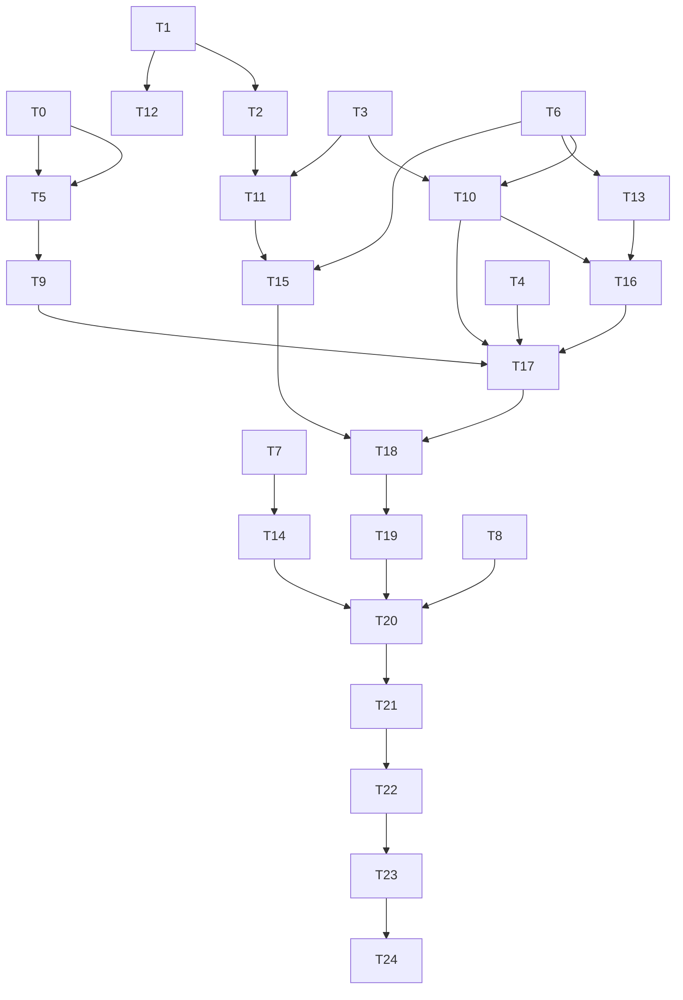

# opencode-go 订阅接入（一期）实现计划

> **For agentic workers:** REQUIRED SUB-SKILL: Use `superpowers:subagent-driven-development`（推荐）或 `superpowers:executing-plans` 逐任务执行本计划。步骤使用 `- [ ]` 复选框跟踪。

**Goal:** 让 agentj 把 OpenCode Go 订阅作为一等 provider：`agentj auth login` 落盘凭据 → live/overlay 目录发现 → Web/TUI 显示真实模型列表 → 请求自带合规 UA 与 `x-opencode-session`，且缺失密钥不再静默发空 Bearer。

**Architecture:** 新增第 18 个 crate `agentj-auth` 专管凭据（0600 文件 + 优先级解析 + OAuth 变体占位）；目录发现/合规头/网关错误归 `agentj-model`；模型列表通过 `ModelProvider::models()` 默认方法与 `ProviderRegistry::list_with_models()` 抵达 `kernel/status`（零协议变更）；`agentj-cli` 在装配点把凭据与目录注入 provider。

**Tech Stack:** Rust 2024（`serde`/`serde_json`/`thiserror`/`toml_edit`/`reqwest`/`wiremock`）、React 19 + vitest（Web）、Bun + @opentui/react（TUI）。

**Spec:** `docs/superpowers/specs/2026-10-04-agentj-opencode-go-subscription-design.md`

## Global Constraints

- 工作区版本 `0.24.2` → `0.25.0`（功能 = minor）；`PROTOCOL_VERSION` 保持 `0.15.0`。
- **禁止改动** `schemas/*.json`（保持 52 个）、`protocol/methods.json`（保持 21 方法）、`crates/agentj-protocol` 的 wire 类型；不运行任何 schema/methods 生成器。
- Rust：edition 2024、`rust-version = 1.96`；函数 ≤50 行、行 ≤120 字符；`cargo clippy --workspace --all-targets -- -D warnings` 零警告。
- 新增依赖仅：`agentj-auth` 的 `serde`/`serde_json`/`thiserror = "2"`（+ dev `tempfile = "3"`）、`agentj-config` 的 `toml_edit = "0.22"`。**不得**引入 `dirs`/`rpassword`/`keyring`；`agentj-auth` **不得**依赖 `reqwest` 或 `toml`。
- 凭据文件：`$XDG_DATA_HOME/agentj/auth.json`，回退 `$HOME/.local/share/agentj/auth.json`；目录 `0700`、文件 `0600`、临时文件 + rename 原子写；权限非 `0600` → 报错而非接受。
- 密钥优先级：`--api-key` > `api_key_env`（非空）> `auth.json`；**任何输出只允许出现末 4 位**（`…abcd`），永不打印完整密钥。
- 需要密钥的 kind：`openai-compat` / `responses` / `anthropic` / `opencode-go`；免密钥 kind：`mock` / `mock-workbench` / `mock-ask`。
- UA：所有 provider HTTP client 统一 `agentj/<CARGO_PKG_VERSION>`；`x-opencode-session` **仅** opencode-go 的 transport 发送，值为本轮内核 `SessionId`（`String`）。
- 目录：live `GET https://opencode.ai/zen/go/v1/models`，5s 超时，匿名可读；未在 overlay 中的 live ID → `openai-compat` + `verified = false`；live 失败 → 回退 overlay，**不阻断启动**。
- 依赖方向：`agentj-model` 不得依赖 `agentj-auth`；`agentj-ipc` 对 `agentj-model` 仅保留 dev-dependency。
- 提交信息英文；任务标题/AC/代码英文，计划头中文。

## Review Focus

1. **密钥泄漏**：任何把完整 key 写入日志/错误/CLI 输出的路径，或把凭据写到 `0600` 之外的路径。
2. **离线可用**：`auth login` 与内核启动在断网/超时下必须成功（仅 warn），CI 中不得因联网失败而红。
3. **wire 零漂移**：任何任务改动 `schemas/`、`protocol/methods.json`、`PROTOCOL_VERSION` 或运行生成器 = 直接失败。
4. **权限边界**：既存 `0644` 的 `auth.json` 必须报错而不是被静默覆盖；非 Unix 平台不得因权限检查 panic。
5. **既有 provider 行为不变**：非 opencode provider 的请求必须与改动前逐字节一致（无 `x-opencode-session`），`api_key_env = ""` 的 mock e2e 夹具必须继续通过。

---

## Tasks

### T0: Create agentj-auth crate with credential types [P0] [Group A — parallel with T1, T3, T4, T6, T7, T8]

```yaml
- id: T0
  title: "Create agentj-auth crate with Credential enum, AuthFile map and redaction"
  files:
    - crates/agentj-auth/Cargo.toml
    - crates/agentj-auth/src/lib.rs
    - crates/agentj-auth/src/credential.rs
  depends_on: []
  breaking: true
  ac:
    - given: 'the JSON body {"opencode-go":{"type":"api_key","key":"sk-x","label":"ws"}}'
      when: "parse_auth_file(body, path) is called"
      then: "one entry exists and Credential::key() returns Ok(\"sk-x\")"
    - given: 'the credential value {"type":"oauth","access":"a","refresh":"r","expires":123}'
      when: "Credential::try_from_value(&value) is called"
      then: 'it returns Err(AuthError::Unsupported { kind: "oauth" }) (message names the phase-2 requirement)'
    - given: 'the credential value {"type":"perpetual"}'
      when: "Credential::try_from_value(&value) is called"
      then: 'it returns Err(AuthError::Unsupported { kind: "perpetual" }) — unknown tags are NOT reported as malformed'
    - given: 'the credential value {"key":"sk-x"} (no type field)'
      when: "Credential::try_from_value(&value) is called"
      then: 'it returns Err(AuthError::Malformed { .. }) naming the missing credential type'
    - given: 'key = "sk-1234567890"'
      when: "redact(key) is called"
      then: 'it returns "…7890"'
  regression:
    - "cargo test -p agentj-model factory_creates_provider_per_kind"
    - "cargo test -p agentj-config"
  test_code: |
    #[cfg(test)]
    mod tests {
        use super::*;
        use crate::credential::{redact, AuthFile, AuthError, Credential};

        #[test]
        fn api_key_credential_parses_via_parse_auth_file() {
            let body = r#"{"opencode-go":{"type":"api_key","key":"sk-x","label":"ws"}}"#;
            let file = parse_auth_file(body, "<test>").unwrap();
            assert_eq!(file.get("opencode-go").unwrap().key().unwrap(), "sk-x");
        }

        #[test]
        fn oauth_and_unknown_tags_report_unsupported() {
            let oauth = serde_json::json!({"type":"oauth","access":"a","refresh":"r","expires":123});
            assert!(matches!(Credential::try_from_value(&oauth), Err(AuthError::Unsupported { ref kind }) if kind == "oauth"));
            let weird = serde_json::json!({"type":"perpetual"});
            assert!(matches!(Credential::try_from_value(&weird), Err(AuthError::Unsupported { ref kind }) if kind == "perpetual"));
        }

        #[test]
        fn missing_type_is_malformed() {
            assert!(matches!(Credential::try_from_value(&serde_json::json!({"key":"sk-x"})), Err(AuthError::Malformed { .. })));
        }

        #[test]
        fn redact_keeps_last_four_only() {
            assert_eq!(redact("sk-1234567890"), "…7890");
        }
    }
  impl_code: |
    // credential.rs
    #[derive(Debug, Clone, PartialEq, Eq, Serialize, Deserialize)]
    #[serde(tag = "type", rename_all = "snake_case")]
    pub enum Credential {
        ApiKey { key: String, #[serde(default)] label: Option<String>, #[serde(default)] created_at: Option<String> },
        OAuth { access: String, refresh: String, expires: i64,
                #[serde(default)] account_id: Option<String>, #[serde(default)] org_id: Option<String> },
    }

    #[derive(Debug, thiserror::Error)]
    pub enum AuthError {
        #[error("credential file not readable: {path}: {reason}")] Io { path: String, reason: String },
        #[error("insecure credential file permissions {mode:o} (expected 600): {path}")]
        InsecurePermissions { path: String, mode: u32 },
        #[error("credential file parse failed: {path}: {reason}")] Malformed { path: String, reason: String },
        #[error("unsupported credential type '{kind}': requires agentj phase 2 or newer")]
        Unsupported { kind: String },
        #[error("no home directory: cannot locate credential store")] NoHomeDir,
    }

    pub type AuthFile = std::collections::BTreeMap<String, Credential>;

    impl Credential {
        pub fn key(&self) -> Result<&str, AuthError> {
            match self {
                Credential::ApiKey { key, .. } => Ok(key),
                Credential::OAuth { .. } => Err(AuthError::Unsupported { kind: "oauth".into() }),
            }
        }

        /// Tag-discriminated parse. Unknown tags are `Unsupported` (version hint), not `Malformed`,
        /// so a newer agentj written file fails with an actionable message rather than "corrupt".
        pub fn try_from_value(v: &serde_json::Value) -> Result<Self, AuthError> {
            match v.get("type").and_then(|t| t.as_str()) {
                Some("api_key") => serde_json::from_value(v.clone())
                    .map_err(|e| AuthError::Malformed { path: "<credential>".into(), reason: e.to_string() }),
                Some("oauth") => Err(AuthError::Unsupported { kind: "oauth".into() }),
                Some(other) => Err(AuthError::Unsupported { kind: other.to_string() }),
                None => Err(AuthError::Malformed { path: "<credential>".into(), reason: "missing credential type".into() }),
            }
        }
    }

    /// Parse the whole store; every entry goes through `Credential::try_from_value`.
    pub fn parse_auth_file(text: &str, path: &str) -> Result<AuthFile, AuthError> {
        let raw: std::collections::BTreeMap<String, serde_json::Value> = serde_json::from_str(text)
            .map_err(|e| AuthError::Malformed { path: path.to_string(), reason: e.to_string() })?;
        raw.into_iter()
            .map(|(k, v)| Credential::try_from_value(&v).map(|c| (k, c)))
            .collect()
    }

    pub fn redact(key: &str) -> String {
        let tail: String = key.chars().rev().take(4).collect::<Vec<_>>().into_iter().rev().collect();
        format!("…{tail}")
    }
    // Cargo.toml: version.workspace = true; serde derive, serde_json, thiserror = "2";
    // dev-deps tempfile = "3"
    // lib.rs: pub mod credential; pub use credential::{redact, AuthError, AuthFile, Credential};
  verify:
    - "cargo test -p agentj-auth"
    - "cargo clippy -p agentj-auth --all-targets -- -D warnings"
```

### T1: Add ModelProvider::models and ProviderRegistry::list_with_models [P0] [Parallel with T0, T3, T4, T6, T7, T8]

```yaml
- id: T1
  title: "Add ModelProvider::models() default method and ProviderRegistry::list_with_models()"
  files:
    - crates/agentj-core/src/module.rs
  depends_on: []
  breaking: false
  ac:
    - given: "a provider that does not override models()"
      when: "models() is called"
      then: "it returns an empty Vec"
    - given: 'providers "a" (no models) and "b" (models ["m2","m1"]) registered'
      when: "list_with_models() is called"
      then: 'it returns [("a", vec![]), ("b", vec!["m2","m1"])] sorted by name'
  regression:
    - "cargo test -p agentj-core"
  test_code: |
    #[test]
    fn provider_models_default_is_empty() {
        struct Stub;
        #[async_trait]
        impl ModelProvider for Stub {
            async fn chat_stream(&self, _m: Vec<ChatMessage>, _t: Vec<ToolDefinition>, _o: ModelOptions)
                -> Result<BoxStream<'static, Result<ModelEvent, ModelError>>, ModelError> { unimplemented!() }
            async fn chat(&self, _m: Vec<ChatMessage>, _o: ModelOptions) -> Result<ChatResponse, ModelError> { unimplemented!() }
        }
        assert!(Stub.models().is_empty());
    }

    #[test]
    fn list_with_models_is_sorted_and_carries_reported_models() {
        struct Stub(Vec<String>);
        #[async_trait]
        impl ModelProvider for Stub {
            async fn chat_stream(&self, _m: Vec<ChatMessage>, _t: Vec<ToolDefinition>, _o: ModelOptions)
                -> Result<BoxStream<'static, Result<ModelEvent, ModelError>>, ModelError> { unimplemented!() }
            async fn chat(&self, _m: Vec<ChatMessage>, _o: ModelOptions) -> Result<ChatResponse, ModelError> { unimplemented!() }
            fn models(&self) -> Vec<String> { self.0.clone() }
        }
        let reg = ProviderRegistry::new();
        reg.register("b".into(), Arc::new(Stub(vec!["m2".into(), "m1".into()])));
        reg.register("a".into(), Arc::new(Stub(vec![])));
        assert_eq!(reg.list_with_models(),
            vec![("a".to_string(), vec![]), ("b".to_string(), vec!["m2".into(), "m1".into()])]);
    }
  impl_code: |
    // in trait ModelProvider, after `chat`:
    /// Model ids this provider serves. Default empty keeps legacy providers unchanged. @since 0.25.0
    fn models(&self) -> Vec<String> { Vec::new() }

    // in impl ProviderRegistry, after `list`:
    /// (name, models) pairs sorted by name, for kernel/status filler. @since 0.25.0
    pub fn list_with_models(&self) -> Vec<(String, Vec<String>)> {
        let providers = self.providers.read();
        let mut out: Vec<(String, Vec<String>)> = providers.iter()
            .map(|(name, p)| (name.clone(), p.models())).collect();
        out.sort_by(|a, b| a.0.cmp(&b.0));
        out
    }
  verify:
    - "cargo test -p agentj-core"
    - "cargo clippy -p agentj-core --all-targets -- -D warnings"
```

### T2: Add ModelOptions.session_id and inject it in TurnRunner [P0] [after T1]

```yaml
- id: T2
  title: "Add ModelOptions.session_id and populate it from the turn SessionId"
  files:
    - crates/agentj-core/src/types.rs
    - crates/agentj-core/src/turn_runner.rs
  depends_on: [T1]
  breaking: false
  ac:
    - given: "ModelOptions::default()"
      when: "session_id is read"
      then: "it is None"
    - given: 'a turn for session id "s1" with a recording provider'
      when: "run_turn dispatches chat_stream"
      then: 'the provider receives ModelOptions { session_id: Some("s1"), .. }'
  regression:
    - "cargo test -p agentj-core"
    - "cargo test -p agentj-model"
  test_code: |
    // turn_runner.rs tests: reuse the existing mock SessionStore/RecordingProvider harness
    #[tokio::test]
    async fn run_turn_injects_session_id_into_model_options() {
        let seen: Arc<Mutex<Option<ModelOptions>>> = Arc::new(Mutex::new(None));
        // RecordingProvider stores `options.clone()` into `seen`, then streams [Delta("ok"), Done]
        let runner = runner_with(Arc::new(RecordingProvider(seen.clone())));
        runner.run_turn("s1".to_string(), "hi".into(), None).unwrap();
        let seen = seen.lock().unwrap().clone().expect("chat_stream must be called");
        assert_eq!(seen.session_id.as_deref(), Some("s1"));
    }
  impl_code: |
    // types.rs
    pub struct ModelOptions {
        pub model: String,
        pub temperature: Option<f32>,
        pub max_tokens: Option<u32>,
        pub stream: bool,
        /// Stable per-conversation id forwarded by subscription transports. Not on the wire. @since 0.25.0
        pub session_id: Option<String>,
    }
    // Default: session_id: None

    // turn_runner.rs, where default_options is built (~line 191):
    let default_options = ModelOptions { model, session_id: Some(session_id.clone()), ..Default::default() };
  verify:
    - "cargo test -p agentj-core"
    - "cargo clippy -p agentj-core --all-targets -- -D warnings"
```

### T3: Add shared HTTP client, session-header rule and gateway-error parser [P0] [Parallel with T0, T1, T4, T6, T7, T8]

```yaml
- id: T3
  title: "Add agentj-model::http with UA client and pure session-header helper"
  files:
    - crates/agentj-model/src/http.rs
    - crates/agentj-model/src/gateway_error.rs
    - crates/agentj-model/src/lib.rs
  depends_on: []
  breaking: false
  ac:
    - given: 'ModelOptions { session_id: Some("s1".into()), .. } and header name "x-opencode-session"'
      when: "session_header(name, &options) is called"
      then: 'it returns Some(("x-opencode-session", "s1"))'
    - given: "ModelOptions::default() (session_id None)"
      when: "session_header(name, &options) is called"
      then: "it returns None"
    - given: "the module constant USER_AGENT"
      when: "read"
      then: 'it equals "agentj/" + env!("CARGO_PKG_VERSION")'
    - given: 'a provider whose session_header is Some("x-opencode-session") while options.session_id is None'
      when: "the request is built"
      then: "no session header is emitted (the rule is: emit iff the header name AND session_id are both present)"
    - given: 'the gateway error body {"type":"error","error":{"type":"GoUsageLimitError","message":"monthly limit"}}'
      when: "parse_gateway_error(429, body) is called"
      then: 'the returned message contains both "GoUsageLimitError" and "monthly limit"'
    - given: 'the non-envelope body "boom"'
      when: "parse_gateway_error(500, "boom") is called"
      then: 'the returned message is exactly "boom" (raw fallback, never empty)'
  regression:
    - "cargo test -p agentj-model"
  test_code: |
    #[cfg(test)]
    mod tests {
        use super::*;
        use agentj_core::types::ModelOptions;

        #[test]
        fn session_header_present_only_when_session_id_set() {
            let opts = ModelOptions { session_id: Some("s1".into()), ..Default::default() };
            assert_eq!(session_header("x-opencode-session", &opts), Some(("x-opencode-session", "s1")));
            assert_eq!(session_header("x-opencode-session", &ModelOptions::default()), None);
        }

        #[test]
        fn user_agent_is_agentj_versioned() {
            assert_eq!(USER_AGENT, concat!("agentj/", env!("CARGO_PKG_VERSION")));
        }

        #[test]
        fn gateway_error_message_carries_error_type() {
            let body = r#"{"type":"error","error":{"type":"GoUsageLimitError","message":"monthly limit"}}"#;
            let msg = crate::gateway_error::parse_gateway_error(429, body);
            assert!(msg.contains("GoUsageLimitError") && msg.contains("monthly limit"), "{msg}");
        }

        #[test]
        fn non_envelope_body_falls_back_to_raw_text() {
            assert_eq!(crate::gateway_error::parse_gateway_error(500, "boom"), "boom");
        }
    }
  impl_code: |
    pub const USER_AGENT: &str = concat!("agentj/", env!("CARGO_PKG_VERSION"));

    pub fn client() -> reqwest::Client {
        reqwest::Client::builder().user_agent(USER_AGENT).build().expect("reqwest client")
    }

    /// (header name, value) when the request carries a per-conversation session id.
    pub fn session_header<'a>(name: &'a str, options: &'a ModelOptions) -> Option<(&'a str, &'a str)> {
        options.session_id.as_deref().map(|sid| (name, sid))
    }
    // lib.rs: pub mod http; pub mod gateway_error;

    // gateway_error.rs
    /// Upstream envelope is {"type":"error","error":{"type":T,"message":M}}; render as "T: M".
    /// Falls back to the raw body so a message is always non-empty. @since 0.25.0
    pub fn parse_gateway_error(_status: u16, body: &str) -> String {
        serde_json::from_str::<serde_json::Value>(body).ok()
            .and_then(|v| Some((v["error"]["type"].as_str()?.to_string(), v["error"]["message"].as_str()?.to_string())))
            .map(|(t, m)| format!("{t}: {m}"))
            .unwrap_or_else(|| body.to_string())
    }
  verify:
    - "cargo test -p agentj-model http"
    - "cargo clippy -p agentj-model --all-targets -- -D warnings"
```

### T4: Add comment-preserving config write-back in agentj-config [P0] [Parallel with T0, T1, T3, T6, T7, T8]

```yaml
- id: T4
  title: "Add toml_edit-based set_model_defaults / write_model_defaults to agentj-config"
  files:
    - crates/agentj-config/Cargo.toml
    - crates/agentj-config/src/write.rs
    - crates/agentj-config/src/lib.rs
  depends_on: []
  breaking: false
  ac:
    - given: 'config text containing "# keep me" and a [permission] table'
      when: 'set_model_defaults(text, "opencode-go", "opencode-go/kimi-k3") is called'
      then: 'the result still contains "# keep me" and contains provider = "opencode-go" plus default_model = "opencode-go/kimi-k3" under [model]'
    - given: "config text without a [model] table"
      when: "set_model_defaults is called"
      then: "a [model] table is created with both keys"
    - given: "a temp file path and its original content"
      when: "write_model_defaults(path, provider, model) is called"
      then: "re-reading the file shows the new values and any unrelated keys are unchanged"
  regression:
    - "cargo test -p agentj-config"
  test_code: |
    #[cfg(test)]
    mod tests {
        use super::*;

        #[test]
        fn set_model_defaults_preserves_comments_and_other_tables() {
            let text = "# keep me\n[model]\nprovider = \"deepseek\"\n\n[permission]\nmode = \"ask\"\n";
            let out = set_model_defaults(text, "opencode-go", "opencode-go/kimi-k3").unwrap();
            assert!(out.contains("# keep me"), "comments must survive: {out}");
            assert!(out.contains("mode = \"ask\""), "unrelated tables must survive: {out}");
            assert!(out.contains("provider = \"opencode-go\""));
            assert!(out.contains("default_model = \"opencode-go/kimi-k3\""));
        }

        #[test]
        fn set_model_defaults_creates_missing_table() {
            let out = set_model_defaults("[session]\ndir = \"./s\"\n", "opencode-go", "m").unwrap();
            assert!(out.contains("[model]") && out.contains("default_model = \"m\""));
        }

        #[test]
        fn write_model_defaults_updates_file_in_place() {
            let dir = tempfile::tempdir().unwrap();
            let path = dir.path().join("config.toml");
            std::fs::write(&path, "# c\n[model]\nprovider = \"deepseek\"\n").unwrap();
            write_model_defaults(&path, "opencode-go", "opencode-go/x").unwrap();
            let text = std::fs::read_to_string(&path).unwrap();
            assert!(text.contains("# c") && text.contains("opencode-go/x"));
        }
    }
  impl_code: |
    // Cargo.toml: toml_edit = "0.22"
    // write.rs
    use std::path::Path;

    pub fn set_model_defaults(text: &str, provider: &str, model: &str) -> Result<String, String> {
        let mut doc = text.parse::<toml_edit::DocumentMut>().map_err(|e| e.to_string())?;
        if !doc.contains_key("model") { doc["model"] = toml_edit::Item::Table(toml_edit::Table::new()); }
        doc["model"]["provider"] = toml_edit::value(provider);
        doc["model"]["default_model"] = toml_edit::value(model);
        Ok(doc.to_string())
    }

    pub fn write_model_defaults(path: &Path, provider: &str, model: &str) -> Result<(), String> {
        let text = std::fs::read_to_string(path).map_err(|e| e.to_string())?;
        std::fs::write(path, set_model_defaults(&text, provider, model)?).map_err(|e| e.to_string())
    }
    // lib.rs: pub mod write; pub use write::{set_model_defaults, write_model_defaults};
  verify:
    - "cargo test -p agentj-config"
    - "cargo clippy -p agentj-config --all-targets -- -D warnings"
```

### T5: Add AuthStore with 0600 atomic persistence [P1] [after T0]

```yaml
- id: T5
  title: "Add AuthStore: XDG path resolution, 0600 atomic save, permission-checked load"
  files:
    - crates/agentj-auth/src/store.rs
    - crates/agentj-auth/src/lib.rs
  depends_on: [T0]
  breaking: true
  ac:
    - given: "a fresh temp dir"
      when: "AuthStore::with_path(dir/auth.json).save(&file) is called with one entry"
      then: "auth.json exists with mode 0o600 and the parent directory has mode 0o700"
    - given: "an auth.json whose mode is 0o644"
      when: "load() is called"
      then: "it returns Err(AuthError::InsecurePermissions)"
    - given: "a store with exactly one entry"
      when: 'remove("opencode-go") is called'
      then: "it returns Ok(true) and the file no longer exists"
    - given: "a store whose file does not exist"
      when: "load() is called"
      then: "it returns Ok with an empty map"
    - given: "an auth.json containing `{` (mode 0600 so the permission check passes)"
      when: "load() is called"
      then: "it returns Err(AuthError::Malformed { path, .. }) and the path names auth.json"
  regression:
    - "cargo test -p agentj-auth credential"
  test_code: |
    #[cfg(test)]
    mod tests {
        use super::*;
        use crate::credential::Credential;

        fn store(dir: &std::path::Path) -> AuthStore { AuthStore::with_path(dir.join("auth.json")) }

        #[test]
        fn save_writes_0600_file_in_0700_dir() {
            let dir = tempfile::tempdir().unwrap();
            let mut file = crate::credential::AuthFile::new();
            file.insert("opencode-go".into(), Credential::ApiKey { key: "sk-1".into(), label: None, created_at: None });
            store(dir.path()).save(&file).unwrap();
            #[cfg(unix)]
            {
                use std::os::unix::fs::PermissionsExt;
                let file_mode = std::fs::metadata(dir.path().join("auth.json")).unwrap().permissions().mode() & 0o777;
                let dir_mode = std::fs::metadata(dir.path()).unwrap().permissions().mode() & 0o777;
                assert_eq!(file_mode, 0o600);
                assert_eq!(dir_mode, 0o700);
            }
        }

        #[test]
        fn load_rejects_group_readable_file() {
            #[cfg(unix)]
            {
                use std::os::unix::fs::PermissionsExt;
                let dir = tempfile::tempdir().unwrap();
                let path = dir.path().join("auth.json");
                std::fs::write(&path, "{}").unwrap();
                std::fs::set_permissions(&path, std::fs::Permissions::from_mode(0o644)).unwrap();
                assert!(matches!(store(dir.path()).load(), Err(AuthError::InsecurePermissions { .. })));
            }
        }

        #[test]
        fn missing_file_loads_as_empty() {
            let dir = tempfile::tempdir().unwrap();
            assert!(store(dir.path()).load().unwrap().is_empty());
        }

        #[test]
        fn remove_last_entry_deletes_file() {
            let dir = tempfile::tempdir().unwrap();
            let s = store(dir.path());
            s.set("opencode-go", Credential::ApiKey { key: "sk-1".into(), label: None, created_at: None }).unwrap();
            assert!(s.remove("opencode-go").unwrap());
            assert!(!dir.path().join("auth.json").exists());
        }

        #[test]
        fn malformed_json_reports_the_file_path() {
            let dir = tempfile::tempdir().unwrap();
            let path = dir.path().join("auth.json");
            std::fs::write(&path, "{").unwrap();
            #[cfg(unix)]
            {
                use std::os::unix::fs::PermissionsExt;
                std::fs::set_permissions(&path, std::fs::Permissions::from_mode(0o600)).unwrap();
            }
            let err = store(dir.path()).load().unwrap_err();
            assert!(matches!(err, AuthError::Malformed { ref path, .. } if path.contains("auth.json")));
        }
    }
  impl_code: |
    pub struct AuthStore { path: PathBuf }

    impl AuthStore {
        pub fn with_default_path() -> Result<Self, AuthError> {
            let base = match std::env::var_os("XDG_DATA_HOME").filter(|v| !v.is_empty()) {
                Some(v) => PathBuf::from(v),
                None => PathBuf::from(std::env::var_os("HOME").ok_or(AuthError::NoHomeDir)?).join(".local/share"),
            };
            Ok(Self { path: base.join("agentj/auth.json") })
        }
        pub fn with_path(path: PathBuf) -> Self { Self { path } }
        pub fn path(&self) -> &Path { &self.path }

        pub fn load(&self) -> Result<AuthFile, AuthError> {
            if !self.path.exists() { return Ok(AuthFile::new()); }
            #[cfg(unix)]
            {
                use std::os::unix::fs::PermissionsExt;
                let mode = std::fs::metadata(&self.path).map_err(io_err(&self.path))?.permissions().mode() & 0o777;
                if mode & 0o077 != 0 {
                    return Err(AuthError::InsecurePermissions { path: self.path.display().to_string(), mode });
                }
            }
            let text = std::fs::read_to_string(&self.path).map_err(io_err(&self.path))?;
            crate::credential::parse_auth_file(&text, &self.path.display().to_string())
        }

        pub fn save(&self, file: &AuthFile) -> Result<(), AuthError> {
            let dir = self.path.parent().expect("auth.json has a parent");
            std::fs::create_dir_all(dir).map_err(io_err(dir))?;
            #[cfg(unix)]
            { use std::os::unix::fs::PermissionsExt; std::fs::set_permissions(dir, std::fs::Permissions::from_mode(0o700)).map_err(io_err(dir))?; }
            let tmp = dir.join("auth.json.tmp");
            let mut opts = std::fs::OpenOptions::new(); opts.write(true).create(true).truncate(true);
            #[cfg(unix)]
            { use std::os::unix::fs::OpenOptionsExt; opts.mode(0o600); }
            let mut f = opts.open(&tmp).map_err(io_err(&tmp))?;
            std::io::Write::write_all(&mut f, serde_json::to_string_pretty(file).expect("credential map serializes").as_bytes()).map_err(io_err(&tmp))?;
            f.sync_all().map_err(io_err(&tmp))?;
            drop(f);
            std::fs::rename(&tmp, &self.path).map_err(io_err(&self.path))
        }

        pub fn get(&self, provider: &str) -> Result<Option<Credential>, AuthError> { Ok(self.load()?.get(provider).cloned()) }
        pub fn set(&self, provider: &str, cred: Credential) -> Result<(), AuthError> {
            let mut file = self.load()?; file.insert(provider.into(), cred); self.save(&file)
        }
        pub fn remove(&self, provider: &str) -> Result<bool, AuthError> {
            let mut file = self.load()?;
            let removed = file.remove(provider).is_some();
            if file.is_empty() { if self.path.exists() { std::fs::remove_file(&self.path).map_err(io_err(&self.path))?; } }
            else { self.save(&file)?; }
            Ok(removed)
        }
    }
    fn io_err(path: &Path) -> impl Fn(std::io::Error) -> AuthError + '_ { move |e| AuthError::Io { path: path.display().to_string(), reason: e.to_string() } }
    // lib.rs: pub mod store; pub use store::AuthStore;
  verify:
    - "cargo test -p agentj-auth"
    - "cargo clippy -p agentj-auth --all-targets -- -D warnings"
```

### T6: Extend ModelCatalog with overlay merge and verified flags [P1] [Group A — parallel with T1, T3, T4, T7, T8]

```yaml
- id: T6
  title: "Extend ModelCatalog with verified entries and from_sources(live, overlay) merge"
  files:
    - crates/agentj-model/src/catalog.rs
    - crates/agentj-model/src/opencode_go.rs
  depends_on: []
  breaking: false
  ac:
    - given: 'overlay json with entry "opencode-go/b" verified true and live ids ["opencode-go/a","opencode-go/b"]'
      when: "ModelCatalog::from_sources(Some(live_ids)) is called"
      then: '"opencode-go/a" is OpenAiCompat with verified false and appears in unverified_ids(), while "opencode-go/b" keeps its overlay format and verified true'
    - given: "live ids None"
      when: "from_sources(None) is called"
      then: "entries equal the overlay entries and unverified_ids() is empty"
    - given: 'live ids ["opencode-go/c"] and an overlay that lacks that id'
      when: "from_sources(Some(...)) is called"
      then: 'ids() == ["opencode-go/c"] (overlay-only entries are dropped)'
    - given: "live ids Some(vec![]) (the live call succeeded but returned nothing)"
      when: "from_sources(Some(vec![])) is called"
      then: "it falls back to the overlay entries (an empty live result is treated as unavailable, never as 'all models removed')"
  regression:
    - "cargo test -p agentj-model catalog_builtin_loads"
    - "cargo test -p agentj-model catalog_lookup_routes_formats"
  test_code: |
    #[cfg(test)]
    mod from_sources_tests {
        use super::*;

        const OVERLAY: &str = r#"{"base_url":"https://opencode.ai/zen/go","models":[
            {"id":"opencode-go/b","format":"anthropic","endpoint":"/v1/messages","verified":true}]}"#;

        #[test]
        fn unknown_live_id_is_synthesized_as_unverified_openai_compat() {
            let cat = ModelCatalog::from_sources(OVERLAY, Some(vec!["opencode-go/b".into(), "opencode-go/a".into()]));
            assert_eq!(cat.ids(), vec!["opencode-go/a", "opencode-go/b"]);
            let a = cat.lookup("opencode-go/a").unwrap();
            assert_eq!(a.format, WireFormat::OpenAiCompat);
            assert!(!a.verified);
            assert_eq!(cat.unverified_ids(), vec!["opencode-go/a"]);
            assert!(cat.lookup("opencode-go/b").unwrap().verified);
        }

        #[test]
        fn live_none_falls_back_to_overlay_only() {
            let cat = ModelCatalog::from_sources(OVERLAY, None);
            assert_eq!(cat.ids(), vec!["opencode-go/b"]);
            assert!(cat.unverified_ids().is_empty());
        }

        #[test]
        fn overlay_only_entries_are_dropped_when_live_succeeds() {
            let cat = ModelCatalog::from_sources(OVERLAY, Some(vec!["opencode-go/c".into()]));
            assert_eq!(cat.ids(), vec!["opencode-go/c"]);
        }

        #[test]
        fn empty_live_result_falls_back_to_overlay() {
            let cat = ModelCatalog::from_sources(OVERLAY, Some(vec![]));
            assert_eq!(cat.ids(), vec!["opencode-go/b"]);
        }
    }
  impl_code: |
    pub struct CatalogEntry { pub id: String, pub format: WireFormat, pub endpoint: String, pub verified: bool }

    impl ModelCatalog {
        pub fn ids(&self) -> Vec<String> { let mut v: Vec<String> = self.entries.keys().cloned().collect(); v.sort(); v }
        pub fn unverified_ids(&self) -> Vec<String> {
            let mut v: Vec<String> = self.entries.values().filter(|e| !e.verified).map(|e| e.id.clone()).collect();
            v.sort(); v
        }
        pub fn from_sources(overlay_json: &str, live_ids: Option<Vec<String>>) -> Self {
            Self::from_overlay_and_live(Self::from_json(overlay_json), live_ids)
        }

        /// Single embed site for callers that already hold a catalog (`ModelCatalog::builtin()`).
        pub fn from_overlay_and_live(overlay: ModelCatalog, live_ids: Option<Vec<String>>) -> Self {
            let Some(mut live) = live_ids.filter(|ids| !ids.is_empty()) else { return overlay };
            live.sort(); live.dedup();
            let mut entries = HashMap::new();
            for id in live {
                let entry = overlay.lookup(&id).cloned().unwrap_or(CatalogEntry {
                    id: id.clone(), format: WireFormat::OpenAiCompat,
                    endpoint: "/v1/chat/completions".into(), verified: false,
                });
                entries.insert(id, entry);
            }
            Self { base_url: overlay.base_url, entries }
        }
    }
    // from_json: `verified: m.verified.unwrap_or(true)` with `#[serde(default = "default_true")]`
    // MANDATORY fixture edit: `crates/agentj-model/src/opencode_go.rs` `test_catalog()` builds three
    // `CatalogEntry` literals without `verified` — add `verified: true` to each, otherwise
    // `cargo test -p agentj-model` does not compile between T6 and T15.
  verify:
    - "cargo test -p agentj-model catalog"
    - "cargo clippy -p agentj-model --all-targets -- -D warnings"
```

### T7: Let Web ComposerOptions accept a served model list [P1] [Parallel with T8]

```yaml
- id: T7
  title: "Add optional models prop to ComposerOptions with MODEL_LIST fallback"
  files:
    - agentj-ui/apps/web/src/components/ComposerOptions.tsx
    - agentj-ui/apps/web/src/components/composerOptions.test.tsx
  depends_on: []
  breaking: false
  ac:
    - given: "the composer model popover with a served list and kernel default_model opencode-go/kimi-k3"
      when: "the popover is opened"
      then: 'the "opencode-go/kimi-k3" row carries the selected/checked state, not the first row by position'
    - given: 'models={[{ name: "opencode-go/kimi-k3", cap: "—" }]}'
      when: "the model popover is opened"
      then: 'the list shows "opencode-go/kimi-k3" and does not show "deepseek-chat"'
    - given: "no models prop"
      when: "the model popover is opened"
      then: 'the built-in MODEL_LIST entry "deepseek-chat" is shown (back-compat)'
    - given: 'models=[{ name: "opencode-go/kimi-k3", cap: "—" }]'
      when: "the served entry is clicked in the model popover"
      then: 'the composer model label becomes "opencode-go/kimi-k3" and the stored composer preference is updated'
  regression:
    - "npm --prefix agentj-ui test --workspace=@agentj/web"
  test_code: |
    it("renders the served model list when provided", async () => {
      render(<ComposerOptions model={null} models={[{ name: "opencode-go/kimi-k3", cap: "—" }]} />);
      await userEvent.click(screen.getByRole("button", { name: /模型/ }));
      expect(screen.getByText("opencode-go/kimi-k3")).toBeInTheDocument();
      expect(screen.queryByText("deepseek-chat")).not.toBeInTheDocument();
    });

    it("falls back to MODEL_LIST when no models prop is given", async () => {
      render(<ComposerOptions model={null} />);
      await userEvent.click(screen.getByRole("button", { name: /模型/ }));
      expect(screen.getByText("deepseek-chat")).toBeInTheDocument();
    });
  impl_code: |
    export type ComposerOptionsProps = {
      model?: string | null;
      models?: ModelEntry[];
      collapsed?: boolean;
      children?: ReactNode;
    };
    // Apply the served list at EVERY MODEL_LIST use site, not just the popover render:
    //   const modelOptions = models && models.length > 0 ? models : MODEL_LIST;
    //   1. index counter ("optionCount")      -> modelOptions.length
    //   2. initial selection index            -> modelOptions.findIndex((m) => m.name === modelName)
    //   3. selectOption(index)                -> modelOptions[index]
    //   4. popover list render                -> modelOptions.map(...)
    // Missing sites 1-3 make keyboard selection a silent no-op with a single served entry.
  verify:
    - "npm --prefix agentj-ui test --workspace=@agentj/web"
```

### T8: Let TUI consume providers[].models [P1] [Parallel with T7]

```yaml
- id: T8
  title: "Make TUI models view read providers[].models with fallback"
  files:
    - agentj-ui/apps/tui/src/models.tsx
    - agentj-ui/apps/tui/src/models.test.tsx
  depends_on: []
  breaking: false
  ac:
    - given: 'kernel/status payload providers=[{id:"opencode-go",models:["opencode-go/a","opencode-go/b"]}]'
      when: "providersFromStatus is called"
      then: 'it returns ["opencode-go/a","opencode-go/b"]'
    - given: 'kernel/status payload providers=[{id:"opencode-go",models:["opencode-go/a"]}] and default_model "opencode-go/a"'
      when: "renderModelList runs"
      then: 'the "opencode-go/a" row carries the active/default marker (▶) and other rows do not'
    - given: 'providers=[{id:"opencode-go",models:[]}]'
      when: "providersFromStatus is called"
      then: "it returns the MODEL_CONFIG.providers fallback"
  regression:
    - "bun --cwd agentj-ui/apps/tui test"
  test_code: |
    import { describe, expect, it } from "bun:test";
    import { MODEL_CONFIG, providersFromStatus } from "./models";

    describe("providersFromStatus", () => {
      it("flattens models from served providers", () => {
        const data = { providers: [{ id: "opencode-go", models: ["opencode-go/a", "opencode-go/b"] }] };
        expect(providersFromStatus(data)).toEqual(["opencode-go/a", "opencode-go/b"]);
      });
      it("falls back when no provider reports models", () => {
        expect(providersFromStatus({ providers: [{ id: "opencode-go", models: [] }] })).toEqual(MODEL_CONFIG.providers);
      });
    });
  impl_code: |
    // Red-phase evidence (verified in-repo): the CURRENT `providersFromStatus` maps `p.id`
    // (provider names, e.g. "opencode-go"), so the T8 test expecting models[] FAILS before
    // this change. The task is a real behaviour change, not a no-op.
    export function providersFromStatus(data: Record<string, unknown>): string[] {
      const prov = data?.["providers"];
      if (!Array.isArray(prov) || prov.length === 0) return MODEL_CONFIG.providers;
      const ids = (prov as Array<{ models?: unknown }>).flatMap((p) =>
        Array.isArray(p?.models) ? p.models.filter((m): m is string => typeof m === "string") : []);
      return ids.length > 0 ? ids : MODEL_CONFIG.providers;
    }
  verify:
    - "bun --cwd agentj-ui/apps/tui test"
```

### T9: Add credential precedence resolution [P2] [after T5]

```yaml
- id: T9
  title: "Add resolve_credential with flag > env > file precedence"
  files:
    - crates/agentj-auth/src/resolve.rs
    - crates/agentj-auth/src/lib.rs
  depends_on: [T5]
  breaking: true
  ac:
    - given: 'flag Some("F"), env var AGENTJ_TEST_KEY="E", and a file entry "K"'
      when: "resolve_credential is called"
      then: 'it returns ResolvedKey { key: "F", source: Flag }'
    - given: 'flag None, api_key_env Some(""), and a file entry "K"'
      when: "resolve_credential is called"
      then: 'it returns ResolvedKey { key: "K", source: File }'
    - given: "flag None, api_key_env naming an unset variable, and no file entry"
      when: "resolve_credential is called"
      then: "it returns Ok(None) (never an empty key)"
  regression:
    - "cargo test -p agentj-auth store"
  test_code: |
    #[cfg(test)]
    mod tests {
        use super::*;
        use crate::credential::Credential;
        use crate::store::AuthStore;

        fn seeded_store(dir: &std::path::Path) -> AuthStore {
            let s = AuthStore::with_path(dir.join("auth.json"));
            s.set("opencode-go", Credential::ApiKey { key: "K".into(), label: None, created_at: None }).unwrap();
            s
        }

        #[test]
        fn flag_wins_over_env_and_file() {
            let dir = tempfile::tempdir().unwrap();
            let s = seeded_store(dir.path());
            std::env::set_var("AGENTJ_TEST_KEY", "E");
            let r = resolve_credential("opencode-go", Some("F"), Some("AGENTJ_TEST_KEY"), &s).unwrap().unwrap();
            assert_eq!((r.key.as_str(), r.source), ("F", KeySource::Flag));
        }

        #[test]
        fn empty_env_name_falls_through_to_file() {
            let dir = tempfile::tempdir().unwrap();
            let s = seeded_store(dir.path());
            let r = resolve_credential("opencode-go", None, Some(""), &s).unwrap().unwrap();
            assert_eq!((r.key.as_str(), r.source), ("K", KeySource::File));
        }

        #[test]
        fn nothing_resolvable_is_none_not_empty_string() {
            let dir = tempfile::tempdir().unwrap();
            let s = AuthStore::with_path(dir.path().join("auth.json"));
            assert!(resolve_credential("opencode-go", None, Some("AGENTJ_UNSET_KEY"), &s).unwrap().is_none());
        }
    }
  impl_code: |
    #[derive(Debug, Clone, Copy, PartialEq, Eq)]
    pub enum KeySource { Flag, Env, File }

    #[derive(Debug, Clone, PartialEq, Eq)]
    pub struct ResolvedKey { pub key: String, pub source: KeySource }

    pub fn resolve_credential(
        provider: &str, flag: Option<&str>, api_key_env: Option<&str>, store: &AuthStore,
    ) -> Result<Option<ResolvedKey>, AuthError> {
        if let Some(k) = flag.filter(|k| !k.trim().is_empty()) {
            return Ok(Some(ResolvedKey { key: k.trim().to_string(), source: KeySource::Flag }));
        }
        if let Some(name) = api_key_env.filter(|n| !n.is_empty()) {
            if let Ok(v) = std::env::var(name) {
                if !v.trim().is_empty() {
                    return Ok(Some(ResolvedKey { key: v.trim().to_string(), source: KeySource::Env }));
                }
            }
        }
        Ok(match store.get(provider)? {
            Some(cred) => Some(ResolvedKey { key: cred.key()?.to_string(), source: KeySource::File }),
            None => None,
        })
    }
    // lib.rs: pub mod resolve; pub use resolve::{resolve_credential, KeySource, ResolvedKey};
  verify:
    - "cargo test -p agentj-auth"
    - "cargo clippy -p agentj-auth --all-targets -- -D warnings"
```

### T10: Add live model discovery over HTTP [P2] [after T3, T6]

```yaml
- id: T10
  title: "Add fetch_live_models(base_url, key) with 5s timeout"
  files:
    - crates/agentj-model/src/catalog_source.rs
    - crates/agentj-model/src/lib.rs
  depends_on: [T3, T6]
  breaking: false
  ac:
    - given: 'a wiremock stub for GET /v1/models returning {"object":"list","data":[{"id":"opencode-go/b"},{"id":"opencode-go/a"}]}'
      when: "fetch_live_models(base_url, None) is called"
      then: 'it returns Ok(["opencode-go/a","opencode-go/b"])'
    - given: "the stub answers 401"
      when: "fetch_live_models is called"
      then: "it returns Err(ModelError::Api { status: 401, .. })"
    - given: "a base_url pointing at a closed port"
      when: "fetch_live_models is called"
      then: "it returns Err(ModelError::Network(_))"
  regression:
    - "cargo test -p agentj-model catalog_source"
  test_code: |
    #[cfg(test)]
    mod tests {
        use super::*;
        use wiremock::matchers::{method, path};
        use wiremock::{Mock, MockServer, ResponseTemplate};

        #[tokio::test]
        async fn live_models_are_sorted_and_deduped() {
            let server = MockServer::start().await;
            Mock::given(method("GET")).and(path("/v1/models"))
                .respond_with(ResponseTemplate::new(200).set_body_string(
                    r#"{"object":"list","data":[{"id":"opencode-go/b"},{"id":"opencode-go/a"}]}"#))
                .mount(&server).await;
            assert_eq!(fetch_live_models(&server.uri(), None).await.unwrap(),
                       vec!["opencode-go/a", "opencode-go/b"]);
        }

        #[tokio::test]
        async fn unauthorized_surfaces_api_error() {
            let server = MockServer::start().await;
            Mock::given(method("GET")).and(path("/v1/models"))
                .respond_with(ResponseTemplate::new(401).set_body_string("Unauthorized"))
                .mount(&server).await;
            assert!(matches!(fetch_live_models(&server.uri(), None).await,
                             Err(ModelError::Api { status: 401, .. })));
        }

        #[tokio::test]
        async fn closed_port_is_a_network_error() {
            let err = fetch_live_models("http://127.0.0.1:9", None).await.unwrap_err();
            assert!(matches!(err, ModelError::Network(_)));
        }
    }
  impl_code: |
    pub async fn fetch_live_models(base_url: &str, key: Option<&str>) -> Result<Vec<String>, ModelError> {
        let url = format!("{}/v1/models", base_url.trim_end_matches('/'));
        let mut req = crate::http::client().get(&url).timeout(std::time::Duration::from_secs(5));
        if let Some(k) = key { req = req.header("Authorization", format!("Bearer {k}")); }
        let res = req.send().await.map_err(|e| ModelError::Network(e.to_string()))?;
        let status = res.status().as_u16();
        if status != 200 {
            return Err(ModelError::Api { status, message: res.text().await.unwrap_or_default() });
        }
        let body: serde_json::Value = res.json().await.map_err(|e| ModelError::Network(e.to_string()))?;
        let mut ids: Vec<String> = body["data"].as_array().into_iter().flatten()
            .filter_map(|m| m["id"].as_str().map(str::to_string)).collect();
        ids.sort(); ids.dedup(); Ok(ids)
    }
    // lib.rs: pub mod catalog_source;
  verify:
    - "cargo test -p agentj-model catalog_source"
    - "cargo clippy -p agentj-model --all-targets -- -D warnings"
```

### T11: Wire UA, session header and Retry-After into the three transports [P2] [after T2, T3]

```yaml
- id: T11
  title: "Add session_header support, agentj UA client and openai-compat Retry-After parsing"
  files:
    - crates/agentj-model/src/openai_compat.rs
    - crates/agentj-model/src/anthropic.rs
    - crates/agentj-model/src/responses.rs
  depends_on: [T2, T3]
  breaking: false
  ac:
    - given: "the anthropic and responses transports"
      when: "a 429 with Retry-After is returned"
      then: "they keep yielding ModelError::RateLimited { retry_after: Some(..) } exactly as today (mechanism differs per transport, observable shape is uniform across all three)"
    - given: 'a 401 body {"type":"error","error":{"type":"AuthError","message":"missing API key"}}'
      when: "the transport surfaces the failure"
      then: 'the message contains "AuthError: missing API key" plus an actionable agentj auth login hint'
    - given: 'a provider whose session_header is Some("x-opencode-session") and options.session_id Some("s1")'
      when: "the request is built"
      then: 'the header "x-opencode-session: s1" is emitted (rule: header name AND session_id must BOTH be present)'
    - given: 'an OpenAICompatibleProvider built via with_session_header("x-opencode-session") and options.session_id Some("s1")'
      when: "chat_stream hits a wiremock stub"
      then: 'the recorded request has header "x-opencode-session: s1" and "user-agent: agentj/<version>"'
    - given: "a provider built via new() (no session header)"
      when: "chat_stream hits the stub"
      then: 'no "x-opencode-session" header is present'
    - given: 'a 429 response with header "Retry-After: 7"'
      when: "chat_stream runs"
      then: "the error is ModelError::RateLimited { retry_after: Some(Duration::from_secs(7)) }"
  regression:
    - "cargo test -p agentj-model"
    - "cargo test -p agentj-model anthropic"
    - "cargo test -p agentj-model responses"
  test_code: |
    #[tokio::test]
    async fn session_header_is_sent_only_when_configured() {
        let server = MockServer::start().await;
        Mock::given(method("POST")).and(path("/v1/chat/completions"))
            .respond_with(ResponseTemplate::new(200).set_body_string("data: [DONE]\n\n"))
            .mount(&server).await;
        let opts = ModelOptions { model: "m".into(), session_id: Some("s1".into()), ..Default::default() };
        let with = OpenAICompatibleProvider::with_session_header(server.uri(), "k".into(), String::new(), "x-opencode-session".into());
        let _ = with.chat_stream(vec![], vec![], opts.clone()).await;
        let reqs = server.received_requests().await.unwrap();
        assert_eq!(reqs[0].headers.get("x-opencode-session").unwrap(), "s1");
        assert!(reqs[0].headers.get("user-agent").unwrap().to_str().unwrap().starts_with("agentj/"));

        let plain = OpenAICompatibleProvider::new(server.uri(), "k".into(), String::new());
        let _ = plain.chat_stream(vec![], vec![], opts).await;
        let reqs = server.received_requests().await.unwrap();
        assert!(reqs[1].headers.get("x-opencode-session").is_none());
    }

    #[tokio::test]
    async fn retry_after_header_is_parsed_for_openai_compat() {
        let server = MockServer::start().await;
        Mock::given(method("POST")).and(path("/v1/chat/completions"))
            .respond_with(ResponseTemplate::new(429).insert_header("retry-after", "7"))
            .mount(&server).await;
        let p = OpenAICompatibleProvider::new(server.uri(), "k".into(), String::new());
        let err = p.chat_stream(vec![], vec![], ModelOptions { model: "m".into(), ..Default::default() }).await.unwrap_err();
        assert!(matches!(err, ModelError::RateLimited { retry_after: Some(d) } if d == Duration::from_secs(7)));
    }
  impl_code: |
    // each provider: new field + ctor (spell out all three, T15 calls these names verbatim)
    pub struct OpenAICompatibleProvider { /* existing */ session_header: Option<String> }
    pub fn with_session_header(base_url: String, api_key: String, model: String, header: String) -> Self
    // ResponsesProvider / AnthropicProvider take no model argument:
    pub fn with_session_header(base_url: String, api_key: String, header: String) -> Self
    pub fn new(base_url: String, api_key: String, model: String) -> Self {
        Self { base_url: base_url.trim_end_matches('/').to_string(), api_key, model,
               client: crate::http::client(), session_header: None }
    }
    pub fn with_session_header(base_url: String, api_key: String, model: String, header: String) -> Self {
        Self { base_url: base_url.trim_end_matches('/').to_string(), api_key, model,
               client: crate::http::client(), session_header: Some(header) }
    }
    // request builders (stream + chat) in all three transports:
    let mut rb = self.client.post(&url).header("Authorization", format!("Bearer {}", self.api_key));
    if let (Some(name), Some(sid)) = (self.session_header.as_deref(), options.session_id.as_deref()) {
        rb = rb.header(name, sid);
    }
    // non-2xx branch in all three transports: message goes through the gateway parser, and
    // 401/403 additionally get an actionable re-login hint.
    let parsed = crate::gateway_error::parse_gateway_error(status, &body);
    let message = if status == 401 || status == 403 {
        format!("{parsed}（请运行 agentj auth login 重新获取凭据）")
    } else { parsed };
    // return Err(ModelError::Api { status, message });
    // openai_compat 429 branch:
    if status == 429 {
        let retry_after = response.headers().get("retry-after")
            .and_then(|v| v.to_str().ok()).and_then(|v| v.trim().parse::<u64>().ok())
            .map(Duration::from_secs);
        return Err(ModelError::RateLimited { retry_after });
    }
    // `new()` sets session_header: None directly (no helper); only OpenCodeGoProvider::with_catalog
    // passes Some("x-opencode-session") via with_session_header(...).
  verify:
    - "cargo test -p agentj-model"
    - "cargo clippy -p agentj-model --all-targets -- -D warnings"
```

### T12: Fill providers[].models in kernel/status [P2] [after T1]

```yaml
- id: T12
  title: "Fill kernel/status providers[].models from ProviderRegistry::list_with_models"
  files:
    - crates/agentj-ipc/src/lib.rs
  depends_on: [T1]
  breaking: false
  ac:
    - given: "a kernel whose only provider reports models [\"m1\"]"
      when: "kernel/status is dispatched"
      then: 'the result contains providers[{id:<name>, models:["m1"]}] and default_model unchanged'
    - given: "a provider reporting no models"
      when: "kernel/status is dispatched"
      then: 'that provider entry has models: []'
    - given: "a KernelContext whose ProviderRegistry is empty while the config lists a provider"
      when: "kernel_model_info is called"
      then: "providers is None (kernel/status reflects REGISTERED providers, not config-listed ones)"
  regression:
    - "cargo test -p agentj-ipc kernel_model_info_surfaces_config_values"
    - "cargo test -p agentj-ipc kernel_model_info_empty_when_no_context_or_config"
    - "cargo test -p agentj-protocol -- drift"
  test_code: |
    #[test]
    fn kernel_status_reports_provider_models() {
        // Reuse this file's existing helpers: `stub_session()` plus a stub provider whose
        // `models()` returns ["m1"]; register it and build the KernelContext with that registry.
        let (_, providers) = kernel_model_info(Some(&ctx_with_stub_provider("opencode-go", &["m1"])));
        let ps = providers.expect("providers present when a provider is registered");
        assert_eq!(ps[0].id, "opencode-go");
        assert_eq!(ps[0].models, vec!["m1".to_string()]);
    }

    // MANDATORY existing-test update in the SAME file
    // (`kernel_model_info_surfaces_config_values`, ~line 4765): it currently builds an EMPTY
    // ProviderRegistry and asserts `ps[0].models.is_empty()` with the message
    // "models is reserved and stays empty". After this change that assert panics (providers is
    // None). Update it to: register a stub provider reporting ["m1"], assert the entry carries
    // ["m1"], and delete the stale "reserved" message.
  impl_code: |
    fn kernel_model_info(ctx: Option<&KernelContext>) -> (Option<String>, Option<Vec<ProviderInfo>>) {
        let Some(ctx) = ctx else { return (None, None) };
        let cfg = ctx.config();
        let default_model = cfg.get_str("model.default_model").filter(|s| !s.is_empty());
        let pairs = ctx.providers().list_with_models();
        let providers = (!pairs.is_empty()).then(|| pairs.into_iter()
            .map(|(id, models)| ProviderInfo { id, models }).collect());
        (default_model, providers)
    }
  verify:
    - "cargo test -p agentj-ipc"
    - "cargo test -p agentj-protocol -- drift"
```

### T13: Add pure overlay builder for the catalog generator [P2] [after T6]

```yaml
- id: T13
  title: "Add catalog_gen::build_overlay with override > models.dev > default resolution"
  files:
    - crates/agentj-model/src/catalog_gen.rs
    - crates/agentj-model/src/lib.rs
  depends_on: [T6]
  breaking: false
  ac:
    - given: 'live ids ["opencode-go/a","opencode-go/b"] and overrides {"opencode-go/b": Anthropic}'
      when: "build_overlay is called"
      then: 'a is OpenAiCompat verified false and b is Anthropic verified true'
    - given: 'a models.dev payload mapping id "opencode-go/c" to npm "@ai-sdk/anthropic"'
      when: "build_overlay is called with that payload"
      then: "c is Anthropic verified true"
    - given: 'duplicate live ids ["opencode-go/a","opencode-go/a"]'
      when: "build_overlay is called"
      then: "exactly one entry is produced"
  regression:
    - "cargo test -p agentj-model catalog"
  test_code: |
    #[cfg(test)]
    mod tests {
        use super::*;
        use std::collections::BTreeMap;

        #[test]
        fn overrides_win_and_unknown_defaults_to_unverified_openai_compat() {
            let mut overrides = BTreeMap::new();
            overrides.insert("opencode-go/b".to_string(), WireFormat::Anthropic);
            let entries = build_overlay(&["opencode-go/a".into(), "opencode-go/b".into()], &serde_json::json!({}), &overrides);
            let a = entries.iter().find(|e| e.id == "opencode-go/a").unwrap();
            let b = entries.iter().find(|e| e.id == "opencode-go/b").unwrap();
            assert_eq!((a.format, a.verified), (WireFormat::OpenAiCompat, false));
            assert_eq!((b.format, b.verified), (WireFormat::Anthropic, true));
        }

        #[test]
        fn models_dev_npm_maps_wire_format() {
            let dev = serde_json::json!({"opencode-go": {"models": {"c": {"npm": "@ai-sdk/anthropic"}}}});
            let entries = build_overlay(&["opencode-go/c".into()], &dev, &BTreeMap::new());
            assert_eq!(entries[0].format, WireFormat::Anthropic);
            assert!(entries[0].verified);
        }

        #[test]
        fn duplicates_collapse() {
            let entries = build_overlay(&["opencode-go/a".into(), "opencode-go/a".into()], &serde_json::json!({}), &BTreeMap::new());
            assert_eq!(entries.len(), 1);
        }
    }
  impl_code: |
    pub fn build_overlay(live_ids: &[String], models_dev: &serde_json::Value,
                         overrides: &BTreeMap<String, WireFormat>) -> Vec<CatalogEntry> {
        let mut ids: Vec<String> = live_ids.to_vec(); ids.sort(); ids.dedup();
        ids.into_iter().map(|id| {
            let from_dev = dev_format(models_dev, &id);
            let (format, verified) = match (overrides.get(&id), from_dev) {
                (Some(f), _) => (*f, true),
                (None, Some(f)) => (f, true),
                (None, None) => (WireFormat::OpenAiCompat, false),
            };
            CatalogEntry { endpoint: endpoint_for(format).into(), id, format, verified }
        }).collect()
    }
    fn dev_format(dev: &serde_json::Value, id: &str) -> Option<WireFormat> {
        let npm = dev["opencode-go"]["models"][id.strip_prefix("opencode-go/")?]["npm"].as_str()?;
        match npm { "@ai-sdk/anthropic" => Some(WireFormat::Anthropic),
                    "@ai-sdk/openai" => Some(WireFormat::Responses),
                    "@ai-sdk/openai-compatible" => Some(WireFormat::OpenAiCompat), _ => None }
    }
    fn endpoint_for(f: WireFormat) -> &'static str { match f {
        WireFormat::OpenAiCompat => "/v1/chat/completions",
        WireFormat::Responses => "/v1/responses", WireFormat::Anthropic => "/v1/messages" } }
    pub fn overlay_json(base_url: &str, entries: &[CatalogEntry]) -> String {
        let models: Vec<serde_json::Value> = entries.iter().map(|e| serde_json::json!({
            "id": e.id, "format": format_name(e.format), "endpoint": e.endpoint, "verified": e.verified })).collect();
        serde_json::to_string_pretty(&serde_json::json!({ "base_url": base_url, "models": models })).expect("overlay json")
    }
    // lib.rs: pub mod catalog_gen;
  verify:
    - "cargo test -p agentj-model catalog_gen"
    - "cargo clippy -p agentj-model --all-targets -- -D warnings"
```

### T14: Plumb served models from App through RunPanel to the composer [P2] [after T7]

```yaml
- id: T14
  title: "Pass kernel/status provider models into RunPanel and ComposerOptions"
  files:
    - agentj-ui/apps/web/src/App.tsx
    - agentj-ui/apps/web/src/RunPanel.tsx
    - agentj-ui/apps/web/src/App.test.tsx
  depends_on: [T7]
  breaking: false
  ac:
    - given: 'kernel/status returns providers=[{id:"opencode-go",models:["opencode-go/kimi-k3"]}]'
      when: "the workbench renders and the model popover is opened"
      then: '"opencode-go/kimi-k3" is listed'
    - given: "kernel/status returns no providers field"
      when: "the workbench renders"
      then: "the existing deepseek-chat fallback assertion still passes"
  regression:
    - "npm --prefix agentj-ui test --workspace=@agentj/web"
  test_code: |
    it("renders served provider models in the composer model list", async () => {
      mockKernelStatus({ modules: [], default_model: "opencode-go/kimi-k3",
                         providers: [{ id: "opencode-go", models: ["opencode-go/kimi-k3"] }] });
      render(<App />);
      await userEvent.click(await screen.findByRole("button", { name: /模型/ }));
      expect(screen.getByText("opencode-go/kimi-k3")).toBeInTheDocument();
    });
  impl_code: |
    // App.tsx: extend the kernel/status response type and state
    const [models, setModels] = useState<{ name: string }[]>([]);
    const providers = (data as { providers?: { id: string; models?: string[] }[] }).providers ?? [];
    const served = providers.flatMap((p) => p.models ?? []).map((name) => ({ name }));
    if (served.length > 0) setModels(served);
    // pass models={models} into <RunPanel ... /> next to model={modelName}
    // RunPanel.tsx: `models?: { name: string }[]` in Props, forward to <ComposerOptions model={model} models={models} ...>
  verify:
    - "npm --prefix agentj-ui test --workspace=@agentj/web"
    - "npm --prefix agentj-ui run build --workspace=@agentj/web"
```

### T15: Route OpenCodeGoProvider through an injected catalog [P3] [after T6, T11]

```yaml
- id: T15
  title: "Add OpenCodeGoProvider::with_catalog, models() and factory create_with_catalog"
  files:
    - crates/agentj-model/src/opencode_go.rs
    - crates/agentj-model/src/factory.rs
  depends_on: [T6, T11]
  breaking: false
  ac:
    - given: 'OpenCodeGoProvider::with_catalog("k", catalog) where catalog only holds "opencode-go/x" -> Anthropic'
      when: "models() is called"
      then: 'it returns ["opencode-go/x"]'
    - given: 'ProviderFactory::create_with_catalog("opencode-go", "opencode-go", base, "k", catalog)'
      when: "a chat_stream for an unknown model is issued"
      then: "it returns Err(ModelError::UnknownModel) and, for a known model, the routing transport is used"
    - given: 'the legacy ProviderFactory::create("opencode-go", ...) call'
      when: "an unknown model is requested"
      then: "it still returns Err(ModelError::UnknownModel) against the builtin catalog"
  regression:
    - "cargo test -p agentj-model factory"
    - "cargo test -p agentj-model catalog"
  test_code: |
    #[test]
    fn with_catalog_exposes_models_and_keeps_routing() {
        let catalog = ModelCatalog::from_sources(OVERLAY_X, None);
        let provider = OpenCodeGoProvider::with_catalog("k".into(), catalog);
        assert_eq!(provider.models(), vec!["opencode-go/x"]);
    }

    #[test]
    fn factory_create_with_catalog_keeps_legacy_create_working() {
        let catalog = ModelCatalog::from_sources(OVERLAY_X, None);
        assert!(ProviderFactory::create_with_catalog("opencode-go", "opencode-go", "https://opencode.ai/zen/go", "k".into(), catalog).is_ok());
        assert!(ProviderFactory::create("opencode-go", "opencode-go", "https://opencode.ai/zen/go", "k".into()).is_ok());
    }
  impl_code: |
    impl OpenCodeGoProvider {
        pub fn new(api_key: String) -> Self { Self::with_catalog(api_key, ModelCatalog::builtin()) }
        pub fn with_catalog(api_key: String, catalog: ModelCatalog) -> Self {
            let base = catalog.base_url.clone();
            let session = "x-opencode-session".to_string();
            let mut transports: HashMap<WireFormat, Box<dyn ModelProvider>> = HashMap::new();
            transports.insert(WireFormat::OpenAiCompat, Box::new(
                OpenAICompatibleProvider::with_session_header(base.clone(), api_key.clone(), String::new(), session.clone())));
            transports.insert(WireFormat::Responses, Box::new(
                ResponsesProvider::with_session_header(base.clone(), api_key.clone(), session.clone())));
            transports.insert(WireFormat::Anthropic, Box::new(
                AnthropicProvider::with_session_header(base, api_key, session)));
            Self { catalog, transports }
        }
    }
    impl ModelProvider for OpenCodeGoProvider {
        fn models(&self) -> Vec<String> { self.catalog.ids() }
        // chat_stream / chat unchanged
    }
    // factory.rs: pub fn create_with_catalog(kind, name, base_url, api_key, catalog: ModelCatalog) -> ...;
    //             pub fn create(...) delegates to create_with_catalog(..., ModelCatalog::builtin())
    // "opencode-go" arm uses OpenCodeGoProvider::with_catalog(api_key, catalog)
  verify:
    - "cargo test -p agentj-model"
    - "cargo clippy -p agentj-model --all-targets -- -D warnings"
```

### T16: Add the catalog generator binary and regenerate the overlay [P3] [after T10, T13]

```yaml
- id: T16
  title: "Add gen_opencode_catalog bin and regenerate models/opencode-go.json"
  files:
    - crates/agentj-model/src/bin/gen_opencode_catalog.rs
    - models/opencode-go.json
  depends_on: [T10, T13]
  breaking: true
  ac:
    - given: "network access to opencode.ai and models.dev"
      when: "cargo run -p agentj-model --bin gen_opencode_catalog is run"
      then: "models/opencode-go.json lists every id from /zen/go/v1/models with id/format/endpoint/verified"
    - given: "the committed overlay matches live"
      when: "the bin runs with --check"
      then: "it exits 0; when live carries an id missing from the overlay it exits non-zero"
  regression:
    - "cargo test -p agentj-model catalog_builtin_loads"
    - "cargo test -p agentj-model catalog_entries_unique_and_valid"
    - "cargo test -p agentj-model catalog_lookup_routes_formats"
  test_code: |
    // Hosted IN THIS BIN file (`#[cfg(test)] mod tests` inside bin/gen_opencode_catalog.rs;
    // picked up by `cargo test -p agentj-model --bin gen_opencode_catalog`).
    #[test]
    fn overrides_seed_covers_the_previously_verified_routes() {
        let o = overrides();
        // These route shapes were validated by the earlier manual curation; losing any of them
        // would silently downgrade a verified route to the openai-compat default.
        assert_eq!(o.get("opencode-go/kimi-k3"), Some(&agentj_model::catalog::WireFormat::OpenAiCompat));
        assert_eq!(o.get("opencode-go/grok-4.5"), Some(&agentj_model::catalog::WireFormat::Responses));
        assert_eq!(o.get("opencode-go/minimax-m3"), Some(&agentj_model::catalog::WireFormat::Anthropic));
    }
  impl_code: |
    // bin/gen_opencode_catalog.rs
    const BASE: &str = "https://opencode.ai/zen/go";
    const OVERLAY_PATH: &str = "models/opencode-go.json";
    #[tokio::main]
    async fn main() {
        let check = std::env::args().any(|a| a == "--check");
        let live = agentj_model::catalog_source::fetch_live_models(BASE, None).await
            .expect("live /models must be reachable for generation");
        let dev: serde_json::Value = reqwest::get("https://models.dev/api.json").await
            .expect("models.dev api").json().await.expect("models.dev json");
        let entries = agentj_model::catalog_gen::build_overlay(&live, &dev, &overrides());
        let rendered = agentj_model::catalog_gen::overlay_json(BASE, &entries);
        if check { assert_eq!(rendered.trim(), std::fs::read_to_string(OVERLAY_PATH).unwrap().trim(),
                             "committed overlay is stale; re-run without --check"); return; }
        std::fs::write(OVERLAY_PATH, format!("{rendered}\n")).expect("write overlay");
        println!("wrote {OVERLAY_PATH} ({} models)", entries.len());
    }
    /// Seeded from the CURRENT committed `models/opencode-go.json` (the 19 entries the earlier
    /// manual curation validated against the Go endpoints table) — copy those id -> format pairs
    /// verbatim before running this bin, so no previously-verified route is downgraded.
    /// New live ids fall through to models.dev, then to openai-compat + verified=false.
    /// Never invent a verified route: an unverified entry is honest, a wrong verified one is not.
    fn overrides() -> std::collections::BTreeMap<String, agentj_model::catalog::WireFormat> {
        use agentj_model::catalog::WireFormat::{Anthropic, OpenAiCompat, Responses};
        let mut m = std::collections::BTreeMap::new();
        // Seed = the pre-task overlay's id -> format pairs, copied here verbatim; the three
        // assertions in this bin's test pin the ones whose loss would silently downgrade a route.
        m.insert("opencode-go/kimi-k3".into(), OpenAiCompat);
        m.insert("opencode-go/grok-4.5".into(), Responses);
        m.insert("opencode-go/minimax-m3".into(), Anthropic);
        // ... the remaining entries of the pre-task models/opencode-go.json
        m
    }
  verify:
    - "cargo test -p agentj-model"
    - "cargo test -p agentj-protocol -- drift"
    # Manual / CI-refresh only (requires network, so NOT a per-task gate and never a CI failure mode):
    # cargo run -p agentj-model --bin gen_opencode_catalog -- --check
```

### T17: Add the agentj auth CLI subcommand [P3] [after T4, T9, T10, T16]

```yaml
- id: T17
  title: "Add agentj auth login|status|logout"
  files:
    - crates/agentj-cli/src/auth.rs
    - crates/agentj-cli/src/main.rs
    - crates/agentj-cli/Cargo.toml
  depends_on: [T4, T9, T10, T16]
  breaking: true
  ac:
    - given: 'a temp HOME and the args ["auth","login","--provider","opencode-go","--api-key","sk-test-1234","--offline"]'
      when: "the auth command runs"
      then: "auth.json holds the key with mode 0600 and no network request is attempted"
    - given: 'stdin piped with "sk-test-1234\n" and no --api-key'
      when: "login runs"
      then: "the key is stored"
    - given: "no --api-key and a TTY stdin"
      when: "login runs"
      then: "it exits non-zero with a usage hint and writes no file"
    - given: 'a stored opencode-go key'
      when: "auth status runs"
      then: 'output contains "…1234", the source (File), the credential file path and the number of overlay-visible models, and does not contain "sk-test-1234"'
    - given: "a stored key"
      when: "auth logout runs"
      then: "the entry is gone and auth.json is deleted when it becomes empty"
    - given: 'a keyless openai-compat provider and ["serve"]'
      when: "the CLI starts"
      then: 'it exits non-zero and stderr contains "no usable model provider"'
    - given: 'an auth.json entry of type "oauth"'
      when: "status or login reads it"
      then: 'it reports "unsupported credential type" mentioning phase 2'
    - given: 'a login run with --default-model opencode-go/not-a-model'
      when: "the command runs"
      then: 'it exits non-zero, names the unknown id, lists available ids, and leaves config.toml untouched'
    - given: "a login run with --offline"
      when: "the command completes"
      then: "the injected catalog fetcher is never invoked (zero HTTP attempts) and the credential is still written"
  regression:
    - "cargo test -p agentj-cli"
    - "cargo test -p agentj-cli --test e2e_cli"
  test_code: |
    // pure-function tests (no process spawn) in auth.rs
    #[test]
    fn login_requires_a_non_empty_key() {
        assert!(parse_login_key(Some("  "), None).is_err());
        assert_eq!(parse_login_key(Some("sk-1"), None).unwrap(), "sk-1");
    }

    #[test]
    fn status_line_never_contains_the_full_key() {
        let line = format_status_line("opencode-go", &ResolvedKey { key: "sk-test-1234".into(), source: KeySource::File });
        assert!(line.contains("…1234"));
        assert!(!line.contains("sk-test-1234"));
    }

    #[tokio::test]
    async fn offline_login_never_calls_the_catalog_fetcher() {
        let dir = tempfile::tempdir().unwrap();
        let store = AuthStore::with_path(dir.path().join("auth.json"));
        let called = std::cell::Cell::new(false);
        run_login_with(
            &store,
            &LoginArgs { provider: "opencode-go".into(), api_key: Some("sk-1".into()), default_model: None, offline: true },
            &|_key: &str| { called.set(true); Ok(None) },
            &dir.path().join("config.toml"),
        ).await.unwrap();
        assert!(!called.get(), "--offline must short-circuit before the catalog fetch");
        assert!(store.get("opencode-go").unwrap().is_some());
    }

    #[tokio::test]
    async fn unknown_default_model_is_rejected_and_lists_available_ids() {
        let dir = tempfile::tempdir().unwrap();
        let store = AuthStore::with_path(dir.path().join("auth.json"));
        let cfg = dir.path().join("config.toml");
        std::fs::write(&cfg, "[model]\nprovider = \"deepseek\"\n").unwrap();
        let err = run_login_with(
            &store,
            &LoginArgs { provider: "opencode-go".into(), api_key: Some("sk-1".into()),
                        default_model: Some("opencode-go/not-a-model".into()), offline: true },
            &|_k: &str| Ok(None),
            &cfg,
        ).await.unwrap_err();
        assert!(err.contains("opencode-go/not-a-model"), "{err}");
        assert!(err.contains("opencode-go/"), "must list available ids: {err}");
        assert!(std::fs::read_to_string(&cfg).unwrap().contains("deepseek"), "config must be untouched");
    }
  impl_code: |
    // main.rs: add to Commands
    Auth { #[command(subcommand)] action: AuthAction },
    #[derive(Subcommand)] pub enum AuthAction {
        Login { #[arg(long, default_value = "opencode-go")] provider: String,
                #[arg(long)] api_key: Option<String>, #[arg(long)] default_model: Option<String>,
                #[arg(long)] offline: bool },
        Status { #[arg(long)] offline: bool },
        Logout { #[arg(long, default_value = "opencode-go")] provider: String },
    }
    // auth.rs
    pub fn parse_login_key(flag: Option<&str>, stdin: Option<&str>) -> Result<String, String>;
    pub fn format_status_line(provider: &str, key: &ResolvedKey) -> String;  // uses auth::redact
    pub async fn run_login(store: &AuthStore, args: &LoginArgs, config_path: &std::path::Path) -> Result<(), String> {
        run_login_with(store, args, &|key: &str| fetch_live_models_blocking(OV_GO_BASE, key), config_path).await
    }

    /// Injectable fetcher so `--offline` and tests can prove zero HTTP attempts.
    pub async fn run_login_with<F>(store: &AuthStore, args: &LoginArgs, fetch: &F, config_path: &std::path::Path) -> Result<(), String>
    where F: Fn(&str) -> Result<Option<Vec<String>>, String> {
        // 1. key = parse_login_key(...) or bail (never an empty key)
        // 2. store.set(provider, Credential::ApiKey { key, label: None, created_at: now })
        // 3. if !args.offline { match fetch(&key) { Ok(_) => {}, Err(e) => warn!("live 目录不可用（{e}），已按提交件 overlay 展示；凭据已保存") } }
        // 4. --default-model: must be in overlay ∪ live -> agentj_config::write_model_defaults(config_path, provider, model)
    }
    pub async fn run_status(...) / pub fn run_logout(...)
    // Cargo.toml: agentj-auth = { path = "../agentj-auth" }
  verify:
    - "cargo test -p agentj-cli"
    - "cargo clippy -p agentj-cli --all-targets -- -D warnings"
```

### T18: Resolve credentials and catalogs at CLI assembly [P3] [after T15, T17]

```yaml
- id: T18
  title: "Add providers assembly with credential resolution, catalog build and keyless skipping"
  files:
    - crates/agentj-cli/src/providers.rs
    - crates/agentj-cli/src/main.rs
  depends_on: [T15, T17]
  breaking: true
  ac:
    - given: 'a config with provider "deepseek" (kind openai-compat, api_key_env "AGENTJ_MISSING") and no auth.json entry'
      when: "build_providers runs"
      then: '"deepseek" is not registered and the returned warnings mention the provider name'
    - given: "a config whose only provider needs a key that cannot be resolved"
      when: "build_providers runs"
      then: 'it returns Err containing "no usable model provider"'
    - given: 'a provider entry with kind "mock" and api_key_env ""'
      when: "build_providers runs"
      then: "the provider is registered"
    - given: 'a provider entry with kind "opencode-go" and a resolvable key while the live catalog fails'
      when: "build_providers runs"
      then: "the provider is registered using the overlay catalog and a warning is returned"
    - given: "assembly succeeded during serve/dashboard startup"
      when: "each provider is registered"
      then: 'a provenance line records the key source (Flag|Env|File) and "…<last4>", and the full key never appears in the log'
    - given: "any assembly path"
      when: "a provider key cannot be resolved"
      then: "no request is issued with an empty Authorization token (the provider is skipped before any HTTP client is built)"
  regression:
    - "cargo test -p agentj-cli --test e2e_cli"
    - "cargo test -p agentj-cli --test e2e_serve"
    - "cargo test -p agentj-cli --test e2e_mcp"
    - "cargo test -p agentj-cli --test e2e_ws"
    - "cargo test -p agentj-cli --test e2e_http_static"
  test_code: |
    #[tokio::test]
    async fn keyless_real_provider_is_skipped_with_a_warning() {
        let config = config_with(&[("deepseek", "openai-compat", "AGENTJ_MISSING")]);
        let out = build_providers(&config, None, &store_without_keys(), |_| Ok(None)).await.unwrap();
        assert!(out.providers.is_empty());
        assert!(out.warnings[0].contains("deepseek"));
    }

    #[tokio::test]
    async fn no_usable_provider_is_a_hard_error() {
        let config = config_with(&[("deepseek", "openai-compat", "AGENTJ_MISSING")]);
        let err = build_providers(&config, None, &store_without_keys(), |_| Ok(None)).await.unwrap_err();
        assert!(err.contains("no usable model provider"));
    }

    #[tokio::test]
    async fn mock_kind_needs_no_key() {
        let config = config_with(&[("mock", "mock", "")]);
        let out = build_providers(&config, None, &store_without_keys(), |_| Ok(None)).await.unwrap();
        assert_eq!(out.providers.len(), 1);
    }

    #[tokio::test]
    async fn opencode_go_registers_with_overlay_when_live_fails() {
        let config = config_with(&[("opencode-go", "opencode-go", "OPENCODE_GO_API_KEY")]);
        std::env::set_var("OPENCODE_GO_API_KEY", "k");
        let out = build_providers(&config, None, &store_without_keys(), |_| Err("offline".into())).await.unwrap();
        assert_eq!(out.providers.len(), 1);
        assert!(out.warnings.iter().any(|w| w.contains("overlay")));
    }

    #[tokio::test]
    async fn keyless_provider_never_reaches_the_network() {
        // The keyless provider's base_url points at the wiremock server: if assembly ever built a
        // client and issued a request (empty Bearer), received_requests() would be non-empty.
        let server = wiremock::MockServer::start().await;
        let config = config_with_base(&[("deepseek", "openai-compat", "AGENTJ_MISSING", &server.uri())]);
        let out = build_providers(&config, None, &store_without_keys(), |_| Ok(None)).await.unwrap();
        assert!(out.providers.is_empty());
        assert!(server.received_requests().await.unwrap().is_empty(), "no empty-Bearer request may be sent");
    }

    // Test-helper note: `config_with` / `config_with_base` / `store_without_keys` are LOCAL helpers
    // in this file (no crate-level harness): build `agentj_config::AgentJConfig::default()`, replace
    // `model.providers` with the given (name, kind, api_key_env[, base_url]) tuples, and
    // `store_without_keys` = `AuthStore::with_path(<tempdir>/auth.json)` (empty store).
  impl_code: |
    const KEY_REQUIRED_KINDS: [&str; 4] = ["openai-compat", "responses", "anthropic", "opencode-go"];
    pub struct Assembly { pub providers: Vec<(String, Arc<dyn ModelProvider>)>, pub warnings: Vec<String> }

    pub async fn build_providers<F>(config: &AgentJConfig, flag: Option<&str>, store: &AuthStore, live: F) -> Result<Assembly, String>
    where F: Fn() -> Result<Option<Vec<String>>, String> {
        let mut providers = vec![]; let mut warnings = vec![];
        for pcfg in &config.inner().model.providers {
            if !KEY_REQUIRED_KINDS.contains(&pcfg.kind.as_str()) {
                providers.push((pcfg.name.clone(), ProviderFactory::create(&pcfg.kind, &pcfg.name, &pcfg.base_url, String::new()).map_err(|e| e.to_string())?));
                continue;
            }
            let Some(resolved) = resolve_credential(&pcfg.name, flag, pcfg.api_key_env.as_deref(), store).map_err(|e| e.to_string())? else {
                warnings.push(format!("provider {} 无可用密钥（api_key_env={:?}），已跳过", pcfg.name, pcfg.api_key_env));
                continue;
            };
            if pcfg.kind == "opencode-go" {
                let live_ids = match live() { Ok(v) => v, Err(e) => { warnings.push(format!("opencode-go：live 目录不可用（{e}），回退提交件 overlay")); None } };
                let catalog = ModelCatalog::from_overlay_and_live(ModelCatalog::builtin(), live_ids);
                warnings.extend(catalog.unverified_ids().into_iter().map(|id| format!("opencode-go：模型路由未验证：{id}")));
                providers.push((pcfg.name.clone(), ProviderFactory::create_with_catalog("opencode-go", &pcfg.name, &pcfg.base_url, resolved.key, catalog).map_err(|e| e.to_string())?));
            } else {
                providers.push((pcfg.name.clone(), ProviderFactory::create(&pcfg.kind, &pcfg.name, &pcfg.base_url, resolved.key).map_err(|e| e.to_string())?));
            }
            // D1 provenance line: source + last 4 only. `redact` is the single redaction point.
            tracing::info!("provider {} 密钥来源 {:?} {}", pcfg.name, resolved.source, agentj_auth::redact(&resolved.key));
        }
        if providers.is_empty() { return Err("no usable model provider：未解析到任何密钥，见 agentj auth status".into()); }
        Ok(Assembly { providers, warnings })
    }
    // main.rs: replace the register loop with build_providers(...) and print each warning via tracing
    // agentj-auth declares `version.workspace = true`, so scripts/check-version.sh needs no new
    // grep entry for the new crate (there is no version literal to drift).
  verify:
    - "cargo test -p agentj-cli"
    - "cargo clippy -p agentj-cli --all-targets -- -D warnings"
```

### T19: Add CLI end-to-end auth tests [P4] [after T18]

```yaml
- id: T19
  title: "Add e2e_auth covering login/status/logout and the keyless startup failure"
  files:
    - crates/agentj-cli/tests/e2e_auth.rs
  depends_on: [T18]
  breaking: false
  ac:
    - given: 'a temp HOME and a temp config'
      when: 'the binary runs auth login --api-key sk-test-1234 --offline then auth status'
      then: 'status stdout contains "…1234", does not contain "sk-test-1234", and auth.json mode is 0600'
    - given: "login ran, then logout"
      when: "the credential path is inspected"
      then: "auth.json no longer exists"
    - given: "a config whose only provider is an openai-compat provider with an unset api_key_env"
      when: "the binary runs serve"
      then: 'it exits non-zero with stderr containing "no usable model provider" and reports no connection error against base_url (the failure happens before any HTTP attempt, so no empty Bearer request is ever sent)'
  regression:
    - "cargo test -p agentj-cli --test e2e_permission"
    - "cargo test -p agentj-cli --test e2e_cli"
    - "cargo test -p agentj-cli --test e2e_mcp"
    - "cargo test -p agentj-cli --test e2e_ws"
    - "cargo test -p agentj-cli --test e2e_http_static"
  test_code: |
    // Test-only binary: copy the `tempdir()` / `write_cfg()` helper patterns from
    // crates/agentj-cli/tests/e2e_cli.rs into this file (integration tests are per-binary and
    // cannot import across test targets).
    use std::process::Command;

    fn run(home: &std::path::Path, args: &[&str]) -> std::process::Output {
        Command::new(env!("CARGO_BIN_EXE_agentj"))
            .env("XDG_DATA_HOME", home).env("HOME", home)
            .args(args).output().unwrap()
    }

    #[test]
    fn login_status_logout_roundtrip() {
        let home = tempdir(); let cfg = write_cfg(&home, "[model]\nprovider = \"opencode-go\"\n");
        let cfg_arg = ["--config", cfg.to_str().unwrap()];
        let login = run(&home, &[cfg_arg[0], cfg_arg[1], "auth", "login", "--api-key", "sk-test-1234", "--offline"]);
        assert!(login.status.success(), "{}", String::from_utf8_lossy(&login.stderr));
        let status = run(&home, &[cfg_arg[0], cfg_arg[1], "auth", "status", "--offline"]);
        let out = String::from_utf8_lossy(&status.stdout);
        assert!(out.contains("…1234") && !out.contains("sk-test-1234"), "{out}");
        assert!(run(&home, &[cfg_arg[0], cfg_arg[1], "auth", "logout"]).status.success());
        assert!(!home.join("agentj/auth.json").exists());
    }

    #[test]
    fn keyless_real_provider_fails_startup() {
        let home = tempdir();
        let cfg = write_cfg(&home, "[model]\nprovider = \"deepseek\"\n[[model.providers]]\nname = \"deepseek\"\nkind = \"openai-compat\"\nbase_url = \"https://example.invalid\"\napi_key_env = \"AGENTJ_MISSING_KEY\"\n");
        let out = run(&home, &["--config", cfg.to_str().unwrap(), "serve"]);
        assert!(!out.status.success());
        assert!(String::from_utf8_lossy(&out.stderr).contains("no usable model provider"));
    }
  impl_code: |
    // test-only file: no production code. Reuse the temp-dir helpers pattern from e2e_cli.rs.
  verify:
    - "cargo test -p agentj-cli --test e2e_auth"
```

### T20: Bump Rust workspace and SDK version to 0.25.0 [P4] [after T8, T14, T19]

```yaml
- id: T20
  title: "Bump workspace Cargo.toml and SDK VERSION to 0.25.0"
  files:
    - Cargo.toml
    - agentj-ui/packages/sdk/src/config.ts
    - agentj-ui/packages/sdk/src/__tests__/config.test.ts
  depends_on: [T8, T14, T19]
  breaking: false
  ac:
    - given: "the repo after the bump"
      when: "./scripts/check-version.sh runs"
      then: 'it prints "version-ok" (PROTOCOL_VERSION stays 0.15.0)'
    - given: "the sdk config test"
      when: "npm --prefix agentj-ui test --workspace=@agentj/sdk runs"
      then: 'the VERSION assertion expects "0.25.0" and passes'
  regression:
    - "cargo test -p agentj-protocol -- drift"
  test_code: |
    // agentj-ui/packages/sdk/src/__tests__/config.test.ts (existing test body; update the values)
    it("pins the workspace and protocol versions", () => {
      expect(VERSION).toBe("0.25.0");
      expect(PROTOCOL_VERSION).toBe("0.15.0");
    });
  impl_code: |
    // Cargo.toml: version = "0.25.0" under [workspace.package]
    // agentj-ui/packages/sdk/src/config.ts: export const VERSION = "0.25.0";
    // PROTOCOL_VERSION line must remain untouched
  verify:
    - "./scripts/check-version.sh"
    - "npm --prefix agentj-ui test --workspace=@agentj/sdk"
```

### T21: Sync desktop version to 0.25.0 [P5] [after T20]

```yaml
- id: T21
  title: "Sync desktop package.json, tauri.conf.json and src-tauri/Cargo.toml to 0.25.0"
  files:
    - agentj-ui/apps/desktop/package.json
    - agentj-ui/apps/desktop/src-tauri/tauri.conf.json
    - agentj-ui/apps/desktop/src-tauri/Cargo.toml
  depends_on: [T20]
  breaking: false
  ac:
    - given: "the three desktop manifests"
      when: "./scripts/check-version.sh runs"
      then: 'it prints "version-ok" with all three at 0.25.0'
    - given: "the desktop UI checker"
      when: "node agentj-ui/apps/desktop/check-desktop-ui.mjs runs"
      then: 'it prints "desktop-ui-ok"'
  regression:
    - "./scripts/check-version.sh"
  test_code: |
    // No new test: the guard is check-version.sh's grep on all three manifests.
  impl_code: |
    // set "version": "0.25.0" in package.json + tauri.conf.json, and version = "0.25.0" in src-tauri/Cargo.toml
  verify:
    - "./scripts/check-version.sh"
    - "node agentj-ui/apps/desktop/check-desktop-ui.mjs"
```

### T22: Write the subscription user guide [P5] [after T21]

```yaml
- id: T22
  title: "Add docs/guide/subscription.md and link it from the guide index"
  files:
    - docs/guide/subscription.md
    - docs/guide/README.md
  depends_on: [T21]
  breaking: false
  ac:
    - given: "docs/guide/subscription.md"
      when: "read"
      then: "it documents auth login/status/logout, the credential path and 0600 requirement, key precedence, offline behavior, the model list source (live + overlay), the compliance headers, and phase-2 gaps (usage endpoint, device-code OAuth)"
    - given: "docs/guide/README.md"
      when: "read"
      then: "its 目录 table contains a row linking subscription.md"
  regression:
    - "./scripts/check-version.sh"
  test_code: |
    // Docs task: no unit test. The verifiable assertions are the grep checks below.
  impl_code: |
    // Write the guide in Chinese, no version-narrative: feature-level description only.
  verify:
    - "test -f docs/guide/subscription.md"
    - "grep -q 'subscription.md' docs/guide/README.md"
```

### T23: Record the changelog entry for 0.25.0 [P5] [after T22]

```yaml
- id: T23
  title: "Add docs/changelog/v0.25.md and index the v0.25 line"
  files:
    - docs/changelog/v0.25.md
    - docs/changelog/README.md
  depends_on: [T22]
  breaking: false
  ac:
    - given: "docs/changelog/v0.25.md"
      when: "read"
      then: "it has Added/Changed sections for 0.25.0 and states PROTOCOL_VERSION unchanged (0.15.0) and type 功能"
    - given: "docs/changelog/README.md"
      when: "read"
      then: 'the version index table has a v0.25 row (0.25.0, 功能, PROTOCOL_VERSION 0.15.0) linking v0.25.md'
  regression:
    - "./scripts/check-version.sh"
  test_code: |
    // Docs task: verifiable via the grep checks below.
  impl_code: |
    // Keep a Changelog style; no version narrative in AGENTS.md/README.md.
  verify:
    - "test -f docs/changelog/v0.25.md"
    - "grep -q 'v0.25.md' docs/changelog/README.md"
```

### T24: Update AGENTS.md and README.md baselines [P6] [after T23]

```yaml
- id: T24
  title: "Update AGENTS.md crate count/architecture and README structure for the 18th crate"
  files:
    - AGENTS.md
    - README.md
  depends_on: [T23]
  breaking: false
  ac:
    - given: "AGENTS.md"
      when: "read"
      then: "the architecture section states 18 crates, lists agentj-auth, the auth CLI subcommand, the toml_edit dependency and the unchanged PROTOCOL_VERSION 0.15.0 baseline"
    - given: "README.md"
      when: "read"
      then: "the structure section mentions the new crate/subscription capability and the version line points at the changelog"
  regression:
    - "./scripts/check-version.sh"
  test_code: |
    // Docs task: verifiable via the grep checks below.
  impl_code: |
    // Only baseline facts: crate count 17 -> 18, new crate name, new commands, new dep.
    // No per-version feature narrative in these two files.
  verify:
    - "grep -q 'agentj-auth' AGENTS.md"
    - "./scripts/check-version.sh"
```

---

## Dependency Graph



## Parallel Execution Groups

- **Group A（无依赖）**：T0, T1, T3, T4, T6, T7, T8
- **Group B**：T2（after T1）, T5（after T0）, T12（after T1）, T13（after T6）, T14（after T7）
- **Group C**：T9（after T5）, T10（after T3/T6）, T11（after T2/T3）
- **Group D**：T15（after T6/T11）, T16（after T10/T13）
- **Group E**：T17（after T4/T9/T10/T16）
- **Group F**：T18（after T15/T17）
- **Group G→L（串行收尾）**：T19 → T20 → T21 → T22 → T23 → T24

> 一期共 **25 个任务**；Group A–D 内部可并行（不同文件、无共享状态）；Gate：每任务完成后按 `ajteam-task-reviewer` 校对（`jskill-feature-dev` Phase 4）。

## Agent Worker Instructions

- **Required sub-skills:** `superpowers:subagent-driven-development`（推荐，每任务一个 worker + 任务后审查）或 `superpowers:executing-plans`（单人顺序执行）。
- **Execution mode:** `subagent-driven-development`；串行收尾组（T19–T24）可顺序内联执行。
- **TDD 顺序强制**：每任务先写 `test_code` → 运行确认失败 → 写 `impl_code` → 运行确认通过 → 提交（一任务一提交，commit message 英文）。
- **Required verification（每任务至少）**：`cargo fmt --check`、`cargo clippy --workspace --all-targets -- -D warnings`、`cargo test --workspace`；前端任务追加 `npm --prefix agentj-ui test --workspace=@agentj/web`（T7/T14）或 `bun --cwd agentj-ui/apps/tui test`（T8）。
- **协议冻结检查（每任务）**：`cargo test -p agentj-protocol -- drift` 必须 52 schemas 全绿；`protocol/methods.json` 仍 21 方法；不得运行 `gen_schemas`/`generate`。
- **版本提醒**：功能 = minor，本阶段 `0.24.2` → `0.25.0`（T20/T21）；bugfix = patch。
- **阶段收尾**：按 `AGENTS.md` 执行 changelog / guide / summary（`.agents/summary/`）同步与收尾提交（T22–T24 覆盖 docs 与基线；summary 文件由 `jskill-feature-dev` 收尾步骤负责）。
