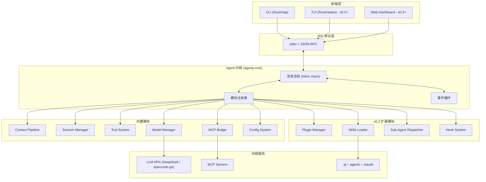
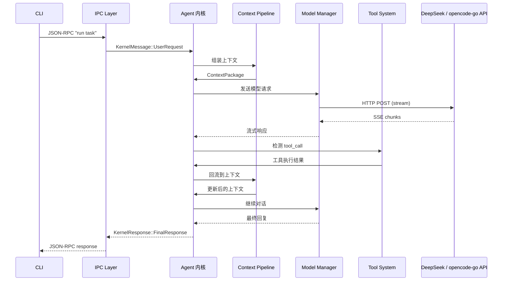
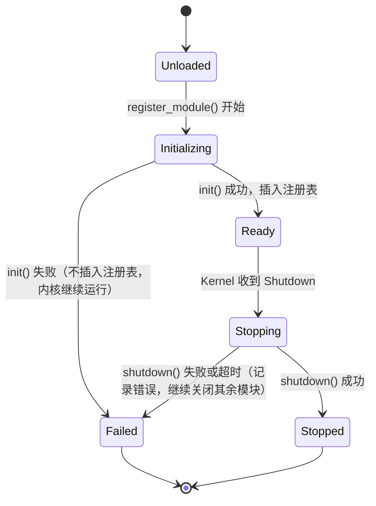
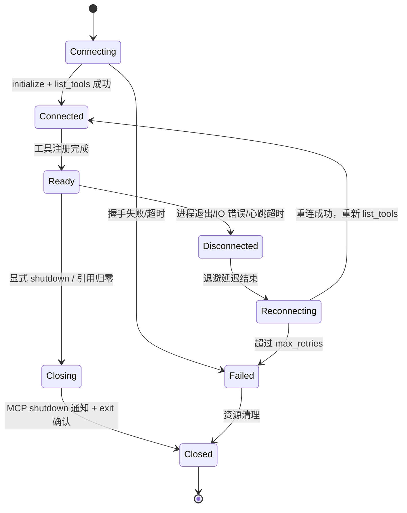
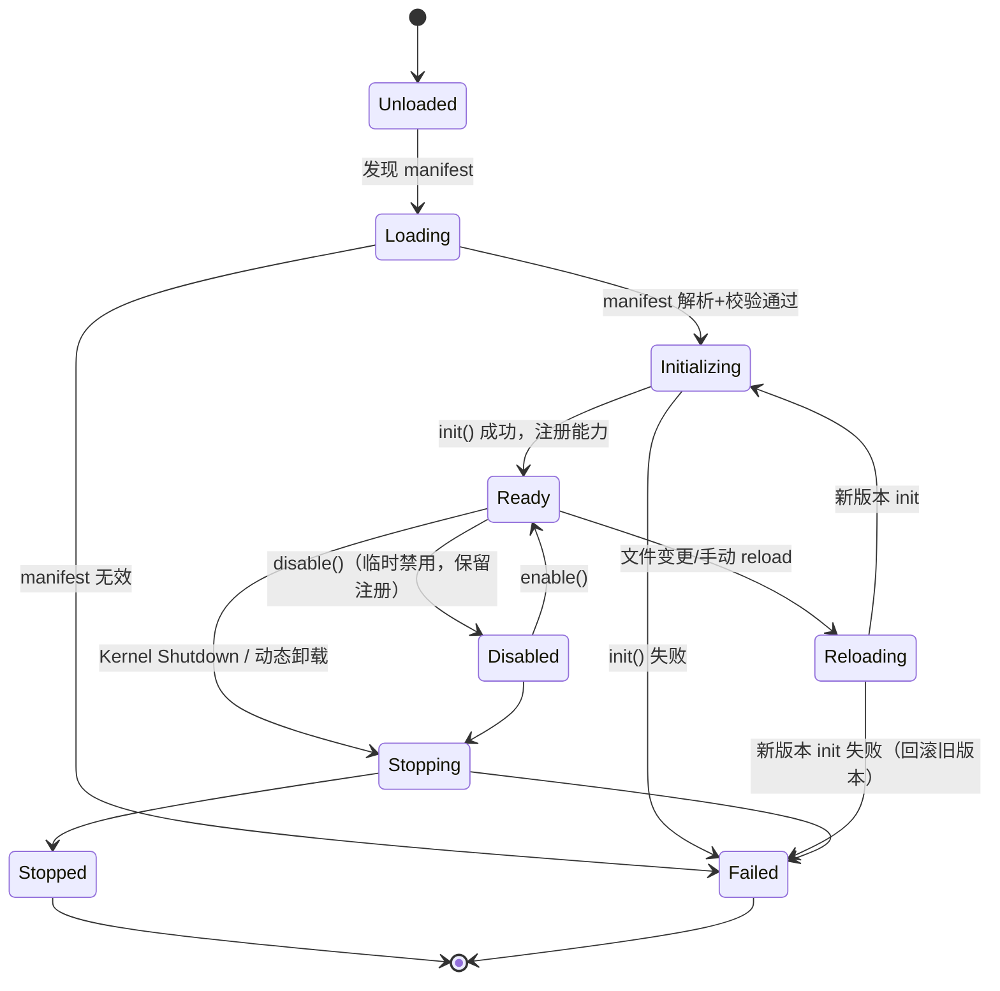
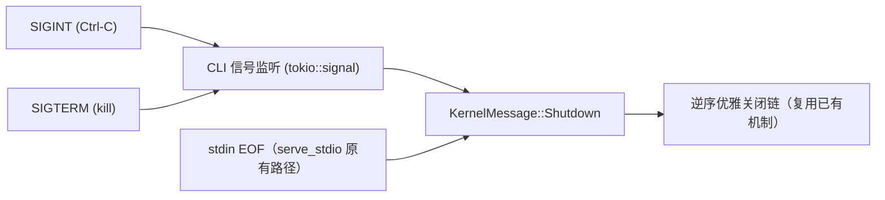
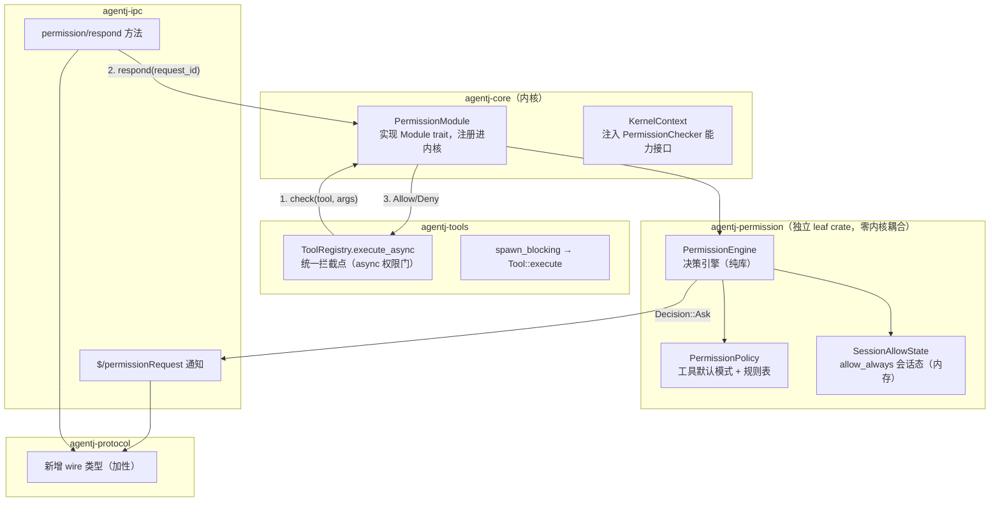
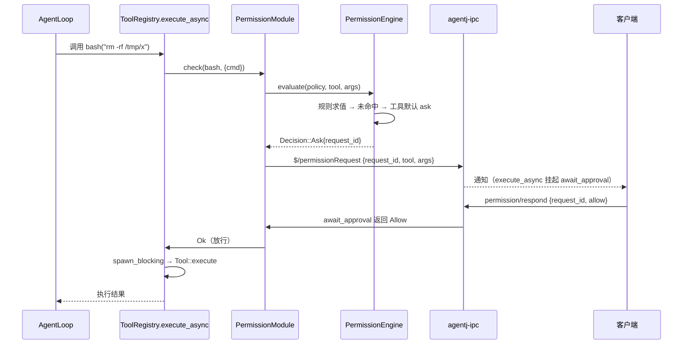
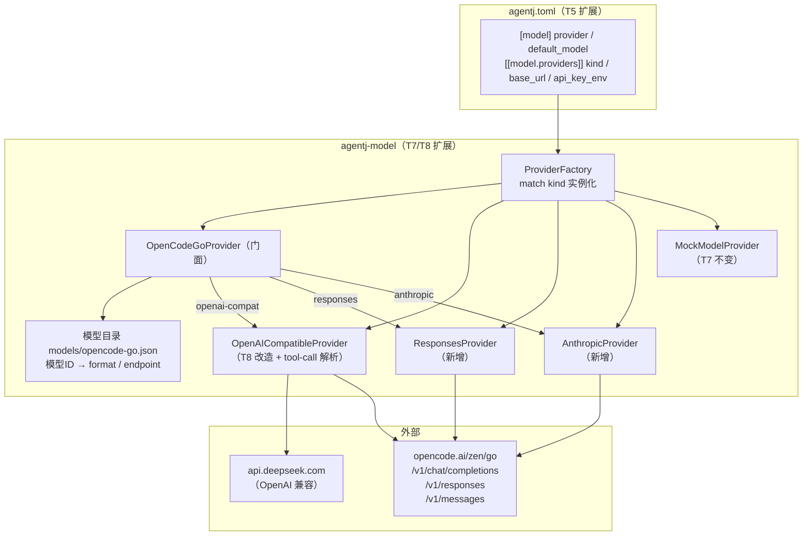
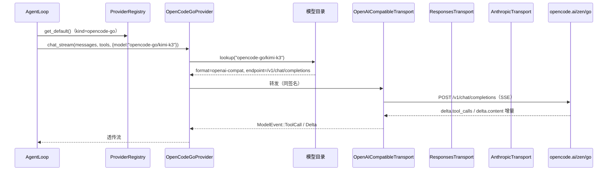

# 设计文档：AgentJ 内核架构

## 概述

AgentJ 是一个面向社区的 AI 编码代理工具，以 Rust 语言构建，采用 Linux 内核式架构设计。其核心设计理念是"内核调度 + 可插拔模块"：一个轻量的 Agent 内核作为消息总线，所有功能——模型管理、工具引擎、MCP 协议、Skills 加载、插件生态——均以独立子系统形式注册到内核，通过消息路由完成协作。

与 opencode / claude code 等主流 agent 工具对标，但差异化在于：

- **Rust 原生**：内核、工具引擎、IPC 层均用 Rust 实现，追求零成本抽象和内存安全
- **前端无关**：通过 stdio + JSON-RPC 协议暴露内核能力，CLI、TUI、Web Dashboard、IDE 插件均可作为协议消费者
- **社区友好**：支持兼容 opencode/claude code 的插件格式，Skills 可加载 `.aj`、`.agents`、`.claude` 多级目录

## 目标与非目标

### 目标

| 阶段 | 目标 |
|------|------|
| v0.1 | 核心链路跑通：CLI 输入 → IPC → 上下文管线 → 模型调用 → 工具执行 → 流式返回 |
| v0.1 | 基础模块可用：Context Pipeline、Session Manager、Tool System、Model Manager（DeepSeek + opencode-go 全模型）、MCP Bridge、Config System |
| v0.1 | 权限闭环：敏感工具（bash/write）执行前权限检查 + IPC 审批流（决策 #17） |
| v0.2 | 生态扩展：Plugin Manager（兼容 opencode/claude code 插件格式）、Skills Loader（多路径）、Sub-Agent Dispatcher、Hook System |
| v0.2+ | 模型扩展：Ollama 本地模型、更多厂商（OpenAI 兼容 API 已随 v0.1 opencode-go 支持提前落地） |
| v0.3 | 内核调度全量重构：AgentLoop 主循环 + Sub-Agent 全量迁入消息总线，兑现"内核调度 + 可插拔模块"理念（决策 #18，协议面零变化） |
| v0.3+ | 商业扩展：Web Dashboard、用量统计、License 管理 |

### 非目标

- ❌ v0.1 不做 TUI 界面（推迟到 v0.2+，IPC 协议已为此预留）
- ❌ v0.1 不做插件动态加载（仅内置模块，插件框架 v0.2 引入）
- ❌ 不做模型训练/微调（定位是 agent 工具，不是 ML pipeline）
- ❌ 不做 IDE 深度集成（VS Code/JetBrains 插件是 v0.3+ 的事）
- ❌ 不做多语言 runtime（核心 Rust + 配置 TOML，前端可选任意语言）
- ❌ v0.1 不做动态模型目录拉取（opencode-go 的 `GET /v1/models` 动态发现属 v0.2 增强项，v0.1 用提交的静态模型目录）

## 设计方案

### 架构模式

采用**消息总线 + Trait 注册**模式，模仿 Linux 内核的 subsystem 设计。内核维护消息总线，各模块通过 `KernelModule` trait 注册为子系统，模块间不直接通信，全部经过内核路由。

### 备选方案

| 方案 | 优点 | 缺点 | 为何未选用 |
|------|------|------|-----------|
| 消息总线 + Trait（选用） | 类型安全（编译期检查）、模块解耦彻底、调试清晰、最贴合 Linux 内核理念 | 消息定义随模块增多膨胀、channel 有微量开销 | — |
| Actor 模型（actix） | 故障隔离极好、天然支持分布式、插件可不同语言 | actix 生态重、调试复杂、对 agent 工具过度设计 | agent 场景不需要分布式故障隔离 |
| 事件驱动 + 共享 Context | 简单直观、启动快、适合原型 | 锁竞争、模块间隐式耦合、难以扩展 | 违背解耦目标 |

## 架构

### 分层架构



### 模块间通信数据流



### 模块层级：双层 Trait 体系

为兼顾内核集成深度和社区扩展灵活性，模块分为两个层级：

```rust
/// 第一层：普通 Module（社区扩展、自定义工具、模型适配器等）
/// 轻量接口，不直接参与内核消息路由，通过注册回调与内核交互
pub trait Module: Send + Sync {
    /// 模块唯一标识
    fn id(&self) -> ModuleId;

    /// 模块元信息（名称、版本、描述、作者等）
    fn metadata(&self) -> ModuleMetadata;

    /// 初始化，接收内核上下文引用和回调注册器
    fn init(&mut self, ctx: &KernelContext, register: &mut ModuleRegister) -> Result<(), ModuleError>;

    /// 优雅关闭
    fn shutdown(&mut self) -> Result<(), ModuleError>;
}

/// 第二层：KernelModule（内核子系统，如 ModelManager、ToolSystem 等）
/// 深度集成，直接参与内核消息路由
pub trait KernelModule: Module {
    /// 处理内核路由过来的消息
    fn handle(&mut self, msg: KernelMessage) -> Result<KernelResponse, ModuleError>;
}
```

**ModuleRegister** 用于普通模块注册回调：

```rust
pub struct ModuleRegister {
    /// 注册一个工具（如自定义 bash/API 调用）
    pub fn register_tool(&mut self, tool: Box<dyn Tool>) -> Result<(), ModuleError>;
    /// 注册事件钩子
    pub fn on_event(&mut self, event: EventType, handler: Box<dyn EventHandler>) -> Result<(), ModuleError>;
    /// 注册模型 provider
    pub fn register_provider(&mut self, provider: Box<dyn ModelProvider>) -> Result<(), ModuleError>;
}
```

**加载流程**：

```
模块发现 → 解析 metadata → 判断类型
                              ├── KernelModule → init() + 注册到消息路由表
                              └── Module      → init() + 回调注册到 ModuleRegister
```

### 模块生命周期状态机

模块生命周期状态由 **Kernel 维护**（`HashMap<ModuleId, ModuleState>`），`Module` trait 不携带状态字段——保持 §7「能力接口与通道分离」原则：状态是编排者（Kernel）的职责，不是能力实现者（模块）的职责。

> v0.2 插件在此状态机基础上扩展 Disabled/Reloading/Loading 等状态与转移，见「插件生命周期（v0.2）」章节。



**状态语义**：

| 状态 | 含义 |
|------|------|
| `Unloaded` | 未注册（默认） |
| `Initializing` | `register_module()` 正在执行 `init()` |
| `Ready` | 初始化成功，已插入注册表，可接收消息 |
| `Stopping` | 已收到 Shutdown，正在执行 `shutdown()` |
| `Stopped` | 优雅关闭完成 |
| `Failed` | `init()`/`shutdown()` 失败或超时（记录原因，可查询） |

**查询与事件**：

- `Kernel::module_state(id) -> Option<ModuleState>` 查询任意模块状态——调用方（IPC/CLI/未来 Web Dashboard）可感知哪些模块可用
- 状态转换触发点记录 `tracing` 日志；`EventType` 预留 `ModuleLoaded` / `ModuleFailed` / `ModuleStopped` 生命周期变体（v0.1 仅定义契约，v0.2 Hook System 消费，见 §7 预留接口）

**优雅关闭链路**：

`KernelMessage::Shutdown` 的处理不再只是 break 循环：

1. **Shutdown 优先检测**：事件循环在广播消息前先检查 `Shutdown`，它不经过 `handle()` 广播——修复"阻塞模块饿死关闭信号"问题（若某模块 `handle()` 长时间阻塞，其余消息包括 Shutdown 都无法到达）
2. 对全部 `Ready` 模块置 `Stopping`
3. **逆序调用 `shutdown()`**：按注册顺序倒序遍历（后注册的先关闭，依赖倒置——被依赖方最后退出）
4. **每模块关闭超时**（默认 2s，可配置）：`tokio::time::timeout` 包裹，超时产生 `KernelError::ShutdownTimeout`
5. 单个模块失败/超时：记录日志 + 状态置 `Failed`，**继续关闭其余模块**，不阻断整体退出
6. 全部完成后 JoinHandle 返回结果

**init 失败语义**：

- `register_module` 返回 `Result<(), KernelError>`，`init()` 失败返回 `Err(KernelError::ModuleInitFailed)`——调用方（IPC/CLI）可感知失败
- 失败模块状态置 `Failed`，**不插入注册表**（不会收到任何消息）
- 内核继续运行——保留"单模块失败不拖垮内核"的隔离意图

**生产路径接线（v0.1 轻量接入）**：

- CLI 创建 `Kernel`，将 AgentLoop 包装为 `AgentLoopModule`（实现 `Module`）注册 → `init()` 在真实进程内执行
- `Kernel::start()` 启动事件循环
- IPC `shutdown` 方法真实发送 `KernelMessage::Shutdown` 并等待 Kernel JoinHandle 完成（不再假返回）
- session/new、session/run 保持直接调用 AgentLoop（符合"编排直接调 trait 对象"决策），但**生命周期（init/shutdown/状态）经由 Kernel**

### MCP 连接生命周期（v0.2）

**背景**：v0.1 每次调用新建 MCP server 子进程（`kill_on_drop(true)` 防泄漏），无连接生命周期概念。v0.2 引入长驻连接复用（决策 #11），需要完整的连接状态机与工具级联清理。

**连接状态机**（由 `McpConnectionManager` 维护，`agentj-mcp` crate 内）：



**连接管理语义**：

- `McpConnectionManager` 持 `HashMap<McpServerId, McpConnection>`；`McpConnection` 含状态 + `Arc<AtomicUsize>` 引用计数 + `idle_since` 时间戳
- **引用计数共享**：多个 session/模块复用同一长驻连接；引用归零 → 空闲计时 → 超时（默认 60s，可配置）优雅关闭（`Closing → Closed`）
- **重连策略**：指数退避 500ms ×2、上限 30s、最多 5 次 → `Failed`
- **级联反注册**：连接进入 `Disconnected`/`Failed`/`Closed` 时执行 `ToolRegistry::unregister_by_source(Mcp{server_id})`——幽灵工具即时清除，模型不再拿到失效 tool definition（M2 缺口闭环）
- **工具刷新**：重连成功后重新 `list_tools` 并 diff 注册/反注册（M3 缺口闭环）
- **优雅关闭**：`Closing` 态发送 MCP 协议 `shutdown` 通知并等待 `exit` 确认，超时后强制终止子进程（复用 v0.1 的 `kill_on_drop` 兜底）
- **调用中崩溃**：返回 `ToolError::ServerUnavailable{server_id}`，工具移除，连接转 `Reconnecting`

### 插件生命周期（v0.2）

**背景**：v0.2 引入动态插件加载（决策 #12），模块生命周期状态机扩展出插件专用状态与转移（P1/P2/P3/P4/P5 缺口闭环）。

**插件状态机**（由 `PluginManager` 维护，`agentj-plugin` crate 内，语义与 Kernel 状态机对齐）：



**新增语义**：

- **Disabled/Enabled**：临时禁用不卸载——禁用期间工具不进模型 tool list、事件 handler 不触发，注册表条目保留但标记停用；`enable()` 恢复（P1 缺口闭环）
- **Reloading（热重载）**：新版本 `init()` 成功 → 原子切换；失败 → 回滚旧版本并记录 `PluginError::ReloadFailed`。触发源：插件目录文件监视（watch）或 IPC 手动 reload（P2 缺口闭环）
- **依赖图**：manifest 显式声明 `dependencies: [PluginId]`；init 按拓扑序（依赖先 init），shutdown 逆拓扑序——替代"注册顺序"（P3 缺口闭环）；循环依赖 → `PluginError::DependencyCycle`
- **Failed 恢复**：`Failed` 为终态，但允许从 `Unloaded` 重新 Loading 重试 init，不做永久锁死（P2 缺口部分闭环）
- **工具冲突策略**：`register_tool_with_source` 默认 `ReplacePolicy::Reject`——同名工具已注册时返回 `PluginError::ToolConflict`（含既有来源）；插件可显式声明 `Replace` 意图覆盖（P5 缺口闭环）

**加载器抽象**：

```rust
pub trait PluginLoader: Send + Sync {
    fn load(&self, manifest: &PluginManifest) -> Result<Box<dyn PluginInstance>, PluginError>;
    fn unload(&self, instance: Box<dyn PluginInstance>) -> Result<(), PluginError>;
}
```

- `LibloadingLoader`：原生 .so/.dylib，v0.2 首载，信任模型 = 用户自装
- `WasmLoader`：WASM 沙箱 + 能力白名单 + 内存/执行超时资源上限（P4 缺口闭环），可选
- `PluginInstance` 桥接为内核 `Module`，复用 Kernel 状态机与 Shutdown 链路

### CLI 信号与关闭入口（v0.1）

**背景**：T14 `serve_stdio` 仅在 stdin EOF 时触发 Kernel Shutdown；用户 Ctrl-C（SIGINT）或 `kill`（SIGTERM）时进程默认直接终止，优雅关闭链不执行——与决策 #8「生产路径真实接入生命周期」矛盾（决策 #13）。

**信号流**：



**设计要点**：

- CLI 主函数启动 `tokio::signal::ctrl_c()` 与 `unix::signal(SIGTERM)` 监听，两个信号统一映射为 `KernelMessage::Shutdown`
- **幂等**：`KernelMessage::Shutdown` 由事件循环优先检测（决策 #9），重复发送无害；EOF 路径与信号路径汇合到同一关闭链
- **总超时兜底**：优雅关闭链超过总时限（默认 10s，可配置）→ 进程强制退出，防止模块 shutdown 挂死导致用户中断无响应
- **读侧中断**：`serve_stdio` 的 `read_line` 阻塞中收到信号 → 事件循环已退出，读循环需感知 Kernel JoinHandle 结束（`select!` 或带超时读），T14 实现细节处理

### Session 生命周期契约（v0.1 契约，v0.2 实现）

**背景**：`SessionStore` 现有接口只有 `create/append/get/estimate_tokens`——会话只增不减。v0.2 若直接加 `delete/archive/expire` 属破坏性接口变更（同 M3 教训），且无清理机制导致长期运行数据无限增长。v0.1 固化契约，实现可推迟（决策 #14）。

**契约（v0.1 加方法签名，InMemory 实现可直接落地）**：

```rust
pub enum SessionStatus { Active, Archived, Deleted }

pub trait SessionStore: Send + Sync {
    // 现有（不变）
    fn create(&self) -> Result<SessionId, ModuleError>;
    fn append(&self, session: &SessionId, message: ChatMessage) -> Result<(), ModuleError>;
    fn get(&self, session: &SessionId) -> Result<Vec<ChatMessage>, ModuleError>;
    fn estimate_tokens(&self, session: &SessionId) -> Result<usize, ModuleError>;

    // v0.1 契约先行，实现可 v0.2 落地
    fn status(&self, session: &SessionId) -> Result<SessionStatus, ModuleError>;
    fn archive(&self, session: &SessionId) -> Result<(), ModuleError>;
    fn delete(&self, session: &SessionId) -> Result<(), ModuleError>;
}
```

**语义**：

- **Archive（软删除）**：数据保留但退出活跃列表，`session/run` 拒绝访问 Archived 会话
- **Delete（硬删除）**：数据不可恢复（InMemory 实现 trivial）
- **过期清理（expire）属 v0.2**：归档会话 TTL + 后台定时扫描回收，`SessionExpired` 事件预留
- **错误语义**：对 Archived/Deleted 会话执行 `append`/`get` → `SessionError::InactiveSession`；对不存在会话 delete → `SessionError::NotFound`
- **事件预留**：`EventType::SessionArchived / SessionDeleted / SessionExpired`（v0.1 契约，v0.2 Hook 消费）

### 会话持久化与恢复（v0.1 契约，v0.2 实现）

**背景**：`SessionStore` 现有接口只定义会话的内存语义（`InMemoryStore = Mutex<HashMap>`），进程重启/崩溃即全部会话丢失。「Session 生命周期契约」解决数据只增不减的清理问题，但**会话数据跨进程存活的恢复能力从未被设计**——决策 #13 的 shutdown 理由提及"上下文持久化"，却无任何模块承担该职责（悬空引用）。v0.1 固化恢复契约，磁盘后端 v0.2 实现（决策 #16）。

**范围边界**：本设计只覆盖**会话历史持久化与恢复**（消息 + 生命周期状态）。**运行级续跑**（`session/run` 中断后从断点续跑）依赖 AgentLoop 编排状态，属 v0.2+ 独立设计（见遗留问题）；协议 §3 当前明文"`session/run` 不可重试"，改动需走协议版本升级流程。

**契约（v0.1 在「Session 生命周期契约」的 trait 基础上追加，纯加性 + 默认实现，InMemory 可直接落地）**：

```rust
/// 可序列化的会话快照——持久化/恢复的原子单元
#[derive(Clone, serde::Serialize, serde::Deserialize)]
pub struct SessionSnapshot {
    pub session_id: SessionId,
    pub status: SessionStatus,
    pub messages: Vec<ChatMessage>,
    pub created_at: u64, // epoch 秒
    pub updated_at: u64,
}

pub trait SessionStore: Send + Sync {
    // 现有 + v0.1 生命周期契约（不变，见「Session 生命周期契约」）

    // v0.1 恢复契约（纯加性；默认实现零破坏，见下方"语义"）
    /// 导出会话完整状态（消息 + 生命周期状态）。不存在 → SessionError::NotFound
    fn snapshot(&self, session: &SessionId) -> Result<SessionSnapshot, ModuleError>;
    /// 恢复会话：不存在则创建，已存在则整体覆盖（messages + status）
    fn restore(&self, snapshot: &SessionSnapshot) -> Result<(), ModuleError>;
    /// 导出全部会话快照——内核启动时探测持久化存储（无持久化的存储返回空）
    fn load_all(&self) -> Result<Vec<SessionSnapshot>, ModuleError>;
}
```

**语义**：

- **snapshot = 恢复原子单元**：快照承载消息历史 + 生命周期状态 + 时间戳，一次导出/恢复即会话的完整一致视图。默认实现由 `get()` + `status()` 组装，时间戳取当前时间（v0.1 InMemory 无时间元数据，尽力而为；v0.2 磁盘后端以持久化元数据为准）
- **restore 覆盖语义**：恢复 = 回到快照时刻的已知状态（消息与状态整体覆盖）；不存在则创建——区别于 `create` 的"新建空会话"
- **load_all 的两种含义**：InMemory 返回空 = "无持久化、重启即空"；FileBackedStore 返回磁盘全部 = "重启后完整恢复"——同一签名承载两种语义，启动代码无需区分
- **协议面零改动**：恢复是内核启动时的内部行为（`load_all` + 存储自恢复），对协议消费者透明——CLI/客户端无需新方法即可获得"重启后会话仍在"（同决策 #4.4「能力收敛在 crate 内」哲学）。`session/status` 预留加性字段 `updated_at`（`@since 0.2.0`），使客户端可感知会话最后活动时间

**v0.2 FileBackedStore 实现（agentj-session）**：

- **布局**：每会话一个 JSON 文件 `<session_id>.json` 于 `~/.agentj/sessions/`（目录经 `agentj-config` 可配，默认 XDG data dir 语义）；删除 = 删文件；归档 = 重写 `status` 字段
- **原子写**：写入 `<id>.json.tmp` → fsync → rename 覆盖，任何时刻崩溃不产生半写文件；temp 残留启动时清理
- **写入时机**：`append`/`archive`/`delete` 即触发持久化（同步——agent 每轮 append 次数少、快照体积小，全量重写成本可接受）；优雅关闭链 `shutdown()` 时全量 flush 兜底——闭环决策 #13 的"上下文持久化"悬空引用
- **启动恢复**：构造时扫描目录解析全部文件 → 内存 Map；解析失败的损坏文件跳过 + `tracing` 告警 + 备份为 `.corrupt` 后缀，不阻断启动
- **session_id 字符集约束**：`SessionId` 为裸 `String`（v0.1 计划），FileBackedStore 写盘前校验字符集（`[A-Za-z0-9_-]`），非法字符 → `SessionError::PersistenceFailed`——文件名安全是磁盘后端的硬约束，v0.1 `create()` 生成方（uuid）天然满足
- **IO 错误**：读/写/重命名失败 → `SessionError::PersistenceFailed`

### 工具执行生命周期（v0.1）

**背景**：`ToolError::Timeout` 声明"超时→强制终止"，但机制未定义——内置 bash 等工具 spawn 子进程后，超时终止的是调用本身还是进程树？`kill_on_drop` 仅覆盖 MCP transport，普通工具子进程会成为孤儿（决策 #15）。

**设计**：

```rust
/// 统一工具执行生命周期：进程组隔离 + 超时 kill + 孤儿回收
pub struct ToolExecutor {
    timeout: Duration,
    kill_on_drop: bool, // 默认 true
}

impl ToolExecutor {
    pub async fn run(&self, cmd: CommandSpec) -> Result<ExecOutput, ToolError>;
}
```

**语义**：

- **进程组隔离**：子进程以独立进程组启动（Unix `setpgid`/`setsid`），超时终止时 kill 整个进程组（含孙进程），避免 bash 脚本子进程逃逸
- **超时**：`tokio::time::timeout` 包裹执行，超时 → kill 进程组 → 返回 `ToolError::Timeout`
- **孤儿回收**：`ToolExecutor` drop（含 panic 路径）时 kill 残留进程组——复用 MCP 的 `kill_on_drop` 哲学，普通工具子进程不泄漏
- **跨平台注记**：进程组 kill 在 Unix（`kill(-pgid)`）语义明确；Windows 需 Job Object 或 `taskkill /T`——v0.1 实现 Unix 路径，Windows 为已知限制（记录于遗留问题）

### 权限管理系统（v0.1）

**背景**：v0.1 交付 BashTool/WriteTool/ReadTool/GlobTool/GrepTool 等内置工具，`ToolError::PermissionDenied` 在错误枚举中已定义（见「错误处理」）——但**没有任何代码路径会产生它**：无权限策略、无检查器、无拦截点，属死变体。工具执行仅有 `ToolExecutor` 的进程生命周期安全（超时/进程组隔离/孤儿回收，见「工具执行生命周期」），**无权限控制**——bash 可执行任意命令、write 可写任意路径。对标 opencode 的 per-tool allow/deny/ask 模式与 claude code 的目录白名单，v0.1 补齐权限闭环（决策 #17）。

**决策模型：工具模式 + 规则覆盖**：

- 每个工具类声明默认模式 `Allow` / `Ask` / `Deny`（内置工具出厂默认：bash=Ask、write=Ask、read/glob/grep=Allow；MCP/插件工具默认 Ask——信任=用户自装，保守起步）
- 细粒度规则叠加在默认模式之上：**路径规则**（文件类工具，glob 相对 workspace 根解析）与**命令规则**（bash，命令前缀匹配）
- **决策优先级：Deny > Allow > Ask**——规则命中即短路；规则未命中回退工具默认模式

> **执行入口注记**：现有 `ToolRegistry` 为注册表（`register/get/definitions`），执行发生在 `AgentLoop::execute_tool_calls`（`spawn_blocking(tool.execute)`）。权限拦截引入 `ToolRegistry::execute_async(name, args, ctx)` 统一入口：**async** 方法先走权限门（Ask 时 `await_approval` 等待审批），放行后再 `spawn_blocking` 委托同步 `Tool::execute`——单一拦截点覆盖全部调用方（AgentLoop/sub-agent/插件），且审批等待不阻塞内核事件循环。

| 工具类 | 默认模式 | 规则示例 |
|--------|---------|---------|
| bash | Ask | allow `npm test`* / deny `rm -rf /*`* |
| write | Ask | allow `src/**` / deny `../**` |
| read / glob / grep | Allow | deny `.env` |
| MCP / 插件工具 | Ask | 按 server/plugin 粒度配置 |

**架构**：



**审批时序（Ask 场景）**：



**接口定义**（agentj-permission 内，能力接口与通道分离——§7 原则）：

```rust
/// 工具默认模式
pub enum PermissionMode { Allow, Ask, Deny }

/// 规则效果（优先级 Deny > Allow）
pub enum PermissionEffect { Allow, Deny }

/// 路径规则：文件类工具（write/read/glob/grep），glob 相对 workspace 根解析
pub struct PathRule {
    pub effect: PermissionEffect,
    pub pattern: String, // glob，如 "src/**" / "../**" / ".env"
}

/// 命令规则：bash，命令前缀匹配
pub struct CommandRule {
    pub effect: PermissionEffect,
    pub prefix: String, // 如 "npm test" / "rm -rf /*"
}

/// 单工具策略：默认模式 + 规则表
pub struct ToolPolicy {
    pub mode: PermissionMode,
    pub path_rules: Vec<PathRule>,
    pub command_rules: Vec<CommandRule>,
}

/// 审批请求 id（不透明，uuid，独立于 JSON-RPC 请求 id）
pub struct PermissionRequestId(pub String);

/// 决策结果
pub enum PermissionDecision {
    Allow,
    Deny { reason: String },
    Ask { request_id: PermissionRequestId },
}

/// 检查上下文
pub struct PermissionContext {
    pub session_id: SessionId,
    pub tool: String,
    pub source: ToolSource,      // Builtin / Mcp / Plugin（复用决策 #10）
    pub args: serde_json::Value, // 原始参数（含 cmd / path 等）
    pub workspace_root: PathBuf,
}

/// 能力接口：ToolRegistry::execute_async 的拦截点依赖此 trait（§7 通道解耦）
pub trait PermissionChecker: Send + Sync {
    /// 同步决策：Allow / Deny / Ask（Ask = 已登记挂起审批并发出 $/permissionRequest 通知）
    fn check(&self, ctx: &PermissionContext) -> PermissionDecision;

    /// 等待 Ask 审批结果（async，内部 await IPC 响应通道；超时/取消 → Deny）
    /// 仅在 check() 返回 Ask 后调用；Tool::execute 是同步的，故审批等待必须发生在
    /// 其外的 async 路径（ToolRegistry::execute_async）——见下方执行入口注记
    async fn await_approval(&self, request_id: &PermissionRequestId) -> PermissionDecision;
}

/// allow_always 会话态（内存）：session_id → 已放行规则指纹集合
pub struct SessionAllowState { /* Mutex<HashMap<SessionId, HashSet<RuleFingerprint>>> */ }
```

**allow_always 语义**：`permission/respond {decision: "allow_always"}` 将 (工具, 命中规则指纹) 写入当前 session 的 `SessionAllowState`；同 session 内后续相同请求直接 `Allow`，**会话结束即失效**（内存态，不回写配置文件——避免无意永久放行危险操作；需跨会话生效的用户显式配置 `[permission]` 规则）。

**审批超时**：`Ask` 请求等待响应的默认超时 60s（可配置），超时 → 自动 `Deny`（返回 `ToolError::PermissionDenied`）；客户端断开（session 终止）→ 挂起审批全部 `Deny`，`session/run` 返回拒绝语义，不无限挂起。

**协议扩展（加性，随 v0.1 计划执行）**：

- S→C 通知：`$/permissionRequest {request_id, tool, args, reason}`（request_id 独立于请求 id，复用 `$/progress` 的 token 解耦设计）
- C→S 请求：`permission/respond {request_id, decision: "allow"|"deny"|"allow_always"}` → `{}`
- `session/run` 保持「一请求一最终响应」不变式，审批等待期间请求挂起
- 属协议加性变更（只加不改）：agentj-protocol 新增 wire 类型 + schema 重生成 + 版本 bump（同步 `docs/specs/ipc-protocol.md`）

**配置段（agentj.toml `[permission]`）**：

```toml
[permission]
# 工具默认模式覆盖（缺省：bash=Ask、write=Ask、read/glob/grep=Allow、MCP/插件=Ask）
# [permission.tools.bash]
# mode = "ask"
# [[permission.tools.bash.command_rules]]
# effect = "allow"
# prefix = "npm test"
# [[permission.tools.bash.command_rules]]
# effect = "deny"
# prefix = "rm -rf /*"

# [permission.tools.write]
# mode = "ask"
# [[permission.tools.write.path_rules]]
# effect = "allow"
# pattern = "src/**"
# [[permission.tools.write.path_rules]]
# effect = "deny"
# pattern = "../**"

# [permission.tools.read]
# mode = "allow"
# [[permission.tools.read.path_rules]]
# effect = "deny"
# pattern = ".env"
```

- 规则解析失败（无效 glob）→ 配置加载失败（fail-fast，`PermissionError::InvalidRule`）
- 工具默认模式与规则均可被 `[permission.tools.<tool>]` 覆盖；未声明的工具类使用出厂默认

### 消息枚举

```rust
pub enum KernelMessage {
    // 从 IPC 层进入
    UserRequest {
        session_id: SessionId,
        content: String,
        attachments: Vec<Attachment>,
    },
    // 模块间转发
    ModelResponse(ModelResponseChunk),
    ToolCallRequest(ToolCall),
    ToolCallResult(ToolCallResult),
    // 生命周期：优先于消息广播检测，触发逆序优雅关闭（见"模块生命周期状态机"）
    Shutdown,
}
```

### 内核调度：现状与理念的差距（v0.1-v0.2 现状，v0.3 全量重构）

**背景**：本设计宣称"内核调度 + 可插拔模块"（Linux 内核式，见「架构模式」）——各模块通过 `KernelModule` 注册为子系统，模块间不直接通信，全部经过内核路由。但 v0.1/v0.2 计划的**实际架构是"注册表 + 生命周期管理"式内核**，与理念存在系统性差距。本节固化差距与重构规划（决策 #18）。

**差距盘点**：

| 理念维度 | 设计宣称 | v0.1-v0.2 实际 | 差距 |
|---------|---------|---------------|------|
| 可插拔模块 | 模块注册 + trait 抽象 | ✅ 双层 Module/KernelModule + 独立 crate 注册 | **无** |
| 模块生命周期由内核维护 | init/shutdown/状态机 | ✅ 已实现（决策 #8/#9，逆序关闭 + 超时） | **无** |
| **内核调度**：所有执行经消息总线 | 模块间不直接通信，全部经内核路由 | ❌ **AgentLoop 编排直调 trait 对象**（`run_turn_stream` 直接调 SessionStore/ModelProvider/ToolRegistry/ContextPipeline，不经 `KernelMessage`） | **有** |
| 模块间通信经内核 | 总线中转 | ❌ 运行期无模块间消息（总线仅承载 IPC 入口 `UserRequest` + 生命周期 `Shutdown`） | **有** |
| 故障隔离 | 单模块失败不拖垮内核 | ⚠️ 部分（init 失败隔离已实现；运行期编排为同步直调，无消息级隔离） | 部分 |

**差距的代价**：

- `AgentLoop` 成为事实上的**"第二内核"**——权限门（决策 #17）、工具循环、上下文回流、模型调度全部挂在直调路径上，而非挂在消息总线
- 对外架构描述（README/AGENTS.md）与实现不符——"内核调度"目前是宣传语
- v0.2 若仅让 Sub-Agent Dispatcher 走总线（`KernelMessage::ServiceCall`），将形成**双执行路径并存**（主循环直调 + 子代理走总线），架构分裂比现状更糟

**重构规划（v0.3，完整落地，决策 #18）**：

- **目标态**：AgentLoop 主循环 + Sub-Agent Dispatcher **全量**迁入 `KernelMessage` 消息总线——`UserRequest → 总线 → AgentLoopModule.handle() → ModelResponse/ToolCallRequest/ToolCallResult 回流总线 → IPC 订阅者`；`KernelMessage` 全部变体接线（v0.1 计划仅用 UserRequest/Shutdown，`ModelResponse/ToolCallRequest/ToolCallResult` 已在 L644 定义，属协议零缺口）
- **协议面零变化**：`session/run` 保持「一请求一最终响应」+ `$/progress` 流式语义；调度重构为**纯内部行为**，CLI/客户端无感知
- **权限门语义保留**：`ToolRegistry::execute_async` 拦截点（决策 #17）不因迁移丢失——工具调用经 `ToolCallRequest` 入总线，权限门仍在 execute_async 内执行
- **任务骨架（v0.3 设计待定，执行前需 `jskill-feature-design`）**：AgentLoop 事件驱动重构（直调 → 状态机 + handle 驱动）、流式返回经总线（`ModelResponse` chunk → IPC 订阅者，保留 `$/progress`）、工具循环经总线（`ToolCallRequest`/`ToolCallResult`）、Sub-Agent 接入总线、消息路由层（request_id → 订阅者映射，镜像 `$/progress` token 解耦）、SessionManager/ContextPipeline 注册为 KernelModule、回归与文档对齐
- **前置依赖**：v0.2 `ModuleResolver` + `KernelMessage::ServiceCall`（v0.2 计划 T1）、KernelMessage 全变体接线、权限门（决策 #17，v0.1）

### Rust Crate 拆分

| Crate | 职责 | 阶段 |
|-------|------|------|
| `agentj-core` | 内核：消息总线、模块注册表、Module/KernelModule trait 定义 | v0.1 |
| `agentj-ipc` | stdio + JSON-RPC 协议实现 | v0.1 |
| `agentj-model` | 模型管理：Provider trait + 三种 wire 格式 transport（OpenAI 兼容 / Responses / Anthropic）+ opencode-go 门面路由 + 工厂 | v0.1 |
| `agentj-tools` | 工具引擎：内置工具注册/调用、ToolExecutor（进程组隔离 + 超时 kill + 孤儿回收） | v0.1 |
| `agentj-session` | 会话管理：对话历史、token 计数、压缩；生命周期契约（archive/delete，v0.2 完整语义） | v0.1 |
| `agentj-context` | 上下文管线：组装、注入、回流 | v0.1 |
| `agentj-mcp` | MCP 协议客户端；v0.1 每次调用新建子进程；v0.2 引入 McpConnectionManager 长驻连接状态机 | v0.1 |
| `agentj-config` | 多级配置合并 | v0.1 |
| `agentj-permission` | 权限管理：PermissionEngine 决策引擎（纯库）、ToolPolicy 工具模式+规则表、SessionAllowState allow_always 会话态；PermissionModule 桥接注册进内核（决策 #17） | v0.1 |
| `agentj-plugin` | 插件管理：PluginLoader 抽象（libloading/WASM）、插件状态机、依赖图拓扑排序、沙箱资源上限 | v0.2 |
| `agentj-skills` | Skills 加载：多路径 | v0.2 |
| `agentj-cli` | CLI 前端（clap），唯一二进制入口 | v0.1 |

### opencode-go 模型供应商支持（v0.1）

**背景**：opencode-go 是 OpenCode 的低价订阅（$5 首月 / $10 月），一个订阅覆盖主流开源编码模型。它**不是单一 API**——官方模型表横跨三种 wire 协议，由模型 ID 决定走哪个 endpoint：

| 模型示例 | wire 格式 | endpoint | AI SDK 包 |
|---------|-----------|----------|-----------|
| Grok 4.5 / GPT 5.6 Luna | OpenAI Responses API | `/v1/responses` | `@ai-sdk/openai` |
| GLM / Kimi / DeepSeek V4 / MiMo / Hy3 | OpenAI Chat Completions | `/v1/chat/completions` | `@ai-sdk/openai-compatible` |
| MiniMax / Qwen | Anthropic Messages API | `/v1/messages` | `@ai-sdk/anthropic` |

模型 ID 格式 `opencode-go/<model>`（如 `opencode-go/kimi-k3`）。「完美支持」= 用户只配置一次（`provider="opencode-go"` + api_key + 模型名），内核自动路由到正确的 wire 格式与 endpoint。

**架构**：



**门面分派数据流**：



**设计要点**：

- **transport 即独立 provider**：`OpenAICompatibleProvider`（OpenAI 兼容，服务 DeepSeek 与 opencode-go 的 chat/completions 模型）、`ResponsesProvider`、`AnthropicProvider` 各自实现 `ModelProvider` trait，可独立注册；`OpenCodeGoProvider` 门面组合三 transport，按模型目录分派——一份代码两种用途（DeepSeek = 直接用 OpenAICompatibleProvider；opencode-go = 门面组合）
- **模型目录**：`models/opencode-go.json`（提交件，复用 `protocol/methods.json` 的「机器工件 + 校验」模式），字段 `{ id, format, endpoint }`，覆盖官方模型表；校验测试断言格式合法、ID 唯一
- **tool-call 解析提前落地**（计划 T8 原为「推迟 v0.2」）：三格式各自实现 `delta → ToolCall` 增量聚合——Chat Completions 的 `delta.tool_calls[].function`、Responses 的 `output_item`、Anthropic 的 `content_block_delta` + `input_json_delta`——聚合完成后发 `ModelEvent::ToolCall`，使 v0.1 AgentLoop 工具循环（T11）对真实模型可用
- **配置向后兼容**：`kind` 缺省 `"openai-compat"`（旧配置零破坏）；`default_model` 缺省 `"deepseek-chat"`；`agentj-core` 的 `ModelProvider` trait / `ProviderRegistry` 零改动

## 关键设计决策

### 1. 双层模块体系：Module vs KernelModule

**决策**：模块分为两层 trait。普通 `Module` 通过 `ModuleRegister` 回调注册能力（工具、事件钩子、模型 provider），不与内核消息路由直接耦合。`KernelModule` 继承 `Module`，额外实现 `handle()` 方法，深度参与内核消息总线。

**理由**：社区扩展（自定义工具、第三方模型适配）不需要理解内核消息枚举的完整结构。轻量 `Module` trait 降低开发门槛，同时通过回调注册器保证扩展能力。内核内置模块（ModelManager、ToolSystem 等）使用 `KernelModule` 获得完整的消息路由能力。

### 2. 消息总线：tokio::mpsc + 枚举消息

使用 `tokio::mpsc` channel 传递 `KernelMessage` 枚举。tokio 是 Rust 异步的标准运行时，枚举消息在编译期穷举所有可能的消息类型，比 `Box<dyn Any>` 更安全。channel 开销在 agent 场景（秒级延迟）下可忽略。

### 3. 模块加载策略

| | v0.1（编译时） | v0.2（动态） |
|---|---|---|
| 方式 | cargo features 控制模块编译 | WASM 运行时或 `libloading` |
| 内置模块 | 所有 v0.1 模块编译进二进制 | 同左 |
| 社区 Module | 不开放 | 实现 `Module` trait，通过 `ModuleRegister` 注册能力 |
| 社区 KernelModule | 不开放 | WASM 沙箱 + 能力白名单 |
| 兼容方案 | 不支持 | 解析 opencode/claude code 插件 manifest，桥接为 Module 或 KernelModule |

**理由**：v0.1 先验证两层 trait 接口的稳定性。在 trait 定义稳固后再开放第三方扩展，避免 API 频繁变动导致的生态断裂。社区模块推荐使用 `Module` trait（低门槛），仅在需要深度内核集成时使用 `KernelModule`。

### 4. 模型 Provider 抽象

```rust
/// 模型厂商的统一抽象
#[async_trait]
pub trait ModelProvider: Send + Sync {
    /// 流式对话
    async fn chat_stream(
        &self,
        messages: Vec<ChatMessage>,
        tools: Vec<ToolDefinition>,
        options: ModelOptions,
    ) -> Result<BoxStream<'static, Result<ModelEvent, ModelError>>, ModelError>;

    /// 非流式对话
    async fn chat(
        &self,
        messages: Vec<ChatMessage>,
        options: ModelOptions,
    ) -> Result<ChatResponse, ModelError>;
}
```

v0.1 实现 `OpenAICompatibleProvider`（兼容 OpenAI Chat Completions API 格式，以 DeepSeek 为默认配置），后续厂商只需实现同一 trait。

### 4.1. opencode-go 支持：三 transport + 门面组合 + 静态模型目录

**决策**：v0.1 `agentj-model` 提供三种 wire 格式的独立 provider——`OpenAICompatibleProvider`（OpenAI Chat Completions，T8 改造）、`ResponsesProvider`（OpenAI Responses API）、`AnthropicProvider`（Anthropic Messages API）——以及 `OpenCodeGoProvider` 门面（组合三 transport，按 `models/opencode-go.json` 静态模型目录把 `opencode-go/<model>` 路由到对应 transport/endpoint）。三 provider 均可独立注册使用（如 DeepSeek 直接用 `OpenAICompatibleProvider`）；门面仅为 opencode-go 订阅提供「一个 base_url + 一个 api_key 覆盖全部模型」的体验。

**理由**：opencode-go 官方模型表横跨三种 wire 协议，单格式实现只能覆盖 1/3 模型，不构成「完美支持」。`ModelProvider` trait 是 wire 格式的实现单元、门面是「按模型路由」的策略单元，职责分离、各自独立演进。静态目录复用 `protocol/methods.json` 的「机器工件 + 校验」模式；动态 `/v1/models` 拉取属 v0.2 增强项（v0.1 非目标）。

### 4.2. tool-call 解析提前到 v0.1

**决策**：v0.1 三个 provider 全部实现 tool-call delta → `ToolCall` 的流式组装（原计划 T8 注释「推迟 v0.2」取消）：Chat Completions `delta.tool_calls[].function`（含 `index` 增量合并）、Responses `output_item`（`function_call` 类型）、Anthropic `content_block_delta`（`input_json_delta` 累加）。组装完成后发 `ModelEvent::ToolCall`，AgentLoop 工具循环（T11）对真实模型可用。

**理由**：AgentJ 是 agent 工具，工具引擎（T9）、AgentLoop 工具循环（T11）在 v0.1 全部就位，唯一缺口是 provider 侧 delta 组装——不落地则 v0.1 真实模型只能纯文本对话，工具执行成为死代码。三种格式的组装逻辑各约 30 行，风险低、收益是「核心链路（模型调用→工具执行→流式返回）」真实跑通。

### 4.3. 配置 `kind` 判别 + `default_model`（向后兼容）

**决策**：`ModelProviderConfig` 增加 `kind: "openai-compat" | "responses" | "anthropic" | "opencode-go"`（缺省 `"openai-compat"`），`ModelSection` 增加 `default_model: String`（缺省 `"deepseek-chat"`）；`agentj-model` 提供 `ProviderFactory` 按 `kind` 实例化对应 provider。旧配置文件不写 `kind`/`default_model` → 默认值生效，零破坏。

**理由**：`kind` 是 provider 实例化的最小必要信息，工厂让 `agentj-model` 成为唯一实例化入口（同 `register_builtins` 哲学）；按 base_url 启发式推断在 opencode-go 场景数学上不可行（同一 base_url 三种格式）；`default_model` 使 `ModelOptions` 从配置注入而非硬编码。

### 4.4. opencode-go 支持不动 IPC 协议

**决策**：v0.1 opencode-go 接入全部收敛在 `agentj-model` + `agentj-config`，`agentj-protocol` / IPC 协议面零改动——模型由配置（`default_model`）全局决定，`session/run` 不新增模型参数，`kernel/status` 不新增模型列表。

**理由**：v0.1 的模型选择属配置层职责，与「编排直接调 trait 对象」决策一致；协议加性纪律（只加不改）意味着每轮选模型/模型列表可随时在 v0.2 加（加性字段），而 v0.1 加等于为推迟的功能预付 schema 重生成 + 版本 bump + TS 绑定重跑成本。

### 5. Skills 加载优先级与合并策略

```
最高优先  .aj/skills/          ← AgentJ 用户/项目级配置
   ↓      .agents/skills/     ← opencode 兼容
   ↓      .claude/skills/     ← claude code 兼容
最低优先  agentj 内置 skills    ← 软件自带
```

同名 Skill：高优先级覆盖低优先级。不同名 Skill：全部加载。

### 6. 插件兼容方案（opencode / claude code）

```
opencode/claude 插件 manifest
        │
        ▼
  适配层：解析 manifest → 生成 AgentJ KernelModule 包装器
        │
        ▼
  AgentJ 内核加载
```

v0.2 优先支持 **manifest 级兼容**（识别插件配置、Skills、MCP 服务器声明），行为级兼容（脚本执行、钩子触发）后续迭代。

### 7. 预留接口：为 v0.2+ Kernel 服务定位通道预留扩展（接口契约先行）

**决策**：v0.1 完全保持消息总线架构（`Box<dyn KernelModule>` + `&mut self handle()`），但**现在定义好未来 Kernel 服务定位通道所需的接口契约**，v0.2+ 仅做增量实现，避免届时大量模块重写。

**核心原则：能力接口与通道分离。** 模块实现的是能力接口（capability traits，`&self` + Send + Sync），内核通过通道（v0.1 消息总线 / v0.2+ 服务定位）到达这些接口。未来更换或叠加通道时，模块实现不感知——因为模块挂在能力接口上，不挂在通道上。

**能力接口现状盘点**：

| 能力接口 | v0.1 现状 | 是否满足"未来可共享" |
|---|---|---|
| `ModelProvider` / `SessionStore` / `ConfigProvider` | `&self` + Send + Sync | ✅ 天然可 `Arc` 共享，Kernel 通道直接 resolve |
| `ToolRegistry` / `ProviderRegistry` | 内部即 `Arc` 共享注册表 | ✅ 本身就是共享结构 |
| `ToolSystem` / `ContextPipeline` | v0.1 实现中保持 `&self` + Send + Sync | ⚠️ 实现时注意，勿写 `&mut self` |

**预留契约（v0.1 仅定义/文档化，v0.2 实现）**：

```rust
// 1. ModuleResolver —— v0.2 服务定位的核心契约（v0.1 仅文档化，不实现）
pub trait ModuleResolver: Send + Sync {
    fn resolve<T: 'static + Send + Sync>(&self, id: &ModuleId) -> Option<Arc<T>>;
}

// 2. KernelContext 访问器方法（纯加性：加方法，保留字段，零破坏）
impl KernelContext {
    pub fn session(&self) -> Arc<dyn SessionStore>;
    pub fn tools(&self) -> Arc<ToolRegistry>;
    pub fn providers(&self) -> Arc<ProviderRegistry>;
    pub fn config(&self) -> Arc<dyn ConfigProvider>;
}
// 未来：方法内部从"硬编码字段"换成 ModuleResolver::resolve()，模块代码零改动

// 3. KernelMessage::ServiceCall —— v0.2 增加（加性变更，非破坏）
//    v0.1 封闭枚举不动；v0.2 加变体时，只要匹配处有通配臂即无破坏

// 4. EventType / EventHandler —— v0.1 的 on_event 注册即未来事件总线的订阅者
//    v0.1 已定义 ModuleLoaded / ModuleFailed / ModuleStopped 生命周期变体（契约先行）
//    v0.2 扩展：ModuleLoading / ModuleDisabled / ModuleEnabled / ModuleReloaded
//            + McpConnecting / McpConnected / McpDisconnected / McpReconnecting / McpClosed
//            + SessionArchived / SessionDeleted / SessionExpired
//    v0.2 publish(event) 广播给所有已注册 handler，复用现有定义
```

**演进路线**：


**边界说明**：唯一无法通过接口预留消除的，是未来若模块内部状态用裸字段 + `&mut self` 组织，转共享时需包 `Mutex`。v0.1 模块按"内部持有 `Arc` 注册表"方式组织状态（与 `ToolRegistry`/`ProviderRegistry` 同风格）即可将此成本降至近乎为零。

### 8. 模块生命周期状态机由 Kernel 维护，且生产路径真实接入

**决策**：模块生命周期状态（`Unloaded/Initializing/Ready/Stopping/Stopped/Failed`）由 Kernel 注册表持有，`Module` trait 不增加状态字段；v0.1 生产路径（CLI）创建 Kernel 并将 AgentLoop 包装为 `AgentLoopModule` 注册，使 init/shutdown 在真实进程内执行。IPC `shutdown` 方法真实发送 `KernelMessage::Shutdown` 并等待优雅关闭完成。

**理由**：状态属于编排者而非能力实现者，符合 §7「能力接口与通道分离」原则——未来 v0.2 插件动态加载/卸载复用同一状态机，模块代码零改动。生产路径接入 Kernel 使生命周期机制从"仅测试存在"变为"真实运行"，避免 v0.1 交付时 shutdown 仍是死代码。

**取舍**：session/run 仍直接调用 AgentLoop（编排不经过消息路由），仅在生命周期层经过 Kernel——在保持"编排直接调 trait 对象"决策的同时补上生命周期闭环，改动面可控（T4/T13/T14）。

### 9. Shutdown 优先于消息广播处理

**决策**：事件循环收到消息时**先检查** `Shutdown`，再广播其余消息。关闭信号不经过 `handle()` 广播，避免某模块 `handle()` 阻塞导致 Shutdown 永远轮不到（饿死）。

**理由**：模块 `handle()` 是同步 `&mut self` 调用，若模块实现有阻塞操作（如等待子进程），串行广播会把 Shutdown 排在队尾。生命周期信号优先是内核关闭可靠性的底线保证。

### 10. ToolRegistry 归属元数据与反注册契约（v0.1 固化，v0.2 消费）

**决策**：v0.1 的 `ToolRegistry` 即固化 `ToolSource` 归属元数据与 `unregister`/`unregister_by_source` 接口（纯加性，不破坏现有调用）；v0.2 MCP 长驻连接与插件卸载直接消费，无需改签名重写。

**理由**：幽灵工具（M2 缺口）根因是工具注册表无来源、无反注册。v0.1 内置工具标注 `ToolSource::Builtin`、每次新建的 MCP 进程标注 `ToolSource::Mcp{server_id}`，字段即就位。符合 §7「接口契约先行、避免 v0.2 重写」哲学；实现成本仅几行。

**契约定义（v0.1 固化，纯加性）**：

```rust
pub enum ToolSource {
    Builtin,
    Mcp { server_id: String },
    Plugin { plugin_id: String },
}

pub struct ToolEntry { pub tool: Arc<dyn Tool>, pub source: ToolSource }

pub enum ReplacePolicy { Reject, Replace } // 默认 Reject

impl ToolRegistry {
    // 保留原签名（委托 Builtin，不破坏现有调用）
    pub fn register_tool(&mut self, tool: Arc<dyn Tool>) -> Result<(), ModuleError>;
    // 新增：带来源注册 + 冲突策略
    pub fn register_tool_with_source(
        &mut self, tool: Arc<dyn Tool>, source: ToolSource, policy: ReplacePolicy,
    ) -> Result<(), ModuleError>;
    pub fn unregister_tool(&mut self, name: &str) -> Option<Arc<dyn Tool>>;
    pub fn unregister_by_source(&mut self, source: &ToolSource) -> usize; // 级联清理，返回移除数量
    pub fn tools(&self) -> Vec<ToolEntry>; // 返回带来源信息
}
```

### 11. MCP 长驻连接：McpConnectionManager + 引用计数 + 级联反注册

**决策**：v0.2 由 `McpConnectionManager`（agentj-mcp）管理长驻连接状态机；多 session 引用计数共享同一连接；空闲超时回收；断连指数退避重连；`Disconnected`/`Failed`/`Closed` 时级联 `unregister_by_source`。

**理由**：v0.1 每次调用新建进程虽简单，但无法支撑 v0.2 的 MCP 连接复用与工具生命周期闭环。引用计数是"多消费者共享资源"的标准答案；级联反注册保证模型永远不会拿到失效 tool definition。与 v0.1 的 `kill_on_drop(true)` 兜底策略兼容（`Closing` 超时后强制 kill）。

### 12. 插件加载器抽象与生命周期扩展

**决策**：`PluginLoader` trait（`load`/`unload`）抽象加载机制——`LibloadingLoader` 为 v0.2 首载（原生 .so/.dylib，信任=用户自装），`WasmLoader` 可选（沙箱+能力白名单+资源上限）；插件状态机在 Kernel 六态基础上扩展 `Loading`/`Disabled`/`Reloading` 状态；依赖经 manifest 显式声明 + 拓扑排序。

**理由**：加载机制与生命周期语义解耦——内核只需面向 `PluginInstance`（桥接 `Module`）工作。Disabled 满足"临时禁用不卸载"的标准插件需求；Reloading 支持热重载且失败回滚；依赖拓扑排序替代注册顺序，保证 init/shutdown 顺序正确。libloading 优先于 WASM 是因为 v0.2 聚焦生态适配，沙箱属增强项（阻塞项：libloading ABI 稳定性、WASM runtime 选型）。

### 13. CLI 信号处理：SIGINT/SIGTERM 触发统一优雅关闭链

**决策**：CLI 层注册 `tokio::signal::ctrl_c()` 与 SIGTERM 监听，统一映射为 `KernelMessage::Shutdown`；优雅关闭链总超时（默认 10s）后强制退出；`serve_stdio` 读侧感知 Kernel 退出。

**理由**：若用户中断（Ctrl-C/kill）直接终止进程，Kernel 逆序优雅关闭链不执行——模块 `shutdown()`（长驻连接优雅关闭、上下文持久化）全部跳过，与决策 #8「生产路径真实接入生命周期」矛盾。信号路径与 EOF 路径汇合同一关闭链，保证任何退出方式生命周期完整。

### 14. Session 生命周期契约先行（v0.1 固化签名，v0.2 实现语义）

**决策**：v0.1 `SessionStore` 即固化 `SessionStatus`/`archive`/`delete` 签名（纯加性），实现可推迟；语义（软删/硬删/过期回收）v0.2 完整落地。

**理由**：同 ToolRegistry 方案 A 教训——"推迟实现"≠"推迟契约"。v0.2 再改接口属破坏性变更；v0.1 固化签名后，长期运行的数据增长问题有了清理入口，InMemory 实现 archive/delete 成本极低。

### 15. 工具执行生命周期：ToolExecutor 进程组隔离 + 超时 kill + 孤儿回收

**决策**：内置工具子进程由 `ToolExecutor` 统一管理——独立进程组、超时 kill 进程组、drop 时回收残留进程组；Unix 进程组为 v0.1 实现路径，Windows 记入已知限制。

**理由**：`ToolError::Timeout` 若只终止调用本身，bash 脚本的孙进程逃逸成孤儿。进程组隔离保证"超时=整树终止"，与 MCP `kill_on_drop` 哲学一致——工具子进程不泄漏是资源生命周期闭环的一部分。

### 16. 会话恢复契约先行（v0.1 固化签名，v0.2 实现磁盘后端）

**决策**：v0.1 在 `SessionStore` 固化 `snapshot`/`restore`/`load_all` 签名（纯加性 + 默认实现），InMemory 可直接落地；v0.2 `FileBackedStore` 实现磁盘持久化（每会话一个 JSON 文件 + 原子写 + 启动扫描恢复）。恢复是内核启动时的内部行为，协议面零改动。

**理由**：会话数据跨进程存活是 agent 工具的基础能力（对标 claude `--resume` / opencode 磁盘会话），且与决策 #14 同为"推迟实现 ≠ 推迟契约"——v0.2 再改 `SessionStore` 接口属破坏性变更（同 M3 教训）。InMemory 默认实现成本几行；v0.2 磁盘后端仅需覆盖三个方法 + 构造扫描，消费方（AgentLoop/内核）零改动。选快照模型（全量重写）而非 JSONL 追加，因为 agent 会话 append 频率低、体积小（KBs~MBs），全量重写换"任意时刻崩溃无半写状态"的简单性更值；JSONL 的追加优化留待会话体积增长到需要 compaction 时再评估。

### 17. 权限管理系统：独立引擎 + 统一拦截点 + IPC 审批流（v0.1）

**决策**：新建 `agentj-permission` 独立 leaf crate（权限决策引擎 + 策略模型 + allow_always 会话态，零内核耦合）；内核侧 `PermissionModule`（实现 `Module` trait）注册，将 `PermissionChecker` 能力接口注入 `KernelContext`；拦截点收敛在 `ToolRegistry::execute_async` 统一入口（async：先权限门、Ask 时 await 审批、放行后 spawn_blocking 委托同步执行；覆盖内置 bash/write + MCP + 插件工具）；`Ask` 决策经 IPC `$/permissionRequest` 通知 + `permission/respond` 方法完成审批，审批超时（默认 60s）自动 Deny。

**理由**：`ToolError::PermissionDenied` 是死变体（定义了错误但无任何代码路径产生它）——工具执行仅有 `ToolExecutor` 的进程生命周期安全（决策 #15），**无权限控制**。拦截点选 `ToolRegistry::execute_async` 而非 ToolExecutor/AgentLoop：单一入口保证所有工具来源（内置 + MCP + 插件，配合决策 #10 的 `ToolSource` 元数据）不遗漏，审计完整；相对 AgentLoop 编排层，未来 sub-agent/插件新增调用路径无需逐点接入。独立 crate 符合「能力接口与通道分离」（§7）：引擎是纯库能力实现，`PermissionModule` 是通道接入（可插拔），v0.2 插件可复用同一检查路径。会话级内存态 allow_always 平衡可用性与安全：跨会话白名单需用户显式配置 `[permission]` 规则，避免"允许并保存"无意永久放行危险操作。

**方案取舍**：全局默认 deny（最安全但 read 也弹确认，v0.1 可用性差）、全局默认 allow（首次运行即裸奔）均未选用；采用"敏感=ask、只读=allow + deny 优先"的默认策略，规则命中短路、未命中回退工具默认模式。

### 18. 内核调度全量重构：兑现"内核调度 + 可插拔模块"理念（v0.3 落地，v1.0 稳定）

**决策**：承认 v0.1-v0.2 实际架构为"注册表 + 生命周期管理"式内核（编排直调），与设计宣称的"内核调度"存在差距（见「内核调度：现状与理念的差距」章节）；**v0.3 期间完整重构**——AgentLoop 主循环 + Sub-Agent Dispatcher **全量**迁入 `KernelMessage` 消息总线（`UserRequest` 入总线、`ModelResponse`/`ToolCallRequest`/`ToolCallResult` 回流总线），兑现 Linux 内核式「内核调度 + 可插拔模块」理念；v1.0 作为首个稳定版消化重构风险。

**理由**：① 设计 L644 的 `KernelMessage` 枚举已含全部调度所需变体，协议零缺口；② 能力接口与通道分离（§7）保证能力实现（SessionStore/ModelProvider/Tool/ContextPipeline trait）零改动，重构面收敛在编排层；③ 若仅让 Sub-Agent 走总线（v0.2 现状计划），会形成双执行路径并存，架构分裂比现状更糟——故全量重构而非增量叠加；④ 时机选 v0.3：v0.1/v0.2 聚焦功能闭环（权限、插件、MCP），调度重构作为独立里程碑避免与功能开发互相阻塞，v1.0 稳定化。**协议面零变化**——`session/run` 一请求一最终响应 + `$/progress` 流式语义保留，CLI/客户端无感知；权限门（决策 #17）的 `execute_async` 拦截点语义不因迁移丢失。

**范围边界**：调度重构为纯内部行为，`agentj-protocol` wire 类型、`docs/specs/ipc-protocol.md`、CLI 接口均不改动；AgentLoop 从"编排者"降为"一个 KernelModule"，其内部 `run_turn_stream` 直调逻辑重写为状态机 + `handle()` 事件驱动（测试同步重写为总线驱动）。

## 错误处理

### 错误类型层次

```rust
// agentj-core 中的错误定义
#[derive(Debug, thiserror::Error)]
pub enum KernelError {
    #[error("module '{0}' not found")]
    ModuleNotFound(ModuleId),

    #[error("module '{0}' initialization failed: {1}")]
    ModuleInitFailed(ModuleId, #[source] anyhow::Error),

    #[error("module '{0}' shutdown failed: {1}")]
    ModuleShutdownFailed(ModuleId, #[source] anyhow::Error),

    #[error("message routing failed for {msg:?}: {reason}")]
    MessageRouteFailed { msg: String, reason: String },

    #[error("shutdown timeout after {0:?}")]
    ShutdownTimeout(Duration),

    #[error("IPC error: {0}")]
    IpcError(#[from] IpcError),
}

#[derive(Debug, thiserror::Error)]
pub enum ModelError {
    #[error("API error ({status}): {message}")]
    ApiError { status: u16, message: String },

    #[error("rate limited, retry after {retry_after:?}")]
    RateLimited { retry_after: Option<Duration> },

    #[error("context length exceeded: {used}/{max} tokens")]
    TokenLimitExceeded { used: usize, max: usize },

    #[error("unknown model '{model}' for provider '{provider}'")]
    UnknownModel { provider: String, model: String },

    #[error("network error: {0}")]
    Network(#[from] reqwest::Error),
}

#[derive(Debug, thiserror::Error)]
pub enum ToolError {
    #[error("tool '{name}' not found")]
    ToolNotFound { name: String },

    #[error("tool '{name}' execution failed: {reason}")]
    ExecutionFailed { name: String, reason: String },

    #[error("tool '{name}' permission denied: {reason}")]
    PermissionDenied { name: String, reason: String },

    #[error("tool timeout after {0:?}")]
    Timeout(Duration),

    #[error("MCP server '{server_id}' unavailable: {reason}")]
    ServerUnavailable { server_id: String, reason: String },
}

// agentj-plugin 中的错误定义
#[derive(Debug, thiserror::Error)]
pub enum PluginError {
    #[error("plugin '{id}' manifest invalid: {reason}")]
    ManifestInvalid { id: String, reason: String },

    #[error("plugin dependency cycle: {0:?}")]
    DependencyCycle(Vec<String>),

    #[error("plugin '{id}' reload failed, rolled back to previous version")]
    ReloadFailed { id: String },

    #[error("tool '{name}' already registered by {existing:?}")]
    ToolConflict { name: String, existing: ToolSource },
}

// agentj-session 中的错误定义
#[derive(Debug, thiserror::Error)]
pub enum SessionError {
    #[error("session '{0}' not found")]
    NotFound(SessionId),

    #[error("session '{0}' is inactive (archived or deleted)")]
    InactiveSession(SessionId),

    #[error("session persistence failed: {0}")]
    PersistenceFailed(String), // v0.1 契约；v0.2 磁盘后端 IO/校验错误（InMemory 不可达）
}

// agentj-permission 中的错误定义
#[derive(Debug, thiserror::Error)]
pub enum PermissionError {
    #[error("permission rule invalid for tool '{tool}': {reason}")]
    InvalidRule { tool: String, reason: String },

    #[error("permission request '{request_id}' timed out after {timeout:?}")]
    RequestTimeout { request_id: String, timeout: Duration },

    #[error("permission request '{request_id}' cancelled: {reason}")]
    RequestCancelled { request_id: String, reason: String },
}
```

### 错误传播策略

- **内核层**：模块 init 失败 → 返回 `ModuleInitFailed`、状态置 `Failed`、不插入注册表，内核继续运行（单模块失败不拖垮内核）。模块关闭失败/超时 → 记录日志、状态置 `Failed`、继续关闭其余模块。致命错误（如 IPC 断开）→ 触发全局 shutdown
- **生命周期层**：`Shutdown` 触发逆序优雅关闭，每模块超时（默认 2s）→ `ShutdownTimeout`；单模块关闭失败不阻断整体退出
- **模型层**：网络/API 错误 → 自动重试（最多 3 次，指数退避）。Token 超限 → 触发上下文压缩后重试。opencode-go 用量限额（5 小时/$12、周/$30、月/$60）以 HTTP 429 返回 → 映射 `ModelError::RateLimited`（含 `retry_after`，支持退避重试）。模型目录未命中（门面收到不在 `models/opencode-go.json` 的模型 ID）→ `ModelError::UnknownModel`（不重试，属配置错误）
- **权限层**：规则解析失败（无效 glob）→ 配置加载 fail-fast（`PermissionError::InvalidRule`）。`Ask` 审批超时（默认 60s）→ `PermissionError::RequestTimeout` → 自动 Deny → `ToolError::PermissionDenied`（接线死变体）；`session/run` 被 `$/cancelRequest` 取消且审批挂起中 → `PermissionError::RequestCancelled`。Deny 决策 → `ToolError::PermissionDenied` 返回给模型（让模型调整命令/路径自行修复），不再重试同参数请求；allow_always 会话态随 session 终止清空。
- **工具层**：执行失败 → 返回错误给模型（让模型自行修复）。超时 → 强制终止并通知模型。MCP server 不可用（断连/崩溃）→ 返回 `ToolError::ServerUnavailable`，工具从注册表移除（`unregister_by_source`），连接进入 `Reconnecting`（v0.2）
- **子进程层**：MCP 客户端子进程 `kill_on_drop(true)`，transport 被 drop 时终止子进程，避免孤儿进程泄漏；每次调用新建 MCP server 进程为 v0.1 简化，连接复用/长驻 server 属 v0.2（`McpConnectionManager` 状态机，见「MCP 连接生命周期」章节）
- **工具执行层**：内置工具子进程由 `ToolExecutor` 统一管理（进程组隔离 + 超时 kill + drop 回收），超时返回 `ToolError::Timeout` 且整树终止，见「工具执行生命周期」章节
- **会话层**：快照/恢复失败 → `SessionError::PersistenceFailed`（v0.2 磁盘后端 IO/损坏错误，v0.1 InMemory 不可达）；对不存在会话 `snapshot` → `NotFound`；损坏的会话文件跳过 + 告警 + 备份 `.corrupt`，不阻断启动，见「会话持久化与恢复」章节
- **插件层**：manifest 无效/依赖循环/工具冲突 → `PluginError` 对应变体；重载失败回滚旧版本；单插件失败不拖垮 PluginManager 与内核
- **CLI 层**：SIGINT/SIGTERM 或 stdin EOF 统一触发 `KernelMessage::Shutdown`；优雅关闭链总超时（默认 10s）后强制退出，见「CLI 信号与关闭入口」章节

## 测试策略

| 层级 | 范围 | 工具 | 目标 |
|------|------|------|------|
| **单元测试** | 每个 crate 的内部逻辑 | `#[cfg(test)]` + tokio test | 覆盖率 > 80% |
| **生命周期测试** | Kernel 状态机转换、逆序关闭、关闭超时、init 失败隔离 | `#[tokio::test]` 构造迷你 Kernel + spy 模块 | 状态转换正确、Shutdown 触发全部模块 shutdown、单模块失败不阻断 |
| **MCP 连接测试**（v0.2） | McpConnectionManager 状态机、引用计数回收、退避重连、级联反注册 | mock MCP server（stdio 子进程模拟） | 断连→工具移除、重连→工具刷新、空闲→优雅关闭 |
| **插件生命周期测试**（v0.2） | 插件状态机、Disabled/Reloading、依赖拓扑排序、工具冲突 | 测试插件（libloading） | 依赖先 init 逆序 shutdown、重载失败回滚、冲突 Reject |
| **CLI 信号测试**（v0.1） | Ctrl-C/SIGTERM 触发优雅关闭、stdin EOF 路径 | spawn 二进制 + `child.kill()` 模拟 SIGTERM | 信号后进程退出码 0、优雅关闭链执行（MCP 子进程被回收） |
| **Session 契约测试**（v0.1） | archive/delete 语义、InactiveSession/NotFound 错误 | InMemory SessionStore | archive 后 run 拒绝、delete 后数据不可达、错误映射正确 |
| **Session 恢复契约测试**（v0.1） | snapshot/restore/load_all 契约、恢复覆盖语义 | InMemory SessionStore | snapshot 往返一致、restore 覆盖已有会话、load_all 默认空、NotFound 错误 |
| **会话存储测试**（v0.2） | FileBackedStore 写读往返、原子写、损坏文件、删除 | 临时目录 + 文件断言 | 重启后数据存活、temp 残留清理、损坏文件跳过不拖垮启动、delete 删文件 |
| **工具执行测试**（v0.1） | 超时杀进程组、孤儿回收 | bash 子进程 spawn 孙进程 | 超时后整树终止、drop 后无残留进程 |
| **权限决策测试**（v0.1） | PermissionEngine 规则求值：路径 glob 匹配、命令前缀匹配、deny>allow>ask 优先级、默认模式回退 | PermissionEngine 单测 + 伪 ToolPolicy | 规则命中短路、未命中回退默认模式、`../**` 越界拒绝 |
| **权限模块测试**（v0.1） | PermissionModule 生命周期（init/shutdown）、PermissionChecker 注入 KernelContext | 迷你 Kernel + spy 模块 | 注册后 ToolRegistry 可解析 checker、shutdown 清空会话态 |
| **审批流测试**（v0.1） | ToolRegistry.execute_async 拦截 → Ask → `$/permissionRequest` 通知 → `permission/respond` 放行/拒绝 | 迷你内核 + mock IPC 客户端 | allow 后执行、deny 后返回 PermissionDenied、超时自动 Deny、allow_always 会话内放行/跨会话失效 |
| **集成测试** | 模块→内核消息通信 | `tests/` 目录，启动迷你内核 | 验证模块间协作 |
| **模型格式测试**（v0.1） | 三 transport 的流式解析 + tool-call 组装 | wiremock 分别 mock `/v1/chat/completions`、`/v1/responses`、`/v1/messages` 的 SSE | 各格式 delta 正确合并、tool_call 增量组装为完整 `ToolCall`、`[DONE]`/终止事件正确 |
| **门面路由测试**（v0.1） | OpenCodeGoProvider 按目录分派 | 目录驱动 + 三 transport 的 mock 实例 | `opencode-go/kimi-k3` → openai-compat、`opencode-go/grok-4.5` → responses、`opencode-go/minimax-m3` → anthropic；目录未命中 → `UnknownModel` |
| **目录校验测试**（v0.1） | `models/opencode-go.json` 工件 | 解析 + 断言 | 每条记录 `format` 合法、`id` 唯一、`endpoint` 非空（漂移门禁） |
| **配置兼容测试**（v0.1） | `kind` / `default_model` 缺省值 | agentj-config 单元测试 | 旧配置（无 `kind`）解析为 `openai-compat`；`default_model` 缺省 `deepseek-chat`；工厂按 `kind` 实例化正确 provider |
| **E2E 测试** | CLI → 完整流水线 | Mock LLM 服务器 | 核心链路正确性 |
| **契约测试** | IPC JSON-RPC 协议 | 固定请求/响应 snapshot | 协议不退化 |
| **性能测试** | Token 吞吐、延迟 | criterion benchmarks | 流式延迟 < 200ms |

**Mock 策略**：v0.1 提供一个内置的 `MockModelProvider`，返回预定义的流式响应和 tool_call 序列，确保无需真实 API 也可跑通全部测试。

## 依赖

### v0.1 核心依赖

所有依赖统一采用 `cargo add` 时的默认最新稳定版，避免锁定旧版本导致后续升级困难。版本号大致范围如下（实际以 `cargo add` 为准）：

```toml
[dependencies]
tokio = { version = "1", features = ["full"] }
serde = { version = "1", features = ["derive"] }
serde_json = "1"
reqwest = { version = "0.12", features = ["json", "stream"] }
thiserror = "2"
anyhow = "1"
toml = "0.8"
futures = "0.3"
tokio-stream = "0.1"
tracing = "0.1"
tracing-subscriber = { version = "0.3", features = ["env-filter"] }
clap = { version = "4", features = ["derive"] }
```

### 开发环境

| 前置条件 | 说明 |
|---------|------|
| Rust 1.96+ | 稳定版 toolchain |
| DeepSeek API Key | v0.1 集成测试和手动验证 |
| Git | 版本管理 |

### 阻塞项

- DeepSeek API 的 tool-calling 能力验证（需实际测试流式 tool_call 支持情况）
- opencode-go 三 wire 格式（Responses / Chat Completions / Anthropic）的实际 SSE 事件结构验证（Grok/GPT 走 `/v1/responses`、MiniMax/Qwen 走 `/v1/messages`，需订阅后实测确认）
- opencode / claude code 插件 manifest 格式调研（v0.2 前置）
- libloading 跨平台 ABI 稳定性验证与版本兼容策略（v0.2 前置）
- WASM runtime 选型调研（wasmtime 等）与沙箱资源上限基准（v0.2 可选）

### 遗留问题 / 已知限制

- **Windows 进程组 kill**：`ToolExecutor` 的进程组终止（`kill(-pgid)`）是 Unix 语义，v0.1 仅实现 Unix 路径；Windows 需 Job Object 或 `taskkill /T`，属已知限制
- **Config 热重载**（低优先级）：`ConfigProvider` 静态加载，无 reload 机制——v0.2 若做配置热更新需接口扩展，同 ToolRegistry 教训（契约先行原则届时适用）
- **ModelProvider 切换**（低优先级）：v0.1 支持多厂商（DeepSeek + opencode-go 全模型，配置层选择），但**运行时切换/重连状态机**属 v0.2 模型扩展（v0.1 为进程启动时静态选择）
- **opencode-go 模型目录为静态快照**：`models/opencode-go.json` 是提交的静态工件，opencode-go 新增模型需随 AgentJ 版本更新；动态 `/v1/models` 拉取属 v0.2 增强项（v0.1 非目标）
- **IPC 多连接**（低优先级）：v0.1 stdio 单客户端模型（EOF 即关）简单可靠；v0.3 Web Dashboard 多连接时的连接生命周期再设计
- **Session 过期回收（expire）**：✅ **v0.3 已实现**（契约已固化于决策 #14）——`scan_expired(ttl, now, bus)` TTL 扫描归档 + `EventType::SessionExpired` 发布 + `spawn_expiry_loop` 后台定时回收，CLI 布线 3600s TTL / 60s 间隔
- **运行级续跑（run resumption）**：会话历史持久化已实现（决策 #16，v0.3 FileBackedStore），但 `session/run` 中断后的续跑（run 状态机 + 检查点 + 协议 resume 语义）仍属 v0.2+ 独立设计——协议 §3 当前明文"`session/run` 不可重试"，改动需走协议版本升级流程
- **allow_always 持久化**：v0.1 会话级内存态（决策 #17），不回写配置文件；跨会话白名单需用户显式配置 `[permission]` 规则。`allow_always` 持久化交互（"允许并保存"）属 v0.2 增强项
- **沙箱化执行**：权限控制（决策 #17）解决"能否执行"，`ToolExecutor` 进程组隔离解决"超时整树终止"；但**无 OS 级沙箱**（chroot/seccomp/bubblewrap）限制工具进程能力边界——属 v0.2 插件 WASM 沙箱（P4）之外的独立增强项，v0.1 不覆盖
- **内核调度未兑现**：v0.1-v0.3 为"注册表 + 生命周期管理"式内核，编排直调（`AgentLoop` 直接调 trait 对象），与"内核调度 + 可插拔模块"理念存在差距（见「内核调度：现状与理念的差距」章节 + 决策 #18）——**v0.3 期间全量重构**，v1.0 稳定。✅ v0.3 已落地前置依赖：`ModuleResolver` + `KernelMessage::ServiceCall`（v0.3 计划 T1）；待续：KernelMessage 全变体接线 + AgentLoop/Sub-Agent 全量迁入总线（守护内核 v0.4 计划）
