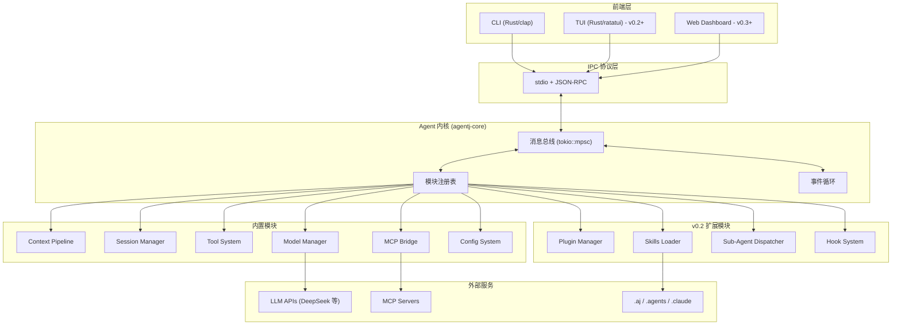
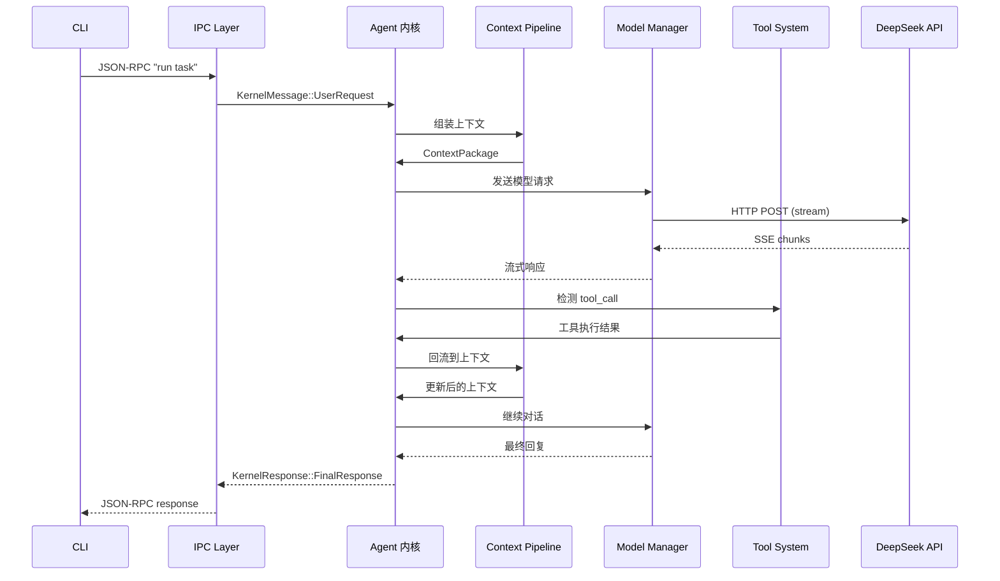

# 设计文档：AgentJ 内核架构

## 概述

AgentJ 是一个面向社区的 AI 编码代理工具，以 Rust 语言构建，采用 Linux 内核式架构设计。其核心设计理念是"内核调度 + 可插拔模块"：一个轻量的 Agent 内核作为消息总线，所有功能——模型管理、工具引擎、MCP 协议、Skills 加载、插件生态——均以独立子系统形式注册到内核，通过消息路由完成协作。

与 opencode / claude code 等主流 agent 工具对标，但差异化在于：

- **Rust 原生**：内核、工具引擎、IPC 层均用 Rust 实现，追求零成本抽象和内存安全
- **前端无关**：通过 stdio + JSON-RPC 协议暴露内核能力，CLI、TUI、Web Dashboard、IDE 插件均可作为协议消费者
- **社区友好**：支持兼容 opencode/claude code 的插件格式，Skills 可加载 `.aj`、`.agents`、`.claude` 多级目录

## 目标与非目标

### 目标

| 阶段 | 目标 |
|------|------|
| v0.1 | 核心链路跑通：CLI 输入 → IPC → 上下文管线 → 模型调用 → 工具执行 → 流式返回 |
| v0.1 | 基础模块可用：Context Pipeline、Session Manager、Tool System、Model Manager（DeepSeek）、MCP Bridge、Config System |
| v0.2 | 生态扩展：Plugin Manager（兼容 opencode/claude code 插件格式）、Skills Loader（多路径）、Sub-Agent Dispatcher、Hook System |
| v0.2+ | 模型扩展：OpenAI 兼容 API、Ollama 本地模型、更多厂商 |
| v0.3+ | 商业扩展：Web Dashboard、用量统计、License 管理 |

### 非目标

- ❌ v0.1 不做 TUI 界面（推迟到 v0.2+，IPC 协议已为此预留）
- ❌ v0.1 不做插件动态加载（仅内置模块，插件框架 v0.2 引入）
- ❌ 不做模型训练/微调（定位是 agent 工具，不是 ML pipeline）
- ❌ 不做 IDE 深度集成（VS Code/JetBrains 插件是 v0.3+ 的事）
- ❌ 不做多语言 runtime（核心 Rust + 配置 TOML，前端可选任意语言）

## 设计方案

### 架构模式

采用**消息总线 + Trait 注册**模式，模仿 Linux 内核的 subsystem 设计。内核维护消息总线，各模块通过 `KernelModule` trait 注册为子系统，模块间不直接通信，全部经过内核路由。

### 备选方案

| 方案 | 优点 | 缺点 | 为何未选用 |
|------|------|------|-----------|
| 消息总线 + Trait（选用） | 类型安全（编译期检查）、模块解耦彻底、调试清晰、最贴合 Linux 内核理念 | 消息定义随模块增多膨胀、channel 有微量开销 | — |
| Actor 模型（actix） | 故障隔离极好、天然支持分布式、插件可不同语言 | actix 生态重、调试复杂、对 agent 工具过度设计 | agent 场景不需要分布式故障隔离 |
| 事件驱动 + 共享 Context | 简单直观、启动快、适合原型 | 锁竞争、模块间隐式耦合、难以扩展 | 违背解耦目标 |

## 架构

### 分层架构



### 模块间通信数据流



### 模块层级：双层 Trait 体系

为兼顾内核集成深度和社区扩展灵活性，模块分为两个层级：

```rust
/// 第一层：普通 Module（社区扩展、自定义工具、模型适配器等）
/// 轻量接口，不直接参与内核消息路由，通过注册回调与内核交互
pub trait Module: Send + Sync {
    /// 模块唯一标识
    fn id(&self) -> ModuleId;

    /// 模块元信息（名称、版本、描述、作者等）
    fn metadata(&self) -> ModuleMetadata;

    /// 初始化，接收内核上下文引用和回调注册器
    fn init(&mut self, ctx: &KernelContext, register: &mut ModuleRegister) -> Result<(), ModuleError>;

    /// 优雅关闭
    fn shutdown(&mut self) -> Result<(), ModuleError>;
}

/// 第二层：KernelModule（内核子系统，如 ModelManager、ToolSystem 等）
/// 深度集成，直接参与内核消息路由
pub trait KernelModule: Module {
    /// 处理内核路由过来的消息
    fn handle(&mut self, msg: KernelMessage) -> Result<KernelResponse, ModuleError>;
}
```

**ModuleRegister** 用于普通模块注册回调：

```rust
pub struct ModuleRegister {
    /// 注册一个工具（如自定义 bash/API 调用）
    pub fn register_tool(&mut self, tool: Box<dyn Tool>) -> Result<(), ModuleError>;
    /// 注册事件钩子
    pub fn on_event(&mut self, event: EventType, handler: Box<dyn EventHandler>) -> Result<(), ModuleError>;
    /// 注册模型 provider
    pub fn register_provider(&mut self, provider: Box<dyn ModelProvider>) -> Result<(), ModuleError>;
}
```

**加载流程**：

```
模块发现 → 解析 metadata → 判断类型
                              ├── KernelModule → init() + 注册到消息路由表
                              └── Module      → init() + 回调注册到 ModuleRegister
```

### 消息枚举

```rust
pub enum KernelMessage {
    // 从 IPC 层进入
    UserRequest {
        session_id: SessionId,
        content: String,
        attachments: Vec<Attachment>,
    },
    // 模块间转发
    ModelResponse(ModelResponseChunk),
    ToolCallRequest(ToolCall),
    ToolCallResult(ToolCallResult),
    // 生命周期
    Shutdown,
}
```

### Rust Crate 拆分

| Crate | 职责 | 阶段 |
|-------|------|------|
| `agentj-core` | 内核：消息总线、模块注册表、Module/KernelModule trait 定义 | v0.1 |
| `agentj-ipc` | stdio + JSON-RPC 协议实现 | v0.1 |
| `agentj-model` | 模型管理：Provider trait + DeepSeek 适配 | v0.1 |
| `agentj-tools` | 工具引擎：内置工具注册/调用/沙箱 | v0.1 |
| `agentj-session` | 会话管理：对话历史、token 计数、压缩 | v0.1 |
| `agentj-context` | 上下文管线：组装、注入、回流 | v0.1 |
| `agentj-mcp` | MCP 协议客户端 | v0.1 |
| `agentj-config` | 多级配置合并 | v0.1 |
| `agentj-plugin` | 插件管理：加载、生命周期、沙箱，支持 Module 注册 | v0.2 |
| `agentj-skills` | Skills 加载：多路径 | v0.2 |
| `agentj-cli` | CLI 前端（clap），唯一二进制入口 | v0.1 |

## 关键设计决策

### 1. 双层模块体系：Module vs KernelModule

**决策**：模块分为两层 trait。普通 `Module` 通过 `ModuleRegister` 回调注册能力（工具、事件钩子、模型 provider），不与内核消息路由直接耦合。`KernelModule` 继承 `Module`，额外实现 `handle()` 方法，深度参与内核消息总线。

**理由**：社区扩展（自定义工具、第三方模型适配）不需要理解内核消息枚举的完整结构。轻量 `Module` trait 降低开发门槛，同时通过回调注册器保证扩展能力。内核内置模块（ModelManager、ToolSystem 等）使用 `KernelModule` 获得完整的消息路由能力。

### 2. 消息总线：tokio::mpsc + 枚举消息

使用 `tokio::mpsc` channel 传递 `KernelMessage` 枚举。tokio 是 Rust 异步的标准运行时，枚举消息在编译期穷举所有可能的消息类型，比 `Box<dyn Any>` 更安全。channel 开销在 agent 场景（秒级延迟）下可忽略。

### 3. 模块加载策略

| | v0.1（编译时） | v0.2（动态） |
|---|---|---|
| 方式 | cargo features 控制模块编译 | WASM 运行时或 `libloading` |
| 内置模块 | 所有 v0.1 模块编译进二进制 | 同左 |
| 社区 Module | 不开放 | 实现 `Module` trait，通过 `ModuleRegister` 注册能力 |
| 社区 KernelModule | 不开放 | WASM 沙箱 + 能力白名单 |
| 兼容方案 | 不支持 | 解析 opencode/claude code 插件 manifest，桥接为 Module 或 KernelModule |

**理由**：v0.1 先验证两层 trait 接口的稳定性。在 trait 定义稳固后再开放第三方扩展，避免 API 频繁变动导致的生态断裂。社区模块推荐使用 `Module` trait（低门槛），仅在需要深度内核集成时使用 `KernelModule`。

### 4. 模型 Provider 抽象

```rust
/// 模型厂商的统一抽象
#[async_trait]
pub trait ModelProvider: Send + Sync {
    /// 流式对话
    async fn chat_stream(
        &self,
        messages: Vec<ChatMessage>,
        tools: Vec<ToolDefinition>,
        options: ModelOptions,
    ) -> Result<BoxStream<'static, Result<ModelEvent, ModelError>>, ModelError>;

    /// 非流式对话
    async fn chat(
        &self,
        messages: Vec<ChatMessage>,
        options: ModelOptions,
    ) -> Result<ChatResponse, ModelError>;
}
```

v0.1 实现 `DeepSeekProvider`（兼容 OpenAI Chat Completions API 格式），后续厂商只需实现同一 trait。

### 5. Skills 加载优先级与合并策略

```
最高优先  .aj/skills/          ← AgentJ 用户/项目级配置
   ↓      .agents/skills/     ← opencode 兼容
   ↓      .claude/skills/     ← claude code 兼容
最低优先  agentj 内置 skills    ← 软件自带
```

同名 Skill：高优先级覆盖低优先级。不同名 Skill：全部加载。

### 6. 插件兼容方案（opencode / claude code）

```
opencode/claude 插件 manifest
        │
        ▼
  适配层：解析 manifest → 生成 AgentJ KernelModule 包装器
        │
        ▼
  AgentJ 内核加载
```

v0.2 优先支持 **manifest 级兼容**（识别插件配置、Skills、MCP 服务器声明），行为级兼容（脚本执行、钩子触发）后续迭代。

## 错误处理

### 错误类型层次

```rust
// agentj-core 中的错误定义
#[derive(Debug, thiserror::Error)]
pub enum KernelError {
    #[error("module '{0}' not found")]
    ModuleNotFound(ModuleId),

    #[error("module '{0}' initialization failed: {1}")]
    ModuleInitFailed(ModuleId, #[source] anyhow::Error),

    #[error("message routing failed for {msg:?}: {reason}")]
    MessageRouteFailed { msg: String, reason: String },

    #[error("shutdown timeout after {0:?}")]
    ShutdownTimeout(Duration),

    #[error("IPC error: {0}")]
    IpcError(#[from] IpcError),
}

#[derive(Debug, thiserror::Error)]
pub enum ModelError {
    #[error("API error ({status}): {message}")]
    ApiError { status: u16, message: String },

    #[error("rate limited, retry after {retry_after:?}")]
    RateLimited { retry_after: Option<Duration> },

    #[error("context length exceeded: {used}/{max} tokens")]
    TokenLimitExceeded { used: usize, max: usize },

    #[error("network error: {0}")]
    Network(#[from] reqwest::Error),
}

#[derive(Debug, thiserror::Error)]
pub enum ToolError {
    #[error("tool '{name}' not found")]
    ToolNotFound { name: String },

    #[error("tool '{name}' execution failed: {reason}")]
    ExecutionFailed { name: String, reason: String },

    #[error("tool '{name}' permission denied: {reason}")]
    PermissionDenied { name: String, reason: String },

    #[error("tool timeout after {0:?}")]
    Timeout(Duration),
}
```

### 错误传播策略

- **内核层**：模块 init/消息处理失败 → 记录日志，不拖垮其他模块。致命错误（如 IPC 断开）→ 触发全局 shutdown
- **模型层**：网络/API 错误 → 自动重试（最多 3 次，指数退避）。Token 超限 → 触发上下文压缩后重试
- **工具层**：执行失败 → 返回错误给模型（让模型自行修复）。超时 → 强制终止并通知模型

## 测试策略

| 层级 | 范围 | 工具 | 目标 |
|------|------|------|------|
| **单元测试** | 每个 crate 的内部逻辑 | `#[cfg(test)]` + tokio test | 覆盖率 > 80% |
| **集成测试** | 模块→内核消息通信 | `tests/` 目录，启动迷你内核 | 验证模块间协作 |
| **E2E 测试** | CLI → 完整流水线 | Mock LLM 服务器 | 核心链路正确性 |
| **契约测试** | IPC JSON-RPC 协议 | 固定请求/响应 snapshot | 协议不退化 |
| **性能测试** | Token 吞吐、延迟 | criterion benchmarks | 流式延迟 < 200ms |

**Mock 策略**：v0.1 提供一个内置的 `MockModelProvider`，返回预定义的流式响应和 tool_call 序列，确保无需真实 API 也可跑通全部测试。

## 依赖

### v0.1 核心依赖

所有依赖统一采用 `cargo add` 时的默认最新稳定版，避免锁定旧版本导致后续升级困难。版本号大致范围如下（实际以 `cargo add` 为准）：

```toml
[dependencies]
tokio = { version = "1", features = ["full"] }
serde = { version = "1", features = ["derive"] }
serde_json = "1"
reqwest = { version = "0.12", features = ["json", "stream"] }
thiserror = "2"
anyhow = "1"
toml = "0.8"
futures = "0.3"
tokio-stream = "0.1"
tracing = "0.1"
tracing-subscriber = { version = "0.3", features = ["env-filter"] }
clap = { version = "4", features = ["derive"] }
```

### 开发环境

| 前置条件 | 说明 |
|---------|------|
| Rust 1.96+ | 稳定版 toolchain |
| DeepSeek API Key | v0.1 集成测试和手动验证 |
| Git | 版本管理 |

### 阻塞项

- DeepSeek API 的 tool-calling 能力验证（需实际测试流式 tool_call 支持情况）
- opencode / claude code 插件 manifest 格式调研（v0.2 前置）
