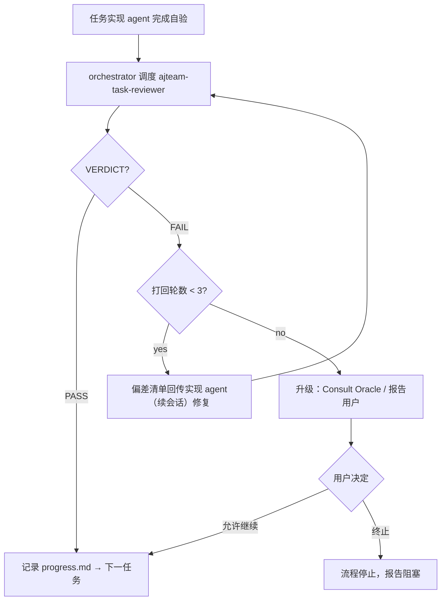

# 设计文档：ajteam-task-reviewer 代码审查 Agent

> 类型：开发流程工具（非产品功能）· 不影响 agentj 运行时行为

## 概述

在 `jskill-feature-dev` 的 TDD 执行阶段，每个任务完成后插入一个专门的代码审查 agent（`ajteam-task-reviewer`），负责检查**实现与对应任务（AC/verify）以及设计文档之间是否存在偏差**。发现偏差时采用**硬门控**：将任务打回实现 agent 修复，重新审查，通过后才进入下一任务。

当前 `jskill-feature-dev` Phase 4 的「Two-phase review per task」（spec compliance + code quality）仅有流程描述，没有专用的 agent 定义。本设计创建该 agent 文件并替换 Phase 4 的两阶段审查。

## 目标与非目标

- **目标**：
  - 创建 `.claude/agents/ajteam-task-reviewer.md` — Claude Code 标准 subagent 定义
  - 将 `jskill-feature-dev` Phase 4 替换为 task-reviewer 硬门控，FAIL 打回重做
  - 打回上限 **3 轮**；仍 FAIL 则升级，禁止绕过门控
- **非目标**：
  - 不做代码风格 / TDD 纪律 / 性能 / 安全审查（由 Phase 5 全面代码审查覆盖）
  - 不运行测试验证（orchestrator 任务后自验 lint + test 保持现状）
  - 不接入 `jskill-bug-fix` 流程（保持其现有 Phase 5 code review）
  - 不创建新的命令（jcmd-*）或技能（jskill-*）

## 设计方案

### 交付物

| 文件 | 动作 | 内容 |
|------|------|------|
| `.claude/agents/ajteam-task-reviewer.md` | 新建 | 审查 agent 定义（frontmatter + 只读工具 + 审查维度 + 输出格式） |
| `.claude/skills/jskill-feature-dev/SKILL.md` | 修改 | Phase 4 两阶段审查 → task-reviewer 硬门控 + 3 轮打回循环 |

### Agent 定义（`.claude/agents/ajteam-task-reviewer.md`）

- **只读 agent**：工具限定 `read` / `grep` / `glob` / `git diff`（不运行测试、不编辑文件）
- **输入**（orchestrator 调度时在 prompt 中提供）：
  - 任务 brief：`id`、`title`、`files`、`ac`（GIVEN/WHEN/THEN）、`verify`、`breaking`
  - 设计文档路径（`docs/superpowers/specs/*-design.md`）
  - 本次任务变更范围（文件清单 / git diff 范围）
- **检查维度**（仅两个核心，聚焦偏差检测）：
  1. **任务 AC/verify 符合性**：逐条 AC 核对实现是否真实满足；`then` 是否可观测地达成；verify 命令所验证的行为是否存在于代码中
  2. **设计文档符合性**：对照设计文档的设计方案 / 架构 / 关键决策 / 错误处理路径，检查实现是否偏离（绕过设计决策、缺失设计要求的错误处理、接口签名不符等）
- **输出格式**（结构化，便于 orchestrator 解析并回传实现 agent）：

  ```text
  VERDICT: PASS | FAIL
  检查项：AC-1 ✅ / AC-2 ❌ / DESIGN-3 ❌
  偏差清单：
  - [AC-2] <具体偏差描述 + 代码位置>
  - [DESIGN-3] <设计要求 vs 实际实现>
  建议：<给实现 agent 的修复指引>
  ```

### 调度流程（jskill-feature-dev Phase 4 改造）



**关键规则：**
- 每次 FAIL 打回后，实现 agent 通过 `task(task_id=ses_...)` 续会话修复，保留上下文
- 审查 agent 每次调度为**独立 subagent**（`ajteam-task-reviewer`），不复用实现 agent 的会话
- 打回上限 **3 轮**（含第 1 次 FAIL 起算）；3 轮仍 FAIL 禁止静默放行
- PASS/FAIL 与偏差清单记录到 `.superpowers/sdd/progress.md`

### 调度 prompt 模板（写入 skill 文档）

沿用 momus 审查 prompt 的 6 段结构：

```text
TASK: 审查任务 {id} — {title} 的实现是否与任务 AC/verify 及设计文档存在偏差。
EXPECTED OUTCOME: 结构化审查报告（VERDICT: PASS/FAIL + 偏差清单 + 修复建议）。
REQUIRED TOOLS: read, grep, glob, git diff — 只读，禁止运行测试/编译。
MUST DO:
  - 读取设计文档 {spec-path} 与任务 brief（AC/verify/files）
  - 逐条 AC 核对实现是否真实满足，then 是否可观测达成
  - 对照设计文档检查实现是否偏离（架构/关键决策/错误处理/接口签名）
  - 输出 VERDICT 与偏差清单，每条附代码位置
MUST NOT DO:
  - 编辑任何文件、运行测试或构建命令
  - 审查代码风格/命名/性能/安全（属 Phase 5 范围）
  - 自行修复偏差 — 仅报告
CONTEXT: 任务 brief = {ac/verify}；设计文档 = {spec-path}；变更范围 = {files/diff}。
```

## 备选方案

| 方案 | 优点 | 缺点 | 为何未选用 |
|------|------|------|-----------|
| 软报告（FAIL 仅记录不阻塞） | 执行更快，不打断节奏 | 偏差累积，后期返工成本高 | 用户选定硬门控 |
| 保留两阶段审查 + 追加 task-reviewer | 信息更全 | 步骤重叠、冗余 | 用户选定替换 |
| 仅创建 agent 不改 skill | 改动最小 | 无强制调度点，agent 可能被绕过 | 用户选定替换 Phase 4 |

## 关键设计决策

| 决策 | 选项 | 选择 | 理由 |
|------|------|------|------|
| Agent 形态 | agents 文件 / skill / 两者 | `.claude/agents/` 子代理文件 | 职责单一、可复用；用户选定 |
| 门控行为 | 硬门控 / 软报告 | 硬门控：FAIL 打回重做 | 阻止偏差扩散到后续任务 |
| 打回轮数 | 2 / 3 | **3** | 给实现 agent 充分修复机会，同时避免无限循环 |
| 检查维度 | 4 项候选 | 仅 AC/verify + 设计符合性 | 聚焦「偏差检测」这一核心职责 |
| 适用范围 | feature-dev / +bug-fix | 仅 feature-dev | bug-fix 已有 Phase 5 review |

## 错误处理

| 条件 | 动作 |
|------|------|
| 审查 agent 返回格式不完整（缺 VERDICT） | 判定 FAIL，重新调度审查（计 1 轮） |
| 3 轮打回仍 FAIL | 升级：Consult Oracle 获取新视角 → 报告用户，等待决定；禁止静默放行 |
| 实现 agent 修复后引入新回归 | 按 jskill-feature-dev 既有「测试破坏」规则处理：当前任务必须通过验证才能继续 |

## 测试策略

- **审查演练**：用 v0.1 PLAN.md 中一个结构化任务 brief 做一次模拟审查，构造一个含偏差的实现，验证 agent 能输出 FAIL + 准确的偏差清单
- **文档一致性**：skill 修改后检查 Phase 4 / 错误处理 / 快速参考表内容自洽
- 本设计为流程工具变更，无产品级代码可测；通过上述演练 + 用户走查验证

## 依赖

- 前置：`jskill-feature-dev` Phase 4 现有结构（已存在）
- 无外部 crate / 服务依赖
- 阻塞项：无

## 实施清单

- [x] T0: 创建 `.claude/agents/ajteam-task-reviewer.md` agent 定义（✅ 已提交）
- [x] T1: 修改 `jskill-feature-dev` Phase 4 为 task-reviewer 硬门控（✅ 已提交）
- [x] T2: 本清单更新 — 已完成
