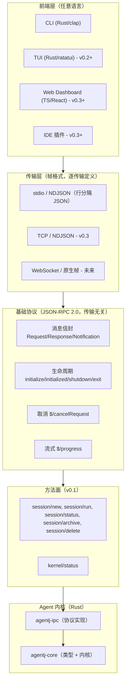
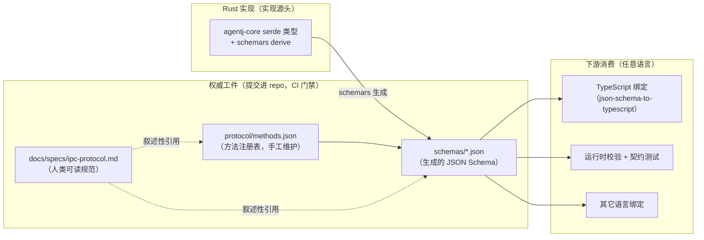
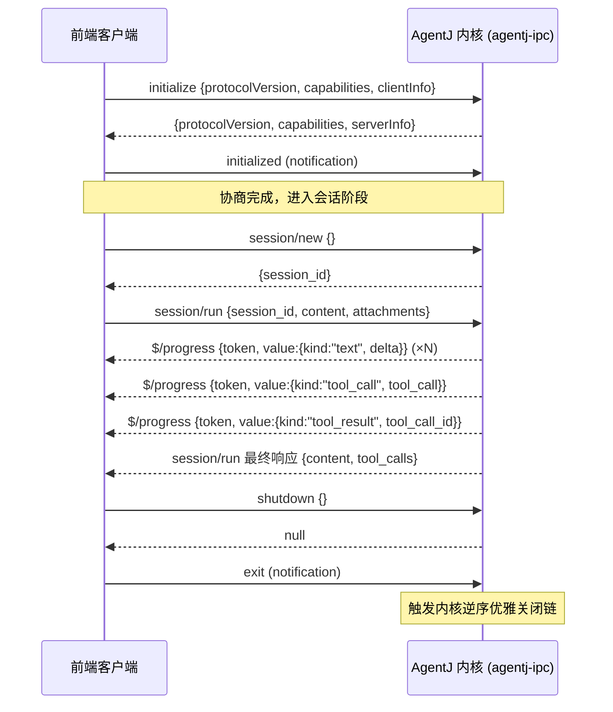
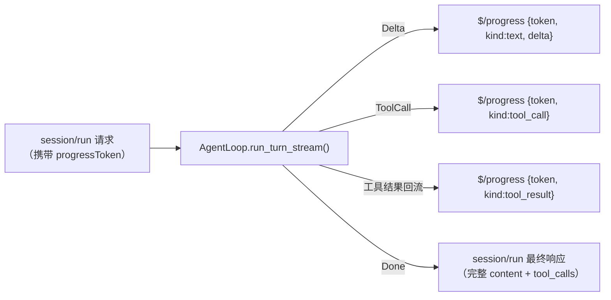

# 设计文档：AgentJ 统一 UI 接口规范（IPC 协议 + JSON Schema）

## 概述

AgentJ 采用「内核调度 + 可插拔模块」架构，内核通过 IPC 层对外暴露能力。设计上明确「前端无关」：CLI、TUI、Web Dashboard、IDE 插件都作为**同一套协议的消费者**，通过 stdio + JSON-RPC 2.0 连接内核（`docs/superpowers/specs/2026-08-09-agentj-core-design.md` 概述与分层架构章节已确立此方向）。

现状缺口：协议目前只有零散的方法名（`session/new`、`session/run`、`shutdown`、`kernel/status`）散落在 v0.1/v0.3 实现计划里，**没有一份权威的、语言无关的协议规范 + JSON Schema**。v0.3 计划明确标注 Web Dashboard 的 `kernel/status` payload schema 为 `[design-pending]`。若不在写任何前端之前先立契约，任意语言的前端各自凭计划里的只言片语猜测实现，接口必然漂移、不一致。

本特性**契约先行**：在 v0.1 开发开始前，产出一份单一权威的接口规范（协议文档 + JSON Schema + 方法注册表），作为所有语言前端实现的唯一契约，并配套契约测试与 CI 漂移门禁保证「接口实现的一致性」。

## 目标与非目标

### 目标

| 编号 | 目标 |
|------|------|
| G1 | 一份权威、语言中立的 **IPC 协议规范**（人类可读 Markdown），覆盖传输帧、基础协议、生命周期、流式、取消、方法面 |
| G2 | 一套**机器可读的 JSON Schema**（`schemas/*.json`）作为消息 payload 的唯一事实来源，任意语言可从中生成绑定/校验消息 |
| G3 | 一份**方法注册表**（`protocol/methods.json`）捕获 JSON Schema 表达不了的方法语义（method 字符串 ↔ params/result 引用、方向、类型） |
| G4 | **版本化 + 能力协商**：`initialize` 握手交换协议版本与能力，前端可探测后端能力、优雅降级 |
| G5 | **一致性保证机制**：Rust 侧 `schemars` 生成 Schema + 契约测试钉死 wire 格式 + CI 漂移门禁 |
| G6 | **v0.1 方法面完整定义**：lifecycle + `session/*` + `kernel/status` + 流式/取消，schema 精确到字段 |

### 非目标

- ❌ 不定义 v0.2/v0.3 方法的完整 Schema（hooks / sub-agent / skills / plugin / stats / license 列为「预留路线图」占位，待各自设计落地后再补）
- ❌ 不在 v0.1 实现 TCP / WebSocket 传输（TCP 属 v0.3，WebSocket 属未来；规范仅在传输抽象层为其预留）
- ❌ 不做 IDE 深度集成的专属接口（VS Code/JetBrains 插件属 v0.3+，作为协议消费者不新增专属方法）
- ❌ 不在 v0.1 引入 meta-model 代码生成器（方案 B，见「备选方案」，v0.2+ 可选演进）
- ❌ 不做多语言 runtime（核心 Rust + 配置 TOML，前端任意语言——这正是本规范存在的意义）

## 设计方案

### 核心方案

以 **JSON Schema 为权威工件**（提交进 repo、CI 门禁），Rust 侧用 `schemars` 从 serde 类型**生成并校验**该 Schema（非手写，保证内核实现永不漂移）；TypeScript 等其它语言从这份提交的 Schema 生成绑定。由于 JSON Schema 无法表达「这是方法 X 的请求、方向是 client→server」这类方法语义（LSP 维护者的既有结论，见备选方案），补一层**机器可校验的方法注册表**。

### 备选方案

| 方案 | 优点 | 缺点 | 为何未选用 |
|------|------|------|-----------|
| A. 提交的 JSON Schema + 方法注册表（选用） | 语言中立、机器校验、代价最小；注册表是迈向 meta-model 的一小步 | 两个工件（schema + 注册表）需同步，靠契约测试/CI 校验 | — |
| B. LSP 式 meta-model（单一模型） | 真正单一事实来源，方向/方法/类型全在一处（LSP 收敛于此，lsprotocol / gen-lsp-types 已验证） | v0.1 就引入 codegen 步骤，对 6–8 个方法的 v0.1 面是过度设计 | v0.1 面太小，不值得引入 codegen；A 的注册表已为升级到 B 留路径 |
| C. 纯 Rust 类型为源 | 零漂移、最少工作 | 把「语言中立」锚定在 Rust，与「任意语言」目标矛盾 | 违背 G1/G2 的「语言中立」核心诉求 |

> **方案 B 的演进路径**：若 v0.2/v0.3 方法面膨胀（hooks、插件、子代理等大量方法），`protocol/methods.json` 可升级为 LSP 式 meta-model（增加 types/enumerations 描述 + codegen），Schema 与注册表语义不变，是加性演进而非重构。

## 架构

### 分层架构



**关键边界**：消息**内容**（JSON-RPC 信封 + 方法面）完全传输无关；每个传输只定义自己的**帧格式**。这样未来加 WebSocket 网关时，方法面零改动，只新增一个帧适配。

### 唯一事实来源与代码生成流



**事实来源层级**：

- **机器事实来源**：`schemas/*.json`（消息 payload 结构）+ `protocol/methods.json`（方法语义：method ↔ schema 引用、方向、类型）。二者是下游代码生成与运行时校验的唯一输入。
- **人类事实来源**：`docs/specs/ipc-protocol.md`（叙述规范，引用上述两个工件）。
- **一致性锚点**：Rust `schemars` 生成 `schemas/*.json` 并提交；契约测试断言 Rust 实际 wire 输出 == Schema；CI 漂移门禁在生成结果与提交版本不一致时失败。

### 消息生命周期（版本协商 + 会话）



### 流式数据流（token 解耦）



**流式模型核心**（沿用 LSP 的 `$/progress` + token 解耦设计）：`session/run` 是一个请求，最终返回**恰好一个**最终响应（满足 JSON-RPC「一请求一响应」不变量）；增量数据（token 增量、tool_call 事件、工具结果）通过 `$/progress` 通知**带外**下发，token 与请求 id 解耦，前端无需预注册即可流式接收。

## 协议规范结构（规范文档自身的大纲）

`docs/specs/ipc-protocol.md`（本特性的实现产物）按 LSP 文档结构组织：

1. **Scope & Conformance** — RFC 2119 术语（MUST/SHOULD/MAY）
2. **传输与帧** — stdio/TCP（NDJSON，一行一条消息）、WebSocket（原生帧，预留）；消息大小上限；传输各自的关闭语义
3. **基础协议** — 消息信封、id 规则、错误对象、错误码表、`$/` 扩展约定
4. **生命周期** — `initialize` / `initialized` / `shutdown` / `exit`；协议版本协商 + 能力交换
5. **消息顺序与并发** — 响应大致按序、顺序无关时可重排（LSP 规则）
6. **取消** — `$/cancelRequest`，被取消请求仍需响应
7. **进度与流式** — `$/progress`、token 模型、value 判别（text / tool_call / tool_result）
8. **方法面** — 每方法一节，采用 LSP 六段式：能力声明 → 请求 → 响应 → 部分结果 → error.data
9. **枚举与向前兼容** — 未知枚举值忽略/保留、不可致命
10. **机器可读模型** — 指向 `schemas/*.json` + `protocol/methods.json`
11. **版本化与变更日志** — `@since` 注解 + 逐版本 changelog

## 关键设计决策

### 1. 消息信封：NDJSON 帧 + JSON-RPC 2.0

**决策**：每个消息一条 JSON（NDJSON，行分隔），信封严格遵循 JSON-RPC 2.0：请求 `{jsonrpc:"2.0", id, method, params}`、通知（无 id）、响应 `{jsonrpc:"2.0", id, result}` 或 `{jsonrpc:"2.0", id, error:{code,message,data?}}`。`id` 为 integer|string，**永不为 null、会话内永不复用**（MCP 比 JSON-RPC 更严的规则）；`params` 一律按名对象（by-name），不用位置参数（LSP 约定，方法面增长后可维护）。`result` 与 `error` 互斥。

**理由**：NDJSON 与 v0.1 计划已采用的 `read_line`/`write + \n` 帧一致（无需 Content-Length 头），JSON 字符串内换行已转义为 `\n`，安全。JSON-RPC 2.0 是 LSP/MCP 共同基底，直接复用信封与错误语义，不造轮子。by-name params 避免位置参数在方法演进时成为破坏源。

### 2. `initialize` 握手：语义化版本 + 能力对象 + 加性纪律

**决策**：连接建立后客户端先发 `initialize`，双方交换 `protocolVersion`（semver：major 破坏 / minor 加方法 / patch 修 bug）+ 两个能力对象（client/server capabilities）+ 元信息（clientInfo/serverInfo）。之后严格「只加不改」：新方法/新字段均为加性、带 `@since` 注解；**未知能力、未知枚举值一律忽略/保留，绝不致命**。客户端在 `initialize` 返回版本不兼容时断开。

**理由**：这是 LSP + MCP 的共同模式——一个轻量握手同时解决「版本协商」和「能力探测」，v0.1 实现成本 ≈ 一对 `initialize`/`initialized` + 两个对象，无需重型状态机。v0.2 出现真正可选能力（hooks、插件）时，直接作为能力标志加进 capabilities 对象，无需重构。

### 3. token 解耦的 `$/progress` 流式

**决策**：流式采用 `$/progress` 通知，`params:{token, value}`，`token` 为 integer|string 且**独立于请求 id**；`value` 按 `kind` 判别：`text`（token 增量）、`tool_call`（模型请求工具）、`tool_result`（工具执行结果）。`session/run` 最终返回一个完整响应。取消用 `$/cancelRequest {id}`，被取消请求仍必须返回响应（JSON-RPC 不变量），可返回部分结果（LSP 规则）。

**理由**：token 与请求 id 解耦使流式可带外进行、可服务通知、无需前端预注册（LSP「out of band」设计）。`value` 的判别 kind（`text`/`tool_call`/`tool_result`）是设计级分类，覆盖「文本增量 / 模型请求工具 / 工具结果回流」三类 turn 级事件；**确切的 kind 集合在实现计划阶段对照 `AgentLoop::run_turn_stream()` 的 `AgentEvent` 枚举最终定稿**（本设计只锁定「token 解耦 + 一请求一最终响应」的机制，不锁定具体事件枚举）。一请求一最终响应保住 JSON-RPC 语义，增量数据走通知，与现有 v0.1 计划「流式返回」目标一致。

### 4. 错误码分段

**决策**：沿用 JSON-RPC 保留段，并在其下方（LSP 风格）划分 agentj 保留块：

| 码 | 含义 | 来源 |
|---|---|---|
| `-32700` | Parse error | JSON-RPC |
| `-32600` | Invalid Request | JSON-RPC |
| `-32601` | Method not found | JSON-RPC |
| `-32602` | Invalid params | JSON-RPC |
| `-32603` | Internal error | JSON-RPC |
| `-32000…-32099` | Server error（实现自定义） | JSON-RPC |
| `-32800` | RequestCancelled | agentj |
| `-32801` | ServerNotInitialized（initialize 前收到请求） | agentj |
| `-32802` | SessionNotFound（映射 `SessionError::NotFound`） | agentj |
| `-32803` | SessionInactive（archived/deleted，映射 `SessionError::InactiveSession`） | agentj |
| `-32804` | InvalidVersion（协议版本不兼容） | agentj |

**理由**：协议错误（信封/初始化/会话/取消）与领域错误（工具失败、模型错误）分离——工具/模型错误作为**结果数据**返回（进流式/响应），不占用 JSON-RPC 错误码；JSON-RPC 错误码只表达协议层失败。映射既有 `SessionError` 变体，避免新错误体系。

### 5. 方法命名规范

**决策**：方法名统一 `namespace/action` 小写（`session/new`、`kernel/status`）；协议级扩展用 `$/` 前缀（`$/cancelRequest`、`$/progress`），沿用 LSP「`$/` 前缀表示可忽略的协议扩展」约定；`rpc.` 前缀为 JSON-RPC 保留，禁用。

**理由**：命名空间化避免未来方法面膨胀时命名冲突；`$/` 让「可安全忽略的通知/扩展」一眼可辨，前端对不认识的 `$/` 通知可直接忽略而不失败。

### 6. 权威工件与一致性锚点

**决策**：`schemas/*.json`（schemars 生成）+ `protocol/methods.json`（方法注册表）为机器事实来源，`docs/specs/ipc-protocol.md` 为人类事实来源。Rust `agentj-core` 类型加 `#[derive(JsonSchema)]`，`agentj-ipc` 提供生成入口；契约测试断言 wire 输出 == Schema；CI 漂移门禁在 `cargo test` 内重新生成并与提交版本 diff，不一致即失败。

**理由**：schemars 生成保证内核实现与 Schema 零漂移；提交的 Schema 又让任意语言（TS/其它）从单一工件生成绑定，语言中立。方法注册表补上 JSON Schema 表达不了的方法语义（method/direction/kind），是 LSP「JSON Schema 不足以描述 request/notification」结论下的最小补丁。

### 7. v0.1 方法面（完整，含生命周期）

| 方法 | 类型 | 方向 | params | result | 说明 |
|------|------|------|--------|--------|------|
| `initialize` | request | C→S | `{protocolVersion, capabilities?, clientInfo?}` | `{protocolVersion, capabilities?, serverInfo}` | 版本 + 能力协商 |
| `initialized` | notification | C→S | `{}` | — | 客户端就绪 |
| `shutdown` | request | C→S | `{}` | `null` | 触发内核优雅关闭链 |
| `exit` | notification | C→S | `{}` | — | shutdown 后进程退出 |
| `session/new` | request | C→S | `{}` | `{session_id}` | 新建会话 |
| `session/run` | request | C→S | `{session_id, content, attachments?, progressToken?}` | `{content, tool_calls?}` + `$/progress` 流 | 运行一轮（流式） |
| `session/status` | request | C→S | `{session_id}` | `{status: "active"\|"archived"\|"deleted"}` | 查询会话状态 |
| `session/archive` | request | C→S | `{session_id}` | `null` | 软删除（v0.1 契约，见核心设计决策 #14） |
| `session/delete` | request | C→S | `{session_id}` | `null` | 硬删除 |
| `kernel/status` | request | C→S | `{}` | `{version, modules:[{id, state}]}` | 模块状态（`Kernel::module_state` 消费） |
| `$/cancelRequest` | notification | 双向 | `{id}` | — | 取消进行中的请求 |
| `$/progress` | notification | S→C | `{token, value}` | — | 流式增量（text/tool_call/tool_result） |

> `session/archive`/`session/delete`/`session/status` 映射 v0.1 已固化的 `SessionStore` 生命周期契约（`status`/`archive`/`delete`，核心设计决策 #14）；过期回收（expire）语义属 v0.2，届时以加性方法（如 `session/expire` 或 TTL 配置）引入。

## 错误处理

### 错误对象

错误响应携带标准 JSON-RPC 错误对象：`{code: integer, message: string, data?: object}`。`data` 预留结构化上下文（如会话 id、模块 id、字段级校验错误）。

### 错误传播策略

- **信封层**：JSON 解析失败 → `-32700`；非法请求结构 → `-32600`；未知方法 → `-32601`；params 校验失败 → `-32602`；内部未预期错误 → `-32603`
- **生命周期层**：`initialize` 前收到业务方法 → `-32801 ServerNotInitialized`；版本不兼容 → `-32804 InvalidVersion`（客户端应断开）
- **会话层**：会话不存在 → `-32802 SessionNotFound`；对 archived/deleted 会话执行 `session/run`/`append` → `-32803 SessionInactive`
- **取消层**：`$/cancelRequest` 后，被取消请求以 `-32800 RequestCancelled` 响应（仍必须响应）
- **领域层**（非协议错误）：工具失败/模型错误作为**结果数据**返回，进 `session/run` 流式与最终响应，不占用 JSON-RPC 错误码——前端在 payload 内感知，协议层不因领域失败而报错

## 测试策略

| 层级 | 范围 | 工具 | 目标 |
|------|------|------|------|
| **Schema 生成测试** | `schemars` 从 Rust 类型生成 Schema | `cargo test -p agentj-ipc` | 生成成功且与提交的 `schemas/*.json` 一致 |
| **契约测试** | IPC 实际 wire 输出 == Schema | 固定请求/响应 snapshot + JSON Schema 校验 | 协议不退化、wire 格式被 Schema 钉死 |
| **信封测试** | 请求/响应/通知/错误对象序列化往返 | serde roundtrip + 非法用例 | 信封结构与 JSON-RPC 2.0 一致 |
| **生命周期测试** | initialize 握手、版本协商、未初始化拒绝 | mock 客户端 + 真实 IPC server | 握手正确、`-32801`/`-32804` 语义正确 |
| **流式测试** | `session/run` 的 `$/progress` 增量序列 | mock AgentLoop + 真实 IPC | token 关联正确、最终响应唯一、取消后仍响应 |
| **会话契约测试** | status/archive/delete 语义 | InMemory SessionStore + IPC | 错误映射（`-32802`/`-32803`）正确 |
| **漂移门禁（CI）** | 重新生成 Schema 与提交版本 diff | `cargo test` 内联生成 + diff | 任何手工改动/漂移即失败 |
| **跨语言绑定测试** | TS 侧从 Schema 生成类型 + 编译 | `json-schema-to-typescript` + `tsc` | 生成的 TS 类型可编译、与 Schema 一致 |

**Mock 策略**：契约测试用 mock `AgentLoop`（复用 v0.1 计划已有的 stub/MockModelProvider）驱动确定性的流式序列，无需真实 LLM 即可验证流式与取消。

## 依赖

### 工件依赖

| 工件 | 路径 | 生成方式 | 门禁 |
|------|------|----------|------|
| 协议规范 | `docs/specs/ipc-protocol.md` | 手工（叙述性权威） | 评审 |
| JSON Schema | `schemas/*.json` | `schemars` 从 `agentj-core` 类型生成 | CI 漂移门禁 |
| 方法注册表 | `protocol/methods.json` | 手工（小体积） | 契约测试校验一致性 |

> 最终路径在实现计划阶段定稿（可能为 `docs/specs/ipc-protocol.md` + 顶层 `schemas/` + `protocol/`，或统一到 `docs/specs/ipc-protocol/` 目录下）。

### Rust 依赖（在 v0.1 计划基础上新增）

```toml
# agentj-core（已有 serde，新增 schemars 用于导出 Schema）
schemars = { version = "1", features = ["derive"] }
# agentj-ipc（契约测试用）
#   serde_json 已有；JSON Schema 校验可用 jsonschema crate 或直接 snapshot diff
```

### 前置条件 / 阻塞项

- v0.1 计划尚未执行（workspace 未 scaffold）——本规范作为 v0.1 的 agentj-ipc（T13/T14）契约基准，**需在 IPC 实现落地前定稿**，实现任务引用本规范
- `schemars` 生成的 Schema 默认 draft（2020-12），需确认与 TS 侧 `json-schema-to-typescript` 兼容（2020-12 支持良好）
- v0.1 计划中 IPC 方法名（`session/new`、`session/run`、`shutdown`）需与本规范方法面核对一致（`kernel/status` 在 v0.3 计划中为 provisional，本规范将其升格为 v0.1 正式方法，因 `Kernel::module_state` 在 v0.1 已存在）

### 遗留问题 / 已知限制

- **传输扩展**：TCP 多连接（v0.3）、WebSocket 网关（未来）的连接生命周期、鉴权、限流、最大连接数策略，本规范仅在传输抽象层预留，具体设计随 v0.3 落地
- **meta-model 演进**：方法面膨胀后可将 `protocol/methods.json` 升级为 LSP 式 meta-model（加 types/enumerations + codegen），属加性演进，见备选方案 B
- **批量请求（batch）**：JSON-RPC 2.0 支持 batch，但 v0.1 协议面暂不启用（前端与内核交互是顺序会话型），规范在基础协议层保留 batch 语义、方法面不承诺 batch 支持，v0.2+ 再议
- **`session/run` 的 `progressToken`**：默认服务端分配（若请求未携带），服务端分配的 token 需在首个 `$/progress` 或最终响应中告知——实现计划阶段定稿该字段的确切语义
