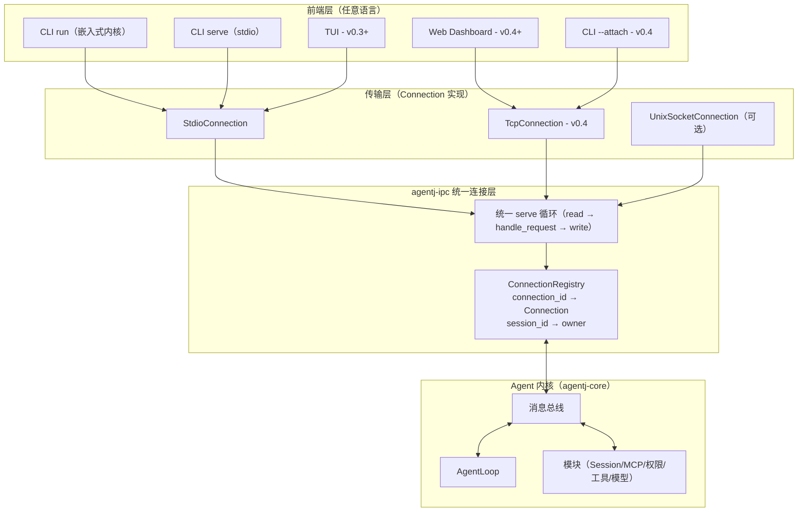
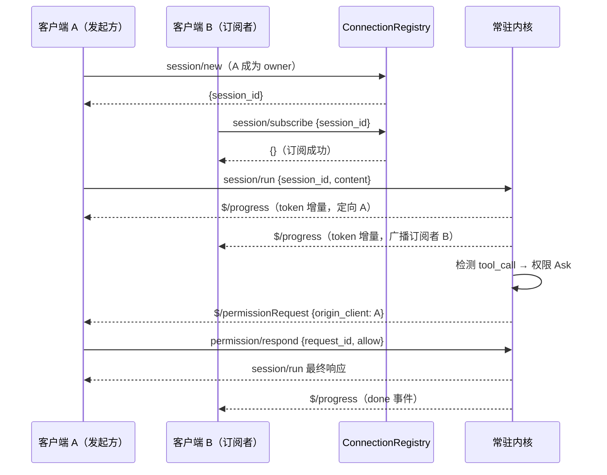
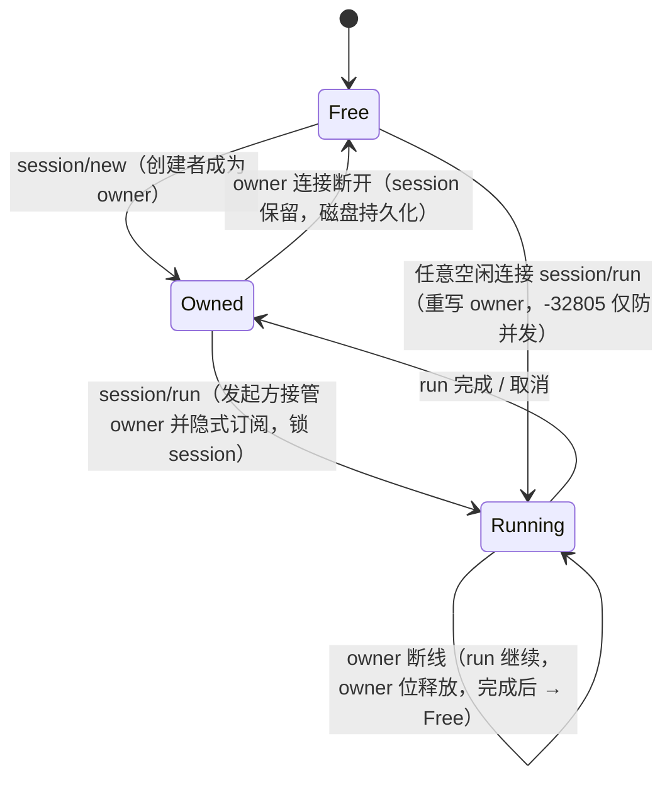
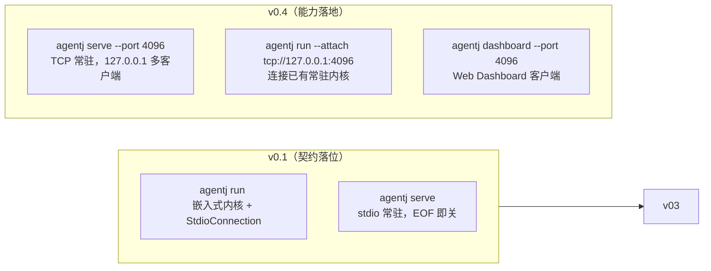

# 设计文档：守护内核（常驻 API 服务）能力

> **实现状态（2026-08-23）**：本设计已在 v0.4 落地——多客户端常驻 TCP 内核（`serve --port` / `run --attach` / `dashboard`）、统一 Connection 抽象（stdio 哨兵 / TcpConnection）、协议加性扩展（`session/subscribe`/`unsubscribe`、`$/progress` 广播、`origin_client` 属主路由、`-32805`/`-32806`、`initialize` token/`connection_id`/`multi_client`）、agentj-stats 用量钩子经 AgentLoop on-turn-complete 接线。WebSocket 网关与运行状态机/控制权转移仍为后续阶段预留。
>
> **实现回填（v0.4.1 复审）**：下述设计要点与 v0.4 实现存在偏差，已在正文同步修订——① 「run 即接管 owner」：实现中 `session/run` 会重写 owner 并隐式订阅发起方（非 owner 也可 run，只要无并发），与初版状态机「只有 owner 能 run」不同，见决策 #4/#7 与状态机；② 新增 `Connection`::`writer()` 半连接写句柄拆分（`ConnectionWriter`），保证 idle 订阅者不丢广播，见决策 #1；③ TCP 常驻下 `shutdown`/最后连接断开触发**全局**优雅关闭，而非仅断请求方，见决策 #7 与 §错误处理；④ `initialize` 认证字段为 `InitializeParams.token`（对应协议规范 §4.1 已补）。

## 概述

AgentJ 的内核架构定位是「前端无关」：CLI、TUI、Web Dashboard、IDE 插件均作为同一套 JSON-RPC 2.0 协议的消费者连接内核。但现有设计（v0.1 计划）的进程模型是**每进程一内核**——内核嵌入 CLI 进程，通过 stdio 服务单一客户端，EOF/信号即触发优雅关闭并退出。这带来三个无法靠磁盘持久化单独解决的诉求：

1. **运行级接管**：一个 UI 发起的 `session/run` 未完成时，另一个 UI（如 Web Dashboard）无法实时看到进度、无法在发起方断线后继续观测——因为内核随发起方进程一起消亡。
2. **资源级复用**：每次启动内核都要冷启动（MCP 长驻连接、模型 provider 连接、权限 allow_always 会话态、模型目录缓存），多 UI 切换即重复冷启动。
3. **历史级接续的一致性**：FileBackedStore（v0.3 已设计）解决「重启后会话仍在」，但「同一内核实例服务所有 UI」能让历史、运行态、审批态、资源全部对齐在同一份进程内状态上。

本特性为 AgentJ 引入**守护内核（常驻 API 服务）能力**：`agentj serve` 按需常驻一个内核实例，通过统一的 Connection 抽象（stdio / TCP）服务多个并发客户端；客户端可共享会话、订阅运行进度、定向审批，实现「同一 PC 所有 UI 提供相同服务、能够接续任务」。

生态参照（调研结论）：主流 AI 编码代理（opencode / Claude Code / Aider / Codex）全部采用「无守护、进程即开即用 + 磁盘持久化接续」；多客户端共享的正确形态是**可选 server 模式**（opencode `serve`、Codex `app-server`），且这些 server 是客户端 spawn 或手动启动，**没有 OS 级守护进程**。本设计遵循该生态事实，定位为「按需常驻」，不做 launchd/systemd 托管。

## 目标与非目标

### 目标

| 编号 | 目标 |
|------|------|
| G1 | **统一传输抽象**：`Connection` trait 作为 stdio / TCP / Unix socket 的统一连接契约，v0.1 `serve_stdio` 直接按此构建（契约先行），v0.4 新增 TCP 传输零重构 |
| G2 | **常驻内核**：`agentj serve` 启动常驻内核，绑定 127.0.0.1，多个客户端连接共享同一内核实例（Kernel + AgentLoop + 模块） |
| G3 | **历史级接续**：跨 UI / 跨进程会话恢复（依赖 v0.3 FileBackedStore 地基），常驻内核下会话一致性更强 |
| G4 | **运行级接管（订阅 + 单发起方控制）**：任意客户端可订阅某 session 的运行进度（`session/subscribe` + `$/progress` 广播）；审批响应与取消仅属主（当前发起方）可用；同 session 并发 run 互斥 |
| G5 | **资源级复用**：MCP 长驻连接、模型连接、allow_always 会话态、模块生命周期状态在常驻内核内跨客户端共享 |
| G6 | **权限审批定向**：`$/permissionRequest` 定向发给发起该 run 的客户端（`origin_client` 字段），`permission/respond` 校验发起方归属 |
| G7 | **协议加性纪律**：全部扩展走「只加不改」（新字段 / 新方法 / 新错误码），v0.1 协议面零破坏 |
| G8 | **阶段衔接（契约合并）**：Connection 契约作为 v0.1 计划**正式任务**（T13 按 Connection 模型构建），多客户端 serve 能力 v0.4 落地，与既有 v0.4 计划（T0/T3/T4）对齐而非另起炉灶 |

### 非目标

- ❌ 不做 OS 级守护进程（launchd / systemd 托管、开机自启、崩溃自动重启、日志轮转）——生态无先例，按需常驻已满足诉求
- ❌ 不做 WebSocket 网关（未来预留，Connection 抽象已为其留位，本设计不实现）
- ❌ 不做控制权转移（完整接管：暂停 / 追加输入 / 重定向输出到新客户端）——运行级接管只做到「广播订阅 + 单发起方控制」，控制权转移属后续阶段独立设计
- ❌ 不做 `session/run` 重试化 / checkpoint / resume 语义——常驻内核本身就是运行状态持有者，断线客户端的 run 继续执行，重连 + subscribe 即恢复观测，无需协议层重试
- ❌ 不做多内核实例编排（如每项目一个常驻内核、内核间通信）——单 PC 单内核实例，服务范围 = 本机
- ❌ 不做鉴权体系（token 之外的用户体系、TLS）——默认 127.0.0.1 绑定 + 可选 `--token`，面向本机信任模型
- ❌ 不做限流/配额（每连接消息速率、最大会话数）——`--max-connections` 上限覆盖 DoS 基本面，细粒度限流推迟

## 设计方案

### 架构模式

统一传输抽象（方案 B）：`agentj-ipc` 内部定义 `Connection` trait，stdio / TCP / Unix socket 都是它的实现；内核一个实例通过 `ConnectionRegistry` 服务 N 个连接。CLI 从「唯一内核宿主」变为「内核宿主 + 协议客户端」复合体。

核心数据结构：

```rust
/// 统一连接抽象：所有传输（stdio / TCP / Unix socket）实现同一接口
pub trait Connection: Send + Sync {
    fn id(&self) -> ConnectionId;
    fn kind(&self) -> TransportKind; // Stdio | Tcp | UnixSocket
    fn send(&self, msg: OutboundMessage) -> Result<(), IpcError>;
    async fn recv(&mut self) -> Option<Result<InboundMessage, IpcError>>;
    fn peer_desc(&self) -> String; // "stdio" / "tcp:127.0.0.1:54321"
    /// Detach a send-only handle sharing this connection's writer. The serve
    /// loop owns the reader half (`recv` needs `&mut self`, so the full
    /// connection cannot stay registered across the await); the registry holds
    /// this handle so broadcasts reach an idle subscriber (v0.4 实现增量).
    fn writer(&self) -> ConnectionWriter;
}

pub struct ConnectionId(pub String); // uuid，注册表主键

/// Send-only handle to a connection, registered while its serve loop owns the
/// reader half. Kept for the connection's lifetime so an idle subscriber never
/// drops out of broadcast reach (v0.4 实现增量 / BUG-006).
pub struct ConnectionWriter {
    id: ConnectionId,
    kind: TransportKind,
    peer: String,
    send: ConnSend, // Arc<dyn Fn(&str) -> Result<(), IpcError>>
}

/// 多客户端共享内核的核心数据结构
pub struct ConnectionRegistry {
    conns: HashMap<ConnectionId, Box<dyn Connection>>,
    writers: HashMap<ConnectionId, ConnectionWriter>, // 读句柄被 serve 循环占用的连接的写句柄
    session_owner: HashMap<SessionId, ConnectionId>, // 权限审批定向路由依据
    pending_runs: HashMap<SessionId, RunHandle>,     // 运行级互斥
    subscribers: HashMap<SessionId, HashSet<ConnectionId>>, // 订阅广播（v0.4 增量）
    authorized: HashSet<ConnectionId>,               // token-gated 已通过 initialize 的连接（v0.4 增量）
}
```

### 备选方案

| 方案 | 优点 | 缺点 | 为何未选用 |
|------|------|------|-----------|
| B. 统一传输抽象（选用） | 传输彻底统一，未来 WebSocket 只需新实现；内核一实例服务 N 连接；stdio 与 TCP 语义一致 | 改动面最大——v0.1 `serve_stdio` 需按 Connection 模型重构（read_line 循环 → 统一 serve 循环） | — |
| A. 沿 v0.4 T0 骨架扩展 | 改动面最小、与既有计划天然衔接 | stdio 单客户端与 TCP 多连接两套语义并存，连接抽象不对称；权限定向、订阅广播需在 TCP 层另造轮子 | 连接不对称在长期是架构债，多客户端能力是本特性核心，不值得为省重构付出双语义代价 |
| C. 守护包装器（胶水层） | 协议面零改动、最快交付 | 双进程胶水层 = 双份生命周期 + 双份状态同步；与资源级复用目标矛盾（MCP 连接仍在内核子进程内，共享的是转发层而非内核态） | 架构上是死胡同，运维复杂度高于直接常驻 |

### 契约先行：Connection 合并进 v0.1 计划，serve 能力落位 v0.4

**Connection trait 契约作为 v0.1 计划正式任务**（v0.1 `serve_stdio` 按 `StdioConnection` + 统一 serve 循环构建，不写死 read_line），**多客户端 serve 能力在 v0.4 落地**（新增 `TcpConnection` + 订阅/定向/错误码）。符合项目「推迟实现 ≠ 推迟契约」哲学（决策 #14/#16 先例）——若 v0.1 先写死 read_line 循环再 v0.4 重构，等于为推迟的功能预付重写成本。v0.1 计划尚未执行，契约合并零重构成本。

## 架构

### 分层架构



### 多客户端共享数据流



### 会话所有权状态机



### CLI 部署形态



## 关键设计决策

### 1. 统一传输抽象：Connection trait

**决策**：`agentj-ipc` 定义 `Connection` trait（`id`/`kind`/`send`/`recv`/`peer_desc`，v0.4 新增 `writer()`），stdio / TCP / Unix socket 均为其实现；内核通过 `ConnectionRegistry` 服务 N 个连接。CLI 成为「内核宿主 + 协议客户端」复合体。

**理由**：多客户端共享是本特性核心，两套连接语义（stdio 单客户端 vs TCP 多连接）并存是长期架构债；统一抽象让未来 WebSocket 只需新增一个 `Connection` 实现（方法面零改动，呼应 IPC 设计「消息内容传输无关」原则）。生态先例：Codex `app-server` 的 JSON-RPC 服务同样对 stdio/WebSocket/Unix socket 统一暴露。

**实现增量（v0.4.1 复审）**：trait 初稿只有 5 个方法，落地时因 Rust 所有权约束（`recv` 需要 `&mut self`，await 期间完整连接不能留在注册表）拆出 `writer()` → `ConnectionWriter` 半连接写句柄：serve 循环独占读半部，注册表持有共享写半部，从而 idle 订阅者不会因「只有写动作才可达」而丢失 `$/progress` 广播（对应 BUG-006）。这属于纯实现细节，不改变决策语义。

### 2. 契约合并：Connection 进 v0.1 计划，serve 能力落位 v0.4

**决策**：Connection 契约作为 **v0.1 计划正式任务**（T13 `serve_stdio` 按 `StdioConnection` + 统一 serve 循环构建，不写死 read_line）；v0.4 新增 `TcpConnection` 与多客户端语义。

**理由**：符合项目「推迟实现 ≠ 推迟契约」哲学（决策 #14/#16 先例）。若 v0.1 先写死、v0.4 再重构，等于为推迟的功能预付重写成本；契约先行则 v0.4 只是「新加一个 Connection 实现 + 注册表逻辑」，v0.1 代码零重写。

### 3. 按需常驻，不做 OS 级守护

**决策**：`agentj serve` 手动启动常驻内核（TCP 绑定 127.0.0.1）；不提供 launchd/systemd 托管、开机自启、崩溃自动重启。

**理由**：生态调研确认主流工具（opencode/Claude Code/Aider/Codex）均无 OS 级守护进程，多客户端共享的正确形态是可选 server 模式（opencode `serve`、Codex `app-server`）。OS 级托管引入服务管理、升级替换、多用户冲突等系统级复杂度，与 v0.1-v0.4 阶段目标（功能闭环）不匹配。按需常驻 + 崩溃即关 + 要接续再启动，已满足「同一 PC 所有 UI 共享」诉求。

### 4. 运行级接管：广播订阅 + 单发起方控制

**决策**：任意客户端可 `session/subscribe` 订阅某 session 的运行进度（`$/progress` 广播）；控制（审批响应、`$/cancelRequest`）仅属主（owner）可用；同 session 并发 run 互斥（`-32805 SessionBusy`）。

**理由**：控制权转移（暂停/接管/重定向）依赖运行状态机 + 控制权转移协议，改动面大且 `session/run` 当前明文不可重试。常驻内核本身就是运行状态持有者——断线客户端的 run 继续执行，重连 + subscribe 即恢复观测，**无需协议层 checkpoint/resume** 就兑现「运行级接续」的核心价值。订阅/控制分离符合最小权限：观察不需要控制权。

**实现回填（v0.4.1 复审）**：实现中 `session/run` 的 owner 语义与初版「只有 owner 能 run」不同——**run 即接管 owner**：任何连接只要该 session 无活动 run 即可发起 `session/run`，发起时重写 `session_owner` 为自身并隐式订阅（无需显式 `session/subscribe` 即可收 `$/progress`）。因此「owner」是「当前发起方」而非「持久所有权凭证」，互斥只防「并发」不防「非 owner 发起」。这既覆盖了走标准 `session/new` 的客户端，也兼容跳过 `session/new` 直接写死 session_id 的客户端。审批定向（决策 #5）随之按「当前 run 的发起方」路由。

### 5. 权限审批定向：发给发起方

**决策**：`$/permissionRequest` 携带 `origin_client` 字段，服务端按 `session_owner` 定向路由到发起该 run 的客户端；`permission/respond` 校验发起方归属，非 owner 响应 → `-32806 NotAuthorized`。

**理由**：研究确认现有契约隐含「单客户端」假设（全仓无 client_id/connection_id 概念），多客户端下「审批发给哪个客户端」必须显式定义。定向发起方与「谁发起谁负责」直觉一致、与任务控制权一致（决策 #4），改动面最小（加性字段 + 服务端路由）。广播 + 首个响应生效存在竞态且允许非发起方授权，安全边界模糊，未选用。

### 6. 协议加性扩展

| 变更 | 类型 | 说明 |
|------|------|------|
| `initialize` result 增加 `capabilities.multi_client: bool` + `connection_id` | 加性字段 | 客户端可感知多客户端环境、获得自身连接标识 |
| `initialize` params 增加 `token` | 加性字段 | `--token` 模式下客户端在 `initialize` 携带访问令牌，不匹配 → `-32806 NotAuthorized`（未配置 token 时该字段缺省） |
| `session/subscribe {session_id, progressToken?}` → `{}` | 新方法 | 订阅某 session 运行进度；`$/progress` 向所有订阅者广播 |
| `session/unsubscribe {session_id}` → `{}` | 新方法 | 退订（连接断开时隐式退订） |
| `$/permissionRequest` 增加 `origin_client` 字段 | 加性字段 | 服务端按 `session_owner` 定向路由 |
| `permission/respond` 发起方校验 | 服务端行为 | 非 owner 连接响应 → `-32806 NotAuthorized` |
| `session/run` 并发互斥 | 服务端行为 | 同 session 已有活动 run → `-32805 SessionBusy` |
| `shutdown` 语义细化（多连接下） | 文档化 | 触发**全局**内核优雅关闭（信号仍可强制）；见决策 #7 回填 |

### 7. 会话所有权与并发

**决策**：session 归属由 `ConnectionRegistry.session_owner` 维护（SessionId → ConnectionId）。owner 断开 → session 保留（磁盘持久化），owner 位释放；运行中 owner 断开 → run 继续，owner 位释放，其他客户端可 subscribe 观测。多客户端下 `shutdown`/最后连接断开触发**全局**内核优雅关闭（SIGINT/SIGTERM 仍可强制）。

**理由**：会话是跨连接共享的持久实体（呼应 FileBackedStore 设计），归属只是「当前控制权」而非「所有权凭证」——断开即释放，避免僵尸归属。并发互斥（`pending_runs`）保证同 session 不出现两个活动 run（`session/run` 一请求一响应不变式在多客户端下依然成立）。

**实现回填（v0.4.1 复审）**：`owner` 是「当前 run 的发起方」且**run 时被重写**（见决策 #4 回填）——断开释放、空闲即可被下一发起方接管。`shutdown` 的**断开请求方连接**（初版语义）落地为**全局关闭**：`dispatch_shutdown` 调用 `signal_shutdown()`（置 `shutdown_requested` + 发 `KernelMessage::Shutdown`），TCP accept 循环的 50ms 轮询观察到该标志后 `run()` 返回、内核优雅退出；stdin EOF、`shutdown` 请求、最后连接断开、SIGINT/SIGTERM 四路径汇合到同一关闭链。此语义与「按需常驻、崩溃即关、要接续再启动」（决策 #3）一致，但与初版「仅断请求方、内核继续服务其它连接」不同，文档据此修订。

### 8. 资源级复用

**决策**：常驻内核天然共享 MCP 长驻连接（v0.3 `McpConnectionManager` 引用计数）、模型 provider 连接、权限 allow_always 会话态（session_id 索引，跨客户端共享）、模块生命周期状态（单 Kernel 实例）。

**理由**：这是「内核常驻」相对「每进程一内核」的核心收益——多 UI 切换不再重复冷启动，与 v0.3 MCP 长驻连接设计天然衔接（引用计数本就是「多消费者共享资源」的标准答案）。

### 9. 与既有计划的衔接

**决策**：Connection 契约作为**正式任务合并进 v0.1 计划**（T13 按 `StdioConnection` + `ConnectionRegistry` 构建，非 read_line 循环）；多客户端 serve 能力（`TcpConnection` + 订阅/定向/错误码）对齐 v0.4 计划（T0/T3/T4），并将 v0.4 计划遗留的 design-pending（鉴权/限流/最大连接数）定稿。

**理由**：v0.4 计划 T0 已写「单共享 IpcServer 服务所有连接」骨架，本设计将其从「TCP 专属」升级为「统一传输抽象」，方向一致、避免另起炉灶。v0.1 计划需插入 Connection 契约任务（见「依赖」）。

## 错误处理

### 新增错误码（agentj 保留块延续）

| 码 | 含义 | 场景 |
|----|------|------|
| `-32805` | `SessionBusy` | 同 session 已有活动 run 时再次 `session/run` |
| `-32806` | `NotAuthorized` | 非 owner 连接的 `permission/respond` 或 `$/cancelRequest` |

### 错误传播策略（多客户端语义细化）

- **审批超时**（60s，可配置）自动 Deny——语义不变，从「内核退出」细化为「owner 连接断开或超时」
- **owner 断开**：挂起审批全部 `Deny`（复用现有 `PermissionError::RequestCancelled` 语义），`session/run` 返回拒绝语义，不无限挂起。因「owner = 当前发起方」且 run 时被重写（决策 #4/#7 回填），`session_owner` 在断连时随 `unregister` 一并清除，无僵尸归属
- **subscribe 断开**：隐式退订，无残留订阅
- **最后连接断开**：常驻内核触发优雅关闭链（复用决策 #13 信号/EOF 汇合机制）。`shutdown` 请求、最后连接断开、SIGINT/SIGTERM 与 stdin EOF 均汇合到同一关闭链；TCP 常驻下 `shutdown` 为**全局**关闭而非仅断请求方（决策 #7 回填）
- **TCP 绑定**：默认 127.0.0.1（localhost 信任，生态惯例）；可选 `--token`（客户端 `initialize` 的 `token` 字段携带），token 不匹配 → `-32806 NotAuthorized`；token-gated 下未通过 `initialize` 的业务方法请求同样 → `-32806`
- **`--max-connections`**（可配置，默认如 16）：超限新连接直接拒绝（关闭 socket）
- **`session/run` 不可重试**：协议语义保持（异常断开视为失败，不重试）——常驻内核下断线客户端的 run 继续执行，重连者用 `session/subscribe` 观测而非重试

## 测试策略

| 层级 | 范围 | 工具 | 目标 |
|------|------|------|------|
| **Connection 契约测试** | stdio / TCP 两端实现一致性（含 `writer()` 半连接写句柄拆分） | 同一 serve 循环驱动两个实现 | 两端行为一致（信封/帧/关闭语义）、idle 订阅者经写句柄可达广播 |
| **ConnectionRegistry 测试** | 注册/注销/owner 映射/并发互斥 | 单元测试 | session_owner 映射正确、pending_runs 互斥、owner 释放 |
| **多客户端集成测试** | 两客户端连同一内核：session 共享、subscribe 广播、审批定向 | 真实 TCP + mock AgentLoop | session/new 后 A run B 可订阅进度；Ask 审批定向 A、B respond 被拒 |
| **协议加性测试** | `initialize` multi_client、`session/subscribe`、`-32805`/`-32806` | 契约测试 + wire 断言 | 新方法/字段 wire 形状正确、错误码映射正确 |
| **断开恢复测试** | owner 断开 → run 继续；重连 subscribe 看到剩余进度 | mock AgentLoop + 断连/重连 | 断线不终止 run、重连后订阅恢复观测 |
| **CLI 形态测试** | `serve --port` / `run --attach` | spawn 二进制 | 常驻服务多连接、attach 复用已有内核、最后连接断开优雅退出 |
| **权限定向测试** | `$/permissionRequest` 定向路由、respond 归属校验 | 迷你内核 + mock 客户端 | 通知只发 owner、非 owner respond → `-32806` |

**Mock 策略**：多客户端场景用 mock AgentLoop（复用 v0.1 计划 stub / MockModelProvider）驱动确定性流式序列，无需真实 LLM。

## 依赖

### 阶段衔接（契约 v0.1，能力 v0.4）

| 阶段 | 变更 | 依赖 |
|------|------|------|
| v0.1 | `agentj-ipc` T13/T14（**正式任务，契约合并**）：`serve_stdio` 按 `StdioConnection` + 统一 serve 循环构建；`ConnectionRegistry`（仅 stdio 单连接路径可用） | v0.1 计划执行 |
| v0.3 | FileBackedStore（会话磁盘持久化地基，已设计）、`McpConnectionManager`（长驻连接，资源复用依赖） | v0.3 计划 |
| v0.4 | `TcpConnection` + `serve --port` / `run --attach`；协议加性扩展（multi_client / subscribe / permission 定向 / 新错误码）；`--token` / `--max-connections`；Web Dashboard（T3）消费 | 本设计 + v0.4 计划 T0/T3/T4 |

### 前置条件 / 阻塞项

- v0.1 计划 T13/T14 已按 Connection 契约执行完毕（✅ 2026-08-16：`agentj-ipc` `StdioConnection` + 统一 serve 循环 + `ConnectionRegistry` 落地；`agentj-cli` run/serve 信号处理经 e2e 验证）
- `docs/specs/ipc-protocol.md` 需同步新增：`session/subscribe`/`session/unsubscribe` 方法节、`multi_client`/`connection_id` 能力字段、`origin_client` 字段、`-32805`/`-32806` 错误码、`shutdown` 多连接语义细化
- `agentj-protocol` 需新增 wire 类型 + schema 重生成 + 版本 bump（加性，同步 TS 绑定测试）
- Web Dashboard（v0.4 T3）依赖本设计的 TCP 常驻能力作为协议入口

### 遗留问题 / 已知限制

- **WebSocket 网关**：Connection 抽象已为其留位（新增一个 `Connection` 实现即可），具体设计（鉴权/代理）随未来需求落地
- **控制权转移（完整接管）**：本设计运行级接管只到「广播订阅 + 单发起方控制」；暂停 / 追加输入 / 重定向输出到新客户端属后续阶段独立设计（依赖运行状态机 + 控制权转移协议）
- **细粒度限流 / 配额**：`--max-connections` 覆盖基本 DoS 面，每连接消息速率、最大会话数等推迟
- **多内核实例**：单 PC 单内核实例是本设计范围；多内核编排（每项目一实例、跨内核通信）未设计
- **Windows 进程组 kill**（沿用既有限制）：`ToolExecutor` 进程组终止为 Unix 语义，Windows 需 Job Object——与本设计正交，不新增

## 决策记录（本次 brainstorming 结论）

| # | 分叉 | 决策 |
|---|------|------|
| 1 | 接续语义层 | **D 三者都要**（历史 + 运行 + 资源）→ 需要常驻内核 |
| 2 | 部署形态 | **A 按需常驻**（`agentj serve`，无 OS 级守护） |
| 3 | 运行级接管 | **A 广播订阅 + 单发起方控制** |
| 4 | 审批路由 | **A 定向发给发起方** |
| 5 | 阶段归属 | **A' 契约合并进 v0.1**（Connection 契约作为 v0.1 T13 正式任务，TCP 常驻保留 v0.4） |
| 6 | 架构方案 | **B 统一传输抽象**（Connection trait） |
