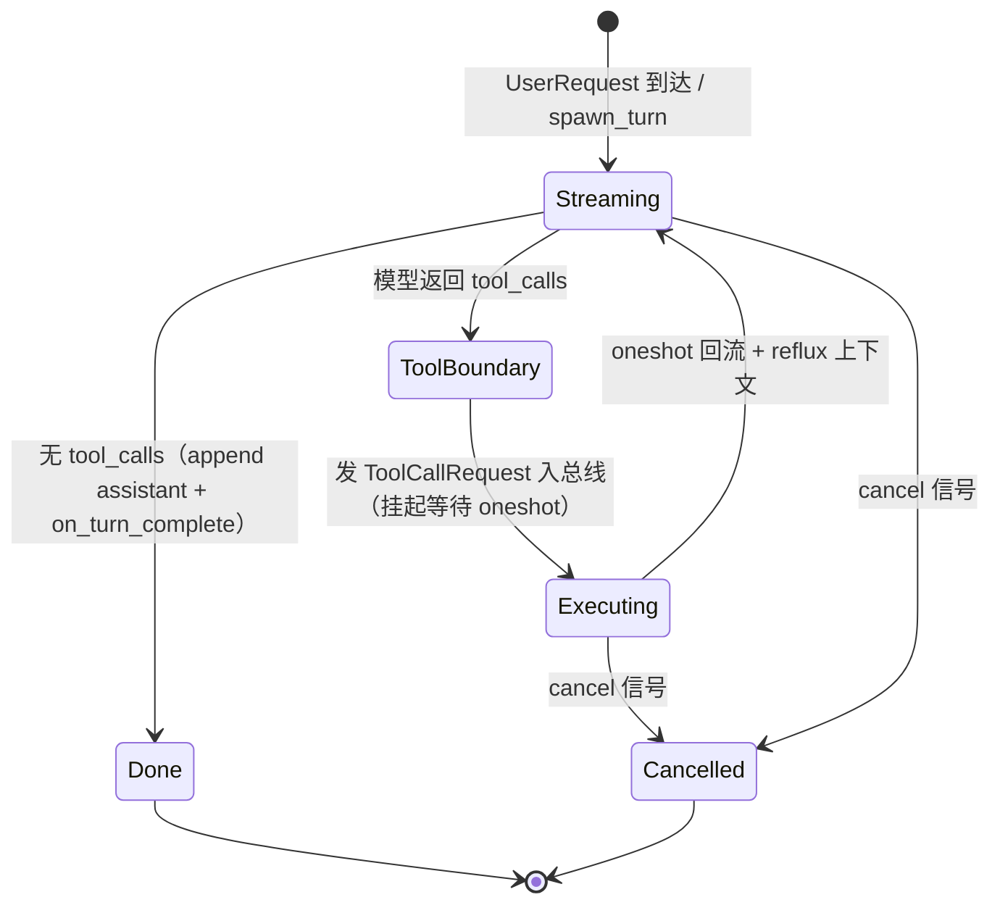
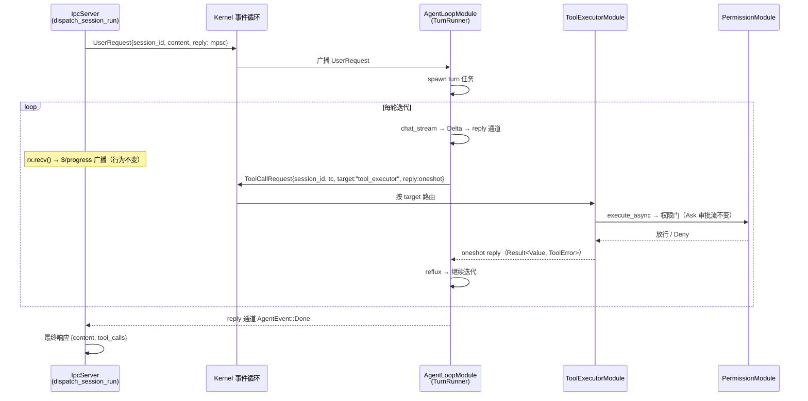

# 设计文档：内核调度全量重构（决策 #18 兑现）

> **前置**：本设计为差距分析 `docs/superpowers/specs/2026-08-30-gap-analysis-vs-original-design.md` 中的 G1 项（🔴 核心理念未兑现）。其余差距 G2-G8 已存档待后续设计。

## 概述

AgentJ 的设计宣称为「内核调度 + 可插拔模块」（Linux 内核式：模块间不直接通信，全部经过内核消息总线路由）。核心设计文档 `2026-08-09-agentj-core-design.md` 决策 #18 明确承认 v0.1-v0.3 的实际架构是「注册表 + 生命周期管理」式内核——`AgentLoop` 编排直调 trait 对象（`ctx.session`/`ctx.providers`/`ctx.tools`/`ctx.pipeline`），不经 `KernelMessage` 消息总线，成为事实上的「第二内核」；并规划 **v0.3 期间全量重构**：AgentLoop 主循环 + Sub-Agent Dispatcher 迁入消息总线，兑现理念。

v0.4.1 实测：该重构**零落地**。`KernelMessage` 仅 3 变体（`UserRequest` 生产 0 构造点 / `ServiceCall` 已接线 / `Shutdown`）；`agentj-ipc` 的 `dispatch_session_run` 直调 `agent_loop.run_turn_stream()`；`Dispatcher` 直建 `AgentLoop`；CLI 的 `AgentLoopModule::handle()` 为空实现、注释自证「编排直调，内核仅管生命周期」。

本特性兑现决策 #18：**全量迁入消息总线**，使「内核调度 + 可插拔模块」从宣传语变为实现事实。**协议面零变化**（`session/run` 一请求一最终响应 + `$/progress` 流式语义保留），CLI/客户端无感知。

## 目标与非目标

### 目标

| 编号 | 目标 |
|------|------|
| G1 | `KernelMessage` 扩展 `UserRequest`（携带 per-turn 事件通道）与 `ToolCallRequest`（携带显式 target + oneshot reply），全变体生产接线 |
| G2 | **AgentLoop 降为内核一个 KernelModule**：turn 编排逻辑（原 `run_inner`）提取为共享 `TurnRunner`，工具调用经 `ToolCallRequest` 总线请求/应答，模型增量经 per-turn 通道 |
| G3 | **ToolExecutorModule**：工具执行从 AgentLoop 内联迁出，作为独立 KernelModule 经 `ToolCallRequest` 路由执行；权限门（决策 #17 `execute_async`）语义保留 |
| G4 | **Sub-Agent 接入总线**：Dispatcher 改为经 `ServiceCall{service:"subagent"}` 发起，子代理 turn 复用同一 `TurnRunner`，其工具调用同样经总线 |
| G5 | **IPC `session/run` 经总线入口**：`IpcServer` 不再直调 `AgentLoop`，改发 `UserRequest` 入总线；`$/progress` 广播、属主路由、run 互斥（IPC 层）语义不变 |
| G6 | **取消经总线**：`$/cancelRequest` 完整取消进行中 turn（原实现仅取消挂起审批），经 `ServiceCall{service:"agent", method:"cancel"}` 信号 `TurnRunner` |
| G7 | `kernel/status` 报告真实模块注册表状态（替代硬编码空数组） |

### 非目标

- ❌ 不处理 G2-G8 其它差距（单全局 inflight 槽、token 用量、FileBackedStore 接线、License 门控、MCP 接线、EventBus 重入、WebSocket 网关）——已存档于差距分析文档，各自独立设计
- ❌ 不做内核级工具拦截/改写（执行前 hook）——B2 语义只到「经总线路由到唯一执行模块」，拦截是未来叠加
- ❌ 不做多 Agent 模块（单 `agent_loop` 模块满足当前诉求；多 Agent 需消息寻址扩展，留待未来）
- ❌ 不新增 `ModelResponse`/`ToolCallResult` 总线变体——结果经 oneshot reply 回流（镜像 `ServiceCallReply` 先例），模型增量走 per-turn 通道（决策见「关键设计决策」#1/#2）
- ❌ 不改任何协议 wire 类型 / 方法面 / schema——纯内部行为（决策 #18 范围边界）
- ❌ 不引入 AgentLoop 双轨（总线 + 直调并存）——全量迁入，直调路径移除

## 设计方案

### 核心方案：混合总线（编排事件经总线，流式走 per-turn 通道）

**现状**：`AgentLoop::run_inner` 是顺序 async 函数，工具调用内联 `execute_async`，事件经 `mpsc::Sender<AgentEvent>` 直接流出；IPC 直调 `run_turn_stream` 消费。

**目标**：
1. **入口总线化**：IPC/CLI 不再直调 AgentLoop，改为向内核发 `UserRequest{..., reply: mpsc::Sender<AgentEvent>}`，内核广播路由到 `AgentLoopModule`。
2. **工具执行总线化**：turn 在工具边界发 `ToolCallRequest{..., target, reply: oneshot}` 入总线，内核按 `target` 路由到 `ToolExecutorModule` 执行，结果经 oneshot 回流，turn 挂起等待（可取消）。
3. **模型增量通道化**：`chat_stream` 的 delta 经 per-turn `reply` 通道直达 IPC 订阅者（不占用总线——单总线串行化与高并发多客户端流式存在张力）。
4. **Sub-Agent 服务化**：Dispatcher 经 `ServiceCall` 接入，复用 `TurnRunner`。
5. **取消总线化**：`ServiceCall{service:"agent", method:"cancel"}` → `TurnRunner::cancel`。

### 备选方案

| 方案 | 优点 | 缺点 | 为何未选用 |
|------|------|------|-----------|
| **B. 混合总线（选用）** | 编排事件（入口/工具/取消/完成）内核级可见可路由；模型增量不占总线，多客户端流式吞吐不受单总线串行化影响；改动面收敛（turn 内核保留，只改入口/出口/工具边界）；与 v0.4 IPC 层 ConnectionRegistry 广播职责互补 | 模型增量未经总线（理念上略打折）；工具调用信息双路（per-turn 通道 + 总线）有轻微重复 | — |
| A. 全量总线（设计 #18 原文） | 每个模型增量都是一条 `ModelResponse` 总线消息，理念最纯 | 单总线串行化高并发流式（队头阻塞）；AgentLoop 需完整状态机重写（每个 delta 驱动一次 handle）；内核需 request_id→订阅者路由层（与 IPC 既有广播职责重叠）；测试全量重写成本最高 | 多客户端 v0.4 刚落地，单总线串行化是架构倒退 |
| C. 最小接线 | 改动最小 | 理念几乎不兑现（AgentLoop 仍是事实第二内核），决策 #18 大部分落空 | 违背本特性核心目标 |
| 工具执行 B1（广播可观测） | 改动更小、无总线往返延迟 | 工具执行仍内联 AgentLoop，"工具循环经总线"落空；拦截能力弱 | 用户选定 B2：真·内核调度工具循环 |
| 工具执行 B2（总线请求/应答，选用） | 工具执行模块化、单一执行者、可被其他模块在执行前观察；镜像既有 `ServiceCall` 请求/应答先例，机制成熟 | 需新建 ToolExecutorModule + 内核 target 路由；工具执行增加一次总线往返（微秒级） | — |
| Sub-Agent UserRequest 同入口 | 语义最统一 | UserRequest 需加 system_prompt 覆盖字段、AgentLoopModule 需区分来源 | 用户选定 ServiceCall（设计 #18 原文指定路径，复用既有机制） |
| Sub-Agent 保持直建 | 改动最小 | "Sub-Agent 接入总线"落空 | 违背决策 #18 |

## 架构

### 消息面（`agentj-core/src/module.rs`）

```rust
#[derive(Debug, Clone)]
pub enum KernelMessage {
    /// IPC/CLI → 内核：发起一轮 turn。`reply` 为 per-turn 事件通道（AgentEvent 流），
    /// 模型增量 / 工具事件 / Done / Error 经此通道直达 IPC 订阅者（不占用总线）。
    UserRequest {
        session_id: SessionId,
        content: String,
        attachments: Vec<Attachment>,
        reply: mpsc::Sender<AgentEvent>,
    },
    /// AgentLoop turn → 内核 → ToolExecutorModule：执行单次工具调用。
    /// `target` 显式指定唯一处理器（镜像 ServiceCall.service 先例，杜绝广播重复执行）；
    /// `reply` 为 oneshot 结果通道（Result<Value, ToolError>）。
    ToolCallRequest {
        session_id: SessionId,   // 权限上下文（PermissionContext 必需）
        tool_call: ToolCall,
        target: ModuleId,        // 工具执行模块 id（如 "tool_executor"）
        reply: ToolCallReply,    // 镜像 ServiceCallReply：Arc<Mutex<Option<oneshot::Sender>>>
    },
    /// 保留：服务定位通道（Sub-Agent dispatch / agent cancel 复用）
    ServiceCall { service, method, params, reply },
    /// 保留：生命周期优先信号
    Shutdown,
}
```

**不新增 `ModelResponse` / `ToolCallResult` 变体**（见「关键设计决策」#1/#2）。

### 内核路由规则（`agentj-core/src/kernel.rs` 事件循环改造）

| 消息 | 路由 | 说明 |
|------|------|------|
| `Shutdown` | 优先检测 → 逆序优雅关闭 | 不变 |
| `ServiceCall` | → `ServiceRegistry` | 不变 |
| `ToolCallRequest` | → `msg.target` 指定模块（**不广播**） | 确定性单执行者 |
| 其余（`UserRequest`） | → 广播 | `AgentLoopModule` 为唯一处理器 |

```rust
while let Some(msg) = rx.recv().await {
    if matches!(msg, KernelMessage::Shutdown) { break; }
    if let KernelMessage::ServiceCall { .. } = &msg { /* 现有 registry 路由 */ continue; }
    let mut guard = modules.lock().unwrap();
    match &msg {
        KernelMessage::ToolCallRequest { target, .. } => {
            if let Some(module) = guard.get_mut(target) {
                if let Err(e) = module.handle(&msg) { tracing::error!(?e, "module handler error"); }
            } else {
                tracing::warn!(%target, "ToolCallRequest to unregistered module");
            }
        }
        _ => { for module in guard.values_mut() { if let Err(e) = module.handle(&msg) { tracing::error!(?e, ...); } } }
    }
}
```

### 模块拆分与 Turn 机制

#### TurnRunner（`agentj-core`，原 `AgentLoop::run_inner` 编排逻辑迁入）

共享 turn 编排单元——`AgentLoopModule`（主 turn）与 SubAgent 服务（子代理 turn）复用同一机制。

```rust
#[derive(Clone)]
pub struct TurnRunner {
    ctx: KernelContext,
    pipeline: Arc<dyn ContextPipeline>,
    default_system_prompt: String,
    max_tool_iterations: usize,
    on_turn_complete: Option<OnTurnComplete>,       // 用法钩子保留
    sender: KernelSender,                            // 发 ToolCallRequest 入总线
    tool_executor_id: ModuleId,                      // ToolCallRequest.target
    turns: Arc<Mutex<HashMap<SessionId, TurnHandle>>>, // 取消表
}

pub struct TurnHandle { cancel_tx: tokio::sync::oneshot::Sender<()> }

impl TurnRunner {
    pub fn create_session(&self) -> Result<SessionId, ModuleError>;        // 委托 ctx.session
    pub fn spawn_turn(
        &self,
        session_id: SessionId,
        content: String,
        system_prompt: Option<String>,   // None = 默认；Sub-Agent 可覆盖
        reply: mpsc::Sender<AgentEvent>,
    ) -> Result<(), ModuleError>;
    pub fn cancel(&self, session_id: &SessionId) -> bool;   // 信号 turn 停止
}
```

**turn 状态机**（`spawn_turn` 内部 spawn 的 async 任务）：



**关键实现点**：
- `Streaming`：`provider.chat_stream()` → `ModelEvent::Delta` → `reply.send(AgentEvent::Delta)`（直接进 per-turn 通道，不经总线）；`ToolCall` 收集到 `tc_list`
- `ToolBoundary`：`tc_list` 非空 → 对每个 tc：`reply.send(AgentEvent::ToolCall(tc))`（IPC 的 `$/progress` 需要）→ 创建 oneshot → `sender.send(ToolCallRequest{...})` → **`select!` 挂起等 oneshot 或 cancel 信号**
- 工具执行期间权限门：`ToolExecutorModule` 内 `execute_async` → `PermissionChecker`（Ask → `$/permissionRequest` → IPC → `permission/respond`，语义不变）
- `Done`：append assistant 消息 + `reply.send(AgentEvent::Done)` + 触发 `on_turn_complete`（用法钩子）
- `Cancelled`：`reply.send(AgentEvent::Error("cancelled"))`，不 append 半截结果
- 总线发送失败（`KernelSender::send` 报 channel full/closed）→ `reply.send(AgentEvent::Error)`，turn 终止

#### AgentLoopModule（`agentj-core`，取代 CLI 的空壳 wrapper）

```rust
pub struct AgentLoopModule {
    runner: TurnRunner,
}

impl Module for AgentLoopModule { /* id="agent_loop"，init/shutdown 生命周期 */ }
impl KernelModule for AgentLoopModule {
    fn handle(&mut self, msg: &KernelMessage) -> Result<KernelResponse, ModuleError> {
        match msg {
            KernelMessage::UserRequest { session_id, content, attachments, reply } => {
                self.runner.spawn_turn(session_id.clone(), content.clone(),
                    None, reply.clone())?;
                Ok(KernelResponse::Handled)
            }
            _ => Ok(KernelResponse::Handled),
        }
    }
}
```

同时注册 `KernelService "agent"`（method `"cancel"`，params `{session_id}`）供 `$/cancelRequest` 经总线取消 turn。

#### ToolExecutorModule（`agentj-core`，新增）

```rust
pub struct ToolExecutorModule {
    ctx: KernelContext,
    workspace_root: PathBuf,   // init 时捕获 std::env::current_dir()
}

impl KernelModule for ToolExecutorModule {
    fn handle(&mut self, msg: &KernelMessage) -> Result<KernelResponse, ModuleError> {
        if let KernelMessage::ToolCallRequest { session_id, tool_call, reply, .. } = msg {
            let ctx = self.ctx.clone();
            let workspace_root = self.workspace_root.clone();
            let reply = reply.clone();
            tokio::spawn(async move {
                let source = ctx.tools.source_of(&tool_call.name).unwrap_or(ToolSource::Builtin);
                let perm_ctx = PermissionContext {
                    session_id: session_id.clone(),
                    tool: tool_call.name.clone(),
                    source,
                    args: tool_call.arguments.clone(),
                    workspace_root,
                };
                let result = ctx.tools.execute_async(&tool_call.name, &tool_call.arguments, &perm_ctx).await;
                if let Some(tx) = reply.lock().unwrap().take() {
                    let _ = tx.send(result);
                }
            });
            Ok(KernelResponse::Handled)
        } else {
            Ok(KernelResponse::Handled)
        }
    }
}
```

- **权限门保留**：`execute_async` 内部走 `PermissionChecker`（Ask 审批流经 IPC，语义不变）——决策 #17 明确「拦截点不因迁移丢失」
- `workspace_root` 进程级固定（`current_dir`），init 捕获一次
- handle 内 spawn 执行任务：handle 为同步 `&mut self`，`execute_async` 为 async，异步边界在 spawn 内完成；oneshot reply 在任务完成时发送
- 执行任务 panic → oneshot drop → turn 侧收到 `RecvError` → 转 `AgentEvent::Error`

#### SubAgent 服务（`agentj-core/src/dispatcher.rs` 改造）

Dispatcher 从「直建 AgentLoop」改造为 **KernelService 客户端 + 服务端**：

- **服务端**：注册 `KernelService "subagent"`，`method="dispatch"`，params `{prompt, system_prompt?}` → 内部 `runner.create_session()` + `runner.spawn_turn(sid, prompt, Some(system_prompt), reply_channel)` → 收集 `AgentEvent::Done` 的 `final_response` → 经 `ServiceCallReply` oneshot 返回 `{session_id, final_response}`
- **客户端**：`Dispatcher::dispatch(spec)` 签名不变（返回 `JoinHandle<Result<SubAgentResult, String>>`），内部改为发 `KernelMessage::ServiceCall{service:"subagent", method:"dispatch", ...}` 并 await oneshot reply

子代理 turn 与主 turn 共享 `TurnRunner` → **子代理工具调用同样经 `ToolCallRequest` 总线执行**，权限门覆盖。

### 数据流（时序）



### IPC 改造（`agentj-ipc`）

**`IpcServer` 不再持有 `AgentLoop`**，改为持有 `Kernel` + `Arc<dyn SessionStore>`（create_session 用）：

```rust
pub struct IpcServer {
    kernel: Kernel,
    session: Arc<dyn SessionStore>,        // create_session 委托
    // 其余字段不变（registry / token / permission_module / kernel_handle / ...）
}
```

**`run_turn_stream` 改经总线**（保留方法签名，事件循环消费端零改动）：

```rust
pub fn run_turn_stream(&self, sid: &str, input: &str) -> mpsc::Receiver<AgentEvent> {
    let (tx, rx) = mpsc::channel(256);
    // 发送失败（channel full/closed）时把错误推回 reply 通道，避免消费端无限等待
    let result = self.kernel.sender().send(KernelMessage::UserRequest {
        session_id: sid.to_string(),
        content: input.to_string(),
        attachments: vec![],
        reply: tx.clone(),
    });
    if result.is_err() {
        let _ = tx.try_send(AgentEvent::Error("user request bus send failed".into()));
    }
    rx
}
```

`dispatch_session_run` 中 `let mut rx = self.agent_loop.run_turn_stream(...)` → `let mut rx = self.run_turn_stream(...)`，**事件循环体（`$/progress` 广播 / text 收集 / Done）不变，仅新增一个分支：`AgentEvent::Error(e)` 时若 `e == "cancelled"` → 返回 `-32800 RequestCancelled`，否则 `-32603`（现状行为）**。

**`$/cancelRequest` 语义完善**：当前仅取消挂起审批（读全局 inflight 槽 → `permission_module.cancel_session`）。G1 增加 turn 取消：同时发 `ServiceCall{service:"agent", method:"cancel", params:{session_id}}` → `TurnRunner::cancel` → turn 转 `Cancelled` → IPC 收到 `AgentEvent::Error("cancelled")` → 返回 `-32800 RequestCancelled`。全局 inflight 槽的并发缺陷（G2）不在本设计范围。

**`kernel/status` 报告真实模块**：`Kernel` 增加 `pub fn modules(&self) -> Vec<(ModuleId, ModuleState)>`（遍历 `states` 注册表），`dispatch_kernel_status` 消费返回 `{version, modules:[{id, state}]}`——兑现协议 schema 中原有语义（现状硬编码空数组）。

**CLI 接线**（`agentj-cli/src/main.rs`）：

| 项 | 现状 | 改造后 |
|----|------|--------|
| `AgentLoopModule` | 空壳 wrapper（handle 空实现） | 使用 `agentj_core::AgentLoopModule`（真实 handle UserRequest） |
| `build_ipc_server` | `IpcServer::new(agent_loop, kernel)` | `IpcServer::new(kernel, session)` |
| `serve_tcp` / `TcpIpcServer::bind` | 传 `agent_loop` | 传 `kernel` + `session` |
| 模块注册 | 仅 `AgentLoopModule` + `PermissionModule` | 增加 `ToolExecutorModule` + SubAgent 服务 |
| `run` 路径 | `ipc_server.run_turn` 直调 | 经 `run_turn_stream`（已总线化） |

## 关键设计决策

### 1. 混合总线：编排事件经总线，模型增量走 per-turn 通道

**决策**：`KernelMessage` 新增 `UserRequest`（携带 `reply: mpsc::Sender<AgentEvent>`）与 `ToolCallRequest`（携带 `target` + oneshot reply）；不新增 `ModelResponse` 变体——模型增量经 per-turn 通道直达 IPC 订阅者。

**理由**：① 决策 #18 的差距核心是「编排直调 trait 对象、不经内核路由」——入口（UserRequest）、工具边界（ToolCallRequest/Result）、取消、Sub-Agent 全部经总线即兑现「模块间通信经内核」；模型增量是高频小消息，走单总线串行化会让多客户端并发流式队头阻塞（v0.4 刚落地多客户端常驻，这是架构倒退）。② per-turn 通道与 v0.4 IPC 层 `ConnectionRegistry` 广播职责互补：通道是「turn → IPC」的定向流，注册表是「session → 多订阅者」的扇出广播。

### 2. 结果回流用 oneshot reply，不新增 `ToolCallResult` 变体

**决策**：工具执行结果经 `ToolCallRequest` 携带的 oneshot reply 回流，不新增 `ToolCallResult` 总线变体。

**理由**：镜像既有 `ServiceCall` + `ServiceCallReply` 先例（`kernel.rs:169-183` 已证明该模式）——请求带 reply 通道、内核路由、结果带外回流，turn 无需内核级 inbox 就能挂起/恢复。砍掉一个变体 = 少一套「turn 侧按 turn_id 收件箱」路由机制。

### 3. `target` 显式路由（镜像 `ServiceCall.service`），不做消息类型→模块路由表

**决策**：`ToolCallRequest` 携带 `target: ModuleId`，内核按 target 路由到唯一模块；`UserRequest` 广播（单处理器）。不引入「消息类型 → 模块」声明式路由表。

**理由**：`service` 字段在 `ServiceCall` 已有先例，最小一致扩展；路由表增加模块 init 声明机制，当前仅 2 个调度消息不值得预支。广播留给未来多消费者场景（YAGNI）。

### 4. `TurnRunner` 共享机制替代「AgentLoop 直调 + Dispatcher 直建」

**决策**：原 `AgentLoop::run_inner` 编排逻辑提取为 `TurnRunner`（共享 turn 机制），`AgentLoopModule`（主 turn）与 SubAgent 服务（子代理 turn）复用；`AgentLoop` 直调 API 移除。

**理由**：① 决策 #18「全量迁入、直调路径移除」——不保留双轨；② 主/子 turn 共享 `TurnRunner` 保证子代理工具调用同样经总线、权限门覆盖，杜绝「子代理直调绕开内核」的新双轨；③ `on_turn_complete` 用法钩子保留在 `TurnRunner`，`UsageCollector` 接线零改动。

### 5. 权限门语义保留在 `ToolExecutorModule::execute_async`

**决策**：工具执行迁入 `ToolExecutorModule`，权限门仍在 `ToolRegistry::execute_async` 统一拦截点（Ask → `$/permissionRequest` → `permission/respond`，超时自动 Deny 等语义全保留）。

**理由**：决策 #17 明示「拦截点不因迁移丢失」——`execute_async` 是内置/MCP/插件工具的统一入口，执行模块迁移不改变拦截点位置；`PermissionContext` 所需 `session_id`/`workspace_root` 由 `ToolCallRequest` 携带与模块捕获提供。

### 6. 取消经 `ServiceCall`（复用既有机制），不新增 `CancelRun` 变体

**决策**：`$/cancelRequest` → IPC 读全局 inflight 槽 → 发 `ServiceCall{service:"agent", method:"cancel"}` → `TurnRunner::cancel`；挂起审批取消（`permission_module.cancel_session`）保留。

**理由**：ServiceCall 是既有通用通道，cancel 是低频控制面操作，新增 `CancelRun` 变体是重复造轮子。全局 inflight 槽并发缺陷（G2）与本设计正交，单独治理。

### 7. 协议面零变化

**决策**：wire 类型 / 方法面 / schema / 协议文档零改动；`session/run` 一请求一最终响应 + `$/progress` 流式语义保留；`$/cancelRequest` 行为从「仅取消审批」完善为「取消整个 run」——属行为完善而非协议变更（`-32800 RequestCancelled` 已在错误码表）。

**理由**：决策 #18 范围边界「调度重构为纯内部行为，协议面零变化」；CLI/客户端无感知是重构的验收标准之一。

## 错误处理

| 场景 | 路径 | 结果 |
|------|------|------|
| `UserRequest` 总线发送失败（channel full/closed） | IPC `run_turn_stream` send 失败 | 错误推回 reply 通道（`AgentEvent::Error`）→ `dispatch_session_run` 返回 `-32603`，无挂起 |
| `ToolCallRequest` 发送失败 | `TurnRunner` spawn 内 `sender.send` Err | `reply.send(AgentEvent::Error("bus send failed"))`，turn 终止 |
| 工具执行任务 panic / 内核关闭中 | oneshot sender drop | turn 侧 `rx.await` → `RecvError` → `reply.send(AgentEvent::Error)` |
| `ToolCallRequest` target 模块未注册 | 内核路由查表未命中 | `tracing::warn` + 消息丢弃 → oneshot drop → turn 收 `RecvError` → Error event（内核继续运行，单消息失败不拖垮内核——决策 #9 语义延续） |
| 工具 Deny / 审批超时 | `execute_async` → `Err(ToolError::PermissionDenied)` | 经 oneshot 原样回流 turn → reflux 给模型（模型可自行调整命令/路径，现状行为不变） |
| 取消 | `TurnRunner::cancel` 触发 `Cancelled` | turn 停流、停工具循环，`reply.send(AgentEvent::Error("cancelled"))` → IPC 返回 `-32800 RequestCancelled`；不 append 半截结果 |
| 内核优雅关闭中运行中的 turn | 事件循环退出 → 模块 handle 不再可达 | turn 任务持有的 oneshot reply drop → turn 收 `RecvError` 终止；模块 `shutdown()` 时 `TurnRunner.turns` 全部 cancel（新增清理） |
| `kernel/status` 查询 | 遍历模块状态表 | 模块 id + 状态快照；空内核返回空数组（协议兼容） |

**新增边界**：`TurnRunner::shutdown`（模块 `shutdown()` 调用）→ cancel 全部活动 turn → 等待任务回收（或标记放弃，复用现有超时机制）。

## 测试策略

| 层级 | 范围 | 工具 | 目标 |
|------|------|------|------|
| **内核路由测试** | `ToolCallRequest` 按 target 路由、未知 target 不崩溃、`UserRequest` 广播 | 迷你 Kernel + spy 模块 | 路由确定性、单执行者、消息失败隔离 |
| **TurnRunner 单测** | turn 全流程：delta 流出、工具边界经总线、oneshot 回流、reflux、Done、取消 | 真实 Kernel + ToolExecutorModule + MockProvider/MockTool | 状态机转换正确、总线往返完整、cancel 中途终止 |
| **ToolExecutorModule 测试** | handle ToolCallRequest 执行 + reply、权限门（Allow/Deny/Ask）、workspace_root 注入 | Mock ToolRegistry + 权限 checker | execute_async 拦截点保留、PermissionContext 字段正确 |
| **权限门回归** | Deny → ToolResult 错误回流模型、Ask → 审批流、超时自动 Deny | mock IPC 审批 | 决策 #17 语义零回归 |
| **Sub-Agent 测试** | `ServiceCall{subagent.dispatch}` 发起、结果返回、子代理工具调用经总线 | 真实 Kernel + MockProvider | 总线化 dispatch、子代理与主 turn 同机制 |
| **IPC 集成测试** | `session/run` 经总线、`$/progress` 广播序列不变、`$/cancelRequest` 完整取消 | mock AgentLoop 移除后改真实总线链路 + mock 客户端 | 协议面行为不变、cancel 返回 `-32800` |
| **kernel/status 测试** | 模块快照 | 迷你 Kernel + 注册 spy 模块 | modules 非空、state 正确 |
| **CLI e2e 回归** | `run` / `serve` / e2e_serve 密封测试 | spawn 二进制 | 现有 e2e 全绿（协议面零变化验收） |
| **全量回归** | `cargo test --workspace` / clippy / drift 门禁 | CI | 280+ 测试全绿、零警告、schemas 零漂移 |

**Mock 策略**：总线链路**真实启动**（`Kernel::new()` + `start()` + 注册真实模块），仅 provider/tools 用 mock——测试驱动的就是生产同一条总线路径，而非旁路 mock 总线（与既有 `kernel.rs` 测试模式一致）。原 `AgentLoop` 直调测试（`run_turn_stream_yields_deltas` 等）迁移为 `TurnRunner` + 总线驱动版本。

## 依赖

### 阶段衔接与前置

| 前置 | 状态 |
|------|------|
| `KernelMessage::ServiceCall` + `ServiceRegistry` + `ModuleResolver`（v0.3 T1） | ✅ 已就绪（`resolver.rs`） |
| `ToolRegistry::execute_async` 统一拦截点 + `PermissionChecker`（决策 #17） | ✅ 已就绪（`agent_loop.rs:238` 现有调用） |
| v0.4 ConnectionRegistry（订阅/属主/run 互斥） | ✅ 已就绪（IPC 层语义保留） |
| 差距分析存档 | ✅ `2026-08-30-gap-analysis-vs-original-design.md` |

### 迁移步骤（实现计划输入）

1. **T1 消息面**：`KernelMessage` 增加 `UserRequest.reply` 字段 + `ToolCallRequest` 变体；`Kernel` 事件循环加 target 路由；`Kernel::modules()` 查询
2. **T2 TurnRunner 提取**：`AgentLoop::run_inner` 编排逻辑迁入 `TurnRunner`（含 `spawn_turn`/`cancel`/`create_session`/`set_on_turn_complete`）；工具边界改为发 `ToolCallRequest` + oneshot await；**`AgentEvent` 类型随迁入 `agentj-core` 公共位置（`types.rs`），供 `KernelMessage` 引用**
3. **T3 ToolExecutorModule**：新增模块，handle `ToolCallRequest` 执行 + reply；权限门保留验证
4. **T4 AgentLoopModule**：`agentj-core` 真实 KernelModule（handle `UserRequest`）；注册 `KernelService "agent".cancel`
5. **T5 Sub-Agent 服务**：`dispatcher.rs` 改造为 ServiceCall 客户端 + "subagent" 服务端
6. **T6 IPC 改造**：`IpcServer` 去 `agent_loop`、`run_turn_stream` 总线化、`$/cancelRequest` 完善、`kernel/status` 模块快照
7. **T7 CLI 接线**：注册 `ToolExecutorModule`/SubAgent 服务、构造签名迁移、`AgentLoopModule` 替换
8. **T8 测试迁移与回归**：原直调测试改总线驱动、新增各层测试、e2e 回归
9. **T9 文档同步**：`AGENTS.md` / `README.md` / 设计文档 TODO / 差距存档 G1 状态 → ✅ 已实现

### 版本与约束

- 版本：`0.4.1 → 0.5.0`（feature bump；规则：每个特性 bump 次版本）
- `agentj-protocol` / `schemas/*.json` / `protocol/methods.json` / `docs/specs/ipc-protocol.md`：**零改动**
- 代码风格：函数 ≤ 50 行、行宽 ≤ 120 字符（项目规则）

### 遗留问题 / 已知限制

- **全局 inflight 槽并发缺陷（G2）**：`$/cancelRequest` 与 `permission/respond` 属主门控读全局槽，多会话并发 run 互相覆盖——本设计沿用现状（单并发 run 语义正确），完整修复留待 G2 独立设计
- **模型增量不经总线**：混合方案的已知取舍（决策 #1），如需内核级 delta 观察可未来叠加 `ModelResponse` 变体（加性）
- **多 Agent 模块寻址**：`UserRequest` 广播 + 单 `AgentLoopModule`；未来多 Agent 需加 target 寻址（加性字段）
- **执行前拦截 hook**：B2 只做到「路由到唯一执行模块」；工具拦截/改写（sandbox/audit）依赖未来在 `ToolExecutorModule` 或总线侧加 pre-execution 钩子

## TODO（阶段完成状态）

- [ ] 设计评审通过 → 实现计划：`docs/superpowers/plans/2026-08-30-agentj-kernel-scheduling-refactor-plan.md`（T1-T9）
- [ ] 开发（feature 分支）→ 验证（workspace 测试 / clippy / drift / e2e）→ 文档同步 → 差距存档 G1 状态更新