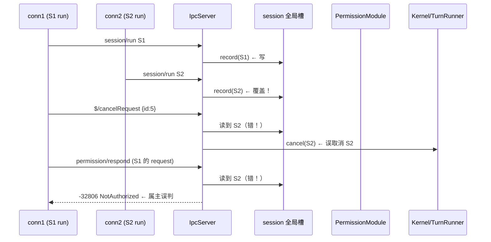
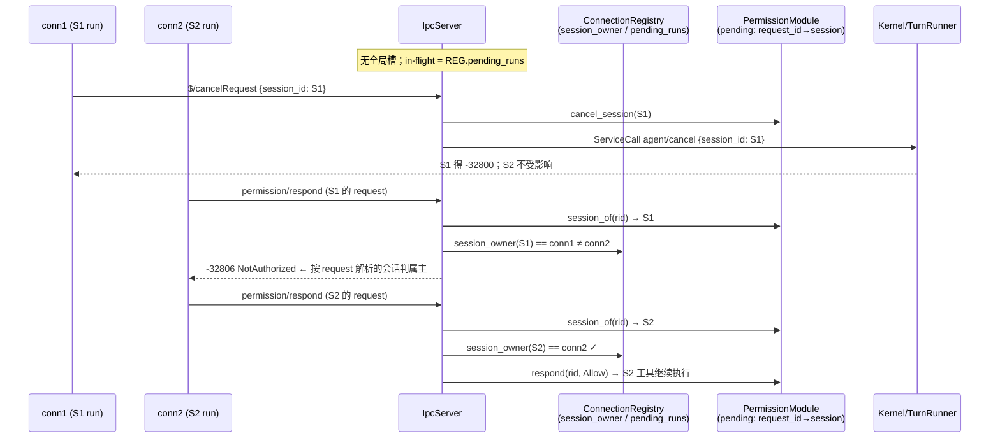

# 设计文档：G2 修复 — 移除单全局 in-flight 会话槽（per-session 路由）

> **来源差距项**：`2026-08-30-gap-analysis-vs-original-design.md` G2「单全局 in-flight 会话槽」（🟠 并发正确性，状态：✅ 已设计）。
> **目标版本**：0.5.1 → 0.6.0（feature bump）。协议 `protocol_version` 0.2.0 不变（加性改动）。
> **验收门禁**：`cargo test --workspace`（含新增并发跨会话测试）+ `cargo clippy --workspace --all-targets -- -D warnings` + `cargo test -p agentj-protocol -- drift` + `bindings/ts` 构建。

## 概述

`IpcServer` 持有单个全局 in-flight 会话槽 `session: Arc<tokio::sync::Mutex<Option<String>>>`（`agentj-ipc/src/lib.rs:286`），
由 `InflightSessionGuard` 在 `session/run` 入口写入（L612）、Drop 时清空。该槽被两个路径读取：

- `dispatch_permission_respond`（L703）— 属主门控：读取全局槽得到「当前会话」，校验 `session_owner(sid) == conn_id`；
- `dispatch_cancel_request`（L753）— 取消路由：读取全局槽得到「当前会话」，对其执行 `cancel_session` + 内核 `agent/cancel`。

**并发跨会话 run 时，槽被后启动者覆盖**：cancel 打错会话、respond 属主判错、先启动者的 guard Drop 把后启动者的槽提前清空。
`CancelParams` 的 `id` 字段被解析后直接丢弃（`_params`），从不参与路由。

内核层与互斥层**已是 per-session**（污染完全源于这个冗余全局槽）：

| 结构 | 位置 | 语义 | 状态 |
|---|---|---|---|
| `pending_runs: HashSet<SessionId>` | `ConnectionRegistry` lib.rs:99 | run 互斥（-32805） | ✅ per-session |
| `session_owner: HashMap<SessionId, String>` | `ConnectionRegistry` lib.rs:98 | 会话属主 conn_id（决策 #5） | ✅ per-session |
| `PermissionModule.pending: HashMap<PermissionRequestId, PendingRequest{session_id,…}>` | `agentj-permission/src/module.rs:70` | request_id→session 映射 | ✅ per-session |
| `TurnRunner.turns: HashMap<SessionId, TurnHandle>` | `agentj-core/src/turn_runner.rs:28` | cancel 句柄 | ✅ per-session |

修复方案：**删除全局槽**，改为两条 per-session 路由——cancel 经 wire 新增的 `session_id` 精确定位（缺省时以 `pending_runs` 单会话兜底）；permission/respond 经 PermissionModule 已有的 `request_id→session_id` 映射定位。

## 目标与非目标

- **目标**：
  - 消除全局 in-flight 槽，并发跨会话 run 互不污染（cancel / respond 精确路由到目标会话）。
  - `$/cancelRequest` wire 携带 `session_id`（加性，`@since 0.6.0`）；`$/permissionRequest` 通知携带 `session_id`（加性，客户端可做多会话 UI 归类）。
  - `permission/respond` 属主门控改为按 request_id 解析出的会话判定（不再依赖全局槽）。
  - 保持错误码语义不变：`-32805 SessionBusy`、`-32806 NotAuthorized`、`-32800 RequestCancelled`、`-32600 InvalidRequest`。
- **非目标**：
  - 不给 `permission/respond` 增加 `session_id`（服务端经 request_id 查表已能唯一路由，wire 冗余）。
  - 不给 `$/cancelRequest` 增加属主门控（与 v0.4 一致：控制面操作，任意已授权连接可取消；authz 加固留待后续）。
  - G3-G8 其他差距项不在本设计范围。

## 设计方案

### A. 协议层（agentj-protocol，加性）

沿用仓库既有加性模式（`InitializeParams.token` / `InitializeResult.connection_id` / `SessionRunParams.progress_token`：
`Option<T>` + `#[serde(skip_serializing_if = "Option::is_none")]` + `@since` 注释；全仓无 `deny_unknown_fields`，serde 默认容忍未知字段）：

```rust
// crates/agentj-protocol/src/streaming.rs
pub struct CancelParams {
    pub id: Id,                             // LSP 兼容，保留但不参与路由
    #[serde(skip_serializing_if = "Option::is_none")]
    pub session_id: Option<SessionId>,      // @since 0.6.0 加性：精确路由目标会话
}

// crates/agentj-protocol/src/permission.rs
pub struct PermissionRequestParams {
    pub request_id: String,
    pub tool: String,
    pub args: serde_json::Value,
    pub reason: String,
    #[serde(skip_serializing_if = "Option::is_none")]
    pub origin_client: Option<String>,
    #[serde(skip_serializing_if = "Option::is_none")]
    pub session_id: Option<SessionId>,      // @since 0.6.0 加性：客户端 UI 归类
}
```

`PermissionRespondParams` **不变**（`request_id` 不透明、与 JSON-RPC id 解耦，服务端路由足够）。

**联动产物**：`cargo run -p agentj-protocol --bin gen_schemas` 重生成 `schemas/CancelParams.json` + `schemas/PermissionRequestParams.json`；
`bindings/ts` `npm run generate && npm run build`；`docs/specs/ipc-protocol.md` §6/§8.15/§8.16 标注 `@since 0.6.0` 与缺省行为说明。
`protocol/methods.json` **不变**（类型名与方向不变；protocol_version 0.2.0 不变——加性改动不触发协议版本 bump）。

### B. IPC 层（agentj-ipc）

1. **删除** `IpcServer.session` 字段（L283-287）与 `InflightSessionGuard`（L289-309）、构造初始化（L338）、
   `dispatch_session_run` 中的记录调用（L609-612）。`pending_runs` 成为 in-flight 会话的唯一事实来源
   （语义一致：in-flight == run 互斥持有中；RunGuard Drop 即 run 结束，与 turn 生命周期对齐）。

2. **`dispatch_permission_respond` 重写**（L696-747）：

```
解析 PermissionRespondParams → request_id
module.session_of(&request_id)
  ├─ None        → -32600 InvalidRequest（"unknown permission request"，与现有 respond=false 路径一致）
  └─ Some(sid)   → registry.session_owner(sid) == conn_id
                     ├─ true  → module.respond(rid, decision)（false → -32600，竞争兜底）
                     └─ false → -32806 NotAuthorized
```

   behavior 对齐说明：旧代码在无 in-flight 时绕过门控，但 unknown request_id 仍 `-32600`；
   新代码 unknown request_id **恒** `-32600`（不依赖全局槽），门控按 request_id 解析出的会话严格生效。

3. **`dispatch_cancel_request` 重写**（L749-767）：

```
解析 CancelParams → { id, session_id: Option<SessionId> }
session_id
  ├─ Some(sid) → 直接路由：cancel_session(sid, "cancelled") + KernelMessage::ServiceCall
  │              { service:"agent", method:"cancel", params:{"session_id": sid} }
  └─ None      → 读 registry.pending_runs
                   ├─ len == 1 → 以该 sid 路由（旧客户端单会话兜底）
                   ├─ len == 0 → no-op（与旧行为一致：无 in-flight 时静默返回 Null）
                   └─ len >  1 → no-op + warn 日志（歧义安全，绝不误取消）
```

   保留 fire-and-forget（`$/cancelRequest` 是 notification，JSON-RPC 2.0 §2.1 无响应通道；`handle_request` L467-471 对无 id 请求不发响应行）。

4. **`attach_permission_notifier`**（L836-864）：wire `$/permissionRequest` params 增加 `session_id` 字段
   （notifier 闭包已持有 `session_id` 参数，直接带上；`origin_client` 属主语义不变，二者正交）。

### C. PermissionModule（agentj-permission）

新增只读 peek（不消费 pending）：

```rust
/// 只读查询 request_id 所属会话（不消费 pending；消费仍走 respond）。
pub fn session_of(&self, request_id: &PermissionRequestId) -> Option<String> {
    self.pending.lock().unwrap().get(request_id).map(|req| req.session_id.clone())
}
```

`respond`（module.rs:98）与 `cancel_session`（module.rs:125）保持现状。

**配套构造点**：`register_ask`（module.rs:232-237）构造 `PermissionRequestParams` 时需携带
`session_id: Some(ctx.session_id.clone())`（模块持有权威会话标识，notifier 闭包直接透传 `p.session_id` 即可，无需 IPC 侧二次注入）。

## 架构与数据流

### 现状（G2 bug）



### 目标（per-session 路由）



### 模块边界

```mermaid
flowchart LR
    subgraph agentj-protocol [agentj-protocol]
        CP[CancelParams + session_id]
        PRP[PermissionRequestParams + session_id]
    end
    subgraph agentj-ipc [agentj-ipc]
        R[dispatch_permission_respond<br/>session_of → owner 门控]
        C[dispatch_cancel_request<br/>session_id 路由 / pending_runs 兜底]
        REG[ConnectionRegistry<br/>session_owner / pending_runs]
        NOT[attach_permission_notifier<br/>带上 session_id]
    end
    subgraph agentj-permission [agentj-permission]
        MOD[PermissionModule<br/>pending: request_id→session_id<br/>+ session_of peek]
    end
    subgraph agentj-core [agentj-core]
        K[Kernel agent/cancel →<br/>TurnRunner.cancel(session_id)]
    end
    CP --> C
    PRP --> NOT
    R --> MOD
    C --> REG
    C --> K
    R --> REG
    NOT --> REG
```

## 备选方案

| 方案 | 优点 | 缺点 | 为何未选用 |
|------|------|------|-----------|
| A：全局槽 → `HashSet<SessionId>` 新字段 | 改动最小，cancel 兜底直接可查 | 与 `pending_runs` 语义重复（两份 in-flight 状态），respond 仍需另建 request→session 映射 | `pending_runs` 已是 per-session 事实来源，再造一份是状态冗余；respond 路由仍需 module 查表 |
| B：删除全局槽，`request_id→session` 映射挂在 IPC 层 | respond 不依赖 module 内部 | 与 PermissionModule.pending 重复维护映射，双写一致性风险；cancel 仍需 wire session_id | PermissionModule 已持有权威映射，IPC 层镜像属冗余 |
| C：删除全局槽，cancel 经 `id`（JSON-RPC request id）→session 映射 | 客户端无需新增字段 | 需 IPC 跟踪 id→session（每 run 登记/清理），状态面更宽；`id` 语义本就是 LSP 请求取消目标，非会话标识 | `session_id` 是规范标识，wire 加性字段更直接；`id` 保留 LSP 兼容但不参与路由 |
| **D（采用）：删除全局槽；cancel 走 wire session_id（+pending_runs 兜底），respond 走 module 查表** | 状态最少（复用 pending_runs + module.pending），路由最精确，错误码语义不变 | 需两处加性 wire 改动 + 相关测试改造 | — |

## 关键设计决策

| # | 决策 | 上下文 | 选项 | 选择理由 |
|---|------|--------|------|---------|
| D1 | `CancelParams` 增加 `session_id: Option<SessionId>` | 无任何当前客户端发送 `$/cancelRequest`（CLI/web-dashboard 零命中），但协议面方法需对旧客户端向后兼容 | 必填 / Option+兜底 | 加性纪律（只加不改）；Option 保证旧 JSON `{id:5}` 仍合法，新服务器对缺失字段以 `pending_runs` 单会话兜底 |
| D2 | `$/permissionRequest` 增加 `session_id` | 客户端（多会话 Web Dashboard）需知审批归属会话做 UI 归类；`origin_client` 只是属主连接 id，非会话标识 | 加 / 不加 | 用户选择：加（加性，客户端面对称），`permission/respond` 不加（服务端已能路由） |
| D3 | 删除全局槽，`pending_runs` 为 in-flight 唯一事实来源 | 全局槽与 `pending_runs` 生命周期一致（run 启动插入/结束移除） | 保留槽改 HashSet / 删除复用 pending_runs | 删除：状态最少；cancel 缺省兜底读 pending_runs（len==1 才动作，歧义安全） |
| D4 | respond 门控经 `module.session_of(rid)` 查表 | PermissionModule.pending 已存 `session_id`，IPC 层未用 | 查 module / IPC 层镜像映射 / 依赖全局槽 | 查 module：零冗余状态、权威数据源；响应 `None` 与现有 `-32600` 行为对齐 |
| D5 | cancel 保持无属主门控、fire-and-forget | notification 无响应通道；v0.4 语义即控制面开放 | 加属主门控 / 保持 | 保持现状（G2 是并发正确性修复，非 authz 加固）；TurnRunner 对不存在的会话回 "no active turn"（当前被丢弃，不影响） |

## 错误处理

| 场景 | 行为 | 错误码 |
|------|------|--------|
| `permission/respond` 的 request_id 未知（含已被 cancel/超时消费） | `session_of` 返回 None → 拒绝 | `-32600 InvalidRequest` |

> **校验顺序声明**：respond 先校验 request 存在性（`session_of`），后校验属主。与旧代码（先读全局槽校验属主、后解析 request）相比，**非属主 + 未知 request_id** 组合的失败码从 `-32806` 变为 `-32600`。两者均为拒绝语义、不泄露额外信息（未知 request 本就无法归属判定），可接受，plan 阶段测试需覆盖此组合锁定行为。
| respond 属主不匹配（含属主连接已断开、session_owner 缺失） | 拒绝；审批将 60s 超时 Deny 兜底（`await_approval` module.rs:297） | `-32806 NotAuthorized` |
| peek 与 respond 之间 request 被消费（cancel/超时竞争） | `respond` 返回 false → 拒绝 | `-32600` |
| `$/cancelRequest` 带 session_id 但目标无 in-flight turn | `TurnRunner::cancel` 返回 false → ServiceCall 回 Err("no active turn")，fire-and-forget 丢弃（无响应通道，保留现状） | 无（notification） |
| `$/cancelRequest` 缺 session_id 且 pending_runs 为空 | no-op，静默返回 Null（与旧行为一致） | 无 |
| `$/cancelRequest` 缺 session_id 且多会话 in-flight | no-op + `tracing::warn!`（歧义安全，绝不误取消） | 无 |
| 同一会话并发 run | `try_acquire_run` 拒绝（不变） | `-32805 SessionBusy` |
| cancel 生效后 run 的客户端 | 收到 AgentEvent::Error("cancelled") → 映射 | `-32800 RequestCancelled` |

## 测试策略

| 层级 | 用例 | 断言 |
|------|------|------|
| protocol 单测 | `CancelParams` / `PermissionRequestParams` 带与不带 session_id roundtrip | 加性字段序列化/反序列化正确，缺省为 None |
| protocol drift | `cargo test -p agentj-protocol -- drift` | schemas 重生成 == 提交件 |
| ipc 单测（改造） | `cancel_request_resolves_pending_to_deny`（L1282）：改带 `session_id` 或 pending_runs 兜底路由 | 审批被 Deny("cancelled") |
| ipc 单测（改造） | `session_run_records_inflight_session_for_cancel`（L1374）：改断言 `pending_runs` 生命周期 + cancel 带 session_id | run 期间 session 在 pending_runs，结束移除；cancel 精准命中 |
| ipc 单测（新增） | 并发 S1/S2 双 run：respond 指向 S1 的 request | conn1 通过、conn2 `-32806`；S1 工具继续、S2 不受影响 |
| ipc 单测（新增） | 并发 S1/S2 双 run：`cancel {session_id:S2}` | S2 得 `-32800`，S1 正常完成 |
| ipc 单测（新增） | `cancel {id}` 无 session_id：单 in-flight → 兜底取消；双 in-flight → no-op | 兜底语义正确、歧义安全 |
| e2e 回归 | `e2e_permission` / `e2e_serve` / `e2e_cli` | 全绿（wire 加性不破坏既有流程） |

## 依赖

- 前置：无阻塞项（G1 v0.5.0 已合入，总线路径稳定）。
- 实施顺序建议：T1 协议层（类型+schemas+spec+TS）→ T2 PermissionModule.session_of → T3 IPC 层（删槽+respond+cancel+notifier）→ T4 测试改造与新增 → T5 文档同步（AGENTS.md/README/summary/gap 档案）+ 版本 0.5.1→0.6.0。

## 实现 TODO（供 plan 阶段细化）

- [x] T1: `CancelParams` + `PermissionRequestParams` 加性字段（`@since 0.6.0`）+ 单测 + schemas 重生成 + spec §6/§8.15/§8.16 + TS 绑定 + drift 门禁
- [x] T2: `PermissionModule::session_of` 只读 peek + 单测
- [x] T3: 删除 `IpcServer.session` + `InflightSessionGuard`；重写 `dispatch_permission_respond` / `dispatch_cancel_request`；`attach_permission_notifier` 带 session_id
- [x] T4: 改造 L1282/L1374 既有测试 + 新增并发跨会话测试（属主隔离 / cancel 精准 / 兜底语义）
- [x] T5: 版本 0.5.1→0.6.0；AGENTS.md / README / summary / gap 档案 G2 行状态更新 + 文档提交