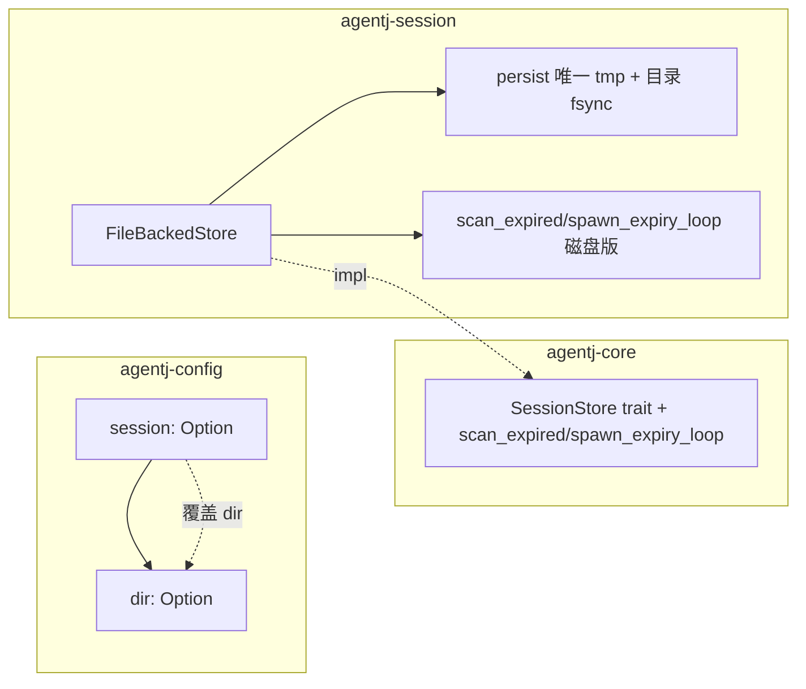

# 设计文档：G4 — 磁盘持久化生产接线（FileBackedStore 生产接入）

## 概述

差距档案（`2026-08-30-gap-analysis-vs-original-design.md` G4 行）指出：v0.3 宣称「FileBackedStore 磁盘持久化已落地」，但 CLI 生产路径（`agentj-cli/src/main.rs:182`）仍用 `InMemoryStore::new()`——**FileBackedStore 全仓生产零引用**（仅 `pub use` + 定义 + 单测）。设计意图（v0.4 守护内核「历史级接续」）依赖磁盘持久化支撑跨进程/跨 UI 会话恢复，但落空了。

本设计兑现 G4：将 `FileBackedStore` 接入 CLI 全部生产模式（`run` 嵌入式 / `serve stdio` / `serve --port` 常驻 / `dashboard`），并修复磁盘写入的两处缺陷（固定 tmp 命名碰撞 + rename 持久性缺失）。

## 目标与非目标

- **目标**：
  - CLI 生产路径以 `FileBackedStore` 为唯一会话存储，会话跨进程/跨重启恢复（兑现「历史级接续」）。
  - 会话目录来源：默认 `$XDG_DATA_HOME/agentj/sessions`，可被 `config.toml [session] dir` 覆盖。
  - `scan_expired`/`spawn_expiry_loop` 提升到 `SessionStore` trait，FileBackedStore 实现磁盘版过期归档（功能对齐 InMemory）。
  - 修复 `persist()` 固定 `.tmp` 命名碰撞：唯一 tmp 命名 + rename 后目录 fsync（崩溃一致性）。
- **非目标**：
  - 协议面零变化（`session/run` 一请求一响应、`$/progress` 流式保留；无 checkpoint/resume 语义）。
  - 不做跨进程同 session 并发写锁（`fs2` flock 不做）；单进程内 Mutex 已串行，跨进程同 session 并发写属异常场景。
  - 不改 FileBackedStore 的「每会话一 JSON 文件 + 全量重写」存储模型。

## 设计方案

### 架构决策

```mermaid
flowchart TB
    subgraph CLI 生产路径（main.rs 单点实例化）
        CFG[Config::load] --> DIR[resolve_session_dir]
        DIR --> FB[FileBackedStore::new dir]
        FB --> CTX[KernelContext.session]
        FB --> EXP[spawn_expiry_loop 磁盘版]
        CTX --> RUN[run 嵌入式]
        CTX --> STDIO[serve stdio]
        CTX --> TCP[serve --port 常驻]
        CTX --> DASH[dashboard]
    end
```

### 备选方案

| 方案 | 优点 | 缺点 | 为何未选用 |
|------|------|------|-----------|
| A. 仅 InMemoryStore 保持现状 | 零改动 | 持久化宣称落空、跨进程恢复不可用 | 不符合 G4 目标 |
| B. XDG 目录仅硬编码 | 简单 | 不可配置、违背 config 优先级惯例 | 采用 XDG + config 覆盖 |
| C. `fs2` flock 跨进程排它 | 严格串行化跨进程写 | 新增依赖、AgentJ 常驻内核已按进程持 store、场景罕见 | 采用唯一 tmp + 目录 fsync |

## 架构

### 组件与数据流



### 关键改动点

1. **`agentj-core::module::SessionStore` trait**：新增
   - `fn scan_expired(&self, ttl: Duration, now_epoch: u64, bus: &EventBus) -> Result<usize, ModuleError>`
   - `fn spawn_expiry_loop(self: Arc<Self>, bus: Arc<EventBus>, ttl: Duration, interval: Duration) -> tokio::task::JoinHandle<()>`
   - 提供默认空实现（`Ok(0)` / no-op），`InMemoryStore` 保留现有实现，`FileBackedStore` 实现磁盘版。

2. **`agentj-session::file_store`（FileBackedStore）**：
   - 新增磁盘版 `scan_expired`：以 `updated` 时间戳为 idle 依据，遍历内存 `updated` 账本，`now_epoch - updated > ttl` 且状态 Active → `archive(sid)` + `bus.publish(SessionExpired)`。
   - 新增 `spawn_expiry_loop`（与 InMemory 同构）。
   - `persist()`：tmp 命名 `sid.json.tmp` → `sid.<uuid>.json.tmp`（唯一）；rename 后对目录 `File::open(dir).sync_all()`。

3. **`agentj-config`**：`AgentJConfig` 增加 `#[serde(default)] pub session: Option<SessionConfig>`，`SessionConfig { pub dir: Option<PathBuf> }`；`ConfigProvider::get_str` 映射 `session.dir`（用于 CLI 解析）。

4. **`agentj-cli`**：
   - `resolve_session_dir(config) -> PathBuf`：优先 `[session] dir`；否则 `$XDG_DATA_HOME/agentj/sessions`（未设 XDG_DATA_HOME 时回退 `$HOME/.local/share/agentj/sessions`）；`FileBackedStore::new(&dir)` 自建目录。
   - `main.rs:182` `InMemoryStore::new()` → `FileBackedStore::new(&dir)`；`session_store` 具体 Arc 保持（供 `spawn_expiry_loop` 经 trait 调用）。
   - `main.rs:285` `session_store.spawn_expiry_loop(...)` 经 `Arc<dyn SessionStore>` 或具体 Arc 调用磁盘版。

## 关键设计决策

| 决策 | 选项 | 选择 | 理由 |
|------|------|------|------|
| D1 会话目录来源 | XDG 默认 / config / env / 固定 | XDG 默认 + config 覆盖 | 平台标准、开箱可用、可配置 |
| D2 过期循环 | trait 化 / FileBacked 固有 / 磁盘不做过期 | trait 化，FileBacked 实现磁盘版 | 功能对齐 InMemory，trait 消费者统一获得过期能力 |
| D3 跨进程写入 | 唯一 tmp + 目录 fsync / + fs2 flock | 唯一 tmp + 目录 fsync | 纯 std 零依赖，解决 tmp 碰撞 + rename 持久性 |

## 错误处理

- 目录创建失败 / `FileBackedStore::new` IO 错误：已有 `SessionError::PersistenceFailed` 传播，CLI `main()` 经 `anyhow` 上报并退出（fail-fast）。
- `scan_expired` 中归档失败：`?` 短路返回该次错误（该轮扫描提前结束，不阻塞调用者）；`spawn_expiry_loop` 默认实现内 `let _ =` 吞错，**下一轮 tick 继续扫描，循环不崩溃**（循环级韧性，而非单轮全扫描韧性）。
- `persist` rename 后目录 fsync 失败：返回 `PersistenceFailed`（数据已写但持久性未保证——保守失败）。
- 跨进程同 session 并发写：唯一 tmp 名避免 tmp 互踩；最终 rename 以最后写入者胜（不锁，异常场景接受）。

## 测试策略

- **agentj-session 单测**：
  - `scan_expired` 磁盘版：构造 updated 账本，验证过期归档 + `SessionExpired` 发布；未过期保留。
  - `spawn_expiry_loop`：驱动一轮扫描（用注入 clock 或显式 now）。
  - tmp 唯一命名：并发写同 session，验证无 tmp 互踩（两个 store 实例并发 append 同一 sid）。
  - 目录 fsync：persist 后目录可读、无残留 `.tmp`。
- **agentj-config 单测**：`[session] dir` 解析 + 缺省 None。
- **agentj-cli 单测**：`resolve_session_dir`——config 覆盖优先、XDG 回退、HOME 回退。
- **回归**：`cargo test --workspace`（含既有 FileBackedStore/InMemory 测试）+ `cargo clippy --workspace --all-targets -- -D warnings`。
- **验收**：`cargo test -p agentj-session`、`-p agentj-config`、`-p agentj-cli` 全绿；`cargo test --workspace` 无回归。

## 依赖

- 无新增外部 crate（XDG 用 `std::env` 解析，目录 fsync 用 `std::fs`）。
- `agentj-session` 依赖不变（agentj-core / serde_json / tokio / tracing / uuid）。
- 前置：v0.5 内核调度重构、v0.6 per-session 路由（均已落地）——本设计在既有 Kernel/IPC 之上接线，无协议耦合。
