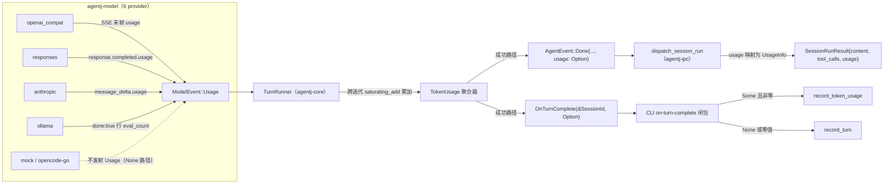
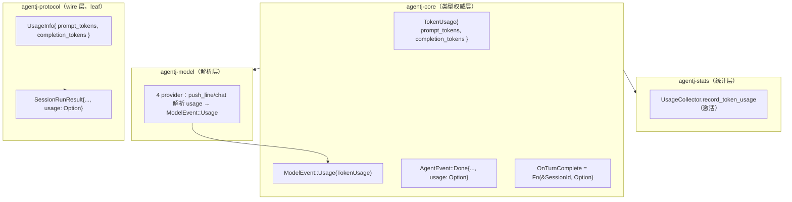

# 设计文档：G3 — token 级用量统计

> 来源：`docs/superpowers/specs/2026-08-30-gap-analysis-vs-original-design.md` G3 行（差距档案）。
> 状态：设计（待实现计划）。
> 取证基线：v0.7.0（三路并行 explore 重新取证，gap 档案 v0.4.1 证据行号已校准）。

## 概述

设计宣称「UsageCollector 统计 tokens」，但实测（v0.7.0 与 v0.4.1 结论一致）`record_token_usage` 是**死代码**（仅单测调用）：`OnTurnComplete` 只传 `&SessionId`、`ModelEvent` 无 Usage 变体、6 个 provider（openai_compat / responses / anthropic / ollama / mock / opencode-go）全部丢弃流式 SSE 末帧与**非流式**响应中的 `usage` 字段，CLI 仅 `record_turn` 累加 turn 数、token 恒为 0。

本特性打通「provider 解析 usage → 总线聚合 → 统计记录 + 协议返回」全链路：让 UsageCollector 记录真实 token 用量，并在 `session/run` 最终结果中加性返回本次用量（客户端可观测）。

## 目标与非目标

### 目标

- 4 个真实 provider（openai_compat / responses / anthropic / ollama）的**流式**路径解析 `usage`（openai_compat 流式需在请求侧补 `stream_options.include_usage`）；mock/opencode-go 透传（`ModelEvent::Usage` 由 mock 脚本手动插入验证聚合）。
- `ModelEvent` 新增独立 `Usage` 变体；`TurnRunner` 跨工具循环迭代累加 prompt/completion token。
- `OnTurnComplete` 签名携带 `Option<TokenUsage>`；CLI 接线改为 `record_token_usage`（激活死代码），turns 计数不丢失。
- `SessionRunResult` 加性新增 `usage: Option<UsageInfo>`（`skip_serializing_if`），客户端每次 `session/run` 后可见本次用量。
- 全量测试 + clippy + 协议漂移门禁 + TS binding 通过。

### 非目标

- **`ChatResponse.usage` 字段与非流式 `chat()` 的 usage 解析延后（决策 D8）**：`chat()` 当前**零生产调用者**（仅 wiremock 单测调用 `.chat(`），为其加字段会同时破坏 8 个文件 10 处 `ChatResponse` 构造点（turn_runner/dispatcher/agent_loop_module/ipc + 4 provider + mock），违反任务粒度 ≤3 文件约束；流式（生产路径）已完整覆盖 gap 档案 G3 核心指控。待 `chat()` 获得生产调用者时一并落地。
- 不加 `ProgressValue::Usage` 流式广播（客户端仅在 run 最终结果可见用量，不流式推送）。
- 不加 stats 查询/统计方法（`kernel/status` 不暴露用量；未来统计面板另立设计）。
- 不做 token 精度/缓存/推理 token（reasoning/cached）细分——仅 `prompt_tokens` + `completion_tokens` 两维（与 `SessionUsage` 现有字段一致）。
- 不改 `record_turn` 语义、不改 `SessionUsage` 结构（`turns` 字段保持）。
- 不做 `fs2`、不做 FileBackedStore 用量持久化（G3 仅内存统计）。

## 现状取证（v0.7.0，设计依据）

| 取证项 | 位置 | 现状 |
|--------|------|------|
| `ModelEvent` | `crates/agentj-core/src/types.rs:78-83` | 仅 `Delta/ToolCall/Done` 3 变体，无 Usage |
| `ChatResponse` | `types.rs:85-89` | 无 usage 字段 |
| `AgentEvent::Done` | `types.rs:92-105` | `{ final_response, tool_calls }` 无 usage |
| `OnTurnComplete` | `types.rs:107` | `Arc<dyn Fn(&SessionId) + Send + Sync>` |
| `record_token_usage` | `crates/agentj-stats/src/lib.rs:32-47` | 死代码（仅 `#[cfg(test)]` 4 处调用）；零值守卫 `return`（不建 entry、不 +1 turn） |
| `record_turn` | `stats/lib.rs:73-78` | 生产唯一调用（CLI）；仅 `turns += 1` |
| CLI 接线 | `crates/agentj-cli/src/main.rs:252-255` | `set_on_turn_complete(\|sid\| usage.record_turn(sid.clone()))` |
| 触发点 | `crates/agentj-core/src/turn_runner.rs:212-224` | 仅成功路径（`tc_list.is_empty()`）发 `Done` 后调 `f(&session_id)`；cancel/max_iter 不触发 |
| provider 流式 | `model/src/{openai_compat,responses,anthropic,ollama}.rs` | 全部丢弃 usage（详见 §6） |
| provider 非流式 | 同上 `chat()` | 全部丢弃 usage |
| 协议 | `agentj-protocol/src/session.rs:24-39` | `SessionRunResult` 无 usage；全协议无 usage/token wire 类型 |
| `$/progress` | `protocol/src/streaming.rs:9-31` | `ProgressValue` 仅 Text/ToolCall/ToolResult，无 usage kind |
| 依赖方向 | `stats/Cargo.toml` | stats 依赖 core（core 不可依赖 stats） |

## 设计方案

### 备选方案

| 方案 | 说明 | 优点 | 缺点 | 为何未选用 |
|------|------|------|------|-----------|
| A. 独立 `ModelEvent::Usage` 变体 + `OnTurnComplete` 携带 `Option<TokenUsage>` + `SessionRunResult.usage` | 本文档方案 | usage 与流终止解耦，适配 6 provider 不统一时序；None 语义保住 turns 计数；加性协议扩展 | 需同步改 `AgentEvent::Done` 构造/消费点 | —（选定） |
| B. `Done` 携带 usage | `ModelEvent::Done { usage: Option<..> }` | 变体数最少 | anthropic `message_delta` 先于 `message_stop`，需 parser 缓冲；多迭代聚合语义纠缠；`Done` 语义被污染 | 传播形态决策 D2 否决 |
| C. 仅服务端统计 | 协议零变化 | 改动最小 | 用量无任何对外观察口，统计「给谁看」悬空 | 范围决策 D1 否决 |
| D. 完整方案（+ 流式广播 + 查询方法） | 客户端全程可见 | 可观测性最强 | 需 schema 重生成 + 方法面扩展 + 流式协议加性，超出 G3 验收 | 范围决策 D1 否决（YAGNI，留待统计面板设计） |

## 架构

### 数据流



### 组件边界



依赖方向：`agentj-core`（定义 `TokenUsage`）← `agentj-model`（provider 发射）、`agentj-stats`（复用自身 `SessionUsage`）；`agentj-protocol` 为 leaf crate 定义独立 wire 类型 `UsageInfo`（不依赖 core）；`agentj-ipc`/`agentj-cli` 消费两端。

## 关键设计决策

| # | 决策 | 选项 | 选择 | 理由 |
|---|------|------|------|------|
| D1 | 范围 | 仅服务端 / **服务端 + run 结果返回** / 完整方案 | 服务端 + `SessionRunResult.usage` | G3 验收核心是记录完整；run 结果返回是低成本加性可观测；流式广播/查询方法 YAGNI |
| D2 | 传播形态 | **独立 `ModelEvent::Usage` 变体** / `Done` 携带 | 独立变体 | 6 provider usage 时序不统一（anthropic `message_delta` 先于 `message_stop`）；独立变体任意位置可发、TurnRunner 无脑累加、`Done` 语义不被污染；对现有 30+ 处 `match ModelEvent` 消费点零破坏（新变体为加性） |
| D3 | `OnTurnComplete` 签名 | **`Fn(&SessionId, Option<TokenUsage>)`** / 强制携带 / 原始值 | Option 携带 | `None` = provider 未报告；CLI 分支保证 turns 恒 +1；mock 零改动（不发射 Usage 即 None） |
| D4 | 类型归属 | **core 定义 `TokenUsage`** / stats 定义 | core | 依赖方向 `stats → core`，core 不可反向依赖；`TokenUsage` 为总线类型（ModelEvent/OnTurnComplete 共用） |
| D5 | 协议 wire 类型 | **`UsageInfo` 独立类型** / 复用 `SessionUsage` | 独立类型 | protocol 为 leaf crate 零内核耦合，不可依赖 stats/core；wire 类型 snake_case + schemars |
| D6 | provider 公共 helper | **各 parser 独立小函数** / 抽公共 `parse_usage` | 独立小函数 | 三线字段名/时序各异（`usage{prompt,completion}` / `usage{input,output}` / `eval_count`），公共 helper 抽象收益有限；抽 `sse_event_stream` 级别的共享层属于过度设计 |
| D7 | 累加溢出 | `saturating_add` / `checked_add` 传播错误 | `saturating_add` | 真实 token 计数不可能溢出，防御性处理即可；不引入错误路径 |
| D8 | **`ChatResponse.usage` 字段与非流式 `chat()` 解析** | 本期落地 / **延后** | 延后 | `chat()` 零生产调用者（仅 wiremock 单测）；加字段需同步改 8 文件 10 处构造点，违反 ≤3 文件任务粒度；流式（生产路径）已覆盖 gap G3 核心；待 `chat()` 获生产调用者时随同落地 |

## 类型设计

### agentj-core（`crates/agentj-core/src/types.rs`）

```rust
/// 单次模型调用（或跨迭代聚合）的 token 用量。
#[derive(Debug, Clone, Copy, Default, PartialEq, Eq)]
pub struct TokenUsage {
    pub prompt_tokens: u64,
    pub completion_tokens: u64,
}

impl TokenUsage {
    /// 跨迭代累加（防御性饱和加法）。
    pub fn accumulate(&mut self, other: TokenUsage) {
        self.prompt_tokens = self.prompt_tokens.saturating_add(other.prompt_tokens);
        self.completion_tokens = self.completion_tokens.saturating_add(other.completion_tokens);
    }
}

pub enum ModelEvent {
    Delta(String),
    ToolCall(ToolCall),
    Usage(TokenUsage),        // 新增（加性）
    Done,
}

pub enum AgentEvent {
    Delta(String),
    ToolCall(ToolCall),
    ToolResult { call_id: String, result: String },
    Done { final_response: String, tool_calls: Vec<ToolCall>, usage: Option<TokenUsage> }, // usage 新增（加性）
    Error(String),
}

pub type OnTurnComplete = Arc<dyn Fn(&SessionId, Option<TokenUsage>) + Send + Sync>;
```

`ChatResponse.usage` 字段与**非流式 `chat()` 的 usage 解析按 D8 延后**（`chat()` 零生产调用者；字段加装会破坏 8 文件 10 构造点，违反 ≤3 文件任务粒度）。`ChatResponse` 保持不变。

### agentj-protocol（`crates/agentj-protocol/src/session.rs`）

```rust
/// session/run 结果中的 token 用量（加性，缺省不序列化）。
#[derive(Debug, Clone, Copy, Serialize, Deserialize, JsonSchema)]
pub struct UsageInfo {
    pub prompt_tokens: u64,
    pub completion_tokens: u64,
}

pub struct SessionRunResult {
    pub content: String,
    pub tool_calls: Option<Vec<ToolCall>>,
    #[serde(skip_serializing_if = "Option::is_none")]
    pub usage: Option<UsageInfo>,
}
```

同步：`cargo run -p agentj-protocol --bin gen_schemas` 重新生成 `schemas/*.json`；`bindings/ts` 重新生成 TS 类型。

### agentj-stats（`crates/agentj-stats/src/lib.rs`）

- `SessionUsage { prompt_tokens, completion_tokens, turns }` 结构不变。
- `record_token_usage` 从死代码转生产调用（由 CLI 闭包驱动），语义不变（含零值守卫）。
- **不改** `record_turn`；CLI 闭包负责分支。

## Provider 解析（`crates/agentj-model/src/`）

| provider | 请求侧改动 | 流式解析 | 非流式解析（D8 延后） | 解析 helper |
|----------|-----------|---------|-----------|------------|
| `openai_compat.rs` | `request_body` 加 `"stream_options": { "include_usage": true }` | `push_line` 中 `json["usage"]` 存在时解析 `usage{prompt_tokens, completion_tokens}` → `ModelEvent::Usage`（SSE 末帧形态：`choices:[]` + 顶层 `usage`，无 finish_reason）；**`Done` 仅于 `[DONE]` 发射**（末帧 `choices:[]`+usage 位于 finish_reason 之后，先发 `Done` 会丢弃 usage） | 延后 | 私有 `fn parse_usage(&Value) -> Option<TokenUsage>` |
| `responses.rs` | 无（`response.completed` 默认带 usage） | `push_line` 的 `"response.completed"` 分支内读 `json["usage"]{input_tokens, output_tokens}` → `Usage`（在 `Done` 之前发射） | 延后 | 私有 `fn parse_usage` |
| `anthropic.rs` | 无（`message_delta` 默认带 usage） | `push_line` 的 `"message_delta"` 分支读 `json["usage"]{input_tokens, output_tokens}` → `Usage`（先于 `message_stop` 到达，独立变体天然适配） | 延后 | 私有 `fn parse_usage` |
| `ollama.rs` | 无 | NDJSON `done:true` 行读 `prompt_eval_count`/`eval_count` → `Usage`（在 `Done` 之前发射） | 延后 | 私有 `fn parse_usage` |
| `mock.rs` | 无 | **不发射** `Usage`（= `None` 路径，测试默认；mock 脚本可手动插入 `ModelEvent::Usage` 验证聚合） | 延后 | — |
| `opencode_go.rs` | 无 | 纯 Facade 路由，透传末端 transport（末端即上述 4 家） | 同左 | — |

发射顺序约束：`Usage` 事件须在 `Done` **之前**发射（TurnRunner 在 `Done` 处 break 并聚合已累加值）；parser 内 `done_emitted` 守卫保持现状。

## 协议加性扩展

- `SessionRunResult.usage: Option<UsageInfo>`（`skip_serializing_if = "Option::is_none"`）——加性纪律：只加不改，旧客户端不感知新字段。
- `dispatch_session_run`（`crates/agentj-ipc/src/lib.rs:599-636`）在 `AgentEvent::Done` 分支取 `usage`，映射为 `UsageInfo` 填入 `session/run` 结果。
- schema 重生成 + 漂移门禁 + TS binding 同步。
- 不加 `ProgressValue::Usage`、不加方法面（D1 范围锁定）。

## 错误处理与边界

| 场景 | 行为 |
|------|------|
| provider 未报告 usage（mock / 缺帧 / 协议无该字段） | `None` 全程传递：`Done.usage = None`、`SessionRunResult.usage` 缺省、CLI 回退 `record_turn`——turns 恒 +1 不丢 |
| 部分迭代报告 usage（多工具循环中某次模型调用无 usage 帧） | 累加已报告的迭代（`TokenUsage::accumulate`），缺失迭代贡献 0 |
| 零 token（`0,0`） | CLI 闭包判零回退 `record_turn`（保住 `record_token_usage` 零值守卫语义，避免吞 turn） |
| u64 溢出 | `saturating_add`（防御性，真实不可能） |
| cancel / max_iter 超限 | 保持现状：不触发 `OnTurnComplete`、`AgentEvent::Error` 无 usage——统计口径 = 成功完成的 turn |
| SSE 解析错误 | 沿用现有 `ModelError::Stream` 透传；usage 字段缺失不视为错误（可选字段） |
| `stream_options.include_usage` 服务端不支持 | openai_compat 无 usage 帧 → `None` 路径，不致命（加性容忍） |

## 测试策略

### 单测（TDD：先测试后实现）

| 层 | 用例 |
|----|------|
| agentj-model | 4 家流式末帧 usage 解析（真值 JSON 摘录：openai SSE 末帧 `choices:[]`+usage / responses `response.completed` / anthropic `message_delta` / ollama `done:true` 行）→ 断言 `ModelEvent::Usage`；usage 缺失 → 无 Usage 事件（None 路径）；openai `request_body` 含 `stream_options.include_usage`；非流式 `chat()` 解析（D8 延后，不测） |
| agentj-core | `TokenUsage::accumulate` 跨迭代累加（含饱和）；TurnRunner：`Usage` 事件跨迭代聚合 → `Done.usage`、全 None → `Done.usage = None`、`OnTurnComplete` 收到聚合值、部分迭代聚合、cancel 不触发回调 |
| agentj-ipc | `dispatch_session_run`：`AgentEvent::Done{usage: Some}` → `SessionRunResult.usage` 映射；`None` → 字段缺省（JSON 序列化断言不含 `usage` 键） |
| agentj-cli | on-turn-complete 三分支：`Some` 非零 → `record_token_usage`（turns+1 & token 累加）/ `Some(0,0)` → `record_turn` / `None` → `record_turn` |
| agentj-stats | `record_token_usage` 现有单测保留（转生产后回归）；新增「生产路径 turns 恒 +1」断言 |
| agentj-protocol | `UsageInfo` schema 生成 + drift 门禁 |

### 集成/密封

- `e2e_cli`/`e2e_permission`：mock LLM 脚本插入 `ModelEvent::Usage` 帧 → 断言 `session/run` 结果含 `usage`；无 Usage 帧 → 结果缺省（向后兼容密封）。
- `cargo test --workspace` + `cargo clippy --workspace --all-targets -- -D warnings` + `cargo fmt --all --check` + `cargo test -p agentj-protocol -- drift` + `bindings/ts` 构建。

### 验收标准

1. `record_token_usage` 无死代码警告（生产路径存在调用）。
2. mock LLM e2e：带 Usage 帧的 run 返回 `SessionRunResult.usage`；不带帧返回缺省。
3. 全量门禁通过；schema/TS 无漂移。

## 依赖

- 前置：G1（v0.5 总线化，`TurnRunner`/`AgentEvent` 已就位）、G2（v0.6 per-session）、G4（v0.7 FileBackedStore）——均已实现。
- 无外部 crate 依赖变更（不引入 `reqwest` 之外新依赖）。
- 版本：minor bump（`0.7.0` → `0.8.0`，特性变更）。