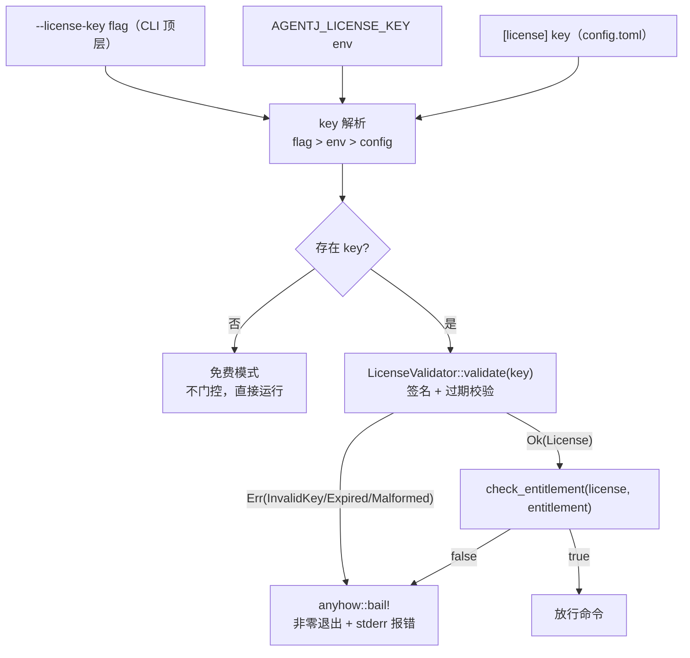
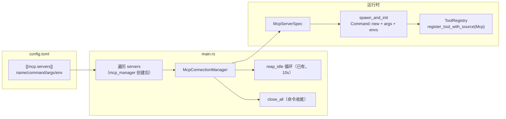
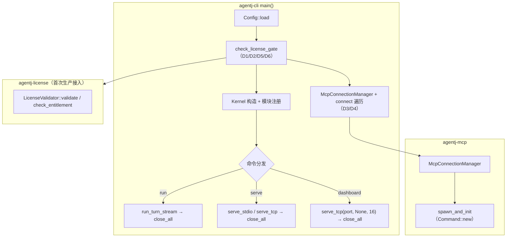

# 设计文档：G5 License 商用门控 + G6 MCP 生产接线（v0.9.0）

> 来源：`docs/superpowers/specs/2026-08-30-gap-analysis-vs-original-design.md` 第 21/22 行（G5/G6 差距行）+ 第 39/40 行（改造方向）。
> 状态：设计阶段（设计→计划→开发→验收管线首站）。

## 概述

AgentJ v0.8.0 已交付 IPC 契约、内核调度、per-session 路由、会话持久化与 token 用量统计，但差距档案剩余两项 🟠「生产接线」缺口悬空：

- **G5 License 商用门控**：`agentj-license` crate 的 Ed25519 校验能力（`validate` / `check_entitlement`）完备但**全仓零生产依赖**（`agentj-cli/Cargo.toml` 无 agentj-license，全仓仅 crate 自身引用）。商业件完全悬空，无 `--license-key` 配置、无任何命令级门控。
- **G6 MCP 生产接线**：CLI 已 spawn `reap_idle` 回收循环（`main.rs:312-320`）但 `connections` 恒空——`[[mcp.servers]]` 配置发现→`connect` 链路缺失，长驻 MCP 特性空转。另有 `connect` 仅接受 `sh -c` 单字符串（`connection_manager.rs:214-222`），无 `command/args/env` 拆分，存在 shell 注入面。

本设计将两者合并为一个阶段：均为 CLI 层「挂空能力激活」，互无依赖、同为 🟠 级，一次性消除 G5/G6 两条差距项。

## 目标与非目标

**目标（G5）**：
- CLI 注入 `LicenseValidator`，新增 key 解析链路（`--license-key` flag / `AGENTJ_LICENSE_KEY` env / `[license] key` TOML）。
- 命令级 entitlement 门控：`run`→`"run"`、`serve`/`serve --port`→`"serve"`、`dashboard`→`"dashboard"`。
- 无 key = 免费模式（零门控，向后兼容）；有 key = 签名+过期校验 + entitlement 门控，失败 fail-fast 非零退出。

**目标（G6）**：
- `[[mcp.servers]]` TOML 配置段：`name/command/args/env`。
- `McpConnectionManager::connect` 签名升级：`command: String` → `McpServerSpec{command,args,env}`，底层 `Command::new(cmd).args(args).envs(env)`（消除 `sh -c` 注入面）。
- CLI 启动时遍历配置逐 server `connect`，失败 `tracing::warn!` 并继续；新增 `close_all()` 供优雅关闭。

**非目标**：
- 不改 IPC 协议契约（协议面零变化，加性纪律；门控收敛在 CLI 命令边界）。
- 不做在线/周期性 license 复验（serve 运行期间 license 到期不中途吊销——记录为已知限制）。
- 不改 MCP 工具注册链路（`register_tools` → `register_tool_with_source(ToolSource::Mcp)` 已完备）。
- 不实现 G7（EventBus 重入 guard）与 G8（WebSocket 网关）。

## 决策摘要（D1-D7，用户审阅门可否决）

| # | 决策点 | 推荐决策 | 理由 |
|---|--------|---------|------|
| **D1** | G5 门控模式 | **Key-optional 免费模式**：无 key 不门控；有 key 才校验门控 | 向后零破坏（现有 e2e 全绿）、社区可用、商业版经 key 解锁，且天然可测 |
| **D2** | G5 entitlement 语义 | 按命令能力细分 `"run"`/`"serve"`/`"dashboard"` | `entitlements: Vec<String>` 天然匹配；可组合售卖（如仅购 dashboard） |
| **D3** | G6 connect 签名 | `connect(server_id, McpServerSpec{command,args,env})` 破坏性替换 + 新增 `close_all()` | `connect` 零生产调用者（仅测试），破坏安全；spec 结构化消除注入面 |
| **D4** | G6 连接失败策略 | 单 server 失败 `tracing::warn!` + 继续启动 | 个别 server 故障不拖垮整体；manager 已有 `Failed` 墓碑 + 重连兜底 |
| **D5** | G5 验证公钥来源 | 编译期常量 `AGENTJ_LICENSE_PUBKEY` + env 覆盖（base64） | e2e 需注入测试公钥；env 覆盖同时服务生产 key 轮换（操作者可控，非安全洞） |
| **D6** | G5 key 解析优先级 | `--license-key` flag > `AGENTJ_LICENSE_KEY` env > `[license] key` | 与 ConfigProvider env 覆盖先例（`AGENTJ_MODEL_PROVIDER`）一致；flag 最高 |
| **D7** | G6 门控位置 | CLI 命令边界门控，IPC 层零改动 | serve 启动即校验，其客户端请求已被命令门控覆盖；per-request 复验仅防中途过期，YAGNI |

## G5 设计方案

### 5.1 配置 schema（`agentj-config`）

```toml
[license]
key = "base64(payload).base64(sig)"   # Ed25519 签名 license key（可选）
```

```rust
// crates/agentj-config/src/lib.rs
pub struct LicenseConfig {
    #[serde(default)]
    pub key: Option<String>,
}

pub struct AgentJConfig {
    // ...model/permission/session 不变
    #[serde(default)]
    pub license: Option<LicenseConfig>,   // 新增，与 session: Option<...> 同模式
}
```

- `merge.rs::merge_config` 新增 `if file.license.is_some() { config.license = file.license; }`。
- `merge.rs::apply_env` 新增 `AGENTJ_LICENSE_KEY` → `config.license.key`。
- `ConfigProvider::get_str` 新增 `"license.key"` 分支。

### 5.2 key 解析优先级（D6）



### 5.3 验证器来源（D5）

`agentj-cli` 新增常量 + env 覆盖：

```rust
// crates/agentj-cli/src/license.rs（新文件，或 main.rs 内嵌辅助）
const AGENTJ_LICENSE_PUBKEY: [u8; 32] = /* 生产公钥，编译期嵌入 */;

fn resolve_validator() -> LicenseValidator {
    if let Ok(b64) = std::env::var("AGENTJ_LICENSE_PUBKEY") && !b64.is_empty() {
        // base64 解码 → VerifyingKey::from_bytes（测试注入 / 生产轮换）
        LicenseValidator::new(decoded)
    } else {
        LicenseValidator::new(VerifyingKey::from_bytes(&AGENTJ_LICENSE_PUBKEY).unwrap())
    }
}
```

生产公钥以占位常量嵌入（后续发版替换为真实商业公钥）；env 覆盖是操作者可控的轮换通道（能设 env 者本就拥有进程环境，非新增攻击面）。

### 5.4 命令级门控（D7）

`main()` 中 `Config::load`（`main.rs:204`）之后、命令分发（`match cli.command`）之前，新增统一门控辅助：

```rust
// crates/agentj-cli/src/main.rs
fn check_license_gate(
    cfg: &agentj_config::Config,
    cli_key: Option<&str>,
    entitlement: &str,
    command_name: &str,
) -> Result<(), anyhow::Error> {
    let key = cli_key.or_else(|| cfg.inner().license.as_ref().and_then(|l| l.key.as_deref()));
    let Some(key) = key else { return Ok(()); };          // D1: 无 key = 免费模式
    let validator = resolve_validator();
    let license = validator.validate(key).map_err(|e| anyhow::anyhow!("license: {e}"))?;
    if !validator.check_entitlement(&license, entitlement) {
        anyhow::bail!("license missing entitlement: {command_name}");
    }
    Ok(())
}
```

分发前调用点（三个命令分支各一次）：

| 命令 | 分支位置 | entitlement | 说明 |
|------|---------|-------------|------|
| `run`（嵌入式单轮） | `Commands::Run` 分支首行 | `"run"` | 仅非 attach 路径门控 |
| `run --attach` | — | 不门控 | 瘦客户端，远程 serve 已按 `"serve"` 门控，本地不重复要求 |
| `serve` / `serve --port` | `Commands::Serve` 分支首行 | `"serve"` | stdio 与 TCP 同语义 |
| `dashboard` | `Commands::Dashboard` 分支首行（绑定端口前） | `"dashboard"` | 独立售卖单位 |

门控失败均发生在端口绑定/内核启动之前（fail-fast，不留半启动状态）。

`agentj-cli/Cargo.toml` 新增 `agentj-license = { path = "../agentj-license" }`（激活零生产引用）。

### 5.5 备选方案（G5）

| 方案 | 优点 | 缺点 | 为何未选用 |
|------|------|------|-----------|
| A. 命令边界门控（推荐） | 零协议变化、fail-fast UX、e2e 易测、改动面最小（CLI 单层） | serve 运行期 license 到期不中途吊销 | 中途吊销是边缘场景，记录为已知限制，非本次范围 |
| B. IPC per-request `license_gate`（镜像 `auth_gate`） | 多客户端逐请求校验、可返回 `-32807` JSON-RPC 错误 | 协议面需新增错误码、双门控冗余、改动面大 | 命令门控已覆盖 serve 全部客户端请求；YAGNI |
| C. Key-mandatory 强门控 | 全产品商业化 | 破坏全部现有 e2e、社区不可用 | 与开源定位冲突，D1 已否决 |
| D. 按分档（run 免费 / serve 收费） | 可分级售卖 | 语义模糊，需定义「档」模型 | 细分 entitlement（D2）已足够灵活 |

## G6 设计方案

### 6.1 配置 schema（`agentj-config`）

```toml
[mcp]
[[mcp.servers]]
name = "filesystem"                        # server_id，对应 ToolSource::Mcp{server_id}
command = "npx"                            # 可执行文件（不再经 sh -c 拼接）
args = ["-y", "@modelcontextprotocol/server-filesystem", "/tmp"]
env = { "FOO" = "bar" }                    # 可选环境变量
```

```rust
// crates/agentj-config/src/lib.rs
pub struct McpServerConfig {
    pub name: String,
    pub command: String,
    #[serde(default)]
    pub args: Vec<String>,
    #[serde(default)]
    pub env: HashMap<String, String>,
}
pub struct McpConfig {
    #[serde(default)]
    pub servers: Vec<McpServerConfig>,
}

pub struct AgentJConfig {
    // ...
    #[serde(default)]
    pub mcp: Option<McpConfig>,             // 新增
}
```

- `merge.rs` 新增 `if file.mcp.is_some() { config.mcp = file.mcp; }`。

### 6.2 `McpConnectionManager` 签名升级（D3，`agentj-mcp`）

```rust
// crates/agentj-mcp/src/connection_manager.rs
pub struct McpServerSpec {
    pub command: String,
    pub args: Vec<String>,
    pub env: HashMap<String, String>,
}

// 破坏性替换（零生产调用者，仅测试）
pub async fn connect(self: &Arc<Self>, server_id: String, spec: McpServerSpec) -> Result<(), ToolError>;

// 新增：优雅关闭全部连接（发送 mcp shutdown 通知 + 反注册工具）
pub async fn close_all(&self);
```

`spawn_and_init` 改造（消除 `sh -c` 注入面）：

```rust
let mut child = Command::new(&spec.command)
    .args(&spec.args)
    .envs(&spec.env)
    .stdin(Stdio::piped()).stdout(Stdio::piped())
    .stderr(Stdio::inherit()).kill_on_drop(true)
    .spawn()...;
```

`close_all` 实现：`connections` 键快照 → 逐个调用现有私有 `close(&id)`（`connection_manager.rs:594`，含 `unregister_by_source` + `McpClosed` 事件）。

### 6.3 CLI 接线（`agentj-cli`）



接线点（`main.rs:305` mcp_manager 创建之后、`session_store.spawn_expiry_loop` 之前）：

```rust
if let Some(mcp_cfg) = config.inner().mcp.as_ref() {
    for srv in &mcp_cfg.servers {
        let spec = McpServerSpec {
            command: srv.command.clone(),
            args: srv.args.clone(),
            env: srv.env.clone(),
        };
        let m = Arc::clone(&mcp_manager);
        if let Err(e) = m.connect(srv.name.clone(), spec).await {   // D4
            tracing::warn!("mcp server {} connect failed: {e}", srv.name);
        }
    }
}
```

关闭时机：`run` 分支 turn 完成后、`serve_tcp::run()` 返回后、`serve_stdio` 返回后，各调一次 `mcp_manager.close_all().await`（`kill_on_drop` 兜底保留）。

### 6.4 备选方案（G6）

| 方案 | 优点 | 缺点 | 为何未选用 |
|------|------|------|-----------|
| A. `connect(server_id, McpServerSpec)` 破坏性替换（推荐） | spec 结构化、消除注入面、零迁移成本 | 破坏现有测试调用点（需同步改测试） | 唯一生产调用者就是测试；一次改齐 |
| B. 保留 `connect(server_id, command)` + 新增 `connect_with_args` | 兼容旧签名 | 双入口维护、语义分裂 | 无外部消费者，加性无收益 |
| C. 继续 `sh -c` 拼接 `command + args` | 零改造 | shell 注入面保留、转义脆弱 | 直接违反安全目标 |
| D. 失败 fail-fast（中止启动） | 配置错误立即暴露 | 单 server 故障拖垮整体启动 | 与 D4 冲突；warn+继续更稳健 |

## 架构总览



## 错误处理

| 场景 | 处理 | 呈现 |
|------|------|------|
| G5 无效/过期/畸形 key | `validate` Err → `anyhow::bail!("license: {e}")` | 进程非零退出 + stderr（对齐 `main.rs:209` 冒泡先例） |
| G5 有 key 缺 entitlement | `check_entitlement` false → `bail!("license missing entitlement: {cmd}")` | 进程非零退出 + stderr |
| G5 免费模式 | 无 key → `Ok(())` 直接放行 | 无感知 |
| G6 server connect 失败 | `tracing::warn!` + continue（D4） | 启动成功，manager 内 `Failed` 墓碑；`execute` 路径已有 `McpDisconnected` + 重连兜底 |
| G6 运行期断连 | 已有 `handle_execute_error`：ghost 反注册 + `reconnect` 指数退避 | 事件总线 `McpDisconnected` |
| G6 优雅关闭 | `close_all`：逐 server `close`（shutdown 通知 + 反注册 + `McpClosed`） | 无；`kill_on_drop` 兜底 |

## 测试策略

### G5 单测（`agentj-cli` 内）

- `agentj-config`：`[license] key` 解析、`AGENTJ_LICENSE_KEY` env 覆盖、merge 分支。
- `main.rs` 门控辅助（复用 `load_test_config` 模式 + `env_lock()` 串行隔离）：
  1. 无 key → `Ok`（免费模式）；
  2. 无效 key → Err；
  3. 有效 key 缺 entitlement → Err；
  4. 有效 key + entitlement → Ok。
  - 测试 key：`ed25519-dalek`（dev-dep）生成 keypair，`AGENTJ_LICENSE_PUBKEY` env 注入公钥。

### G5 e2e（新 `tests/e2e_license.rs`，复用 `e2e_serve` 范式）

| # | 场景 | 断言 |
|---|------|------|
| 1 | 无 key + mock provider → `run "hi"` | `status.success()` + stdout 含 `session_id` |
| 2 | 无效 key → `run "hi"` | `!status.success()` + stderr 含 `license` |
| 3 | 有效 key 缺 entitlement（`"dashboard"` key 跑 `run`） | `!status.success()` + stderr 含 `entitlement` |
| 4 | 有效 key + `"run"` entitlement → `run "hi"` | `status.success()` |

- 场景 2 用 `--license-key <invalid>` flag 注入；场景 3/4 用 `--license-key <signed>` + env `AGENTJ_LICENSE_PUBKEY=<pubkey_b64>`（测试 keypair 公钥）双注入，验证 D5/D6 链路。
- 注意：现有 e2e 均 `stderr: Stdio::null()`，G5 需改 `Stdio::piped()` 以断言 stderr。
- fixture：仿 `permission_deny.toml` 新增 `license_run.toml`（mock provider + 空 license 占位）。

### G6 单测（`agentj-mcp`）

- `connect(server_id, spec)`：复用 `mcp_echo.sh` 固件，断言 args 传入生效（echo 回显 `args` 内容）、env 生效（echo 回显 env 值）、`state()==Ready`、`registry.tools()` 含 `ToolSource::Mcp` 条目。
- `close_all`：连接后 `close_all` → `state()==Closed` + registry 无 Mcp 工具。
- 现有 `connection_manager.rs` 6 个 `#[tokio::test]` 调用点同步迁移至新签名。

### G6 e2e（新 `tests/e2e_mcp.rs`）

- 新增 fixture `fixtures/mcp_cli_echo.sh`（复刻 `mcp_echo.sh`：逐行 read/echo JSON-RPC，`initialize`→`tools/list`→`tools/call`）。
- 临时 config 写 `[mcp]` 段（command 指向 fixture 脚本）+ mock provider；`serve --port 0` → `session/run` 触发含 mcp 工具调用的脚本 → 断言终局 `result.content` 含 echo 输出。
- 坏 command server（`command = "nonexistent-binary-xyz"`）→ 启动仍成功（D4 warn 路径）。

### 门禁

`cargo test --workspace` / `cargo clippy --workspace -- -D warnings` / `cargo fmt --all --check` / `cargo test -p agentj-protocol -- drift`（协议零变化，drift 必绿）/ `bindings/ts`（无需重生成）。

## 依赖

| 项 | 说明 |
|----|------|
| 前置阶段 | 无（G5/G6 均独立；v0.8.0 全量通过为基线） |
| 新增依赖 | `agentj-cli` → `agentj-license`（path）；`agentj-cli` dev → `ed25519-dalek`（测试签名）；`agentj-config` 无新依赖；`agentj-mcp` 无新依赖 |
| 破坏面 | `McpConnectionManager::connect` 签名破坏（仅测试调用者，同步迁移） |
| 已知限制 | serve 运行期 license 到期不中途吊销；`close_all` 为尽力关闭（`kill_on_drop` 兜底） |

## 版本与文档同步

- 版本：`0.8.0` → `0.9.0`（feature，minor；AGENTS.md 规则）。
- 阶段完成后自动同步 `AGENTS.md` / `README.md` / `.claude/summary/summary_and_next.md`（G5/G6 完成态 + 差距档案状态行更新为「✅ 已实现」附本设计链接）。