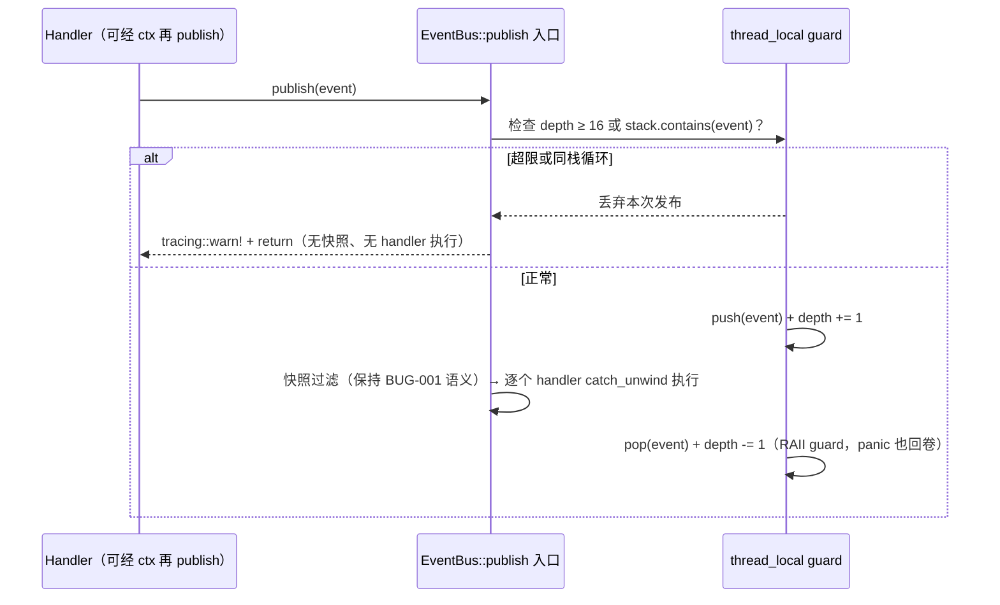
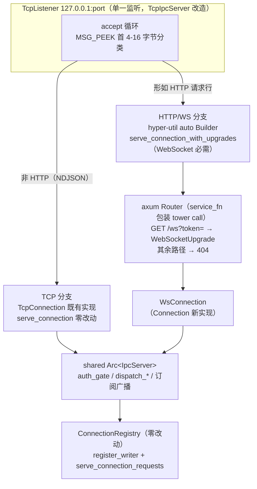
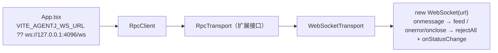

# 设计文档：G7 EventBus 重入防护 + G8 WebSocket 网关（v0.10.0）

> **来源**：`docs/superpowers/specs/2026-08-30-gap-analysis-vs-original-design.md` 差距项 G7（设计债）+ G8（形态限制）。
> **前置**：v0.9.1 已发布（G5 License gating + G6 MCP wiring 全落地）；G1-G6 六项差距全部闭环，本设计处理剩余两项。

## 概述

**G7 — EventBus 重入防护**：`agentj-core` 的 `EventBus::publish` 为同步发布，handler 在调用线程上串行执行。死锁（BUG-001，快照发布）与 panic 隔离（BUG-002，`catch_unwind`）已修复，但**无递归深度防护**——handler 自触发同类型事件（或经 `ctx`/捕获的 `Arc<EventBus>` 再 publish）会形成同步无限递归，最终栈溢出。这是设计债：事件总线作为内核扩展点（插件/MCP/未来消费方）的健壮性缺口。

**G8 — WebSocket 网关**：Web Dashboard 的 `RpcClient` 硬编码 `node:net` TCP（`jsonrpc.ts:1`），浏览器打开即 `TypeError`；`Connection` 传输抽象（daemon-kernel 设计决策 #1）已为 WebSocket 留位——「新增一个 `Connection` 实现即可」。本设计落地：**同端口**（`127.0.0.1:port` 单一监听）同时服务 raw TCP（NDJSON，`run --attach tcp://` 零破坏）与 HTTP/WS（浏览器 Dashboard 直连），前端以 `WebSocketTransport` 替代 `node:net` 并顺带修复通知丢失（BUG-005）。

两项均为差距档案收尾项，合并为一个 feature 版本 v0.10.0 实施。

## 目标与非目标

### G7 目标与非目标

| | 内容 |
|---|---|
| **目标** | ① `EventBus::publish` 入口加 thread_local 递归深度 guard（上限 16）与同栈循环检测；② 超限/循环事件**丢弃 + `tracing::warn!`**（不 panic）；③ 全仓 14 处生产发布点**零改动**（全部收口于 `publish`）；④ 保持 BUG-001 快照（handler 内 register/publish 不死锁）与 BUG-002 `catch_unwind`（panic 隔离）语义 |
| **非目标** | ❌ handler 异步化 / 队列化；❌ 跨线程事件溯源（guard 仅限调用线程，`thread_local`）；❌ 通配/过滤订阅（现状精确相等语义不动）；❌ 事件追溯日志（仅 warn 计数，不记录事件链） |

### G8 目标与非目标

| | 内容 |
|---|---|
| **目标** | ① `serve --port` **同端口**共存 raw TCP 与 HTTP/WS（连接分类器，`run --attach tcp://` 语义零破坏）；② 新增 `WsConnection` 实现 `Connection` trait（`TransportKind::WebSocket`），复用 `IpcServer`/`ConnectionRegistry` 既有服务循环，注册表零改动；③ WS 鉴权**双通道**：upgrade 阶段 `?token=` 校验（`--token` 设置时，不匹配 → 403 不升级）+ 连接后 `initialize.token` 经既有 `auth_gate` 复验（-32806）；④ `max_connections` 覆盖 WS 连接；⑤ 前端 `WebSocketTransport` 实现扩展后的 `RpcTransport`（新增 `close()`/`onNotification`），`ResponseRouter.feed` 分叉处理响应与通知（修复 BUG-005）；⑥ 删除 `node:net` 导入，浏览器零 polyfill 可连 |
| **非目标** | ❌ wss/TLS（保持 127.0.0.1 本机信任模型）；❌ HTTP REST API 面（仅 `/ws` 一条路由，其余 404）；❌ Unix socket（既有预留，非本次）；❌ CORS/跨源策略（本机单源）；❌ 每连接消息速率限流（`max_connections` 覆盖 DoS 基本面）；❌ WS 消息超长/分片重组（Text 消息即一条 JSON 的契约不变） |

## 设计方案

### G7：EventBus 重入防护

**guard 形态**（`agentj-core/src/hooks.rs` 内）：

```
thread_local! {
    static EVENT_DEPTH: Cell<u8>,          // 当前调用栈深度
    static EVENT_STACK: RefCell<Vec<EventType>>, // 当前调用栈事件链
}
const MAX_EVENT_DEPTH: u8 = 16;
```

**放置**：`EventBus::publish` 入口首行——全仓 14 处生产发布点（`kernel.rs` 5 / `connection_manager.rs` 7 / `session` 2）及全部测试发布均收口于此，单点防护即全覆盖，**调用点零改动**。

**执行语义**（与现有快照 + `catch_unwind` 叠加）：



- **同类型自触发**（handler 直接再 publish 同一 EventType）：`stack.contains(event)` 即时拦截，深度 1 即拒。
- **跨类型循环**（A→B→A 环）：`depth >= 16` 兜底截断，不依赖穷举环检测。
- **合法重入**（handler 内 publish **不同类型**事件，如 MCP 生命周期链）：深度 < 16 且非同栈事件，正常放行——`ReentrantHandler` 既有测试（handler 内 register + publish 不死锁）语义保持。
- **panic 安全**：guard 回卷在 RAII Drop 中执行；即使 handler panic（被 `catch_unwind` 捕获），深度计数与事件栈仍正确恢复，线程后续发布不受污染。

### G8：同端口连接分类器 + axum WebSocket 网关

**架构总览**：`TcpIpcServer` 的 accept 循环升级为「连接分类器」——单一 `TcpListener` 绑定 `127.0.0.1:port`，accept 后 `MSG_PEEK` 首字节嗅探：形如 HTTP 请求行（`METHOD SP URI SP HTTP/…`）走 HTTP/WS 分支，否则走既有 raw TCP 分支。`serve --port 4096` 语义不变，`run --attach tcp://127.0.0.1:4096` 零破坏；浏览器新增 `ws://127.0.0.1:4096/ws` 入口。



**WsConnection**（`agentj-ipc/src/ws.rs` 新文件）：

| 维度 | 设计 |
|---|---|
| `kind()` | `TransportKind::WebSocket`（新 variant，枚举加性） |
| `id()` / `peer_desc()` | `ws-{peer}` / `ws:127.0.0.1:54321` |
| `send()` | `sink.send(Message::Text(msg))`——**原生帧**，一条 Text Message 即一条 JSON，无 `\n` 拼接 |
| `recv()` | `stream.next().await` → Text 消息体；关闭帧/EOF → `None` |
| `writer()` | 克隆共享 `SplitSink` 的 `Arc<Mutex<…>>` 句柄——复用 BUG-006 半连接写句柄模式，idle WS 订阅者不丢广播 |
| 服务路径 | 复用 `register_writer` + `serve_connection_requests`，**ConnectionRegistry 零改动** |

**鉴权双通道**（用户决策）：

1. **upgrade 阶段**：`GET /ws` handler 提取 `Query(token)`——`--token` 配置时缺失或不匹配 → `403 Forbidden` 响应、不执行 upgrade。
2. **连接后**：既有 `auth_gate` 传输无关复验——WS 首条消息必须 `initialize` 且携带正确 `token`，否则 `-32806 NotAuthorized`。

**max_connections**：WS 分支以 `axum State` 内 `AtomicUsize` 独立计数，超限 → `503` 拒绝 upgrade；与 TCP 分支的 `active` 计数互不干扰。

**生命周期语义**（重要决策）：**WS 连接不参与「最后连接断开 → 全局关闭」判定**（`active` 计数仅统计 TCP 连接）。理由：浏览器会话短暂、刷新/网络抖动频繁，常驻内核生命周期不应绑定观测性客户端；内核存亡由信号（SIGINT/SIGTERM）、显式 `shutdown` 请求与 CLI 工具客户端（TCP last-disconnect）决定。

**CLI 形态**：`serve --port` 一处改造即同时获得 TCP + WS 能力；`dashboard --port` 复用同路径。前端默认 `ws://127.0.0.1:{port}/ws`。

### 前端：WebSocketTransport + 通知分发

**RpcTransport 扩展**（`web-dashboard/src/jsonrpc.ts`）：

| 成员 | 现状 | 扩展后 |
|---|---|---|
| `send(line): Promise<string>` | ✓ | 保持 |
| `close(): void` | 无 | 新增（连接释放/重连前清理） |
| `onNotification?: (method, params) => void` | 无 | 新增（`$/progress`/`$/permissionRequest` 分发） |

**ResponseRouter.feed 分叉**（修复 BUG-005）：`msg.id == null` 不再丢弃——分叉为「通知」经 `onNotification` 回调分发（订阅/进度/权限请求）；`msg.id` 匹配 `pending` 表 → 正常响应路由。`RpcClient` 增加 `onNotification` 注册入口。

**WebSocketTransport**（`web-dashboard/src/transport/websocket.ts` 新文件）：



- `send` → `ws.send(line)`（WS 原生帧，无需 `\n`）。
- `onmessage` → `ResponseRouter.feed(data)`（整消息已分帧）。
- `onerror`/`onclose` → `rejectAll`（既有语义）+ 可选指数退避重连状态机（`connecting/open/closed`，暴露 `onStatusChange` 供 App 显示）。
- 连接地址：`import.meta.env.VITE_AGENTJ_WS_URL ?? ws://127.0.0.1:4096/ws`（`dashboard --port` 动态端口经 env 注入）。
- **删除 `import net from 'node:net'`** 与 `static connect` TCP 分支——vite 无需任何 polyfill，浏览器 TypeError 根除（Vite 8 默认不 polyfill node）。

## 关键设计决策

| # | 分叉 | 决策 |
|---|------|------|
| D1 (G7) | guard 放置层 | **`EventBus::publish` 入口**——14 生产发布点全收口于此，单点防护全覆盖、调用点零改动；备选「handler 执行循环内」需改 3 个 crate、遗漏面大 |
| D2 (G7) | 超限行为 | **丢弃 + `tracing::warn!`**（gap 档案建议的 thread_local depth<16 语义）——fail-fast panic 与 BUG-002 panic 隔离目标冲突，且 handler 库（插件）不应因递归 bug 拖垮进程 |
| D3 (G7) | 防护粒度 | **深度 16 + 同栈事件检测双保险**——同类型自触发即时拦截（depth 1），跨类型环由深度兜底；仅深度一维会放任同类型反复执行浪费 |
| D4 (G8) | 端口拓扑 + 库选型 | **同端口 + axum**（用户决策）——单一 `127.0.0.1:port` 经连接分类器共存 raw TCP 与 HTTP/WS；`run --attach tcp://` 零破坏，浏览器获 `ws://…/ws` 统一入口。备选「独立 `--ws-port` + tokio-tungstenite」依赖最小但双端口；「ws-only」破坏 TCP 兼容不可取 |
| D5 (G8) | HTTP/WS 服务方式 | **hyper-util `auto::Builder` + `serve_connection_with_upgrades` + axum Router service**（axum 官方 `serve-with-hyper` 模式）——连接分类器需逐连接手动接管，axum 的 `serve(listener, app)` 全量接管不适用；`service_fn` 包装 tower call 是官方文档化桥接 |
| D6 (G8) | 鉴权衔接 | **双通道**（用户决策）：upgrade `?token=` 校验（403）+ 连接后 `initialize.token` 经 `auth_gate` 复验（-32806）——upgrade 层拦截未授权浏览器会话，`auth_gate` 保持协议语义权威；`auth_gate` 传输无关，零改动 |
| D7 (G8) | 生命周期归属 | **WS 不参与 last-disconnect 全局关闭**（`active` 仅统计 TCP）——浏览器会话短暂/频繁刷新，不应决定常驻内核存亡；内核由信号/显式 shutdown/CLI 客户端决定存亡 |
| D8 (G8) | 前端形态 | **WebSocketTransport + RpcTransport 扩展（close/onNotification）+ BUG-005 修复**（用户决策）——`RpcClient`/`RpcTransport`/`ResponseRouter` 既有解耦点直接复用；最小替换（仅 send）会让 Dashboard 永远看不到运行进度，价值打折 |

## 错误处理

| 场景 | 行为 |
|---|---|
| G7 递归超限（depth ≥ 16） | `tracing::warn!`（含 EventType），丢弃发布，handler 不执行，无 panic |
| G7 同栈循环（`stack.contains`） | `tracing::warn!`，丢弃发布 |
| G7 handler panic | 既有 `catch_unwind` 捕获；RAII guard Drop 回卷 depth/stack，线程后续发布不受污染 |
| G8 非 HTTP 且非合法 NDJSON 的 TCP 连接 | 既有路径：解析失败按 `IpcError` 断开处理（语义不变） |
| G8 `--token` 下 `?token=` 缺失/不匹配 | `403 Forbidden`，不执行 WS upgrade |
| G8 WS 首条消息非 `initialize` / token 错 | 既有 `auth_gate` → `-32806 NotAuthorized`（传输无关，零改动） |
| G8 WS `max_connections` 超限 | `503` 拒绝 upgrade（TCP 分支既有 drop-socket 语义不变） |
| G8 WS 对端关闭帧 / 断连 | `recv` 返回 `None` → 既有 serve 循环退出路径 → `unregister`（隐式退订/释放 owner，语义与 TCP 一致） |
| G8 前端 `onerror`/`onclose` | `rejectAll`（挂起请求全拒）+ `onStatusChange` 状态更新 + 可选指数退避重连 |
| G8 前端 WS 地址不可达 | App 显示 `kernel unreachable`（既有 try/catch 语义） |

## 测试策略

| 层级 | 范围 | 工具 | 目标 |
|---|---|---|---|
| G7 单元 | 同类型自触发 20 次 | `hooks.rs` 单测（`ReentrantHandler` 变体） | 深度截断、无栈溢出、warn 计数正确 |
| G7 单元 | 跨类型环 A→B→A | 单测 | depth 16 兜底截断，深度回卷正确 |
| G7 单元 | 合法重入（不同类型） | 既有 `ReentrantHandler` 回归 | 不死锁、正常执行 |
| G7 单元 | panic 后状态回卷 | `PanicHandler` 变体 | panic 后线程再 publish 正常 |
| G8 单元 | `WsConnection` 帧语义 | `ws.rs` 单测（tokio-tungstenite client 直连） | Text 消息无 `\n`、关闭帧 → None、writer 句柄可达 |
| G8 集成 | 连接分类器 | `TcpIpcServer` 集成测试 | NDJSON 连接走 TCP 分支、HTTP upgrade 走 WS 分支，同端口互不干扰 |
| G8 集成 | 鉴权双通道 | 集成测试 | `?token=` 错 → 403；`initialize` 无 token → -32806 |
| G8 集成 | max_connections | 集成测试 | WS 超限拒绝 upgrade |
| G8 e2e | `serve --port` 双端并存 | `e2e_cli` 扩展 | TCP 客户端（attach）+ WS 客户端（tungstenite）同连一端口各自工作 |
| G8 e2e | 生命周期 | e2e | 仅 WS 连接存在时断开不触发全局关闭；SIGINT 仍关闭 |
| 前端 | `WebSocketTransport` | vitest（mock WebSocket） | send/feed/close/onStatusChange 正确 |
| 前端 | 通知分发（BUG-005） | vitest（既有 `jsonrpc.test.ts` 扩展） | `id==null` 通知经 `onNotification` 分发，响应路由不变 |
| 前端 | 构建产物 | `npm run build` + 产物 grep | `dist/assets/*.js` 无 `node:net`，无 polyfill 依赖 |

**Mock 策略**：Rust 侧 WS 用 `tokio-tungstenite` client 直连真实 `WsIpcServer`（无浏览器依赖）；前端用 mock `WebSocket` 类驱动确定性序列。

## 依赖

| 变更 | 说明 |
|---|---|
| `agentj-ipc/Cargo.toml` | 新增 `axum = "0.8"`（`ws` feature，自带 tokio-tungstenite）、`hyper-util`（`auto`/`rt`/`service` feature）；tower→hyper 桥接二选一：`hyper::service::service_fn` 包装（axum 官方 `serve-with-hyper` 模式，主推）或 `TowerToHyperService` 适配 |
| workspace 版本 | `0.9.1` → `0.10.0`（minor，feature 级） |
| 协议面 | **零变化**（WS 是传输层，JSON-RPC 2.0 信封/wire 类型/schema 全不动）——`cargo test -p agentj-protocol -- drift` 应保持通过 |
| `docs/specs/ipc-protocol.md` | 新增 WebSocket 传输节（`ws://…/ws` 入口、原生帧语义、`?token=` 与 `initialize` 双通道鉴权） |
| gap 档案 | G7/G8 状态行更新为「✅ 已设计」并附本设计链接 |
| 前端 | 无新增依赖（原生 `WebSocket`）；删除 `node:net` 导入 |

### 前置条件 / 阻塞项

- 无外部阻塞。axum 手动接管模式（D5）已由官方 `serve-with-hyper` 示例与生产项目（vscode/cmux/metrics 等）验证可行，`serve_connection_with_upgrades` 是 WebSocket 升级的必需调用。

### 遗留问题 / 已知限制

- G7 guard 为调用线程局部（`thread_local`）：跨线程并发发布不受深度约束（语义本为「单线程调用栈」保护，跨线程各栈独立）。
- G8 同端口分类器以「首字节形似 HTTP」判定，极端 NDJSON 首行以 `GET ` 等开头时理论误判（实际 JSON-RPC 首字节必为 `{`，无碰撞）。
- G8 浏览器 WSS/TLS、HTTP REST 面、CORS、每连接速率限流均明确非目标，随产品需求独立设计。
- WS 客户端重连为前端尽力而为（指数退避），服务端不做会话粘滞/断线续传（沿用 `session/subscribe` 重连观测语义）。

## 决策记录（本次 brainstorming 结论）

| # | 分叉 | 决策 |
|---|------|------|
| 1 | G8 服务端形态 | **B 同端口 HTTP upgrade + axum**（用户选定） |
| 2 | G7 guard 语义 | **depth 16 + 同栈循环检测，超限 drop+warn**（推荐采纳） |
| 3 | G8 前端形态 | **WebSocketTransport + RpcTransport 扩展 + BUG-005 修复**（推荐采纳） |
| 4 | G8 鉴权 | **双通道**：upgrade `?token=` + `initialize` 复验（用户选定） |