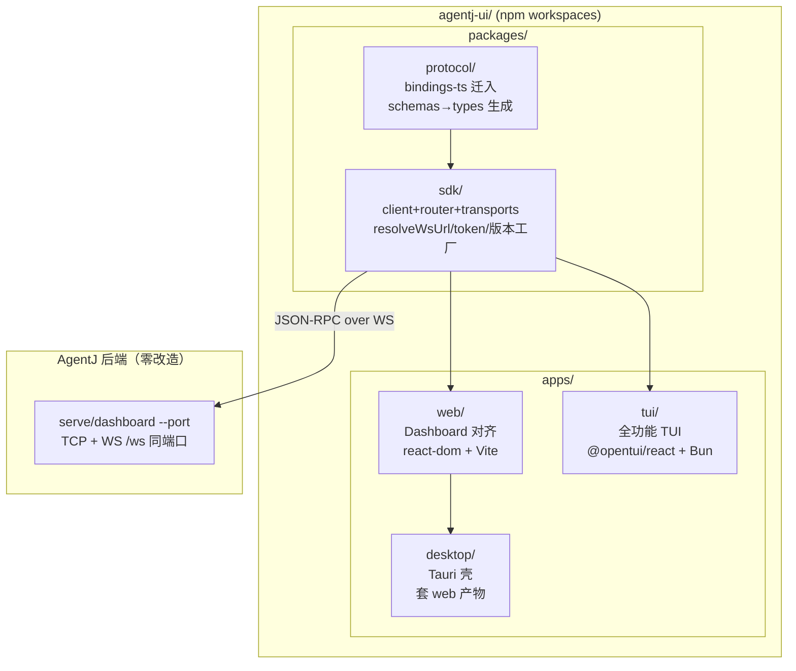
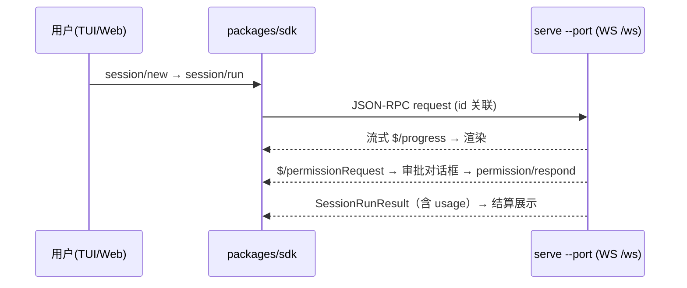
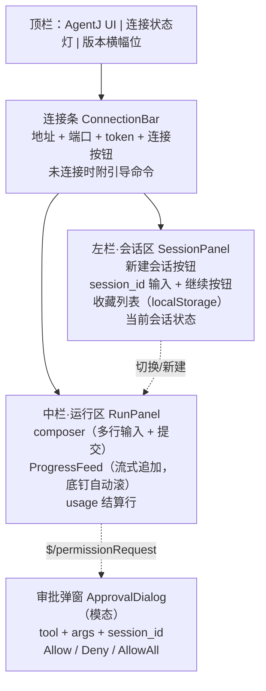
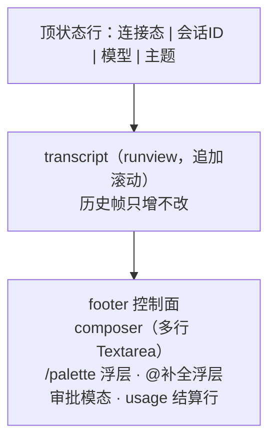

# 设计文档：agentj-ui 三端统一前端（Web / TUI / 桌面安装包）

> **状态**：设计中（待用户终审）。前置讨论：TUI 渲染选 OpenTUI、桌面壳选 Tauri、TUI 首版按全功能 scope、总体采方案 A（Monorepo 五件套、分阶段交付）。

## 概述

将 `web-dashboard/` 重命名为 `agentj-ui/`（npm workspaces monorepo，前端不拆独立仓），沉淀三端共享的协议 SDK 与类型生成管线；Web 端就地对齐；新增基于 OpenTUI（`@opentui/react` + Bun）的全功能 TUI；新增 Tauri 壳输出桌面安装包。后端零改造——三端均为现有 JSON-RPC over WebSocket 协议的消费者（`serve --port` / `dashboard --port` 的 `/ws` 端点，G8 已落地）。

本设计只定 WHAT 与 WHY（架构、决策、取舍）；任务级 TDD 拆分归实现计划阶段。

## 目标与非目标

### 目标

- **G1**：`web-dashboard` → `agentj-ui/apps/web` 重命名（`git mv` 保留历史），根 README / AGENTS.md / CI 路径同步，CI 全绿。
- **G2**：沉淀 `packages/protocol`（`bindings/ts` 迁入，schemas → TS 类型生成）与 `packages/sdk`（client + router + transports + 连接配置工厂），Web / TUI / Desktop 同源消费；后端协议漂移门禁纳入前端 CI 前置。
- **G3**：Web 完整交互——方法名常量化、`?token=` 透传、`protocol_version` 与 workspace 版本同源；会话管理（新建 / 凭 session_id 继续，ID 收藏于 localStorage 弥补无 `session/list`）；composer 发 prompt；`$/progress` 流式落页面；`$/permissionRequest` 可操作审批对话框（谁发起谁审批）；usage 结算；页面布局见新增 §Web 端页面布局。
- **G4**：TUI 全功能——连接管理、会话列表/新建/切换/继续、composer（多行输入、@文件补全、/命令面板）、run 流式渲染、审批对话框、模型选择、主题切换、usage 结算行、优雅退出。
- **G5**：Tauri 壳输出四件套安装包（deb / AppImage / dmg / msi）；`agentj` 二进制分发（cargo-dist）只出评估结论，不实现。

### 非目标

- ❌ 后端协议改造（16 方法面冻结，加性扩展除外）。
- ❌ TUI 嵌入式内核（TUI 只做 WS 协议客户端，不 spawn 后端）。
- ❌ 移动端安装包（Tauri v2 能力预留，不出包）。
- ❌ Ink 兜底实现（仅 TUI spike 失败时触发，触发后另起设计变更）。
- ❌ Web 端视觉重设计（沿用现有样式，只做功能对齐）。
- ❌ Electron（Tauri 已覆盖，无需第二套壳）。

## 设计方案

采用**方案 A：Monorepo 五件套，一次设计、分阶段交付**（P0 重命名 + SDK 抽取 → P1 Web 对齐 → P2 TUI 全量 → P3 Tauri 打包，每阶段独立可验收、可止损）。

```text
agentj-ui/
  package.json                 # npm workspaces 根：apps/* + packages/*
  packages/
    protocol/                  # bindings/ts 迁入：schemas/*.json → types 生成管线
    sdk/                       # client + router + transports + config 工厂
      src/
        client.ts              # RpcClient（自 jsonrpc.ts 原样抽取）
        router.ts              # ResponseRouter（含 BUG-005 通知分叉）
        config.ts              # resolveWsUrl({env,port,token}) + protocolVersion 单一来源（新增）
        transports/
          websocket.ts         # 浏览器 WS（现 websocket.ts 原样迁入）
          tcp.ts               # Node TCP（新增，预留 CLI/桌面直连场景）
        methods.ts             # 由 protocol/methods.json 生成的方法名常量（新增）
      src/__tests__/          # jsonrpc.test.ts 原样迁入 + 新增用例
  apps/
    web/                       # web-dashboard 迁入（react-dom + Vite，功能对齐）
    tui/                       # OpenTUI 全功能 TUI（@opentui/react + Bun，新增）
    desktop/                   # Tauri 壳（套 apps/web 构建产物，新增）
```

### 备选方案

| 方案 | 优点 | 缺点 | 为何未选用 |
|------|------|------|-----------|
| B. 纵向切片（先三端最小闭环再叠功能） | 最早看到三端同框；OpenTUI 验证最快 | 中间态长期存在；全功能清单需二次设计返工 | 与已定的全功能 scope 决策冲突 |
| C. TUI 优先风险前置 | OpenTUI 的坑最早暴露，沉没成本最小 | Web 改进与安装包延迟；目录需临时安排 | A 的 P2 独立验收已保留同等止损能力，无需单独方案 |
| TUI 用 Ink + Node | 最成熟（Claude Code/Gemini CLI 在用），生态大 | 30FPS 上限 + 内存开销大；同为新语言栈却无性能优势 | 流式 agent 场景恰是 Ink 短板，OpenTUI 为此而生 |
| TUI 用 ratatui（本仓 Rust） | 零新依赖、零学习成本 | UI 逻辑写两份，违背一套代码要求 | 长期维护双倍成本 |
| 包管理器用 pnpm | workspace 脚本更顺（`pnpm -r`） | 需迁移现有 package-lock.json，全仓工具链改动 | 最小改动原则：沿用 npm workspaces |

## 架构



一次 run 的数据流（TUI/Web 同理）：



## 关键设计决策

- **D1 — SDK 边界**：抽取 `src/jsonrpc.ts`（RpcClient / ResponseRouter / RpcTransport 原样）+ `src/transport/websocket.ts` 为 `packages/sdk` 内核；新增 `transports/tcp.ts` 与 `config.ts`；`bindings/ts` 整体迁为 `packages/protocol`，generate 输出改为 SDK 内类型。`RpcTransport` 接口（`send(line): Promise<string>` + 可选 `close`）保持不变，是三端复用的契约点。
- **D2 — 生成而非手写**：方法名常量由 `protocol/methods.json` 生成，类型由 `schemas/*.json` 经既有 `json-schema-to-typescript` 管线生成；`cargo test -p agentj-protocol -- drift` 纳入 `agentj-ui` CI 第一门，后端改契约而 SDK 未同步即红灯。
- **D3 — TUI 连接模式**：纯 WS 协议客户端，连 `dashboard --port`（无 token 最简）或 `serve --port`（`?token=` 透传）；断线指数退避重连（上限 30s 间隔）+ `onStatusChange`；重连后靠 `session/subscribe` 恢复观测，不做会话粘滞（沿用 G8 语义）。
- **D4 — TUI 功能清单**：连接管理 → 会话列表/新建/切换/继续（`session/*`）→ composer（多行输入、@文件补全、/命令面板）→ run 流式渲染（`$/progress`）→ 审批对话框（`$/permissionRequest` → `permission/respond`，含 allow_always 会话态提示）→ 模型选择（`default_model` + providers 只读展示）→ 主题切换 → usage 结算行（`SessionRunResult.usage`）→ 优雅退出。
- **D5 — Web 完整交互清单**：方法名常量化、`initialize.protocol_version` 与 workspace 版本同源、`?token=` 拼接；ConnectionBar（地址/token/连接按钮，未连接时附 `agentj dashboard --port …` 引导）；会话区（新建会话、凭 session_id 继续、localStorage 收藏）；composer（多行输入 + 提交）；ProgressFeed（`$/progress` 落页面）；审批可操作对话框（`permission/respond`，含 allow_always 选项；仅本端发起的会话可批，`session_owner` 门控失败则报错）；usage 结算行；页面布局见 §Web 端页面布局。
- **D6 — Tauri 壳**：`apps/desktop` 仅壳（`tauri.conf.json` + 图标 + 与 workspace 版本同源的版本号），`frontendDist` 指向 `apps/web` 构建产物；第一版不嵌后端（用户本机另起 `serve --port`，壳内提供连接地址输入）。
- **D7 — 改名迁移**：`git mv web-dashboard agentj-ui/apps/web` → 建 workspaces 根 → `packages/*` 抽取 → 更新根 README / AGENTS.md / CI 路径 → 版本 **0.10.0 → 0.11.0**（minor，feature 级）。
- **D8 — 兜底触发条件**：P2 首个可运行 TUI 版本连续阻塞，或 OpenTUI 出现不可绕过的内存/渲染缺陷 → 切 Ink 兜底并另起设计变更；不预写 Ink 代码。

## Web 端页面布局

三栏式（桌面宽屏；窄屏自动堆叠为单列：连接 → 会话 → 运行 → 审批）：



- **状态机**：未连接（仅连接条可用，其余置灰）→ 已连接无会话（会话区可用）→ 会话空闲（composer 可提交）→ 运行中（composer 禁用，ProgressFeed 追加）→ 待审批（模态弹窗阻塞，run 视图保留）→ 结算（usage 行 + composer 恢复）。
- **交互规则**：审批弹窗仅本端发起会话可操作（`session_owner` 门控）；收藏的 session_id 一键继续（`session/status` + `session/subscribe`）；窄屏 <900px 时三栏纵向堆叠，顺序同上。

## TUI 屏布局

固定分区（终端全屏；transcript 为不可变追加区，footer 为可变控制面，沿用 opencode split-footer 模式）：



- **焦点流转**：composer ⇄ (`/` 触发 palette，`@` 触发补全）→ Enter 提交 run → 运行中焦点锁 composer（Esc 可清空）→ `$/permissionRequest` 弹出模态（Allow/Deny/AllowAll，Tab 切换）→ 关闭回 composer。
- ** unhealthy 态**：断线时 footer 顶部插一行 `reconnecting…`，transcript 保留；403 时停重试并提示改 token（同 Web 行径）。

## 错误处理

| 场景 | 行为 |
|------|------|
| 内核不可达（WS 拒绝/超时） | 状态行 `kernel unreachable` + 指数退避重连，不阻断 UI |
| `initialize` 版本不匹配 | 横幅警告（期望 vs 实际），降级可用，不断连 |
| token 错误（403 / -32806） | 明确提示检查 token，停止重连，用户修正后手动重连 |
| 通知解析失败（未知 method / 坏帧） | `feed` 跳过 + `console.debug`，不 crash（沿用 BUG-005 语义） |
| 断线时 pending 请求悬挂 | `rejectAll` 全量拒绝并标记，UI 对应区域置过期态 |
| TUI 原生层 panic（OpenTUI Zig 侧） | 捕获 → 恢复终端状态 → 打印错误码退出，不留脏终端 |
| Tauri 壳内后端未启动 | 引导页提示 `agentj dashboard --port …` 并提供地址输入框 |
| 审批响应被拒（request 已过期 / 非本端发起） | 对话框内联报错并可关闭，不阻塞 run 视图；TUI/Web 同行径 |
| 凭收藏 ID 继续失败（会话已归档/删除） | 会话区报错并提供新建按钮，收藏条目标记失效 |

## 测试策略

- **SDK**：`jsonrpc.test.ts` 原样迁入（8 用例：BUG-002/005 回归保留），新增 token 透传、`$/permissionRequest` 分叉、断线 rejectAll、重连用例；vitest。
- **protocol**：复用后端漂移门禁 + 生成产物 `tsc --noEmit`，为 `agentj-ui` CI 第一门。
- **Web**：`tsc -b && vite build` + 对齐项组件测试（progress 落页面、token 拼接）。
- **TUI**：OpenTUI `testRender` 快照关键组件（审批对话框、流式消息区）+ Bun test 连 Mock WS server 跑 `session/run → progress → done` 全链路。
- **Desktop**：四件套产物存在性断言 + 壳加载 web 产物冒烟。
- **验收标准**：`npm -ws run build && npm -ws run test` 全绿 + 后端 `cargo test --workspace` / clippy 全绿 + TUI 手工跑完一次 run + 审批 + 安装包可安装启动并连上本地内核。

## 依赖

- **前置**：Bun ≥1.2（TUI dev/build/compile）、Rust 工具链（Tauri 壳构建）、Node 24+（Web 沿用）、可联调的 `serve --port` 后端。
- **外部依赖**：`@opentui/react` + `@opentui/core`（pre-1.0，6 平台预构建二进制）、Tauri CLI v2、npm workspaces。
- **阻塞项**：无后端阻塞；唯一风险为 OpenTUI spike（P2 首验，失败转 Ink 兜底并另起设计变更）。
